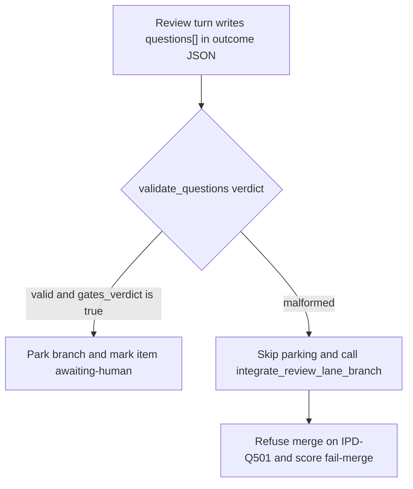

- Id: pi8ga2
- Status: done
- Close-Evidence: .aw/records/walkthroughs/20261114-revgate-02-01u6ht-review-questions-schema.walkthrough.md
- Blocks-Release: next
- Set: revgate
- Priority: high
- Work-Kind: bug
- Summary: build_review_prompt tells reviewers to write questions[] without giving questions_schema_literal, so escalated review blockers fail validate_questions and hit fail-merge instead of parking awaiting-human

> Write and proofread this backlog item per the technical writing standard, `.aw/system/workflows/technical-writing/technical-writing.md` (`.agents/workflows/technical-writing/technical-writing.md` in a legacy-layout install), including requirement 12 (diagrams).

## Workflow history
- 2026-11-14 done (aw set): fixed in 2d0ccf156
- 2026-11-14 created (aw backlog): build_review_prompt tells reviewers to write questions[] without giving questions_schema_literal, so escalated review blockers fail validate_questions and hit fail-merge instead of parking awaiting-human

## Observed

In `run-20261114T042744Z-1314525`, two independent review turns (`iqhzse` in session `09d53914` and `kyl3m4` in session `ea4d942a`) found blocking defects, escalated `OQ-02` (`Blocking: yes`, `Status: open`), and wrote `questions[]` in their outcome JSON files (`07-iqhzse.json` and `10-kyl3m4.json`). Both agents guessed field names (`id`, `plan`, `finding`, `blocking`, `question`, `context`) and wrote `options` entries over 120 characters (up to 283 characters). `runner_shared.validate_questions` rejected both payloads with `questions-malformed`, which skipped the `awaiting-human` parking branch and sent both turns into `integrate_review_lane_branch`, where `check_review_lane_artifacts` refused integration with `IPD-Q501` (`fail-merge`).

## Cause

`agent_workflows/runner_shared.py::build_prompt` embeds `questions_schema_literal()` for execute turns, while `agent_workflows/runner_shared.py::build_review_prompt` instructs isolated review turns to write `questions[]` without providing the entry schema or the 120-character limit on `options` items (`QUESTION_OPTION_MAX_LENGTH`).

## Fix

1. Update `agent_workflows/runner_shared.py::questions_schema_literal` to accept an optional `artifact_id6` value (defaulting to `"id6"`) and state the `evidence` and `options` item count and character limits inline.
2. Embed `questions_schema_literal(artifact_id6=item_id6)` in `agent_workflows/runner_shared.py::build_review_prompt` for isolated review turns while keeping non-isolated review prompts unchanged.
3. Verify in `tests/test_question_carrier.py` that the `questions[]` JSON snippet rendered inside an isolated review prompt parses cleanly and passes `validate_questions` for that item.
