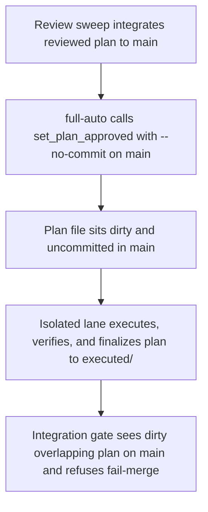

- Id: 66qh30
- Status: done
- Set: 66qh30
- Work-Kind: bug
- Priority: high
- Summary: set_plan_approved under --full-auto dirties main with --no-commit causing 100% fail-merge on verified lanes
- Short-Description: set_plan_approved under --full-auto dirties main with --no-commit causing 100% fail-merge on verified lanes

> Write and proofread this backlog item per the technical writing standard, `.aw/system/workflows/technical-writing/technical-writing.md` (`.agents/workflows/technical-writing/technical-writing.md` in a legacy-layout install), including requirement 12 (diagrams).

## Workflow history
- 2026-11-21 done (aw set): Fixed directly by commit 03a7dc3f5 (commits auto-approved under integration_lock; verified 3 passed in tests/test_runner_fullauto_and_sweep_fixes.py and live on pbdtss commit 53a698394)
- 2026-11-21 created (aw backlog): set_plan_approved under --full-auto dirties main with --no-commit causing 100% fail-merge on verified lanes

## Problem

`agent_workflows/runner_shared.py::set_plan_approved` invokes `aw set auto-approved <id6> --no-commit --dir <repo>` directly against the primary `main` checkout when `--full-auto` clears a reviewed plan. That mutates the plan file in `main` without committing it. When the isolated execution lane (`aw/lane/<id6>`) then executes, verifies, finalizes (`git mv pending/ -> executed/`), and tries to integrate back into `main`, the integration gate detects the uncommitted plan file in `main` overlapping the incoming rename and refuses with `fail-merge` (`main tree has un-owned dirty paths overlapping the incoming change`).

## Observed evidence

In `run-20261121T070301Z-2497766` (six plans: `zgxig2`, `s4utmv`, `dd48b5`, `vvxbbl`, `8h1q1k`, `l7d19a`), every plan passed `/plan-review`, execution, and independent verification (`Verified: yes`), and every single one failed integration (`6 fail-merge`) with `integration refused: main tree has un-owned dirty paths overlapping the incoming change` pointing at its own uncommitted `Status: auto-approved` edit on `main`. The same dirty uncommitted `auto-approved` plan file was also observed on `20261121-companion-bugs-01-mnsbzt`.

## Fix direction

1. Route `agent_workflows/runner_shared.py::set_plan_approved` through an isolated coordinator worktree and repository integration lock (matching `perform_coordinator_proposal_file`), committing the `reviewed -> auto-approved` transition cleanly and fast-forwarding `main`, instead of running `aw set auto-approved --no-commit --dir <repo>` directly on the primary checkout.
2. Add a behavioral test exercising `--full-auto` review -> auto-approve -> isolated execution -> integration end to end on a real git repository, asserting that `main` stays clean after `set_plan_approved` and the verified lane integrates cleanly without `fail-merge`.
