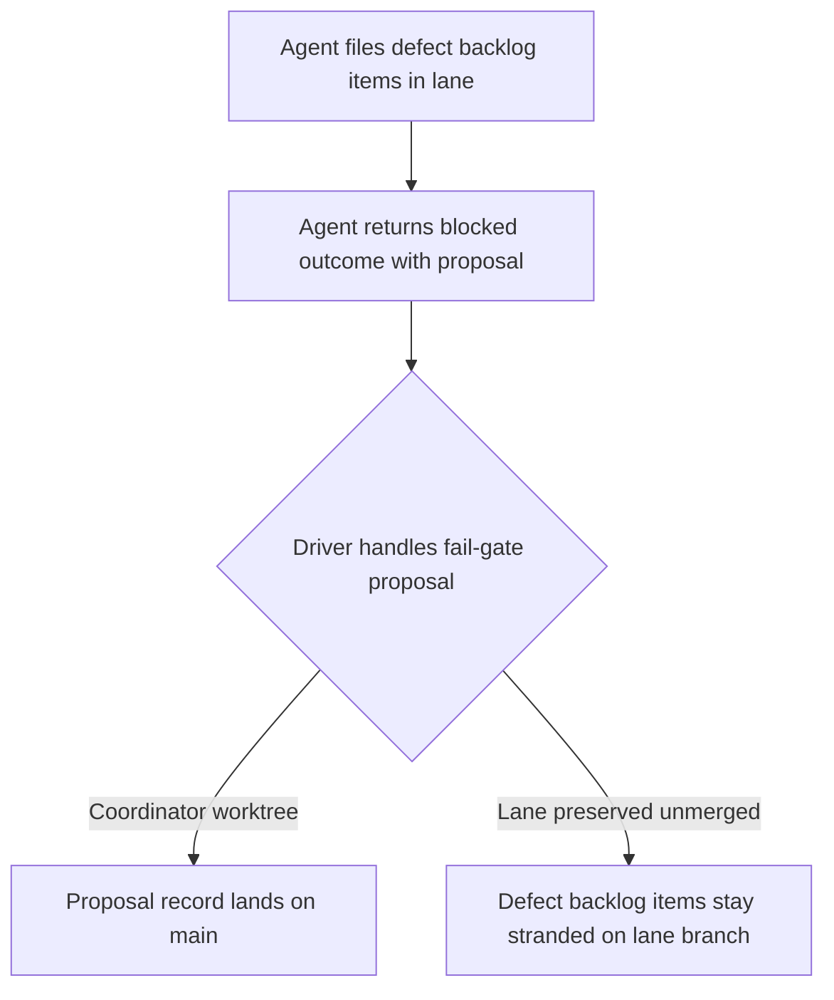

- Id: 8s4qhh
- Status: done
- Graduated-To: 8s4qhh
- Set: 8s4qhh
- Work-Kind: bug
- Priority: high
- Summary: runner proposal filing strands agent-filed defect backlog items on unmerged preserved lanes
- Short-Description: runner proposal filing strands agent-filed defect backlog items on unmerged preserved lanes
- Blocks-Release: next

> Write and proofread this backlog item per the technical writing standard, `.aw/system/workflows/technical-writing/technical-writing.md` (`.agents/workflows/technical-writing/technical-writing.md` in a legacy-layout install), including requirement 12 (diagrams).

## Workflow history
- 2026-11-21 done (aw backlog): closed by aw agy run: IPD 8h1q1k executed (every IPD carrier is executed and this run executed .aw/records/plans/executed/20261121-8s4qhh-01-8h1q1k-land-agent-filed-defect-backlog-items-on-main-when-a-lane-st.ipd.md); evidence .aw/records/plans/executed/20261121-8s4qhh-01-8h1q1k-land-agent-filed-defect-backlog-items-on-main-when-a-lane-st.ipd.md
- 2026-11-21 graduated (aw set): Graduated to review-ready plan 8h1q1k (set 8s4qhh)
- 2026-11-21 created (aw backlog): runner proposal filing strands agent-filed defect backlog items on unmerged preserved lanes

## Problem

The driver prompt instructs an executing agent to file a backlog item with `aw backlog new --apply` for each defect finding. When the agent commits those defect backlog items on its isolated lane branch and stops with a `proposal` (`fail-gate`), `agent_workflows/runner_shared.py::perform_coordinator_proposal_file` commits the proposal record directly onto `main` while the driver preserves the lane branch unmerged. The defect backlog items stay stranded on the unmerged lane branch, so the proposal record on `main` cites dangling backlog IDs that do not exist on `main`.

## Observed evidence

In `run-20261121T014040Z-2638602`, IPD `60mazt` committed four defect backlog items (`0dsjzl`, `fnabjy`, `xl9xrm`, `7mmhlp`) on `aw/lane/60mazt` and returned a material `tool-defect` proposal. The driver filed proposal `735ium` on `main`, referencing `0dsjzl` and `fnabjy`, while all four defect backlog files stayed unmerged on `aw/lane/60mazt`.

## Fix direction

1. When `agent_workflows/runner_shared.py` files a `fail-gate` proposal or preserves a blocked lane whose `defect_report` reports findings, detect newly added backlog files under `.aw/records/backlog/open/` (and `.agents/backlog/open/` in legacy layouts) on the lane branch relative to its base commit.
2. Validate those newly added backlog files and land them onto `main` inside the coordinator worktree under the repository integration lock, without merging incomplete code or test changes from the preserved lane. Record an explicit refusal event if any lane backlog file fails validation.
3. Add a behavioral test verifying that when an isolated lane commits a defect backlog item alongside a failing test edit and emits a material proposal, both the proposal record and the defect backlog item land on `main` while the incomplete test edit remains preserved on the lane branch.
