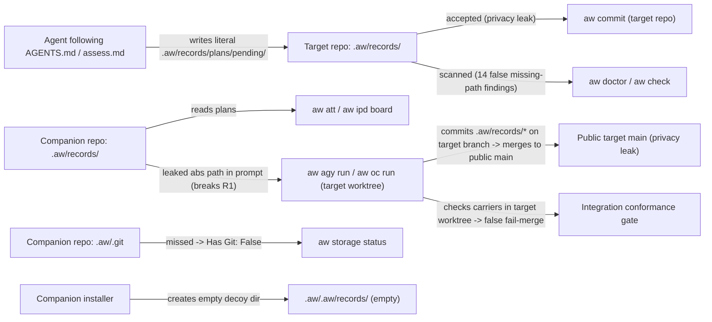

- Id: rvxmzz
- Status: done
- Set: companion-bugs
- Work-Kind: bug
- Priority: high
- Summary: Fix public-target-private-companion records split-brain, target-repo leaks, and diagnostics
- Short-Description: Fix public-target-private-companion records split-brain, target-repo leaks, and diagnostics
- Blocks-Release: next

> Write and proofread this backlog item per the technical writing standard, `.aw/system/workflows/technical-writing/technical-writing.md` (`.agents/workflows/technical-writing/technical-writing.md` in a legacy-layout install), including requirement 12 (diagrams).

## Problem

A target repository installed with preset `public-target-private-companion` (`records_backend: "companion"`, `placements.records: "companion-tracked"`) suffers from a nine-part split-brain failure across interactive tooling, diagnostics, companion installation, and unattended runners (`aw agy run` / `aw oc run`). Together, these defects leak private plans and reviews into the public target repository and break unattended review and execution lanes.

Observed on 2026-11-21 on a freshly installed companion-mode target repository (`v1.3.0rc2` installer) and an unattended review sweep (`run-20261121T055224Z-1705064`):

1. **Missing companion instructions in `AGENTS.md` and workflows.** `AGENTS.md` and `.aw/system/workflows/assess/assess.md` contain zero mentions of companion storage or `aw path records`. Both repeatedly direct agents to literal `.aw/records/plans/pending/`, causing an agent running `/assess-performance` to write four Implementation Plan Documents (IPDs) into the target repository's `.aw/records/plans/pending/` instead of the companion repository (`<repo>.aw/records/plans/pending/`).
2. **`aw commit` commits private records into the public target repository.** Even though `.aw/config/project.json` declares `preset: "public-target-private-companion"` and `git_policies.records: "companion-git"`, `aw commit` accepts paths under `.aw/records/` in the target repository and commits them to the target `main` branch (`AW-Runner: aw commit`). Pushing the target repository would publish private plans to a public remote.
3. **Split-brain path resolution across `aw` commands.** `aw attention` (`aw att`) and `aw ipd board` resolve `aw path records` (`<repo>.aw/records`) and report zero plans, whereas `aw doctor` and `aw check` scan target-local `.aw/records/`. `aw doctor` then reports 14 false missing-path findings for `.aw/records/*/README.md` and record directories that exist in the companion repository. (Additionally, if a user symlinks target `.aw/records` to `<repo>.aw/records`, `aw att` stops seeing the companion records altogether because local `.aw/records` shadows the companion fallback while symlink traversal is refused.)
4. **False unversioned report in `aw storage status`.** `aw storage status` reports `Durability State: unversioned` and `Has Git: False` when `<repo>.aw/.git` exists at the companion root (checking `records/.git` or missing the companion root check).
5. **No target `.aw/.gitignore` guard for `records/` in companion mode.** In a companion-mode target repository, `.aw/.gitignore` does not ignore target-local `records/`, so files mistakenly written to `.aw/records/` appear trackable to `git` and `aw commit`.
6. **False-positive `fail-merge` (`check.ipd-uncarried-obligation`) in runner review integration.** During an unattended `aw agy run` review sweep, the review integration gate refused a valid review with `carrier <id6> resolves to no backlog item or plan` even though both sibling plans existed in `<repo>.aw/records/plans/pending/`. The gate evaluated carrier resolution inside the isolated target worktree (where `.aw/records/` is absent) instead of resolving carriers through the companion records root, causing terminal `fail-merge` and cascading `fail-depend` across the rest of the plan set.
7. **Runner review and execution lanes attempt to merge private records into the public target `main`.** In companion mode, the runner executes reviews in an isolated worktree of the target repository; the agent commits revised `.aw/records/plans/pending/*.ipd.md` and `.aw/records/reviews/*.review.md` on the target worktree branch, and the driver attempts to integrate that branch into the public target `main` instead of routing record mutations to `<repo>.aw/records/` (and its companion Git repository). Only the false-positive conformance failure in item 6 prevented those private records from landing on public `main`.
8. **Broken R1 prompt purity in companion mode.** In `state.json`, the runner passed `/plan-review <companion-abs-path>/records/plans/pending/<plan>.ipd.md` (an absolute path outside the isolated worktree) while telling the agent not to read or write outside the lane and logging `R1 prompt purity: the emitted prompt names no path outside the lane` in `events.jsonl`.
9. **Empty decoy `<repo>.aw/.aw/records/` directory created at install time.** Companion setup created both `<repo>.aw/records/` (the active records root) and an empty `<repo>.aw/.aw/records/` directory, misleading operators and agents about where companion records live.

## Component interaction (current split-brain)

## Acceptance criteria

1. **Installer and `AGENTS.md` / workflow guidance:** In a repository with `records_backend: "companion"`, the installed `AGENTS.md` block and plan/record authoring workflows must state that records live at `aw path records` (never literal target-repo `.aw/records/`) and must direct agents to use `aw ipd scaffold`, `aw backlog new`, `aw specs new`, and `aw research new` rather than hand-creating files under target `.aw/records/`.
2. **`aw commit` containment gate:** When `records_backend` is `"companion"` (or `git_policies.records` is `"companion-git"`), `aw commit` run in the target repository must refuse to stage or commit any path under `.aw/records/` with a non-zero exit code and an actionable error naming `aw path records`.
3. **Target `.aw/.gitignore` containment and no decoy companion dir:** When installing or migrating a companion-mode repository, the installer must ignore target-local `.aw/records/` in target Git and must not create an empty `<repo>.aw/.aw/records/` decoy directory alongside `<repo>.aw/records/`.
4. **Unified records root across `aw doctor`, `aw check`, `aw index`, `aw att`, and `aw ipd`:** `aw doctor`, `aw check`, carrier resolution (`check.ipd-uncarried-obligation`), and all artifact checkers must resolve the records root through the same backend resolver as `aw path records`, `aw att`, and `aw ipd board`, including when invoked against an isolated worktree. A freshly installed companion-mode repository with zero records must produce zero false missing-path findings for `.aw/records/*/README.md` or record subdirectories, and `aw doctor` must warn explicitly if stray files or symlinks exist in target-local `.aw/records/`.
5. **Accurate `aw storage status` Git detection:** `aw storage status` must detect `<companion-root>/.git` (for example `<repo>.aw/.git`) and report `Has Git: True` (distinguishing initialized-with-commits versus initialized-with-zero-commits rather than reporting `Has Git: False`).
6. **Companion-safe runner review and execution lanes (`aw agy run` / `aw oc run`):**
   - Review and execution prompts emitted in companion mode must preserve R1 prompt purity by referencing only lane-local materialized input paths, never raw `<companion-abs-path>/records/...` paths outside the lane.
   - Integration conformance checks (including `check.ipd-uncarried-obligation`) must resolve sibling carriers against the companion records root so valid sibling carriers never trigger false-positive `fail-merge`.
   - Record outputs produced by a lane (revised IPDs, `.review.md` files, executed-plan transitions) must be integrated into the companion repository (`<repo>.aw/records/` and its companion Git history), and the target repository integration gate must refuse to merge any `.aw/records/**` path into the public target `main` branch.
7. **Behavioral regression tests:** Automated tests must install a `public-target-private-companion` repository in a temporary directory and verify criteria 1 through 6 end-to-end by running the CLI and runner integration code against real temporary target + companion Git repositories and asserting on exit codes, outputs, carrier resolution, and Git state in both repositories.

## Workflow history
- 2026-11-21 done (aw backlog): closed by aw agy run: IPD p47398 executed (every IPD carrier is executed and this run executed .aw/records/plans/executed/20261121-companion-bugs-00-p47398-fix-public-target-private-companion-records-split-brain-cont.ipd.md, .aw/records/plans/executed/20261121-companion-bugs-02-pbdtss-unified-companion-records-resolution-across-doctor-check-eng.ipd.md, .aw/records/plans/executed/20261121-companion-bugs-03-v8tqje-companion-safe-runner-prompts-record-routing-and-public-targ.ipd.md); evidence .aw/records/plans/executed/20261121-companion-bugs-02-pbdtss-unified-companion-records-resolution-across-doctor-check-eng.ipd.md
- 2026-11-21 graduated (aw set): graduated to companion-bugs IPD set (p47398, mnsbzt, pbdtss, v8tqje)
- 2026-11-21 created (aw backlog): Fix public-target-private-companion records split-brain, target-repo leaks, and diagnostics
- 2026-11-21 updated: added four companion-mode runner and installer defects observed in run-20261121T055224Z-1705064 (false-positive check.ipd-uncarried-obligation fail-merge, runner attempting to merge private records into public target main, broken R1 prompt purity, and empty companion .aw/records decoy directory)
