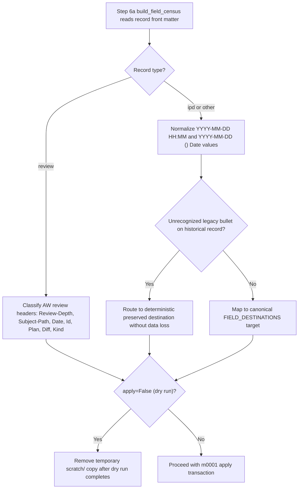

- Id: m4apfh
- Status: done
- Set: m4apfh
- Work-Kind: bug
- Priority: high
- Summary: Support AW-emitted review fields, timestamped dates, historical IPD headers, and dry-run scratch cleanup in m0001
- Short-Description: Support AW-emitted review fields, timestamped dates, historical IPD headers, and dry-run scratch cleanup in m0001

> Write and proofread this backlog item per the technical writing standard, `.aw/system/workflows/technical-writing/technical-writing.md` (`.agents/workflows/technical-writing/technical-writing.md` in a legacy-layout install), including requirement 12 (diagrams).

## Workflow history
- 2026-11-26 done (aw set): Fixed directly in commit 1f7716141: added AW review header fields, timestamped/annotated Date normalization, deterministic historical IPD bullet preservation, and dry-run scratch/ cleanup (173 passed in 22.75s, mypy clean, sanitize clean)
- 2026-11-26 created (aw backlog): Support AW-emitted review fields, timestamped dates, historical IPD headers, and dry-run scratch cleanup in m0001

## Problem

Auditing `aw migrate metadata` (`m0001`) Step 6a (`build_field_census`) on a real repository produced 108 field-census refusals and left temporary dry-run artifacts behind on disk:

1. **Step 6a refuses 64 metadata fields generated by `agent-workflows` itself on `.review.md` files:**
   - `agent_workflows/migrations/m0001_convert.py::FIELD_DESTINATIONS["review"]` omits seven header fields written by `agent-workflows` review workflows: `Review-Depth`, `Subject-Path`, `Date`, `Id`, `Plan`, `Diff`, and `Kind`.
   - `agent_workflows/migrations/m0001_verify.py::build_field_census` therefore blocks `m0001 --apply` and skips round-trip verification on review files created by `aw` itself.
2. **Step 6a refuses standard `YYYY-MM-DD HH:MM` and annotated legacy `Date` values:**
   - `build_field_census` rejects timestamped dates such as `2026-08-10 21:00` and annotated historical dates such as `2026-07-23 (fleshed from stub 2026-08-07)`.
3. **Step 6a has no deterministic preservation path for historical IPD bullet headers:**
   - On historical executed and superseded plans, `build_field_census` hard-refuses legacy bullet headers including `Risk tier`, `Parent`, `Grandparent`, `Prior-Status`, `Relationship`, and `Requested by`, forcing manual edits to historical records before migration can proceed.
4. **Dry run leaves `scratch/` behind under `.aw/state/durable/migrations/m0001/`:**
   - Running `m0001_metadata_v2.run(..., apply=False)` writes a full `scratch/` copy and large `journal.json` under `.aw/state/durable/migrations/m0001/` and leaves them on disk after the dry run finishes.

## Target flow

## Affected code

- `agent_workflows/migrations/m0001_convert.py`: `FIELD_DESTINATIONS` (review and historical IPD field mappings), date normalization, and conversion handlers
- `agent_workflows/migrations/m0001_verify.py`: `build_field_census` and `_classify_field`
- `agent_workflows/migrations/m0001_metadata_v2.py`: `run` dry-run `scratch/` cleanup

## Acceptance criteria

1. `m0001_convert.FIELD_DESTINATIONS["review"]`, `m0001_verify.build_field_census`, and `m0001_convert` must classify and round-trip all seven `aw`-emitted review header fields (`Review-Depth`, `Subject-Path`, `Date`, `Id`, `Plan`, `Diff`, `Kind`) with zero unknown-field refusals.
2. Legacy `Date` parsing in `m0001_verify` and `m0001_convert` must accept `YYYY-MM-DD HH:MM` and `YYYY-MM-DD (<note>)`, normalizing the stored date value to `YYYY-MM-DD` while preserving any annotation note losslessly if required by the round-trip contract.
3. Unrecognized legacy bullet headers on historical records (including `Risk tier`, `Parent`, `Grandparent`, `Prior-Status`, `Relationship`, and `Requested by` on `executed/` and `superseded/` plans) must be preserved deterministically (for example, in a dedicated preserved body section or custom metadata map that passes Step 6 round-trip verification) instead of blocking migration with an unknown-field refusal.
4. `m0001_metadata_v2.run(..., apply=False)` must remove its temporary `scratch/` tree upon dry-run completion (both on pass and on refusal) rather than leaving a full repository copy on disk.
5. Behavioral regression tests must verify review-header round-trip conversion, timestamped/annotated `Date` normalization, deterministic preservation of unrecognized historical IPD bullets, and dry-run `scratch/` cleanup.
