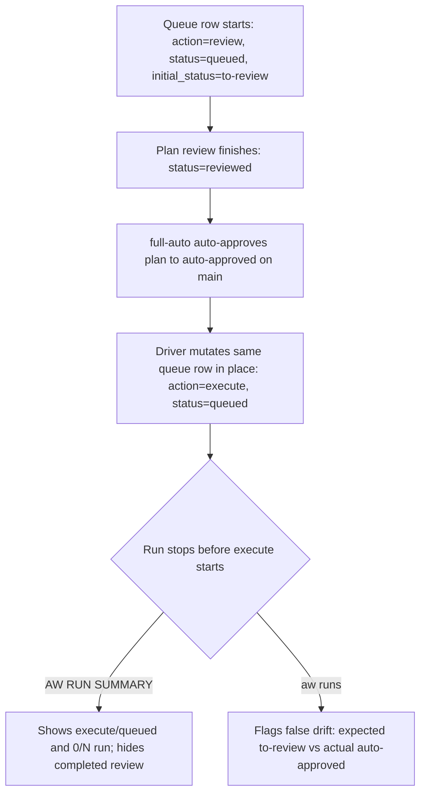

- Id: b0en28
- Status: graduated
- Graduated-To: b0en28
- Set: b0en28
- Work-Kind: bug
- Priority: medium
- Summary: full-auto overwrites reviewed queue item to execute/queued hiding completed review in run summary and causing false drift in aw runs
- Short-Description: full-auto overwrites reviewed queue item to execute/queued hiding completed review in run summary and causing false drift in aw runs
- Blocks-Release: next

> Write and proofread this backlog item per the technical writing standard, `.aw/system/workflows/technical-writing/technical-writing.md` (`.agents/workflows/technical-writing/technical-writing.md` in a legacy-layout install), including requirement 12 (diagrams).

## Workflow history
- 2026-11-21 graduated (aw backlog): graduated by run run-20261121T164611Z-3890369: feol8w
- 2026-11-21 created (aw backlog): full-auto overwrites reviewed queue item to execute/queued hiding completed review in run summary and causing false drift in aw runs

## Problem

When a `--full-auto` run finishes reviewing a `to-review` plan and auto-approves it (`agent_workflows/runner_shared.py`), the driver overwrites that single queue item in place: it changes `item["action"]` from `"review"` to `"execute"`, resets `item["status"]` from `"reviewed"` to `"queued"`, and sets `item["auto_approved"] = True`.

When the run stops before executing that plan (for example via `--after-call` or an interruption), three defects appear:

1. `AW RUN SUMMARY` renders the row as `Action: execute | Status: queued` (even though it spent time and tokens completing its review) and reports `Progress: 0/N` / `Total (0/N items run)`, hiding the completed review.
2. `aw runs <run-id>` flags a false status disagreement (`Issue: YES`, `Expected Status: to-review` vs `Actual Status: auto-approved`) because `item["status"]` was reset to `"queued"` while `item["initial_status"]` remained `"to-review"`.
3. `state.json` records `run_state_check.outcome = "skipped-unmapped"` (`source_status: "reviewed"`, `target_status: "queued"`) on the in-place reset.

## Observed evidence

In `run-20261121T141636Z-2560095` (`companion-bugs` under `--full-auto`, stopped with Level 1 `--after-call` immediately after `pbdtss` review finished):
- `pbdtss` completed a 9m 58s, 301.7k-token review (`attempts: [('review', 'reviewed')]`, committed `auto-approved` on `main` at `53a698394`).
- `AW RUN SUMMARY` displayed `Progress: 0/3 [ ] 0%`, `Total (0/3 items run)`, and row `02 | 03 | pbdtss | companion-bugs | execute | queued | - | 9m 58s`.
- `aw runs run-20261121T141636Z-2560095` flagged `Issue: YES` with `Expected Status: to-review` vs `Actual Status: auto-approved`.

## Fix direction

1. Preserve the completed review phase in run state and summary rendering when `--full-auto` transitions an item from `review` to `execute` (for example by displaying a distinct status such as `reviewed -> queued` or keeping the completed review step visible alongside the queued execute step, and updating `initial_status` / expected-status computation in `aw runs` when `auto_approved` is True so `auto-approved` on disk is recognized as expected rather than drift).
2. Map the `reviewed -> queued` (or phase-advance) transition cleanly in the run-state checker so `run_state_check` does not emit `skipped-unmapped`.
3. Add behavioral tests verifying that when a `--full-auto` run stops `--after-call` immediately after reviewing and auto-approving a plan, `AW RUN SUMMARY` surfaces the completed review clearly (not `0/N` / bare `queued`) and `aw runs <run-id>` reports zero status-disagreement issues for that plan.
