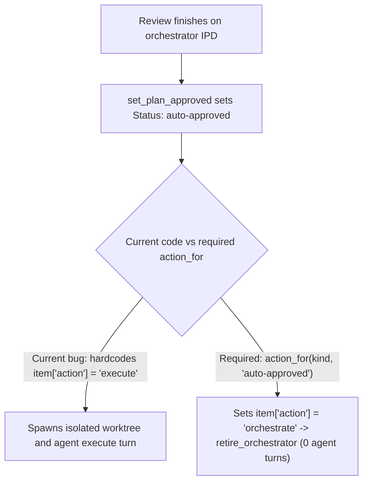

- Id: diobl2
- Status: graduated
- Graduated-To: diobl2
- Set: diobl2
- Work-Kind: bug
- Priority: high
- Summary: full-auto hardcodes item action to execute instead of orchestrate for reviewed orchestrator IPDs
- Short-Description: full-auto hardcodes item action to execute instead of orchestrate for reviewed orchestrator IPDs
- Blocks-Release: next

> Write and proofread this backlog item per the technical writing standard, `.aw/system/workflows/technical-writing/technical-writing.md` (`.agents/workflows/technical-writing/technical-writing.md` in a legacy-layout install), including requirement 12 (diagrams).

## Workflow history
- 2026-11-21 graduated (aw backlog): graduated by run run-20261121T164611Z-3890369: behm9r
- 2026-11-21 created (aw backlog): full-auto hardcodes item action to execute instead of orchestrate for reviewed orchestrator IPDs

## Problem

When `aw agy run --full-auto` or `aw oc run --full-auto` finishes reviewing an Implementation Plan Document (IPD) with `- Kind: orchestrator` and transitions it from `reviewed` to `auto-approved` inside `agent_workflows/runner_shared.py`, the auto-approval block overwrites `item["action"] = "execute"` unconditionally whenever `run_action != "review"`.

`agent_workflows/runner_shared.py::action_for` (delegating to `agent_workflows/run_selection_policy.py::runner_action`) maps `Kind: orchestrator` with status `auto-approved` to `orchestrate`, never `execute`. Hardcoding `"execute"` bypasses `action_for` and causes the runner to allocate a worker worktree, create a begin receipt, and spend an agent execution turn on an orchestrator instead of routing it through `agent_workflows/runner_shared.py::dispatch_orchestrator_item` and `agent_workflows/ipd_lifecycle.py::retire_orchestrator`.

## Observed instance

In `run-20261121T141636Z-2560095`, orchestrator `p47398` (`Set: companion-bugs`, `- Kind: orchestrator`) passed `/plan-review` in attempt 1, was set to `- Status: auto-approved` at commit `5942566bc`, and was dispatched in attempt 2 as a normal execute agent turn in worktree `.aw/worktrees/p47398` even though all three children (`mnsbzt`, `pbdtss`, `v8tqje`) were already `executed` on `main`.

## Acceptance criteria

1. In the `--full-auto` post-review auto-approval transition in `agent_workflows/runner_shared.py`, compute the next queue action through `action_for(kind, "auto-approved")` (reading `kind` from `item.get("kind")` or `plan_kind_from_file(plan_curr)`), rather than hardcoding `item["action"] = "execute"`.
2. Ensure an orchestrator IPD that transitions `to-review -> reviewed -> auto-approved` under `--full-auto` receives `item["action"] = "orchestrate"` and `item["status"] = "queued"`, so a subsequent queue iteration dispatches `dispatch_orchestrator_item` and retires it via `retire_orchestrator` without spawning an agent execution turn (and preserves the correct progress log wording).
3. Add a behavioral regression test verifying that under `--full-auto`, a reviewed `Kind: orchestrator` IPD transitions to `action == "orchestrate"` and is retired without invoking the agent executor, while a reviewed `Kind: child` (or standard) IPD still transitions to `action == "execute"`.
