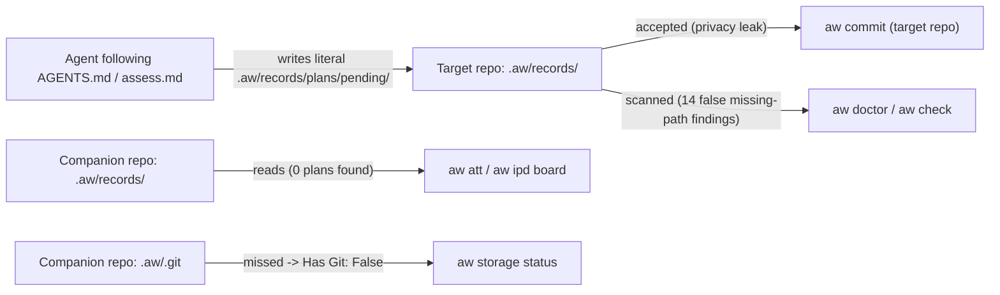

- Id: rvxmzz
- Status: open
- Set: companion-bugs
- Work-Kind: bug
- Priority: high
- Summary: Fix public-target-private-companion records split-brain, target-repo leaks, and diagnostics
- Short-Description: Fix public-target-private-companion records split-brain, target-repo leaks, and diagnostics
- Blocks-Release: next

> Write and proofread this backlog item per the technical writing standard, `.aw/system/workflows/technical-writing/technical-writing.md` (`.agents/workflows/technical-writing/technical-writing.md` in a legacy-layout install), including requirement 12 (diagrams).

## Problem

A target repository installed with preset `public-target-private-companion` (`records_backend: "companion"`, `placements.records: "companion-tracked"`) suffers from a five-part split-brain failure that leaks private plans into the public target repository and breaks `aw` visibility and diagnostics.

Observed on 2026-11-21 on a freshly installed companion-mode target repository (`v1.3.0rc2` installer):

1. **Missing companion instructions in `AGENTS.md` and workflows.** `AGENTS.md` and `.aw/system/workflows/assess/assess.md` contain zero mentions of companion storage or `aw path records`. Both repeatedly direct agents to literal `.aw/records/plans/pending/`, causing an agent running `/assess-performance` to write four Implementation Plan Documents (IPDs) into the target repository's `.aw/records/plans/pending/` instead of the companion repository (`<repo>.aw/records/plans/pending/`).
2. **`aw commit` commits private records into the public target repository.** Even though `.aw/config/project.json` declares `preset: "public-target-private-companion"` and `git_policies.records: "companion-git"`, `aw commit` accepts paths under `.aw/records/` in the target repository and commits them to the target `main` branch (`AW-Runner: aw commit`). Pushing the target repository would publish private plans to a public remote.
3. **Split-brain path resolution across `aw` commands.** `aw attention` (`aw att`) and `aw ipd board` resolve `aw path records` (`<repo>.aw/records`) and report zero plans, whereas `aw doctor` and `aw check` scan target-local `.aw/records/`. `aw doctor` then reports 14 false missing-path findings for `.aw/records/*/README.md` and record directories that exist in the companion repository.
4. **False unversioned report in `aw storage status`.** `aw storage status` reports `Durability State: unversioned` and `Has Git: False` when `<repo>.aw/.git` exists at the companion root (checking `records/.git` or missing the companion root check).
5. **No target `.aw/.gitignore` guard for `records/` in companion mode.** In a companion-mode target repository, `.aw/.gitignore` does not ignore target-local `records/`, so files mistakenly written to `.aw/records/` appear trackable to `git` and `aw commit`.

## Component interaction (current split-brain)

## Acceptance criteria

1. **Installer and `AGENTS.md` / workflow guidance:** In a repository with `records_backend: "companion"`, the installed `AGENTS.md` block and plan/record authoring workflows must state that records live at `aw path records` (never literal target-repo `.aw/records/`) and must direct agents to use `aw ipd scaffold`, `aw backlog new`, `aw specs new`, and `aw research new` rather than hand-creating files under target `.aw/records/`.
2. **`aw commit` containment gate:** When `records_backend` is `"companion"` (or `git_policies.records` is `"companion-git"`), `aw commit` run in the target repository must refuse to stage or commit any path under `.aw/records/` with a non-zero exit code and an actionable error naming `aw path records`.
3. **Target `.aw/.gitignore` containment:** When installing or migrating a companion-mode target repository, the installer must ignore target-local `.aw/records/` (or document and enforce why it cannot be tracked in target Git) so stray target-local record files cannot be staged into the public target repository.
4. **Unified records root across `aw doctor`, `aw check`, `aw index`, `aw att`, and `aw ipd`:** `aw doctor` and `aw check` must resolve the records root through the same backend resolver as `aw path records`, `aw att`, and `aw ipd board`. A freshly installed companion-mode repository with zero records must produce zero false missing-path findings for `.aw/records/*/README.md` or record subdirectories, and `aw doctor` must warn explicitly if stray files exist in target-local `.aw/records/`.
5. **Accurate `aw storage status` Git detection:** `aw storage status` must detect `<companion-root>/.git` (for example `<repo>.aw/.git`) and report `Has Git: True` (distinguishing initialized-with-commits versus initialized-with-zero-commits rather than reporting `Has Git: False`).
6. **Behavioral regression tests:** Automated tests must install a `public-target-private-companion` repository in a temporary directory and verify criteria 1 through 5 end-to-end by running the CLI commands and asserting on exit codes, outputs, and Git state.

## Workflow history
- 2026-11-21 created (aw backlog): Fix public-target-private-companion records split-brain, target-repo leaks, and diagnostics
