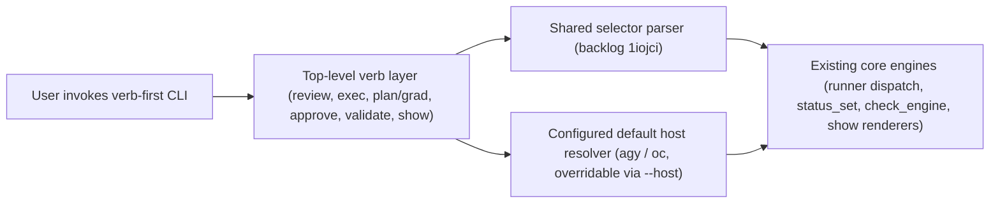

- Id: i8dc07
- Status: open
- Set: cliverbs
- Work-Kind: feature
- Priority: medium
- Summary: Add verb-first top-level CLI commands and unify read-only views under aw show
- Short-Description: Add verb-first top-level CLI commands and unify read-only views under aw show

> Write and proofread this backlog item per the technical writing standard, `.aw/system/workflows/technical-writing/technical-writing.md` (`.agents/workflows/technical-writing/technical-writing.md` in a legacy-layout install), including requirement 12 (diagrams).

## Scope

Redesign top-level `aw` CLI ergonomics around natural, verb-first commands and consolidate read-only inspection views under `aw show`:

1. **Verb-first top-level operational commands**: expose concise top-level verbs (`aw rev` / `aw review`, `aw run` / `aw exec`, `aw plan` / `aw grad` / `aw graduate`, `aw validate`, and `aw approve`) that route to the configured host (`agy` or `oc`) or the corresponding artifact lifecycle operation without forcing users to remember host prefixes (`aw agy run --action review`) or status-mutation plumbing (`aw set approved ... --by-human`).
2. **Unified read-only inspection under `aw show`**: make `aw show` the single home for read-only inspection views (individual artifacts, Sets, `stale-reviews`, `decisions`, and similar views) rather than spreading read-only reporting across rarely used noun commands such as `aw reviews`.
3. **Compatibility and shared selection**: coordinate directly with backlog item `1iojci` (normalized artifact selector flags across all `aw` commands) so every new verb and `aw show` view shares the same selector grammar, while preserving existing host-qualified commands (`aw oc ...`, `aw agy ...`, `aw set ...`) as stable lower-level aliases.

## Current situation

Today, routine daily operations require verbose, structurally inconsistent invocations across multiple command namespaces:

| User intent | Current command(s) | Friction |
| --- | --- | --- |
| Review plans or specs | `aw agy run --action review <ids>` or `aw oc review <id>` | Host-prefixed; inconsistent verb vs `--action` syntax |
| Execute approved plans | `aw agy run <ids>` or `aw oc run <ids>` | Host-prefixed; no short `aw exec` |
| Graduate backlog / plan from spec | `aw agy run --action plan <ids>` | `--action plan` hides graduation intent |
| Approve plans or specs | `aw set approved <ids> --by-human` or `aw specs set <id> --status approved --by-human` | Verbose status plumbing; differs between plans and specs |
| Validate repository or execution | `aw check`, `aw attention --check`, `aw backlog check`, `aw ipd lint`, `/verify` | Fragmented across multiple check verbs |
| Inspect read-only views | `aw show <id6>`, `aw reviews decisions`, `aw att`, `aw ipd board`, `aw graduation <id6>` | `aw show` is underused; `aw reviews` has only one narrow subcommand (`decisions`) |

## Proposed architecture

Every top-level verb is a thin, well-documented front door over the existing core engines and the shared selector parser (`1iojci`). Existing host-qualified commands (`aw oc ...`, `aw agy ...`, `aw set ...`) remain supported so scripts, docs, and runner self-invocations do not break.

## Acceptance criteria (bounded outcome)

1. All design open questions (`OQ-01` through `OQ-05`) are resolved with the maintainer and recorded in a governing specification before implementation.
2. Top-level verb commands (`review`/`rev`, `run`/`exec`, `plan`/`grad`/`graduate`, `approve`, `validate`) and consolidated `aw show` views share one selector layer (aligned with `1iojci`) and delegate cleanly to existing core engines.
3. Existing `aw oc ...`, `aw agy ...`, and `aw set ...` commands continue to work without breaking existing automation.
4. Help text (`aw --help`), shell completions, and behavioral CLI tests cover every new top-level verb and `aw show` view.

## Open questions

### OQ-01: How should verb-first runner commands (`aw review`, `aw exec`, `aw plan`) pick the execution host (`agy` vs `oc`)?

- Blocking: yes
- Status: resolved
- Owner: maintainer
- Context: `agent_workflows/runner_profiles.py` already stores `default_runner` (`agy` or `oc`), named runner profiles (host, model, variant), per-runner default profiles, and role mappings (consumed by `aw run ipd` and `aw run as <profile>`). Top-level verbs (`aw rev`, `aw exec`, `aw grad`) omit the host prefix and need a resolution rule for host, profile, and per-action/per-state defaults.
- Options:
  1. **Read a configured default host (from repo/user config or `AW_HOST` env var), with `--host agy|oc` (or `--as <profile>`) to override per call, and refuse cleanly with a clear hint if no default host is configured (recommended).**
  2. **Infer the host automatically from the current environment or installed binaries (`agy` on PATH vs `opencode` on PATH), with `--host` override.** Convenient on single-host machines, but unpredictable when both `agy` and `oc` are installed.
  3. **Require `--as <profile>` or `--host <host>` whenever the verb dispatches an AI runner.** Explicit, but re-adds boilerplate to every command.
- Recommendation: Option 1 (configured default host + `AW_HOST` + `--host` / `--as` override).
- Resolution or deferral rationale: RESOLVED 2026-11-22 by the user via /askme: Reuse `runner_profiles.py` (`default_runner`, named profiles, `--host` / `--as` / `AW_HOST` overrides) with automatic fallback to PATH detection when `default_runner` is unset (if a single host binary is available), PLUS per-verb / per-state default profile configuration and command-line control (e.g., backlog graduations default to model A, IPD executions to model B, validations to model C). User rationale: wants per-verb/per-state config and CLI control across workflow stages and automatic PATH fallback when `default_runner` is unset.

### OQ-02: How should `aw show` distinguish named read-only views (`stale-reviews`, `decisions`, `board`, etc.) from artifact selectors (`id6`, Set ID, filename fragment, status)?

- Blocking: yes
- Status: resolved
- Owner: maintainer
- Context: Today `aw show <action_ref>` takes a single positional selector (`id6`, Set ID, filename fragment, or status). Adding named read-only views under `aw show` introduces a possible namespace collision if a Set ID or filename fragment ever matches a view name.
- Options:
  1. **Reserve a small, documented list of built-in view names (`stale-reviews`, `decisions`, `graduation`, etc.) that dispatch first, and provide an explicit escape hatch (for example `aw show artifact <selector>` or `--artifact <selector>`) if a Set ID ever collides (recommended).** Keeps `aw show stale-reviews` and `aw show pp6y76` both natural and short.
  2. **Require a flag for views (`aw show --view stale-reviews`) and keep positional arguments strictly for artifact selectors.** Zero collision risk, at the cost of extra typing on every view invocation.
  3. **Require a noun subcommand for everything (`aw show artifact <id6>`, `aw show stale-reviews`, `aw show decisions`).** Completely unambiguous, but breaks existing `aw show <id6>` muscle memory.
- Recommendation: Option 1 (reserved view names with an explicit artifact escape hatch).
- Resolution or deferral rationale: RESOLVED 2026-11-22 by the user via /askme: Option A (reserved built-in view names dispatching first, falling back to artifact selectors, with an explicit `aw show artifact <selector>` escape hatch), including `stale-reviews`, `decisions`, `graduation`, `board`, `history`, and `runs` under `aw show`. User noted liking all of the additional views.

### OQ-03: What should `aw validate` run, and how does it relate to `aw check`, `aw attention --check`, and `aw verify`?

- Blocking: yes
- Status: resolved
- Owner: maintainer
- Context: Deterministic local checks already live under `aw check`, `aw doctor`, `aw checkup`, `aw sanitize`, and `aw test`, while AI post-execution verification lives in `/verify-execution` (and `/verify`) with no top-level CLI verb.
- Options:
  1. **`aw validate <ids|set>` runs AI post-execution verification (`/verify-execution`) using the configured validation host/model profile, while `aw check` and `aw doctor` remain the fast deterministic local checks (recommended).**
  2. **`aw validate` runs fast deterministic checks (`aw check` + `aw attention --check` + `aw sanitize`, with optional `--tests`), and AI post-execution verification gets a separate verb (for example `aw verify <ids>`).**
  3. **Context-sensitive `aw validate`: bare `aw validate` runs deterministic checks, while `aw validate <executed-id6>` runs AI `/verify-execution`.**
- Recommendation: Option 1 (`aw validate` runs AI post-execution verification `/verify-execution`; `aw check` / `aw doctor` remain deterministic checks).
- Resolution or deferral rationale: RESOLVED 2026-11-22 by the user via /askme: Option A (`aw validate <ids|set>` runs AI post-execution verification `/verify-execution` using the configured validation host/model profile, while `aw check` and `aw doctor` remain the fast deterministic local checks). No reason was given.

### OQ-04: Should `aw approve` require `--by-human` or treat interactive terminal invocation as human attestation?

- Blocking: yes
- Status: open
- Owner: maintainer
- Context: Today `aw set approved <id6> --by-human` requires the explicit `--by-human` flag as an attested speed bump so autonomous agents cannot silently approve plans without recording human attribution.
- Options:
  1. **Interactive human TTY: `aw approve <ids>` prompts/confirms and records human attestation without requiring `--by-human`; non-TTY / agent invocations still require explicit `--by-human --message "<human instruction>"` (recommended).** Fast and natural for a human at a keyboard while preserving the agent speed bump.
  2. **Always require `--by-human` on `aw approve`, matching `aw set approved`.** Uniform across TTY and non-TTY, but keeps extra boilerplate for humans typing `aw approve`.
  3. **Reserve `aw approve` for interactive TTY only and refuse non-TTY invocations altogether.** Strongest guard against agent misuse, but prevents an agent from recording a human's explicit chat approval via `aw approve`.
- Recommendation: Option 1 (TTY-interactive confirmation for humans; `--by-human --message` required when non-interactive).
- Resolution or deferral rationale:

### OQ-05: What should happen to `aw reviews` once its read-only views move under `aw show`?

- Blocking: yes
- Status: open
- Owner: maintainer
- Context: Today `aw reviews` only exposes one subcommand (`aw reviews decisions`), which the maintainer identified as an awkward top-level noun.
- Options:
  1. **Move `decisions` under `aw show decisions` and keep `aw reviews decisions` as a deprecated compatibility alias hidden from top-level `aw --help` (recommended).** Cleans up the CLI surface immediately without breaking existing scripts or references.
  2. **Remove `aw reviews` outright in the 2.0.0 release once `aw show decisions` ships.** Cleanest surface, acceptable if 2.0.0 permits breaking CLI removals.
  3. **Keep both `aw reviews` and `aw show` equally documented.** Avoids migration, but preserves two competing read-only surfaces.
- Recommendation: Option 1 (consolidate under `aw show`, keep a hidden compatibility alias until removal is explicitly scheduled).
- Resolution or deferral rationale:

## Workflow history
- 2026-11-22 created (aw backlog): Add verb-first top-level CLI commands and unify read-only views under aw show
