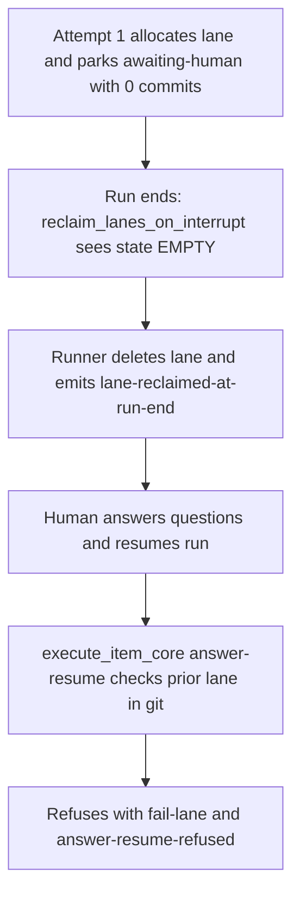

- Id: kxavyv
- Status: open
- Set: kxavyv
- Work-Kind: bug
- Priority: high
- Summary: Do not reclaim EMPTY lanes of awaiting-human items or refuse answer-resume when a prior EMPTY lane was reclaimed
- Short-Description: Do not reclaim EMPTY lanes of awaiting-human items or refuse answer-resume when a prior EMPTY lane was reclaimed
- Blocks-Release: next

> Write and proofread this backlog item per the technical writing standard, `.aw/system/workflows/technical-writing/technical-writing.md` (`.agents/workflows/technical-writing/technical-writing.md` in a legacy-layout install), including requirement 12 (diagrams).

## Workflow history
- 2026-11-23 created (aw backlog): Do not reclaim EMPTY lanes of awaiting-human items or refuse answer-resume when a prior EMPTY lane was reclaimed

### Problem

When an isolated driver turn parks an item in `awaiting-human` with open questions before making any commits, its allocated git worktree lane has zero commits and a clean tree (`EMPTY`). At run end, `agent_workflows/runner_shared.py:reclaim_lanes_on_interrupt` (in `run-end` mode) reclaims and deletes that `EMPTY` lane, emits `lane-reclaimed-at-run-end`, and clears the item's preserved lane state.

When the operator later answers the questions and resumes the run, `agent_workflows/runner_shared.py:execute_item_core` enters the answer-resume branch, calls `agent_workflows/worktree_lease.py:lane_is_safe_to_adopt` for the prior lane ID, finds that the branch/worktree is no longer registered in git, and immediately terminates the item with `fail-lane` and event `answer-resume-refused` (`prior lane '<id6>' is not registered in git`). Downstream dependents and any set orchestrator then fail with `fail-depend`.

### Failure flow

### Desired outcome

1. Resuming an `awaiting-human` item after its questions are answered must succeed even when attempt 1 produced zero commits in its lane.
2. Fix the contract coherently across `agent_workflows/runner_shared.py:reclaim_lanes_on_interrupt` and `agent_workflows/runner_shared.py:execute_item_core`:
   - either do not reclaim lanes belonging to `awaiting-human` items at run end, or
   - allow answer-resume to allocate a fresh lane cleanly when the prior lane was reclaimed as `EMPTY` (preserving strict refusal when a lane with committed or uncommitted work is missing or unsafe).
3. Add behavioral tests verifying the full sequence: an isolated turn parks in `awaiting-human` with zero commits, run-end cleanup runs, answers are recorded, and resuming the run dispatches attempt 2 without `answer-resume-refused` or `fail-lane`.
