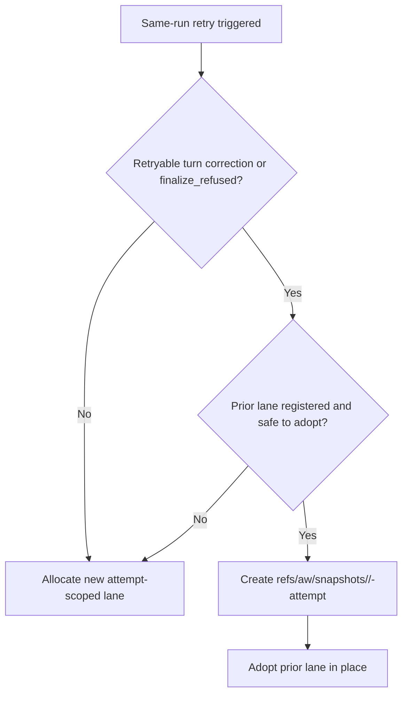

- Id: cv5gav
- Status: open
- Set: laneretry
- Work-Kind: feature
- Priority: high
- Summary: Reuse prior attempt lane on retryable finalize refusals with a snapshot ref
- Short-Description: Reuse prior attempt lane on retryable finalize refusals with a snapshot ref

> Write and proofread this backlog item per the technical writing standard, `.aw/system/workflows/technical-writing/technical-writing.md` (`.agents/workflows/technical-writing/technical-writing.md` in a legacy-layout install), including requirement 12 (diagrams).

## Workflow history
- 2026-11-23 created (aw backlog): Reuse prior attempt lane on retryable finalize refusals with a snapshot ref

## Problem

`runner_shared.try_adopt_fix_it_lane` already exists to reuse a failed attempt's worktree lane instead of allocating a fresh `aw/lane/<id6>_attemptN` branch. Two gates currently prevent it from firing on common retries:

1. `try_adopt_fix_it_lane` returns `None` unless the previous attempt carries both `turn_failure_kind` and `turn_correction`. Retryable finalize refusals recorded by `runner_shared.handle_finalize_refusal` set `finalize_refused` and `finalize_refusal` instead, so they bypass lane adoption and fall through to `worktree_lease.allocate_worktree`, which creates `_attempt2`.
2. `try_adopt_fix_it_lane` refuses adoption when `prior_session_id` is absent, even though the default policy starts a fresh agent session unless `resume_correction_session` is enabled.

Allocating `_attempt2` forces the retry turn to copy files from the prior lane, create new commits, rerun the full validation suite from scratch, and leave the prior lane orphaned.

## Required outcome

1. `runner_shared.try_adopt_fix_it_lane` must admit same-run retries whose prior attempt ended in a retryable `finalize_refused` outcome when the prior lane exists, is registered, has no foreign live owner, and is not corrupted.
2. `try_adopt_fix_it_lane` must require `prior_session_id` only when `resume_correction_session` is enabled; when starting a fresh session in the reused lane, a missing `prior_session_id` must not prevent lane adoption.
3. Before mutating an adopted lane on attempt `N`, the driver must create a non-destructive Git ref snapshot (`refs/aw/snapshots/<run-id>/<id6>-attempt<N-1>`) pointing at the prior lane's `HEAD` so rollback remains possible without copying the worktree.
4. The driver must still fall back to `worktree_lease.allocate_worktree` (creating `_attemptN`) when the prior lane is missing, unregistered, owned by another live process, or otherwise unsafe to adopt.

## Flow

## Acceptance criteria

- A retry triggered by a retryable `finalize_refused` outcome reuses the prior attempt's worktree and branch instead of allocating `_attempt2`, records the snapshot ref at the prior `HEAD`, and leaves the snapshot ref readable in Git.
- A retry with `resume_correction_session` disabled and `prior_session_id` set to `None` still adopts the prior lane when it is otherwise safe.
- A retry whose prior lane is owned by another live process or unregistered falls back to an attempt-scoped lane without modifying the prior lane.
- Automated tests verify both the adopted-lane path (including snapshot ref creation) and the fallback path.
