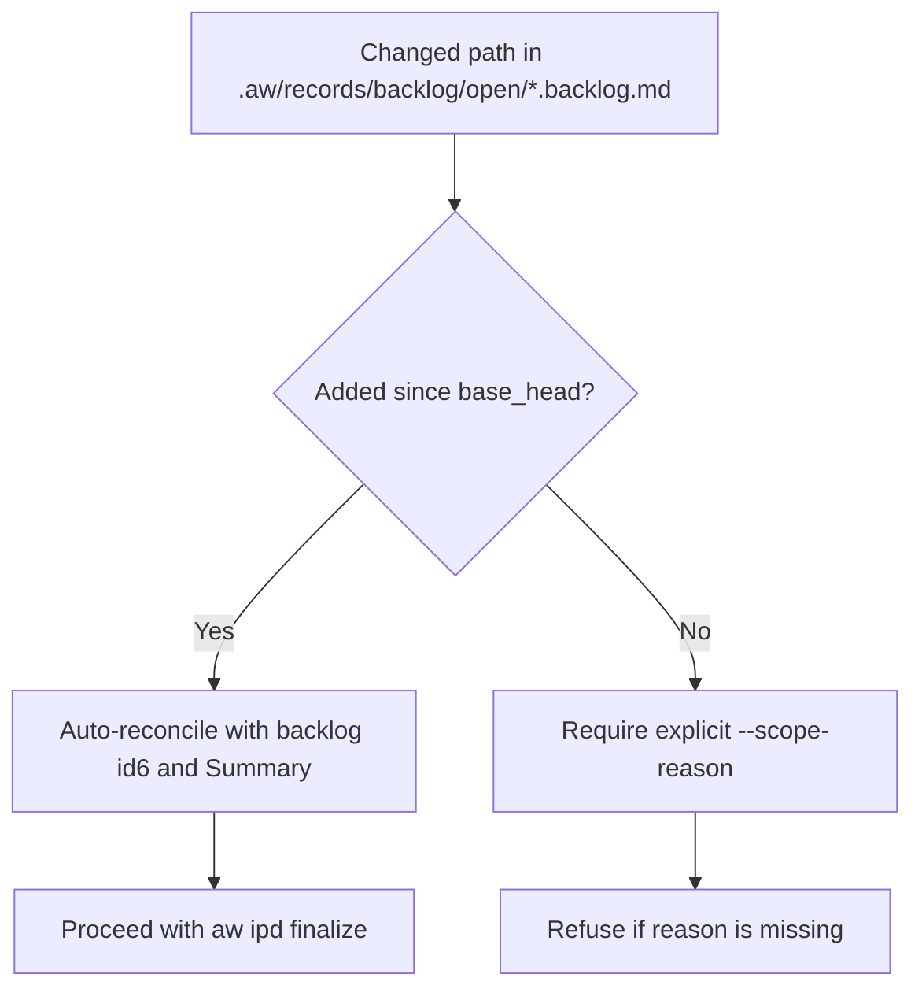

- Id: h4glq1
- Status: open
- Set: laneretry
- Work-Kind: feature
- Priority: high
- Summary: Auto-reconcile newly added open backlog items during aw ipd finalize
- Short-Description: Auto-reconcile newly added open backlog items during aw ipd finalize

> Write and proofread this backlog item per the technical writing standard, `.aw/system/workflows/technical-writing/technical-writing.md` (`.agents/workflows/technical-writing/technical-writing.md` in a legacy-layout install), including requirement 12 (diagrams).

## Workflow history
- 2026-11-23 created (aw backlog): Auto-reconcile newly added open backlog items during aw ipd finalize

## Problem

Executing agents file newly discovered defects with `aw backlog new` during implementation plan document (IPD) execution. `SCOPE_PATHS_IMPLICIT_ALLOWANCES` in `agent_workflows/ipd_schema.py` allows plan files and record indexes, but it does not allow newly created backlog files. When `runner_shared.compute_scope_reconciliation` inspects the lane before `runner_shared.driver_finalize`, every newly added `.aw/records/backlog/open/*.backlog.md` file enters `unjustified_out_of_scope` unless the agent separately recorded a `--scope-reason`. As a result, `aw ipd finalize` refuses valid executions and triggers unnecessary retry attempts.

## Required outcome

1. `agent_workflows/runner_shared.py` (`compute_scope_reconciliation`) and `agent_workflows/ipd_lifecycle.py` (scope verification for `aw ipd finalize`) must recognize newly added open backlog items matching `.aw/records/backlog/open/*.backlog.md` and their matching newly added metadata log under `.aw/records/meta/<id6>.jsonl`.
2. When an execution adds such a new backlog file, `compute_scope_reconciliation` must automatically supply a `--scope-reason` entry citing the new backlog item's `<id6>` and `Summary` (or `ipd_lifecycle` must accept newly added open backlog items under an explicit, audited allowance) so `aw ipd finalize` does not refuse.
3. Modifications or deletions of pre-existing files under `.aw/records/backlog/` must still require an explicit `--scope-reason` and must not be auto-reconciled.

## Flow

## Acceptance criteria

- Running `runner_shared.compute_scope_reconciliation` and `aw ipd finalize` on a lane that adds a new `.aw/records/backlog/open/*.backlog.md` file (and optional `.aw/records/meta/<id6>.jsonl`) succeeds without manual `--scope-reason` flags, and the finalize record captures the auto-generated reason citing the backlog `<id6>`.
- Running `aw ipd finalize` on a lane that modifies or deletes a pre-existing `.aw/records/backlog/` file without an explicit `--scope-reason` still refuses.
- Unit and integration tests cover newly added backlog items, modified pre-existing backlog items, and deleted pre-existing backlog items.
