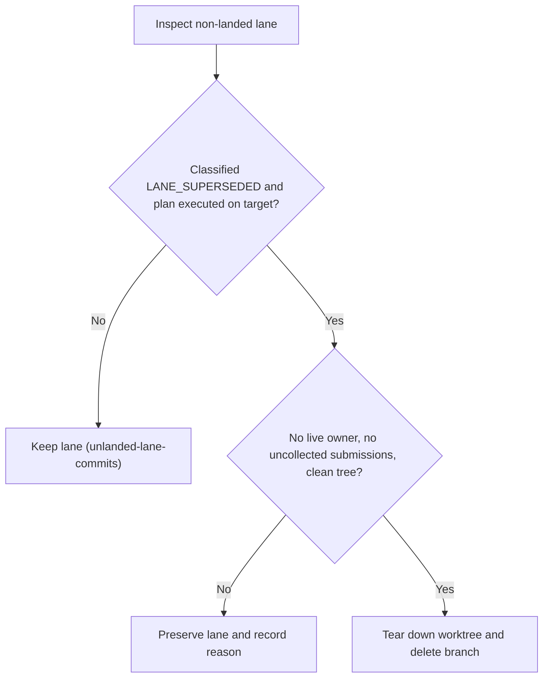

- Id: mt3qxm
- Status: open
- Set: laneretry
- Work-Kind: feature
- Priority: medium
- Summary: Tear down LANE_SUPERSEDED sibling lanes on landing and allow aw lanes prune --apply to remove them
- Short-Description: Tear down LANE_SUPERSEDED sibling lanes on landing and allow aw lanes prune --apply to remove them

> Write and proofread this backlog item per the technical writing standard, `.aw/system/workflows/technical-writing/technical-writing.md` (`.agents/workflows/technical-writing/technical-writing.md` in a legacy-layout install), including requirement 12 (diagrams).

## Workflow history
- 2026-11-23 created (aw backlog): Tear down LANE_SUPERSEDED sibling lanes on landing and allow aw lanes prune --apply to remove them

## Problem

When an implementation plan document (IPD) requires multiple attempts and attempt `N` lands on the target branch, earlier attempt lanes (`aw/lane/<id6>`, `aw/lane/<id6>_attempt2`, through `attempt<N-1>`) remain behind as `LANE_SUPERSEDED` husks:

1. In `agent_workflows/runner_shared.py`, post-landing teardown calls `lane_containment.teardown_lane_if_classified` only on the active attempt's worktree handle and never tears down superseded sibling attempts from the same run.
2. In `agent_workflows/lanes_cli.py`, `collect_lane_rows` marks only `LANE_LANDED` and `LANE_EMPTY_OF_WORK` lanes as `removable`, leaving `LANE_SUPERSEDED` lanes as `keep: unmerged work`.
3. In `agent_workflows/lane_containment.py`, `inventory_lane` sets `unlanded_commits = True` whenever `runner_shared.lane_work_has_landed` is not `True`, so `teardown_lane_if_classified` refuses `LANE_SUPERSEDED` lanes with `unlanded-lane-commits` even after the plan is `executed` on the target branch.

## Required outcome

1. `agent_workflows/lane_containment.py` (`inventory_lane` and `teardown_lane_if_classified`) must support a verified-superseded teardown path: a lane classified as `LANE_SUPERSEDED` by `runner_shared.classify_lane_integration` may be torn down when the plan is `executed` on the target branch, no live process owns the lane, and the lane holds no uncollected submissions or unexplained dirty tracked files.
2. When attempt `N` lands and transitions a plan to `executed`, `agent_workflows/runner_shared.py` must automatically attempt verified-superseded teardown for prior attempt lanes (`1..N-1`) recorded on that item, recording any preservation refusal in run events rather than failing the landed item.
3. `agent_workflows/lanes_cli.py` (`collect_lane_rows` and `run_prune`) must classify verified `LANE_SUPERSEDED` lanes with no live owner and no dirty working tree as removable (distinguished from `LANE_LANDED` in output, for example `removable (superseded)`) so `aw lanes prune --apply` removes them cleanly.

## Flow

## Acceptance criteria

- After attempt `N` of an item lands and reaches `executed`, the driver tears down superseded lanes `1..N-1` when they pass the verified-superseded inventory gate, and logs a preservation event if any superseded lane still holds unexplained dirty files or uncollected submissions.
- `aw lanes list` and `aw lanes prune` display clean `LANE_SUPERSEDED` lanes as removable, and `aw lanes prune --apply` removes their worktrees and branches with exit code 0.
- Non-superseded lanes with unlanded commits (plans not `executed` on target) and superseded lanes with live owners or dirty tracked files remain preserved by both the driver and `aw lanes prune --apply`.
- Automated tests cover driver post-landing sibling teardown, `inventory_lane` superseded verification, and `aw lanes prune --apply` on superseded vs genuinely stranded lanes.
