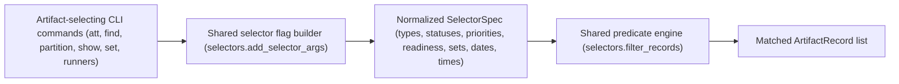

- Id: 1iojci
- Status: open
- Set: selectors
- Work-Kind: feature
- Priority: medium
- Summary: Aggregate and normalize all artifact selector flags across all aw commands
- Short-Description: Aggregate and normalize all artifact selector flags across all aw commands

> Write and proofread this backlog item per the technical writing standard, `.aw/system/workflows/technical-writing/technical-writing.md` (`.agents/workflows/technical-writing/technical-writing.md` in a legacy-layout install), including requirement 12 (diagrams).

## Scope

Define one shared artifact-selector flag specification and matching engine, and wire it into every `aw` command and tool that selects tracked artifacts (plans, specs, backlog items, research notes, prompts, releases, and roadmaps).

A user must be able to pass the same include/exclude filter flags (such as `-t`/`-T`, `-s`/`-S`, `-p`/`-P`, `-r`/`-R`, Set ID filters, and date/time filters) on any artifact-selecting command without memorizing per-command flag names or colliding short options.

Commands in scope include `aw att` / `aw next`, `aw find`, `aw partition`, `aw show`, `aw set`, `aw group`, `aw rename`, `aw archive`, `aw index`, `aw ipd board`, `aw oc run` / `aw oc review`, `aw agy run` / `aw agy review`, and future verb-first entry points.

## Current drift

Audit of `agent_workflows/cli.py` and companion CLI modules shows inconsistent coverage and short-flag collisions across artifact-selecting commands:

| Filter dimension | `aw att` / `aw next` | `aw find` | `aw partition` | Other commands / known collisions |
| --- | --- | --- | --- | --- |
| Type / tree | `-t` / `--type` / `--tree` (repeatable); no `-T` | `-t` / `--type` / `--tree` (repeatable); no `-T` | `-t` / `--type` / `--tree` (single value); no `-T` | `aw runners` uses `-t` for `--tree` (process tree) |
| Status | `-s` / `--status`, `-S` / `--status-not` | `-s` / `--status`, `-S` / `--status-not` | `-s` / `--status`; no `-S` | `aw find` also binds `-S` to `--short` on one path; `aw runs` uses `-s` for `--short` and `-S` for `--summary-only` |
| Priority | `-p` / `--priority`; no `-P` | No priority flag (`-p` means `--paths`) | `-p` / `--priority`; no `-P` | `-p` collision between `--priority` (`att`, `partition`) and `--paths` (`find`) |
| Readiness | `-r` / `--readiness`; no `-R` | Missing | Missing | `pwatch.py` uses `-r` / `-R` for process regex |
| Set ID | Positional selector only | `--set` (single); no exclude flag | Positional selector only | `--set` exists on authoring verbs (`new`, `scaffold`) and `runs`; no `--set-id` or `--not-set-id` anywhere |
| Filename date (`YYYYMMDD` prefix) | Sort only (`--order-by date`), no filter | Missing | Missing | `--date` is an authoring override on `new`/`set`/`scaffold`; `-d` is `--details` on `att`, `--diff` on `engine`, `--repo` on `pwatch`/`runners_monitor` |
| Modified / created time | Sort only (`--order-by mtime|ctime`), no filter | Missing | Missing | `aw runs` and `aw profile` use `--since` / `--until` |

Secondary defect noted during inspection: `aw att --help` registers a misspelled option `--arcive-state`.

## Proposed normalized selector contract

Centralize selector CLI registration and predicate evaluation in one shared module (extending `agent_workflows/selectors.py`) so every artifact-selecting subparser attaches the same flags and calls the same filter function:

Proposed uniform include/exclude pairs:

- Type / tree: `-t` / `--type` (include) and `-T` / `--not-type` / `--type-not` (exclude).
- Status: `-s` / `--status` (include) and `-S` / `--not-status` / `--status-not` (exclude).
- Priority: `-p` / `--priority` (include) and `-P` / `--not-priority` / `--priority-not` (exclude).
- Readiness: `-r` / `--readiness` (include) and `-R` / `--not-readiness` / `--readiness-not` (exclude).
- Set ID: `--set-id` (include) and `--not-set-id` (exclude), with short aliases decided in OQ-01.
- Filename date (`YYYYMMDD` prefix at the start of artifact filenames): proposed `--date` / `-d` (with negated form or range expressions), distinct from `--modified-time` and `--created-time` (decided in OQ-02 and OQ-03).

Every filter flag should be repeatable (and accept comma-separated values consistently) across all artifact-selecting commands.

## Acceptance criteria (bounded outcome)

1. One shared helper registers the normalized selector flags on every artifact-selecting command in `agent_workflows/cli.py` and companion CLIs, and one shared evaluator applies them.
2. Every artifact-selecting command supports the full agreed set of include and exclude flags (type, status, priority, readiness, set ID, filename date, modified time, created time) with identical parsing and matching semantics.
3. All flag-naming and collision open questions (`OQ-01` through `OQ-05`) are resolved before implementation, and shell completions plus `--help` text reflect the normalized flags.
4. Behavioral CLI tests exercise each selector flag and its negated counterpart across representative commands (`att`, `find`, `partition`, `show`, `set`, and runners).

## Open questions

### OQ-01: How should short aliases for multi-word selectors (`--set-id`, `--not-set-id`, `--details`/`--description`, `--modified-time`, `--created-time`) be spelled?

- Blocking: yes
- Status: open
- Owner: maintainer
- Context: Python `argparse` parses single-dash multi-letter flags (such as `-sid`, `-nsid`, `-desc`, `-mtime`, `-ctime`) ambiguously whenever the first letter is also a single-letter option that takes an argument. Because `-s` is `--status`, `argparse` can interpret `-sid` as `-s id` (status equals `id`), and `-desc` as `-d esc` if `-d` takes a value.
- Options:
  1. **Double-dash short aliases (recommended):** `--set-id` / `--sid`, `--not-set-id` / `--nsid`, `--details` / `--desc`, `--modified-time` / `--mtime`, `--created-time` / `--ctime`. Standard GNU syntax, zero collision with single-letter flags (`-s`, `-d`, `-m`, `-c`), and works natively with `argparse` and shell completion.
  2. **Single-letter pairs plus long flags:** assign unused single letters (for example `-g` / `-G` for set/group, `-d` / `-D` for filename date, `-m` for mtime, `-c` for ctime) alongside full long names (`--set-id`, `--not-set-id`, `--modified-time`, `--created-time`).
  3. **Custom pre-parser supporting single-dash multi-letter aliases (`-sid`, `-nsid`, `-desc`, `-mtime`, `-ctime`):** rewrite those exact tokens before `argparse` runs. Disables POSIX short-flag bundling (such as `-sid` meaning `-s id`) and adds custom parser maintenance.
- Recommendation: Option 1 (double-dash short aliases `--sid`, `--nsid`, `--desc`, `--mtime`, `--ctime`, optionally paired with single-letter flags where unambiguous).
- Resolution or deferral rationale:

### OQ-02: What should the filename-date selector flag be called, and should `-d` move from `--details` to the filename-date selector?

- Blocking: yes
- Status: open
- Owner: maintainer
- Context: Tracked artifact filenames begin with an 8-digit date (`YYYYMMDD-<setid>-NN-<id6>-<slug>.<type>.md`). Today, `-d` is `--details` on `aw att` (showing summary/scope/description details under each item), `--diff` on `engine.py`, and `--repo` on `pwatch.py`/`runners_monitor.py`. Meanwhile, `--date` is already used on authoring commands (`new`, `set`, `scaffold`, `group`) to override the date written into a filename or workflow history line.
- Options:
  1. **Use `--date` / `-d` for filename-date selection on read/query commands, and move `aw att`'s `-d` (`--details`) to `--details` / `--desc` (recommended).** Keeps `--date` on authoring commands as a write override (distinct subcommand role), and gives the filename-date filter the shortest natural name on every query/selection command.
  2. **Use `--file-date` / `--fdate` (or `--artifact-date`) for filename-date selection, and keep `-d` / `--details` on `aw att`.** Zero breaking change for existing `aw att -d` muscle memory and zero verb-role overloading of `--date`, at the cost of a slightly longer flag name.
  3. **Use `--dated` / `-d` for filename-date selection, move `--details` to `--desc`, and leave `--date` solely for authoring overrides.** Avoids overloading `--date` across read vs write commands while keeping `-d` short for date filtering.
- Recommendation: Option 1 (`--date` / `-d` for filename-date selection on selector commands, moving `--details` to `--details` / `--desc`), provided no single command both selects by filename date and overrides a written date.
- Resolution or deferral rationale:

### OQ-03: What expression syntax and timestamp sources should `--date`, `--modified-time` (`--mtime`), and `--created-time` (`--ctime`) use?

- Blocking: yes
- Status: open
- Owner: maintainer
- Context: Users may want to match an exact date (`20261122`), a month prefix (`202611`), a range (`20261101..20261115`), a comparison (`>=2026-11-01`, `<2026-11-15`), or a relative window (`7d`, `24h`, matching `aw runs --since`). For `--created-time` and `--modified-time`, filesystem `stat` timestamps are unreliable across git checkouts and rebases (and Linux `st_ctime` is inode change time, not file creation time), whereas git commit history and `## Workflow history` / metadata timestamps are durable but slower unless cached.
- Options:
  1. **Unified expression syntax (`YYYYMMDD`, `YYYY-MM-DD`, prefixes like `202611`, ranges `A..B`, comparators `>=`/`<=`/`>`/`<`, and relative windows like `7d` / `24h` for mtime/ctime); git/metadata timestamps for `--created-time` and `--modified-time` with filesystem fallback for untracked/modified working-tree files (recommended).**
  2. **Separate `--since` / `--until` style pairs per timestamp (`--date-since`, `--date-before`, `--mtime-since`, `--ctime-since`).** Simpler parser (no shell quoting needed for `>`/`<`), but multiplies the number of flags.
  3. **Filesystem `stat` timestamps only for `--mtime` / `--ctime`, matching `aw att --order-by mtime|ctime`.** Fastest and matches current `aw att` sort keys, but resets on fresh clones and rebase/checkout operations.
- Recommendation: Option 1, and align `aw att --order-by mtime|ctime` with the same timestamp authority so sorting and filtering never disagree.
- Resolution or deferral rationale:

### OQ-04: How should existing short-flag collisions (`-p`, `-S`, `-s`, `-t`) be resolved across commands?

- Blocking: yes
- Status: open
- Owner: maintainer
- Context: Existing commands reuse selector short letters for non-selector meanings: `aw find` uses `-p` for `--paths` (collides with `-p` / `--priority`) and `-S` for `--short` on one path (collides with `-S` / `--status-not`); `aw runs` uses `-s` for `--short` and `-S` for `--summary-only`; `aw runners` uses `-t` for `--tree`.
- Options:
  1. **Enforce the normalized selector short flags strictly on all artifact-selecting commands (`att`, `find`, `partition`, `show`, `set`, `group`, `rename`, `archive`, `index`, `ipd`, `oc`, `agy`), deprecate conflicting short flags on `aw find` (use `--paths` and `--short` long forms), and exempt non-artifact operational commands (`aw runs`, `aw runners`, `pwatch`) (recommended).**
  2. **Normalize across ALL `aw` subcommands including `aw runs` and `aw runners`.** Maximally uniform across the entire CLI, but breaks existing `aw runs -s`, `aw runs -S`, and `aw runners -t` muscle memory.
  3. **Preserve conflicting legacy short flags on `aw find` and require long flags (`--priority`, `--status-not`) there.** Avoids breaking any existing script, but defeats the goal of identical short flags everywhere artifacts are selected.
- Recommendation: Option 1 (strict consistency across every artifact-selecting command; keep non-artifact monitor commands independent).
- Resolution or deferral rationale:

### OQ-05: Should negated selector flags accept both `--not-<field>` and `--<field>-not` spellings?

- Blocking: yes
- Status: open
- Owner: maintainer
- Context: Today the CLI mixes both word orders: `--status-not` (`-S`) puts `-not` at the end, while `--not-active` puts `not-` at the start, and the new Set ID exclusion was requested as `--not-set-id`.
- Options:
  1. **Pick one canonical spelling for `--help` (proposed: `--not-<field>`, e.g., `--not-type`, `--not-status`, `--not-priority`, `--not-readiness`, `--not-set-id`, `--not-date`) and register `--<field>-not` as hidden/accepted aliases for backward compatibility and muscle memory (recommended).**
  2. **Standardize strictly on `--<field>-not` (`--type-not`, `--status-not`, `--set-id-not`) with no aliases.** Matches existing `--status-not`, but conflicts with `--not-active` and `--not-set-id`.
  3. **Standardize strictly on `--not-<field>` and deprecate `--status-not`.** Cleanest single spelling, but breaks scripts using `--status-not`.
- Recommendation: Option 1 (canonical `--not-<field>` in `--help`, with `--<field>-not` accepted everywhere so existing `--status-not` scripts continue working).
- Resolution or deferral rationale:

## Workflow history
- 2026-11-22 created (aw backlog): Aggregate and normalize all artifact selector flags across all aw commands
