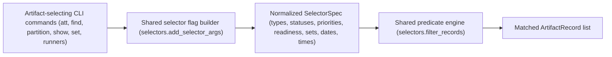

- Id: 1iojci
- Status: open
- Set: selectors
- Work-Kind: feature
- Priority: medium
- Summary: Aggregate and normalize all artifact selector flags across all aw commands
- Short-Description: Aggregate and normalize all artifact selector flags across all aw commands

> Write and proofread this backlog item per the technical writing standard, `.aw/system/workflows/technical-writing/technical-writing.md` (`.agents/workflows/technical-writing/technical-writing.md` in a legacy-layout install), including requirement 12 (diagrams).

## Scope

Define one shared artifact-selector flag specification and matching engine, and wire it into every `aw` command and tool that selects tracked artifacts (plans, specs, backlog items, research notes, prompts, releases, and roadmaps).

A user must be able to pass the same include/exclude filter flags (such as `-t`/`-T`, `-s`/`-S`, `-p`/`-P`, `-r`/`-R`, Set ID filters, and date/time filters) on any artifact-selecting command without memorizing per-command flag names or colliding short options.

Commands in scope include `aw att` / `aw next`, `aw find`, `aw partition`, `aw show`, `aw set`, `aw group`, `aw rename`, `aw archive`, `aw index`, `aw ipd board`, `aw oc run` / `aw oc review`, `aw agy run` / `aw agy review`, and future verb-first entry points.

## Current drift

Audit of `agent_workflows/cli.py` and companion CLI modules shows inconsistent coverage and short-flag collisions across artifact-selecting commands:

| Filter dimension | `aw att` / `aw next` | `aw find` | `aw partition` | Other commands / known collisions |
| --- | --- | --- | --- | --- |
| Type / tree | `-t` / `--type` / `--tree` (repeatable); no `-T` | `-t` / `--type` / `--tree` (repeatable); no `-T` | `-t` / `--type` / `--tree` (single value); no `-T` | `aw runners` uses `-t` for `--tree` (process tree) |
| Status | `-s` / `--status`, `-S` / `--status-not` | `-s` / `--status`, `-S` / `--status-not` | `-s` / `--status`; no `-S` | `aw find` also binds `-S` to `--short` on one path; `aw runs` uses `-s` for `--short` and `-S` for `--summary-only` |
| Priority | `-p` / `--priority`; no `-P` | No priority flag (`-p` means `--paths`) | `-p` / `--priority`; no `-P` | `-p` collision between `--priority` (`att`, `partition`) and `--paths` (`find`) |
| Readiness | `-r` / `--readiness`; no `-R` | Missing | Missing | `pwatch.py` uses `-r` / `-R` for process regex |
| Set ID | Positional selector only | `--set` (single); no exclude flag | Positional selector only | `--set` exists on authoring verbs (`new`, `scaffold`) and `runs`; no `--set-id` or `--not-set-id` anywhere |
| Filename date (`YYYYMMDD` prefix) | Sort only (`--order-by date`), no filter | Missing | Missing | `--date` is an authoring override on `new`/`set`/`scaffold`; `-d` is `--details` on `att`, `--diff` on `engine`, `--repo` on `pwatch`/`runners_monitor` |
| Modified / created time | Sort only (`--order-by mtime|ctime`), no filter | Missing | Missing | `aw runs` and `aw profile` use `--since` / `--until` |

Secondary defect noted during inspection: `aw att --help` registers a misspelled option `--arcive-state`.

## Proposed normalized selector contract

Centralize selector CLI registration and predicate evaluation in one shared module (extending `agent_workflows/selectors.py`) so every artifact-selecting subparser attaches the same flags and calls the same filter function:

Proposed uniform include/exclude pairs:

- Type / tree: `-t` / `--type` (include) and `-T` / `--not-type` / `--type-not` (exclude).
- Status: `-s` / `--status` (include) and `-S` / `--not-status` / `--status-not` (exclude).
- Priority: `-p` / `--priority` (include) and `-P` / `--not-priority` / `--priority-not` (exclude).
- Readiness: `-r` / `--readiness` (include) and `-R` / `--not-readiness` / `--readiness-not` (exclude).
- Set ID: `--set-id` (include) and `--not-set-id` (exclude), with short aliases decided in OQ-01.
- Filename date (`YYYYMMDD` prefix at the start of artifact filenames): proposed `--date` / `-d` (with negated form or range expressions), distinct from `--modified-time` and `--created-time` (decided in OQ-02 and OQ-03).

Every filter flag should be repeatable (and accept comma-separated values consistently) across all artifact-selecting commands.

## Acceptance criteria (bounded outcome)

1. One shared helper registers the normalized selector flags on every artifact-selecting command in `agent_workflows/cli.py` and companion CLIs, and one shared evaluator applies them.
2. Every artifact-selecting command supports the full agreed set of include and exclude flags (type, status, priority, readiness, set ID, filename date, modified time, created time) with identical parsing and matching semantics.
3. All flag-naming and collision open questions (`OQ-01` through `OQ-05`) are resolved before implementation, and shell completions plus `--help` text reflect the normalized flags.
4. Behavioral CLI tests exercise each selector flag and its negated counterpart across representative commands (`att`, `find`, `partition`, `show`, `set`, and runners).

## Open questions

### OQ-01: How should short aliases for multi-word selectors (`--set-id`, `--not-set-id`, `--details`/`--description`, `--modified-time`, `--created-time`) be spelled?

- Blocking: yes
- Status: resolved
- Owner: maintainer
- Context: Empirically verified against Python `argparse`: single-dash multi-letter options (`-sid`, `-nsid`, `-desc`, `-mtime`, `-ctime`) parse cleanly alongside 1-letter options (`-s`, `-n`, `-d`) because exact option strings match before attached short-option values; the only `argparse` caveat is prefix-abbreviation ambiguity on partial tokens (e.g. `-si` when both `-s` and `-sid` exist). The choice is therefore CLI convention and ergonomics: double-dash aliases, single-dash aliases, both, or 1-letter flags.
- Options:
  1. **Double-dash short aliases (`--sid`, `--nsid`, `--mtime`, `--ctime`, `--desc`) alongside full names, keeping single-dash strictly for 1-letter flags.**
  2. **Single-dash multi-letter aliases (`-sid`, `-nsid`, `-mtime`, `-ctime`, `-desc`) alongside full double-dash names.**
  3. **Document double-dash short aliases (`--sid`, `--nsid`, `--mtime`, `--ctime`, `--desc`) as canonical in `--help`, and also accept single-dash forms (`-sid`, `-nsid`, `-mtime`, `-ctime`, `-desc`) as hidden aliases.**
  4. **Assign unused 1-letter pairs alongside full double-dash names.**
- Recommendation: Option 1 (or Option 3 to support both double-dash and Unix `find`-style single-dash habits).
- Resolution or deferral rationale: RESOLVED 2026-11-22 by the user via /askme: Option C (document double-dash short aliases `--sid`, `--nsid`, `--mtime`, `--ctime`, `--desc` as canonical in `--help`, and also accept single-dash forms `-sid`, `-nsid`, `-mtime`, `-ctime`, `-desc` as hidden aliases). No reason was given.

### OQ-02: What should the filename-date selector flag be called, and should `-d` move from `--details` to the filename-date selector?

- Blocking: yes
- Status: resolved
- Owner: maintainer
- Context: Tracked artifact filenames begin with an 8-digit date (`YYYYMMDD-<setid>-NN-<id6>-<slug>.<type>.md`). Today, `-d` is `--details` on `aw att` (4 files across the repo, 0 docs), `--diff` on `engine.py`, and `--repo` on `pwatch.py`/`runners_monitor.py`. Meanwhile, `--date` is already used on authoring/mutating commands (`new`, `set`, `scaffold`, `group`) to override the date written into a filename or workflow history line.
- Options:
  1. **Use `--date` / `-d` (and `-D` / `--not-date`) for filename-date selection across selector commands, move `aw att`'s `-d` (`--details`) to `--details` / `--desc` / `-desc`, and rename the write-override flag on `aw set` to `--history-date` (keeping `--date` on `new`/`scaffold` where no selection occurs) (recommended).**
  2. **Use `--file-date` / `--fdate` / `-fdate` (no `-d` collision) for filename-date selection, keeping `-d` / `--details` on `aw att` and `--date` on `aw set` untouched.**
  3. **Use `--dated` / `-d` (and `-D` / `--not-dated`) for filename-date selection, move `--details` to `--desc` / `-desc`, and leave `--date` solely for write-override dates (including on `aw set`).**
- Recommendation: Option 1 (`--date` / `-d` / `-D` for filename-date selection, moving `--details` to `--details` / `--desc` / `-desc` and `aw set --date` to `--history-date`).
- Resolution or deferral rationale: RESOLVED 2026-11-22 by the user via /askme: Option A (`--date` / `-d` and `-D` / `--not-date` for filename-date selection across selector commands; move `aw att`'s `-d` / `--details` to `--details` / `--desc` / `-desc`; rename `aw set`'s write-override `--date` to `--history-date`, keeping `--date` on authoring commands where no selection occurs). No reason was given.

### OQ-03: What expression syntax and timestamp sources should `--date`, `--modified-time` (`--mtime`), and `--created-time` (`--ctime`) use?

- Blocking: yes
- Status: resolved
- Owner: maintainer
- Context: Users may want to match an exact date (`20261122`), a month prefix (`202611`), a range (`20261101..20261115` or open range `20261101..` / `..20261115`), a comparison (`>=2026-11-01`, `<2026-11-15`), or a relative window (`7d`, `24h`, matching `aw runs --since`). Today `aw att --order-by mtime|ctime` reads raw filesystem `stat()` (`st.st_mtime`, `st.st_ctime`), which resets on git checkouts/rebases/clones (and Linux `st_ctime` is inode change time, not creation time).
- Options:
  1. **Unified expression syntax (`YYYYMMDD`, `YYYY-MM-DD`, prefixes like `202611`, ranges `A..B`, open ranges `A..` / `..B`, comparators `>=`/`<=`/`>`/`<`, and relative windows like `7d` / `24h`); batched git/artifact history timestamps for `--created-time` and `--modified-time` with filesystem fallback for uncommitted/untracked files, and align `aw att --order-by mtime|ctime` to the same source (recommended).**
  2. **Same unified expression syntax, using raw filesystem `stat()` timestamps only for `--mtime` / `--ctime`.**
  3. **Separate `--since` / `--until` style pairs per timestamp (`--date-since`, `--date-before`, `--mtime-since`, `--ctime-since`).**
- Recommendation: Option 1 (unified expression syntax with durable batched git/history timestamps and working-tree fallback, aligned with `aw att --order-by mtime|ctime`).
- Resolution or deferral rationale: RESOLVED 2026-11-22 by the user via /askme: Option A (unified expression syntax supporting exact dates, prefixes, closed/open `..` ranges, quoted comparators, and relative windows like `7d`/`24h`; backed by batched git/artifact history timestamps with filesystem fallback for uncommitted/untracked files, and aligning `aw att --order-by mtime|ctime` to the same source). No reason was given.

### OQ-04: How should existing short-flag collisions (`-p`, `-S`, `-s`, `-t`) be resolved across commands?

- Blocking: yes
- Status: open
- Owner: maintainer
- Context: Existing commands reuse selector short letters for non-selector meanings: `aw find` uses `-p` for `--paths` (collides with `-p` / `--priority`) and `-S` for `--short` on one path (collides with `-S` / `--status-not`); `aw runs` uses `-s` for `--short` and `-S` for `--summary-only`; `aw runners` uses `-t` for `--tree`.
- Options:
  1. **Enforce the normalized selector short flags strictly on all artifact-selecting commands (`att`, `find`, `partition`, `show`, `set`, `group`, `rename`, `archive`, `index`, `ipd`, `oc`, `agy`), deprecate conflicting short flags on `aw find` (use `--paths` and `--short` long forms), and exempt non-artifact operational commands (`aw runs`, `aw runners`, `pwatch`) (recommended).**
  2. **Normalize across ALL `aw` subcommands including `aw runs` and `aw runners`.** Maximally uniform across the entire CLI, but breaks existing `aw runs -s`, `aw runs -S`, and `aw runners -t` muscle memory.
  3. **Preserve conflicting legacy short flags on `aw find` and require long flags (`--priority`, `--status-not`) there.** Avoids breaking any existing script, but defeats the goal of identical short flags everywhere artifacts are selected.
- Recommendation: Option 1 (strict consistency across every artifact-selecting command; keep non-artifact monitor commands independent).
- Resolution or deferral rationale:

### OQ-05: Should negated selector flags accept both `--not-<field>` and `--<field>-not` spellings?

- Blocking: yes
- Status: open
- Owner: maintainer
- Context: Today the CLI mixes both word orders: `--status-not` (`-S`) puts `-not` at the end, while `--not-active` puts `not-` at the start, and the new Set ID exclusion was requested as `--not-set-id`.
- Options:
  1. **Pick one canonical spelling for `--help` (proposed: `--not-<field>`, e.g., `--not-type`, `--not-status`, `--not-priority`, `--not-readiness`, `--not-set-id`, `--not-date`) and register `--<field>-not` as hidden/accepted aliases for backward compatibility and muscle memory (recommended).**
  2. **Standardize strictly on `--<field>-not` (`--type-not`, `--status-not`, `--set-id-not`) with no aliases.** Matches existing `--status-not`, but conflicts with `--not-active` and `--not-set-id`.
  3. **Standardize strictly on `--not-<field>` and deprecate `--status-not`.** Cleanest single spelling, but breaks scripts using `--status-not`.
- Recommendation: Option 1 (canonical `--not-<field>` in `--help`, with `--<field>-not` accepted everywhere so existing `--status-not` scripts continue working).
- Resolution or deferral rationale:

## Workflow history
- 2026-11-22 created (aw backlog): Aggregate and normalize all artifact selector flags across all aw commands
