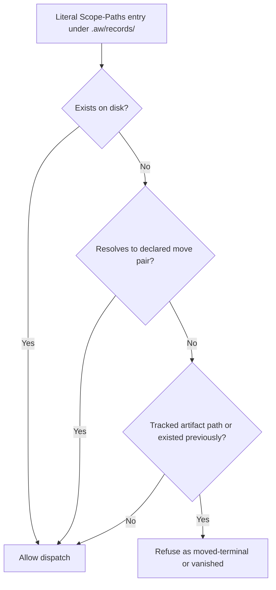

- Id: y04w9r
- Status: open
- Set: y04w9r
- Work-Kind: bug
- Priority: medium
- Summary: Do not refuse dispatch in stale_record_scope_paths when a plan creates a new literal file under .aw/records/
- Short-Description: Do not refuse dispatch in stale_record_scope_paths when a plan creates a new literal file under .aw/records/
- Blocks-Release: next

> Write and proofread this backlog item per the technical writing standard, `.aw/system/workflows/technical-writing/technical-writing.md` (`.agents/workflows/technical-writing/technical-writing.md` in a legacy-layout install), including requirement 12 (diagrams).

## Workflow history
- 2026-11-22 created (aw backlog): Do not refuse dispatch in stale_record_scope_paths when a plan creates a new literal file under .aw/records/

### Problem

`agent_workflows/check_engine.py:stale_record_scope_paths` flags every literal (non-glob) `Scope-Paths` entry under `.aw/records/` that does not yet exist on disk and does not resolve to another declared path in the same plan. When no matching file exists anywhere under `.aw/records/`, the predicate classifies the entry as `SCOPE_STALE_VANISHED`. `agent_workflows/runner_shared.py` then refuses execution at dispatch with `fail-gate` and event `scope-target-stale`.

This check produces a false positive when an approved plan declares a literal path under `.aw/records/` that the plan itself intends to create (for example, a non-artifact helper file such as `.aw/records/specs/candidates/<area>/README.md`). Prior backlog item `dparot` exempted declared move or rename pairs, where both source and destination appear in `Scope-Paths`, but did not cover net-new literal files that have no pre-existing source file. When the refusal fires on an upstream plan in a set, it also cascades `fail-depend` to downstream plans and blocks orchestrator retirement.

### Classification flow

### Desired outcome

1. `agent_workflows/check_engine.py:stale_record_scope_paths` and the dispatch gate in `agent_workflows/runner_shared.py` must distinguish a stale or vanished existing record target from a literal path under `.aw/records/` that a plan legitimately intends to create (such as a non-artifact file like `README.md` that carries no tracked record facet or id6).
2. Existing protection for stale record pointers (such as a tracked plan, spec, or backlog path that moved to a terminal directory or vanished after the plan was authored) must remain enforced.
3. Add behavioral tests verifying that:
   - a plan declaring a literal new non-artifact file under `.aw/records/` (such as `README.md`) is not classified as `SCOPE_STALE_VANISHED` and is not refused at dispatch;
   - a plan declaring a tracked artifact path under `.aw/records/` that moved to a terminal directory or vanished is still refused.
