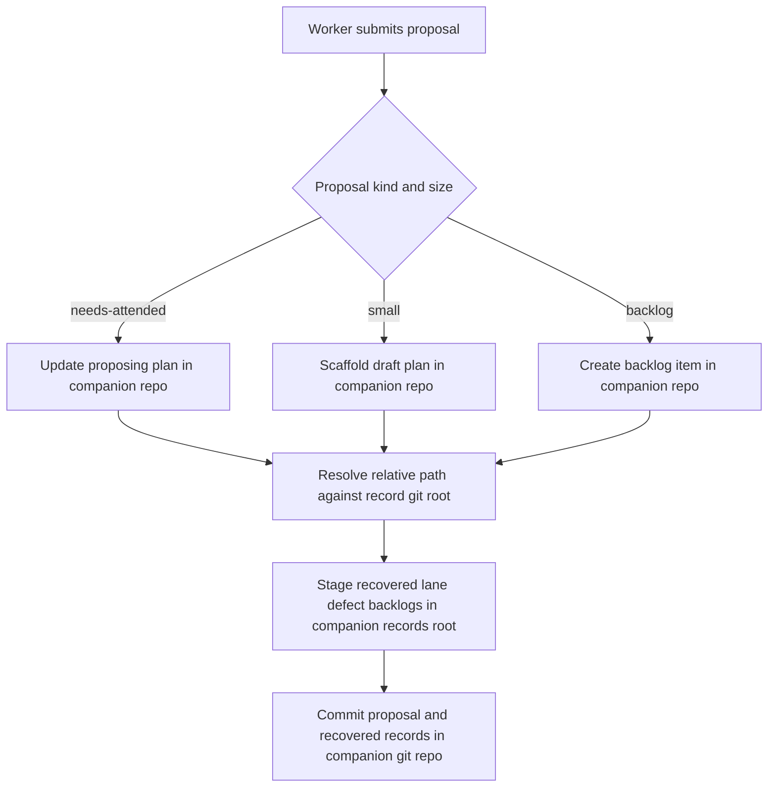

- Id: 7h6m66
- Status: open
- Set: 7h6m66
- Work-Kind: bug
- Priority: high
- Summary: perform_coordinator_proposal_file crashes with ValueError in companion-records repos
- Short-Description: perform_coordinator_proposal_file crashes with ValueError in companion-records repos
- Blocks-Release: next

> Write and proofread this backlog item per the technical writing standard, `.aw/system/workflows/technical-writing/technical-writing.md` (`.agents/workflows/technical-writing/technical-writing.md` in a legacy-layout install), including requirement 12 (diagrams).

## Workflow history
- 2026-11-25 created (aw backlog): perform_coordinator_proposal_file crashes with ValueError in companion-records repos

## Symptom

In a repository configured with companion records storage (`records_backend == "companion"`, such as `public-target-private-companion`), `agent_workflows/runner_shared.py::perform_coordinator_proposal_file` crashes with an unhandled `ValueError` when a worker submits a proposal during an isolated run.

Observed on 2026-11-24 during `aw oc run` (`run-20261124T224158Z-2254979`) executing plan `57d38a` in a companion-backed target repository:

- The worker submitted a `PROPOSAL_KIND_NEEDS_ATTENDED` proposal after step `E-02` blocked.
- `execute_item_core` called `perform_coordinator_proposal_file`.
- `perform_coordinator_proposal_file` created a coordinator worktree (`coord.path`) on the target repository, resolved the proposing plan in the external companion repository via `resolve_plan_path`, wrote the `Attended: required` edit directly to the live companion file, and then raised:
  `ValueError: '<companion>/records/plans/pending/20261124-v1rmjz-01-57d38a-...ipd.md' is not in the subpath of '<coord-worktree>'`.
- The unhandled exception aborted the run and left the item in status `fail-verify?` without committing the companion edit or filing a clean `ProposalFilingResult`.

## Code-inspected failure paths

Code inspection of `agent_workflows/runner_shared.py::perform_coordinator_proposal_file` shows four places that assume proposal records live inside the target repository coordinator worktree (`coord.path`):

1. `PROPOSAL_KIND_NEEDS_ATTENDED` branch (observed): calls `target.relative_to(coord.path)` on a plan resolved in the external companion records root after mutating that live companion file in place.
2. `size == "small"` branch (code-inspected): runs `aw ipd scaffold --apply` with `cwd=coord.path`, locates `created_plan` under `project_records_dir(coord.path) / "plans" / "pending"`, and calls `created_plan.relative_to(coord.path)`.
3. Default backlog branch (code-inspected): runs `aw backlog new --apply` with `cwd=coord.path`, locates `created_backlog` under `project_records_dir(coord.path) / "backlog" / "open"`, and calls `created_backlog.relative_to(coord.path)`.
4. Lane defect recovery and commit landing (code-inspected): `_stage_validated_lane_backlogs` writes recovered lane defect backlogs to `coord_path / rel_path` (inside the target repository worktree instead of the companion records root), and `perform_coordinator_proposal_file` commits `commit_paths` inside `coord.path` via `git_commit_helper.offer_commit` and lands them onto the target repository via `ipd_lifecycle.land_worktree_commit`.

## Expected behavior

When `records_backend` places records in a companion repository (and for `~/.aw/` `home` storage if applicable), `perform_coordinator_proposal_file` must resolve proposal record paths, stage recovered lane defect backlogs, and commit changes against the records repository (`record_git_root` / `project_records_dir`) instead of calling `Path.relative_to(coord.path)` or committing records into the target repository.

## Relationship to existing plans

Verified against open backlog items and the `comphome` plan set (`20261124-comphome-00-92ujfc` through `20261124-comphome-06-4vnd36`): none of those items address `perform_coordinator_proposal_file`.

## Acceptance criteria

1. In a companion-records repository, `perform_coordinator_proposal_file` handles all three proposal branches (`PROPOSAL_KIND_NEEDS_ATTENDED`, `size == "small"`, and the default backlog branch) without raising `ValueError`, commits the resulting record change to the companion repository, and returns `ProposalFilingResult(filed=True, ...)`.
2. In a companion-records repository, recovered lane defect backlogs staged by `_stage_validated_lane_backlogs` are written and committed under the companion records root, never inside the target repository worktree.
3. Regression tests exercise all three proposal branches and lane defect recovery in a companion-backed repository fixture and assert clean companion commits, zero `.aw/records/` mutations in the target repository, and `filed=True`.
