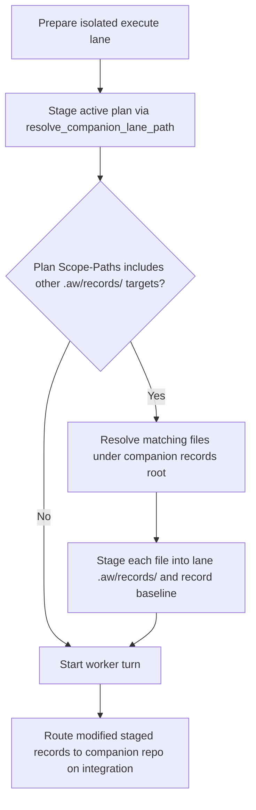

- Id: 8q9sfu
- Status: open
- Set: 8q9sfu
- Work-Kind: bug
- Priority: medium
- Summary: Isolated execute lanes in companion-records repos do not stage other companion records declared in Scope-Paths
- Short-Description: Isolated execute lanes in companion-records repos do not stage other companion records declared in Scope-Paths
- Blocks-Release: next

> Write and proofread this backlog item per the technical writing standard, `.aw/system/workflows/technical-writing/technical-writing.md` (`.agents/workflows/technical-writing/technical-writing.md` in a legacy-layout install), including requirement 12 (diagrams).

## Workflow history
- 2026-11-25 created (aw backlog): Isolated execute lanes in companion-records repos do not stage other companion records declared in Scope-Paths

## Symptom

In a repository configured with companion records storage (`records_backend == "companion"`, such as `public-target-private-companion`), an isolated execute lane stages only the active plan file and omits other companion records declared in the plan's `- Scope-Paths:`.

Observed on 2026-11-24 during `aw oc run` (`run-20261124T224158Z-2254979`) executing plan `57d38a` in a companion-backed target repository:

- Plan `57d38a` declared `.aw/records/plans/**/20261121-perf-opt-03-p1f3dc-remote-cli-tests-doc-sync-and-final-benchmarks.ipd.md` in `- Scope-Paths:` so step `E-02` could append a permitted dated `## Workflow history` line to executed plan `p1f3dc`.
- The isolated lane contained only `57d38a` under `.aw/records/plans/pending/` and did not contain `p1f3dc` under `.aw/records/plans/executed/`.
- Step `E-02` blocked because the declared companion record was absent from the lane worktree, forcing the worker to stop and submit a `needs-attended` proposal (which then hit `7h6m66`).

## Code-inspected cause

In `agent_workflows/runner_shared.py::execute_item_core`, the execute-lane preparation block calls `lane_containment.resolve_companion_lane_path(lane_root, lane_plan_path, repo=repo, overwrite=False)` only for `lane_plan_path`. It does not expand or stage other logical `.aw/records/...` entries (exact paths or globs) declared in the plan's `- Scope-Paths:` from the companion records root into `<lane>/.aw/records/...` before starting the worker turn.

On integration, `agent_workflows/runner_shared.py::route_companion_lane_records` already collects modified lane `.aw/records/**` files against `lane_containment.read_companion_staged_baseline` and routes them back to the companion repository.

## Expected behavior

Before starting an isolated execute turn in a companion-records repository (and in `~/.aw/` `home` storage once home lane staging lands under `4vnd36`), `execute_item_core` must resolve logical `.aw/records/...` paths and globs declared in the active plan's `- Scope-Paths:` against the external records root and stage each matching existing file into the lane via `lane_containment.resolve_companion_lane_path` with `overwrite=False`, enforcing containment and no-symlink rules.

## Relationship to existing items

- Distinct from `7h6m66`, which covers the `ValueError` crash in `perform_coordinator_proposal_file` when a worker submits a proposal in a companion-records repository.
- Verified against open backlog items and the `comphome` plan set (`20261124-comphome-00-92ujfc` through `20261124-comphome-06-4vnd36`): none of those items stage non-target companion `- Scope-Paths:` artifacts into isolated execute lanes.

## Acceptance criteria

1. In a companion-records repository, when an approved plan declares another existing companion record (by exact logical `.aw/records/...` path or glob) in `- Scope-Paths:`, isolated execute lane preparation stages that file into `<lane>/.aw/records/...` and records its hash in the companion staged baseline before the worker starts.
2. When the worker edits that staged companion record (for example, appending a dated `## Workflow history` note to an executed plan) and the lane integrates, `route_companion_lane_records` writes and commits the edit in the companion repository without touching `.aw/records/` in the target repository.
3. Unmatched globs, traversal paths (`..`), or symlinks escaping the companion records root never escape containment or crash lane setup.
4. Regression tests in `tests/test_companion_runner_integration.py` cover staging and round-trip companion routing for a plan whose `- Scope-Paths:` names another companion record.
