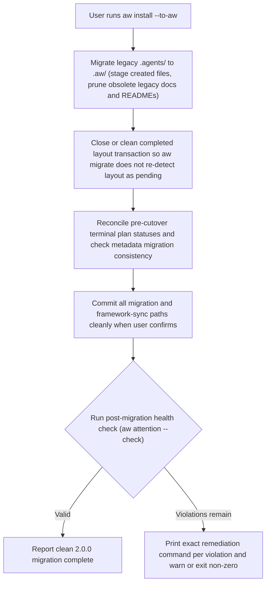

- Id: d31qxm
- Status: open
- Set: d31qxm
- Work-Kind: bug
- Priority: high
- Summary: Make aw install --to-aw leave a clean, valid 2.0.0 repository
- Short-Description: Make aw install --to-aw leave a clean, valid 2.0.0 repository
- Blocks-Release: next

> Write and proofread this backlog item per the technical writing standard, `.aw/system/workflows/technical-writing/technical-writing.md` (`.agents/workflows/technical-writing/technical-writing.md` in a legacy-layout install), including requirement 12 (diagrams).

## Workflow history
- 2026-11-25 created (aw backlog): Make aw install --to-aw leave a clean, valid 2.0.0 repository

## Problem

When a user migrates a legacy `.agents/` repository to `.aw/` with `aw install --to-aw`, the command prints `OK: migrated legacy layout to .aw/` yet leaves the repository broken and cluttered. Immediately afterward, `aw attention` fails with `VIEW INVALID`, `aw migrate` still claims layout migration is pending, `aw migrate metadata` fails with an unguided refusal, and untracked or uninventoried files remain in `.aw/`.

Observed on a real legacy repository during `aw install --to-aw`:

1. **Commit crash on untracked `.aw/.gitignore` and orphaned `.aw/config/config.json`:**
   - `agent_workflows/layout_migration.py` (`_ensure_gitignore` and legacy `config.json` creation) writes `.aw/.gitignore` and `.aw/config/config.json` to disk without staging them.
   - `agent_workflows/engine.py` (`prompt_and_run_commit`) detects `.aw/.gitignore` via `git status --porcelain`, adds it to `files_to_commit`, and executes `git commit -- <paths>` without staging it first. Git aborts with `error: pathspec '.aw/.gitignore' did not match any file(s) known to git`, leaving all migration changes staged but uncommitted and `.aw/config/config.json` stranded untracked beside `.aw/config/project.json`.
2. **Migration creates an uninventoried `.aw/records/docs/` tree that `aw attention` rejects:**
   - `aw install --to-aw` moves legacy `.agents/docs/README.md` into `.aw/records/docs/README.md`.
   - `agent_workflows/attention.py` immediately flags `.aw/records/docs` with `attention.uninventoried-tree: tree directory under records root matching no policy`, causing `VIEW INVALID`.
3. **Completed layout transaction stays open and `aw migrate` still reports layout pending:**
   - After `aw install --to-aw` succeeds, `aw migrate-layout status` still reports `Active Transaction: True` with `Status: completed` and `Authority: switched`.
   - Running `aw migrate` (`agent_workflows/cli.py`: `_run_migrate_bare`) still reports `Step 1: layout (pending)` because `has_agents_root` matches surviving `.agents/` directories (such as `.agents/skills/` or deferred leftovers), proposing to re-migrate hundreds of items with no explanation.
4. **Pre-cutover legacy terminal plans still break `aw attention`:**
   - `agent_workflows/layout_migration.py` (`_stamp_cutovers`) writes cutover dates into `.aw/config/project.json`, yet `aw attention` still marks the entire board `VIEW INVALID` on pre-cutover plans already in terminal directories:
     - Plans in `.aw/records/plans/executed/` with no `- Status:` bullet or YAML `Status: executed` frontmatter trigger `attention.missing-status`.
     - Plans in `.aw/records/plans/executed/` with legacy wording (`- Status: implemented (...)`) trigger `attention.unknown-status: plan status 'legacy/unknown'`.
     - A retired plan in `.aw/records/plans/superseded/` carrying a legacy `- Status: draft` bullet appears under `ready` instead of `done` or `parked`.
   - The migration neither normalizes legacy terminal plan headers (or grandfathers pre-cutover terminal directories in `attention.py`) nor prints an actionable repair command.
5. **Contradictory metadata-migration status and unguided collision refusal:**
   - During pre-cutover Phase A (`CURRENT_METADATA_SCHEMA == 1`), `aw install --to-aw` prints `OK: no pending metadata migrations`, whereas `aw migrate metadata` runs directly without gating on `CURRENT_METADATA_SCHEMA` and fails with `FAIL Refused (a): mapped plans share (Set='<set>', Order=1): <fileA>, <fileB>` without giving the user any resolution command or guidance.
6. **Stale `.agents/` references left in migrated READMEs:**
   - `aw install --to-aw` emits dangling-reference warnings across `.aw/records/{docs,plans,prompt-library,prompts}/README.md` pointing at removed `.agents/...` paths instead of refreshing or removing obsolete legacy READMEs during migration.
7. **No post-migration health gate:**
   - `aw install --to-aw` reports success without running `aw attention --check` or summarizing remaining operator actions, so the user discovers the broken board only afterward.

## Target workflow

## Affected code

- `agent_workflows/cli.py`: `_handle_legacy_migration`, `_run_migrate_layout`, `_run_migrate_metadata`, `_run_migrate_bare`
- `agent_workflows/layout_migration.py`: `_ensure_gitignore`, `_stamp_cutovers`, legacy `.agents/docs/` handling, and transaction completion/cleanup
- `agent_workflows/engine.py`: `prompt_and_run_commit` (staging untracked framework-created files such as `.aw/.gitignore` and reconciling legacy `.aw/config/config.json`)
- `agent_workflows/attention.py` and `agent_workflows/attention_contract.py`: `attention.uninventoried-tree`, `attention.missing-status`, and `attention.unknown-status` handling for pre-cutover terminal plans
- `agent_workflows/migrations/m0001_renames.py`: duplicate `(Set, Order)` refusal guidance and consistency with `aw install --to-aw`'s pending-migration check

## Acceptance criteria

1. **Clean commit:** On a legacy `.agents/` repository with no prior `.aw/.gitignore`, accepting the commit prompt at the end of `aw install --to-aw` stages `.aw/.gitignore` (and either removes or tracks `.aw/config/config.json` consistently with `.aw/config/project.json`), commits with exit code 0, and leaves zero untracked framework or migration files behind.
2. **No uninventoried `.aw/records/docs/` residue:** `aw install --to-aw` does not leave an uninventoried `.aw/records/docs/` directory (or obsolete `.agents/docs/README.md`) under `.aw/records/` that triggers `attention.uninventoried-tree`.
3. **No dangling `.agents/` README references:** Migrated or framework-owned READMEs under `.aw/records/` are refreshed or retired during `--to-aw` so the post-install dangling-reference check emits zero warnings for framework-managed READMEs.
4. **Idempotent `aw migrate` and closed transaction:** After `aw install --to-aw` completes, `aw migrate-layout status` does not leave an open active transaction that confuses subsequent commands, and `aw migrate --dry-run` reports no pending layout migration (even when `.agents/skills/` is present for Antigravity).
5. **Valid `aw attention` after migration:** After `aw install --to-aw` runs on a legacy repository containing pre-cutover plans in `executed/` (with missing `- Status:`, YAML frontmatter `Status: executed`, or legacy `- Status: implemented (...)`) and retired plans in `superseded/` (with stale `- Status: draft`), `aw attention --check` exits 0 with `valid: true`, and superseded plans do not appear under `ready`. Either `--to-aw` normalizes or backfills terminal status metadata safely (without altering recorded execution steps or evidence) or `attention.py` applies a documented pre-cutover terminal-disposition rule consistently.
6. **Consistent metadata migration check and actionable refusals:** `aw install --to-aw` and `aw migrate metadata` agree on whether metadata migrations are pending once `CURRENT_METADATA_SCHEMA` cuts over, and whenever `m0001_renames` refuses on a duplicate `(Set, Order)` pair, the refusal prints the exact command(s) needed to resolve the collision.
7. **Post-migration verification:** At the end of `aw install --to-aw`, the installer runs the attention contract check and either confirms a clean board or lists each remaining violation with its exact repair command.
8. **End-to-end regression test:** Add a behavioral regression test exercising `aw install --to-aw` on a realistic legacy `.agents/` fixture (including `.agents/docs/README.md`, pre-cutover `executed/` plans without `- Status:`, a `superseded/` plan with `- Status: draft`, and `.agents/skills/`), asserting commit exit 0, clean `git status`, `aw attention --check` exit 0, and `aw migrate --dry-run` reporting no pending layout migration.
