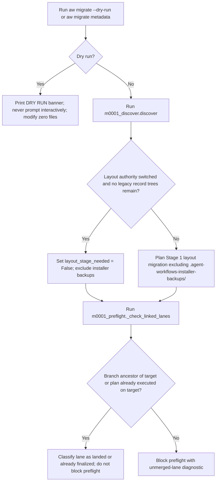

- Id: aug8qe
- Status: open
- Set: aug8qe
- Work-Kind: bug
- Priority: high
- Summary: Fix aw migrate --dry-run wizard prompt, m0001_discover layout-stage false positives, and preflight finalized-lane checks
- Short-Description: Fix aw migrate --dry-run wizard prompt, m0001_discover layout-stage false positives, and preflight finalized-lane checks
- Blocks-Release: next

> Write and proofread this backlog item per the technical writing standard, `.aw/system/workflows/technical-writing/technical-writing.md` (`.agents/workflows/technical-writing/technical-writing.md` in a legacy-layout install), including requirement 12 (diagrams).

## Workflow history
- 2026-11-26 created (aw backlog): Fix aw migrate --dry-run wizard prompt, m0001_discover layout-stage false positives, and preflight finalized-lane checks

## Problem

Auditing `aw migrate` and `aw migrate metadata` (`m0001`) on a legacy repository whose layout migration had already completed uncovered three migration entry and preflight defects:

1. **`aw migrate --dry-run` prompts interactively and prints no dry-run notice:**
   - In `agent_workflows/cli.py::_run_migrate_bare`, when `apply_mode` is `False` (under `aw migrate --dry-run`) and output is human-formatted (non-JSON, non-agent), the command passes `action=None` into `_run_migrate_layout`.
   - That enters the interactive layout wizard and asks whether to rename migrated records, then prints the layout plan and exits `0` without printing a dry-run banner or stating that zero files changed.
2. **`m0001_discover.discover` falsely requires Stage 1 layout migration and copies installer backups into `.aw/state`:**
   - Even after layout authority has switched (`Authority: switched`), `agent_workflows/migrations/m0001_discover.py::discover` sets `layout_stage_needed = True` when `.agents/` still contains non-record host assets (such as `README.md`, `skills/`, or legacy `workflows/`).
   - `m0001` then plans to copy `.agent-workflows-installer-backups/` files into `.aw/state`.
3. **`m0001` preflight `LANES` check reports `landed=false` for already-finalized rebased lanes:**
   - `agent_workflows/migrations/m0001_preflight.py::_check_linked_lanes` relies on `agent_workflows/runner_shared.py::lane_work_has_landed`, which checks only `git merge-base --is-ancestor <branch> <target>`.
   - When an executed plan's lane commits were rebased or re-committed onto `main` and the plan is already finalized in `plans/executed/` on `main`, `m0001` preflight refuses with `landed=false` instead of distinguishing an already-finalized lane from genuinely unmerged work.

## Scope boundaries and related items

- `_run_migrate_bare` layout-pending detection and completed layout transaction closure are tracked in backlog item `d31qxm` (Make `aw install --to-aw` leave a clean, valid 2.0.0 repository).
- Bumping `CURRENT_METADATA_SCHEMA` from `1` to `2` is owned by `metastore` cutover plan `cxxmyv`.
- Automatic teardown and pruning of superseded sibling lanes (`LANE_SUPERSEDED`) are tracked in backlog item `mt3qxm`.

## Target flow

## Affected code

- `agent_workflows/cli.py`: `_run_migrate_bare`, `_run_migrate_layout`
- `agent_workflows/migrations/m0001_discover.py`: `discover`
- `agent_workflows/migrations/m0001_preflight.py`: `_check_linked_lanes`
- `agent_workflows/runner_shared.py`: `lane_work_has_landed` (if helper extension is shared)

## Acceptance criteria

1. Running `aw migrate --dry-run` in human output mode must not invoke an interactive prompt, must print an explicit dry-run notice stating that zero files were modified, and must leave the working tree untouched.
2. When layout authority is already switched and `.agents/` holds only non-record host assets (such as `skills/`, `README.md`, or leftover shims), `m0001_discover.discover` must set `layout_stage_needed = False`.
3. `m0001_discover.discover` and Stage 1 planning must never plan copying `.agent-workflows-installer-backups/` into `.aw/state`.
4. `m0001_preflight._check_linked_lanes` must distinguish a linked lane whose plan is already finalized in `plans/executed/` on the target branch (even when the lane commits were rebased) from a lane holding unmerged in-flight work, and must continue to refuse lanes with genuinely unmerged, non-finalized changes.
5. Behavioral regression tests must cover `aw migrate --dry-run` non-interactive output, `m0001_discover.discover` with switched layout authority and `.agent-workflows-installer-backups/`, and `m0001_preflight._check_linked_lanes` on both rebased-finalized lanes and genuinely unmerged lanes.
