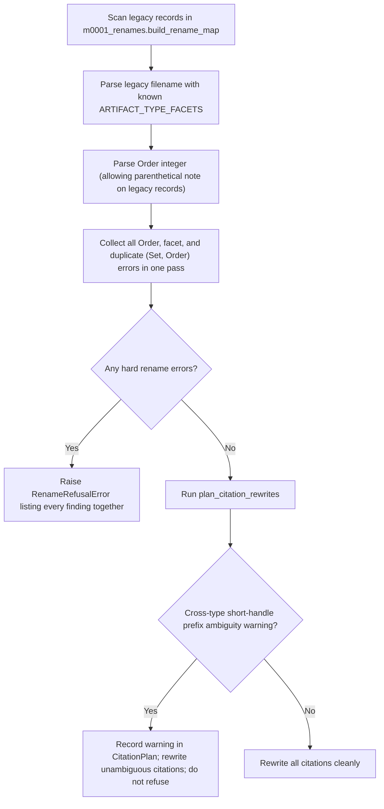

- Id: emfcrf
- Status: open
- Set: emfcrf
- Work-Kind: bug
- Priority: high
- Summary: Harden m0001 rename and citation planner for multi-error reporting, dot slugs, annotated Order, and cross-type prefix warnings
- Short-Description: Harden m0001 rename and citation planner for multi-error reporting, dot slugs, annotated Order, and cross-type prefix warnings
- Blocks-Release: next

> Write and proofread this backlog item per the technical writing standard, `.aw/system/workflows/technical-writing/technical-writing.md` (`.agents/workflows/technical-writing/technical-writing.md` in a legacy-layout install), including requirement 12 (diagrams).

## Workflow history
- 2026-11-26 created (aw backlog): Harden m0001 rename and citation planner for multi-error reporting, dot slugs, annotated Order, and cross-type prefix warnings

## Problem

Auditing `aw migrate metadata` (`m0001`) on a real legacy repository uncovered three defects in filename parsing, rename planning, and citation rewriting:

1. **`m0001_renames` fails fast on the first refusal and rejects annotated integer `Order` values:**
   - In `agent_workflows/migrations/m0001_renames.py`, `_parse_order_int` calls `int(raw_order.strip())` and raises `RenameRefusalError` on the first non-integer `Order` value.
   - Immediately above it, `_parse_terse_set` strips parenthetical annotations from `- Set: <terse> (<desc>)`, whereas `_parse_order_int` rejects legacy values such as `- Order: 0 (orchestrator)` and `- Order: 4 (hot-path domain slice; child of the -04 slice orchestrator)`.
   - Because `build_rename_map` raises immediately on each refusal category (`Order`, unknown facet, duplicate `(Set, Order)`, citation ambiguity), an operator must run `aw migrate metadata` repeatedly to discover one refusal at a time.
2. **`_LEGACY_TIMESTAMP_RE` misparses dots inside a legacy slug as an unknown compound facet:**
   - In `agent_workflows/artifact_naming.py`, `_LEGACY_TIMESTAMP_RE` excludes `.` from `slug` while allowing `.` in `facet`.
   - A legacy prompt named `20260710-1800-00-contracts-review-prompt-generator.execute.prompt.md` is parsed as `slug='contracts-review-prompt-generator'` and `facet='execute.prompt'`, causing `build_rename_map` to refuse with `unknown facet 'execute.prompt' (must be in ARTIFACT_TYPE_FACETS)`.
3. **`plan_citation_rewrites` turns cross-type legacy timestamp prefix warnings into a hard refusal:**
   - In `agent_workflows/migrations/m0001_renames.py::plan_citation_rewrites`, any non-empty `warnings` list from `artifact_refs.plan_reference_rewrites_with_warnings` raises `RenameRefusalError`.
   - When two historical artifacts of different types share a legacy `YYYYMMDD-HHMM-NN` prefix (for example, an executed plan and a research document created in the same minute), `m0001` refuses to migrate the entire repository even though full-filename citations remain unambiguous and leaving genuinely ambiguous short handles unrewritten with a recorded warning is safer than rewriting historical filenames.

## Target flow

## Affected code

- `agent_workflows/artifact_naming.py`: `_LEGACY_TIMESTAMP_RE` (and legacy filename parsing helpers)
- `agent_workflows/migrations/m0001_renames.py`: `_parse_order_int`, `build_rename_map`, `plan_citation_rewrites`

## Acceptance criteria

1. `artifact_naming._LEGACY_TIMESTAMP_RE` (or its parser) must match only known `ARTIFACT_TYPE_FACETS` before `.md` and fold earlier dot-separated segments (such as `.execute` in `...generator.execute.prompt.md`) into the slug instead of failing with `unknown facet`.
2. `m0001_renames._parse_order_int` must accept a leading integer followed by a parenthetical annotation on legacy records (matching `_parse_terse_set`) and continue to reject values without a valid leading integer.
3. `m0001_renames.build_rename_map` must collect all rename-stage refusals across the repository (`Order`, facet, and duplicate `(Set, Order)` findings) and report the complete list in one refusal rather than failing fast on the first invalid file.
4. `m0001_renames.plan_citation_rewrites` must surface cross-type legacy `YYYYMMDD-HHMM-NN` short-handle ambiguity warnings in the migration report (leaving only the ambiguous short handles unrewritten while still rewriting unambiguous full-filename citations) instead of aborting the migration with `RenameRefusalError`.
5. Behavioral regression tests must verify dot-containing legacy slugs, annotated legacy `Order` parsing, multi-error aggregation in a single `build_rename_map` pass, and cross-type prefix collision warning handling in `plan_citation_rewrites`.
