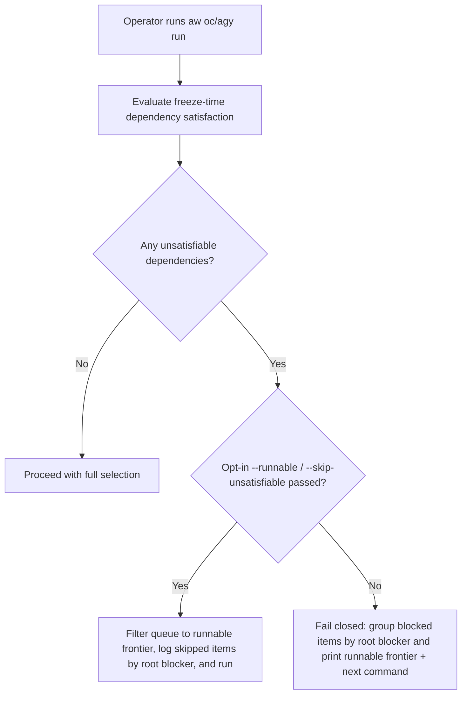

- Id: oxv48x
- Status: open
- Set: oxv48x
- Work-Kind: feature
- Priority: medium
- Summary: aw oc/agy run aborts on RUN-DEPENDENCY-UNSATISFIABLE without surfacing the runnable frontier or grouping root blockers
- Short-Description: aw oc/agy run aborts on RUN-DEPENDENCY-UNSATISFIABLE without surfacing the runnable frontier or grouping root blockers

> Write and proofread this backlog item per the technical writing standard, `.aw/system/workflows/technical-writing/technical-writing.md` (`.agents/workflows/technical-writing/technical-writing.md` in a legacy-layout install), including requirement 12 (diagrams).

## Workflow history
- 2026-11-26 created (aw backlog): aw oc/agy run aborts on RUN-DEPENDENCY-UNSATISFIABLE without surfacing the runnable frontier or grouping root blockers

## Problem

When an operator passes a set or a list of Implementation Plan Document (IPD) IDs to `aw oc run` or `aw agy run`, `agent_workflows/runner_shared.py::enforce_freeze_time_refusal` evaluates every queued item's dependencies and aborts the entire run if any item has an unsatisfiable dependency.

On a long serial dependency chain (for example a 20-plan set where 1 or 2 upstream plans are still `reviewed` or `to-review` and 15 downstream plans are `approved`), freeze-time preflight prints one `[RUN-DEPENDENCY-UNSATISFIABLE]` line per transitive dependent and exits without naming:

1. Which upstream plan is the root blocker of the chain.
2. Which selected items have all prerequisites satisfied right now (the runnable frontier).
3. A single command or opt-in flag to run only the currently runnable subset without manually extracting IDs.

## Desired behavior

## Acceptance criteria

- By default (with no opt-in flag), `agent_workflows/runner_shared.py::enforce_freeze_time_refusal` must keep whole-run fail-closed refusal so no partial run executes unexpectedly.
- When freeze-time refusal reports `[RUN-DEPENDENCY-UNSATISFIABLE]` findings, the error output must group transitive dependents under their root blocker(s) instead of repeating flat redundant lines, and must list the currently runnable frontier IDs (if non-empty) with a copyable next command.
- `aw oc run` and `aw agy run` must support an explicit opt-in flag (for example `--runnable` or `--skip-unsatisfiable`) that narrows the selection to items whose dependencies are satisfied (or satisfiable within the narrowed queue), records the skipped items and their root blockers in the run output, and refuses cleanly if the runnable frontier is empty.
- Behavioral tests must exercise both drivers (`agent_workflows/oc_runipd.py` and `agent_workflows/agy_runipd.py`) on a multi-step chain with a blocked upstream node and a runnable sibling branch, asserting on grouped error output, runnable-frontier reporting, and opt-in narrowed execution.
