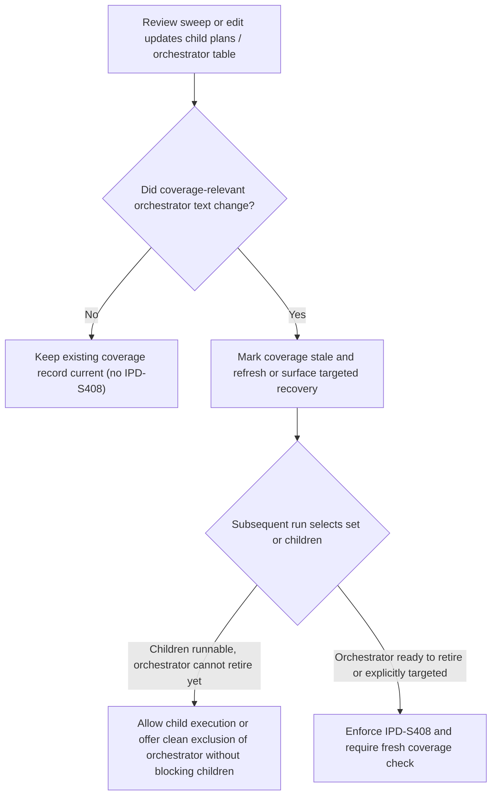

- Id: s1kxai
- Status: open
- Set: s1kxai
- Work-Kind: bug
- Priority: high
- Summary: Child review sweeps leave parent orchestrators with stale IPD-S408 coverage records that block subsequent runs
- Short-Description: Child review sweeps leave parent orchestrators with stale IPD-S408 coverage records that block subsequent runs
- Blocks-Release: next

> Write and proofread this backlog item per the technical writing standard, `.aw/system/workflows/technical-writing/technical-writing.md` (`.agents/workflows/technical-writing/technical-writing.md` in a legacy-layout install), including requirement 12 (diagrams).

## Workflow history
- 2026-11-26 created (aw backlog): Child review sweeps leave parent orchestrators with stale IPD-S408 coverage records that block subsequent runs

## Problem

When a review sweep edits child Implementation Plan Documents (IPDs) or updates a parent orchestrator's `## Child IPDs` table, the parent orchestrator's recorded coverage fingerprint becomes stale. `agent_workflows/orchestrator_readiness.py` then reports `CODE_COVERAGE_STALE` (`coverage-record-stale`), and `agent_workflows/ipd_lint.py` emits `IPD-S408` (`C_ORCH_NOT_READY`).

Two user-facing failures compound this issue:

1. **Subsequent runs block on the stale orchestrator.** Running `aw oc run <set>` or `aw agy run <set>` (or piping approved IDs from `aw attention -s approved --ids`) includes the Order-0 orchestrator in freeze-time preflight (`agent_workflows/runner_shared.py::enforce_freeze_time_refusal`), which aborts the entire run with `[RUN-STRUCTURE-PREFLIGHT] ... violates IPD-S408` even when none of the children can finish in that run and the orchestrator cannot retire yet.
2. **`aw attention -s approved` mixes Order-0 orchestrators with executable children.** Operators filtering approved plans to feed into a runner cannot distinguish or exclude `Kind: orchestrator` plans from executable `Kind: child` plans without manual inspection.

## Desired behavior

## Acceptance criteria

- Review sweeps that land valid edits to child plans or an orchestrator's child table must either refresh the affected orchestrator's coverage record automatically (when a model host is available) or surface a single explicit post-sweep next step naming `aw ipd coverage <id6>` before the operator launches a follow-up execution run.
- `agent_workflows/orchestrator_readiness.py` and `agent_workflows/runner_shared.py::enforce_freeze_time_refusal` must distinguish between (a) targeting an orchestrator for retirement or status advancement (where `IPD-S408: coverage-record-stale` must remain a hard preflight gate) and (b) running a set's executable child plans before all children have executed (where a stale parent coverage record should not needlessly prevent approved children from making progress, or must provide a documented opt-out/child-only selector).
- `aw attention` must support filtering by plan kind (for example `--kind child` / `--kind orchestrator` or an equivalent documented flag) so operators can list executable child plans separately from Order-0 orchestrators.
- Behavioral tests must verify that stale coverage continues to gate orchestrator retirement and orchestrator status advancement (`IPD-S408`), while the chosen recovery or child-only selection path unblocks child execution cleanly.
