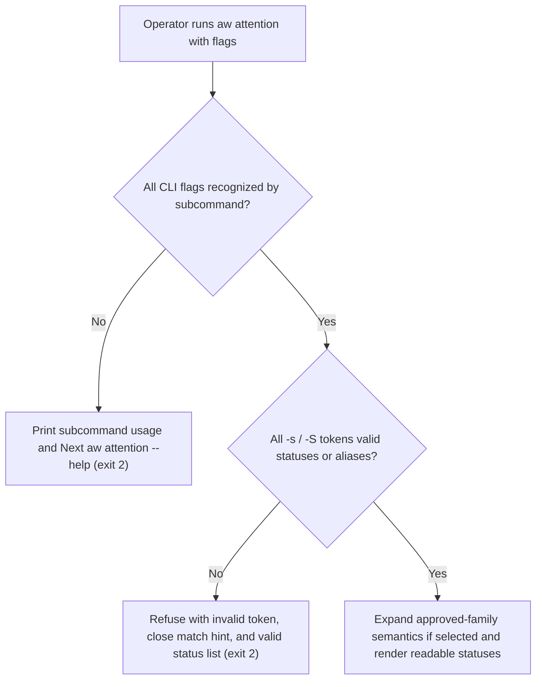

- Id: x83m2c
- Status: open
- Set: x83m2c
- Work-Kind: bug
- Priority: medium
- Summary: aw attention omits auto-approved under -s approved, ignores unknown or truncated status tokens, and prints top-level help on unknown subcommand flags
- Short-Description: aw attention omits auto-approved under -s approved, ignores unknown or truncated status tokens, and prints top-level help on unknown subcommand flags
- Blocks-Release: next

> Write and proofread this backlog item per the technical writing standard, `.aw/system/workflows/technical-writing/technical-writing.md` (`.agents/workflows/technical-writing/technical-writing.md` in a legacy-layout install), including requirement 12 (diagrams).

## Workflow history
- 2026-11-26 created (aw backlog): aw attention omits auto-approved under -s approved, ignores unknown or truncated status tokens, and prints top-level help on unknown subcommand flags

## Problem

Operators running `aw attention` (aliased as `aw att`) encounter three related command-line interface (CLI) defects:

1. **Approved filter drops `auto-approved` plans.** `agent_workflows/attention.py::matches_status` performs exact membership matching against `it.native_status` and `it.attention_class`. Running `aw attention -s approved -t plan <set>` omits Implementation Plan Documents (IPDs) whose status is `auto-approved`, even though `auto-approved` plans are ready to execute alongside `approved` plans. Operators who pipe `aw attention -s approved --ids` into `aw oc run` or `aw agy run` silently drop runnable `auto-approved` prerequisites and trigger downstream dependency refusals.
2. **Truncated status display collides with unvalidated status filters.** `agent_workflows/attention.py::_abbrev_status` slices status words to 8 characters (`supersed`, `auto-app`, `to-revie`). Meanwhile, `agent_workflows/attention.py::parse_status_filters` accepts any token without checking it against the known status vocabulary. When an operator copies a truncated status word from the table into `-S supersed` or mistypes a status, `aw attention` silently returns unfiltered or empty output with exit code 0 instead of refusing with the valid status list (unlike `aw ipd --status` and `aw find --status`, which reject unknown tokens).
3. **Subcommand flag errors emit top-level help.** When an operator passes an unrecognized flag to a subcommand (for example `aw att --date 20261102`), `agent_workflows/cli.py::_AWParser.error` prints the top-level `agent-workflows` usage block and `Next  aw --help` instead of the subcommand's usage block and `Next  aw attention --help`.

## Desired behavior

## Acceptance criteria

- `agent_workflows/attention.py::parse_status_filters` and the `aw attention` entry path must validate every `-s`/`--status` and `-S`/`--status-not` token against the recognized native statuses and attention classes across selected trees, and must exit non-zero with the unknown token and valid status names when a token is unrecognized.
- The `aw attention` table renderer (`agent_workflows/attention.py::_abbrev_status` and `_render_table_row`) must avoid producing misleading truncated tokens that fail when passed back to `-s`/`-S` (either by widening the Status column to fit full status names or by mapping documented unambiguous abbreviations that `-s`/`-S` accept).
- Filtering executable approved plans in `aw attention` must provide clear, documented behavior for `auto-approved` (either including `auto-approved` under `-s approved` or providing an explicit documented filter such as `ready-to-execute` while documenting the exact distinction between `approved` and `auto-approved`).
- `agent_workflows/cli.py::_AWParser.error` must emit the invoked subcommand's usage and `Next  aw <subcommand> --help` when an unrecognized argument is passed after a recognized subcommand (such as `aw att --date ...`).
- Behavioral tests must verify each of the four criteria via CLI invocations and assert on exit codes, stderr text, and filtered item IDs.
