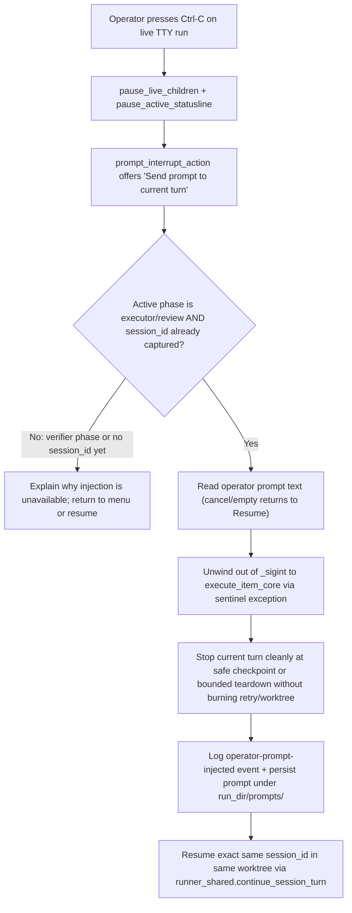

- Id: 9ici96
- Status: open
- Set: 9ici96
- Work-Kind: feature
- Priority: medium
- Summary: Add Ctrl-C interrupt menu option to inject a prompt into a live aw agy|oc run
- Short-Description: Add Ctrl-C interrupt menu option to inject a prompt into a live aw agy|oc run

> Write and proofread this backlog item per the technical writing standard, `.aw/system/workflows/technical-writing/technical-writing.md` (`.agents/workflows/technical-writing/technical-writing.md` in a legacy-layout install), including requirement 12 (diagrams).

## Workflow history
- 2026-11-27 created (aw backlog): Add Ctrl-C interrupt menu option to inject a prompt into a live aw agy|oc run

## Problem

When an operator presses Ctrl-C during a live interactive `aw oc run` or `aw agy run` session, `agent_workflows/runner_stop.py::handle_interactive_interrupt` pauses the child process group (`pause_live_children`) and displays a 4-option capped menu (`prompt_interrupt_action`):

1. Resume?
2. Finish current item, clean up, and exit?
3. Clean up and exit?
4. Exit, leaving a mess?

Operators who notice an in-flight agent drifting, missing a constraint, or taking the wrong approach currently cannot steer the active turn without aborting the item, waiting for teardown, and restarting.

## Technical constraints and prerequisites

- **Headless turns cannot read mid-turn stdin.** Both `agent_workflows/oc_runipd.py::run_opencode` (`opencode run --format json`) and `agent_workflows/agy_runipd.py::run_agy_turn` (`agy --output-format stream-json`) run non-interactively with stdin already consumed or closed. Injecting a prompt therefore requires an **interrupt-and-resume-same-session** flow rather than writing to the paused child's stdin.
- **Session-continuation prerequisite (`z4kwzd`).** Plan `z4kwzd` (`aw agy|oc prompt`) introduces `agent_workflows/runner_shared.py::continue_session_turn` as the host-neutral session-resumption seam. This backlog item reuses `continue_session_turn` rather than duplicating session-resume logic.
- **Signal safety and spec `c4gd2h` invariants.** `agent_workflows/runner_stop.py` owns POSIX `SIGINT`/`SIGTERM` handlers while `agent_workflows/runner_shared.py` must not import `signal`. Launching a follow-up turn must never happen inside `_sigint`; the handler must unwind to `runner_shared.py::execute_item_core` through a dedicated sentinel exception (for example `InjectPromptInterrupt`). Stop-request escalation under spec `c4gd2h` R9 must remain monotonic and unaffected by a prompt injection.

## Desired behavior

## Edge cases that the design and `/plan-review` must resolve

1. **In-flight tool safety:** stopping the interrupted child cleanly (preferring `StopAtCheckpoint` / bounded wind-down before termination) so an active `git commit`, file write, or test process is not left half-written inside the worktree.
2. **Pre-session-ID race:** if Ctrl-C arrives before the host emits its `session_id` in stream JSON, the menu must refuse injection cleanly (or offer waiting/resuming) rather than launching an orphaned fresh session.
3. **Phase boundaries:** disallow or explicitly gate prompt injection during an independent **verifier** turn (`build_verifier_prompt`) so operator steering cannot silently invalidate verification independence.
4. **Attempt, retry, and timeout accounting:** injecting a prompt must not burn a retry budget slot or mark the item failed/interrupted, must keep `render_stream.StreamTracker` token and elapsed totals continuous, and must reset the stall timeout for the resumed continuation turn.
5. **Nested Ctrl-C and non-TTY safety:** pressing Ctrl-C while typing the injected prompt must cancel cleanly (back to the menu or clean teardown), and non-TTY / `--unattended` runs must continue using the existing `SIGINT_LADDER` unchanged (`interrupt_menu_is_safe`).

## Acceptance criteria

- `agent_workflows/runner_stop.py::prompt_interrupt_action` and `handle_interactive_interrupt` must expose a "Send prompt" option on interactive TTY runs while preserving all four existing options and keeping non-TTY `SIGINT_LADDER` behavior unchanged.
- Selecting "Send prompt" must never spawn a child process inside `_sigint`; it must unwind cleanly back to `agent_workflows/runner_shared.py::execute_item_core` and resume the exact same `session_id` in the same worktree via `runner_shared.py::continue_session_turn` on both OpenCode (`oc_runipd.py`) and Antigravity (`agy_runipd.py`).
- Every injected prompt must be persisted under `<run_dir>/prompts/` and recorded as an auditable `operator-prompt-injected` event in `<run_dir>/events.jsonl` without consuming a retry attempt or tearing down the active worktree.
- The implementation must refuse injection cleanly when no `session_id` has been observed yet or when the active turn is an independent verifier turn, and must preserve spec `c4gd2h` monotonic stop-request invariants.
- Behavioral tests must exercise both hosts (`oc` and `agy`) through simulated `SIGINT` interruption, prompt capture, clean child stop, same-session continuation, pre-session-ID refusal, verifier-turn refusal, and cancel/empty-input resume.
