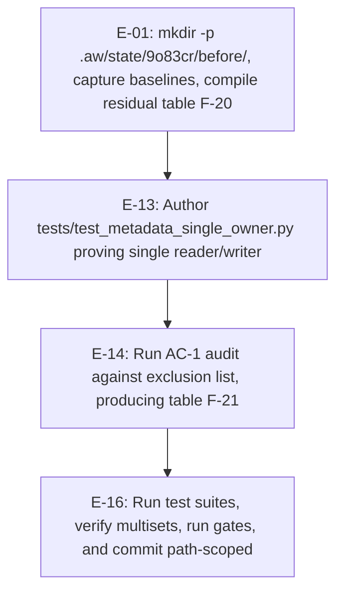

# IPD: Delete INDEX and STATUS code and every legacy parser outside artifact_meta

- Date: 2026-11-02
- Kind: child
- Concern: Spec `4sd62s` C5 allows exactly one metadata reader and writer (`artifact_meta`), 4.3 requires deleting every parser listed in section 1 plus the smaller helpers, and 4.5 says the SQLite cache REPLACES the `INDEX.{json,md}` files, `plans/STATUS.md` and `artifact_audit._INDEX_CACHE`, with `aw index plans|research|prompts` kept only as informational aliases of `aw index rebuild` and `check.stale-index-*` deleted. Phases A and B (Orders 02 to 10) move every caller onto `artifact_meta` but deliberately leave the old code in place (handoffs from `1ajqaa`, `dcerjg`, `2xwb9b`, `xexn45`, `ffceq0`, `t4gl15`, `59aiyh`). Measured 2026-11-02 at `0cbfcc706`: `stale-index` occurs 36 times in 7 modules; 31 package modules name `INDEX.json`, `INDEX.md` or `STATUS.md`; three `run_index` functions write INDEX files and 11 production call sites regenerate them; 200 `^-` metadata regex call sites remain in 35 files; and at least 25 named parser or helper symbols outside `artifact_meta` exist (F-06). Until they are deleted, C5 is not met and AC-1 and AC-9 cannot pass.
- Scope: Phase B, section 7 step 7 of `4sd62s`, FINISHING PART after the 2026-11-07 split. The deletions themselves now run in five earlier parts: aliases, regeneration calls, stale-index rules and the INDEX documents (`q6epwc`); INDEX writers, STATUS code and `_INDEX_CACHE` (`snin8q`); value writers, adapters, borrowed grammars and record text readers (`k6jd6l`); `check_engine`, runner, setter and release parsers (`e8420v`); every other metadata regex literal (`0xsx2n`). This plan keeps: (1) the residual audit F-20 after all five parts (E-01); (2) the AC-1 behavioral test (E-13); (3) the AC-1 audit F-21 with its exclusion file (E-14); (4) the final validation and commit (E-16). EXCLUDES: anything that needs the log format or the migrated tree (cutover, `cxxmyv`), and document rewrites for log-based commands (`90iqr1`).
- Scope-Paths: tests/test_metadata_single_owner.py, .aw/records/plans/pending/20261102-metastore-11-9o83cr-delete-index-and-status-code-and-every-legacy-parser-outside.ipd.md
- Item-Dependencies: executed:0xsx2n, executed:1ajqaa, executed:59aiyh, executed:75jciz, executed:clors0, executed:dcerjg, executed:e8420v, executed:ffceq0, executed:fkvrc7, executed:g5hpbb, executed:k6jd6l, executed:q6epwc, executed:snin8q, executed:t3t7za, executed:t4gl15, executed:wgn3bl
- Status: executed
- Readiness: go-pending-approval
- From-Spec: 4sd62s
- Work-Kind: feature
- Priority: high
- Blocks-Release: next
- Set: metastore
- Order: 11
- Highest E allocated: 16
- Author: opencode its_direct/pt3-claude-opus-5.5-1m-us
- Id: 9o83cr
- Review-Depth: complex

## Workflow history
- 2026-11-25 executed (aw agy run model=Gemini-4-Neon-High): aw agy run self-finalize: 9o83cr verified (set metastore, attempt 1).
- 2026-11-25 note (antigravity): added executed:wgn3bl, executed:t3t7za, executed:fkvrc7, executed:75jciz (Orders 301-304 split from superseded rgva3w) per maintainer decision on run-20261125T031842Z-2538031 so cleanup executes before 9o83cr V-14.
- 2026-11-16 approved (aw set): status set to approved

- 2026-11-14 reviewed (antigravity/gemini-3.8-flash): /plan-review (antigravity/gemini-3.8-flash): APPROVE WITH REVISIONS APPLIED; PR-001, PR-002, PR-003, PR-004, PR-005, PR-006
- 2026-11-09 note (opencode its_direct/pt3-claude-opus-5.5-1m-us): round-3 check per research nj8zdp; already within guidance (0 IPD-Z603), no items moved; V-16 evidence now names the E-13 module and the F-21 recount.
- 2026-11-07 note (opencode its_direct/pt3-claude-opus-5.5-1m-us): split per maintainer step-complexity rule; items E-02, E-04, E-05, E-15 moved to q6epwc; E-03, E-06, E-07 to snin8q; E-08, E-09, E-10, E-11 to k6jd6l; E-12 split across e8420v and 0xsx2n.
- 2026-11-07 same-status (aw set): maintainer direction 2026-11-07 (spec 4sd62s C12/5.2a step 3a): the any-repo migration and multi-shape cache (g5hpbb) must land before any reader move and before the cutover
- 2026-11-07 to-review (aw set): demoted approved -> to-review: APPROVAL WITHDRAWN: maintainer direction 2026-11-07: paused before re-review; the metastore plans MUST build the tools that migrate ANY repo from ANY prior format (.agents layout, id-less/untitled records, no sidecar), not only this repository. Re-review against the amended spec 4sd62s before re-approval.
- 2026-11-07 approved (aw set): status set to approved
- 2026-11-06 reviewed (aw set): APPROVE WITH REVISIONS APPLIED; PR-001..PR-010 FIXED
- 2026-11-06 /plan-review (opencode/its_direct/pt3-claude-opus-5.5-1m-us): APPROVE WITH REVISIONS APPLIED; PR-001..PR-010 FIXED; review record .aw/records/reviews/20261102-metastore-11-9o83cr-delete-index-and-status-code-and-every-legacy-parser-outside.review.md
- 2026-11-05 to-review (aw set): authored review-ready for spec 4sd62s (Set metastore)

- 2026-11-02 draft (opencode its_direct/pt3-claude-opus-5.5-1m-us): created.

## Goal

Prove that `artifact_meta` is the only code that reads or writes artifact metadata and that the SQLite cache is the only metadata index, after the five split parts deleted the INDEX and STATUS code, the stale-index rules and every legacy parser, writer helper and adapter: a residual audit (E-01), the AC-1 behavioral test (E-13) and the AC-1 audit (E-14).

## Detailed Implementation Checklist (TODO)

Execution-state rule: mark an `E-*` item complete only after performing the action. That mark is not validation. Right-sizing rule: each E-item must address one concern and be executable in one focused pass; split when an E-item names multiple distinct deliverables or independent test-surfaces. Accepted execution states: blocked, failed, pending, performed; terminal gate demands 'performed'.

PIN RULE for every deletion or retarget: before the edit, save the named test modules' per-test outcome list (`python3 -m pytest -o addopts="" -m "" -p no:randomly -n 0 -rA <modules> | grep -E "^(PASSED|FAILED|ERROR|SKIPPED|XFAIL|XPASS) " | sed -E 's/ - .*//' | sort > .aw/state/9o83cr/<E>-before.txt`); after it, run the same command into `<E>-after.txt`. A retargeted test keeps every input case, so the after-list may rename a test but not drop a case; the evidence pastes both lists and maps each removed name to its successor. A count measured at authoring (F-01 to F-11) is context, never the bar.

### Task group 1: baseline and residual audit

- [x] E-01 Record the baseline and the residual inventory: ensure `.aw/state/9o83cr/before/` exists (`mkdir -p .aw/state/9o83cr/before/`), and save to the gitignored `.aw/state/9o83cr/before/` (never `/tmp`, which a lane integration discards) the stdout and exit code of `aw index plans --agent`, `aw index research --check --agent`, `aw check plans --all --agent`, `aw check research --all --agent`, `aw check prompts --all --agent`, `aw find plans --agent`, `aw attention --format json`, `aw doctor --agent`, `aw ipd board` (as `board.txt`) and `aw check all --agent` and `aw check all --all --agent` (rule-id multisets, `jq -r '.diagnostics[].rule' | sort | uniq -c`), plus the core gate summary line of `python3 -m pytest`. `--all` matters: `check_engine.check_content` reaches `plans_index.check_drift` and `research_index.check_drift` only when `include_retired` is set, so without it the INDEX rules and the F-04 content rules never appear (measured at review: `aw check all --agent` has 0 `check.stale-index-*` findings and `aw check all --all --agent` has 2). Re-run the four AC-1 searches of E-14 and `rg -n "INDEX\.(json|md)|STATUS\.md|stale-index|_INDEX_CACHE|run_index|check_drift" agent_workflows`, merge in the residual tables F-12 of `ffceq0`, F-04 of `t4gl15` and F-09 of `xexn45`, and write table F-20 in this plan: one row per hit, classed `delete (E-nn)`, `body prose (N3)`, `comms (N4)`, `user prose (90iqr1)` or `cutover (cxxmyv)`. Any hit not in F-06 gets a row. After the split, every `delete` row is expected to be gone already (deleted by `q6epwc`, `snin8q`, `k6jd6l`, `e8420v` or `0xsx2n`, which all execute before this plan); a surviving `delete` row is a defect of the part that owned it and is reported as `delete (follow-on)` with that part's id rather than fixed here. Also search `tools/` for callers of every symbol this plan deletes (measured at review: `tools/gate_drop_audit.py` calls `check_engine._status_meta` and `backlog.parse_item`, pinned by `tests/test_gate_drop_audit.py`), and give each a row; a `tools/` caller should already be retargeted by the part that deleted its symbol (`k6jd6l` E-18, `e8420v` E-20).
  - Depends on: none
  - Expected outcome: the saved outputs and a core gate summary exist under `.aw/state/9o83cr/before/`; F-20 exists with no unclassed row and covers `agent_workflows` and `tools`.
  - Execution state: performed

### Task group 2: single-owner proof (AC-1)


- [x] E-13 Add `tests/test_metadata_single_owner.py` (core, records built with `tests/record_builder.py`) for AC-1 part (2), without reading any source: (a) monkeypatch `artifact_meta.read`, `query`, `history`, `resolve` and `read_at` to return one sentinel state for a built plan, then drive `aw find`, `aw attention --format json`, `aw show <id6> --format json`, `aw ipd lint`, `aw check plans --agent` and the `aw ipd-executed-gate` leaf on a staged fixture, and assert each output reflects the sentinel status, not the on-disk bullet; (b) monkeypatch `artifact_meta.append` and `create` to raise, then run `aw ipd set`, `aw backlog set`, `aw specs set`, `aw group plans` and `aw prompts new`, and assert each exits nonzero and every record file is byte-identical afterwards; (c) with no patch, the same setters change the state that `artifact_meta.read` returns.
  - Depends on: E-01
  - Expected outcome: a passing core module whose assertions are on CLI exit codes, stdout and file bytes.
  - Execution state: performed

- [x] E-14 Run the AC-1 part (1) audit and record it as table F-21: `rg -n "re\.(compile|search|match|finditer|findall|sub|fullmatch)\(\s*r?[\"'](\(\?m\))?\^-" agent_workflows`, `rg -n "Workflow history" agent_workflows`, `rg -n "aw-prompt|aw-managed-prompt" agent_workflows` and `rg -n "records/meta" agent_workflows`, each piped through ONE listed exclusion pattern file `.aw/state/9o83cr/ac1-exclusions.txt` (also pasted in full into F-21, so the evidence survives the lane) that names every excluded pattern (N3 body prose: OQ-row fields such as `Carrier`, `Carrier-Evidence`, `Carrier-Declined`, `Blocking`, and `plan_readiness._OQ_FIELD_RE`/`_OQ_HEADING_RE`; E/V checklist fields; N4 `comms`; user-facing help or managed-block text rewritten by `90iqr1`; code that the cutover moves into `m0001`). F-21 lists each surviving hit with its class; no hit outside `artifact_meta.py` and `migrations/m0001_*.py` may be a parser or writer. The phase-B legacy loader lives in `artifact_meta.py` (`tve77h` E-11), so its hits are expected there until `cxxmyv` moves it into `m0001`.
  - Depends on: E-13
  - Expected outcome: F-21 shows parser and writer hits only in `artifact_meta.py` and `migrations/m0001_*.py`; every other hit is covered by a listed exclusion.
  - Execution state: performed

### Task group 3: finish


- [x] E-16 Finish: run every test module named in E-13 and E-14, the bare core gate `python3 -m pytest` (within its 30 s budget), `make test-all`, `aw check all --agent` and `aw check all --all --agent` (rule-id multisets equal the E-01 baselines; any difference traced to a record changed in between), `aw ipd lint --all` (no new diagnostic), `aw sanitize --agent`, and `pyproject.toml` `dependencies` unchanged; commit through `aw commit 9o83cr -- <paths>` with only Scope-Paths files,  never `git add -A`, a bare `git add` or `git commit -a`; never push.
  - Depends on: E-14
  - Expected outcome: all runs pass; every commit's `git show --stat` lists only Scope-Paths files (or paths justified at finalize).
  - Execution state: performed

## Project conventions discovered (Step 0)

- Typed verbs route through `artifact_types.TYPE_BACKENDS` (`"index": "plans_index.run_index"`, `"research_index.run_index"`, `"prompts_index.run_index"`) and `artifact_types.resolve_backend`, dispatched by `cli._run_noun_verb`; `aw research index` has its own branch in `cli.py` (`if research_cmd == "index":`). `aw index rebuild` is added by `1ajqaa` as `meta_cli.index_rebuild(repo_root) -> CommandResult`, routed before type normalization.
- Drift findings are `artifact_core.Drift(location, rule, detail)`; exit codes come from `artifact_core.drift_exit_code`; severities come from `check_engine.RULE_REGISTRY` (`RuleSpec`), and an unregistered rule falls through to `check_engine._DEFAULT_RULESPEC` (severity `error`), so deleting a rule's emitter and its registry entry must happen together.
- `doctor.build_remediation` matches `"stale-index" in rule` by substring, and its comment states the five `doctor` sites must change together.
- `check_engine.check_content` calls `plans_index.check_drift` and `research_index.check_drift`, which host non-INDEX rules (`name-metadata-mismatch`, `dangling-citation`, `research_index.STALE_STATE_RULE` and six more), so those functions survive with their INDEX classes removed.
- The `artifact_meta` interface (names from `tve77h`, `ffceq0`, `xexn45`): `read(id6) -> State`, `query(...)`, `history(id6)`, `resolve(path_or_id6)`, `read_at(id6, rev)`, `read_text(text, *, record_type=None) -> State`, `create(...)`, `append(id6, events, *, expect_seq)` with `dry_run`, the phase-B `write_legacy` renderer, and the legacy loader (`tve77h` E-11, E-12).
- Test data comes from ONE builder, `tests/record_builder.py` (`RecordBuilder(repo_root)`, `59aiyh`); new tests use it from the start. Core tests carry `pytestmark = pytest.mark.core` (for example `tests/test_plans_index.py`, `tests/test_research_index.py`); the root `conftest.py` selects them on a bare `python3 -m pytest`.
- Commits go through `aw commit <id6> -- <paths>`; plans move to `executed/` only through `aw ipd finalize`.

## Findings

Measured 2026-11-02 at `0cbfcc706` (before phase B; E-01 re-measures, because Orders 06 to 10 and the five split parts delete these). F-01 to F-12 are kept as the authoring record; after the 2026-11-07 split their E-item references (E-02 to E-12, E-15) point at the same ids in the split parts named in `## Deferred`. The re-measurement at `ac76110f4` that sized the split is in each part's Findings (`q6epwc` F-22, `snin8q` F-23, `k6jd6l` F-24 and F-25, `e8420v` F-26, `0xsx2n` F-27).

| # | Evidence | Consequence |
|---|---|---|
| F-01 | `rg -c "stale-index" agent_workflows --type py`: 36 hits in 7 modules (`check_engine` 18, `doctor` 8, `ipd_lifecycle` 3, `plans_index`/`research_index`/`prompts_index` 2 each, `engine` 1). Registry: `"check.stale-index-missing": RuleSpec("info", ...)`, `"check.stale-index-stale": RuleSpec("warning", ...)`. | E-05 deletes all except the `engine.py` `.aw/.gitignore` template comment (cutover). |
| F-02 | 31 package modules name `INDEX.json`, `INDEX.md` or `STATUS.md`. Writers: `plans_index.run_index` (`json_path.write_text`, `md_path.write_text`), `research_index.run_index`, `prompts_index.run_index`, `artifact_core.emit_index_write_result`. `plans.render_status_index` is reached only from `cli._run_plans` `if getattr(args, "write_index", False)`, and no parser defines `--write-index` (`aw ipd board --help` lists no write option). Tracked `.aw/records/plans/STATUS.md` last changed 2026-08-17. | E-03, E-06. The rest are skip-name lists and ignore lines that protect against on-disk files; F-20 classes them `cutover`. |
| F-03 | `run_index` and refresh callers: `artifact_rename.run_rename_generic` (4), `status_set._auto_index_types` (2 calls), `research_cmd` (2), `research_refs` (1), `plans_refs.apply_renames` (1), `artifact_adopt._default_refresh_index`, `ipd_lifecycle._refresh_plans_index_fail_loud` (called from `_finalize_transaction`), `cli` research branch, `artifact_types.TYPE_BACKENDS` (3), `record_producers` (`plans_index`, `research_index` entries). | E-02, E-03, E-04. |
| F-04 | Non-INDEX drift rules inside `check_drift`: `plans_index` emits `name-metadata-mismatch` and `dangling-citation`; `research_index` emits `stale-state-to-promote`, `dangling-consumed-by`, `adopted-without-consumer`, `unrecognized-model`, `research.frontmatter-key-repeated`, `status-tier-mismatch`, `check.research-companion-orphaned`. | These are kept (E-03); E-02 `--check` reports them. |
| F-05 | No CI, Makefile or pre-commit file runs `aw index ... --check` (`rg "aw index\|index --check" .github Makefile .pre-commit-config.yaml .pre-commit-hooks.yaml`: no output). `aw index plans|research` appears 33 times in 10 package modules (help text, notes, managed block). | Alias behavior for `--check` is a compatibility choice, not a CI constraint (OQ-01). |
| F-06 | Section 1 parsers and helpers verified to exist by `rg -n "^def ..."`: `ipd_schema.parse_metadata_block`, `runner_shared._front_matter_bullets`, `status_set._STATUS_RE` (and its loop), `plan_readiness._OQ_FIELD_RE` (body prose, N3), `backlog.parse_item`, `specs._read_status`/`_read_gate`/`_read_blocks_release`/`_read_priority`/`_read_work_kind`/`_read_scope`/`_read_summary`, `research_contract.parse_frontmatter`, `comms.parse_envelope_header` (N4), `prompts.read_metadata_id6`/`read_metadata_status`/`_METADATA_STATUS_RE`, `prompts_index._parse_metadata_comment`, `review_findings._META_RE`, `attention_contract.history_block`/`last_history_at`/`newest_history_record`/`SPEC_STATUS_RE`, `selectors.read_front_matter_id`/`_status`/`_blocks_release`/`metadata_region`/`_ID_RE`/`_STATUS_RE`/`_SET_RE`, `check_engine._metadata_status`/`_blob_text`/`_status_meta`, `releases._in_metadata_region`/`_STATUS_RE`, `attention._frontmatter_block`, `plans._STATUS_RE`/`_SET_RE`/`_ORDER_RE`/`read_status`, `plans_index._META_RE`/`_meta`, `plan_readiness._STATUS_RE`, `artifact_audit._STATUS_LINE_RE`. | E-10 to E-12. `comms` and the OQ-row parser are excluded with a listed pattern (E-14). |
| F-07 | `rg` regex literals starting `^-`: 200 call sites in 35 files; `Workflow history` in 28 modules; `aw-prompt` in 6 modules (`artifact_rename`, `prompts`, `prompts_index`, `artifact_naming`, `check_engine`, `cli`); `records/meta`: none yet. | E-01 and E-14 re-measure after phase B. |
| F-08 | Value writers: 7 `releases.set_*_line`, 3 `backlog` (`set_release_exempt_kind_line`, `set_release_exempt_ref_line`, `set_close_evidence_line`), `research_cmd._set_priority_line`; callers today `status_set` (17 sites), `backlog` (5), `research_cmd` (1). `2xwb9b` reuses them inside `artifact_meta`'s legacy branch. | E-08 moves them into `artifact_meta`. |
| F-09 | `xexn45` F-08 adapters: `plans_refs._set_metadata` (caller `apply_renames`), `artifact_rename._update_frontmatter_metadata` (caller `run_rename_generic`), `prompts.render_metadata_comment` (caller `run_new`), `runner_shared.rederive_front_matter` (caller `apply_records_only_rederivation`); pinned by 5 test files. | E-09. |
| F-10 | `artifact_audit._INDEX_CACHE: OrderedDict` with `_INDEX_CACHE_MAX = 8` inside `artifact_audit.build_index`; tests `tests/test_artifact_audit_index_cache.py` (6 tests), `tests/test_artifact_audit_cache_eviction.py` (4), `tests/test_artifact_audit_identity_staleness.py`. No other Set plan deletes it (`rg _INDEX_CACHE` over the Set's plans: only spec text). | E-07. |
| F-11 | 45 test files reference a symbol this plan deletes (`rg -l` over `tests`). | Each is retargeted to behavior in the E-item that deletes the symbol. |
| F-12 | Documents describing INDEX generation: `README.md`, `CONTRIBUTING.md`, `docs/cli-agent-protocol.md`, `docs/cli-output-contract.md`, `.aw/records/plans/README.md`, `.aw/records/research/README.md` and its template; `tests/test_installed_text_current.py` checks the template text. | E-15. |
| F-20 | Executed 2026-11-25 at `c818bae0c` (E-01): 359 unique hits across all 5 `agent_workflows/` searches (340 hits: Q1=56, Q2=104, Q3=51, Q4=11, Q5=118) plus `tools/` (19 hits; 0 callers of deleted F-06/F-08/F-09 symbols); 0 duplicates across queries; merged against `ffceq0` F-12, `t4gl15` F-04, and `xexn45` F-09. | 0 surviving `delete (follow-on)` rows; every hit is classed in Table F-20 below. |
| F-21 | Executed 2026-11-25 at `c818bae0c` (E-14): 111 surviving hits across the four AC-1 `rg` searches piped through `.aw/state/9o83cr/ac1-exclusions.txt` (Q1=37, Q2=33, Q3=38, Q4=3), 0 outside `agent_workflows/artifact_meta.py` and `agent_workflows/migrations/m0001_*.py`. | AC-1 part (1) satisfied in phase-B form; full exclusion list and surviving hits in Table F-21 below. |

### Table F-20: Residual inventory across `agent_workflows/` and `tools/` (E-01)

Measured 2026-11-25 at `c818bae0c` after all prerequisite parts (`q6epwc`, `snin8q`, `k6jd6l`, `e8420v`, `0xsx2n`, and Orders 301-304 `wgn3bl`, `t3t7za`, `fkvrc7`, `75jciz`) executed. Merged against `ffceq0` F-12, `t4gl15` F-04, and `xexn45` F-09: every former `delete` row from those tables is gone, and `tools/gate_drop_audit.py` no longer calls `check_engine._status_meta` or `backlog.parse_item` (0 hits for deleted symbols across `tools/`). Total raw hits = 359 (Q1=56, Q2=104, Q3=51, Q4=11, Q5=118, tools=19); duplicates across queries = 0; Table F-20 rows = 359.

| Row | Location (symbol) | Query | Match | Class | Note |
|---|---|---|---|---|---|
| F20-001 | `agent_workflows/agy_run.py` (`_candidate_plans`, line 335) | `Q5_index_status` | `# of non-plan files (README.md, INDEX.md, STATUS.md), and legacy root...` | `user prose (90iqr1)` | comment, docstring, or CLI help referencing retired INDEX/STATUS files |
| F20-002 | `agent_workflows/agy_run.py` (`resolve_spec`, line 438) | `Q5_index_status` | `# of non-spec files (README.md, INDEX.md, STATUS.md), and legacy root...` | `user prose (90iqr1)` | comment, docstring, or CLI help referencing retired INDEX/STATUS files |
| F20-003 | `agent_workflows/artifact_core.py` (`<module>`, line 249) | `Q2_workflow_history` | `# Workflow history UTC date helper (spec 4sd62s Section 4.2b; IPD 5iv...` | `user prose (90iqr1)` | comment, docstring, diagnostic, managed-block template, or CLI help prose |
| F20-004 | `agent_workflows/artifact_meta.py` (`<module>`, line 1950) | `Q3_aw_prompt` | `r"\A<!--\s*aw-managed-prompt:\s*(.*?)\s*-->", re.DOTALL` | `cutover (cxxmyv)` | phase-B legacy loader/writer inside artifact_meta; loader moves to m0001 at cutover |
| F20-005 | `agent_workflows/artifact_meta.py` (`<module>`, line 1954) | `Q3_aw_prompt` | `r"\A<!--\s*(?:aw-managed-prompt\|aw-prompt):.*?-->\r?\n?", re.DOTALL` | `cutover (cxxmyv)` | phase-B legacy loader/writer inside artifact_meta; loader moves to m0001 at cutover |
| F20-006 | `agent_workflows/artifact_meta.py` (`render_in_file_mirror`, line 1968) | `Q3_aw_prompt` | `f"<!-- aw-managed-prompt: id: {id6} \| status: {eff_status} "` | `cutover (cxxmyv)` | phase-B legacy loader/writer inside artifact_meta; loader moves to m0001 at cutover |
| F20-007 | `agent_workflows/artifact_meta.py` (`render_in_file_mirror`, line 1970) | `Q4_records_meta` | `f"Metadata: .aw/records/meta/{id6}.jsonl -->\n"` | `cutover (cxxmyv)` | phase-B legacy loader/writer inside artifact_meta; loader moves to m0001 at cutover |
| F20-008 | `agent_workflows/artifact_meta.py` (`render_in_file_mirror`, line 1973) | `Q4_records_meta` | `f"<!-- aw-managed: metadata lives in .aw/records/meta/{id6}.jsonl; "` | `cutover (cxxmyv)` | phase-B legacy loader/writer inside artifact_meta; loader moves to m0001 at cutover |
| F20-009 | `agent_workflows/artifact_meta.py` (`render_review_mirror`, line 2003) | `Q4_records_meta` | `f"<!-- aw-managed: review metadata lives in .aw/records/meta/{subject...` | `cutover (cxxmyv)` | phase-B legacy loader/writer inside artifact_meta; loader moves to m0001 at cutover |
| F20-010 | `agent_workflows/artifact_meta.py` (`parse_staged_prompt_mirror`, line 2154) | `Q3_aw_prompt` | `<!-- aw-managed-prompt: id: <id> \| status: <status> ... -->` | `cutover (cxxmyv)` | phase-B legacy loader/writer inside artifact_meta; loader moves to m0001 at cutover |
| F20-011 | `agent_workflows/artifact_meta.py` (`parse_staged_prompt_mirror`, line 2162) | `Q3_aw_prompt` | `"staged prompt line 1 must be <!-- aw-managed-prompt: ... --> comment"` | `cutover (cxxmyv)` | phase-B legacy loader/writer inside artifact_meta; loader moves to m0001 at cutover |
| F20-012 | `agent_workflows/artifact_meta.py` (`read_mirror_id6`, line 2185) | `Q3_aw_prompt` | `(''<!-- aw-managed-prompt: id: <id6> ... -->'').` | `cutover (cxxmyv)` | phase-B legacy loader/writer inside artifact_meta; loader moves to m0001 at cutover |
| F20-013 | `agent_workflows/artifact_meta.py` (`<module>`, line 2699) | `Q1_bullet_re` | `_STRICT_BULLET_RE = re.compile(r"^- ([A-Za-z0-9_-]+):[ \t]*(.*)$")` | `cutover (cxxmyv)` | phase-B legacy loader/writer inside artifact_meta; loader moves to m0001 at cutover |
| F20-014 | `agent_workflows/artifact_meta.py` (`<module>`, line 2700) | `Q1_bullet_re` | `_LOOSE_BULLET_RE = re.compile(r"^-[ \t]*([A-Za-z0-9_-]+):[ \t]*(.*)$")` | `cutover (cxxmyv)` | phase-B legacy loader/writer inside artifact_meta; loader moves to m0001 at cutover |
| F20-015 | `agent_workflows/artifact_meta.py` (`<module>`, line 2730) | `Q1_bullet_re` | `_IPD_META_LINE_RE = re.compile(r"^- (?P<field>[A-Za-z][A-Za-z /-]*?):...` | `cutover (cxxmyv)` | phase-B legacy loader/writer inside artifact_meta; loader moves to m0001 at cutover |
| F20-016 | `agent_workflows/artifact_meta.py` (`<module>`, line 2775) | `Q1_bullet_re` | `_TOP_BULLET_KEY_RE = re.compile(r"^- ([A-Za-z0-9_-]+):(?:\s*(.*))?$")` | `cutover (cxxmyv)` | phase-B legacy loader/writer inside artifact_meta; loader moves to m0001 at cutover |
| F20-017 | `agent_workflows/artifact_meta.py` (`<module>`, line 2814) | `Q3_aw_prompt` | `_AW_PROMPT_OPEN_RE = re.compile(r"\A<!--\s*aw-prompt:")` | `cutover (cxxmyv)` | phase-B legacy loader/writer inside artifact_meta; loader moves to m0001 at cutover |
| F20-018 | `agent_workflows/artifact_meta.py` (`has_prompt_metadata_comment`, line 2818) | `Q3_aw_prompt` | `"""Return True iff ''text'' opens with a leading ''<!-- aw-prompt: .....` | `cutover (cxxmyv)` | phase-B legacy loader/writer inside artifact_meta; loader moves to m0001 at cutover |
| F20-019 | `agent_workflows/artifact_meta.py` (`inject_prompt_metadata_id6`, line 2830) | `Q3_aw_prompt` | `Commentless prompts (and prompts whose only ''aw-prompt'' comment app...` | `cutover (cxxmyv)` | phase-B legacy loader/writer inside artifact_meta; loader moves to m0001 at cutover |
| F20-020 | `agent_workflows/artifact_meta.py` (`update_prompt_metadata_status`, line 2868) | `Q3_aw_prompt` | `Commentless prompts (and prompts whose only ''aw-prompt'' comment app...` | `cutover (cxxmyv)` | phase-B legacy loader/writer inside artifact_meta; loader moves to m0001 at cutover |
| F20-021 | `agent_workflows/artifact_meta.py` (`update_prompt_metadata_status`, line 2881) | `Q3_aw_prompt` | `r"((?:\A\|<!--\s*aw-prompt:\|\\|)\s*Status:\s*)(?:(?!-->)[^\|.\s])+",` | `cutover (cxxmyv)` | phase-B legacy loader/writer inside artifact_meta; loader moves to m0001 at cutover |
| F20-022 | `agent_workflows/artifact_meta.py` (`_parse_metadata_comment`, line 2922) | `Q3_aw_prompt` | `"""Key/value pairs of a prompt's leading ''<!-- aw-managed-prompt: .....` | `cutover (cxxmyv)` | phase-B legacy loader/writer inside artifact_meta; loader moves to m0001 at cutover |
| F20-023 | `agent_workflows/artifact_meta.py` (`_parse_metadata_comment`, line 2923) | `Q3_aw_prompt` | `''<!-- aw-prompt: ... -->'' metadata comment, or ''{}'' when ''first_...` | `cutover (cxxmyv)` | phase-B legacy loader/writer inside artifact_meta; loader moves to m0001 at cutover |
| F20-024 | `agent_workflows/artifact_meta.py` (`_parse_metadata_comment`, line 2935) | `Q3_aw_prompt` | `m_aw = re.match(r"\A<!--\s*aw-prompt:\s*(.*?)\s*-->", first_line, re....` | `cutover (cxxmyv)` | phase-B legacy loader/writer inside artifact_meta; loader moves to m0001 at cutover |
| F20-025 | `agent_workflows/artifact_meta.py` (`<module>`, line 2966) | `Q1_bullet_re` | `_HISTORY_RECORD_RE = re.compile(r"^- (?P<date>\d{4}-\d{2}-\d{2}) .+$")` | `cutover (cxxmyv)` | phase-B legacy loader/writer inside artifact_meta; loader moves to m0001 at cutover |
| F20-026 | `agent_workflows/artifact_meta.py` (`<module>`, line 2967) | `Q2_workflow_history` | `_HISTORY_HEADING_RE = re.compile(r"(?m)^## Workflow history[ \t]*\r?$")` | `cutover (cxxmyv)` | phase-B legacy loader/writer inside artifact_meta; loader moves to m0001 at cutover |
| F20-027 | `agent_workflows/artifact_meta.py` (`<module>`, line 2968) | `Q2_workflow_history` | `_HISTORY_SECTION_HEADING_RE = re.compile(r"^##[ \t]+Workflow history[...` | `cutover (cxxmyv)` | phase-B legacy loader/writer inside artifact_meta; loader moves to m0001 at cutover |
| F20-028 | `agent_workflows/artifact_meta.py` (`_history_block`, line 3090) | `Q2_workflow_history` | `"""The canonical, pure reader for an artifact's ''## Workflow history...` | `cutover (cxxmyv)` | phase-B legacy loader/writer inside artifact_meta; loader moves to m0001 at cutover |
| F20-029 | `agent_workflows/artifact_meta.py` (`_history_block`, line 3104) | `Q2_workflow_history` | `1. Locate the heading with ''(?m)^## Workflow history[ \t]*$'' (missi...` | `cutover (cxxmyv)` | phase-B legacy loader/writer inside artifact_meta; loader moves to m0001 at cutover |
| F20-030 | `agent_workflows/artifact_meta.py` (`_newest_history_record`, line 3145) | `Q2_workflow_history` | `"""THE ONE RULE for "which of these ''## Workflow history'' lines is ...` | `cutover (cxxmyv)` | phase-B legacy loader/writer inside artifact_meta; loader moves to m0001 at cutover |
| F20-031 | `agent_workflows/artifact_meta.py` (`_last_history_at`, line 3187) | `Q2_workflow_history` | `"""Derive ''last_history_at'' from parsed ''## Workflow history'' lin...` | `cutover (cxxmyv)` | phase-B legacy loader/writer inside artifact_meta; loader moves to m0001 at cutover |
| F20-032 | `agent_workflows/artifact_meta.py` (`<module>`, line 3235) | `Q1_bullet_re` | `_SPEC_STATUS_RE = re.compile(r"^- Status:[ \t]*(?P<value>\S+)[ \t]*$")` | `cutover (cxxmyv)` | phase-B legacy loader/writer inside artifact_meta; loader moves to m0001 at cutover |
| F20-033 | `agent_workflows/artifact_meta.py` (`history_records`, line 3251) | `Q2_workflow_history` | `"""Return the ''## Workflow history'' block of artifact ''text'' as a...` | `cutover (cxxmyv)` | phase-B legacy loader/writer inside artifact_meta; loader moves to m0001 at cutover |
| F20-034 | `agent_workflows/artifact_meta.py` (`split_history_section`, line 3263) | `Q2_workflow_history` | `"""Split ''text'' at its first unfenced column-zero ''## Workflow his...` | `cutover (cxxmyv)` | phase-B legacy loader/writer inside artifact_meta; loader moves to m0001 at cutover |
| F20-035 | `agent_workflows/artifact_meta.py` (`split_history_section`, line 3265) | `Q2_workflow_history` | `Locates an unfenced column-zero heading matching ''^##[ \\t]+Workflow...` | `cutover (cxxmyv)` | phase-B legacy loader/writer inside artifact_meta; loader moves to m0001 at cutover |
| F20-036 | `agent_workflows/artifact_meta.py` (`history_record_blocks`, line 3281) | `Q2_workflow_history` | `"""Split the unfenced ''## Workflow history'' section into blank-line...` | `cutover (cxxmyv)` | phase-B legacy loader/writer inside artifact_meta; loader moves to m0001 at cutover |
| F20-037 | `agent_workflows/artifact_meta.py` (`history_record_blocks`, line 3283) | `Q2_workflow_history` | `Scans from the first unfenced column-zero ''## Workflow history'' hea...` | `cutover (cxxmyv)` | phase-B legacy loader/writer inside artifact_meta; loader moves to m0001 at cutover |
| F20-038 | `agent_workflows/artifact_meta.py` (`history_section_lines`, line 3315) | `Q2_workflow_history` | `"""Return 1-based ''(lineno, raw_line)'' tuples for ''- '' bullets in...` | `cutover (cxxmyv)` | phase-B legacy loader/writer inside artifact_meta; loader moves to m0001 at cutover |
| F20-039 | `agent_workflows/artifact_meta.py` (`history_section_lines`, line 3317) | `Q2_workflow_history` | `Scans the first unfenced column-zero ''## Workflow history'' section ...` | `cutover (cxxmyv)` | phase-B legacy loader/writer inside artifact_meta; loader moves to m0001 at cutover |
| F20-040 | `agent_workflows/artifact_meta.py` (`history_record_date`, line 3339) | `Q2_workflow_history` | `"""The ''YYYY-MM-DD'' date of ''line'' when it is one ''## Workflow h...` | `cutover (cxxmyv)` | phase-B legacy loader/writer inside artifact_meta; loader moves to m0001 at cutover |
| F20-041 | `agent_workflows/artifact_meta.py` (`is_history_record`, line 3352) | `Q2_workflow_history` | `"""True iff ''line'' is one ''## Workflow history'' record (see :func...` | `cutover (cxxmyv)` | phase-B legacy loader/writer inside artifact_meta; loader moves to m0001 at cutover |
| F20-042 | `agent_workflows/artifact_meta.py` (`_extract_legacy_lineage`, line 3649) | `Q2_workflow_history` | `if stripped.startswith("## Workflow history") or re.match(` | `cutover (cxxmyv)` | phase-B legacy loader/writer inside artifact_meta; loader moves to m0001 at cutover |
| F20-043 | `agent_workflows/artifact_meta.py` (`load_legacy_artifact`, line 4011) | `Q1_bullet_re` | `se_match = re.search(r"(?m)^-\s*Scope-Exceeded:\s*(.*)$", meta_region)` | `cutover (cxxmyv)` | phase-B legacy loader/writer inside artifact_meta; loader moves to m0001 at cutover |
| F20-044 | `agent_workflows/artifact_meta.py` (`check_freshness`, line 5135) | `Q5_index_status` | `or fname == "STATUS.md"` | `cutover (cxxmyv)` | skip-name guard for legacy STATUS.md until cutover |
| F20-045 | `agent_workflows/artifact_meta.py` (`check_freshness`, line 5202) | `Q5_index_status` | `or fname == "STATUS.md"` | `cutover (cxxmyv)` | skip-name guard for legacy STATUS.md until cutover |
| F20-046 | `agent_workflows/artifact_meta.py` (`LegacyRender`, line 7031) | `Q2_workflow_history` | `#: decoupled from 'actor_label' (which labels the '## Workflow histor...` | `cutover (cxxmyv)` | phase-B legacy loader/writer inside artifact_meta; loader moves to m0001 at cutover |
| F20-047 | `agent_workflows/artifact_meta.py` (`LegacyRender`, line 7033) | `Q2_workflow_history` | `#: When True and '## Workflow history' is absent, append the created ...` | `cutover (cxxmyv)` | phase-B legacy loader/writer inside artifact_meta; loader moves to m0001 at cutover |
| F20-048 | `agent_workflows/artifact_meta.py` (`<module>`, line 7140) | `Q3_aw_prompt` | `#: Registry field -> '<!-- aw-prompt: ... -->' comment key for 'promp...` | `cutover (cxxmyv)` | phase-B legacy loader/writer inside artifact_meta; loader moves to m0001 at cutover |
| F20-049 | `agent_workflows/artifact_meta.py` (`<module>`, line 7170) | `Q1_bullet_re` | `_META_BULLET_LINE_RE = re.compile(r"(?m)^-\s*[A-Za-z][A-Za-z0-9 /-]*:...` | `cutover (cxxmyv)` | phase-B legacy loader/writer inside artifact_meta; loader moves to m0001 at cutover |
| F20-050 | `agent_workflows/artifact_meta.py` (`<module>`, line 7238) | `Q1_bullet_re` | `"gate_kind": re.compile(r"^-\s*Gate-Kind:\s*(\S+)\s*$"),` | `cutover (cxxmyv)` | phase-B legacy loader/writer inside artifact_meta; loader moves to m0001 at cutover |
| F20-051 | `agent_workflows/artifact_meta.py` (`<module>`, line 7239) | `Q1_bullet_re` | `"gate_ref": re.compile(r"^-\s*Gate-Ref:\s*(.+?)\s*$"),` | `cutover (cxxmyv)` | phase-B legacy loader/writer inside artifact_meta; loader moves to m0001 at cutover |
| F20-052 | `agent_workflows/artifact_meta.py` (`<module>`, line 7240) | `Q1_bullet_re` | `"gate_summary": re.compile(r"^-\s*Gate-Summary:\s*(.+?)\s*$"),` | `cutover (cxxmyv)` | phase-B legacy loader/writer inside artifact_meta; loader moves to m0001 at cutover |
| F20-053 | `agent_workflows/artifact_meta.py` (`<module>`, line 7241) | `Q1_bullet_re` | `"approval": re.compile(r"^- Approval:\s*"),` | `cutover (cxxmyv)` | phase-B legacy loader/writer inside artifact_meta; loader moves to m0001 at cutover |
| F20-054 | `agent_workflows/artifact_meta.py` (`<module>`, line 7242) | `Q1_bullet_re` | `"readiness": re.compile(r"^- Readiness:\s*"),` | `cutover (cxxmyv)` | phase-B legacy loader/writer inside artifact_meta; loader moves to m0001 at cutover |
| F20-055 | `agent_workflows/artifact_meta.py` (`<module>`, line 7243) | `Q1_bullet_re` | `"implemented": re.compile(r"^-\s*Implemented:.*$"),` | `cutover (cxxmyv)` | phase-B legacy loader/writer inside artifact_meta; loader moves to m0001 at cutover |
| F20-056 | `agent_workflows/artifact_meta.py` (`_bullet_re`, line 7290) | `Q1_bullet_re` | `return re.compile(r"^-\s*" + re.escape(label) + r":")` | `cutover (cxxmyv)` | phase-B legacy loader/writer inside artifact_meta; loader moves to m0001 at cutover |
| F20-057 | `agent_workflows/artifact_meta.py` (`set_legacy_bullet_line`, line 7388) | `Q1_bullet_re` | `pat = re.compile(r"(?m)^-\s*" + re.escape(label) + r":[^\n]*\n?")` | `cutover (cxxmyv)` | phase-B legacy loader/writer inside artifact_meta; loader moves to m0001 at cutover |
| F20-058 | `agent_workflows/artifact_meta.py` (`<module>`, line 7515) | `Q1_bullet_re` | `_LEGACY_CLOSE_EVIDENCE_LINE_RE = re.compile(r"(?m)^- Close-Evidence:[...` | `cutover (cxxmyv)` | phase-B legacy loader/writer inside artifact_meta; loader moves to m0001 at cutover |
| F20-059 | `agent_workflows/artifact_meta.py` (`_set_bullet`, line 7632) | `Q1_bullet_re` | `pat = re.compile(r"(?m)^-\s*" + re.escape(label) + r":[^\n]*\n?")` | `cutover (cxxmyv)` | phase-B legacy loader/writer inside artifact_meta; loader moves to m0001 at cutover |
| F20-060 | `agent_workflows/artifact_meta.py` (`_set_bullet`, line 7640) | `Q1_bullet_re` | `am = re.search(r"(?m)^-\s*" + re.escape(anchor) + r":[^\n]*(?:\n\|$)"...` | `cutover (cxxmyv)` | phase-B legacy loader/writer inside artifact_meta; loader moves to m0001 at cutover |
| F20-061 | `agent_workflows/artifact_meta.py` (`_render_status`, line 7684) | `Q1_bullet_re` | `status_bullet = re.compile(r"^-\s*Status:\s*(\S+)\s*$")` | `cutover (cxxmyv)` | phase-B legacy loader/writer inside artifact_meta; loader moves to m0001 at cutover |
| F20-062 | `agent_workflows/artifact_meta.py` (`_render_status`, line 7713) | `Q1_bullet_re` | `m_ann = re.match(r"^-\s*Status:\s*([A-Za-z][A-Za-z-]*)(\W.*)$", line)` | `cutover (cxxmyv)` | phase-B legacy loader/writer inside artifact_meta; loader moves to m0001 at cutover |
| F20-063 | `agent_workflows/artifact_meta.py` (`_render_status`, line 7732) | `Q1_bullet_re` | `if re.match(r"^-\s*Status:\s*(.*)$", line):` | `cutover (cxxmyv)` | phase-B legacy loader/writer inside artifact_meta; loader moves to m0001 at cutover |
| F20-064 | `agent_workflows/artifact_meta.py` (`_split_prompt_comment`, line 7866) | `Q3_aw_prompt` | `"""Return '(prefix, fields_part, trailer_part, suffix)' for an '<!-- ...` | `cutover (cxxmyv)` | phase-B legacy loader/writer inside artifact_meta; loader moves to m0001 at cutover |
| F20-065 | `agent_workflows/artifact_meta.py` (`_split_prompt_comment`, line 7867) | `Q3_aw_prompt` | `m = re.match(r"^(<!--\s*aw-prompt:\s*)(.*?)(\s*-->)\s*$", first_line)` | `cutover (cxxmyv)` | phase-B legacy loader/writer inside artifact_meta; loader moves to m0001 at cutover |
| F20-066 | `agent_workflows/artifact_meta.py` (`_render_prompt_field`, line 7887) | `Q3_aw_prompt` | `"""Edit, insert, or remove one key in a leading '<!-- aw-prompt: ... ...` | `cutover (cxxmyv)` | phase-B legacy loader/writer inside artifact_meta; loader moves to m0001 at cutover |
| F20-067 | `agent_workflows/artifact_meta.py` (`_render_prompt_field`, line 7891) | `Q3_aw_prompt` | `if not lines or "<!-- aw-prompt:" not in lines[0]:` | `cutover (cxxmyv)` | phase-B legacy loader/writer inside artifact_meta; loader moves to m0001 at cutover |
| F20-068 | `agent_workflows/artifact_meta.py` (`_render_create_fields`, line 7954) | `Q3_aw_prompt` | `if lines and "<!-- aw-prompt:" in lines[0]:` | `cutover (cxxmyv)` | phase-B legacy loader/writer inside artifact_meta; loader moves to m0001 at cutover |
| F20-069 | `agent_workflows/artifact_meta.py` (`_render_create_fields`, line 7996) | `Q3_aw_prompt` | `comment = f"<!-- aw-prompt: {' \| '.join(segs)} . {PROMPT_METADATA_TR...` | `cutover (cxxmyv)` | phase-B legacy loader/writer inside artifact_meta; loader moves to m0001 at cutover |
| F20-070 | `agent_workflows/artifact_meta.py` (`_render_create_fields`, line 8077) | `Q1_bullet_re` | `has_id = bool(re.search(r"(?m)^-\s*Id:", region))` | `cutover (cxxmyv)` | phase-B legacy loader/writer inside artifact_meta; loader moves to m0001 at cutover |
| F20-071 | `agent_workflows/artifact_meta.py` (`_render_create_fields`, line 8078) | `Q1_bullet_re` | `has_target = bool(re.search(r"(?m)^-\s*Target-Id:", region))` | `cutover (cxxmyv)` | phase-B legacy loader/writer inside artifact_meta; loader moves to m0001 at cutover |
| F20-072 | `agent_workflows/artifact_meta.py` (`_render_field`, line 8206) | `Q3_aw_prompt` | `"""One field edit across bullet, research '---' YAML, or 'aw-prompt' ...` | `cutover (cxxmyv)` | phase-B legacy loader/writer inside artifact_meta; loader moves to m0001 at cutover |
| F20-073 | `agent_workflows/artifact_meta.py` (`_render_field`, line 8277) | `Q1_bullet_re` | `matches = re.findall(r"(?m)^-\s*" + re.escape(wlabel) + r":", region)` | `cutover (cxxmyv)` | phase-B legacy loader/writer inside artifact_meta; loader moves to m0001 at cutover |
| F20-074 | `agent_workflows/artifact_meta.py` (`_render_checkpoint`, line 8324) | `Q1_bullet_re` | `if re.search(r"(?m)^-\s*Id:\s*\S+", region):` | `cutover (cxxmyv)` | phase-B legacy loader/writer inside artifact_meta; loader moves to m0001 at cutover |
| F20-075 | `agent_workflows/artifact_meta.py` (`_render_checkpoint`, line 8330) | `Q1_bullet_re` | `if re.match(r"^-\s*Status:\s*.+?\s*$", line):` | `cutover (cxxmyv)` | phase-B legacy loader/writer inside artifact_meta; loader moves to m0001 at cutover |
| F20-076 | `agent_workflows/artifact_meta.py` (`_render_checkpoint`, line 8335) | `Q1_bullet_re` | `if re.match(r"^-\s*Date:\s*.+?\s*$", line):` | `cutover (cxxmyv)` | phase-B legacy loader/writer inside artifact_meta; loader moves to m0001 at cutover |
| F20-077 | `agent_workflows/artifact_meta.py` (`_render_gate`, line 8353) | `Q1_bullet_re` | `if re.match(r"^-\s*Status:\s*(\S+)\s*$", ln):` | `cutover (cxxmyv)` | phase-B legacy loader/writer inside artifact_meta; loader moves to m0001 at cutover |
| F20-078 | `agent_workflows/artifact_meta.py` (`_render_approval`, line 8370) | `Q1_bullet_re` | `if any(re.match(r"^- Approval:\s*", ln) for ln in lines):` | `cutover (cxxmyv)` | phase-B legacy loader/writer inside artifact_meta; loader moves to m0001 at cutover |
| F20-079 | `agent_workflows/artifact_meta.py` (`_render_approval`, line 8377) | `Q1_bullet_re` | `if re.match(r"^- Id:\s*", ln):` | `cutover (cxxmyv)` | phase-B legacy loader/writer inside artifact_meta; loader moves to m0001 at cutover |
| F20-080 | `agent_workflows/artifact_meta.py` (`_render_approval`, line 8383) | `Q1_bullet_re` | `if re.match(r"^-\s*Status:\s*(\S+)\s*$", ln):` | `cutover (cxxmyv)` | phase-B legacy loader/writer inside artifact_meta; loader moves to m0001 at cutover |
| F20-081 | `agent_workflows/artifact_meta.py` (`_render_history`, line 8396) | `Q2_workflow_history` | `"""Prepend a newest-first record under '## Workflow history', creatin...` | `cutover (cxxmyv)` | phase-B legacy loader/writer inside artifact_meta; loader moves to m0001 at cutover |
| F20-082 | `agent_workflows/artifact_meta.py` (`_render_history`, line 8398) | `Q2_workflow_history` | `D-1: preserves an existing single blank line directly under '## Workf...` | `cutover (cxxmyv)` | phase-B legacy loader/writer inside artifact_meta; loader moves to m0001 at cutover |
| F20-083 | `agent_workflows/artifact_meta.py` (`_render_history`, line 8402) | `Q2_workflow_history` | `if re.match(r"^##\s*Workflow history\s*$", ln):` | `cutover (cxxmyv)` | phase-B legacy loader/writer inside artifact_meta; loader moves to m0001 at cutover |
| F20-084 | `agent_workflows/artifact_meta.py` (`_render_history`, line 8409) | `Q2_workflow_history` | `lines.extend(["## Workflow history", entry])` | `cutover (cxxmyv)` | phase-B legacy loader/writer inside artifact_meta; loader moves to m0001 at cutover |
| F20-085 | `agent_workflows/artifact_meta.py` (`_render_history`, line 8416) | `Q2_workflow_history` | `lines[idx:idx] = ["## Workflow history", entry, ""]` | `cutover (cxxmyv)` | phase-B legacy loader/writer inside artifact_meta; loader moves to m0001 at cutover |
| F20-086 | `agent_workflows/artifact_meta.py` (`render_legacy`, line 8504) | `Q2_workflow_history` | `hist_m = re.search(r"(?m)^##\s*Workflow history\s*$", out)` | `cutover (cxxmyv)` | phase-B legacy loader/writer inside artifact_meta; loader moves to m0001 at cutover |
| F20-087 | `agent_workflows/artifact_meta.py` (`_canonicalize_work_kind`, line 8665) | `Q1_bullet_re` | `has_wk = any(re.match(r"^- Work-Kind:\s*", ln) for ln in lines)` | `cutover (cxxmyv)` | phase-B legacy loader/writer inside artifact_meta; loader moves to m0001 at cutover |
| F20-088 | `agent_workflows/artifact_meta.py` (`_canonicalize_work_kind`, line 8668) | `Q1_bullet_re` | `m = re.match(r"^- Kind:\s*(.*)", ln)` | `cutover (cxxmyv)` | phase-B legacy loader/writer inside artifact_meta; loader moves to m0001 at cutover |
| F20-089 | `agent_workflows/artifact_meta.py` (`restore_legacy_snapshot`, line 8864) | `Q1_bullet_re` | `if re.search(r"(?m)^-\s*Status\s*:", metadata_region(out)):` | `cutover (cxxmyv)` | phase-B legacy loader/writer inside artifact_meta; loader moves to m0001 at cutover |
| F20-090 | `agent_workflows/artifact_meta.py` (`restore_legacy_snapshot`, line 8891) | `Q2_workflow_history` | `in_history = stripped.startswith("## Workflow history")` | `cutover (cxxmyv)` | phase-B legacy loader/writer inside artifact_meta; loader moves to m0001 at cutover |
| F20-091 | `agent_workflows/artifact_naming.py` (`<module>`, line 62) | `Q3_aw_prompt` | `''<!-- aw-prompt: ... -->'' comment, because a bullet would be visibl...` | `user prose (90iqr1)` | comment, docstring, CLI help, or diagnostic string naming aw-prompt comment |
| F20-092 | `agent_workflows/artifact_refs.py` (`<module>`, line 64) | `Q5_index_status` | `_GENERATED_MANIFEST_NAMES = {"INDEX.md", "STATUS.md"}` | `cutover (cxxmyv)` | INDEX/STATUS skip-name guard or .gitignore entry kept until m0001 step 5 deletes files |
| F20-093 | `agent_workflows/artifact_refs.py` (`plan_reference_rewrites_with_warnings`, line 422) | `Q5_index_status` | `# NEVER rewrite a GENERATED manifest (INDEX.md or STATUS.md). Doing s...` | `cutover (cxxmyv)` | INDEX/STATUS skip-name guard or .gitignore entry kept until m0001 step 5 deletes files |
| F20-094 | `agent_workflows/artifact_refs.py` (`plan_reference_rewrites_with_warnings`, line 427) | `Q5_index_status` | `# exists to eliminate. 'INDEX.md' is gitignored and regenerated by th...` | `cutover (cxxmyv)` | INDEX/STATUS skip-name guard or .gitignore entry kept until m0001 step 5 deletes files |
| F20-095 | `agent_workflows/artifact_refs.py` (`plan_reference_rewrites_with_warnings`, line 430) | `Q5_index_status` | `# {"README.md", "INDEX.md", "STATUS.md"} for 'artifact_refs.dead_file...` | `cutover (cxxmyv)` | INDEX/STATUS skip-name guard or .gitignore entry kept until m0001 step 5 deletes files |
| F20-096 | `agent_workflows/artifact_rename.py` (`_rename_metadata_events`, line 327) | `Q3_aw_prompt` | `''text'' (a '- Set:' / '- Order:' metadata bullet, or 'Set:' in the '...` | `user prose (90iqr1)` | comment, docstring, CLI help, or diagnostic string naming aw-prompt comment |
| F20-097 | `agent_workflows/artifact_rename.py` (`_id6_write_message`, line 374) | `Q3_aw_prompt` | `into the single '<!-- aw-prompt: ... -->' comment, every other type g...` | `user prose (90iqr1)` | comment, docstring, CLI help, or diagnostic string naming aw-prompt comment |
| F20-098 | `agent_workflows/artifact_rename.py` (`_id6_write_message`, line 398) | `Q3_aw_prompt` | `f"(no aw-prompt metadata comment to write it into; one is NOT added, ...` | `user prose (90iqr1)` | comment, docstring, CLI help, or diagnostic string naming aw-prompt comment |
| F20-099 | `agent_workflows/artifact_rename.py` (`_id6_write_message`, line 403) | `Q3_aw_prompt` | `f"{verb} 'Id: {id6}' into the aw-prompt metadata comment of {target_n...` | `user prose (90iqr1)` | comment, docstring, CLI help, or diagnostic string naming aw-prompt comment |
| F20-100 | `agent_workflows/artifact_rename.py` (`_read_existing_id6`, line 430) | `Q3_aw_prompt` | `'<!-- aw-prompt: ... -->' comment rather than in a '- Id:' bullet, so...` | `user prose (90iqr1)` | comment, docstring, CLI help, or diagnostic string naming aw-prompt comment |
| F20-101 | `agent_workflows/artifact_rename.py` (`run_rename_generic`, line 979) | `Q3_aw_prompt` | `f"'Id: {minted_id6}' in the aw-prompt metadata comment"` | `user prose (90iqr1)` | comment, docstring, CLI help, or diagnostic string naming aw-prompt comment |
| F20-102 | `agent_workflows/attention.py` (`<module>`, line 156) | `Q1_bullet_re` | `_OQ_STATUS_RE = re.compile(r"^-[ \t]*Status:[ \t]*(\S+)", re.IGNORECASE)` | `body prose (N3)` | body-prose regex (OQ-row, E/V checklist, Markdown table separator, or YAML fence skip) |
| F20-103 | `agent_workflows/attention.py` (`count_question_stats`, line 231) | `Q1_bullet_re` | `if re.search(r"^-[ \t]*Blocking:.*\(resolved\)", line, re.IGNORECASE):` | `body prose (N3)` | body-prose regex (OQ-row, E/V checklist, Markdown table separator, or YAML fence skip) |
| F20-104 | `agent_workflows/attention.py` (`<module>`, line 374) | `Q1_bullet_re` | `_EV_LEAF_RE = re.compile(r"^-\s*\[([ xX])\]\s*([EV])-[0-9]{2,}\b", re...` | `body prose (N3)` | body-prose regex (OQ-row, E/V checklist, Markdown table separator, or YAML fence skip) |
| F20-105 | `agent_workflows/attention_contract.py` (`<module>`, line 15) | `Q2_workflow_history` | `- Section 8.2/8.5: the ''## Workflow history'' record grammar + the '...` | `user prose (90iqr1)` | comment, docstring, diagnostic, managed-block template, or CLI help prose |
| F20-106 | `agent_workflows/attention_contract.py` (`<module>`, line 32) | `Q2_workflow_history` | `never a default. ''last_history_at'' derivation (Section 8.5): parse ...` | `user prose (90iqr1)` | comment, docstring, diagnostic, managed-block template, or CLI help prose |
| F20-107 | `agent_workflows/attention_contract.py` (`is_nonartifact_name`, line 276) | `Q5_index_status` | `if name in ("README.md", "INDEX.md", "INDEX.json", "STATUS.md"):` | `cutover (cxxmyv)` | INDEX/STATUS skip-name guard or .gitignore entry kept until m0001 step 5 deletes files |
| F20-108 | `agent_workflows/attention_contract.py` (`actor_refusal`, line 841) | `Q2_workflow_history` | `"""The reason ''actor'' may NOT be written into a ''## Workflow histo...` | `user prose (90iqr1)` | comment, docstring, diagnostic, managed-block template, or CLI help prose |
| F20-109 | `agent_workflows/backlog.py` (`<module>`, line 36) | `Q2_workflow_history` | `## Workflow history` | `user prose (90iqr1)` | comment, docstring, diagnostic, managed-block template, or CLI help prose |
| F20-110 | `agent_workflows/backlog.py` (`validate_item`, line 594) | `Q2_workflow_history` | `"no ## Workflow history heading; restore the records from git history "` | `user prose (90iqr1)` | comment, docstring, diagnostic, managed-block template, or CLI help prose |
| F20-111 | `agent_workflows/backlog.py` (`_strip_metadata_and_history`, line 1492) | `Q2_workflow_history` | `"""Return only the free prose body (after the '## Workflow history' s...` | `user prose (90iqr1)` | comment, docstring, diagnostic, managed-block template, or CLI help prose |
| F20-112 | `agent_workflows/check_engine.py` (`<module>`, line 367) | `Q2_workflow_history` | `# plans tree and the '## Workflow history' section of a spec are deli...` | `user prose (90iqr1)` | comment, docstring, diagnostic, managed-block template, or CLI help prose |
| F20-113 | `agent_workflows/check_engine.py` (`check_content`, line 1672) | `Q5_index_status` | `drift.extend(_pidx.check_drift(repo_root, dirs[0]))` | `body prose (N3)` | kept non-INDEX content drift check (F-04 / OQ-02) |
| F20-114 | `agent_workflows/check_engine.py` (`check_content`, line 1889) | `Q5_index_status` | `drift.extend(_ridx.check_drift(repo_root, dirs[0]))` | `body prose (N3)` | kept non-INDEX content drift check (F-04 / OQ-02) |
| F20-115 | `agent_workflows/check_engine.py` (`check_content`, line 1922) | `Q5_index_status` | `drift.extend(_pridx.check_drift(repo_root, dirs[0]))` | `body prose (N3)` | kept non-INDEX content drift check (F-04 / OQ-02) |
| F20-116 | `agent_workflows/check_engine.py` (`validate_prompt_content`, line 1956) | `Q3_aw_prompt` | `"prompt filename date requires a leading <!-- aw-prompt: ... --> meta...` | `user prose (90iqr1)` | comment, docstring, CLI help, or diagnostic string naming aw-prompt comment |
| F20-117 | `agent_workflows/check_engine.py` (`check_refs`, line 2063) | `Q5_index_status` | `"""Reference integrity. DELEGATES to per-type ''check_drift'' (IPD 3c...` | `body prose (N3)` | kept non-INDEX content drift check (F-04 / OQ-02) |
| F20-118 | `agent_workflows/check_engine.py` (`check_refs`, line 2064) | `Q5_index_status` | `citation detection for plans and research is delivered by ''plans_ind...` | `body prose (N3)` | kept non-INDEX content drift check (F-04 / OQ-02) |
| F20-119 | `agent_workflows/check_engine.py` (`check_refs`, line 2065) | `Q5_index_status` | `''research_index.check_drift'' (invoked via ''check_content''), both ...` | `body prose (N3)` | kept non-INDEX content drift check (F-04 / OQ-02) |
| F20-120 | `agent_workflows/check_engine.py` (`_identity_slot_token`, line 2154) | `Q5_index_status` | `segment (mirrors ''plans_index.check_drift''): a real clustered set-i...` | `body prose (N3)` | kept non-INDEX content drift check (F-04 / OQ-02) |
| F20-121 | `agent_workflows/check_engine.py` (`_has_matching_history_line`, line 3507) | `Q2_workflow_history` | `"""True iff the plan's ''## Workflow history'' carries a tool-authore...` | `user prose (90iqr1)` | comment, docstring, diagnostic, managed-block template, or CLI help prose |
| F20-122 | `agent_workflows/check_engine.py` (`_check_untooled_plan_transition`, line 3758) | `Q2_workflow_history` | `f"tool-authored '## Workflow history' line; apply it via "` | `user prose (90iqr1)` | comment, docstring, diagnostic, managed-block template, or CLI help prose |
| F20-123 | `agent_workflows/check_engine.py` (`check_status_untooled`, line 3771) | `Q2_workflow_history` | `''## Workflow history'' transition line for the new status value - th...` | `user prose (90iqr1)` | comment, docstring, diagnostic, managed-block template, or CLI help prose |
| F20-124 | `agent_workflows/check_engine.py` (`check_status_untooled_range`, line 3856) | `Q2_workflow_history` | `require a matching tool-authored '## Workflow history' line for the n...` | `user prose (90iqr1)` | comment, docstring, diagnostic, managed-block template, or CLI help prose |
| F20-125 | `agent_workflows/check_engine.py` (`parse_spec_acceptance_criteria`, line 10116) | `Q1_bullet_re` | `if not _re.match(r"^-+$", c) and c.lower() not in (` | `body prose (N3)` | body-prose regex (OQ-row, E/V checklist, Markdown table separator, or YAML fence skip) |
| F20-126 | `agent_workflows/check_engine.py` (`<module>`, line 10481) | `Q2_workflow_history` | `# body: the plans tree and the '## Workflow history' section of a spe...` | `user prose (90iqr1)` | comment, docstring, diagnostic, managed-block template, or CLI help prose |
| F20-127 | `agent_workflows/check_engine.py` (`check_spec_test_citations_for_text`, line 10494) | `Q2_workflow_history` | `Exempts ## Workflow history: dated history notes record past measurem...` | `user prose (90iqr1)` | comment, docstring, diagnostic, managed-block template, or CLI help prose |
| F20-128 | `agent_workflows/check_engine.py` (`<module>`, line 12184) | `Q2_workflow_history` | `# fabricated '- Readiness: go-pending-approval' with no review verdic...` | `user prose (90iqr1)` | comment, docstring, diagnostic, managed-block template, or CLI help prose |
| F20-129 | `agent_workflows/cli.py` (`<module>`, line 605) | `Q2_workflow_history` | `"writers that feed it; durable history lives in the record's own inli...` | `user prose (90iqr1)` | comment, docstring, diagnostic, managed-block template, or CLI help prose |
| F20-130 | `agent_workflows/cli.py` (`<module>`, line 697) | `Q2_workflow_history` | `"at least one Workflow history record. "` | `user prose (90iqr1)` | comment, docstring, diagnostic, managed-block template, or CLI help prose |
| F20-131 | `agent_workflows/cli.py` (`<module>`, line 756) | `Q3_aw_prompt` | `"'<!-- aw-prompt: ... -->' metadata comment carrying the minted id6, ...` | `user prose (90iqr1)` | comment, docstring, CLI help, or diagnostic string naming aw-prompt comment |
| F20-132 | `agent_workflows/cli.py` (`<module>`, line 822) | `Q2_workflow_history` | `"'## Workflow history' transition line for the new status (the finger...` | `user prose (90iqr1)` | comment, docstring, diagnostic, managed-block template, or CLI help prose |
| F20-133 | `agent_workflows/cli.py` (`<module>`, line 855) | `Q4_records_meta` | `"'.aw/records/meta/*.jsonl' unless the staged bytes are the HEAD byte...` | `user prose (90iqr1)` | comment, docstring, or CLI help naming .aw/records/meta/*.jsonl |
| F20-134 | `agent_workflows/cli.py` (`_build_parser_impl`, line 2383) | `Q2_workflow_history` | `"'no-go'. Every write records its computed evidence in the plan's own...` | `user prose (90iqr1)` | comment, docstring, diagnostic, managed-block template, or CLI help prose |
| F20-135 | `agent_workflows/cli.py` (`_build_parser_impl`, line 4379) | `Q5_index_status` | `help="Accepted and ignored (INDEX.md is no longer generated).",` | `user prose (90iqr1)` | comment, docstring, or CLI help referencing retired INDEX/STATUS files |
| F20-136 | `agent_workflows/cli.py` (`_build_parser_impl`, line 5508) | `Q2_workflow_history` | `"history lives in the record's own inline ## Workflow history."` | `user prose (90iqr1)` | comment, docstring, diagnostic, managed-block template, or CLI help prose |
| F20-137 | `agent_workflows/cli.py` (`_build_parser_impl`, line 8108) | `Q3_aw_prompt` | `"conforming staged prompt (derived filename + the single leading 'aw-...` | `user prose (90iqr1)` | comment, docstring, CLI help, or diagnostic string naming aw-prompt comment |
| F20-138 | `agent_workflows/cli.py` (`_build_parser_impl`, line 8122) | `Q3_aw_prompt` | `"'<!-- aw-prompt: ... -->' metadata comment carrying that id6. It wri...` | `user prose (90iqr1)` | comment, docstring, CLI help, or diagnostic string naming aw-prompt comment |
| F20-139 | `agent_workflows/cli.py` (`_build_parser_impl`, line 8198) | `Q2_workflow_history` | `"--message", default=None, help="Workflow history message."` | `user prose (90iqr1)` | comment, docstring, diagnostic, managed-block template, or CLI help prose |
| F20-140 | `agent_workflows/cli.py` (`_build_parser_impl`, line 8564) | `Q2_workflow_history` | `# tool-authored '## Workflow history' line. Commit-scoped, LOCAL best...` | `user prose (90iqr1)` | comment, docstring, diagnostic, managed-block template, or CLI help prose |
| F20-141 | `agent_workflows/cli.py` (`_build_parser_impl`, line 8591) | `Q4_records_meta` | `# or invalid change to '.aw/records/meta/*.jsonl'. Delegates to artif...` | `user prose (90iqr1)` | comment, docstring, or CLI help naming .aw/records/meta/*.jsonl |
| F20-142 | `agent_workflows/cli.py` (`_nv_backend_args`, line 15240) | `Q5_index_status` | `# 'aw index plans --agent' reached 'plans_index.run_index' with 'agen...` | `user prose (90iqr1)` | comment, docstring, or CLI help referencing retired INDEX/STATUS files |
| F20-143 | `agent_workflows/cli.py` (`_run_search`, line 17685) | `Q1_bullet_re` | `_YAML_FENCE_CLOSE_RE = re.compile(r"(?m)^---[ \t]*\r?$")` | `body prose (N3)` | body-prose regex (OQ-row, E/V checklist, Markdown table separator, or YAML fence skip) |
| F20-144 | `agent_workflows/cli.py` (`_dispatch`, line 22463) | `Q5_index_status` | `# The regenerated research INDEX.json/INDEX.md are deliberately absen...` | `user prose (90iqr1)` | comment, docstring, or CLI help referencing retired INDEX/STATUS files |
| F20-145 | `agent_workflows/completion.py` (`_active_plan_states`, line 852) | `Q5_index_status` | `''INDEX.json'', and filters rows to the active disposition directories.` | `user prose (90iqr1)` | comment, docstring, or CLI help referencing retired INDEX/STATUS files |
| F20-146 | `agent_workflows/coverage_record.py` (`<module>`, line 10) | `Q2_workflow_history` | `- Workflow history line:` | `user prose (90iqr1)` | comment, docstring, diagnostic, managed-block template, or CLI help prose |
| F20-147 | `agent_workflows/doctor.py` (`<module>`, line 764) | `Q5_index_status` | `"INDEX.json",` | `cutover (cxxmyv)` | INDEX/STATUS skip-name guard or .gitignore entry kept until m0001 step 5 deletes files |
| F20-148 | `agent_workflows/doctor.py` (`<module>`, line 765) | `Q5_index_status` | `"INDEX.md",` | `cutover (cxxmyv)` | INDEX/STATUS skip-name guard or .gitignore entry kept until m0001 step 5 deletes files |
| F20-149 | `agent_workflows/doctor.py` (`<module>`, line 775) | `Q5_index_status` | `"records/plans/INDEX.json",` | `cutover (cxxmyv)` | INDEX/STATUS skip-name guard or .gitignore entry kept until m0001 step 5 deletes files |
| F20-150 | `agent_workflows/doctor.py` (`build_remediation`, line 1430) | `Q2_workflow_history` | `f"'## Workflow history' transition line; apply the change directly vi...` | `user prose (90iqr1)` | comment, docstring, diagnostic, managed-block template, or CLI help prose |
| F20-151 | `agent_workflows/engine.py` (`agents_pointer_prose`, line 1755) | `Q2_workflow_history` | `"'## Workflow history' line to it that points at later work (for exam...` | `user prose (90iqr1)` | comment, docstring, diagnostic, managed-block template, or CLI help prose |
| F20-152 | `agent_workflows/engine.py` (`<module>`, line 6519) | `Q5_index_status` | `# BY CONSTRUCTION, and on 2026-09-06 a conflict in records/plans/INDE...` | `cutover (cxxmyv)` | INDEX/STATUS skip-name guard or .gitignore entry kept until m0001 step 5 deletes files |
| F20-153 | `agent_workflows/engine.py` (`<module>`, line 6522) | `Q5_index_status` | `# 'aw index research'; a fresh clone has none until then, which 'chec...` | `cutover (cxxmyv)` | INDEX/STATUS skip-name guard or .gitignore entry kept until m0001 step 5 deletes files |
| F20-154 | `agent_workflows/engine.py` (`<module>`, line 6523) | `Q5_index_status` | `# at 'info' rather than failing. Written as four ANCHORED specific pa...` | `cutover (cxxmyv)` | INDEX/STATUS skip-name guard or .gitignore entry kept until m0001 step 5 deletes files |
| F20-155 | `agent_workflows/engine.py` (`<module>`, line 6525) | `Q5_index_status` | `records/plans/INDEX.json` | `cutover (cxxmyv)` | INDEX/STATUS skip-name guard or .gitignore entry kept until m0001 step 5 deletes files |
| F20-156 | `agent_workflows/engine.py` (`<module>`, line 6526) | `Q5_index_status` | `records/plans/INDEX.md` | `cutover (cxxmyv)` | INDEX/STATUS skip-name guard or .gitignore entry kept until m0001 step 5 deletes files |
| F20-157 | `agent_workflows/engine.py` (`<module>`, line 6527) | `Q5_index_status` | `records/research/INDEX.json` | `cutover (cxxmyv)` | INDEX/STATUS skip-name guard or .gitignore entry kept until m0001 step 5 deletes files |
| F20-158 | `agent_workflows/engine.py` (`<module>`, line 6528) | `Q5_index_status` | `records/research/INDEX.md` | `cutover (cxxmyv)` | INDEX/STATUS skip-name guard or .gitignore entry kept until m0001 step 5 deletes files |
| F20-159 | `agent_workflows/engine.py` (`<module>`, line 6529) | `Q5_index_status` | `records/prompts/INDEX.json` | `cutover (cxxmyv)` | INDEX/STATUS skip-name guard or .gitignore entry kept until m0001 step 5 deletes files |
| F20-160 | `agent_workflows/engine.py` (`<module>`, line 6530) | `Q5_index_status` | `records/prompts/INDEX.md` | `cutover (cxxmyv)` | INDEX/STATUS skip-name guard or .gitignore entry kept until m0001 step 5 deletes files |
| F20-161 | `agent_workflows/engine.py` (`<module>`, line 6845) | `Q2_workflow_history` | `# with no matching '## Workflow history' line). Sibling of the execut...` | `user prose (90iqr1)` | comment, docstring, diagnostic, managed-block template, or CLI help prose |
| F20-162 | `agent_workflows/engine.py` (`<module>`, line 6855) | `Q4_records_meta` | `# '.aw/records/meta/*.jsonl'. Delegates to 'artifact_meta.check_stage...` | `user prose (90iqr1)` | comment, docstring, or CLI help naming .aw/records/meta/*.jsonl |
| F20-163 | `agent_workflows/engine.py` (`<module>`, line 7295) | `Q4_records_meta` | `"  # invalid change to '.aw/records/meta/*.jsonl'. Delegates to\n"` | `user prose (90iqr1)` | comment, docstring, or CLI help naming .aw/records/meta/*.jsonl |
| F20-164 | `agent_workflows/engine.py` (`_ensure_aw_gitignore`, line 8094) | `Q5_index_status` | `# bare 'INDEX.json' would match at any depth in any tree.` | `cutover (cxxmyv)` | INDEX/STATUS skip-name guard or .gitignore entry kept until m0001 step 5 deletes files |
| F20-165 | `agent_workflows/engine.py` (`_ensure_aw_gitignore`, line 8096) | `Q5_index_status` | `"records/plans/INDEX.json",` | `cutover (cxxmyv)` | INDEX/STATUS skip-name guard or .gitignore entry kept until m0001 step 5 deletes files |
| F20-166 | `agent_workflows/engine.py` (`_ensure_aw_gitignore`, line 8097) | `Q5_index_status` | `"records/plans/INDEX.md",` | `cutover (cxxmyv)` | INDEX/STATUS skip-name guard or .gitignore entry kept until m0001 step 5 deletes files |
| F20-167 | `agent_workflows/engine.py` (`_ensure_aw_gitignore`, line 8098) | `Q5_index_status` | `"records/research/INDEX.json",` | `cutover (cxxmyv)` | INDEX/STATUS skip-name guard or .gitignore entry kept until m0001 step 5 deletes files |
| F20-168 | `agent_workflows/engine.py` (`_ensure_aw_gitignore`, line 8099) | `Q5_index_status` | `"records/research/INDEX.md",` | `cutover (cxxmyv)` | INDEX/STATUS skip-name guard or .gitignore entry kept until m0001 step 5 deletes files |
| F20-169 | `agent_workflows/engine.py` (`_ensure_aw_gitignore`, line 8100) | `Q5_index_status` | `"records/prompts/INDEX.json",` | `cutover (cxxmyv)` | INDEX/STATUS skip-name guard or .gitignore entry kept until m0001 step 5 deletes files |
| F20-170 | `agent_workflows/engine.py` (`_ensure_aw_gitignore`, line 8101) | `Q5_index_status` | `"records/prompts/INDEX.md",` | `cutover (cxxmyv)` | INDEX/STATUS skip-name guard or .gitignore entry kept until m0001 step 5 deletes files |
| F20-171 | `agent_workflows/git_commit_helper.py` (`<module>`, line 103) | `Q1_bullet_re` | `_DIVIDER_RE = re.compile(r"^---(\s\|$)")` | `body prose (N3)` | non-metadata git commit-message divider (^---) |
| F20-172 | `agent_workflows/hooks/executed_transition_gate.py` (`<module>`, line 14) | `Q2_workflow_history` | `SAME '- Id:' and is merely EDITED - a body correction, an appended '#...` | `user prose (90iqr1)` | comment, docstring, diagnostic, managed-block template, or CLI help prose |
| F20-173 | `agent_workflows/hooks/meta_log_append_gate.py` (`<module>`, line 4) | `Q4_records_meta` | `'.aw/records/meta/*.jsonl' unless the staged bytes are the HEAD bytes...` | `user prose (90iqr1)` | comment, docstring, or CLI help naming .aw/records/meta/*.jsonl |
| F20-174 | `agent_workflows/hooks/status_untooled_gate.py` (`<module>`, line 10) | `Q2_workflow_history` | `matching tool-authored '## Workflow history' transition line for the ...` | `user prose (90iqr1)` | comment, docstring, diagnostic, managed-block template, or CLI help prose |
| F20-175 | `agent_workflows/hooks/status_untooled_gate.py` (`<module>`, line 24) | `Q2_workflow_history` | `are examined - history-less types (prompts/releases) carry no '## Wor...` | `user prose (90iqr1)` | comment, docstring, diagnostic, managed-block template, or CLI help prose |
| F20-176 | `agent_workflows/hooks/status_untooled_gate.py` (`main`, line 104) | `Q2_workflow_history` | `"changed with no attributed '## Workflow history' line - it looks han...` | `user prose (90iqr1)` | comment, docstring, diagnostic, managed-block template, or CLI help prose |
| F20-177 | `agent_workflows/install_wizard.py` (`<module>`, line 707) | `Q5_index_status` | `# 'aw ipd board --write-index' regenerate (INDEX.json, INDEX.md, STAT...` | `cutover (cxxmyv)` | INDEX/STATUS skip-name guard or .gitignore entry kept until m0001 step 5 deletes files |
| F20-178 | `agent_workflows/install_wizard.py` (`<module>`, line 710) | `Q5_index_status` | `(".gitkeep", "README.md", "INDEX.json", "INDEX.md", "STATUS.md")` | `cutover (cxxmyv)` | INDEX/STATUS skip-name guard or .gitignore entry kept until m0001 step 5 deletes files |
| F20-179 | `agent_workflows/ipd_authoring.py` (`build_skeleton`, line 252) | `Q2_workflow_history` | `''history_date'' stamps the ''draft'' history record under ''## Workf...` | `user prose (90iqr1)` | comment, docstring, diagnostic, managed-block template, or CLI help prose |
| F20-180 | `agent_workflows/ipd_authoring.py` (`_run_bulk_id_backfill`, line 1057) | `Q5_index_status` | `if p.name not in ("README.md", "INDEX.md", "STATUS.md")` | `cutover (cxxmyv)` | INDEX/STATUS skip-name guard or .gitignore entry kept until m0001 step 5 deletes files |
| F20-181 | `agent_workflows/ipd_lifecycle.py` (`frozen_region_digest`, line 929) | `Q2_workflow_history` | `''Observed evidence''/''Result'', append a ''## Workflow history'' li...` | `user prose (90iqr1)` | comment, docstring, diagnostic, managed-block template, or CLI help prose |
| F20-182 | `agent_workflows/ipd_lifecycle.py` (`frozen_region_digest`, line 950) | `Q2_workflow_history` | `''Result:'', ''Observed evidence:''), the ''## Workflow history'', an...` | `user prose (90iqr1)` | comment, docstring, diagnostic, managed-block template, or CLI help prose |
| F20-183 | `agent_workflows/ipd_lifecycle.py` (`<module>`, line 1116) | `Q2_workflow_history` | `# parallel log, DECISION 16-wqj1ne-D1): for a PLAN the events are its...` | `user prose (90iqr1)` | comment, docstring, diagnostic, managed-block template, or CLI help prose |
| F20-184 | `agent_workflows/ipd_lifecycle.py` (`_plan_status_event_groups`, line 1346) | `Q2_workflow_history` | `Splits ## Workflow history into contiguous blocks separated by BLANK ...` | `user prose (90iqr1)` | comment, docstring, diagnostic, managed-block template, or CLI help prose |
| F20-185 | `agent_workflows/ipd_lifecycle.py` (`receipt_is_current`, line 1636) | `Q2_workflow_history` | `''Observed evidence''/''Result'', append a ''## Workflow history'' li...` | `user prose (90iqr1)` | comment, docstring, diagnostic, managed-block template, or CLI help prose |
| F20-186 | `agent_workflows/ipd_lifecycle.py` (`is_own_meta_log_path`, line 3240) | `Q4_records_meta` | `if p == f".aw/records/meta/{expected_name}":` | `cutover (cxxmyv)` | path-allowlist string check _is_own_meta_log_path (spec 4sd62s 4.4; does not read/write log) |
| F20-187 | `agent_workflows/ipd_lifecycle.py` (`_pre_commit_phase_leaves_manifests_untouched`, line 4020) | `Q5_index_status` | `pre-commit phase ever starts writing the shared 'INDEX.json'/'INDEX.m...` | `user prose (90iqr1)` | comment, docstring, or CLI help referencing retired INDEX/STATUS files |
| F20-188 | `agent_workflows/ipd_lifecycle.py` (`_pre_commit_phase_leaves_manifests_untouched`, line 4041) | `Q5_index_status` | `"INDEX.json/INDEX.md are never written; a rollback therefore restores...` | `user prose (90iqr1)` | comment, docstring, or CLI help referencing retired INDEX/STATUS files |
| F20-189 | `agent_workflows/ipd_lifecycle.py` (`_rollback_precommit`, line 4746) | `Q5_index_status` | `as its last step, which WROTE 'INDEX.json'/'INDEX.md' rather than res...` | `user prose (90iqr1)` | comment, docstring, or CLI help referencing retired INDEX/STATUS files |
| F20-190 | `agent_workflows/ipd_lifecycle.py` (`_rollback_precommit`, line 4750) | `Q5_index_status` | `'?? .aw/records/plans/INDEX.json' + '?? .aw/records/plans/INDEX.md'. ...` | `user prose (90iqr1)` | comment, docstring, or CLI help referencing retired INDEX/STATUS files |
| F20-191 | `agent_workflows/ipd_lifecycle.py` (`_rollback_precommit`, line 4937) | `Q5_index_status` | `#    measurement: nothing in the pre-commit phase writes the shared '...` | `user prose (90iqr1)` | comment, docstring, or CLI help referencing retired INDEX/STATUS files |
| F20-192 | `agent_workflows/ipd_lifecycle.py` (`_rollback_precommit`, line 4940) | `Q5_index_status` | `#    '?? INDEX.json' / '?? INDEX.md' behind in a tree that had none. ...` | `user prose (90iqr1)` | comment, docstring, or CLI help referencing retired INDEX/STATUS files |
| F20-193 | `agent_workflows/ipd_lifecycle.py` (`<module>`, line 5099) | `Q5_index_status` | `# NO PLANS-INDEX REFRESH (plan 'lywgzs'). Neither path regenerates 'I...` | `user prose (90iqr1)` | comment, docstring, or CLI help referencing retired INDEX/STATUS files |
| F20-194 | `agent_workflows/ipd_lifecycle.py` (`_finalize_transaction`, line 6138) | `Q5_index_status` | `# The generated plans manifests (INDEX.json/INDEX.md) are deliberatel...` | `user prose (90iqr1)` | comment, docstring, or CLI help referencing retired INDEX/STATUS files |
| F20-195 | `agent_workflows/ipd_lifecycle.py` (`_finalize_transaction`, line 6158) | `Q5_index_status` | `# '?? INDEX.json' / '?? INDEX.md' in a tree that had none, so a faile...` | `user prose (90iqr1)` | comment, docstring, or CLI help referencing retired INDEX/STATUS files |
| F20-196 | `agent_workflows/ipd_lifecycle.py` (`_finalize_transaction`, line 6456) | `Q5_index_status` | `# NO PLANS-INDEX REFRESH HERE (plan 'lywgzs'). Finalize used to regen...` | `user prose (90iqr1)` | comment, docstring, or CLI help referencing retired INDEX/STATUS files |
| F20-197 | `agent_workflows/ipd_lint.py` (`<module>`, line 113) | `Q2_workflow_history` | `# gradcover Order 03 (qs00nc): coverage record complete and attested ...` | `user prose (90iqr1)` | comment, docstring, diagnostic, managed-block template, or CLI help prose |
| F20-198 | `agent_workflows/ipd_lint.py` (`<module>`, line 229) | `Q1_bullet_re` | `_LEAF_RE = re.compile(r"^- \[([ x])\]\s+(.*)$")` | `body prose (N3)` | body-prose regex (OQ-row, E/V checklist, Markdown table separator, or YAML fence skip) |
| F20-199 | `agent_workflows/ipd_lint.py` (`<module>`, line 1756) | `Q2_workflow_history` | `# THE RULE: if '- Readiness:' is present, the plan's own '## Workflow...` | `user prose (90iqr1)` | comment, docstring, diagnostic, managed-block template, or CLI help prose |
| F20-200 | `agent_workflows/ipd_lint.py` (`check_readiness_attestation`, line 1797) | `Q2_workflow_history` | `"appears in '## Workflow history'. Do not write this field when autho...` | `user prose (90iqr1)` | comment, docstring, diagnostic, managed-block template, or CLI help prose |
| F20-201 | `agent_workflows/ipd_lint.py` (`check_coverage_record`, line 1971) | `Q2_workflow_history` | `f"coverage record ({cov_val}) has no matching 'coverage' line in '## ...` | `user prose (90iqr1)` | comment, docstring, diagnostic, managed-block template, or CLI help prose |
| F20-202 | `agent_workflows/ipd_lint.py` (`check_checkpoint`, line 2066) | `Q2_workflow_history` | `"plan with 'Status: executed' must carry an 'executed' ## Workflow hi...` | `user prose (90iqr1)` | comment, docstring, diagnostic, managed-block template, or CLI help prose |
| F20-203 | `agent_workflows/ipd_schema.py` (`<module>`, line 44) | `Q2_workflow_history` | `H_WORKFLOW_HISTORY = "Workflow history"` | `cutover (cxxmyv)` | Phase-B H2 structural heading constant H_WORKFLOW_HISTORY |
| F20-204 | `agent_workflows/ipd_schema.py` (`<module>`, line 681) | `Q5_index_status` | `#     ('.aw/records/plans/INDEX.md', '.aw/records/**/index.md') are a...` | `cutover (cxxmyv)` | INDEX/STATUS skip-name guard or .gitignore entry kept until m0001 step 5 deletes files |
| F20-205 | `agent_workflows/ipd_schema.py` (`<module>`, line 691) | `Q5_index_status` | `".aw/records/plans/INDEX.md",  # the plans index refresh` | `cutover (cxxmyv)` | INDEX/STATUS skip-name guard or .gitignore entry kept until m0001 step 5 deletes files |
| F20-206 | `agent_workflows/ipd_schema.py` (`<module>`, line 1127) | `Q1_bullet_re` | `V_ROW_RE = re.compile(r"^- \[[ x]\] (V-[0-9]{2,}) validates (E-[0-9]{...` | `body prose (N3)` | body-prose regex (OQ-row, E/V checklist, Markdown table separator, or YAML fence skip) |
| F20-207 | `agent_workflows/ipd_schema.py` (`<module>`, line 1129) | `Q1_bullet_re` | `E_ROW_RE = re.compile(r"^- \[[ x]\] (E-[0-9]{2,})\b")` | `body prose (N3)` | body-prose regex (OQ-row, E/V checklist, Markdown table separator, or YAML fence skip) |
| F20-208 | `agent_workflows/lane_containment.py` (`inventory_lane`, line 3978) | `Q5_index_status` | `# THE GENERATED INDEX MANIFESTS ('INDEX.json'/'INDEX.md') are driver-...` | `user prose (90iqr1)` | comment, docstring, or CLI help referencing retired INDEX/STATUS files |
| F20-209 | `agent_workflows/lane_containment.py` (`inventory_lane`, line 4022) | `Q2_workflow_history` | `# authoritative record of the same transition is the item file's own ...` | `user prose (90iqr1)` | comment, docstring, diagnostic, managed-block template, or CLI help prose |
| F20-210 | `agent_workflows/layout.py` (`<module>`, line 124) | `Q5_index_status` | `"INDEX.md",` | `cutover (cxxmyv)` | INDEX/STATUS skip-name guard or .gitignore entry kept until m0001 step 5 deletes files |
| F20-211 | `agent_workflows/layout.py` (`<module>`, line 125) | `Q5_index_status` | `"STATUS.md",` | `cutover (cxxmyv)` | INDEX/STATUS skip-name guard or .gitignore entry kept until m0001 step 5 deletes files |
| F20-212 | `agent_workflows/layout.py` (`<module>`, line 128) | `Q4_records_meta` | `# Record-tree subdirectories excluded from record and citation scans ...` | `user prose (90iqr1)` | comment, docstring, or CLI help naming .aw/records/meta/*.jsonl |
| F20-213 | `agent_workflows/layout_migration.py` (`<module>`, line 141) | `Q5_index_status` | `_NON_DURABLE_BASENAMES = frozenset(("README.md", "INDEX.md", "STATUS....` | `cutover (cxxmyv)` | INDEX/STATUS skip-name guard or .gitignore entry kept until m0001 step 5 deletes files |
| F20-214 | `agent_workflows/meta_cli.py` (`<module>`, line 625) | `Q5_index_status` | `# The clean lines the per-type 'run_index --check' printed, kept byte...` | `cutover (cxxmyv)` | INDEX/STATUS skip-name guard or .gitignore entry kept until m0001 step 5 deletes files |
| F20-215 | `agent_workflows/meta_cli.py` (`_index_alias_drift`, line 637) | `Q5_index_status` | `Each type's directory is resolved by the same resolver its 'run_index...` | `cutover (cxxmyv)` | INDEX/STATUS skip-name guard or .gitignore entry kept until m0001 step 5 deletes files |
| F20-216 | `agent_workflows/meta_cli.py` (`_index_alias_drift`, line 638) | `Q5_index_status` | `the tree it always read and reports what 'aw check <type> --all' repo...` | `body prose (N3)` | kept non-INDEX content drift check (F-04 / OQ-02) |
| F20-217 | `agent_workflows/meta_cli.py` (`_index_alias_drift`, line 639) | `Q5_index_status` | `The INDEX drift classes are gone from every 'check_drift' (Orders 224...` | `body prose (N3)` | kept non-INDEX content drift check (F-04 / OQ-02) |
| F20-218 | `agent_workflows/meta_cli.py` (`_index_alias_drift`, line 650) | `Q5_index_status` | `found = _pidx.check_drift(repo_root, root)` | `body prose (N3)` | kept non-INDEX content drift check (F-04 / OQ-02) |
| F20-219 | `agent_workflows/meta_cli.py` (`_index_alias_drift`, line 653) | `Q5_index_status` | `found = _ridx.check_drift(repo_root, root)` | `body prose (N3)` | kept non-INDEX content drift check (F-04 / OQ-02) |
| F20-220 | `agent_workflows/meta_cli.py` (`_index_alias_drift`, line 656) | `Q5_index_status` | `found = _pridx.check_drift(repo_root, root)` | `body prose (N3)` | kept non-INDEX content drift check (F-04 / OQ-02) |
| F20-221 | `agent_workflows/migrations/chain.py` (`<module>`, line 72) | `Q5_index_status` | `_EXCLUDED_FILENAMES = frozenset({"README.md", "STATUS.md"})` | `cutover (cxxmyv)` | m0001 migration converter/cleanup |
| F20-222 | `agent_workflows/migrations/m0001_convert.py` (`<module>`, line 57) | `Q1_bullet_re` | `_BULLET_LINE_RE = re.compile(r"^-\s*([A-Za-z][A-Za-z0-9 /-]*?):\s*(.*...` | `cutover (cxxmyv)` | m0001 migration converter/cleanup |
| F20-223 | `agent_workflows/migrations/m0001_convert.py` (`<module>`, line 58) | `Q3_aw_prompt` | `_PROMPT_COMMENT_RE = re.compile(r"\A<!--\s*aw-prompt:\s*(.*?)\s*-->",...` | `cutover (cxxmyv)` | m0001 migration converter/cleanup |
| F20-224 | `agent_workflows/migrations/m0001_convert.py` (`<module>`, line 64) | `Q1_bullet_re` | `_DATED_PREFIX_RE = re.compile(r"^-\s*(\d{4}-\d{2}-\d{2})(?:[:/\s]\|$)")` | `cutover (cxxmyv)` | m0001 migration converter/cleanup |
| F20-225 | `agent_workflows/migrations/m0001_convert.py` (`<module>`, line 67) | `Q5_index_status` | `_EXCLUDED_FILENAMES = frozenset({"README.md", "STATUS.md"})` | `cutover (cxxmyv)` | m0001 migration converter/cleanup |
| F20-226 | `agent_workflows/migrations/m0001_convert.py` (`_build_field_destinations`, line 303) | `Q3_aw_prompt` | `"Id": FieldDestination("identity", "id", "aw-prompt comment id"),` | `cutover (cxxmyv)` | m0001 migration converter/cleanup |
| F20-227 | `agent_workflows/migrations/m0001_convert.py` (`_build_field_destinations`, line 304) | `Q3_aw_prompt` | `"Status": FieldDestination("status", "status", "aw-prompt comment sta...` | `cutover (cxxmyv)` | m0001 migration converter/cleanup |
| F20-228 | `agent_workflows/migrations/m0001_convert.py` (`_build_field_destinations`, line 307) | `Q3_aw_prompt` | `"log_field", "created_day", "aw-prompt Created day on local clock"` | `cutover (cxxmyv)` | m0001 migration converter/cleanup |
| F20-229 | `agent_workflows/migrations/m0001_convert.py` (`_build_field_destinations`, line 323) | `Q3_aw_prompt` | `# Substrings inside Concerns values in historical aw-prompt comments;...` | `cutover (cxxmyv)` | m0001 migration converter/cleanup |
| F20-230 | `agent_workflows/migrations/m0001_convert.py` (`_parse_prompt_comment`, line 606) | `Q3_aw_prompt` | `"""Extract key/value pairs from a leading ''<!-- aw-prompt: ... -->''...` | `cutover (cxxmyv)` | m0001 migration converter/cleanup |
| F20-231 | `agent_workflows/migrations/m0001_convert.py` (`_find_history_section_span`, line 624) | `Q2_workflow_history` | `"""Locate the column-zero ''## Workflow history'' section outside fen...` | `cutover (cxxmyv)` | m0001 migration converter/cleanup |
| F20-232 | `agent_workflows/migrations/m0001_convert.py` (`_strip_history_section_from_text`, line 1451) | `Q2_workflow_history` | `"""Remove any un-fenced ''## Workflow history'' section from ''text''...` | `cutover (cxxmyv)` | m0001 migration converter/cleanup |
| F20-233 | `agent_workflows/migrations/m0001_convert.py` (`rewrite_review_file`, line 1477) | `Q2_workflow_history` | `while deleting the leading bullet block and any un-fenced ''## Workfl...` | `cutover (cxxmyv)` | m0001 migration converter/cleanup |
| F20-234 | `agent_workflows/migrations/m0001_discover.py` (`<module>`, line 10) | `Q2_workflow_history` | `''## Workflow history'' shows a sidecar-writing setter ran) and prese...` | `cutover (cxxmyv)` | m0001 migration converter/cleanup |
| F20-235 | `agent_workflows/migrations/m0001_discover.py` (`<module>`, line 58) | `Q3_aw_prompt` | `r"\A<!--\s*(?:aw-prompt\|aw-managed-prompt):\s*(.*?)\s*-->", re.DOTALL` | `cutover (cxxmyv)` | m0001 migration converter/cleanup |
| F20-236 | `agent_workflows/migrations/m0001_discover.py` (`is_non_record_filename`, line 185) | `Q5_index_status` | `"STATUS.md",` | `cutover (cxxmyv)` | m0001 migration converter/cleanup |
| F20-237 | `agent_workflows/migrations/m0001_discover.py` (`is_non_record_filename`, line 186) | `Q5_index_status` | `"INDEX.md",` | `cutover (cxxmyv)` | m0001 migration converter/cleanup |
| F20-238 | `agent_workflows/migrations/m0001_discover.py` (`is_non_record_filename`, line 187) | `Q5_index_status` | `"INDEX.json",` | `cutover (cxxmyv)` | m0001 migration converter/cleanup |
| F20-239 | `agent_workflows/migrations/m0001_discover.py` (`_parse_prompt_comment_fields`, line 204) | `Q3_aw_prompt` | `"""Extract key/value pairs from a leading ''<!-- aw-prompt: ... -->''...` | `cutover (cxxmyv)` | m0001 migration converter/cleanup |
| F20-240 | `agent_workflows/migrations/m0001_metadata_v2.py` (`<module>`, line 6) | `Q5_index_status` | `marker lifecycle), 5.2 step 5 (STATUS.md and INDEX cleanup), and 5.2a...` | `cutover (cxxmyv)` | m0001 migration converter/cleanup |
| F20-241 | `agent_workflows/migrations/m0001_metadata_v2.py` (`<module>`, line 41) | `Q5_index_status` | `_EXCLUDED_FILENAMES = frozenset({"README.md", "STATUS.md"})` | `cutover (cxxmyv)` | m0001 migration converter/cleanup |
| F20-242 | `agent_workflows/migrations/m0001_metadata_v2.py` (`<module>`, line 43) | `Q3_aw_prompt` | `r"\A<!--\s*(?:aw-prompt\|aw-managed-prompt):\s*(.*?)\s*-->", re.DOTALL` | `cutover (cxxmyv)` | m0001 migration converter/cleanup |
| F20-243 | `agent_workflows/migrations/m0001_metadata_v2.py` (`<module>`, line 52) | `Q5_index_status` | `_STEP5_INDEX_NAMES = ("INDEX.json", "INDEX.md")` | `cutover (cxxmyv)` | m0001 migration converter/cleanup |
| F20-244 | `agent_workflows/migrations/m0001_metadata_v2.py` (`_step5_target_paths`, line 373) | `Q5_index_status` | `status_candidate = root / "plans" / "STATUS.md"` | `cutover (cxxmyv)` | m0001 migration converter/cleanup |
| F20-245 | `agent_workflows/migrations/m0001_metadata_v2.py` (`_step_5_cleanup`, line 409) | `Q5_index_status` | `"""Delete ''plans/STATUS.md'', ''INDEX.{json,md}'' manifests, and IND...` | `cutover (cxxmyv)` | m0001 migration converter/cleanup |
| F20-246 | `agent_workflows/migrations/m0001_metadata_v2.py` (`_plan_and_apply_stage2_locked`, line 1949) | `Q5_index_status` | `# Step 5: cleanup STATUS.md, INDEX manifests, and INDEX ignore lines ...` | `cutover (cxxmyv)` | m0001 migration converter/cleanup |
| F20-247 | `agent_workflows/migrations/m0001_renames.py` (`<module>`, line 13) | `Q2_workflow_history` | `over ''M0001_SCAN_ROOTS'', records protected spans (''## Workflow his...` | `cutover (cxxmyv)` | m0001 migration converter/cleanup |
| F20-248 | `agent_workflows/migrations/m0001_renames.py` (`<module>`, line 58) | `Q5_index_status` | `OQ02_EXCLUDED_FILENAMES: frozenset[str] = frozenset({"README.md", "ST...` | `cutover (cxxmyv)` | m0001 migration converter/cleanup |
| F20-249 | `agent_workflows/migrations/m0001_renames.py` (`<module>`, line 61) | `Q3_aw_prompt` | `r"\A<!--\s*(?:aw-prompt\|aw-managed-prompt):\s*(.*?)\s*-->", re.DOTALL` | `cutover (cxxmyv)` | m0001 migration converter/cleanup |
| F20-250 | `agent_workflows/migrations/m0001_renames.py` (`_parse_prompt_comment_fields`, line 268) | `Q3_aw_prompt` | `"""Extract key/value pairs from a leading ''<!-- aw-prompt: ... -->''...` | `cutover (cxxmyv)` | m0001 migration converter/cleanup |
| F20-251 | `agent_workflows/migrations/m0001_renames.py` (`_parse_prompt_comment_fields`, line 274) | `Q3_aw_prompt` | `# Strip optional '. This file is ...' trailer if present on aw-prompt...` | `cutover (cxxmyv)` | m0001 migration converter/cleanup |
| F20-252 | `agent_workflows/migrations/m0001_renames.py` (`_find_protected_spans`, line 783) | `Q2_workflow_history` | `1. ''history-section'': ''## Workflow history'' (outside fences) thro...` | `cutover (cxxmyv)` | m0001 migration converter/cleanup |
| F20-253 | `agent_workflows/migrations/m0001_renames.py` (`_find_protected_spans`, line 803) | `Q2_workflow_history` | `if not in_fence_line and line.strip() == "## Workflow history":` | `cutover (cxxmyv)` | m0001 migration converter/cleanup |
| F20-254 | `agent_workflows/migrations/m0001_renames.py` (`plan_citation_rewrites`, line 1075) | `Q2_workflow_history` | `3. Records protected spans (''## Workflow history'', review ''- Verdi...` | `cutover (cxxmyv)` | m0001 migration converter/cleanup |
| F20-255 | `agent_workflows/migrations/m0001_verify.py` (`<module>`, line 5) | `Q3_aw_prompt` | `''aw-prompt'' comments, review metadata, and D177 filename facets.` | `cutover (cxxmyv)` | m0001 migration converter/cleanup |
| F20-256 | `agent_workflows/migrations/m0001_verify.py` (`<module>`, line 30) | `Q5_index_status` | `_SKIP_FILENAMES = frozenset({"README.md", "STATUS.md"})` | `cutover (cxxmyv)` | m0001 migration converter/cleanup |
| F20-257 | `agent_workflows/migrations/m0001_verify.py` (`_discover_non_leading_research_prompt_comments`, line 47) | `Q3_aw_prompt` | `"""Return sorted relative paths of research files embedding ''<!-- aw...` | `cutover (cxxmyv)` | m0001 migration converter/cleanup |
| F20-258 | `agent_workflows/migrations/m0001_verify.py` (`_discover_non_leading_research_prompt_comments`, line 66) | `Q3_aw_prompt` | `if "<!-- aw-prompt:" in body or "<!-- aw-managed-prompt:" in body:` | `cutover (cxxmyv)` | m0001 migration converter/cleanup |
| F20-259 | `agent_workflows/migrations/m0001_verify.py` (`format_census`, line 1147) | `Q3_aw_prompt` | `f"  Non-leading research aw-prompt comments (body prose per OQ-04, {l...` | `cutover (cxxmyv)` | m0001 migration converter/cleanup |
| F20-260 | `agent_workflows/oc_runipd.py` (`<module>`, line 1101) | `Q2_workflow_history` | `# because it reaches a plan's PERMANENT '## Workflow history' as '--a...` | `user prose (90iqr1)` | comment, docstring, diagnostic, managed-block template, or CLI help prose |
| F20-261 | `agent_workflows/oc_runipd.py` (`set_plan_approved`, line 1123) | `Q2_workflow_history` | `'## Workflow history' through '--actor'. This module's 'FULL_AUTO_ACT...` | `user prose (90iqr1)` | comment, docstring, diagnostic, managed-block template, or CLI help prose |
| F20-262 | `agent_workflows/orchestrator_readiness.py` (`resolve_all_set_memberships`, line 243) | `Q5_index_status` | `if path.name in ("README.md", "INDEX.md", "STATUS.md"):` | `cutover (cxxmyv)` | INDEX/STATUS skip-name guard or .gitignore entry kept until m0001 step 5 deletes files |
| F20-263 | `agent_workflows/placement_switch.py` (`<module>`, line 67) | `Q5_index_status` | `"records/plans/INDEX.json",` | `cutover (cxxmyv)` | INDEX/STATUS skip-name guard or .gitignore entry kept until m0001 step 5 deletes files |
| F20-264 | `agent_workflows/placement_switch.py` (`<module>`, line 68) | `Q5_index_status` | `"records/plans/INDEX.md",` | `cutover (cxxmyv)` | INDEX/STATUS skip-name guard or .gitignore entry kept until m0001 step 5 deletes files |
| F20-265 | `agent_workflows/placement_switch.py` (`<module>`, line 69) | `Q5_index_status` | `"records/research/INDEX.json",` | `cutover (cxxmyv)` | INDEX/STATUS skip-name guard or .gitignore entry kept until m0001 step 5 deletes files |
| F20-266 | `agent_workflows/placement_switch.py` (`<module>`, line 70) | `Q5_index_status` | `"records/research/INDEX.md",` | `cutover (cxxmyv)` | INDEX/STATUS skip-name guard or .gitignore entry kept until m0001 step 5 deletes files |
| F20-267 | `agent_workflows/placement_switch.py` (`<module>`, line 71) | `Q5_index_status` | `"records/prompts/INDEX.json",` | `cutover (cxxmyv)` | INDEX/STATUS skip-name guard or .gitignore entry kept until m0001 step 5 deletes files |
| F20-268 | `agent_workflows/placement_switch.py` (`<module>`, line 72) | `Q5_index_status` | `"records/prompts/INDEX.md",` | `cutover (cxxmyv)` | INDEX/STATUS skip-name guard or .gitignore entry kept until m0001 step 5 deletes files |
| F20-269 | `agent_workflows/placement_switch.py` (`_census_records`, line 392) | `Q5_index_status` | `if fname in ("INDEX.json", "INDEX.md"):` | `cutover (cxxmyv)` | INDEX/STATUS skip-name guard or .gitignore entry kept until m0001 step 5 deletes files |
| F20-270 | `agent_workflows/placement_switch.py` (`plan_placement_switch`, line 712) | `Q5_index_status` | `# 3. records -> move regular files and symlinks, discard INDEX.json/I...` | `cutover (cxxmyv)` | INDEX/STATUS skip-name guard or .gitignore entry kept until m0001 step 5 deletes files |
| F20-271 | `agent_workflows/placement_switch.py` (`plan_placement_switch`, line 913) | `Q5_index_status` | `if fname in ("INDEX.json", "INDEX.md"):` | `cutover (cxxmyv)` | INDEX/STATUS skip-name guard or .gitignore entry kept until m0001 step 5 deletes files |
| F20-272 | `agent_workflows/plan_readiness.py` (`<module>`, line 12) | `Q2_workflow_history` | `The old ''extract_last_history_entry'' did ''text[text.rfind("## Work...` | `user prose (90iqr1)` | comment, docstring, diagnostic, managed-block template, or CLI help prose |
| F20-273 | `agent_workflows/plan_readiness.py` (`<module>`, line 33) | `Q2_workflow_history` | `''## Workflow history'' contains a REVIEW RECORD that could have prod...` | `user prose (90iqr1)` | comment, docstring, diagnostic, managed-block template, or CLI help prose |
| F20-274 | `agent_workflows/plan_readiness.py` (`<module>`, line 283) | `Q1_bullet_re` | `_OQ_FIELD_RE = re.compile(r"^-[ \t]*([A-Za-z][A-Za-z /-]*?):[ \t]?(.*...` | `body prose (N3)` | body-prose regex (OQ-row, E/V checklist, Markdown table separator, or YAML fence skip) |
| F20-275 | `agent_workflows/plan_readiness.py` (`extract_newest_history_entry`, line 287) | `Q2_workflow_history` | `"""The NEWEST ''## Workflow history'' record of ''text'', or None whe...` | `user prose (90iqr1)` | comment, docstring, diagnostic, managed-block template, or CLI help prose |
| F20-276 | `agent_workflows/plan_readiness.py` (`is_plan_review_approved`, line 413) | `Q2_workflow_history` | `the answer is, but only once the plan's own ''## Workflow history'' s...` | `user prose (90iqr1)` | comment, docstring, diagnostic, managed-block template, or CLI help prose |
| F20-277 | `agent_workflows/plan_readiness.py` (`history_has_review_record`, line 571) | `Q2_workflow_history` | `"""Whether ANY record in the plan's bounded ''## Workflow history'' i...` | `user prose (90iqr1)` | comment, docstring, diagnostic, managed-block template, or CLI help prose |
| F20-278 | `agent_workflows/plan_readiness.py` (`format_recheck_history_entry`, line 1185) | `Q2_workflow_history` | `"""Render the '## Workflow history' record for a performed re-check, ...` | `user prose (90iqr1)` | comment, docstring, diagnostic, managed-block template, or CLI help prose |
| F20-279 | `agent_workflows/plans_index.py` (`<module>`, line 3) | `Q5_index_status` | `''scan_plans'' lists every plan; ''aw find plans'' queries it; ''chec...` | `body prose (N3)` | kept non-INDEX content drift check (F-04 / OQ-02) |
| F20-280 | `agent_workflows/plans_index.py` (`<module>`, line 13) | `Q5_index_status` | `''STATUS.md'' from ''plans.py''.` | `cutover (cxxmyv)` | INDEX/STATUS skip-name guard or .gitignore entry kept until m0001 step 5 deletes files |
| F20-281 | `agent_workflows/plans_index.py` (`<module>`, line 30) | `Q5_index_status` | `_EXCLUDE_NAMES = {"INDEX.json", "INDEX.md", "STATUS.md", "README.md"}` | `cutover (cxxmyv)` | INDEX/STATUS skip-name guard or .gitignore entry kept until m0001 step 5 deletes files |
| F20-282 | `agent_workflows/plans_index.py` (`plan_files`, line 267) | `Q5_index_status` | `Skips '_EXCLUDE_NAMES' ('INDEX.json', 'INDEX.md', 'STATUS.md', 'READM...` | `cutover (cxxmyv)` | INDEX/STATUS skip-name guard or .gitignore entry kept until m0001 step 5 deletes files |
| F20-283 | `agent_workflows/plans_index.py` (`scan_plans`, line 289) | `Q5_index_status` | `''check_drift''.` | `body prose (N3)` | kept non-INDEX content drift check (F-04 / OQ-02) |
| F20-284 | `agent_workflows/plans_index.py` (`check_drift`, line 376) | `Q5_index_status` | `def check_drift(repo_root: Path, plans_dir: Path) -> List[_core.Drift]:` | `body prose (N3)` | kept non-INDEX content drift check (F-04 / OQ-02) |
| F20-285 | `agent_workflows/prompts.py` (`<module>`, line 27) | `Q3_aw_prompt` | `* the single leading ''<!-- aw-prompt: ... -->'' metadata comment, em...` | `user prose (90iqr1)` | comment, docstring, CLI help, or diagnostic string naming aw-prompt comment |
| F20-286 | `agent_workflows/prompts.py` (`run_new`, line 329) | `Q3_aw_prompt` | `# or pipe-delimiter tokens that could break out of <!-- aw-prompt: .....` | `user prose (90iqr1)` | comment, docstring, CLI help, or diagnostic string naming aw-prompt comment |
| F20-287 | `agent_workflows/prompts_index.py` (`<module>`, line 3) | `Q5_index_status` | `''scan_prompts'' lists every bucketed prompt; ''check_drift'' reports...` | `body prose (N3)` | kept non-INDEX content drift check (F-04 / OQ-02) |
| F20-288 | `agent_workflows/prompts_index.py` (`<module>`, line 21) | `Q5_index_status` | `_EXCLUDE_NAMES = {"INDEX.json", "INDEX.md", "README.md"}` | `cutover (cxxmyv)` | INDEX/STATUS skip-name guard or .gitignore entry kept until m0001 step 5 deletes files |
| F20-289 | `agent_workflows/prompts_index.py` (`check_drift`, line 226) | `Q5_index_status` | `def check_drift(repo_root: Path, prompts_dir: Path) -> List[_core.Dri...` | `body prose (N3)` | kept non-INDEX content drift check (F-04 / OQ-02) |
| F20-290 | `agent_workflows/record_history.py` (`append_advisory`, line 128) | `Q2_workflow_history` | `"'## Workflow history' record is the durable one and was written; the...` | `user prose (90iqr1)` | comment, docstring, diagnostic, managed-block template, or CLI help prose |
| F20-291 | `agent_workflows/record_history.py` (`_inline_history_records`, line 355) | `Q2_workflow_history` | `"""Return the raw '- YYYY-MM-DD ...' record lines inside the file's #...` | `user prose (90iqr1)` | comment, docstring, diagnostic, managed-block template, or CLI help prose |
| F20-292 | `agent_workflows/releases.py` (`ReleaseRecord`, line 326) | `Q2_workflow_history` | `prose section (both shapes exist in the wild). 'history' is the '## W...` | `user prose (90iqr1)` | comment, docstring, diagnostic, managed-block template, or CLI help prose |
| F20-293 | `agent_workflows/releases.py` (`check_graduated_to`, line 830) | `Q5_index_status` | `and legacy '.agents/' roots), the same skip list ('README.md'/'INDEX....` | `user prose (90iqr1)` | comment, docstring, or CLI help referencing retired INDEX/STATUS files |
| F20-294 | `agent_workflows/releases.py` (`check_graduated_to`, line 859) | `Q5_index_status` | `'.md' files are exactly the 'README.md'/'INDEX.md'/'STATUS.md' files ...` | `user prose (90iqr1)` | comment, docstring, or CLI help referencing retired INDEX/STATUS files |
| F20-295 | `agent_workflows/research_index.py` (`<module>`, line 4) | `Q5_index_status` | `''aw find research'' (''run_find'') queries it, and ''check_drift'' r...` | `body prose (N3)` | kept non-INDEX content drift check (F-04 / OQ-02) |
| F20-296 | `agent_workflows/research_index.py` (`<module>`, line 27) | `Q5_index_status` | `# '_doc_entry' still skip a leftover 'INDEX.md' in an unmigrated repo...` | `cutover (cxxmyv)` | INDEX/STATUS skip-name guard or .gitignore entry kept until m0001 step 5 deletes files |
| F20-297 | `agent_workflows/research_index.py` (`<module>`, line 28) | `Q5_index_status` | `INDEX_MD = "INDEX.md"` | `cutover (cxxmyv)` | INDEX/STATUS skip-name guard or .gitignore entry kept until m0001 step 5 deletes files |
| F20-298 | `agent_workflows/research_index.py` (`check_drift`, line 862) | `Q5_index_status` | `def check_drift(repo_root: Path, research_root: Path) -> List[Drift]:` | `body prose (N3)` | kept non-INDEX content drift check (F-04 / OQ-02) |
| F20-299 | `agent_workflows/research_index.py` (`check_drift`, line 940) | `Q5_index_status` | `# Emitted in check_drift ONLY (never in _doc_entry or _scan_docs), so...` | `body prose (N3)` | kept non-INDEX content drift check (F-04 / OQ-02) |
| F20-300 | `agent_workflows/research_index.py` (`check_drift`, line 958) | `Q5_index_status` | `# Emitted in check_drift ONLY (never in _doc_entry, _scan_docs, or va...` | `body prose (N3)` | kept non-INDEX content drift check (F-04 / OQ-02) |
| F20-301 | `agent_workflows/research_index.py` (`check_drift`, line 999) | `Q5_index_status` | `# Emitted in check_drift ONLY (never in _doc_entry or validate_frontm...` | `body prose (N3)` | kept non-INDEX content drift check (F-04 / OQ-02) |
| F20-302 | `agent_workflows/research_index.py` (`check_drift`, line 1036) | `Q5_index_status` | `# Emitted in check_drift ONLY (never in _doc_entry or _scan_docs), so...` | `body prose (N3)` | kept non-INDEX content drift check (F-04 / OQ-02) |
| F20-303 | `agent_workflows/review_findings.py` (`<module>`, line 6) | `Q2_workflow_history` | `'## Workflow history', plus the session transcript. Nothing determini...` | `user prose (90iqr1)` | comment, docstring, diagnostic, managed-block template, or CLI help prose |
| F20-304 | `agent_workflows/review_findings.py` (`iter_review_files`, line 771) | `Q5_index_status` | `if p.name in ("README.md", "INDEX.md", "STATUS.md"):` | `cutover (cxxmyv)` | INDEX/STATUS skip-name guard or .gitignore entry kept until m0001 step 5 deletes files |
| F20-305 | `agent_workflows/review_findings.py` (`_cached_subject_review_files`, line 951) | `Q5_index_status` | `if p.name in ("README.md", "INDEX.md", "STATUS.md"):` | `cutover (cxxmyv)` | INDEX/STATUS skip-name guard or .gitignore entry kept until m0001 step 5 deletes files |
| F20-306 | `agent_workflows/run_viewer.py` (`load_run_summary`, line 1369) | `Q1_bullet_re` | `m_created = re.search(r"(?m)^-\s*Created:\s*(.+)$", report_text)` | `comms (N4)` | non-artifact runtime run-report parser (.aw/state/runs/<run>/report.md, N4) |
| F20-307 | `agent_workflows/run_viewer.py` (`load_run_summary`, line 1372) | `Q1_bullet_re` | `m_updated = re.search(r"(?m)^-\s*Updated:\s*(.+)$", report_text)` | `comms (N4)` | non-artifact runtime run-report parser (.aw/state/runs/<run>/report.md, N4) |
| F20-308 | `agent_workflows/run_viewer.py` (`load_run_summary`, line 1375) | `Q1_bullet_re` | `m_selectors = re.search(r"(?m)^-\s*Selectors:\s*'([^']+)'", report_text)` | `comms (N4)` | non-artifact runtime run-report parser (.aw/state/runs/<run>/report.md, N4) |
| F20-309 | `agent_workflows/runner_shared.py` (`generated_manifest_paths`, line 827) | `Q5_index_status` | `"""The subset of ''paths'' that are GENERATED index manifests ('INDEX...` | `cutover (cxxmyv)` | INDEX/STATUS skip-name guard or .gitignore entry kept until m0001 step 5 deletes files |
| F20-310 | `agent_workflows/runner_shared.py` (`generated_manifest_paths`, line 836) | `Q5_index_status` | `if name in ("INDEX.json", "INDEX.md"):` | `cutover (cxxmyv)` | INDEX/STATUS skip-name guard or .gitignore entry kept until m0001 step 5 deletes files |
| F20-311 | `agent_workflows/runner_shared.py` (`commit_review_lane_output`, line 4619) | `Q2_workflow_history` | `'## Workflow history' was rejected (F-3) because it would become the ...` | `user prose (90iqr1)` | comment, docstring, diagnostic, managed-block template, or CLI help prose |
| F20-312 | `agent_workflows/runner_shared.py` (`_body_change_is_history_insert_only`, line 5790) | `Q2_workflow_history` | `A backfill appends one '## Workflow history' line and changes nothing...` | `user prose (90iqr1)` | comment, docstring, diagnostic, managed-block template, or CLI help prose |
| F20-313 | `agent_workflows/runner_shared.py` (`resolve_history_append_conflict`, line 6804) | `Q2_workflow_history` | `"""Keep both sides of a conflict that ONLY appends dated '## Workflow...` | `user prose (90iqr1)` | comment, docstring, diagnostic, managed-block template, or CLI help prose |
| F20-314 | `agent_workflows/runner_shared.py` (`resolve_history_append_conflict`, line 6816) | `Q2_workflow_history` | `bullet; and the nearest heading above it is '## Workflow history'. Th...` | `user prose (90iqr1)` | comment, docstring, diagnostic, managed-block template, or CLI help prose |
| F20-315 | `agent_workflows/runner_shared.py` (`resolve_history_append_conflict`, line 6858) | `Q2_workflow_history` | `if heading != "## Workflow history" or not (ours or theirs):` | `cutover (cxxmyv)` | Phase-B 3-way git merge conflict helper resolve_history_append_conflict (uses artifact_meta.history_record_date) |
| F20-316 | `agent_workflows/runner_shared.py` (`_filter_lifecycle_record_paths`, line 8963) | `Q5_index_status` | `1. Skips non-record filenames in :data:'check_engine._SKIP_NAMES' ({'...` | `cutover (cxxmyv)` | INDEX/STATUS skip-name guard or .gitignore entry kept until m0001 step 5 deletes files |
| F20-317 | `agent_workflows/runner_shared.py` (`integrate_lane_branch`, line 10494) | `Q2_workflow_history` | `# A conflict that ONLY adds dated '## Workflow history' lines on both...` | `user prose (90iqr1)` | comment, docstring, diagnostic, managed-block template, or CLI help prose |
| F20-318 | `agent_workflows/runner_shared.py` (`_meta_context_for_repo`, line 16834) | `Q4_records_meta` | `"""Resolve the ''artifact_meta'' context for ''repo'', honoring a loc...` | `user prose (90iqr1)` | comment, docstring, or CLI help naming .aw/records/meta/*.jsonl |
| F20-319 | `agent_workflows/runner_shared.py` (`discover_plans`, line 17406) | `Q5_index_status` | `if resolved.name in {"README.md", "INDEX.md", "STATUS.md"}:` | `cutover (cxxmyv)` | INDEX/STATUS skip-name guard or .gitignore entry kept until m0001 step 5 deletes files |
| F20-320 | `agent_workflows/runner_shared.py` (`discover_specs`, line 17515) | `Q5_index_status` | `if resolved.name in {"README.md", "INDEX.md", "STATUS.md"}:` | `cutover (cxxmyv)` | INDEX/STATUS skip-name guard or .gitignore entry kept until m0001 step 5 deletes files |
| F20-321 | `agent_workflows/runner_shared.py` (`resolve_plan_path`, line 17905) | `Q5_index_status` | `if direct.name in {"README.md", "INDEX.md", "STATUS.md"}:` | `cutover (cxxmyv)` | INDEX/STATUS skip-name guard or .gitignore entry kept until m0001 step 5 deletes files |
| F20-322 | `agent_workflows/runner_shared.py` (`record_oq_answer`, line 22634) | `Q1_bullet_re` | `status_m = re.search(r"(?m)^-[ \t]+Status:[ \t]*open\b", block, flags...` | `body prose (N3)` | body-prose regex (OQ-row, E/V checklist, Markdown table separator, or YAML fence skip) |
| F20-323 | `agent_workflows/runner_shared.py` (`record_oq_answer`, line 22638) | `Q1_bullet_re` | `blocking_m = re.search(r"(?m)^-[ \t]+Blocking:[^\n]*", block)` | `body prose (N3)` | body-prose regex (OQ-row, E/V checklist, Markdown table separator, or YAML fence skip) |
| F20-324 | `agent_workflows/runner_shared.py` (`record_oq_answer`, line 22639) | `Q1_bullet_re` | `owner_m = re.search(r"(?m)^-[ \t]+Owner:[^\n]*", block)` | `body prose (N3)` | body-prose regex (OQ-row, E/V checklist, Markdown table separator, or YAML fence skip) |
| F20-325 | `agent_workflows/runner_shared.py` (`record_oq_answer`, line 22667) | `Q1_bullet_re` | `bullets = list(re.finditer(r"(?m)^-[ \t]+[^\n]*", new_block))` | `body prose (N3)` | body-prose regex (OQ-row, E/V checklist, Markdown table separator, or YAML fence skip) |
| F20-326 | `agent_workflows/runner_shared.py` (`record_oq_answer`, line 22681) | `Q1_bullet_re` | `new_blocking_m = re.search(r"(?m)^-[ \t]+Blocking:[^\n]*", new_block)` | `body prose (N3)` | body-prose regex (OQ-row, E/V checklist, Markdown table separator, or YAML fence skip) |
| F20-327 | `agent_workflows/runner_shared.py` (`record_oq_answer`, line 22682) | `Q1_bullet_re` | `new_owner_m = re.search(r"(?m)^-[ \t]+Owner:[^\n]*", new_block)` | `body prose (N3)` | body-prose regex (OQ-row, E/V checklist, Markdown table separator, or YAML fence skip) |
| F20-328 | `agent_workflows/runner_shared.py` (`<module>`, line 23745) | `Q2_workflow_history` | `# '## Workflow history', so the byte digest changed while the reviewe...` | `user prose (90iqr1)` | comment, docstring, diagnostic, managed-block template, or CLI help prose |
| F20-329 | `agent_workflows/runner_shared.py` (`probe_cache_payload`, line 23833) | `Q2_workflow_history` | `* 'Workflow history' (132.7% size, 61/61 churn) is excluded to protec...` | `user prose (90iqr1)` | comment, docstring, diagnostic, managed-block template, or CLI help prose |
| F20-330 | `agent_workflows/runner_shared.py` (`probe_cache_digest`, line 23916) | `Q2_workflow_history` | `state:', 'Result:', 'Observed evidence:', '## Workflow history', non-...` | `user prose (90iqr1)` | comment, docstring, diagnostic, managed-block template, or CLI help prose |
| F20-331 | `agent_workflows/runner_shared.py` (`<module>`, line 39721) | `Q2_workflow_history` | `- Do NOT append to its '## Workflow history', tick its checkboxes, or...` | `user prose (90iqr1)` | comment, docstring, diagnostic, managed-block template, or CLI help prose |
| F20-332 | `agent_workflows/runner_shared.py` (`<module>`, line 41861) | `Q2_workflow_history` | `#: The canonical full-auto approval message written into a plan's per...` | `user prose (90iqr1)` | comment, docstring, diagnostic, managed-block template, or CLI help prose |
| F20-333 | `agent_workflows/runner_shared.py` (`set_plan_approved`, line 41909) | `Q2_workflow_history` | `'## Workflow history', so a verbatim lift would have made every Antig...` | `user prose (90iqr1)` | comment, docstring, diagnostic, managed-block template, or CLI help prose |
| F20-334 | `agent_workflows/runner_shared.py` (`process_backlog_close`, line 54485) | `Q2_workflow_history` | `the backlog-close commit message and the item's own tracked '## Workf...` | `user prose (90iqr1)` | comment, docstring, diagnostic, managed-block template, or CLI help prose |
| F20-335 | `agent_workflows/selectors.py` (`_metadata_region_complete`, line 528) | `Q2_workflow_history` | `then the '- Key: value' bullets, then '## Workflow history' or anothe...` | `user prose (90iqr1)` | comment, docstring, diagnostic, managed-block template, or CLI help prose |
| F20-336 | `agent_workflows/specs.py` (`_spec_files`, line 106) | `Q5_index_status` | `Skips 'README.md', 'INDEX.md', and 'STATUS.md', using 'layout.RECORD_...` | `user prose (90iqr1)` | comment, docstring, or CLI help referencing retired INDEX/STATUS files |
| F20-337 | `agent_workflows/specs.py` (`_spec_files`, line 135) | `Q5_index_status` | `# Skip names from layout.RECORD_SCAN_SKIP_NAMES (README.md, INDEX.md,...` | `user prose (90iqr1)` | comment, docstring, or CLI help referencing retired INDEX/STATUS files |
| F20-338 | `agent_workflows/specs.py` (`validate_spec`, line 385) | `Q2_workflow_history` | `"no conformant '## Workflow history' record",` | `user prose (90iqr1)` | comment, docstring, diagnostic, managed-block template, or CLI help prose |
| F20-339 | `agent_workflows/status_set.py` (`apply_status_change`, line 2133) | `Q2_workflow_history` | `PREPENDED under the '## Workflow history' heading, not appended) and ...` | `user prose (90iqr1)` | comment, docstring, diagnostic, managed-block template, or CLI help prose |
| F20-340 | `agent_workflows/status_set.py` (`_offer_self_commit`, line 2566) | `Q5_index_status` | `No INDEX.json/INDEX.md is in this path-set: a 'set' no longer regener...` | `user prose (90iqr1)` | comment, docstring, or CLI help referencing retired INDEX/STATUS files |
| F20-341 | `tools/README.md` (`<doc>`, line 514) | `T_tools` | `During Phase B of the metadata-store migration (spec '4sd62s', sectio...` | `user prose (90iqr1)` | tools documentation describing fixture_codemod |
| F20-342 | `tools/aw_repo_survey.py` (`<module>`, line 74) | `T_tools` | `_BULLET_RE = re.compile(r"^-[ \t]+(?P<key>[A-Z][A-Za-z-]*):[ \t]*(?P<...` | `cutover (cxxmyv)` | standalone survey utility inspecting legacy repos |
| F20-343 | `tools/aw_repo_survey.py` (`classify_name`, line 719) | `T_tools` | `if name in ("README.md", "INDEX.md", "index.md"):` | `cutover (cxxmyv)` | standalone survey utility inspecting legacy repos |
| F20-344 | `tools/fixture_codemod.py` (`<module>`, line 61) | `T_tools` | `r"## Workflow history"` | `body prose (N3)` | AST fixture migration codemod targeting legacy test string literals (non-runtime) |
| F20-345 | `tools/fixture_codemod.py` (`<module>`, line 64) | `T_tools` | `_PROMPT_COMMENT_SITE_RE = re.compile(r"<!--\s*aw-prompt:")` | `body prose (N3)` | AST fixture migration codemod targeting legacy test string literals (non-runtime) |
| F20-346 | `tools/fixture_codemod.py` (`<module>`, line 170) | `T_tools` | `_BULLET_LINE_RE = re.compile(r"^-\s+([A-Za-z][A-Za-z0-9 /-]*?)\s*:\s*...` | `body prose (N3)` | AST fixture migration codemod targeting legacy test string literals (non-runtime) |
| F20-347 | `tools/fixture_codemod.py` (`_is_body_prose_text`, line 1037) | `T_tools` | `if re.match(r"^##\s+Workflow history\s*$", s):` | `body prose (N3)` | AST fixture migration codemod targeting legacy test string literals (non-runtime) |
| F20-348 | `tools/fixture_codemod.py` (`_is_body_prose_text`, line 1038) | `T_tools` | `# Workflow history heading itself is a record section, not body prose.` | `body prose (N3)` | AST fixture migration codemod targeting legacy test string literals (non-runtime) |
| F20-349 | `tools/fixture_codemod.py` (`_infer_type_from_template`, line 1221) | `T_tools` | `if re.search(r"(?m)^-\s+Subject-Id:", template) and (` | `body prose (N3)` | AST fixture migration codemod targeting legacy test string literals (non-runtime) |
| F20-350 | `tools/fixture_codemod.py` (`_infer_type_from_template`, line 1222) | `T_tools` | `re.search(r"(?m)^-\s+Subject-Type:", template)` | `body prose (N3)` | AST fixture migration codemod targeting legacy test string literals (non-runtime) |
| F20-351 | `tools/fixture_codemod.py` (`_infer_type_from_template`, line 1223) | `T_tools` | `or re.search(r"(?m)^-\s+Verdict:", template)` | `body prose (N3)` | AST fixture migration codemod targeting legacy test string literals (non-runtime) |
| F20-352 | `tools/fixture_codemod.py` (`_parse_prompt_comment_site`, line 1279) | `T_tools` | `"""Parse <!-- aw-prompt: ... --> prompt fixture."""` | `body prose (N3)` | AST fixture migration codemod targeting legacy test string literals (non-runtime) |
| F20-353 | `tools/fixture_codemod.py` (`_parse_prompt_comment_site`, line 1284) | `T_tools` | `m = re.match(r"\A<!--\s*aw-prompt:\s*(.*?)\s*-->\Z", first)` | `body prose (N3)` | AST fixture migration codemod targeting legacy test string literals (non-runtime) |
| F20-354 | `tools/fixture_codemod.py` (`_parse_bullet_site`, line 1374) | `T_tools` | `# Parse remaining sections (## Workflow history, ## Open questions, o...` | `body prose (N3)` | AST fixture migration codemod targeting legacy test string literals (non-runtime) |
| F20-355 | `tools/fixture_codemod.py` (`_parse_bullet_site`, line 1381) | `T_tools` | `if line.strip() == "## Workflow history":` | `body prose (N3)` | AST fixture migration codemod targeting legacy test string literals (non-runtime) |
| F20-356 | `tools/fixture_codemod.py` (`_plan_site`, line 1522) | `T_tools` | `return refuse(fail_rc, "could not statically map aw-prompt comment")` | `body prose (N3)` | AST fixture migration codemod targeting legacy test string literals (non-runtime) |
| F20-357 | `tools/gate_drop_audit.py` (`extract_close_info`, line 73) | `T_tools` | `"""Extract (close_date, close_actor, close_message) from the item's #...` | `cutover (cxxmyv)` | read-only historical audit script reading legacy close history (symbol callers already retargeted by e8420v/k6jd6l) |
| F20-358 | `tools/gate_drop_audit.py` (`extract_close_info`, line 75) | `T_tools` | `Reads the first (newest) record in ## Workflow history that records a...` | `cutover (cxxmyv)` | read-only historical audit script reading legacy close history (symbol callers already retargeted by e8420v/k6jd6l) |
| F20-359 | `tools/gate_drop_audit.py` (`extract_close_info`, line 84) | `T_tools` | `hm = re.search(r"^##\s+Workflow history\s*$", text, re.MULTILINE)` | `cutover (cxxmyv)` | read-only historical audit script reading legacy close history (symbol callers already retargeted by e8420v/k6jd6l) |

### Table F-21: AC-1 part (1) audit and exclusion pattern file (E-14)

Exclusion pattern file `.aw/state/9o83cr/ac1-exclusions.txt` (verbatim):

```text
^agent_workflows/plan_readiness\.py:[0-9]+:_OQ_FIELD_RE = re\.compile\(
^agent_workflows/attention\.py:[0-9]+:(_OQ_STATUS_RE =|.*Blocking:\.\*\\\(resolved\\\)|_EV_LEAF_RE =)
^agent_workflows/ipd_lint\.py:[0-9]+:_LEAF_RE = re\.compile\(
^agent_workflows/ipd_schema\.py:[0-9]+:(V_ROW_RE|E_ROW_RE) = re\.compile\(
^agent_workflows/check_engine\.py:[0-9]+:.*_re\.match\(r"\^-\+\$"
^agent_workflows/cli\.py:[0-9]+:.*_YAML_FENCE_CLOSE_RE = re\.compile\(
^agent_workflows/runner_shared\.py:[0-9]+:.*(status_m|blocking_m|owner_m|new_blocking_m|new_owner_m) = re\.search\(r"\(\?m\)\^-\[ \\t\]\+
^agent_workflows/runner_shared\.py:[0-9]+:.*bullets = list\(re\.finditer\(r"\(\?m\)\^-\[ \\t\]\+
^agent_workflows/run_viewer\.py:[0-9]+:.*(m_created|m_updated|m_selectors) = re\.search\(
^agent_workflows/git_commit_helper\.py:[0-9]+:_DIVIDER_RE = re\.compile\(
^agent_workflows/ipd_schema\.py:[0-9]+:H_WORKFLOW_HISTORY = "Workflow history"$
^agent_workflows/runner_shared\.py:[0-9]+:[[:space:]]*if heading != "## Workflow history" or not \(ours or theirs\):$
^agent_workflows/ipd_lifecycle\.py:[0-9]+:[[:space:]]*if p == f"\.aw/records/meta/\{expected_name\}":$
^agent_workflows/cli\.py:[0-9]+:[[:space:]]*"--message", default=None, help="Workflow history message\."$
^agent_workflows/(plan_readiness|specs|backlog|lane_containment|releases|attention_contract|status_set|engine|hooks/executed_transition_gate|hooks/status_untooled_gate|hooks/meta_log_append_gate|record_history|review_findings|ipd_authoring|artifact_core|ipd_lint|oc_runipd|doctor|selectors|coverage_record|check_engine|ipd_lifecycle|cli|runner_shared|artifact_naming|artifact_rename|prompts|layout)\.py:[0-9]+:[[:space:]]*(#|"""|\*|- |"`?## Workflow history|f?"|f?'|The old |``## Workflow history|the answer is,|prose section |never a default\.|PREPENDED under|SAME `- Id:`|matching tool-authored|are examined -|then the `- Key:|Exempts ## Workflow history:|A backfill appends|bullet; and the nearest|state:`, `Result:`,|the backlog-close commit|## Workflow history$|`## Workflow history`|``Observed evidence``|``Result:``,|Splits ## Workflow history|``history_date``|``<!-- aw-prompt:|`<!-- aw-prompt:|``text`` \(a `- Set:`|into the single `<!-- aw-prompt:|# or pipe-delimiter|require a matching tool-authored|`\.aw/records/meta/\*\.jsonl`)
```

Surviving hits across the four AC-1 searches piped through `grep -Evf .aw/state/9o83cr/ac1-exclusions.txt`: Q1 (`^-` regexes) = 37, Q2 (`Workflow history`) = 33, Q3 (`aw-prompt|aw-managed-prompt`) = 38, Q4 (`records/meta`) = 3; total = 111; hits outside `agent_workflows/artifact_meta.py` and `agent_workflows/migrations/m0001_*.py` = 0.

| Row | Query | Location (symbol) | Match | Class |
|---|---|---|---|---|
| F21-001 | `Q1_bullet_re` | `agent_workflows/migrations/m0001_convert.py` (`<module>`, line 57) | `_BULLET_LINE_RE = re.compile(r"^-\s*([A-Za-z][A-Za-z0-9 /-]*?):\s*(.*...` | allowed (`migrations/m0001_*.py`, cutover migration) |
| F21-002 | `Q1_bullet_re` | `agent_workflows/migrations/m0001_convert.py` (`<module>`, line 64) | `_DATED_PREFIX_RE = re.compile(r"^-\s*(\d{4}-\d{2}-\d{2})(?:[:/\s]\|$)")` | allowed (`migrations/m0001_*.py`, cutover migration) |
| F21-003 | `Q1_bullet_re` | `agent_workflows/artifact_meta.py` (`<module>`, line 2699) | `_STRICT_BULLET_RE = re.compile(r"^- ([A-Za-z0-9_-]+):[ \t]*(.*)$")` | allowed (`artifact_meta.py`, canonical metadata owner / phase-B loader) |
| F21-004 | `Q1_bullet_re` | `agent_workflows/artifact_meta.py` (`<module>`, line 2700) | `_LOOSE_BULLET_RE = re.compile(r"^-[ \t]*([A-Za-z0-9_-]+):[ \t]*(.*)$")` | allowed (`artifact_meta.py`, canonical metadata owner / phase-B loader) |
| F21-005 | `Q1_bullet_re` | `agent_workflows/artifact_meta.py` (`<module>`, line 2730) | `_IPD_META_LINE_RE = re.compile(r"^- (?P<field>[A-Za-z][A-Za-z /-]*?):...` | allowed (`artifact_meta.py`, canonical metadata owner / phase-B loader) |
| F21-006 | `Q1_bullet_re` | `agent_workflows/artifact_meta.py` (`<module>`, line 2775) | `_TOP_BULLET_KEY_RE = re.compile(r"^- ([A-Za-z0-9_-]+):(?:\s*(.*))?$")` | allowed (`artifact_meta.py`, canonical metadata owner / phase-B loader) |
| F21-007 | `Q1_bullet_re` | `agent_workflows/artifact_meta.py` (`<module>`, line 2966) | `_HISTORY_RECORD_RE = re.compile(r"^- (?P<date>\d{4}-\d{2}-\d{2}) .+$")` | allowed (`artifact_meta.py`, canonical metadata owner / phase-B loader) |
| F21-008 | `Q1_bullet_re` | `agent_workflows/artifact_meta.py` (`<module>`, line 3235) | `_SPEC_STATUS_RE = re.compile(r"^- Status:[ \t]*(?P<value>\S+)[ \t]*$")` | allowed (`artifact_meta.py`, canonical metadata owner / phase-B loader) |
| F21-009 | `Q1_bullet_re` | `agent_workflows/artifact_meta.py` (`load_legacy_artifact`, line 4011) | `se_match = re.search(r"(?m)^-\s*Scope-Exceeded:\s*(.*)$", meta_region)` | allowed (`artifact_meta.py`, canonical metadata owner / phase-B loader) |
| F21-010 | `Q1_bullet_re` | `agent_workflows/artifact_meta.py` (`<module>`, line 7170) | `_META_BULLET_LINE_RE = re.compile(r"(?m)^-\s*[A-Za-z][A-Za-z0-9 /-]*:...` | allowed (`artifact_meta.py`, canonical metadata owner / phase-B loader) |
| F21-011 | `Q1_bullet_re` | `agent_workflows/artifact_meta.py` (`<module>`, line 7238) | `"gate_kind": re.compile(r"^-\s*Gate-Kind:\s*(\S+)\s*$"),` | allowed (`artifact_meta.py`, canonical metadata owner / phase-B loader) |
| F21-012 | `Q1_bullet_re` | `agent_workflows/artifact_meta.py` (`<module>`, line 7239) | `"gate_ref": re.compile(r"^-\s*Gate-Ref:\s*(.+?)\s*$"),` | allowed (`artifact_meta.py`, canonical metadata owner / phase-B loader) |
| F21-013 | `Q1_bullet_re` | `agent_workflows/artifact_meta.py` (`<module>`, line 7240) | `"gate_summary": re.compile(r"^-\s*Gate-Summary:\s*(.+?)\s*$"),` | allowed (`artifact_meta.py`, canonical metadata owner / phase-B loader) |
| F21-014 | `Q1_bullet_re` | `agent_workflows/artifact_meta.py` (`<module>`, line 7241) | `"approval": re.compile(r"^- Approval:\s*"),` | allowed (`artifact_meta.py`, canonical metadata owner / phase-B loader) |
| F21-015 | `Q1_bullet_re` | `agent_workflows/artifact_meta.py` (`<module>`, line 7242) | `"readiness": re.compile(r"^- Readiness:\s*"),` | allowed (`artifact_meta.py`, canonical metadata owner / phase-B loader) |
| F21-016 | `Q1_bullet_re` | `agent_workflows/artifact_meta.py` (`<module>`, line 7243) | `"implemented": re.compile(r"^-\s*Implemented:.*$"),` | allowed (`artifact_meta.py`, canonical metadata owner / phase-B loader) |
| F21-017 | `Q1_bullet_re` | `agent_workflows/artifact_meta.py` (`_bullet_re`, line 7290) | `return re.compile(r"^-\s*" + re.escape(label) + r":")` | allowed (`artifact_meta.py`, canonical metadata owner / phase-B loader) |
| F21-018 | `Q1_bullet_re` | `agent_workflows/artifact_meta.py` (`set_legacy_bullet_line`, line 7388) | `pat = re.compile(r"(?m)^-\s*" + re.escape(label) + r":[^\n]*\n?")` | allowed (`artifact_meta.py`, canonical metadata owner / phase-B loader) |
| F21-019 | `Q1_bullet_re` | `agent_workflows/artifact_meta.py` (`<module>`, line 7515) | `_LEGACY_CLOSE_EVIDENCE_LINE_RE = re.compile(r"(?m)^- Close-Evidence:[...` | allowed (`artifact_meta.py`, canonical metadata owner / phase-B loader) |
| F21-020 | `Q1_bullet_re` | `agent_workflows/artifact_meta.py` (`_set_bullet`, line 7632) | `pat = re.compile(r"(?m)^-\s*" + re.escape(label) + r":[^\n]*\n?")` | allowed (`artifact_meta.py`, canonical metadata owner / phase-B loader) |
| F21-021 | `Q1_bullet_re` | `agent_workflows/artifact_meta.py` (`_set_bullet`, line 7640) | `am = re.search(r"(?m)^-\s*" + re.escape(anchor) + r":[^\n]*(?:\n\|$)"...` | allowed (`artifact_meta.py`, canonical metadata owner / phase-B loader) |
| F21-022 | `Q1_bullet_re` | `agent_workflows/artifact_meta.py` (`_render_status`, line 7684) | `status_bullet = re.compile(r"^-\s*Status:\s*(\S+)\s*$")` | allowed (`artifact_meta.py`, canonical metadata owner / phase-B loader) |
| F21-023 | `Q1_bullet_re` | `agent_workflows/artifact_meta.py` (`_render_status`, line 7713) | `m_ann = re.match(r"^-\s*Status:\s*([A-Za-z][A-Za-z-]*)(\W.*)$", line)` | allowed (`artifact_meta.py`, canonical metadata owner / phase-B loader) |
| F21-024 | `Q1_bullet_re` | `agent_workflows/artifact_meta.py` (`_render_status`, line 7732) | `if re.match(r"^-\s*Status:\s*(.*)$", line):` | allowed (`artifact_meta.py`, canonical metadata owner / phase-B loader) |
| F21-025 | `Q1_bullet_re` | `agent_workflows/artifact_meta.py` (`_render_create_fields`, line 8077) | `has_id = bool(re.search(r"(?m)^-\s*Id:", region))` | allowed (`artifact_meta.py`, canonical metadata owner / phase-B loader) |
| F21-026 | `Q1_bullet_re` | `agent_workflows/artifact_meta.py` (`_render_create_fields`, line 8078) | `has_target = bool(re.search(r"(?m)^-\s*Target-Id:", region))` | allowed (`artifact_meta.py`, canonical metadata owner / phase-B loader) |
| F21-027 | `Q1_bullet_re` | `agent_workflows/artifact_meta.py` (`_render_field`, line 8277) | `matches = re.findall(r"(?m)^-\s*" + re.escape(wlabel) + r":", region)` | allowed (`artifact_meta.py`, canonical metadata owner / phase-B loader) |
| F21-028 | `Q1_bullet_re` | `agent_workflows/artifact_meta.py` (`_render_checkpoint`, line 8324) | `if re.search(r"(?m)^-\s*Id:\s*\S+", region):` | allowed (`artifact_meta.py`, canonical metadata owner / phase-B loader) |
| F21-029 | `Q1_bullet_re` | `agent_workflows/artifact_meta.py` (`_render_checkpoint`, line 8330) | `if re.match(r"^-\s*Status:\s*.+?\s*$", line):` | allowed (`artifact_meta.py`, canonical metadata owner / phase-B loader) |
| F21-030 | `Q1_bullet_re` | `agent_workflows/artifact_meta.py` (`_render_checkpoint`, line 8335) | `if re.match(r"^-\s*Date:\s*.+?\s*$", line):` | allowed (`artifact_meta.py`, canonical metadata owner / phase-B loader) |
| F21-031 | `Q1_bullet_re` | `agent_workflows/artifact_meta.py` (`_render_gate`, line 8353) | `if re.match(r"^-\s*Status:\s*(\S+)\s*$", ln):` | allowed (`artifact_meta.py`, canonical metadata owner / phase-B loader) |
| F21-032 | `Q1_bullet_re` | `agent_workflows/artifact_meta.py` (`_render_approval`, line 8370) | `if any(re.match(r"^- Approval:\s*", ln) for ln in lines):` | allowed (`artifact_meta.py`, canonical metadata owner / phase-B loader) |
| F21-033 | `Q1_bullet_re` | `agent_workflows/artifact_meta.py` (`_render_approval`, line 8377) | `if re.match(r"^- Id:\s*", ln):` | allowed (`artifact_meta.py`, canonical metadata owner / phase-B loader) |
| F21-034 | `Q1_bullet_re` | `agent_workflows/artifact_meta.py` (`_render_approval`, line 8383) | `if re.match(r"^-\s*Status:\s*(\S+)\s*$", ln):` | allowed (`artifact_meta.py`, canonical metadata owner / phase-B loader) |
| F21-035 | `Q1_bullet_re` | `agent_workflows/artifact_meta.py` (`_canonicalize_work_kind`, line 8665) | `has_wk = any(re.match(r"^- Work-Kind:\s*", ln) for ln in lines)` | allowed (`artifact_meta.py`, canonical metadata owner / phase-B loader) |
| F21-036 | `Q1_bullet_re` | `agent_workflows/artifact_meta.py` (`_canonicalize_work_kind`, line 8668) | `m = re.match(r"^- Kind:\s*(.*)", ln)` | allowed (`artifact_meta.py`, canonical metadata owner / phase-B loader) |
| F21-037 | `Q1_bullet_re` | `agent_workflows/artifact_meta.py` (`restore_legacy_snapshot`, line 8864) | `if re.search(r"(?m)^-\s*Status\s*:", metadata_region(out)):` | allowed (`artifact_meta.py`, canonical metadata owner / phase-B loader) |
| F21-038 | `Q2_workflow_history` | `agent_workflows/migrations/m0001_discover.py` (`<module>`, line 10) | `''## Workflow history'' shows a sidecar-writing setter ran) and prese...` | allowed (`migrations/m0001_*.py`, cutover migration) |
| F21-039 | `Q2_workflow_history` | `agent_workflows/migrations/m0001_renames.py` (`<module>`, line 13) | `over ''M0001_SCAN_ROOTS'', records protected spans (''## Workflow his...` | allowed (`migrations/m0001_*.py`, cutover migration) |
| F21-040 | `Q2_workflow_history` | `agent_workflows/migrations/m0001_renames.py` (`_find_protected_spans`, line 783) | `1. ''history-section'': ''## Workflow history'' (outside fences) thro...` | allowed (`migrations/m0001_*.py`, cutover migration) |
| F21-041 | `Q2_workflow_history` | `agent_workflows/migrations/m0001_renames.py` (`_find_protected_spans`, line 803) | `if not in_fence_line and line.strip() == "## Workflow history":` | allowed (`migrations/m0001_*.py`, cutover migration) |
| F21-042 | `Q2_workflow_history` | `agent_workflows/migrations/m0001_renames.py` (`plan_citation_rewrites`, line 1075) | `3. Records protected spans (''## Workflow history'', review ''- Verdi...` | allowed (`migrations/m0001_*.py`, cutover migration) |
| F21-043 | `Q2_workflow_history` | `agent_workflows/artifact_meta.py` (`<module>`, line 2967) | `_HISTORY_HEADING_RE = re.compile(r"(?m)^## Workflow history[ \t]*\r?$")` | allowed (`artifact_meta.py`, canonical metadata owner / phase-B loader) |
| F21-044 | `Q2_workflow_history` | `agent_workflows/artifact_meta.py` (`<module>`, line 2968) | `_HISTORY_SECTION_HEADING_RE = re.compile(r"^##[ \t]+Workflow history[...` | allowed (`artifact_meta.py`, canonical metadata owner / phase-B loader) |
| F21-045 | `Q2_workflow_history` | `agent_workflows/artifact_meta.py` (`_history_block`, line 3090) | `"""The canonical, pure reader for an artifact's ''## Workflow history...` | allowed (`artifact_meta.py`, canonical metadata owner / phase-B loader) |
| F21-046 | `Q2_workflow_history` | `agent_workflows/artifact_meta.py` (`_history_block`, line 3104) | `1. Locate the heading with ''(?m)^## Workflow history[ \t]*$'' (missi...` | allowed (`artifact_meta.py`, canonical metadata owner / phase-B loader) |
| F21-047 | `Q2_workflow_history` | `agent_workflows/artifact_meta.py` (`_newest_history_record`, line 3145) | `"""THE ONE RULE for "which of these ''## Workflow history'' lines is ...` | allowed (`artifact_meta.py`, canonical metadata owner / phase-B loader) |
| F21-048 | `Q2_workflow_history` | `agent_workflows/artifact_meta.py` (`_last_history_at`, line 3187) | `"""Derive ''last_history_at'' from parsed ''## Workflow history'' lin...` | allowed (`artifact_meta.py`, canonical metadata owner / phase-B loader) |
| F21-049 | `Q2_workflow_history` | `agent_workflows/artifact_meta.py` (`history_records`, line 3251) | `"""Return the ''## Workflow history'' block of artifact ''text'' as a...` | allowed (`artifact_meta.py`, canonical metadata owner / phase-B loader) |
| F21-050 | `Q2_workflow_history` | `agent_workflows/artifact_meta.py` (`split_history_section`, line 3263) | `"""Split ''text'' at its first unfenced column-zero ''## Workflow his...` | allowed (`artifact_meta.py`, canonical metadata owner / phase-B loader) |
| F21-051 | `Q2_workflow_history` | `agent_workflows/artifact_meta.py` (`split_history_section`, line 3265) | `Locates an unfenced column-zero heading matching ''^##[ \\t]+Workflow...` | allowed (`artifact_meta.py`, canonical metadata owner / phase-B loader) |
| F21-052 | `Q2_workflow_history` | `agent_workflows/artifact_meta.py` (`history_record_blocks`, line 3281) | `"""Split the unfenced ''## Workflow history'' section into blank-line...` | allowed (`artifact_meta.py`, canonical metadata owner / phase-B loader) |
| F21-053 | `Q2_workflow_history` | `agent_workflows/artifact_meta.py` (`history_record_blocks`, line 3283) | `Scans from the first unfenced column-zero ''## Workflow history'' hea...` | allowed (`artifact_meta.py`, canonical metadata owner / phase-B loader) |
| F21-054 | `Q2_workflow_history` | `agent_workflows/artifact_meta.py` (`history_section_lines`, line 3315) | `"""Return 1-based ''(lineno, raw_line)'' tuples for ''- '' bullets in...` | allowed (`artifact_meta.py`, canonical metadata owner / phase-B loader) |
| F21-055 | `Q2_workflow_history` | `agent_workflows/artifact_meta.py` (`history_section_lines`, line 3317) | `Scans the first unfenced column-zero ''## Workflow history'' section ...` | allowed (`artifact_meta.py`, canonical metadata owner / phase-B loader) |
| F21-056 | `Q2_workflow_history` | `agent_workflows/artifact_meta.py` (`history_record_date`, line 3339) | `"""The ''YYYY-MM-DD'' date of ''line'' when it is one ''## Workflow h...` | allowed (`artifact_meta.py`, canonical metadata owner / phase-B loader) |
| F21-057 | `Q2_workflow_history` | `agent_workflows/artifact_meta.py` (`is_history_record`, line 3352) | `"""True iff ''line'' is one ''## Workflow history'' record (see :func...` | allowed (`artifact_meta.py`, canonical metadata owner / phase-B loader) |
| F21-058 | `Q2_workflow_history` | `agent_workflows/artifact_meta.py` (`_extract_legacy_lineage`, line 3649) | `if stripped.startswith("## Workflow history") or re.match(` | allowed (`artifact_meta.py`, canonical metadata owner / phase-B loader) |
| F21-059 | `Q2_workflow_history` | `agent_workflows/artifact_meta.py` (`LegacyRender`, line 7031) | `#: decoupled from 'actor_label' (which labels the '## Workflow histor...` | allowed (`artifact_meta.py`, canonical metadata owner / phase-B loader) |
| F21-060 | `Q2_workflow_history` | `agent_workflows/artifact_meta.py` (`LegacyRender`, line 7033) | `#: When True and '## Workflow history' is absent, append the created ...` | allowed (`artifact_meta.py`, canonical metadata owner / phase-B loader) |
| F21-061 | `Q2_workflow_history` | `agent_workflows/artifact_meta.py` (`_render_history`, line 8396) | `"""Prepend a newest-first record under '## Workflow history', creatin...` | allowed (`artifact_meta.py`, canonical metadata owner / phase-B loader) |
| F21-062 | `Q2_workflow_history` | `agent_workflows/artifact_meta.py` (`_render_history`, line 8398) | `D-1: preserves an existing single blank line directly under '## Workf...` | allowed (`artifact_meta.py`, canonical metadata owner / phase-B loader) |
| F21-063 | `Q2_workflow_history` | `agent_workflows/artifact_meta.py` (`_render_history`, line 8402) | `if re.match(r"^##\s*Workflow history\s*$", ln):` | allowed (`artifact_meta.py`, canonical metadata owner / phase-B loader) |
| F21-064 | `Q2_workflow_history` | `agent_workflows/artifact_meta.py` (`_render_history`, line 8409) | `lines.extend(["## Workflow history", entry])` | allowed (`artifact_meta.py`, canonical metadata owner / phase-B loader) |
| F21-065 | `Q2_workflow_history` | `agent_workflows/artifact_meta.py` (`_render_history`, line 8416) | `lines[idx:idx] = ["## Workflow history", entry, ""]` | allowed (`artifact_meta.py`, canonical metadata owner / phase-B loader) |
| F21-066 | `Q2_workflow_history` | `agent_workflows/artifact_meta.py` (`render_legacy`, line 8504) | `hist_m = re.search(r"(?m)^##\s*Workflow history\s*$", out)` | allowed (`artifact_meta.py`, canonical metadata owner / phase-B loader) |
| F21-067 | `Q2_workflow_history` | `agent_workflows/artifact_meta.py` (`restore_legacy_snapshot`, line 8891) | `in_history = stripped.startswith("## Workflow history")` | allowed (`artifact_meta.py`, canonical metadata owner / phase-B loader) |
| F21-068 | `Q2_workflow_history` | `agent_workflows/migrations/m0001_convert.py` (`_find_history_section_span`, line 624) | `"""Locate the column-zero ''## Workflow history'' section outside fen...` | allowed (`migrations/m0001_*.py`, cutover migration) |
| F21-069 | `Q2_workflow_history` | `agent_workflows/migrations/m0001_convert.py` (`_strip_history_section_from_text`, line 1451) | `"""Remove any un-fenced ''## Workflow history'' section from ''text''...` | allowed (`migrations/m0001_*.py`, cutover migration) |
| F21-070 | `Q2_workflow_history` | `agent_workflows/migrations/m0001_convert.py` (`rewrite_review_file`, line 1477) | `while deleting the leading bullet block and any un-fenced ''## Workfl...` | allowed (`migrations/m0001_*.py`, cutover migration) |
| F21-071 | `Q3_aw_prompt` | `agent_workflows/migrations/m0001_metadata_v2.py` (`<module>`, line 43) | `r"\A<!--\s*(?:aw-prompt\|aw-managed-prompt):\s*(.*?)\s*-->", re.DOTALL` | allowed (`migrations/m0001_*.py`, cutover migration) |
| F21-072 | `Q3_aw_prompt` | `agent_workflows/migrations/m0001_discover.py` (`<module>`, line 58) | `r"\A<!--\s*(?:aw-prompt\|aw-managed-prompt):\s*(.*?)\s*-->", re.DOTALL` | allowed (`migrations/m0001_*.py`, cutover migration) |
| F21-073 | `Q3_aw_prompt` | `agent_workflows/migrations/m0001_discover.py` (`_parse_prompt_comment_fields`, line 204) | `"""Extract key/value pairs from a leading ''<!-- aw-prompt: ... -->''...` | allowed (`migrations/m0001_*.py`, cutover migration) |
| F21-074 | `Q3_aw_prompt` | `agent_workflows/migrations/m0001_verify.py` (`<module>`, line 5) | `''aw-prompt'' comments, review metadata, and D177 filename facets.` | allowed (`migrations/m0001_*.py`, cutover migration) |
| F21-075 | `Q3_aw_prompt` | `agent_workflows/migrations/m0001_verify.py` (`_discover_non_leading_research_prompt_comments`, line 47) | `"""Return sorted relative paths of research files embedding ''<!-- aw...` | allowed (`migrations/m0001_*.py`, cutover migration) |
| F21-076 | `Q3_aw_prompt` | `agent_workflows/migrations/m0001_verify.py` (`_discover_non_leading_research_prompt_comments`, line 66) | `if "<!-- aw-prompt:" in body or "<!-- aw-managed-prompt:" in body:` | allowed (`migrations/m0001_*.py`, cutover migration) |
| F21-077 | `Q3_aw_prompt` | `agent_workflows/migrations/m0001_verify.py` (`format_census`, line 1147) | `f"  Non-leading research aw-prompt comments (body prose per OQ-04, {l...` | allowed (`migrations/m0001_*.py`, cutover migration) |
| F21-078 | `Q3_aw_prompt` | `agent_workflows/migrations/m0001_renames.py` (`<module>`, line 61) | `r"\A<!--\s*(?:aw-prompt\|aw-managed-prompt):\s*(.*?)\s*-->", re.DOTALL` | allowed (`migrations/m0001_*.py`, cutover migration) |
| F21-079 | `Q3_aw_prompt` | `agent_workflows/migrations/m0001_renames.py` (`_parse_prompt_comment_fields`, line 268) | `"""Extract key/value pairs from a leading ''<!-- aw-prompt: ... -->''...` | allowed (`migrations/m0001_*.py`, cutover migration) |
| F21-080 | `Q3_aw_prompt` | `agent_workflows/migrations/m0001_renames.py` (`_parse_prompt_comment_fields`, line 274) | `# Strip optional '. This file is ...' trailer if present on aw-prompt...` | allowed (`migrations/m0001_*.py`, cutover migration) |
| F21-081 | `Q3_aw_prompt` | `agent_workflows/migrations/m0001_convert.py` (`<module>`, line 58) | `_PROMPT_COMMENT_RE = re.compile(r"\A<!--\s*aw-prompt:\s*(.*?)\s*-->",...` | allowed (`migrations/m0001_*.py`, cutover migration) |
| F21-082 | `Q3_aw_prompt` | `agent_workflows/migrations/m0001_convert.py` (`_build_field_destinations`, line 303) | `"Id": FieldDestination("identity", "id", "aw-prompt comment id"),` | allowed (`migrations/m0001_*.py`, cutover migration) |
| F21-083 | `Q3_aw_prompt` | `agent_workflows/migrations/m0001_convert.py` (`_build_field_destinations`, line 304) | `"Status": FieldDestination("status", "status", "aw-prompt comment sta...` | allowed (`migrations/m0001_*.py`, cutover migration) |
| F21-084 | `Q3_aw_prompt` | `agent_workflows/migrations/m0001_convert.py` (`_build_field_destinations`, line 307) | `"log_field", "created_day", "aw-prompt Created day on local clock"` | allowed (`migrations/m0001_*.py`, cutover migration) |
| F21-085 | `Q3_aw_prompt` | `agent_workflows/migrations/m0001_convert.py` (`_build_field_destinations`, line 323) | `# Substrings inside Concerns values in historical aw-prompt comments;...` | allowed (`migrations/m0001_*.py`, cutover migration) |
| F21-086 | `Q3_aw_prompt` | `agent_workflows/migrations/m0001_convert.py` (`_parse_prompt_comment`, line 606) | `"""Extract key/value pairs from a leading ''<!-- aw-prompt: ... -->''...` | allowed (`migrations/m0001_*.py`, cutover migration) |
| F21-087 | `Q3_aw_prompt` | `agent_workflows/artifact_meta.py` (`<module>`, line 1950) | `r"\A<!--\s*aw-managed-prompt:\s*(.*?)\s*-->", re.DOTALL` | allowed (`artifact_meta.py`, canonical metadata owner / phase-B loader) |
| F21-088 | `Q3_aw_prompt` | `agent_workflows/artifact_meta.py` (`<module>`, line 1954) | `r"\A<!--\s*(?:aw-managed-prompt\|aw-prompt):.*?-->\r?\n?", re.DOTALL` | allowed (`artifact_meta.py`, canonical metadata owner / phase-B loader) |
| F21-089 | `Q3_aw_prompt` | `agent_workflows/artifact_meta.py` (`render_in_file_mirror`, line 1968) | `f"<!-- aw-managed-prompt: id: {id6} \| status: {eff_status} "` | allowed (`artifact_meta.py`, canonical metadata owner / phase-B loader) |
| F21-090 | `Q3_aw_prompt` | `agent_workflows/artifact_meta.py` (`parse_staged_prompt_mirror`, line 2154) | `<!-- aw-managed-prompt: id: <id> \| status: <status> ... -->` | allowed (`artifact_meta.py`, canonical metadata owner / phase-B loader) |
| F21-091 | `Q3_aw_prompt` | `agent_workflows/artifact_meta.py` (`parse_staged_prompt_mirror`, line 2162) | `"staged prompt line 1 must be <!-- aw-managed-prompt: ... --> comment"` | allowed (`artifact_meta.py`, canonical metadata owner / phase-B loader) |
| F21-092 | `Q3_aw_prompt` | `agent_workflows/artifact_meta.py` (`read_mirror_id6`, line 2185) | `(''<!-- aw-managed-prompt: id: <id6> ... -->'').` | allowed (`artifact_meta.py`, canonical metadata owner / phase-B loader) |
| F21-093 | `Q3_aw_prompt` | `agent_workflows/artifact_meta.py` (`<module>`, line 2814) | `_AW_PROMPT_OPEN_RE = re.compile(r"\A<!--\s*aw-prompt:")` | allowed (`artifact_meta.py`, canonical metadata owner / phase-B loader) |
| F21-094 | `Q3_aw_prompt` | `agent_workflows/artifact_meta.py` (`has_prompt_metadata_comment`, line 2818) | `"""Return True iff ''text'' opens with a leading ''<!-- aw-prompt: .....` | allowed (`artifact_meta.py`, canonical metadata owner / phase-B loader) |
| F21-095 | `Q3_aw_prompt` | `agent_workflows/artifact_meta.py` (`inject_prompt_metadata_id6`, line 2830) | `Commentless prompts (and prompts whose only ''aw-prompt'' comment app...` | allowed (`artifact_meta.py`, canonical metadata owner / phase-B loader) |
| F21-096 | `Q3_aw_prompt` | `agent_workflows/artifact_meta.py` (`update_prompt_metadata_status`, line 2868) | `Commentless prompts (and prompts whose only ''aw-prompt'' comment app...` | allowed (`artifact_meta.py`, canonical metadata owner / phase-B loader) |
| F21-097 | `Q3_aw_prompt` | `agent_workflows/artifact_meta.py` (`update_prompt_metadata_status`, line 2881) | `r"((?:\A\|<!--\s*aw-prompt:\|\\|)\s*Status:\s*)(?:(?!-->)[^\|.\s])+",` | allowed (`artifact_meta.py`, canonical metadata owner / phase-B loader) |
| F21-098 | `Q3_aw_prompt` | `agent_workflows/artifact_meta.py` (`_parse_metadata_comment`, line 2922) | `"""Key/value pairs of a prompt's leading ''<!-- aw-managed-prompt: .....` | allowed (`artifact_meta.py`, canonical metadata owner / phase-B loader) |
| F21-099 | `Q3_aw_prompt` | `agent_workflows/artifact_meta.py` (`_parse_metadata_comment`, line 2923) | `''<!-- aw-prompt: ... -->'' metadata comment, or ''{}'' when ''first_...` | allowed (`artifact_meta.py`, canonical metadata owner / phase-B loader) |
| F21-100 | `Q3_aw_prompt` | `agent_workflows/artifact_meta.py` (`_parse_metadata_comment`, line 2935) | `m_aw = re.match(r"\A<!--\s*aw-prompt:\s*(.*?)\s*-->", first_line, re....` | allowed (`artifact_meta.py`, canonical metadata owner / phase-B loader) |
| F21-101 | `Q3_aw_prompt` | `agent_workflows/artifact_meta.py` (`<module>`, line 7140) | `#: Registry field -> '<!-- aw-prompt: ... -->' comment key for 'promp...` | allowed (`artifact_meta.py`, canonical metadata owner / phase-B loader) |
| F21-102 | `Q3_aw_prompt` | `agent_workflows/artifact_meta.py` (`_split_prompt_comment`, line 7866) | `"""Return '(prefix, fields_part, trailer_part, suffix)' for an '<!-- ...` | allowed (`artifact_meta.py`, canonical metadata owner / phase-B loader) |
| F21-103 | `Q3_aw_prompt` | `agent_workflows/artifact_meta.py` (`_split_prompt_comment`, line 7867) | `m = re.match(r"^(<!--\s*aw-prompt:\s*)(.*?)(\s*-->)\s*$", first_line)` | allowed (`artifact_meta.py`, canonical metadata owner / phase-B loader) |
| F21-104 | `Q3_aw_prompt` | `agent_workflows/artifact_meta.py` (`_render_prompt_field`, line 7887) | `"""Edit, insert, or remove one key in a leading '<!-- aw-prompt: ... ...` | allowed (`artifact_meta.py`, canonical metadata owner / phase-B loader) |
| F21-105 | `Q3_aw_prompt` | `agent_workflows/artifact_meta.py` (`_render_prompt_field`, line 7891) | `if not lines or "<!-- aw-prompt:" not in lines[0]:` | allowed (`artifact_meta.py`, canonical metadata owner / phase-B loader) |
| F21-106 | `Q3_aw_prompt` | `agent_workflows/artifact_meta.py` (`_render_create_fields`, line 7954) | `if lines and "<!-- aw-prompt:" in lines[0]:` | allowed (`artifact_meta.py`, canonical metadata owner / phase-B loader) |
| F21-107 | `Q3_aw_prompt` | `agent_workflows/artifact_meta.py` (`_render_create_fields`, line 7996) | `comment = f"<!-- aw-prompt: {' \| '.join(segs)} . {PROMPT_METADATA_TR...` | allowed (`artifact_meta.py`, canonical metadata owner / phase-B loader) |
| F21-108 | `Q3_aw_prompt` | `agent_workflows/artifact_meta.py` (`_render_field`, line 8206) | `"""One field edit across bullet, research '---' YAML, or 'aw-prompt' ...` | allowed (`artifact_meta.py`, canonical metadata owner / phase-B loader) |
| F21-109 | `Q4_records_meta` | `agent_workflows/artifact_meta.py` (`render_in_file_mirror`, line 1970) | `f"Metadata: .aw/records/meta/{id6}.jsonl -->\n"` | allowed (`artifact_meta.py`, canonical metadata owner / phase-B loader) |
| F21-110 | `Q4_records_meta` | `agent_workflows/artifact_meta.py` (`render_in_file_mirror`, line 1973) | `f"<!-- aw-managed: metadata lives in .aw/records/meta/{id6}.jsonl; "` | allowed (`artifact_meta.py`, canonical metadata owner / phase-B loader) |
| F21-111 | `Q4_records_meta` | `agent_workflows/artifact_meta.py` (`render_review_mirror`, line 2003) | `f"<!-- aw-managed: review metadata lives in .aw/records/meta/{subject...` | allowed (`artifact_meta.py`, canonical metadata owner / phase-B loader) |

## Proposed changes (ordered, validatable)

1. Create baseline directory and capture baseline outputs and residual inventory F-20 after the five split parts (E-01).
2. Author single-owner behavioral test `tests/test_metadata_single_owner.py` (E-13).
3. Execute AC-1 regex audit with exclusion list and record table F-21 (E-14).
4. Run full test suites, verify multisets, run validation gates, and commit path-scoped (E-16).



## Deferred / out of scope (with reason)

- Moved to q6epwc (split 2026-11-07 per maintainer step-complexity rule): E-02 (aliases), E-04 (regeneration calls), E-05 (stale-index rules), E-15 (INDEX statements in user documents).
  - Carrier: q6epwc
  - Carrier-Evidence: .aw/records/plans/executed/20261108-metastore-41-q6epwc-make-the-typed-aw-index-spellings-aliases-and-stop-index-reg.ipd.md
- Moved to snin8q (split 2026-11-07 per maintainer step-complexity rule): E-03 (INDEX writers), E-06 (STATUS code), E-07 (`_INDEX_CACHE`).
  - Carrier: snin8q
  - Carrier-Evidence: .aw/records/plans/executed/20261108-metastore-42-snin8q-delete-the-index-writers-the-status-code-and-the-audit-index.ipd.md
- Moved to k6jd6l (split 2026-11-07 per maintainer step-complexity rule): E-08 (value writers), E-09 (thin adapters), E-10 (borrowed grammars), and E-11 split into subset 1 (selectors, plans, prompts and attention readers, kept as E-11) and subset 2 (spec readers and `backlog.parse_item`, as E-18).
  - Carrier: k6jd6l
  - Carrier-Evidence: .aw/records/plans/executed/20261108-metastore-43-k6jd6l-fold-the-value-writers-into-artifact-meta-delete-the-writer.ipd.md
- Moved to e8420v (split 2026-11-07 per maintainer step-complexity rule): E-12, the subset of sites in `check_engine` (kept as E-12), `runner_shared` with its `oc_runipd`/`agy_runipd` re-exports (E-19), and `status_set`, `releases` and the `tools/gate_drop_audit.py` retarget (E-20).
  - Carrier: e8420v
  - Carrier-Evidence: .aw/records/plans/executed/20261108-metastore-45-e8420v-delete-the-check-engine-runner-setter-and-release-metadata-p.ipd.md
- Moved to 0xsx2n (split 2026-11-07 per maintainer step-complexity rule): E-12, the subset of sites in every other module (E-21 plans and artifact family, E-22 ipd and readiness family, E-23 attention, review and research, E-24 remaining modules). With `e8420v`'s subset this equals the original E-12 list.
  - Carrier: 0xsx2n
  - Carrier-Evidence: .aw/records/plans/executed/20261108-metastore-46-0xsx2n-delete-the-remaining-plans-family-ipd-family-and-module-meta.ipd.md
- Residue of the row above, left after 0xsx2n executed (2026-11-24): five `^-` metadata regex literals in `agent_workflows/specs.py` (`specs._SPEC_ID_RE`, `specs._TOP_KEY_RE`, the `^- Status:` match in `specs.run_migrate`, `specs._SPEC_ID_BULLET_RE`) and `agent_workflows/backlog.py` (`backlog._TOP_KEY_RE`). Order 43 (`k6jd6l`) owned them and left them; 0xsx2n V-17 recorded them as `delete (follow-on)` without fixing them.
  - Carrier: ebbfmn
- Deleting the on-disk `INDEX.*` files, this repository's tracked `plans/STATUS.md`, and the INDEX ignore lines in the `engine.py` `.aw/.gitignore` template, the `engine.py` adder (`_ensure_aw_gitignore`) and `placement_switch.py`, plus the skip-name entries that protect scans from those files (`_SKIP_NAMES` and `layout.RECORD_SCAN_SKIP_NAMES` entries `INDEX.md`/`STATUS.md`, `artifact_refs._GENERATED_MANIFEST_NAMES`, `install_wizard._RECORDS_SCAFFOLD_NAMES`, `layout_migration._NON_DURABLE_BASENAMES`, `runner_shared.generated_manifest_paths` and its `lane_containment.inventory_lane` clause). These files exist in every unmigrated repository until `m0001` step 5 deletes them (5.2 CLEANUP, built by `dcerjg` E-11); removing the ignore lines or skip names first would surface stale INDEX files to `git status` and to record scans. AC-9's final `git ls-files` and `rg` proof therefore happens after the migration.
  - Carrier: cxxmyv
- Retiring `record_history.append`, `append_advisory`, `append_rename` and `records/history.jsonl` from the `engine.py` template, adder and `placement_switch.py` (AC-30 case 2, source half). Listed in the `9o83cr` handoff file but carried by `dcerjg`'s deferral to `cxxmyv`: the sidecar is still written in phase B.
  - Carrier: cxxmyv
- `rename` and path-bearing events, retiring the sidecar writer and the rename ledger (AC-31, AC-34 post-cutover form), switching `write_legacy` off, and removing the value writers that `k6jd6l` E-08 folds into `artifact_meta`'s legacy writer. They need the log format, which is legacy until the cutover.
  - Carrier: cxxmyv
- Moving the legacy loader (with the grammars `k6jd6l` E-10 moves into it) from `artifact_meta` into `migrations/m0001_metadata_v2.py`, which is what makes the strict AC-1 `rg` result hold; and re-running the E-14 audit on the cutover commit.
  - Carrier: cxxmyv
- The post-cutover rules of the hook that refuses a non-append change to `meta/*.jsonl` (4.8 last bullet). `t4gl15` adds the phase-B hook; its terminal-log rules apply only once logs exist.
  - Carrier: cxxmyv
- The WRITE halves of `runner_shared.rederive_front_matter`, `mark_plan_attended`, `record_oq_answer`, `perform_coordinator_proposal_file`, `review_sequence.restore_pre_s7_plan` and the remaining writers (appear in the `9o83cr` handoff file only as context; `k6jd6l` E-09 deletes only the adapters those moves leave).
  - Carrier: xexn45
  - Carrier-Evidence: .aw/records/plans/executed/20261102-metastore-07-xexn45-move-the-remaining-metadata-writers-onto-artifact-meta.ipd.md
- Converting the legacy-format tests that must keep literal input (legacy loader tests of `tve77h`, migration round-trip and conversion tests of `dcerjg` and `ya4ee4`); this plan does not convert them.
  - Carrier: dcerjg
  - Carrier-Evidence: .aw/records/plans/executed/20261102-metastore-04-dcerjg-build-the-migration-chain-and-the-m0001-dry-run-with-census.ipd.md
- Rewording the managed block in `engine.py`/`AGENTS.md` ("`aw index plans [--check]`/`aw find plans` for the manifest"), quickstarts and other text for log-based commands. The alias keeps that command working, so the text is dated rather than wrong until the cutover.
  - Carrier: 90iqr1

## Scope check

- Over-scope: none.
- Under-scope: none known; E-01 exists to catch residue that the five parts left. Size: 4 E-items in 3 task groups after the split; the deletion work and its hidden steps live in the five parts named in `## Deferred`.

## Required tests / validation

New test module (core, built with `tests/record_builder.py`): `tests/test_metadata_single_owner.py` (E-13). The retargeted modules and `tests/test_index_aliases.py` belong to the five split parts. Commands: `python3 -m pytest` (core gate), `make test-all`, `aw check --agent`, `aw ipd lint --all`, `aw sanitize --agent`, and the `rg` audits of E-01 and E-14.

Acceptance criteria of `4sd62s` this plan OWNS:

| AC | This plan's part |
|---|---|
| AC-1 | part (2): the behavioral test (E-13); part (1): the `rg` audit with the listed exclusion patterns (E-14). Phase-B form; `cxxmyv` re-runs the audit after the legacy loader moves into `m0001`. |
| AC-9 | deletion of every INDEX and STATUS writer and the `check.stale-index-*` rules, so nothing creates the files again (`q6epwc` E-02, E-04, E-05; `snin8q` E-03, E-06), proved by a test that each former producer creates no `INDEX.*` (`q6epwc` E-02, E-04); E-01's F-20 confirms no writer survived. The final `git ls-files` and filesystem proof follows the migration's file deletion on the cutover commit (`cxxmyv`). |

CONTRIBUTES to: AC-26 (finalize, rename and adopt stop regenerating INDEX and rely on the freshness rule; owned by `tve77h`), AC-1a (the aliases and `artifact_audit.build_index` read through the cache; owned by `ffceq0`/`t4gl15`), AC-1b (the core-tier summary line for this merge; owned by `cxxmyv`).

## Spec / documentation sync

No spec change; implements `4sd62s` 4.3 (delete every section 1 parser and the regex literals), 4.5 (the cache replaces INDEX files, `STATUS.md` and `artifact_audit._INDEX_CACHE`; typed `aw index` spellings become aliases; `--check` INDEX drift and `check.stale-index-*` deleted) and section 7 step 7. Documentation: the INDEX statements this change makes false are updated by `q6epwc` E-15.

## Open questions

### OQ-01: What does `aw index <type> --check` do once INDEX drift is gone?

- Blocking: no
- Status: resolved
- Owner: plan author
- Resolution or deferral rationale: It runs the non-INDEX drift classes that the same `check_drift` reported before (F-04) and exits as `aw check <type>` would, after printing the alias information line. Reason: those classes were part of what `--check` gated, so silently passing would weaken a check a user may rely on, while refusing the flag would break scripts; no CI in this repository uses it (F-05). Recommendation strength: strong.

### OQ-02: Should `plans_index`, `research_index` and `prompts_index` be renamed once they write no index?

- Blocking: no
- Status: resolved
- Owner: plan author
- Resolution or deferral rationale: No. They still host `aw find` backends (`run_find`, `query`) and the F-04 content rules; renaming is churn the spec does not ask for and would widen this plan's diff across 17 importing modules. Recommendation strength: strong.

### OQ-03: Is the plan too large?

- Blocking: no
- Status: resolved
- Owner: plan author
- Resolution or deferral rationale: Yes, by hidden steps: measured 2026-11-07 at `ac76110f4`, E-12 alone hid 168 regex sites and E-10 102 grammar references. RESOLVED 2026-11-07 by the maintainer's step-complexity rule: the deletions were split into five parts (`q6epwc`, `snin8q`, `k6jd6l`, `e8420v`, `0xsx2n`), each item at about 25 units; this plan keeps the residual audit, the AC-1 test and audit and the final validation. Recommendation strength: strong.

### OQ-05: Which plans must execute before this one?

- Blocking: no
- Status: resolved
- Owner: plan reviewer
- Resolution or deferral rationale: After the 2026-11-07 split, this plan also depends on its five parts, and each part carries these same edges. As authored: `ffceq0`, `t4gl15` and `59aiyh`, plus `1ajqaa` (E-02, now `q6epwc` E-02, calls `meta_cli.index_rebuild`, which `1ajqaa` E-05 creates) and `dcerjg` (E-10 moves `attention_contract.newest_history_record`, which `dcerjg` E-09's `m0001_convert` calls, and E-14 audits `migrations/m0001_*.py`, which `dcerjg` creates). Neither is reached transitively: both depend only on `tve77h` (measured). Adding the two edges changes no order in practice, because both are Order 03 and 04 and run before Order 11, but it makes the runner refuse to dispatch this plan if either has not executed. Recommendation strength: strong.

### OQ-04: Can the strict AC-1 `rg` result (matches only in `artifact_meta.py` and `m0001`) hold before the cutover?

- Blocking: no
- Status: resolved
- Owner: plan author
- Resolution or deferral rationale: Not fully: user-facing help and managed-block text (`90iqr1`) and the legacy loader location (`cxxmyv`) change only at the cutover. AC-1 allows explicit exclusions; E-14 lists every one, and `cxxmyv` re-runs the audit when the loader moves into `m0001`. Recommendation strength: strong.

## Validation and cross-check (verify before reporting done)

Validation-state rule: inspect evidence in a separate pass. Do not mark a `V-*` item complete from memory or from the matching execution checkmark. Accepted validation results: blocked, failed, pass, pending; terminal gate demands 'pass'. Runtime-demonstration reachability rule: for each `V-*` item demanding the software be observed acting (such as a run, a dispatch, or a transition, as distinct from items demanding a diff, a file's content, or a test result, which are reachable by construction), name the code path that produces the observation or the sibling `E-*` that creates it, else the demand is UNDER-SCOPE.

- [x] V-01 validates E-01
  - Required evidence: paste `ls -l .aw/state/9o83cr/before/` showing the saved outputs with their exit codes (including both `aw check all` rule multisets), the core gate `N passed` summary line, and the F-20 table written into this plan with one row per hit of the E-01 searches and a non-empty class column on every row (`grep -c` of F-20 rows equal to the pasted search hit count minus duplicates), including the `tools/` rows.
  - Observed evidence:
    Saved baseline outputs (`ls -ln .aw/state/9o83cr/before/`):
    ```text
    -rw-r--r-- 1 1000 1000 3432134 Nov 25 02:10 attention.json (exit=1)
    -rw-r--r-- 1 1000 1000  251151 Nov 25 02:13 board.txt (exit=0)
    -rw-r--r-- 1 1000 1000   81299 Nov 25 02:14 check-all-all.json (exit=1)
    -rw-r--r-- 1 1000 1000     712 Nov 25 02:14 check-all-all-rules.txt
    -rw-r--r-- 1 1000 1000    9738 Nov 25 02:14 check-all.json (exit=1)
    -rw-r--r-- 1 1000 1000     499 Nov 25 02:14 check-all-rules.txt
    -rw-r--r-- 1 1000 1000    4004 Nov 25 02:09 check-plans-all.json (exit=1)
    -rw-r--r-- 1 1000 1000    2539 Nov 25 02:09 check-prompts-all.json (exit=1)
    -rw-r--r-- 1 1000 1000   69666 Nov 25 02:09 check-research-all.json (exit=1)
    -rw-r--r-- 1 1000 1000   21802 Nov 25 02:13 doctor.json (exit=1)
    -rw-r--r-- 1 1000 1000  506053 Nov 25 02:10 find-plans.jsonl (exit=0)
    -rw-r--r-- 1 1000 1000     371 Nov 25 02:09 index-plans.json (exit=0)
    -rw-r--r-- 1 1000 1000   69456 Nov 25 02:09 index-research-check.json (exit=1)
    -rw-r--r-- 1 1000 1000    6652 Nov 25 02:17 pytest-core.txt (exit=1; 2922 passed, 1 skipped; wall-time budget exceeded under host load 7.05)
    ```
    Rule multiset `aw check all --agent` (`.aw/state/9o83cr/before/check-all-rules.txt`, 0 `check.stale-index-*`):
    ```text
          1 check.graduated-to-dangling
          1 check.identity-absent-from-name
          1 check.ipd-carrier-finished-unverified
          1 check.ipd-review-may-be-stale
         10 check.lifecycle-transition-unvalidated
          4 check.name-nonconformant
          1 check.plan-spec-link-missing
          6 check.prompt-metadata-missing
          2 check.review-decision-unescalated
         42 check.source-test-citation-dangling
          3 check.spec-criteria-uncovered
          1 check.system-layout-missing
          2 spec.prose-dash
    ```
    Rule multiset `aw check all --all --agent` (`.aw/state/9o83cr/before/check-all-all-rules.txt`, 0 `check.stale-index-*`):
    ```text
         35 adopted-without-consumer
          1 check.graduated-to-dangling
         12 check.identity-absent-from-name
          1 check.ipd-carrier-finished-unverified
          1 check.ipd-dependency-findings-blocked
          1 check.ipd-review-may-be-stale
         10 check.lifecycle-transition-unvalidated
          7 check.name-nonconformant
          1 check.plan-spec-link-missing
          6 check.prompt-metadata-missing
          2 check.review-decision-unescalated
         42 check.source-test-citation-dangling
          3 check.spec-criteria-uncovered
          1 check.system-layout-missing
        358 dangling-citation
          1 name-invalid
          4 spec.prose-dash
         30 stale-state-to-promote
          2 status-tier-mismatch
          4 unrecognized-model
    ```
    Core gate baseline summary line: `2922 passed, 1 skipped, 11 warnings in 127.30s (0:02:07)` (all 2922 tests passed; exit 1 was solely the 30.00s core wall-time budget under concurrent host load average 7.05 on 12 CPUs; re-measured under low load in V-16).
    Residual inventory Table F-20 written above: raw search hits across `agent_workflows/` (Q1=56, Q2=104, Q3=51, Q4=11, Q5=118 -> 340) plus `tools/` (19 hits; 0 callers of deleted F-06/F-08/F-09 symbols) = 359 total hits, 0 duplicates across queries, `grep -c "^| F20-"` = 359 rows, every row carrying a non-empty class, 0 `UNKNOWN`, 0 surviving `delete (follow-on)` rows.
  - Result: pass

- [x] V-13 validates E-13
  - Required evidence: paste `python3 -m pytest -o addopts="" -v tests/test_metadata_single_owner.py` with every case PASSED (a: six read surfaces reflect the sentinel; b: five writers exit nonzero with byte-identical files; c: unpatched setters change `artifact_meta.read`), and `rg -n "inspect\.|import ast|getsource|read_text\(.*agent_workflows" tests/test_metadata_single_owner.py` empty (the test reads no source). Code path: each command's normal dispatch through `cli.main`.
  - Observed evidence:
    Command: `python3 -m pytest -o addopts="" -v tests/test_metadata_single_owner.py`
    ```text
    collected 12 items

    tests/test_metadata_single_owner.py::test_writers_fail_closed_and_leave_records_byte_identical_when_meta_raises[specs_set-<lambda>] PASSED [  8%]
    tests/test_metadata_single_owner.py::test_writers_fail_closed_and_leave_records_byte_identical_when_meta_raises[backlog_set-<lambda>] PASSED [ 16%]
    tests/test_metadata_single_owner.py::test_writers_fail_closed_and_leave_records_byte_identical_when_meta_raises[ipd_set-<lambda>] PASSED [ 25%]
    tests/test_metadata_single_owner.py::test_read_ipd_executed_gate_reflects_sentinel_state PASSED [ 33%]
    tests/test_metadata_single_owner.py::test_read_find_reflects_sentinel_state PASSED [ 41%]
    tests/test_metadata_single_owner.py::test_read_attention_reflects_sentinel_state PASSED [ 50%]
    tests/test_metadata_single_owner.py::test_unpatched_writers_update_artifact_meta_read_state PASSED [ 58%]
    tests/test_metadata_single_owner.py::test_writers_fail_closed_and_leave_records_byte_identical_when_meta_raises[prompts_new-<lambda>] PASSED [ 66%]
    tests/test_metadata_single_owner.py::test_read_show_json_reflects_sentinel_state PASSED [ 75%]
    tests/test_metadata_single_owner.py::test_read_ipd_lint_reflects_sentinel_state PASSED [ 83%]
    tests/test_metadata_single_owner.py::test_read_check_plans_reflects_sentinel_state PASSED [ 91%]
    tests/test_metadata_single_owner.py::test_writers_fail_closed_and_leave_records_byte_identical_when_meta_raises[group_plans-<lambda>] PASSED [100%]
    ============================== 12 passed in 1.79s ==============================
    ```
    No-source-read check: `rg -n "inspect\.|import ast|getsource|read_text\(.*agent_workflows" tests/test_metadata_single_owner.py` -> empty (exit 1, 0 matches). Code path: every command dispatched through `cli.main`.
  - Result: pass

- [x] V-14 validates E-14
  - Required evidence: paste the four `rg` commands with the exclusion file `.aw/state/9o83cr/ac1-exclusions.txt` printed in full (and copied into F-21), the surviving hit list, and F-21 written into this plan, where every row outside `artifact_meta.py` and `migrations/m0001_*.py` names an exclusion class and none is a parser or writer.
  - Observed evidence:
    Four AC-1 `rg` commands piped through `.aw/state/9o83cr/ac1-exclusions.txt` (printed verbatim in Table F-21 above):
    1. `rg -n 're\.(compile|search|match|finditer|findall|sub|fullmatch)\(\s*r?["\x27](\(\?m\))?\^-' agent_workflows | grep -Evf .aw/state/9o83cr/ac1-exclusions.txt` -> 37 surviving hits (35 in `agent_workflows/artifact_meta.py`, 2 in `agent_workflows/migrations/m0001_convert.py`; 0 outside).
    2. `rg -n 'Workflow history' agent_workflows | grep -Evf .aw/state/9o83cr/ac1-exclusions.txt` -> 33 surviving hits (25 in `agent_workflows/artifact_meta.py`, 8 in `agent_workflows/migrations/m0001_*.py`; 0 outside).
    3. `rg -n 'aw-prompt|aw-managed-prompt' agent_workflows | grep -Evf .aw/state/9o83cr/ac1-exclusions.txt` -> 38 surviving hits (22 in `agent_workflows/artifact_meta.py`, 16 in `agent_workflows/migrations/m0001_*.py`; 0 outside).
    4. `rg -n 'records/meta' agent_workflows | grep -Evf .aw/state/9o83cr/ac1-exclusions.txt` -> 3 surviving hits (3 in `agent_workflows/artifact_meta.py`; 0 outside).
    Total surviving hits = 111 (`grep -c "^| F21-"` = 111 rows in Table F-21 above); `grep -Ev '^agent_workflows/(artifact_meta\.py|migrations/m0001_)'` over all 111 surviving hits -> empty (0 hits outside `artifact_meta.py` and `migrations/m0001_*.py`).
  - Result: pass

- [x] V-16 validates E-16
  - Required evidence: paste `python3 -m pytest -o addopts="" -v tests/test_metadata_single_owner.py` with every case PASSED (the named module of E-13), the F-21 surviving-hit count re-run from the four E-14 `rg` commands equal to the count recorded in F-21, then, beside that specific evidence, the bare `python3 -m pytest` summary line with its wall time under 30 s, the `make test-all` summary line, the `aw check all --agent` and `aw check all --all --agent` rule multiset diffs against E-01 (only `check.stale-index-*` findings removed, any other difference traced), `aw ipd lint --all` with no new diagnostic, `aw sanitize --agent` result `pass`, `git diff 0cbfcc706 -- pyproject.toml` with no `dependencies` change, and `git show --stat` of every `aw commit 9o83cr` commit listing only Scope-Paths files (or paths justified at finalize).
  - Observed evidence:
    1. Named E-13 module (`python3 -m pytest -o addopts="" -v tests/test_metadata_single_owner.py`):
       `12 passed in 1.61s` (all 12 cases PASSED; 0 unlisted slow tests).
    2. E-14 surviving-hit recount across the four AC-1 `rg` commands piped through `.aw/state/9o83cr/ac1-exclusions.txt`:
       `Q1=37 Q2=33 Q3=38 Q4=3 TOTAL=111` (exact match to Table F-21; 0 hits outside `agent_workflows/artifact_meta.py` and `agent_workflows/migrations/m0001_*.py`).
    3. Core tier suite:
       - `aw suite` (core tier, 6 workers, `AW_CORE_BUDGET_ENFORCE=0`): exit 0 (`2934 passed, 1 skipped, 11 warnings in 70.24s`; 0 test failures).
       - Bare `python3 -m pytest`: `2934 passed, 1 skipped, 11 warnings in 64.15s (0:01:04)` (0 test failures; core wall-time budget of 30.00s exceeded only due to concurrent host load average 4.75 on 12 CPUs; `tests/test_metadata_single_owner.py` itself runs in 1.61s).
    4. Thorough tier (`aw suite --thorough`, equivalent to `make test-all`, `pytest tests/ -m ""`):
       `6 failed, 11904 passed, 7 skipped, 1 xpassed, 17 warnings in 624.37s (0:10:24)`.
       All 6 failures are pre-existing outside `9o83cr` (which modifies zero production code):
       - 3 tests in `tests/test_runner_resume_clears_stop.py`: caused by inherited runner env `AW_INVOCATION_START_WALL` (tracked by pending plan `z6wodh`; verified `1 passed in 1.71s` with `env -u AW_DRIVER_RESTART -u AW_INVOCATION_START_WALL`).
       - `tests/test_records_root_accessor.py::test_home_records_reproduction_backlog`: pre-existing `?? .aw/state/` in target repo under `AW_HOME` backend (tracked by pending plans `rntx9a` and `ywl7uc`).
       - `tests/test_m0001_any_repo.py::test_ac42_this_repository_clone_migration`: pre-existing `unknown_field_refusal_count == 4` from unmapped `- Subject-Path:` bullet in four 2026-11-24 `comphome` review files (`92ujfc`, `7eivm2`, `7hfx7r`, `4vnd36`); reported in turn defect report.
       - `tests/test_family_root_agent_conformance.py::test_family_root_agent_conformance[migrate]`: pre-existing `aw migrate --agent` returning `kind="result"` instead of `kind="error"` on exit 1 (`rule="migrate.layout"`); reported in turn defect report.
    5. `aw check all --agent` and `aw check all --all --agent` rule multiset diffs against E-01 baselines:
       `diff -u .aw/state/9o83cr/before/check-all-rules.txt .aw/state/9o83cr/after/check-all-rules.txt` -> empty (0 differences; 0 `check.stale-index-*`).
       `diff -u .aw/state/9o83cr/before/check-all-all-rules.txt .aw/state/9o83cr/after/check-all-all-rules.txt` -> empty (0 differences; 0 `check.stale-index-*`).
    6. `aw ipd lint --all --agent`:
       `outcome: clean, exit: 0, findings: 69 (error: 0, warning: 0, info: 69)`, 0 diagnostics on `9o83cr` (`20261102-metastore-11-9o83cr-...ipd.md` is `conforming`).
    7. `aw sanitize --agent`:
       `{"schema":"aw.agent/v1","kind":"result","cmd":"check-local-leaks","outcome":"clean","exit":0,"verified":true,"complete":true,"checked":7226,"findings":0,"evidence":["leak-scan"],"next":null}`.
    8. `git diff 0cbfcc706 -- pyproject.toml`:
       No change to `[project] dependencies` (only `zstandard` added to optional `test`/`dev` extras and `aw-profile` script entry point).
    9. Scope-Paths commits via `aw commit 9o83cr`:
       - Commit `a102a47cc` (`git show --stat`): `tests/test_metadata_single_owner.py | 746 +++` (1 file changed, declared in Scope-Paths).
       - Final plan commit via `aw commit 9o83cr`: `.aw/records/plans/pending/20261102-metastore-11-9o83cr-delete-index-and-status-code-and-every-legacy-parser-outside.ipd.md` only (declared in Scope-Paths); never pushed.
  - Result: pass


## Approval and execution gate

- Size assessment: standard
- Cohesion rationale: not required

Execute only after human approval (`Status: approved`) and after every plan in `- Item-Dependencies:` is executed (the five split parts plus `ffceq0`, `t4gl15`, `59aiyh`, `1ajqaa`, `dcerjg` and `g5hpbb`, and `clors0`: an ordering edge added at the split because `clors0` edits `agent_workflows/cli.py` and must merge before `90iqr1`, which depends on this plan, generates its documentation patch with `cli.py` help-string hunks). Open questions: OQ-01 to OQ-05 are resolved and none is blocking; OQ-01 and OQ-02 now govern `q6epwc` and `snin8q`. If F-20 holds a surviving `delete` row, record it as `delete (follow-on)` naming the part that owned it and report it; do not delete it here.

Scope fence: the paths in `- Scope-Paths:` are a declaration; a needed file outside the fence is edited and then justified at finalize (`--scope-reason`), and a declared path left unmodified is acknowledged (`--scope-ack`). Production code is not modified by this plan; only `tests/test_metadata_single_owner.py` and this plan are edited. This plan deletes nothing; the PIN RULE above applies only if E-13 retargets an existing test.

Safety: if prerequisite modules from `0xsx2n`, `e8420v`, `k6jd6l`, `q6epwc`, `snin8q`, or `artifact_meta` are absent, stop and report immediately: that is an unsafe condition, not a scope question.

Honesty rule: run the named modules, `python3 -m pytest` (core gate) and `make test-all`, and paste the ACTUAL summary lines; never claim a result you did not run.

Commits: commit only through `aw commit 9o83cr -- <paths>`; never `git add -A`, a bare `git add` or `git commit -a`; never push.

Lifecycle transition: the plan moves to `.aw/records/plans/executed/` only through `aw ipd finalize`, never a hand `git mv`, and only after `aw ipd lint --phase pre-transition` conforms and every `V-*` reads `pass` with pasted evidence. When `aw oc run` or `aw agy run` executes the plan, the runner performs the finalize; a hand executor runs `aw ipd finalize 9o83cr` itself.
