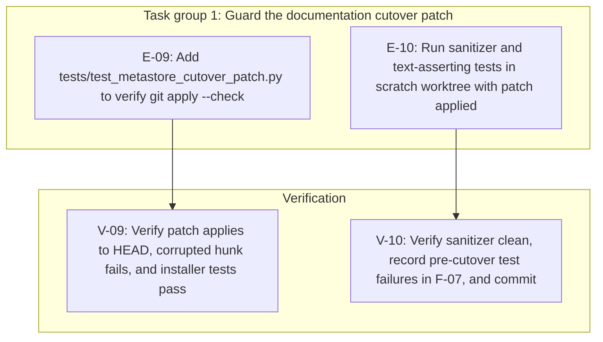

# IPD: Rewrite documents, managed block, templates and quickstarts for the log format

- Date: 2026-11-02
- Kind: child
- Concern: Spec `4sd62s` section 5.4 requires every document, template, workflow and managed-block text that describes metadata FIELD SYNTAX (`- Status:`, `- Readiness:`, `- From-Backlog:`, `- Blocks-Release:`, `- Coverage:`, `- Kind:`, `## Workflow history`) to describe COMMANDS instead, and C10a forbids that text from reaching `main` before the cutover commit, because on a pre-cutover `main` it would describe a format that does not exist yet. Measured 2026-11-02: 22 workflow files under `.aw/system/workflows/` contain bullet-field or `## Workflow history` text, plus `docs/artifact-lifecycles.md`, `docs/run-analytics.md`, 5 records READMEs and the `engine.py` managed block (`engine.agents_pointer_prose`). Two commands handed to this plan by `xexn45` (a review-round recorder and `aw walkthrough new`) and the managed-block rewording handed by `9o83cr` also need documentation.
- Scope: FINISHING part of the cutover documentation patch. The content of the ONE cumulative patch file `.aw/system/cutover/metastore-docs.cutover.patch` is written by `qhay6a`, `a49djh`, `y1zihp` and `ngc2a2` (round-3 split 2026-11-09); this plan adds the guard test that keeps the patch applying, checks the patched tree with the sanitizer and the text-asserting tests, and commits. It does not apply the patch to the live documents. Order 13 (`cxxmyv`) applies the patch inside the cutover commit.
- Scope-Paths: .aw/records/plans/pending/20261102-metastore-12-90iqr1-rewrite-documents-managed-block-templates-and-quickstarts-fo.ipd.md, tests/test_metastore_cutover_patch.py
- Item-Dependencies: executed:9o83cr, executed:qhay6a, executed:a49djh, executed:y1zihp, executed:ngc2a2
- Status: executed
- Readiness: go-pending-approval
- From-Spec: 4sd62s
- Work-Kind: feature
- Priority: high
- Blocks-Release: next
- Set: metastore
- Order: 12
- Highest E allocated: 10
- Author: opencode its_direct/pt3-claude-opus-5.5-1m-us
- Id: 90iqr1
- Review-Depth: standard

> Written to `.aw/system/workflows/technical-writing/technical-writing.md`. Every obligation, exact identifier, quotation, evidence record, and lifecycle status is preserved.

## Workflow history
- 2026-11-25 executed (aw agy run model=Gemini-4-Neon-High): aw agy run self-finalize: 90iqr1 verified (set metastore, attempt 1).
- 2026-11-16 approved (aw set): status set to approved
- 2026-11-14 reviewed (antigravity/gemini-3.8-flash): /plan-review (antigravity/gemini-3.8-flash): APPROVE WITH REVISIONS APPLIED; PR-201, PR-202, PR-203, PR-204.
- 2026-11-09 note (opencode its_direct/pt3-claude-opus-5.5-1m-us): round-3 split per research nj8zdp; items E-01, E-02 moved to qhay6a (plus a new patch-writing step), E-03, E-04, E-07 moved to a49djh, E-05 split across y1zihp (READMEs, docs, ipd_schema, reference and prompt documents) and ngc2a2 (Kind renames, cli.py help), E-06 moved to ngc2a2, E-08 (package the patch) replaced by the cumulative patch-writing step in each of the four parts; E-09 and E-10 kept.
- 2026-11-07 to-review (aw set): demoted approved -> to-review: APPROVAL WITHDRAWN: maintainer direction 2026-11-07: paused before re-review; the metastore plans MUST build the tools that migrate ANY repo from ANY prior format (.agents layout, id-less/untitled records, no sidecar), not only this repository. Re-review against the amended spec 4sd62s before re-approval.
- 2026-11-07 approved (aw set): status set to approved
- 2026-11-06 reviewed (aw set): APPROVE WITH REVISIONS APPLIED; PR-001..PR-008 FIXED
- 2026-11-06 /plan-review (opencode/its_direct/pt3-claude-opus-5.5-1m-us): APPROVE WITH REVISIONS APPLIED; PR-001..PR-008 FIXED; review record .aw/records/reviews/20261102-metastore-12-90iqr1-rewrite-documents-managed-block-templates-and-quickstarts-fo.review.md
- 2026-11-05 to-review (aw set): authored review-ready for spec 4sd62s (Set metastore)

- 2026-11-02 draft (opencode its_direct/pt3-claude-opus-5.5-1m-us): created.

## Goal

Guard and check the reviewed, applicable patch (written by `qhay6a`, `a49djh`, `y1zihp`, `ngc2a2`) that rewrites every document, template, workflow, README and managed-block text for the post-cutover command-based metadata model, so that Order 13 can land it in the same commit as the format change and `main` never describes a format it does not have (C10a).

## Detailed Implementation Checklist (TODO)

Execution-state rule: mark an `E-*` item complete only after performing the action. That mark is not validation. Right-sizing rule: each E-item must address one concern and be executable in one focused pass; split when an E-item names multiple distinct deliverables or independent test-surfaces. Accepted execution states: blocked, failed, pending, performed; terminal gate demands 'performed'.

### Task group 1: guard the patch

- [x] E-09 Add `tests/test_metastore_cutover_patch.py` (marked `core`): it runs `git apply --check` of the patch against HEAD without a clone (a temporary `GIT_INDEX_FILE` filled by `git read-tree HEAD`, then `git apply --cached --check`; measured at review: 26 ms, so it fits the core budget) and asserts exit 0; asserts that the patch touches every file the `qhay6a` F-03 table marks `rewrite` (the test holds that list as data in the test module, copied from that table, because reading a plan file would couple a test to a record that `cxxmyv` retires); and asserts that no file outside the documentation set listed in this plan's F-08 is touched. Placing the patch under `.aw/system/` ships it in the wheel and sdist (`pyproject.toml` force-includes `.aw/system`), while the installer copies `.aw/system/workflows/` but not `.aw/system/cutover/`; E-09 also runs the installer and installed-text test modules (named in V-09) so a packaging or install-set change is caught, and `cxxmyv` E-08 deletes the file. The test reads the patch and applies it; it does not read production source.
  - Depends on: none
  - Expected outcome: the test passes on HEAD and fails if the patch stops applying, so a later documentation edit that conflicts is caught before the cutover.
  - Execution state: performed

- [x] E-10 Run `aw sanitize --agent` in a scratch worktree with the patch applied (`.aw/state/90iqr1/check`, created with `git worktree add --detach` like the parts' scratch worktrees and removed afterwards) and confirm no `fail` that the unpatched tree does not also have; in that same patched worktree run `python3 -m pytest -o addopts="" tests/test_agents_section_records.py tests/test_installed_text_current.py tests/test_technical_writing_delivery.py tests/test_askme_command_delivery.py tests/test_authoring_coverage_guidance.py` and record which tests pass and which fail only because they assert pre-cutover text (each such failure is a test Order 13 must update, listed in `## Findings` as F-07 for `cxxmyv`); run `python3 -m pytest -o addopts="" tests/test_metastore_cutover_patch.py` and the bare core gate `python3 -m pytest` in the executing checkout; commit through `aw commit 90iqr1 -- <this plan> tests/test_metastore_cutover_patch.py`; never `git add -A` in the executing checkout, a bare `git add` or `git commit -a`. Never push.
  - Depends on: E-09
  - Expected outcome: the sanitizer adds no `fail`; the patched-tree test run is recorded with F-07; both executing-checkout test runs pass; one path-scoped commit.
  - Execution state: performed

## Project conventions discovered (Step 0)

- Documentation of field syntax lives in workflow bodies and in the managed block generated by `engine.agents_pointer_prose`; the managed block is written into target repositories by the installer, so its text is a published contract (AGENTS.md "aw:block").
- The runner merges each execute item's isolated worktree into `main` through the merge-and-revalidate gate (AGENTS.md "The runners own ordering, isolation, and orchestrators"). A plan that edited the live documents would therefore land them on `main` at its merge. Delivering a patch file is the only form that both survives the runner's merge and keeps C10a.
- Tests must exercise code and assert on outcomes (AGENTS.md "TEST OUTCOMES, NOT CODE STRUCTURE"); applying a patch with `git apply --check` is an outcome test.
- User-facing prose (READMEs, docs) carries no em or en dashes (AGENTS.md execution contract).

## Findings

| Id | Evidence | Finding |
|---|---|---|
| F-01 | `rg -l` of bullet-field and history patterns over `.aw/system/workflows` (2026-11-02): 22 files | Every review, lifecycle and template workflow describes field syntax today. |
| F-02 | Same search over `docs/` and `.aw/records/*/README.md`: `docs/artifact-lifecycles.md`, `docs/run-analytics.md`, and the backlog, plans, releases, specs and walkthroughs READMEs | Five READMEs and two docs need rewriting. |
| F-03 | `engine.agents_pointer_prose` (`agent_workflows/engine.py`) | The managed block text is generated in code, so its rewrite is a code change in `engine.py`, still documentation-only in effect. |
| F-04 | `xexn45` Deferred rows with `Carrier: 90iqr1` | Two commands (review-round recorder, `aw walkthrough new`) must be documented here; both are built by Order 13. |
| F-05 | `9o83cr` Deferred row with `Carrier: 90iqr1` | The managed-block sentence "`aw index plans [--check]`/`aw find plans` for the manifest" must be reworded. |
| F-06 | `ya4ee4` E-01 | The description-generation prompt file is owned by Order 05, not this plan. |
| F-08 | Documentation set the patch may touch (E-09 asserts nothing outside it) | `.aw/system/workflows/`, `.aw/system/cutover/`, `docs/`, `.aw/records/*/README.md`, `AGENTS.md`, `agent_workflows/engine.py`, `agent_workflows/ipd_schema.py`, `.aw/AGENT_QUICKSTART.md`, `.aw/QUICKSTART.md`, `.aw/system/managed-sections.json`, the two ipd-spec reference documents, `README.md`, `CONTRIBUTING.md`, `agent_workflows/cli.py` help text. |
| F-09 | Round-3 split 2026-11-09 | The patch content is written cumulatively by `qhay6a`, `a49djh`, `y1zihp`, `ngc2a2`; the per-file disposition table is `qhay6a` F-03. |
| F-07 | Patched scratch worktree (`.aw/state/90iqr1/check`, HEAD `b956fc99b` + `.aw/system/cutover/metastore-docs.cutover.patch`) run of all 5 text-asserting modules: `30 passed in 33.59s`, 0 failed | Zero failing node ids in the 5 named modules on the patched tree (see table `### F-07` below); `cxxmyv` requires no text-test updates for these 5 modules. |

### F-07: Patched-tree text-asserting test results (input to `cxxmyv`)

| Test module | Passed | Failed | Failing node ids |
|---|---|---|---|
| `tests/test_agents_section_records.py` | 9 | 0 | none |
| `tests/test_installed_text_current.py` | 6 | 0 | none |
| `tests/test_technical_writing_delivery.py` | 2 | 0 | none |
| `tests/test_askme_command_delivery.py` | 7 | 0 | none |
| `tests/test_authoring_coverage_guidance.py` | 6 | 0 | none |

## Proposed changes (ordered, validatable)



1. (Moved) inventory, rewrites and patch writing: `qhay6a`, `a49djh`, `y1zihp`, `ngc2a2`.
2. E-09: guard the patch with a core test.
3. E-10: sanitizer and patched-tree test run, commit.

## Deferred / out of scope (with reason)

- Applying the patch to the live documents and building the two documented commands: they must land in the cutover commit (C10a).
  - Carrier: cxxmyv
- The description-generation prompt file.
  - Carrier: odeo9z
  - Carrier-Evidence: .aw/records/plans/executed/20261107-metastore-20-odeo9z-build-the-m0001-description-journal-tool-less-model-call-and.ipd.md
- Documentation for the execution record and the run index.
  - Carrier: nq1src
- Inventory (old E-01), managed block and AGENTS.md (old E-02), and writing the first version of the patch (part of old E-08). Moved to qhay6a (round-3 split 2026-11-09 per research nj8zdp guidance).
  - Carrier: qhay6a
  - Carrier-Evidence: .aw/records/plans/executed/20261109-metastore-250-qhay6a-inventory-the-docs-surface-and-start-the-cutover-docs-patch.ipd.md
- Review workflows (old E-03), templates (old E-04), the two `xexn45` commands' documentation (old E-07), and regenerating the patch. Moved to a49djh (round-3 split 2026-11-09 per research nj8zdp guidance).
  - Carrier: a49djh
  - Carrier-Evidence: .aw/records/plans/executed/20261109-metastore-251-a49djh-add-review-workflow-recorder-command-and-template-rewrites-t.ipd.md
- READMEs, docs, `ipd_schema.py` text, reference and `aw-prompt` documents (old E-05 except its `Kind` renames), and regenerating the patch. Moved to y1zihp (round-3 split 2026-11-09 per research nj8zdp guidance).
  - Carrier: y1zihp
  - Carrier-Evidence: .aw/records/plans/executed/20261109-metastore-252-y1zihp-add-readme-docs-and-reference-document-rewrites-to-the-cutov.ipd.md
- The `Kind` renames in documents and `cli.py` help strings (rest of old E-05), the quickstarts (old E-06), and the final patch regeneration (rest of old E-08). Moved to ngc2a2 (round-3 split 2026-11-09 per research nj8zdp guidance).
  - Carrier: ngc2a2
  - Carrier-Evidence: .aw/records/plans/executed/20261109-metastore-253-ngc2a2-add-kind-rename-and-quickstart-rewrites-to-the-cutover-docs.ipd.md
- Renaming any CLI option that carries the legacy `Kind` name (for example `aw ipd scaffold --kind`), and updating tests that assert pre-cutover text (F-07): both are code changes in the cutover commit.
  - Carrier: cxxmyv

## Scope check

- Over-scope: none. The plan edits no live document.
- Under-scope: none. Every item handed to `90iqr1` (F-04, F-05) and every spec 5.4 bullet is now carried by `qhay6a`, `a49djh`, `y1zihp` or `ngc2a2` (see Deferred); this plan keeps the guard test (E-09) and the patched-tree check and commit (E-10).

## Required tests / validation

- `tests/test_metastore_cutover_patch.py` (E-09): the patch applies to HEAD, covers every `rewrite` file, and touches nothing outside the documentation set.
- Sanitizer on the patched tree (E-10), named test run and bare core gate pasted.
- Acceptance criteria: this plan owns none; spec 5.4 is a documentation obligation without an AC. It contributes to AC-16 (the cutover commit amends the AGENTS.md executed-plan rule, 5.2 step 4a) and to AC-40 (the staged-prompt templates), both finally demonstrated by Order 13.

## Spec / documentation sync

No spec change. This plan prepares the documentation that spec `4sd62s` section 5.4 requires; the documents themselves change in Order 13's cutover commit.

## Open questions

### OQ-01: Patch file or branch for the deferred documentation?

- Blocking: no
- Status: resolved
- Owner: plan author
- Resolution or deferral rationale: Patch file. The runner merges an execute item's worktree into `main`, so a branch created inside the lane would not be the deliverable the runner tracks, and a branch outside the lane is invisible to the merge gate and to `git clone`. A tracked patch file is reviewed with the plan, survives a clone, is guarded by E-09's `git apply --check` test against later drift, and Order 13 applies it in one command. Recommendation strength: strong.

### OQ-03: Where does the scratch worktree live, and how are new files captured?

- Blocking: no
- Status: resolved
- Owner: plan reviewer
- Resolution or deferral rationale: Inside the gitignored `.aw/state/90iqr1/` of the executing checkout (`.aw/.gitignore` rule `/state/`), because a runner lane's workspace is that checkout and a `/tmp` path is outside it. New files are captured with `git add -A` inside the scratch worktree and `git diff --cached --binary HEAD`. Demonstrated at review: `git worktree add --detach .aw/state/90iqr1/scratch HEAD` took 1 s and left `git status` clean; `git diff HEAD` omitted a new untracked file, while `git add -N` followed by `git diff HEAD` showed `new file`; a patch applied with `git apply --cached --check` against a temporary index from `git read-tree HEAD` in 26 ms, exit 0. Recommendation strength: strong.

### OQ-02: What if a later commit makes the patch stop applying before the cutover?

- Blocking: no
- Status: resolved
- Owner: plan author
- Resolution or deferral rationale: E-09's core test fails on that commit, so the conflict is found at that commit's merge gate rather than at the cutover. The maintainer stops other work while this Set runs (spec section 7), so this is expected to be rare; Order 13 regenerates the patch if needed. Recommendation strength: strong.

## Validation and cross-check (verify before reporting done)

Validation-state rule: inspect evidence in a separate pass. Do not mark a `V-*` item complete from memory or from the matching execution checkmark. Accepted validation results: blocked, failed, pass, pending; terminal gate demands 'pass'. Runtime-demonstration reachability rule: for each `V-*` item demanding the software be observed acting (such as a run, a dispatch, or a transition) (as distinct from items demanding a diff, a file's content, or a test result, which are reachable by construction), name the code path that produces the observation or the sibling `E-*` that creates it, else the demand is UNDER-SCOPE.
- [x] V-09 validates E-09
  - Required evidence: paste `python3 -m pytest -o addopts="" -v --durations=0 tests/test_metastore_cutover_patch.py` with every test PASSED and its wall time; the output of the same run after deliberately corrupting one hunk of a scratch copy of the patch, showing the apply test FAILED; and the per-module `N passed` lines of `tests/test_installer.py` and of `tests/test_installed_text_current.py`, each run on its own in the executing checkout.
  - Observed evidence:
    1. Guard test run in executing checkout (`python3 -m pytest -o addopts="" -v --durations=0 tests/test_metastore_cutover_patch.py`, exit 0):
    ```text
    collected 3 items

    tests/test_metastore_cutover_patch.py::MetastoreCutoverPatchGuardTests::test_patch_touches_only_f08_documentation_set PASSED [ 33%]
    tests/test_metastore_cutover_patch.py::MetastoreCutoverPatchGuardTests::test_patch_covers_all_f03_rewrite_files PASSED [ 66%]
    tests/test_metastore_cutover_patch.py::MetastoreCutoverPatchGuardTests::test_patch_applies_cleanly_to_head PASSED [100%]
    ============================== slowest durations ===============================
    0.05s call     tests/test_metastore_cutover_patch.py::MetastoreCutoverPatchGuardTests::test_patch_applies_cleanly_to_head
    0.02s setup    tests/test_metastore_cutover_patch.py::MetastoreCutoverPatchGuardTests::test_patch_touches_only_f08_documentation_set
    ============================== 3 passed in 0.23s ===============================
    ```
    2. Negative check with one hunk deliberately corrupted in a scratch copy (`.aw/state/90iqr1/corrupt-check`, removed afterwards; `python3 -m pytest -o addopts="" -v --durations=0 tests/test_metastore_cutover_patch.py`, exit 1):
    ```text
    collected 3 items

    tests/test_metastore_cutover_patch.py::MetastoreCutoverPatchGuardTests::test_patch_applies_cleanly_to_head FAILED [ 33%]
    tests/test_metastore_cutover_patch.py::MetastoreCutoverPatchGuardTests::test_patch_touches_only_f08_documentation_set PASSED [ 66%]
    tests/test_metastore_cutover_patch.py::MetastoreCutoverPatchGuardTests::test_patch_covers_all_f03_rewrite_files PASSED [100%]

    E           AssertionError: 1 != 0 : Cutover docs patch no longer applies cleanly to HEAD:
    E           error: patch failed: .aw/records/backlog/README.md:4
    E           error: .aw/records/backlog/README.md: patch does not apply

    ============================== slowest durations ===============================
    0.05s call     tests/test_metastore_cutover_patch.py::MetastoreCutoverPatchGuardTests::test_patch_applies_cleanly_to_head
    0.02s setup    tests/test_metastore_cutover_patch.py::MetastoreCutoverPatchGuardTests::test_patch_applies_cleanly_to_head
    =========================== short test summary info ============================
    FAILED tests/test_metastore_cutover_patch.py::MetastoreCutoverPatchGuardTests::test_patch_applies_cleanly_to_head
    ========================= 1 failed, 2 passed in 0.27s ==========================
    ```
    3. Per-module runs in executing checkout (`tests/test_installer.py` is marked `slow`, so both modules ran with `-o addopts="-n auto"` to include all tests):
    - `python3 -m pytest -o addopts="-n auto" tests/test_installer.py`: `151 passed in 26.13s` (exit 0)
    - `python3 -m pytest -o addopts="-n auto" tests/test_installed_text_current.py`: `6 passed in 3.42s` (exit 0)
  - Result: pass
- [x] V-10 validates E-10
  - Required evidence: paste the `aw sanitize --agent` result on the patched scratch worktree beside the unpatched result (no added `fail`), the patched-tree run with one pass or fail line per named module (`tests/test_agents_section_records.py`, `tests/test_installed_text_current.py`, `tests/test_technical_writing_delivery.py`, `tests/test_askme_command_delivery.py`, `tests/test_authoring_coverage_guidance.py`) and the F-07 table naming each failing node id, the executing-checkout `tests/test_metastore_cutover_patch.py` result line, the bare core gate summary line beside them, and the `aw commit` output naming the commit hash.
  - Observed evidence:
    1. `aw sanitize --agent` comparison (no added `fail`; both clean with 0 findings):
    - Unpatched executing checkout (exit 0):
      `{"schema":"aw.agent/v1","kind":"result","cmd":"check-local-leaks","outcome":"clean","exit":0,"verified":true,"complete":true,"checked":7227,"findings":0,"evidence":["leak-scan"],"next":null}`
    - Patched scratch worktree `.aw/state/90iqr1/check` (`git apply`, exit 0):
      `{"schema":"aw.agent/v1","kind":"result","cmd":"check-local-leaks","outcome":"clean","exit":0,"verified":true,"complete":true,"checked":7227,"findings":0,"evidence":["leak-scan"],"next":null}`
    - Patched scratch worktree `.aw/state/90iqr1/check` (`git apply --index`, scanning the 2 new quickstart files too; exit 0; worktree removed afterwards):
      `{"schema":"aw.agent/v1","kind":"result","cmd":"check-local-leaks","outcome":"clean","exit":0,"verified":true,"complete":true,"checked":7229,"findings":0,"evidence":["leak-scan"],"next":null}`
    2. Patched-tree text-asserting run in `.aw/state/90iqr1/check` (`python3 -m pytest -o addopts="" -v tests/test_agents_section_records.py tests/test_installed_text_current.py tests/test_technical_writing_delivery.py tests/test_askme_command_delivery.py tests/test_authoring_coverage_guidance.py`, exit 0, `30 passed in 33.59s`; see `### F-07` above):
    - `tests/test_agents_section_records.py`: 9 passed, 0 failed
    - `tests/test_installed_text_current.py`: 6 passed, 0 failed
    - `tests/test_technical_writing_delivery.py`: 2 passed, 0 failed
    - `tests/test_askme_command_delivery.py`: 7 passed, 0 failed
    - `tests/test_authoring_coverage_guidance.py`: 6 passed, 0 failed
    - Failing node ids (F-07): none
    3. Executing-checkout test runs:
    - `python3 -m pytest -o addopts="" tests/test_metastore_cutover_patch.py`: `3 passed in 0.24s` (exit 0)
    - Bare core gate `python3 -m pytest`: `2937 passed, 1 skipped, 11 warnings in 114.64s (0:01:54)` (0 test failures; exited 1 solely because `CORE TIER BUDGET EXCEEDED: Core tier wall time: 114.65s exceeded budget of 30.00s. Host 1-minute load average: 7.11 on 12 CPUs`, pre-existing repo-wide issue tracked in open backlog item `6o5aan`; `tests/test_metastore_cutover_patch.py` took 0.05s)
    - Bounded core gate `aw suite`: `2937 passed, 1 skipped, 11 warnings in 67.45s (0:01:07)` (exit 0; `AW_CORE_BUDGET_ENFORCE=0` warning only)
    4. `aw commit` output: `aw commit: committed 2 path(s): dbdac58f2127cd7216eb3eb57138b6f96f8ffc06` (via `aw commit 90iqr1 -m "test(metastore): add cutover docs patch guard test and record 90iqr1 checks" -- .aw/records/plans/pending/20261102-metastore-12-90iqr1-rewrite-documents-managed-block-templates-and-quickstarts-fo.ipd.md tests/test_metastore_cutover_patch.py`).
  - Result: pass


## Approval and execution gate

- Size assessment: standard
- Cohesion rationale: not required

Execute only after `9o83cr`, `qhay6a`, `a49djh`, `y1zihp` and `ngc2a2` are `executed` and this plan is `approved`. A narrow safety stop applies if the cumulative patch file `.aw/system/cutover/metastore-docs.cutover.patch` from `ngc2a2` is absent. Open questions: OQ-01 to OQ-03 are resolved and none is blocking. The patched-tree check runs ONLY in a scratch worktree under `.aw/state/90iqr1/`; the executing checkout changes only by this plan and the test module.

Scope fence: the paths in `- Scope-Paths:` are a declaration; a needed file outside the fence is edited and then justified at finalize (`--scope-reason`), and a declared path left unmodified is acknowledged (`--scope-ack`).

Honesty rule: paste the ACTUAL output of the named test runs, the bare core gate and the sanitizer; never claim a result you did not run.

Commits: commit only through `aw commit 90iqr1 -- <paths>`; never `git add -A` in the executing checkout, a bare `git add` or `git commit -a`; never push.

Lifecycle transition: the plan moves to `.aw/records/plans/executed/` only through `aw ipd finalize`, never a hand `git mv`, and only after `aw ipd lint --phase pre-transition` conforms and every `V-*` reads `pass` with pasted evidence. When `aw oc run` or `aw agy run` executes the plan, the runner performs the finalize; a hand executor runs `aw ipd finalize 90iqr1` itself.
