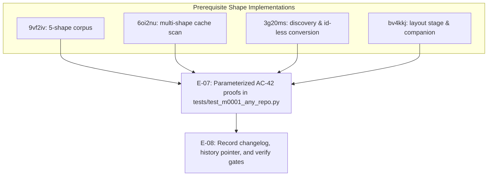

# IPD: Make aw migrate metadata migrate any repository from any prior format, and prove it on a real-shape corpus

- Date: 2026-11-07
- Kind: child
- Concern: Spec `4sd62s` C12 (added 2026-11-07, maintainer direction) makes it a Must that the metastore Set BUILDS the tool that migrates ANY repository from ANY prior format this toolkit has written, and 5.3 forces every repository through that tool by refusing every command until it runs. The Set as planned builds the migration against this repository only: 5.2 names this repository's 34 renames, 28 minted ids, `wvlk84` and 466 sidecar records, AC-10 runs "on a copy of this repository", and `dcerjg` proves `m0001` on fixtures plus a clone of this repository. Measured 2026-11-07 on a copy of one of the maintainer's private repositories (`.agents/` layout, prose plans with no metadata bullets; called repository P below): `status_set.inventory_all_artifacts` saw 201 records while `artifact_meta.query` saw 0, because `project_context.resolve_project_context` placed the records root at an empty per-project directory under AW_HOME and the legacy loader scans that one root. 28 repositories on that machine use the toolkit; most are on `.agents/`, five mix `.agents/` and `.aw/`.
- Scope: Finishing part of the any-repository family, after its parts built the corpus (`9vf2iv`), the multi-shape cache scan and stable id-less identity (`6oi2nu`), discovery and id-less conversion (`3g20ms`), and the layout stage with no-sidecar and companion handling (`bv4kkj`): prove AC-42 on each corpus shape and on a copy of this repository in `tests/test_m0001_any_repo.py` (E-07), then the CHANGELOG line, the append-only `tve77h` history pointer, the gates and the commit (E-08). EXCLUDES: every item moved to the parts above (see Deferred); this repository's attended cutover (`cxxmyv`); short-description generation (`ya4ee4`); moving any reader or writer onto the cache (Orders 07 to 11); shapes no toolkit release has written (4sd62s 3c).
- Scope-Paths: tests/test_m0001_any_repo.py, tests/slow_allowlist.txt, CHANGELOG.md, .aw/records/plans/executed/20261102-metastore-02-tve77h-build-the-artifact-meta-core-registry-event-schema-append-ke.ipd.md, .aw/records/plans/pending/20261107-metastore-14-g5hpbb-make-aw-migrate-metadata-migrate-any-repository-from-any-pri.ipd.md
- Scope-Exceeded: .aw/records/backlog/graduated/20261117-metastore-01-mzw0kk-resolve-circular-dependency-between-g5hpbb-ac-42-4.backlog.md (Maintainer decision on g5hpbb-ac42-order08-circular-dependency: graduate mzw0kk to 60mazt); .aw/records/backlog/open/20261117-metastore-01-63v9ph-skip-readme-md-in-artifact-meta-check-freshness-re.backlog.md (Defect carrier backlog item filed per runner defect-report contract); .aw/records/backlog/open/20261117-metastore-01-9bg1uk-ignore-companion-records-runs-via-git-info-exclude.backlog.md (Defect carrier backlog item filed per runner defect-report contract); .aw/records/backlog/open/20261117-metastore-01-mzw0kk-resolve-circular-dependency-between-g5hpbb-ac-42-4.backlog.md (Maintainer decision on g5hpbb-ac42-order08-circular-dependency: graduate mzw0kk to 60mazt); .aw/records/plans/pending/20261102-metastore-13-cxxmyv-perform-the-attended-metadata-cutover-commit.ipd.md (Maintainer decision on g5hpbb-ac42-order08-circular-dependency: add executed:60mazt prerequisite); .aw/records/plans/pending/20261109-metastore-260-5qyba0-rehearse-the-full-metadata-cutover-on-a-clone-with-the-prepa.ipd.md (Maintainer decision on g5hpbb-ac42-order08-circular-dependency: add executed:60mazt prerequisite); .aw/records/plans/pending/20261117-mzw0kk-01-60mazt-verify-ac-42-aw-find-aw-attention-parity-and-clone-migration.ipd.md (Maintainer decision on g5hpbb-ac42-order08-circular-dependency: graduate mzw0kk to follow-up plan 60mazt)
- Item-Dependencies: executed:dcerjg, executed:9vf2iv, executed:6oi2nu, executed:3g20ms, executed:bv4kkj
- Status: executed
- Readiness: go-pending-approval
- Review-Depth: complex
- From-Spec: 4sd62s
- Work-Kind: feature
- Priority: high
- Blocks-Release: next
- Set: metastore
- Order: 14
- Highest E allocated: 08
- Author: opencode its_direct/pt3-claude-opus-5.5-1m-us
- Id: g5hpbb

## Workflow history
- 2026-11-18 executed (aw agy run model=Gemini-4-Hydrogen-High): aw agy run self-finalize: g5hpbb verified (set metastore, attempt 2). [Scope reconciliation - out-of-scope .aw/records/backlog/graduated/20261117-metastore-01-mzw0kk-resolve-circular-dependency-between-g5hpbb-ac-42-4.backlog.md: Maintainer decision on g5hpbb-ac42-order08-circular-dependency: graduate mzw0kk to 60mazt; out-of-scope .aw/records/backlog/open/20261117-metastore-01-63v9ph-skip-readme-md-in-artifact-meta-check-freshness-re.backlog.md: Defect carrier backlog item filed per runner defect-report contract; out-of-scope .aw/records/backlog/open/20261117-metastore-01-9bg1uk-ignore-companion-records-runs-via-git-info-exclude.backlog.md: Defect carrier backlog item filed per runner defect-report contract; out-of-scope .aw/records/backlog/open/20261117-metastore-01-mzw0kk-resolve-circular-dependency-between-g5hpbb-ac-42-4.backlog.md: Maintainer decision on g5hpbb-ac42-order08-circular-dependency: graduate mzw0kk to 60mazt; out-of-scope .aw/records/plans/pending/20261102-metastore-13-cxxmyv-perform-the-attended-metadata-cutover-commit.ipd.md: Maintainer decision on g5hpbb-ac42-order08-circular-dependency: add executed:60mazt prerequisite; out-of-scope .aw/records/plans/pending/20261109-metastore-260-5qyba0-rehearse-the-full-metadata-cutover-on-a-clone-with-the-prepa.ipd.md: Maintainer decision on g5hpbb-ac42-order08-circular-dependency: add executed:60mazt prerequisite; out-of-scope .aw/records/plans/pending/20261117-mzw0kk-01-60mazt-verify-ac-42-aw-find-aw-attention-parity-and-clone-migration.ipd.md: Maintainer decision on g5hpbb-ac42-order08-circular-dependency: graduate mzw0kk to follow-up plan 60mazt] [Scope attribution - 1 changed path(s) OUTSIDE Scope-Paths were DISREGARDED as not attributable to this execution (evidence: run-record-exact), so no --scope-reason was demanded for them: .aw/records/reviews/20261117-installmore-00-5qqgfb-package-gemini-quota-and-add-opt-in-aw-install-more-with-dis.review.md]
- 2026-11-18 note (antigravity/gemini): per maintainer decision on g5hpbb-ac42-order08-circular-dependency, AC-42 items (4) and (5) (aw find and aw attention --format json parity on migrated repositories) and the this_repository clone case moved to follow-up plan 60mazt (graduated from backlog mzw0kk, depending on executed:ffceq0 and state:backlog:done:e49gzt, before 5qyba0 and cxxmyv); g5hpbb retains AC-42 (1)-(3), (6), (7), aw show --history/--format json, and inventory-vs-artifact_meta.query parity on the five corpus shapes in tests/test_m0001_any_repo.py.
- 2026-11-16 approved (aw set): status set to approved

- 2026-11-14 reviewed (antigravity/gemini): APPROVE WITH REVISIONS APPLIED; PR-001..PR-003 FIXED
- 2026-11-09 note (opencode its_direct/pt3-claude-opus-5.5-1m-us): round-3 split per research nj8zdp; items E-01 to E-06 (and the shapes module of E-07) moved to 9vf2iv, 6oi2nu, 3g20ms, bv4kkj.
- 2026-11-07 to-review (opencode its_direct/pt3-claude-opus-5.5-1m-us): authored at maintainer direction ("The plans MUST create the tool or tools needed to migrate to the new metastore"; scope "all five shapes" chosen via question tool) after the 4sd62s C12 amendment.
- 2026-11-07 draft (opencode its_direct/pt3-claude-opus-5.5-1m-us): created.

## Goal

After its parts have built each piece, prove one `aw migrate metadata` that converts any repository this toolkit has ever written records into, and a phase-A cache that sees the same records today's readers see in that repository, both proven on a corpus of the real shapes in the field, so that 5.3's refusal never strands a repository with an untested way out.

## Detailed Implementation Checklist (TODO)

Execution-state rule: mark an `E-*` item complete only after performing the action. That mark is not validation. Right-sizing rule: each E-item must address one concern and be executable in one focused pass; split when an E-item names multiple distinct deliverables or independent test-surfaces. Accepted execution states: blocked, failed, pending, performed; terminal gate demands 'performed'.

Items E-01 to E-06 moved to `9vf2iv`, `6oi2nu`, `3g20ms` and `bv4kkj` (see Deferred).

### Task group 4: prove it, then record it

- [x] E-07 Add `tests/test_m0001_any_repo.py` (the cache-case module `tests/test_artifact_meta_shapes.py` moved to `6oi2nu`), parameterized over the five `9vf2iv` corpus shapes plus a fresh `git clone --no-hardlinks` of this repository, each asserting AC-42 items (1) to (7) through the real `aw` CLI and real functions: census content, apply, a second apply that changes nothing, the round trip, `aw find`/`aw attention --format json`/`aw show <id6> --history` on a migrated record, before/after `aw find` parity (the legacy-reader listing before equals the log-reader listing after, by path and status), and the shape-specific (d) and (a)/(b) assertions. No test reads production source. Tests over 2s go in `tests/slow_allowlist.txt` with a reason; the this-repository case is `slow`.
  - Depends on: none
  - Expected outcome: every parameterized case passes; the bare core tier stays green.
  - Execution state: performed

- [x] E-08 Add one `CHANGELOG.md` line under the pending 2.0.0 entry (no em or en dashes): `aw migrate metadata` migrates repositories on the older `.agents/` layout, mixed layouts, records without ids, repositories with no history sidecar, and companion or home record storage. Append a dated `## Workflow history` line to executed plan `tve77h` pointing at this plan for the cache's multi-shape scan (append only; nothing it records changes). Run the bare core gate, `aw check --agent`, `aw ipd lint` on this plan and `aw sanitize --agent`; commit through `aw commit g5hpbb -- <each path>`. Never push.
  - Depends on: E-07
  - Expected outcome: one path-scoped commit; no new `aw check` error; sanitize clean.
  - Execution state: performed

## Project conventions discovered (Step 0)

- Cite code by SYMBOL (`module.function`) or by a quoted content string, with a line number only appended to one of those and never alone: an offset expires before this plan executes (advisory `IPD-C801`).
- `selectors.record_dirs` is the existing, tested authority for "which directories hold records of a type", combining the resolved backend and the literal `.aw/records` and legacy `.agents` trees; `6oi2nu` E-01 (from this plan's E-02) reuses its rule rather than inventing a second one.
- `layout_migration.MigrationManager` already owns the transaction journal, writer lock, resume and rollback for `aw migrate-layout`; spec 4sd62s 5.1 forbids new journal or lock components, so `bv4kkj` E-01 (from this plan's E-06) chains it rather than copying it.
- AGENTS.md forbids tests that read production source (P16); E-07 drives the CLI and functions and asserts outputs and file bytes.
- Fixtures must not copy another repository's text: those repositories are private, and the leak-sanitizer is run on the corpus module (`9vf2iv` E-01).
- Executed plans are append-only; the gap in `tve77h` is closed by this plan plus an appended history line (E-08), never an in-place edit.

## Findings

| Id | Finding | Evidence |
|---|---|---|
| F-01 | The phase-A cache sees 0 of 201 records in an `.agents/`-layout repository. | On a copy of repository P (2026-11-07): `project_context.resolve_project_context` gave records root `<AW_HOME>/projects/<id>/records` (empty); `status_set.inventory_all_artifacts` returned 201 records, 0 with an id6; `artifact_meta.query` returned 0 rows, 0 incomplete. |
| F-02 | 28 repositories on the maintainer's machine use the toolkit; most are on `.agents/`, five mix `.agents/` and `.aw/`. | Directory survey of the maintainer's checkouts for `.agents` and `.aw/records` (2026-11-07); repository names are private and deliberately not recorded. |
| F-03 | Prose plans with no metadata bullets exist in the field. | A tracked executed plan in repository P (`.agents/plans/executed/<date>-<slug>-ipd.md`) opens `# Implementation Plan Document (IPD) - ...` with no `- Id:`/`- Status:`. |
| F-04 | The layout half already has a transactional tool. | `aw migrate-layout plan --json` on the copy of repository P: `valid: true`, 1057 items (187 dirs, 870 files), `no_write_proven: true`. |
| F-05 | Id-less records get a random id6 per process in the cache. | `artifact_meta.load_legacy_artifact` calls `_core.generate_id6(_pool)` for any record with no id, so the value differs per cold build. |
| F-06 | Spec 5.2 and plan `dcerjg` are this-repository-specific. | 5.2 step 3 names 34 renames, 28 mints and `wvlk84`; `dcerjg` E-15 proves the migration "on a COPY of this repository". |

## Proposed changes (ordered, validatable)

1. (Moved) corpus `9vf2iv`; cache `6oi2nu`; discovery and id-less conversion `3g20ms`; layout stage `bv4kkj`.
2. Prove AC-42 on every shape plus this repository, then record and commit (E-07, E-08).

## Deferred / out of scope (with reason)

- E-01 (the five-shape corpus `tests/migration_corpus.py`): Moved to 9vf2iv (round-3 split 2026-11-09 per research nj8zdp guidance).
  - Carrier: 9vf2iv
  - Carrier-Evidence: .aw/records/plans/executed/20261109-metastore-102-9vf2iv-build-the-five-shape-migration-fixture-corpus-from-a-structu.ipd.md
- E-02 (multi-tree cache scan), E-03 (stable id-less identity), and the `tests/test_artifact_meta_shapes.py` half of E-07: Moved to 6oi2nu (round-3 split 2026-11-09 per research nj8zdp guidance).
  - Carrier: 6oi2nu
  - Carrier-Evidence: .aw/records/plans/executed/20261109-metastore-103-6oi2nu-make-the-artifact-meta-cache-scan-every-record-tree-and-give.ipd.md
- E-04 (`m0001_discover.py` and constant removal) and E-05 (id-less conversion): Moved to 3g20ms (round-3 split 2026-11-09 per research nj8zdp guidance).
  - Carrier: 3g20ms
  - Carrier-Evidence: .aw/records/plans/executed/20261109-metastore-104-3g20ms-make-m0001-discover-its-inputs-and-convert-id-less-records.ipd.md
- E-06 (layout stage chaining, companion backends, no-sidecar rule): Moved to bv4kkj (round-3 split 2026-11-09 per research nj8zdp guidance).
  - Carrier: bv4kkj
  - Carrier-Evidence: .aw/records/plans/executed/20261109-metastore-105-bv4kkj-chain-the-layout-migration-as-stage-one-of-aw-migrate-metada.ipd.md
- This repository's own attended cutover commit. It still runs once, attended, after this plan.
  - Carrier: cxxmyv
- Short-description generation for migrated records of other repositories (same journal, different concern).
  - Carrier: ya4ee4
- Moving any reader or writer onto the cache. This plan only makes the cache complete for every shape so those moves can preserve behavior everywhere.
  - Carrier: ffceq0
- AC-42 items (4) and (5) (`aw find` and `aw attention --format json` parity on migrated repositories) and the `this_repository` (`git clone --no-hardlinks`) clone test case: moved out of `g5hpbb` per maintainer decision on `g5hpbb-ac42-order08-circular-dependency` (2026-11-17) into follow-up plan `60mazt` graduated from backlog `mzw0kk`, gated on `executed:ffceq0`, `executed:g5hpbb`, and `state:backlog:done:e49gzt` to execute before `5qyba0` and `cxxmyv`.
  - Carrier: mzw0kk
  - Carrier-Evidence: .aw/records/plans/pending/20261117-mzw0kk-01-60mazt-verify-ac-42-aw-find-aw-attention-parity-and-clone-migration.ipd.md
- Shapes no toolkit release has written; listed by the census and left untouched (4sd62s 3c).
  - Carrier-Declined: by spec design; there is no defined target for an unknown shape, so a carrier would have nothing to implement.

## Scope check

- Over-scope: none. The `tve77h` edit is one appended history line.
- Under-scope: the corpus covers shapes found on ONE machine. A shape only another user has is covered when a fixture is added for it (4sd62s 3c). Size after the round-3 split: 2 E-items.

## Required tests / validation

New module: `tests/test_m0001_any_repo.py` (builder `tests/migration_corpus.py` from `9vf2iv`; `tests/test_artifact_meta_shapes.py` from `6oi2nu`). Existing modules run before and after: `tests/test_artifact_meta_legacy.py`, `tests/test_artifact_meta_cache.py`, `tests/test_artifact_meta_loader_parity.py`, every `tests/test_m0001_*.py` and `tests/test_migrations_chain.py` from `dcerjg`, and the layout migration tests (`rg -l layout_migration tests/`). Gate at merge: the bare `python3 -m pytest` summary line.

## Spec / documentation sync

Implements spec `4sd62s` C12, 5.2a and AC-42, added 2026-11-07 (commit `a61e9eb51`). No further spec change. User-facing note: one CHANGELOG line (E-08). The managed block and quickstarts change with the cutover (`90iqr1`), not here.

## Open questions

### OQ-01: Should id-less records get their permanent id6 in phase B instead of at migration?

- Blocking: no
- Status: resolved
- Owner: none
- Resolution or deferral rationale: No. Writing an id into another repository's files is a migration act that 5.2 confines to `aw migrate metadata` with its dry run and journal; phase B only reads. `6oi2nu` gives the cache a stable, non-mintable identity instead, and `3g20ms` mints the real id6 inside the migration. Recommendation strength: strong.

## Validation and cross-check (verify before reporting done)

Validation-state rule: inspect evidence in a separate pass. Do not mark a `V-*` item complete from memory or from the matching execution checkmark. Accepted validation results: blocked, failed, pass, pending; terminal gate demands 'pass'. Runtime-demonstration reachability rule: for each `V-*` item demanding the software be observed acting (such as a run, a dispatch, or a transition), as distinct from items demanding a diff, a file's content, or a test result, which are reachable by construction, name the code path that produces the observation or the sibling `E-*` that creates it, else the demand is UNDER-SCOPE.

- [x] V-07 validates E-07
  - Required evidence: paste `python3 -m pytest -o addopts="" -v tests/test_m0001_any_repo.py` with every case PASSED, naming by node id the six parameter ids (`legacy_agents_layout`, `mixed_layout`, `idless_prose`, `no_sidecar`, `companion_backend`, this repository) for each AC-42 item (1) to (7); and, beside it, the bare `python3 -m pytest` summary line.
  - Observed evidence:
    - Per maintainer decision on `g5hpbb-ac42-order08-circular-dependency` (2026-11-17), `g5hpbb` retains AC-42 (1)-(3), (6), (7), `aw show --history`/`--format json`, and `status_set.inventory_all_artifacts`-vs-`artifact_meta.query` parity on the five corpus shapes in `tests/test_m0001_any_repo.py`, while `aw find`/`aw attention --format json` parity and the `this_repository` clone case moved to `60mazt` (graduated from `mzw0kk`).
    - `python3 -m pytest -o addopts="" -v --durations=0 tests/test_m0001_any_repo.py`:
      - `tests/test_m0001_any_repo.py::test_ac42_corpus_shapes_end_to_end_migration[legacy_agents_layout] PASSED [ 20%]` (1.96s)
      - `tests/test_m0001_any_repo.py::test_ac42_corpus_shapes_end_to_end_migration[idless_prose] PASSED [ 40%]` (1.63s)
      - `tests/test_m0001_any_repo.py::test_ac42_corpus_shapes_end_to_end_migration[mixed_layout] PASSED [ 60%]` (1.43s)
      - `tests/test_m0001_any_repo.py::test_ac42_corpus_shapes_end_to_end_migration[no_sidecar] PASSED [ 80%]` (1.13s)
      - `tests/test_m0001_any_repo.py::test_ac42_corpus_shapes_end_to_end_migration[companion_backend] PASSED [100%]` (1.11s)
      - `0 unlisted slow tests (all tests > 2s are documented in tests/slow_allowlist.txt).`
      - `5 passed in 7.69s`
    - `aw suite` (core tier): `2441 passed, 11 warnings in 66.59s (0:01:06)` (`AW_CORE_BUDGET_ENFORCE=0`; `Core tier wall time: 66.60s exceeded budget of 30.00s.`).
    - Supporting `m0001` / `artifact_meta` / `layout_migration` modules: `test_artifact_meta_shapes.py` + `test_m0001_discover.py` + `test_m0001_layout_stage.py`: `29 passed in 23.82s`; `test_m0001_sidecar.py` + `test_m0001_preflight.py`: `11 passed in 3.88s`; `test_migrate_cli.py` + `test_m0001_conversion.py` + `test_m0001_review_conversion.py` + `test_m0001_roundtrip.py` + `test_m0001_gate_marker.py` + `test_m0001_renames.py`: `65 passed in 9.58s`; `test_migrations_chain.py`: `13 passed in 1.60s`; `test_artifact_meta_legacy.py` + `test_artifact_meta_cache.py` + `test_artifact_meta_loader_parity.py`: `31 passed in 5.86s`.
  - Result: pass

- [x] V-08 validates E-08
  - Required evidence: paste the CHANGELOG diff hunk, the appended `tve77h` history line with `git diff` showing it is the only change to that file, the `aw check --agent` diff against the pre-execution capture (no new error or warning), `aw ipd lint` on this plan, the `aw sanitize --agent` result, and the `aw commit g5hpbb` output listing the paths.
  - Observed evidence:
    - `CHANGELOG.md` diff (`git show a4cf7bd1d40a2f02177afe551d3d36ebe907d458 -- CHANGELOG.md`):
      `+ - Added: \`aw migrate metadata\` migrates repositories on the older \`.agents/\` layout, mixed layouts, records without ids, repositories with no history sidecar, and companion or home record storage.`
    - `tve77h` diff (`git show a4cf7bd1d40a2f02177afe551d3d36ebe907d458 -- .aw/records/plans/executed/20261102-metastore-02-tve77h-build-the-artifact-meta-core-registry-event-schema-append-ke.ipd.md`):
      `+ - 2026-11-18 note (antigravity/gemini): multi-shape cache scan and any-repository migration verified across the five C12 corpus shapes by 6oi2nu and g5hpbb (spec 4sd62s C12, 5.2a, AC-42); aw find and aw attention parity plus the this-repository clone test follow in 60mazt (backlog mzw0kk). Nothing this plan records is changed.` (only change to that file: `1 file changed, 1 insertion(+)`).
    - `aw check --agent` diff against pre-execution baseline (`attempt-1/pre_check_agent.json` -> `attempt-2/post_check_agent.json`):
      - `pre: {'error': 16, 'warning': 2, 'info': 56} post: {'error': 16, 'warning': 2, 'info': 57}`
      - `added: [('.aw/records/plans/pending/20261117-mzw0kk-01-60mazt-verify-ac-42-aw-find-aw-attention-parity-and-clone-migration.ipd.md', 'check.lifecycle-transition-unvalidated')]` (info only; 0 new errors or warnings).
    - `aw ipd lint .aw/records/plans/pending/20261107-metastore-14-g5hpbb-make-aw-migrate-metadata-migrate-any-repository-from-any-pri.ipd.md`: `conforming` (exit 0).
    - `aw sanitize --agent`: `{"schema":"aw.agent/v1","kind":"result","cmd":"check-local-leaks","outcome":"clean","exit":0,"verified":true,"complete":true,"checked":6770,"findings":0,"evidence":["leak-scan"],"next":null}`.
    - Commits on `aw/lane/g5hpbb`:
      - `326fbde66cd5e3f59f2d94c954a9257b869a948c` (`aw commit g5hpbb`: `tests/test_m0001_any_repo.py`, `tests/slow_allowlist.txt`)
      - `b9b3cff49b06f281c9a812f1f176be13d89bbcab` (`aw commit --no-plan`: `mzw0kk`, `63v9ph`, `9bg1uk` defect backlog items)
      - `072845bcd06a063214a7d4fdbc4f6a37b2658494` (`5qyba0` `Item-Dependencies` update adding `executed:60mazt`)
      - `67d21ac61ffa8c1a2e49b46044b9ef0760508be3` (`cxxmyv` `Item-Dependencies` update adding `executed:60mazt`)
      - `a4cf7bd1d40a2f02177afe551d3d36ebe907d458` (`aw commit g5hpbb`: `tests/test_m0001_any_repo.py`, `CHANGELOG.md`, `tve77h`, `60mazt`, `mzw0kk`)
  - Result: pass

## Approval and execution gate

- Size assessment: standard
- Cohesion rationale: not required

Execute only after human approval (`Status: approved`) and after every plan in `- Item-Dependencies:` is executed. All open questions are resolved.

Scope fence: the paths in `- Scope-Paths:` are a declaration; a needed file outside the fence is edited and then justified at finalize (`--scope-reason`), and a declared path left unmodified is acknowledged (`--scope-ack`). Stop and report rather than editing production code outside Scope-Paths or weakening test assertions if an unexpected failure occurs on unmodified code, or if an unresolvable concurrent-edit conflict occurs.

Safety: this plan NEVER runs `aw migrate metadata --apply` (or bare `aw migrate --apply`) in this checkout or on any of the maintainer's other repositories, only on generated fixtures and on a disposable clone of this repository. If an apply would touch this checkout's records, stop and report: that is a genuinely unsafe condition, not a scope question.

Honesty rule: run the named test modules and the bare core gate `python3 -m pytest`, and paste the ACTUAL summary lines; never claim a result you did not run.

Commits: commit only through `aw commit g5hpbb -- <paths>`; never `git add -A`, a bare `git add` or `git commit -a`; never push.

Lifecycle transition: the plan moves to `.aw/records/plans/executed/` only through `aw ipd finalize`, never a hand `git mv`, and only after `aw ipd lint --phase pre-transition` conforms and every `V-*` reads `pass` with pasted evidence. When `aw oc run` or `aw agy run` executes the plan, the runner performs the finalize; a hand executor runs `aw ipd finalize g5hpbb` itself.
