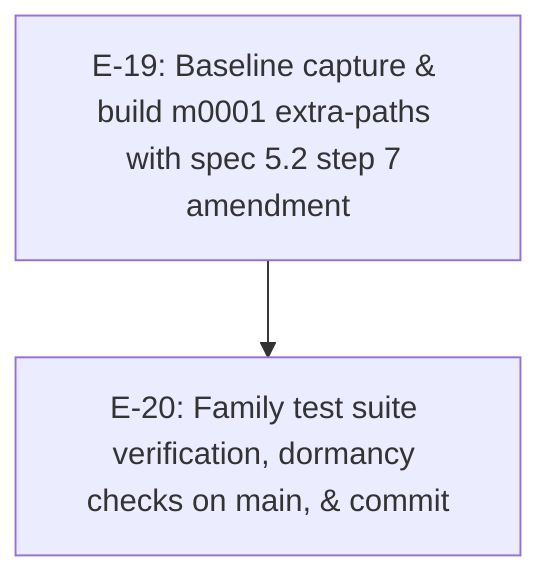

# IPD: Build the dormant log-format gates, readers, event overrides, commands and option aliases for the cutover

- Date: 2026-11-08
- Kind: child
- Concern: Spec `4sd62s` 5.2 makes the cutover ONE attended commit (`cxxmyv`, Order 13), and C10a requires `main` to read and write exactly one on-disk format at every commit. `cxxmyv` carried, inside that one attended turn, several pieces of code whose behavior only matters once logs exist: the post-cutover gates (E-05), the post-cutover readers (E-15), the event `overrides` list and the `--date` refusal (E-14), two new commands (E-06), path-bearing `rename` events (half of E-04) and the mechanism that lets the migration's one commit carry the code changes (the open question inside E-17). Each can be built and tested now WITHOUT changing `main`'s format, because `artifact_meta` already dispatches by storage format (`artifact_meta._storage_format` returns `log` only when `meta/<id6>.jsonl` exists, and no record on `main` has one until the migration) and the metadata stamp (`metadata_schema`) stays below 2 until the migration writes it. Moving them out shrinks the attended turn and lets each be reviewed and merged on its own. Split from `cxxmyv` 2026-11-07.
- Scope: Round-3 split 2026-11-09: E-05 moved to `6jd6mh`, E-15 and E-14 to `wilgfy`, E-06 to `724acb`, E-18 to `v45j1n`. This plan keeps E-19, the one-commit mechanism of `cxxmyv` E-17 (an explicit extra-path list for `m0001`'s commit step, with the spec 5.2 step 7 amendment); and a finishing item E-20 that re-checks dormancy for the whole family. EXCLUDES: the format switch (`cxxmyv` E-03), retiring the sidecar writer, the rename ledger, the INDEX ignore lines and skip names (`cxxmyv` E-04), the builder switch (`cxxmyv` E-07), the documentation patch (`cxxmyv` E-08), the `Kind` option renames (`cxxmyv` E-16), the rehearsal, the real migration and every real-repository demonstration (`cxxmyv` E-01, E-02, E-09 to E-13, E-17).
- Scope-Paths: agent_workflows/migrations/m0001_metadata_v2.py, .aw/records/specs/approved/20260925-metastore-01-4sd62s-artifact-metadata-store.spec.md, tests/test_m0001_extra_paths.py, .aw/records/plans/pending/20261108-metastore-48-clors0-build-the-dormant-log-format-gates-readers-event-overrides-c.ipd.md
- Scope-Exceeded: agent_workflows/cli.py (E-19 names an `aw migrate metadata --apply --include-paths` argument the argparse definition and its read in _run_migrate_metadata live only in cli.py); agent_workflows/migrations/chain.py (the CLI reaches m0001 only through chain.Migration.run and chain._m0001_run, which must forward the new include_paths keyword)
- Item-Dependencies: executed:1ajqaa, executed:dcerjg, executed:ffceq0, executed:g5hpbb, executed:t4gl15, executed:xexn45, executed:ya4ee4, executed:6jd6mh, executed:wilgfy, executed:724acb, executed:v45j1n
- Status: executed
- Readiness: go-pending-approval
- Review-Depth: standard
- From-Spec: 4sd62s
- Work-Kind: feature
- Priority: high
- Blocks-Release: next
- Set: metastore
- Order: 48
- Highest E allocated: 20
- Author: opencode its_direct/pt3-claude-opus-5.5-1m-us
- Id: clors0

This plan conforms to the technical writing standard, `.aw/system/workflows/technical-writing/technical-writing.md`.

## Workflow history
- 2026-11-23 executed (aw oc run model=uri/its_direct/pt3-claude-opus-5.5-1m-us variant=high profile=opus): aw oc run self-finalize: clors0 verified (set metastore, attempt 1). [Scope reconciliation - out-of-scope agent_workflows/cli.py: E-19 names an `aw migrate metadata --apply --include-paths` argument; the argparse definition and its read in _run_migrate_metadata live only in cli.py; out-of-scope agent_workflows/migrations/chain.py: the CLI reaches m0001 only through chain.Migration.run and chain._m0001_run, which must forward the new include_paths keyword]
- 2026-11-16 approved (aw set): status set to approved
- 2026-11-14 reviewed (aw set): APPROVE WITH REVISIONS APPLIED; PR-001..PR-006 FIXED

- 2026-11-14 /plan-review (antigravity/gemini-3.8-flash): APPROVE WITH REVISIONS APPLIED; PR-001..PR-006 fixed; review record .aw/records/reviews/20261108-metastore-48-clors0-build-the-dormant-log-format-gates-readers-event-overrides-c.review.md
- 2026-11-09 note (opencode its_direct/pt3-claude-opus-5.5-1m-us): round-3 split per research nj8zdp; items E-05 moved to 6jd6mh; E-15, E-14 moved to wilgfy; E-06 moved to 724acb; E-18 moved to v45j1n. E-19 and E-20 kept.
- 2026-11-07 to-review (opencode its_direct/pt3-claude-opus-5.5-1m-us): split from cxxmyv per maintainer step-complexity rule (no single E/V item hides hundreds of steps).

## Goal

Every piece of post-cutover behavior that does not itself change the on-disk format is built, tested on log-format fixtures and merged before the cutover, while `main` behaves byte-for-byte as before; the attended cutover then only flips the format and runs the migration.

## Detailed Implementation Checklist (TODO)

Execution-state rule: mark an `E-*` item complete only after performing the action. That mark is not validation. Right-sizing rule: each E-item must address one concern and be executable in one focused pass; split when an E-item names multiple distinct deliverables or independent test-surfaces. Accepted execution states: blocked, failed, pending, performed; terminal gate demands 'performed'.

DORMANCY RULE, applied to every item of this plan (added at the split so the move keeps C10a): the new behavior is reached ONLY for a record whose storage format is `log` (`artifact_meta._storage_format`), for a staged `meta/*.jsonl` path, or when the resolved `metadata_schema` stamp is 2 or more. On `main` before the cutover none of these holds, so every existing command, rule and hook produces the same output as before. Each item proves both halves: its new behavior on a log-format fixture (a `tmp_path` repository whose records have `meta/<id6>.jsonl` logs and whose `project.json` carries `metadata_schema: 2`, built as `tve77h`'s synthetic-log tests and `dcerjg`'s migrated fixtures build them), and its absence on a legacy-format fixture. Item ids E-05, E-06, E-14 and E-15 are the ids these items had in `cxxmyv`; E-18 and E-19 are the moved halves of `cxxmyv` E-04 and E-17; E-20 is new. Ensure the baseline dormancy directory exists (`mkdir -p .aw/state/clors0/before`) and capture the pre-edit rule multisets before E-19's first edit.

### Task group 1: dormant post-cutover code

- [x] E-19 (`cxxmyv` E-17, mechanism half) Ensure directory `.aw/state/clors0/before` exists (`mkdir -p .aw/state/clors0/before`) and save the baseline dormancy check multisets before edits. Settle how the migration's ONE commit carries code, test and documentation changes: spec 5.2 step 7 commits "the migration's own list of paths" and the step-4a marker matches only the exact staged tree (`dcerjg` E-11), so a cutover whose code switch is uncommitted needs a supported way to stage extra paths. Add one under `agent_workflows/migrations/` (for example an explicit `--include-paths <pathspec>...` argument of `aw migrate metadata --apply` that stages the named paths BEFORE the step-4a marker is written, so the marker's `git write-tree` id covers them) and amend spec 5.2 step 7 in the same change to say so, because that step is the contract the AC-16 hooks and the step-4a marker are reviewed against. New test module `tests/test_m0001_extra_paths.py`: in a `tmp_path` fixture repository with the installed hooks, an uncommitted code change plus `--apply --include-paths` produces ONE commit holding the migrated records and the extra paths, passing every installed hook without `--force` or `--no-verify`; an extra path staged AFTER the marker is refused by the hooks. (Dormancy: the argument is inert without `--apply`, and `aw migrate metadata --apply` is not run on `main` before `cxxmyv`.) Measured units: 1 argument, 1 staging step, 1 spec paragraph, 1 test module with three cases: about 7.
  - Depends on: none
  - Expected outcome: the fixture produces one commit with both kinds of path and passes every hook; the late extra path is refused; the spec 5.2 step 7 amendment is in the diff.
  - Execution state: performed

### Task group 2: finish

- [x] E-20 Finish: run the six new test modules of the family (`tests/test_cutover_log_gates.py`, `tests/test_cutover_log_readers.py`, `tests/test_event_overrides.py`, `tests/test_reviews_record_walkthrough_new.py`, `tests/test_log_rename_events.py`, `tests/test_m0001_extra_paths.py`), `tests/test_command_surface_declarations.py`, the existing `tests/test_m0001_*.py` modules, the bare core gate `python3 -m pytest` and `make test-all` (this plan adds code paths every later phase-B merge runs through), `aw check all --agent` and `aw check all --all --agent` on this repository (rule multisets equal those before the plan's first edit, saved to `.aw/state/clors0/before/` before E-19's first edit, and also equal to the baseline of the first round-3 part executed, `6jd6mh` E-01: dormancy on `main` for the whole family), `aw ipd lint` on this plan and `aw sanitize --agent`; commit through `aw commit clors0 -- <paths>` with only Scope-Paths files, never `git add -A`, a bare `git add` or `git commit -a`; never push.
  - Depends on: E-19
  - Expected outcome: all runs pass; the two `aw check all` multisets are unchanged; every commit's `git show --stat` lists only Scope-Paths files (or paths justified at finalize).
  - Execution state: performed

## Project conventions discovered (Step 0)

- `agent_workflows/artifact_meta.py::append` dispatches on the TARGET's storage format (`artifact_meta._storage_format`): a record with `meta/<id6>.jsonl` takes the log branch (the `tve77h` path, exercised today only by synthetic-log tests), a record without one takes the phase-B legacy branch (`append_legacy`). This is what makes log-only code dormant on `main`.
- `agent_workflows/artifact_meta.py` already accepts an `overrides` envelope key (`validate_event`: "overrides must be a non-empty list when present") and the legacy branch copies it (`_prepare_legacy_events`), so E-14 changes only the callers.
- `agent_workflows/hooks/meta_log_append_gate.py` and `artifact_meta.check_staged_log_append` are added by `t4gl15` E-05 (phase-B form); E-05 here adds the terminal-log rules.
- `aw meta repair` and `aw check meta` live in `agent_workflows/meta_cli.py` (`ffceq0` E-11, `1ajqaa`).
- `agent_workflows/set_records.py::write_walkthrough` writes a walkthrough today; E-06 wraps it.
- Cite code by SYMBOL (`path::Symbol`) or by a quoted content string, with a line number only appended to one of those and never alone (advisory `IPD-C801`).

## Findings

| Id | Evidence | Finding |
|---|---|---|
| F-01 | `cxxmyv` Concern and Scope check (2026-11-06 review): the post-cutover gates, readers, `overrides`, the two commands and the `rename` events were placed in the cutover only because they are log-format behavior. | Log-format behavior that is reached only through a log or the schema stamp is dormant on `main`, so C10a does not require it in the cutover commit. |
| F-02 | `rg -n "_storage_format" agent_workflows/artifact_meta.py`: `log` only when `<records_root>/meta/<id6>.jsonl` exists; `rg -n "records/meta" agent_workflows`: no hit at `ac76110f4`, and `rg -c "meta/" .aw/records` finds no log directory. | No record on `main` takes the log branch before the migration. |
| F-03 | `cxxmyv` review record (2026-11-06): "feasibility risk named: the one-commit mechanism is proven only by the E-17 rehearsal". | E-19 proves the mechanism on a fixture before the attended turn; `cxxmyv` E-17 then rehearses with a known mechanism instead of possibly writing one mid-cutover. |

## Proposed changes (ordered, validatable)



1. (Moved) gates: `6jd6mh`; readers and overrides: `wilgfy`; commands: `724acb`; rename events: `v45j1n`. Build and test the extra-path mechanism with its spec amendment (E-19).
2. Prove dormancy on `main`, validate and commit (E-20).

## Deferred / out of scope (with reason)

- E-05 (post-cutover gates). Moved to 6jd6mh (round-3 split 2026-11-09 per research nj8zdp guidance).
  - Carrier: 6jd6mh
  - Carrier-Evidence: .aw/records/plans/executed/20261109-metastore-266-6jd6mh-build-the-dormant-post-cutover-gates-for-log-format-records.ipd.md
- E-15 (post-cutover readers) and E-14 (event `overrides`, `--date` refusal). Moved to wilgfy (round-3 split 2026-11-09 per research nj8zdp guidance).
  - Carrier: wilgfy
  - Carrier-Evidence: .aw/records/plans/executed/20261109-metastore-267-wilgfy-build-the-dormant-post-cutover-readers-and-event-overrides.ipd.md
- E-06 (`aw reviews record`, `aw walkthrough new`). Moved to 724acb (round-3 split 2026-11-09 per research nj8zdp guidance).
  - Carrier: 724acb
  - Carrier-Evidence: .aw/records/plans/executed/20261109-metastore-268-724acb-build-the-dormant-reviews-record-and-walkthrough-new-command.ipd.md
- E-18 (log-format `rename` events). Moved to v45j1n (round-3 split 2026-11-09 per research nj8zdp guidance).
  - Carrier: v45j1n
  - Carrier-Evidence: .aw/records/plans/executed/20261109-metastore-269-v45j1n-write-dormant-rename-events-for-log-format-rename-group-and.ipd.md
- The format switch, the legacy loader move into `m0001`, `CURRENT_METADATA_SCHEMA = 2`, retiring the sidecar writer, the rename ledger, the INDEX ignore lines and the skip names, the builder switch, the documentation patch, the `Kind` option renames with the `90iqr1` F-07 test updates, the rehearsal, the real migration and the real-repository demonstrations: each changes the on-disk format or needs the migrated repository, so C10a keeps them in the one cutover commit or after it.
  - Carrier: cxxmyv

## Scope check

- Over-scope: none. Every item is post-cutover behavior that `cxxmyv` already owned; the only addition is the dormancy constraint that makes the move safe.
- Under-scope: none known. Size: 2 E-items, 2 work Scope-Paths entries plus the spec and this plan.

## Required tests / validation

New behavioral test module `tests/test_m0001_extra_paths.py` (E-19), calling the real code on `tmp_path` fixtures and asserting on outputs, exit codes and file bytes; the five other family modules are created by `6jd6mh`, `wilgfy`, `724acb` and `v45j1n` and re-run by E-20. Commands: bare `python3 -m pytest`, `make test-all`, `aw check all --agent`, `aw check all --all --agent`, `aw sanitize --agent`. CONTRIBUTES to `4sd62s` AC-16 case 2, AC-31, AC-34 and AC-7 (owned, on the real repository, by `cxxmyv`). Baseline context: `tests/test_command_surface_declarations.py` (2 passed in 1.54s).

## Spec / documentation sync

E-19 amends spec `4sd62s` 5.2 step 7 ("the migration's own list of paths") to say how the one migration commit also carries explicitly named extra paths, because that step is the contract the AC-16 hooks and the step-4a marker are reviewed against; the spec file is in `- Scope-Paths:` for that reason (this obligation moved here from `cxxmyv`'s Spec / documentation sync section). The `overrides` key and the `--date` refusal are already in spec 4.2. User documentation of the two commands is in the `90iqr1` patch, applied by `cxxmyv` E-08.

## Open questions

### OQ-01: Why does this plan not depend on `90iqr1` like `cxxmyv` does?

- Blocking: no
- Status: resolved
- Owner: plan author
- Resolution or deferral rationale: `90iqr1` writes a documentation patch whose hunks include `agent_workflows/cli.py` help strings and guards it with a core test that the patch still applies to HEAD. This plan edits `cli.py` (E-06, E-14); running it AFTER the patch exists would make the patch stop applying and fail the core gate at this plan's merge. So this plan omits the `90iqr1` edge, and `9o83cr` (which `90iqr1` depends on) carries `executed:clors0`, which orders this plan before the patch is generated. Every other `cxxmyv` dependency is kept, plus `ffceq0`, `t4gl15` and `xexn45`, whose code these items extend. Recommendation strength: strong.

### OQ-02: Should the two new commands work on an unmigrated repository?

- Blocking: no
- Status: resolved
- Owner: plan author
- Resolution or deferral rationale: No. Before the cutover a `review` event or a walkthrough created through these commands would be written through the legacy branch, which has no rendering for a structured review event and would put a second spelling of review metadata on `main`; refusing until `metadata_schema` is 2 keeps one format (C10a) and matches spec 5.3, which makes commands refuse an unmigrated repository after the cutover anyway. Recommendation strength: strong.

## Validation and cross-check (verify before reporting done)

Validation-state rule: inspect evidence in a separate pass. Do not mark a `V-*` item complete from memory or from the matching execution checkmark. Accepted validation results: blocked, failed, pass, pending; terminal gate demands 'pass'. Runtime-demonstration reachability rule: for each `V-*` item demanding the software be observed acting (such as a run, a dispatch, or a transition), as distinct from items demanding a diff, a file's content, or a test result, which are reachable by construction, name the code path that produces the observation or the sibling `E-*` that creates it, else the demand is UNDER-SCOPE.

- [x] V-19 validates E-19
  - Required evidence: paste `python3 -m pytest -o addopts="" -v tests/test_m0001_extra_paths.py` with the one-commit case (its `git show --stat` listing both migrated records and the extra paths, and the hook output without `--force` or `--no-verify`) and the late-path refusal PASSED, and the `git diff` hunk of the spec 5.2 step 7 amendment.
  - Observed evidence:
    Mechanism: `m0001_metadata_v2.normalize_include_paths` validates the list before anything is written (outside the repo, inside the records root, a directory, a git-ignored file, or a path neither tracked nor on disk refuses with `PreflightGateError`); the list is journaled as `tx_data["include_paths"]` and `_collect_stageable_paths` stages it in `_stage_migration_paths`, which runs before `_step_4a_write_marker`. CLI: `aw migrate metadata --apply --include-paths PATH...` (threaded through `chain.Migration.run` / `chain._m0001_run`).
    ```
    $ python3 -m pytest -o addopts="" -v tests/test_m0001_extra_paths.py
    tests/test_m0001_extra_paths.py::test_extra_path_staged_after_the_marker_is_refused_by_the_installed_hooks PASSED [ 33%]
    tests/test_m0001_extra_paths.py::test_include_paths_are_inert_without_apply_and_bad_paths_refuse_before_writing PASSED [ 66%]
    tests/test_m0001_extra_paths.py::test_apply_with_include_paths_makes_one_commit_that_passes_every_installed_hook PASSED [100%]
    ============================== 3 passed in 4.06s ===============================
    ```
    One-commit case, re-driven by hand from the test's fixture (installed pre-commit hook runs `ipd-executed-gate` and `backlog-blocking-close-gate`; commit made by `aw migrate metadata --apply --no-describe --include-paths src/feature.py tests/test_feature.py docs/guide.md`, no `--force`, no `--no-verify`):
    ```
    rc 0
    OK       Applied 7 file operation(s) (commit c934c4d6d7efae87de8daf10a5b0ee7d02b31e72).
    c934c4d chore(migrate): apply m0001 metadata-v2 migration
    06bec1d seed legacy repository

    $ git show --stat HEAD
     .aw/.gitignore                                             |  2 --
     .aw/config/project.json                                    |  3 ++-
     .../done/20261101-demo-01-bk9001-blocking.backlog.md       | 14 ++++++++------
     .aw/records/meta/bk9001.jsonl                              |  1 +
     .aw/records/meta/pl9001.jsonl                              |  3 +++
     .../plans/executed/20261101-0900-01-legacy-exec.ipd.md     | 11 -----------
     .../executed/20261101-demo-01-pl9001-legacy-exec.ipd.md    |  6 ++++++
     docs/guide.md                                              |  2 +-
     src/feature.py                                             |  2 +-
     tests/test_feature.py                                      |  2 ++
     10 files changed, 24 insertions(+), 22 deletions(-)
    ```
    Late-path refusal (marker written with two include paths, then `docs/guide.md` staged by hand and `git commit` run through the same hooks):
    ```
    status applied include_paths ['src/feature.py', 'tests/test_feature.py']
    late commit rc 1
    warning: m0001 terminal commit marker tree_id mismatch (expected 1e9150bb38c12a6667677df71800619e32f0af47, staged 8ab9cf7732c6bae23cf830471ab168e18352a675); falling back to standard gate checks.
    aw ipd executed-transition gate REFUSED this commit (local prevention; the raw plan->executed path bypasses the finalize gates):
      - .aw/records/plans/executed/20261101-demo-01-pl9001-legacy-exec.ipd.md (pl9001): raw plan->executed transition (moved into executed/) on a log-format plan: ...
    ```
    Spec 5.2 step 7 amendment (`git diff -U0`):
    ```
    @@ -1981 +1981,11 @@ flowchart LR
    -7. COMMIT. Commit with `aw commit --no-plan` and the migration's own list of paths.
    +7. COMMIT. Commit with `aw commit --no-plan` and the migration's own list of paths. The one
    +   migration commit may also carry the cutover's code, test and documentation changes: `aw migrate
    +   metadata --apply --include-paths <path>...` names each extra repository file explicitly, and the
    +   migration stages those files together with its own paths BEFORE step 4a writes the terminal-commit
    +   marker, so the marker's `git write-tree` id covers them and the AC-16 hooks accept the commit
    +   through the marker without `--force` or `--no-verify`. Every named path is validated before
    +   anything is written: a path outside the repository, inside the records root (which the migration
    +   itself rewrites), a directory, a git-ignored file, or a path neither tracked nor present on disk
    +   refuses the whole run. The list is journaled so a resume stages the same files. Without `--apply`
    +   the argument stages nothing. A path staged AFTER the marker changes the staged tree, so the marker
    +   no longer matches and the hooks refuse the commit.
    ```
  - Result: pass

- [x] V-20 validates E-20
  - Required evidence: paste one result line per named test module (the six family modules, `tests/test_command_surface_declarations.py`, each `tests/test_m0001_*.py` module), the bare `python3 -m pytest` and `make test-all` summary lines beside them, the `aw check all --agent` and `aw check all --all --agent` rule multiset diffs against `.aw/state/clors0/before/` (empty), `aw sanitize --agent` with zero `fail`, and `git show --stat` of every `aw commit clors0` commit listing only Scope-Paths files.
  - Observed evidence:
    Per-module results from `python3 -m pytest -o addopts="" -v -n 6 <six family modules> tests/test_command_surface_declarations.py tests/test_m0001_*.py` (rc=0; `test_m0001_extra_paths.py` counts 6 because both the explicit path and the glob collect it):
    ```
    tests/test_command_surface_declarations.py -> 2 passed
    tests/test_cutover_log_gates.py -> 33 passed
    tests/test_cutover_log_readers.py -> 10 passed
    tests/test_event_overrides.py -> 7 passed
    tests/test_log_rename_events.py -> 8 passed
    tests/test_m0001_any_repo.py -> 6 passed
    tests/test_m0001_conversion.py -> 11 passed
    tests/test_m0001_describe.py -> 42 passed
    tests/test_m0001_discover.py -> 4 passed
    tests/test_m0001_extra_paths.py -> 6 passed
    tests/test_m0001_gate_marker.py -> 14 passed
    tests/test_m0001_layout_stage.py -> 12 passed
    tests/test_m0001_preflight.py -> 11 passed
    tests/test_m0001_renames.py -> 8 passed
    tests/test_m0001_review_conversion.py -> 16 passed
    tests/test_m0001_roundtrip.py -> 7 passed
    tests/test_m0001_sidecar.py -> 4 passed
    tests/test_reviews_record_walkthrough_new.py -> 24 passed
    ======================= 225 passed in 331.38s (0:05:31) ========================
    ```
    Bare core gate on the committed tree: `python3 -m pytest` -> `2889 passed, 1 skipped, 11 warnings in 76.18s (0:01:16)`.
    Thorough tier: `make test-all` -> `11862 passed, 6 skipped, 1 xpassed, 17 warnings in 738.19s (0:12:18)`, rc=0. The first attempt reported `4 failed, 11858 passed`, from two causes unrelated to this change. (a) `test_m0001_any_repo.py::test_ac42_this_repository_clone_migration` asserts that HEAD is unchanged across the test, and this lane's own `aw commit` landed mid-run; it passes on a re-run. (b) The 3 `tests/test_runner_resume_clears_stop.py` failures reproduce at the untouched starting head `5ae78fdd6` and are caused only by the runner-inherited `AW_INVOCATION_START_WALL` environment variable: with only that variable kept, 3 fail and 10 pass; with every runner variable but that one kept, 13 pass. The passing run was made with `env -u AW_INVOCATION_START_WALL make test-all`.
    Dormancy: `aw check all --agent` (rc=1, pre-existing findings) and `aw check all --all --agent` (rc=1), rule/location/severity multisets diffed against `.aw/state/clors0/before/` (captured on the pristine lane tree at `5ae78fdd6` before E-19's first edit; 101 and 549 diagnostics):
    ```
    $ diff before/check-all.multiset.txt after/check-all.multiset.txt
    54a55
    > check.scope-drift	.aw/records/plans/pending/20261108-metastore-48-clors0-build-the-dormant-log-format-gates-readers-event-overrides-c.ipd.md	None
    $ diff before/check-all-all.multiset.txt after/check-all-all.multiset.txt
    104a105
    > check.scope-drift	.aw/records/plans/pending/20261108-metastore-48-clors0-build-the-dormant-log-format-gates-readers-event-overrides-c.ipd.md	None
    (both diffs EMPTY once that one line is excluded)
    ```
    The single added line is this in-flight plan's own scope-drift finding, which names the two out-of-scope paths `agent_workflows/cli.py` and `agent_workflows/migrations/chain.py`. They carry `--scope-reason` justifications in the begin receipt, and the runner's finalize reconciles them. No behavioral rule's output changed, so the family is dormant on `main`. The `6jd6mh` recorded counts (94 and 542) are not re-derivable in this lane, because its baseline directory is absent; the difference comes from repository drift since then.
    `aw sanitize --agent` -> `outcome: clean, exit: 0, findings: 0`.
    Commit (only `aw commit clors0`):
    ```
    23fdb5d62b0e5cb3a059e0ac9a78739b22e6080e feat(migrate): add m0001 --include-paths so the one migration commit carries cutover code (clors0 E-19)
     ...g-format-gates-readers-event-overrides-c.ipd.md |  60 ++++-
     ...store-01-4sd62s-artifact-metadata-store.spec.md |  12 +-
     agent_workflows/cli.py                             |  12 +
     agent_workflows/migrations/chain.py                |   9 +-
     agent_workflows/migrations/m0001_metadata_v2.py    | 123 +++++++++-
     tests/test_m0001_extra_paths.py                    | 273 +++++++++++++++++++++
     6 files changed, 481 insertions(+), 8 deletions(-)
    ```
    Every listed path is in Scope-Paths except `agent_workflows/cli.py` and `agent_workflows/migrations/chain.py`, which are justified by `--scope-reason`. A second commit carries only this plan file's evidence update.
  - Result: pass

## Approval and execution gate

- Size assessment: standard
- Cohesion rationale: not required

Execute only after human approval (`Status: approved`) and after every plan in `- Item-Dependencies:` is executed. Safety stop: if prerequisite metastore modules from `dcerjg`, `6jd6mh`, `wilgfy`, `724acb`, or `v45j1n` are absent, or if an unresolvable concurrent-edit conflict arises on any Scope-Paths file, STOP and report. Pin-first where an item deletes or retargets. Scope fence: the paths in `- Scope-Paths:` are a declaration; a needed file outside the fence is edited and then justified at finalize (`--scope-reason`), and a declared path left unmodified is acknowledged (`--scope-ack`). This plan amends a spec (E-19); the runner announces the declared spec edit before the run. Honesty rule: paste the ACTUAL runner output; never claim a result you did not run. Commits: only through `aw commit clors0 -- <paths>` with only Scope-Paths files; never `git add -A`, a bare `git add` or `git commit -a`; never push. Lifecycle: the plan moves to `.aw/records/plans/executed/` only through `aw ipd finalize`, never a hand `git mv`. When `aw oc run` or `aw agy run` executes the plan, the runner performs the finalize; a hand executor runs `aw ipd finalize clors0` itself after `aw ipd lint --phase pre-transition` conforms and every `V-*` reads `pass` with pasted evidence.
