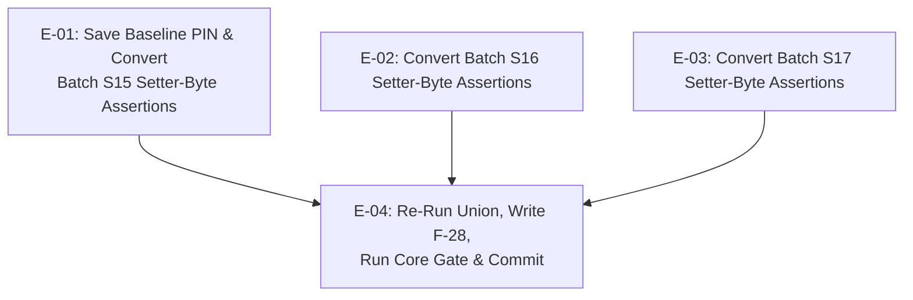

# IPD: Move setter-byte assertions of batches S15 to S17 onto the format-aware field helper

- Date: 2026-11-08
- Kind: child
- Concern: Spec `4sd62s` C10a requires `main` to read and write exactly one metadata format at every commit, so the cutover commit (Order 13, `cxxmyv`) must switch the format and every test that asserts on it at once. `cxxmyv` E-07 carried, as one item, "convert the setter-byte assertions to `artifact_meta.read` plus the in-file mirror" (`59aiyh` Deferred row). Measured 2026-11-07 at `ac76110f4`: `rg -n "assert.*['\"]- (Status|Priority|Blocks-Release|Work-Kind|From-Backlog|From-Spec|Readiness|Approval|Set|Order|Kind|Id|Gate-Kind|Gate-Ref|Item-Dependencies|Graduated-To|Close-Evidence|Release-Exempt-(Kind|Ref)):" tests`, minus lines over command output and minus the legacy-grammar test modules, prints 518 candidate lines in 81 test modules; the 7 modules that `k6jd6l` E-08 already retargets hold 51 of them, leaving 467 in 74 modules. Converting them inside the attended cutover would hide several hundred steps in one item of a plan that cannot be retried cheaply. This work CAN move earlier without changing `main`'s on-disk format: the helper asserts through the ACTIVE format, which is the legacy format until the cutover, so every converted test still checks the same bytes today and needs no edit when the cutover flips the builder. Part of the split of `w13bkp` (Order 47); the helper is `j5fqax` E-01 (formerly `iog3cw` E-01).
- Scope: `cxxmyv` E-07 (setter-byte half), batches S15, S16, S17 moved verbatim from `w13bkp` (module and class lists unchanged; 8 module entries, 62 candidate lines at the split); E-04 finishes. The helper is `j5fqax` E-01 (formerly `iog3cw` E-01). EXCLUDES: switching `RECORD_FORMAT` to `log` and the log-format branch of the helper (`cxxmyv` E-07, the cutover commit); displayed-output assertions; legacy-format subject tests; the `review-pilot` corpus; production code; every other batch.
- Scope-Paths: tests/test_specs_from_backlog.py, tests/test_specs_releases_descriptive_safety.py, tests/test_specs_set_adapter.py, tests/test_specs_set_gate_parity.py, tests/test_specs_status_dirs.py, tests/test_specs_verbs.py, tests/test_status_set_meta_writer.py, tests/test_status_set_partial_batch.py, .aw/records/plans/pending/20261108-metastore-61-aqc3m6-move-setter-byte-assertions-of-batches-s15-to-s17-onto-the-f.ipd.md
- Item-Dependencies: executed:1ajqaa, executed:59aiyh, executed:90iqr1, executed:dcerjg, executed:g5hpbb, executed:iog3cw, executed:ya4ee4
- Status: executed
- Readiness: go-pending-approval
- Review-Depth: standard
- From-Spec: 4sd62s
- Work-Kind: feature
- Priority: high
- Blocks-Release: next
- Set: metastore
- Order: 61
- Highest E allocated: 04
- Author: opencode its_direct/pt3-claude-opus-5.5-1m-us
- Id: aqc3m6

> Write and proofread this plan per the technical writing standard, `.aw/system/workflows/technical-writing/technical-writing.md` (`.agents/workflows/technical-writing/technical-writing.md` in a legacy-layout install), including requirement 12 (diagrams).

## Workflow history
- 2026-11-25 executed (human-assisted finalize): Finalize aqc3m6 from preserved lane aw/lane/aqc3m6 (run-20261125T103744Z-2547641). [Scope reconciliation - in-scope-unmodified tests/test_specs_releases_descriptive_safety.py: not-needed: remaining matches are non-setter assertions]
- 2026-11-16 approved (aw set): status set to approved

- 2026-11-14 reviewed (antigravity/gemini-3.8-flash): /plan-review (antigravity/gemini-3.8-flash): APPROVE WITH REVISIONS APPLIED; PR-001, PR-002, PR-003, PR-004.
- 2026-11-08 to-review (opencode its_direct/pt3-claude-opus-5.5-1m-us): split from w13bkp (batches S15, S16, S17) per maintainer step-complexity rule (no single E/V item hides hundreds of steps; at most 4 batch items per plan).

## Goal

Every setter-byte assertion in batches S15, S16, S17 goes through the format-aware field helper of `j5fqax` E-01 (formerly `iog3cw` E-01), with identical per-test outcomes before and after, so the cutover commit changes the helper and the builder and not these modules.

## Detailed Implementation Checklist (TODO)

Execution-state rule: mark an `E-*` item complete only after performing the action. That mark is not validation. Right-sizing rule: each E-item must address one concern and be executable in one focused pass; split when an E-item names multiple distinct deliverables or independent test-surfaces. Accepted execution states: blocked, failed, pending, performed; terminal gate demands 'performed'.

Batch rule, applied to every batch E-item of this plan:
1. Ensure `.aw/state/aqc3m6/` exists via `mkdir -p .aw/state/aqc3m6/`. Record the unmodified per-test outcome list of the batch's modules: `python3 -m pytest -o addopts="" -m "" -p no:randomly -n 0 -rA <modules> | grep -E "^(PASSED|FAILED|ERROR|SKIPPED|XFAIL|XPASS) " | sed -E 's/ - .*//' | sort > .aw/state/aqc3m6/<batch>-before.txt`. For a batch restricted to named test classes, pass the `<module>::<Class>` node ids.
2. In each named module (or class), replace every SETTER-BYTE assertion with a call to the helper of `tests/record_builder.py` added by `j5fqax` E-01, formerly `iog3cw` E-01 (`assert_field(path, field, value)` and `assert_no_field(path, field)`). A setter-byte assertion is an `assertIn`/`assertNotIn`/`assert ... in` over the text of a RECORD FILE that names a front-matter bullet (`- Status:`, `- Priority:`, `- Blocks-Release:` and the other F-28 fields). An assertion over command OUTPUT (stdout, stderr, a rendered message) is a `displayed-output assertion` and is NOT converted; an assertion whose subject is the legacy grammar itself (a legacy-loader, migration or quoted-example test) is `legacy-format subject` and is NOT converted.
3. Re-run the same command into `<batch>-after.txt` and require `diff` to print nothing. A conversion that would change what a test checks (for example a test that asserts the exact bullet spelling, such as whitespace after the colon) stops and is reported with its node id; it is listed as `setter-byte, exact spelling` in F-28 for `cxxmyv`, not weakened.
4. Count the remaining matches of the F-28 pattern in the batch's modules and give each remaining line one class: `converted` (none should remain), `displayed-output assertion`, `legacy-format subject` or `setter-byte, exact spelling`.
5. The helper never reads production source, and no test gains a source-reading assertion.

### Task group 1: batches

- [x] E-01 Before the first edit, ensure `.aw/state/aqc3m6/` exists (`mkdir -p .aw/state/aqc3m6/`). Batch S15: convert the setter-byte assertions of `tests/test_specs_from_backlog.py`, `tests/test_specs_releases_descriptive_safety.py` (25 candidate assertion lines at `ac76110f4`, F-28). Apply the batch rule with `<batch>` = `S15`.
  - Depends on: none
  - Expected outcome: an empty before/after `diff` for the S15 outcome lists; the remaining F-28 matches in the batch's modules pasted with a class on each and no `setter-byte` row left unconverted except `setter-byte, exact spelling` rows with their node ids.
  - Execution state: performed

- [x] E-02 Batch S16: convert the setter-byte assertions of `tests/test_specs_set_adapter.py`, `tests/test_specs_set_gate_parity.py`, `tests/test_specs_status_dirs.py`, `tests/test_specs_verbs.py`, `tests/test_status_set_meta_writer.py` (21 candidate assertion lines at `ac76110f4`, F-28). Apply the batch rule with `<batch>` = `S16`.
  - Depends on: none
  - Expected outcome: an empty before/after `diff` for the S16 outcome lists; the remaining F-28 matches in the batch's modules pasted with a class on each and no `setter-byte` row left unconverted except `setter-byte, exact spelling` rows with their node ids.
  - Execution state: performed

- [x] E-03 Batch S17: convert the setter-byte assertions of `tests/test_status_set_partial_batch.py` (16 candidate assertion lines at `ac76110f4`, F-28). Apply the batch rule with `<batch>` = `S17`.
  - Depends on: none
  - Expected outcome: an empty before/after `diff` for the S17 outcome lists; the remaining F-28 matches in the batch's modules pasted with a class on each and no `setter-byte` row left unconverted except `setter-byte, exact spelling` rows with their node ids.
  - Execution state: performed

### Task group 2: finish

- [x] E-04 Finish this part: run the batch rule's command over every module of S15, S16, S17 once more and confirm the outcome multiset equals the union of the batches' `-before.txt` lists; write F-28's remaining-match table for this part (one row per remaining match with its class) so `cxxmyv` E-07 has the exact list of `setter-byte, exact spelling` rows it must still change; run the bare core gate `python3 -m pytest` and `aw sanitize --agent`; commit through `aw commit aqc3m6 -- <each changed path>`, one commit per batch allowed, never `git add -A`, a bare `git add` or `git commit -a`. Never push.
  - Depends on: E-01, E-02, E-03
  - Expected outcome: the union comparison is empty; F-28 for this part is written; all runs pass; every commit is path-scoped to Scope-Paths (or justified at finalize).
  - Execution state: performed

## Project conventions discovered (Step 0)

- Test data comes from ONE builder, `tests/record_builder.py` (`9rgn2w`/`59aiyh`), which writes through `artifact_meta`; `cxxmyv` E-07 switches it to `RECORD_FORMAT = "log"` in the cutover commit.
- Tests are behavioral (AGENTS.md "TEST OUTCOMES, NOT CODE STRUCTURE"); core modules set `pytestmark = pytest.mark.core`; `pyproject.toml` `addopts` deselects `slow` and `livecorpus`, so a complete comparison passes `-m ""`, and `pytest-randomly` is installed, so a deterministic order needs `-p no:randomly`.
- `artifact_meta.read_text(text, *, record_type=None) -> State` parses a record's text in either format (phase-B legacy loader), so the helper's legacy branch needs no new parser.
- Cite code by SYMBOL (`module.function`) or by a quoted content string, with a line number only appended to one of those and never alone (advisory `IPD-C801`).

## Findings

| Id | Evidence | Finding |
|---|---|---|
| F-28 | Copied from `w13bkp` F-28 (measured at `ac76110f4`): 467 candidate setter-byte lines in 74 modules, split into 20 batches S01 to S20 of at most about 30 lines. This part: S15, S16, S17, 62 lines. | Each batch is at most about 30 one-line conversions in at most 10 modules. The final table (written by E-04) lists every remaining match with its class. |
| F-28 | Re-measured at `0d6025f4d` before the first edit with the F-28 pattern (`rg -c`): S15 24 (`tests/test_specs_from_backlog.py` 24, `tests/test_specs_releases_descriptive_safety.py` 0), S16 22 (`tests/test_specs_set_adapter.py` 4, `tests/test_specs_set_gate_parity.py` 2, `tests/test_specs_status_dirs.py` 3, `tests/test_specs_verbs.py` 11, `tests/test_status_set_meta_writer.py` 2), S17 15 (`tests/test_status_set_partial_batch.py` 15): 61 lines, against 62 at `ac76110f4` (intervening plans touched these modules; `tests/test_specs_releases_descriptive_safety.py` had no match left). After conversion: 1 remaining match. | Part table for S15 to S17 (1 remaining row: 1 `legacy-format subject`, 0 `setter-byte, exact spelling`, 0 `displayed-output assertion`): (1) `tests/test_status_set_meta_writer.py::test_w14_backlog_single_kind_line_becomes_work_kind` (`assert "- Kind:" not in p.read_text(encoding="utf-8")`) - `legacy-format subject`: the test's subject is the legacy `- Kind:` alias being rewritten to `- Work-Kind:`, `kind` has no builder field label, and the line above already asserts the whole file byte-for-byte. The cutover (`cxxmyv` E-07) has no `setter-byte, exact spelling` row from this part. Outside the single-line pattern: eight whole-file `assertNotIn` lines with no `- ` prefix (`tests/test_specs_from_backlog.py` `"From-Backlog"`/`"Blocks-Release"` in the two dash-clears tests; `tests/test_specs_set_gate_parity.py` `"Gate-Kind"`/`"Gate-Ref"` in two tests) are left as written because they check the whole file body and `assert_no_field` checks only the metadata region, so converting them would weaken them (decision `04-aqc3m6-D1`, following `01-iog3cw-D1`). Five `self.assertNotIn("- Blocks-Release: relaaa", content)` lines in `tests/test_specs_from_backlog.py` were removed rather than rewritten, because the `assert_field(dest_path, "blocks_release", "relbbb")` beside each requires exactly one `- Blocks-Release:` line equal to `relbbb`, which already excludes `relaaa` (decision `04-aqc3m6-D2`). |

## Proposed changes (ordered, validatable)

1. Convert the batches (E-01 to E-03); the batches are independent.
2. Re-run the union, write F-28, run the core gate, commit (E-04).

## Deferred / out of scope (with reason)

- Switching the builder to `RECORD_FORMAT = "log"`, adding the helper's log-format branch, and changing the `setter-byte, exact spelling` rows F-28 lists: they change the on-disk format and so belong to the cutover commit (C10a).
  - Carrier: cxxmyv
- The helper and batches S01 to S04 (S02 and S03 by `iog3cw`; the helper and S04 by `j5fqax`, S01 by `545ag7`, both executed and cited with Carrier-Evidence in the executed `iog3cw` record).
  - Carrier: iog3cw
  - Carrier-Evidence: .aw/records/plans/executed/20261108-metastore-44-iog3cw-add-the-format-aware-field-assertion-helper-and-move-the-fir.ipd.md
- The value-writer test modules retargeted by `k6jd6l` E-08.
  - Carrier: k6jd6l
  - Carrier-Evidence: .aw/records/plans/executed/20261108-metastore-43-k6jd6l-fold-the-value-writers-into-artifact-meta-delete-the-writer.ipd.md

## Scope check

- Over-scope: none. No production module changes.
- Under-scope: none known. Size: 4 E-items, 9 Scope-Paths entries; every batch item is at most about 30 one-line conversions.

## Required tests / validation

Each batch is validated by an identical per-test result list before and after (the batch rule), which is behavioral by construction: the same tests, the same inputs, the same outcomes, with each assertion at least as strict as before. Commands: the batch rule's command per batch, the bare core gate `python3 -m pytest`, `aw sanitize --agent`. CONTRIBUTES to AC-1b (owned by `cxxmyv`).

## Spec / documentation sync

No spec change; prepares part of `4sd62s` section 6 and section 7 step 9 (the test-data half of the cutover) without changing the on-disk format.

## Open questions

### OQ-02: Why does this part run so late?

- Blocking: no
- Status: resolved
- Owner: plan author
- Resolution or deferral rationale: It carries `cxxmyv`'s own dependencies (rule of the 2026-11-07 split), including `90iqr1`, which depends on `9o83cr` and so on every phase-B deletion part. Running after them means the deletion parts' test retargets (for example `k6jd6l` E-08 and E-09, which already move several of these modules onto `artifact_meta.read`) land first, so no assertion is converted twice. Recommendation strength: strong.

### OQ-01: Can this run before the cutover without breaking C10a?

- Blocking: no
- Status: resolved
- Owner: plan author
- Resolution or deferral rationale: Yes. The helper reads through the ACTIVE format and, in the legacy format, also asserts the exact bullet line, so each converted test checks at least what it checked before on the same legacy bytes; `main` keeps one on-disk format. Only the format switch, the log branch of the helper and the exact-spelling rows wait for the cutover commit. Recommendation strength: strong.

## Validation and cross-check (verify before reporting done)

Validation-state rule: inspect evidence in a separate pass. Do not mark a `V-*` item complete from memory or from the matching execution checkmark. Accepted validation results: blocked, failed, pass, pending; terminal gate demands 'pass'. Runtime-demonstration reachability rule: for each `V-*` item demanding the software be observed acting (such as a run, a dispatch, or a transition), as distinct from items demanding a diff, a file's content, or a test result, which are reachable by construction, name the code path that produces the observation or the sibling `E-*` that creates it, else the demand is UNDER-SCOPE.

- [x] V-01 validates E-01
  - Required evidence: paste the empty `diff .aw/state/aqc3m6/S15-before.txt .aw/state/aqc3m6/S15-after.txt`, the before and after F-28 `rg -c` count for each of `tests/test_specs_from_backlog.py`, `tests/test_specs_releases_descriptive_safety.py` (one line per module or test class), and the class of every remaining match.
  - Observed evidence:
    - `diff .aw/state/aqc3m6/S15-before.txt .aw/state/aqc3m6/S15-after.txt`: empty (exit 0, printed `EMPTY-DIFF`; 27 lines in each, all `PASSED`).
    - F-28 `rg -c` counts (before -> after): `tests/test_specs_from_backlog.py` 24 -> 0; `tests/test_specs_releases_descriptive_safety.py` 0 -> 0 (no match at `0d6025f4d`; its `- Status:`/`- Blocks-Release:` strings are injected forged inputs, not assertions).
    - Remaining matches: none. Four whole-file `self.assertNotIn("From-Backlog"|"Blocks-Release", content)` lines outside the pattern left as written (decision `04-aqc3m6-D1`); five redundant `assertNotIn("- Blocks-Release: relaaa", content)` lines subsumed by `assert_field(..., "blocks_release", "relbbb")` (decision `04-aqc3m6-D2`).
  - Result: pass

- [x] V-02 validates E-02
  - Required evidence: paste the empty `diff .aw/state/aqc3m6/S16-before.txt .aw/state/aqc3m6/S16-after.txt`, the before and after F-28 `rg -c` count for each of `tests/test_specs_set_adapter.py`, `tests/test_specs_set_gate_parity.py`, `tests/test_specs_status_dirs.py`, `tests/test_specs_verbs.py`, `tests/test_status_set_meta_writer.py` (one line per module or test class), and the class of every remaining match.
  - Observed evidence:
    - `diff .aw/state/aqc3m6/S16-before.txt .aw/state/aqc3m6/S16-after.txt`: empty (exit 0, printed `EMPTY-DIFF`; 53 lines in each, all `PASSED`).
    - F-28 `rg -c` counts (before -> after): `tests/test_specs_set_adapter.py` 4 -> 0; `tests/test_specs_set_gate_parity.py` 2 -> 0; `tests/test_specs_status_dirs.py` 3 -> 0; `tests/test_specs_verbs.py` 11 -> 0; `tests/test_status_set_meta_writer.py` 2 -> 1.
    - Remaining match: `tests/test_status_set_meta_writer.py:129` `assert "- Kind:" not in p.read_text(encoding="utf-8")` in `test_w14_backlog_single_kind_line_becomes_work_kind` - `legacy-format subject` (the legacy `- Kind:` alias is the test's subject; `kind` has no builder bullet label). The converted `test_cache_state_does_not_change_setter_bytes_or_stdout` keeps its byte equality `got == ref_bytes` and asserts the status through `assert_field(got_path, "status", "approved")`.
  - Result: pass

- [x] V-03 validates E-03
  - Required evidence: paste the empty `diff .aw/state/aqc3m6/S17-before.txt .aw/state/aqc3m6/S17-after.txt`, the before and after F-28 `rg -c` count for each of `tests/test_status_set_partial_batch.py` (one line per module or test class), and the class of every remaining match.
  - Observed evidence:
    - `diff .aw/state/aqc3m6/S17-before.txt .aw/state/aqc3m6/S17-after.txt`: empty (exit 0, printed `EMPTY-DIFF`; 16 lines in each, all `PASSED`).
    - F-28 `rg -c` counts (before -> after): `tests/test_status_set_partial_batch.py` 15 -> 0.
    - Remaining matches: none.
  - Result: pass

- [x] V-04 validates E-04
  - Required evidence: paste the `diff` of the concatenated, sorted `-before.txt` lists of S15, S16, S17 against the combined after-run list (empty), F-28 for this part as written with one row per remaining match and its class, the per-module F-28 `rg -c` count for each of `tests/test_specs_from_backlog.py`, `tests/test_specs_releases_descriptive_safety.py`, `tests/test_specs_set_adapter.py`, `tests/test_specs_set_gate_parity.py`, `tests/test_specs_status_dirs.py`, `tests/test_specs_verbs.py`, `tests/test_status_set_meta_writer.py`, `tests/test_status_set_partial_batch.py`, the bare `python3 -m pytest` summary line beside them and wall time, the `aw sanitize --agent` result with zero `fail`, and every `aw commit aqc3m6` output listing only Scope-Paths.
  - Observed evidence:
    - `diff .aw/state/aqc3m6/union-before.txt .aw/state/aqc3m6/union-after.txt` (union-before is `cat S15-before.txt S16-before.txt S17-before.txt | sort`; union-after is one run over all eight modules): empty (exit 0, printed `UNION-EMPTY`; 96 lines each).
    - F-28 for S15 to S17 written in `## Findings` (1 remaining row, `legacy-format subject`; no `setter-byte, exact spelling` row for `cxxmyv`).
    - Per-module F-28 `rg -c` after: `tests/test_specs_from_backlog.py` 0, `tests/test_specs_releases_descriptive_safety.py` 0, `tests/test_specs_set_adapter.py` 0, `tests/test_specs_set_gate_parity.py` 0, `tests/test_specs_status_dirs.py` 0, `tests/test_specs_verbs.py` 0, `tests/test_status_set_meta_writer.py` 1, `tests/test_status_set_partial_batch.py` 0.
    - Bare core gate `python3 -m pytest`: `2952 passed, 1 skipped, 11 warnings in 106.90s (0:01:46)` (wall `real 1m47.595s`).
    - `aw sanitize --agent`: `{"schema":"aw.agent/v1","kind":"result","cmd":"check-local-leaks","outcome":"clean","exit":0,"verified":true,"complete":true,"checked":7230,"findings":0,"evidence":["leak-scan"],"next":null}` (zero `fail`).
    - `aw commit aqc3m6 -m "test(aqc3m6): move S15-S17 setter-byte assertions onto assert_field/assert_no_field" -- <7 test paths>`: `aw commit: committed 7 path(s): 26f71ba028f14e0e20ec496f42f3e60822f0ee5e`; `git show --stat HEAD` lists only `tests/test_specs_from_backlog.py`, `tests/test_specs_set_adapter.py`, `tests/test_specs_set_gate_parity.py`, `tests/test_specs_status_dirs.py`, `tests/test_specs_verbs.py`, `tests/test_status_set_meta_writer.py`, `tests/test_status_set_partial_batch.py` (all Scope-Paths). `tests/test_specs_releases_descriptive_safety.py` is a declared Scope-Path left unmodified (no match to convert). This plan file's evidence commit follows through `aw commit aqc3m6`.
  - Result: pass

## Approval and execution gate

- Size assessment: standard
- Cohesion rationale: not required

Execute only after human approval (`Status: approved`) and after every plan in `- Item-Dependencies:` is executed. Scope fence: the paths in `- Scope-Paths:` are a declaration; a needed file outside the fence is edited and then justified at finalize (`--scope-reason`), and a declared path left unmodified is acknowledged (`--scope-ack`). Safety stop: if prerequisite metastore symbols from `59aiyh`, `90iqr1`, `iog3cw`, `j5fqax`, or `ya4ee4` are absent upon starting, stop and report rather than creating conflicting implementations. Honesty rule: paste the ACTUAL summary lines; never claim a result you did not run. Commits: only through `aw commit aqc3m6 -- <paths>` with only Scope-Paths files; never `git add -A`, a bare `git add` or `git commit -a`; never push. Lifecycle: the plan moves to `.aw/records/plans/executed/` only through finalize; when `aw oc run` or `aw agy run` executes the plan, the runner performs the finalize; a hand executor runs `aw ipd finalize aqc3m6` itself; never a hand `git mv` to `executed/`.
