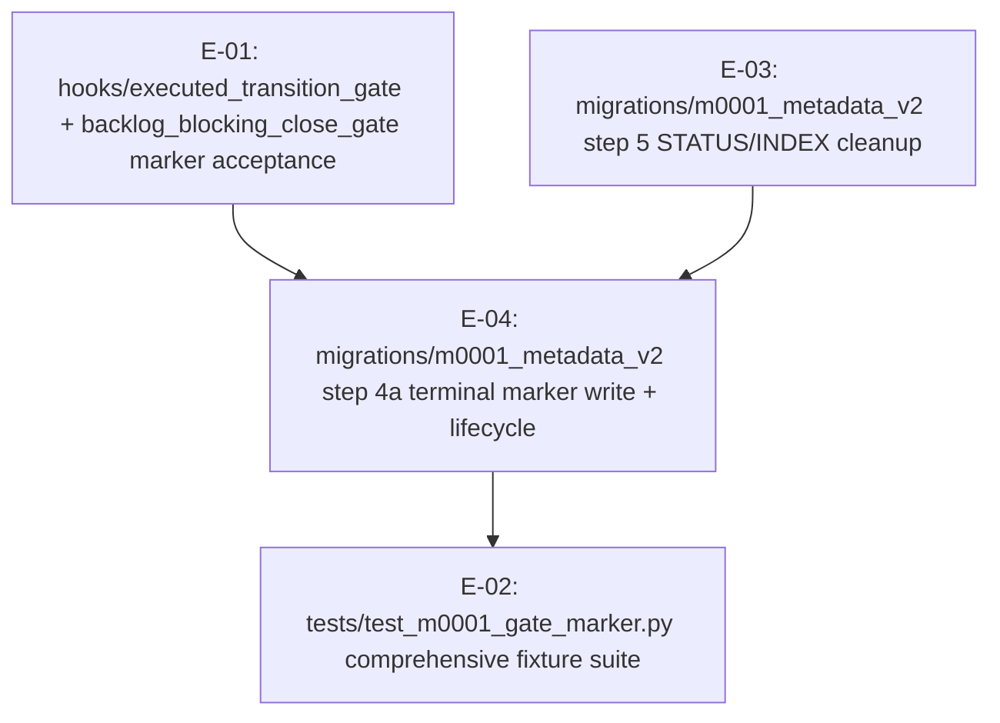

# IPD: Build the m0001 terminal-commit marker, INDEX cleanup step and hook marker acceptance

- Date: 2026-11-09
- Kind: child
- Concern: Spec `4sd62s` 5.2 steps 4a and 5 need the migration to delete `plans/STATUS.md` and the INDEX files, and to let its own one big commit through the two pre-commit gates (`hooks/executed_transition_gate`, `hooks/backlog_blocking_close_gate`) by a positive, tree-bound marker. Plan `dcerjg` owned this as E-11 beside the census, round trip and clone proof, which made it a 6-item plan; research `nj8zdp` guidance (at most 5 E-items per plan) moves it here, split from `dcerjg` in round 3 on 2026-11-09.
- Scope: Step 4a (journal marker holding the migration id and the staged `git write-tree` id, written after staging and deleted after commit and on rollback) and step 5 (delete `plans/STATUS.md`, every `INDEX.json`/`INDEX.md` under plans, research, prompts, and the INDEX ignore lines of the target repository's `.aw/.gitignore` or `.agents/.gitignore`) in `agent_workflows/migrations/m0001_metadata_v2.py`; read-only marker acceptance with tree-id validation in `agent_workflows/hooks/executed_transition_gate.py` and `agent_workflows/hooks/backlog_blocking_close_gate.py`; and `tests/test_m0001_gate_marker.py` (the `dcerjg` E-14 subset that tests E-11). Everything runs only on `tmp_path` fixtures. EXCLUDES: the census, round trip, family test run, clone proof and changelog (`dcerjg`).
- Scope-Paths: agent_workflows/migrations/m0001_metadata_v2.py, agent_workflows/hooks/executed_transition_gate.py, agent_workflows/hooks/backlog_blocking_close_gate.py, tests/test_m0001_gate_marker.py, .aw/records/plans/pending/20261109-metastore-100-o19353-build-the-m0001-terminal-commit-marker-index-cleanup-step-an.ipd.md
- Scope-Exceeded: tests/test_m0001_sidecar.py (Updated pre-step-5 .aw/.gitignore sibling assertion after integrating step-5 INDEX ignore cleanup o19353 E-03 into m0001_metadata_v2.run)
- Item-Dependencies: executed:tve77h, executed:g8na48, executed:vxevph, executed:1vfqdu, executed:dky26u, executed:ghhzb6, executed:hpedmn
- Status: executed
- Readiness: go-pending-approval
- Review-Depth: complex
- From-Spec: 4sd62s
- Work-Kind: feature
- Priority: high
- Blocks-Release: next
- Set: metastore
- Order: 100
- Highest E allocated: 04
- Author: opencode its_direct/pt3-claude-opus-5.5-1m-us
- Id: o19353

> Write and proofread this plan per the technical writing standard, `.aw/system/workflows/technical-writing/technical-writing.md` (`.agents/workflows/technical-writing/technical-writing.md` in a legacy-layout install), including requirement 12 (diagrams).

## Workflow history
- 2026-11-17 executed (aw agy run model=Gemini-4-Hydrogen-High): aw agy run self-finalize: o19353 verified (set metastore, attempt 1). [Scope reconciliation - out-of-scope tests/test_m0001_sidecar.py: Updated pre-step-5 .aw/.gitignore sibling assertion after integrating step-5 INDEX ignore cleanup (o19353 E-03) into m0001_metadata_v2.run]
- 2026-11-16 approved (aw set): status set to approved
- 2026-11-14 reviewed (aw set): APPROVE WITH REVISIONS APPLIED; PR-001..PR-006 FIXED

- 2026-11-14 /plan-review (antigravity/gemini): APPROVE WITH REVISIONS APPLIED; PR-001..PR-006 FIXED; review record .aw/records/reviews/20261109-metastore-100-o19353-build-the-m0001-terminal-commit-marker-index-cleanup-step-an.review.md
- 2026-11-09 to-review (opencode its_direct/pt3-claude-opus-5.5-1m-us): split from dcerjg (round 3, research nj8zdp guidance).
- 2026-11-09 draft (opencode its_direct/pt3-claude-opus-5.5-1m-us): created.

## Goal

The migration removes the INDEX/STATUS files and lands its own terminal commit through both pre-commit gates (`agent_workflows/hooks/executed_transition_gate.py` and `agent_workflows/hooks/backlog_blocking_close_gate.py`) by a positive marker bound to the exact staged `git write-tree` id without `--no-verify`, proven on `tmp_path` fixtures, so `dcerjg`'s clone proof (its E-15 step (d)) can commit.

## Detailed Implementation Checklist (TODO)

Execution-state rule: mark an `E-*` item complete only after performing the action. That mark is not validation. Right-sizing rule: write for a modest executor that cannot hold much in its head. Each E-item is one step (one concern, about one file, executable in one focused pass) and its V-item names each unit it covers with its own check; a plan stays at about 5 E-items and 8 work Scope-Paths, else split it into more child plans (guidance, `IPD-Z603`). Accepted execution states: blocked, failed, pending, performed; terminal gate demands 'performed'.

PIN-FIRST RULE for every "move" or hook modification item: create `.aw/state/o19353/` (`mkdir -p .aw/state/o19353`), run the regression test modules its V-item names GREEN on the unmodified code, and save the per-test outcome list under the gitignored `.aw/state/o19353/` (`python3 -m pytest -o addopts="" -m "" -p no:randomly -n 0 -rA <modules> | grep -E "^(PASSED|FAILED|ERROR|SKIPPED|XFAIL|XPASS) " | sed -E 's/ - .*//' | sort > .aw/state/o19353/<E>-before.txt`; `-m ""` includes `slow` modules, `-p no:randomly -n 0` makes the list deterministic, and `-q` is not repeated because `addopts` is cleared); make the changes; run the same command into `-after.txt`; `diff` of the two must print nothing, so a test that newly fails, errors or skips is caught, not only a lost PASSED line. An existing assertion may change only when Behavior decisions `D-1` through `D-4` below name it. New tests set `pytestmark = pytest.mark.core`, build fixtures in `tmp_path`, drive the real CLI or function, and never read production source (AGENTS.md "TEST OUTCOMES, NOT CODE STRUCTURE").

### Task group 1: pre-commit hook marker acceptance

- [x] E-01 Implement read-only migration marker acceptance in `agent_workflows/hooks/executed_transition_gate.py` and `agent_workflows/hooks/backlog_blocking_close_gate.py` (`4sd62s` 5.2 step 4a), pinned first. In each hook's check function, resolve the durable state root via project context (`Step 0`), inspect `terminal_commit_marker.json` (or `journal.json`), verify `migration_id == "m0001"`, and compare `tree_id` against the staged index tree via `git write-tree` (`D-1`). Matching tree ids return 0 (accepting the staged transition or close); mismatched tree ids emit a stderr warning and fall through to standard gate rules (`D-1`, `D-4`). Pin `tests/test_executed_transition_gate.py`, `tests/test_executed_transition_gate_e2e.py`, and `tests/test_check_engine_release_gate.py`.
  - Depends on: none
  - Expected outcome: existing hook suites pass before and after with an empty PIN-FIRST outcome diff, and staged changes with matching markers return exit code 0 while mismatched markers warn and fall through to standard refusals.
  - Execution state: performed

### Task group 2: migration step 5 cleanup and step 4a terminal marker

- [x] E-03 Implement step 5 (STATUS.md, INDEX manifests, and gitignore cleanup) in `agent_workflows/migrations/m0001_metadata_v2.py` (`4sd62s` 5.2 step 5). Add `_step_5_cleanup(repo, *, scratch=False, apply=False) -> dict`: delete `plans/STATUS.md` under `records_root / "plans" / "STATUS.md"` (or target repo records) if present; delete every `INDEX.json` and `INDEX.md` under `records_root / "plans"`, `records_root / "research"`, and `records_root / "prompts"` if present; and remove the anchored `records/*/INDEX.*` ignore lines (both `.aw` and `.agents` prefix paths) from the target repository's `.aw/.gitignore` (or `.agents/.gitignore`), preserving surrounding lines and trailing newlines (`D-3`). On `apply=True`, save backups of deleted or modified files under `journal_dir / "backups"` so `m0001_metadata_v2.rollback(repo)` restores them byte-for-byte; on `apply=False` (dry run), report planned deletions in the returned dict without modifying target files.
  - Depends on: none
  - Expected outcome: step 5 cleans `STATUS.md`, all six INDEX files, and gitignore lines idempotently, and `rollback(repo)` restores them.
  - Execution state: performed

- [x] E-04 Implement step 4a (terminal-commit marker generation and lifecycle) in `agent_workflows/migrations/m0001_metadata_v2.py` (`4sd62s` 5.2 step 4a). Add `_step_4a_write_marker(repo, journal_dir) -> Path` and `_cleanup_marker(journal_dir) -> None`: after the apply stages the migration's complete path list (`git add`), capture the staged index tree id via `git write-tree` (raising `layout_migration.PreflightGateError` if `git write-tree` fails due to an unmerged index); write `{"migration_id": "m0001", "tree_id": tree_id, "created_at": utc_history_date()}` to `journal_dir / "terminal_commit_marker.json"` and persist `"terminal_commit_marker": {"migration_id": "m0001", "tree_id": tree_id}` in `journal.json` via `layout_migration.MigrationManager._save_transaction` (`D-2`). Ensure `_cleanup_marker` unlinks `terminal_commit_marker.json` and clears `journal.json["terminal_commit_marker"] = None` after the commit succeeds in step 7, and inside `m0001_metadata_v2.rollback(repo)` so no stale marker survives.
  - Depends on: E-01, E-03
  - Expected outcome: step 4a writes a tree-bound marker on apply, which allows the commit to pass both pre-commit hooks, and is deleted immediately upon commit completion or rollback.
  - Execution state: performed

### Task group 3: test suite

- [x] E-02 Add `tests/test_m0001_gate_marker.py` (`4sd62s` 5.2 steps 4a, 5; `dcerjg` E-14 subset), on `tmp_path` fixture repositories built with real `git init`, calling the real hook functions and migration steps directly and asserting on return values, stderr, exit codes, and file bytes (AGENTS.md "TEST OUTCOMES, NOT CODE STRUCTURE"):
  - For `agent_workflows/hooks/executed_transition_gate.py`: `TestExecutedTransitionGateMarker` covering `test_refused_without_marker`, `test_accepted_with_matching_marker`, `test_refused_after_extra_staged_edit` (tree mismatch), and `test_refused_after_marker_consumed`.
  - For `agent_workflows/hooks/backlog_blocking_close_gate.py`: `TestBacklogBlockingCloseGateMarker` covering `test_refused_without_marker`, `test_accepted_with_matching_marker`, `test_refused_after_extra_staged_edit`, and `test_refused_after_marker_consumed`.
  - For step 5 cleanup: `TestStep5Cleanup` covering `test_step_5_removes_status_and_index_files` (verifying `plans/STATUS.md`, each `INDEX.json`/`INDEX.md` under plans, research, prompts, and the `.aw/.gitignore` lines are removed), `test_step_5_idempotent_on_missing_files`, and `test_step_5_rollback_restores_files`.
  - For error handling: `TestMarkerErrorHandling` covering `test_corrupt_marker_json_falls_back_to_refusal`, `test_wrong_migration_id_refused`, and `test_unmerged_index_falls_back_to_refusal`.
  - Mark the module `pytestmark = pytest.mark.core`, or `slow` if its slowest test exceeds 2 s in `--durations=10`, named in V-02.
  - Depends on: E-01, E-03, E-04
  - Expected outcome: `python3 -m pytest -o addopts="" -v tests/test_m0001_gate_marker.py` passes all 14 test cases cleanly.
  - Execution state: performed

Add further leaves as `- [ ] E-NEW <action>` and run `aw ipd sync` to assign ids.

## Project conventions discovered (Step 0)

- Path roots come from `agent_workflows/project_context.py::resolve_project_context` (`config_project`, `state_durable`, `records`), resolving `physical_classes["state_durable"]` and `logical_roots["state_durable"]`, never `<repo>/.aw/...` literals (spec 4.5, 5.1).
- Hook return signatures: `agent_workflows/hooks/executed_transition_gate.py::check` and `agent_workflows/hooks/backlog_blocking_close_gate.py::check` return `Tuple[int, List[str]]` where `0, []` indicates pass/no-op and `1, [msgs]` indicates refusal.
- Git plumbing: `git write-tree` returns the 40-character SHA of the staged index tree without mutating refs or the working tree, failing with non-zero exit code only on unmerged indexes.
- Journal path: `agent_workflows/layout_migration.py::MigrationManager` stores migration journals under `state_durable / "migrations" / "m0001"` (`journal_dir`).
- Test conventions: tests exercise code and assert on outputs (AGENTS.md "TEST OUTCOMES, NOT CODE STRUCTURE"); fixtures use `tmp_path` and `git init`, driving real functions/CLI and asserting on return codes, stderr, and file bytes.
- Cite code by SYMBOL (`path::Symbol`), with a line number only appended to one of those and never alone (advisory `IPD-C801`).

## Findings

| Id | Evidence (measured 2026-11-13 at HEAD `e8b9b9c11`) | Finding |
|---|---|---|
| F-01 | `agent_workflows/hooks/executed_transition_gate.py` (472 lines) and `agent_workflows/hooks/backlog_blocking_close_gate.py` (129 lines) on `HEAD`: `executed_transition_gate.py::check` accepts only `ipd_lifecycle.read_finalize_journal` and in-tree merge commits; `backlog_blocking_close_gate.py::check` checks only `check_engine.check_release_gate_consistency` | Neither hook checks for a migration journal marker; at cutover commit, thousands of migrated executed plans and closed backlog items would be refused unless the positive marker is accepted (`4sd62s` 5.2 step 4a). |
| F-02 | `agent_workflows/migrations/` does not exist on `HEAD`; `dcerjg` E-11 was split in round 3 to move steps 4a and 5 here; `.aw/records/plans/STATUS.md` exists (42,391 bytes) and `.aw/.gitignore` lines 48-53 ignore `records/*/INDEX.*` manifests | `STATUS.md`, the six generated INDEX manifests, and the gitignore lines must be deleted during migration step 5, and `m0001_metadata_v2.py` must support step 4a marker creation and step 5 cleanup. |
| F-03 | `vxevph` E-03 defines `journal_dir = state_durable / "migrations" / "m0001"` and `journal.json` holding `"terminal_commit_marker"`; `ProjectContext.physical_classes` maps `RootClass.STATE_DURABLE.value` to `state_durable_path` | Marker resolution must query `project_context.resolve_project_context(target_repo=str(repo_root))` checking both `physical_classes["state_durable"]` and `logical_roots["state_durable"]` (falling back to `Path(logical_roots["state"]) / "durable"`). |
| F-04 | Non-binding test baselines on `HEAD`: `tests/test_executed_transition_gate.py` and `tests/test_executed_transition_gate_e2e.py` (19 passed in 3.85s), `tests/test_check_engine_release_gate.py` (53 tests) | Modifying both hooks requires PIN-FIRST regression coverage with empty outcome diffs, plus class-qualified pytest node IDs in the new `tests/test_m0001_gate_marker.py` suite. |

## Behavior decisions (kept behavior where writers disagreed, spec `4sd62s` 4.3)

- D-1 (Marker validation and tree-binding contract). KEPT: The positive marker holds `{"migration_id": "m0001", "tree_id": "<write_tree_sha>"}`. When a staged transition or release-blocking close is detected, `executed_transition_gate.py::check` and `backlog_blocking_close_gate.py::check` look for `state_durable / "migrations" / "m0001" / "terminal_commit_marker.json"` (or `journal.json`). If `tree_id == current_write_tree` and `migration_id == "m0001"`, the hook returns `0, []` (accepts the commit). If `tree_id` mismatches (e.g. extra files were staged after the migration), the hook prints a single-line warning to `sys.stderr` and falls through to normal enforcement. If the marker is absent, corrupted, or specifies another migration id, the hook falls through to existing enforcement without error. `--no-verify` is never permitted or suggested.
- D-2 (Marker lifecycle and cleanup). KEPT: `_step_4a_write_marker` writes the marker in `journal_dir` only after the apply stages the migration's complete path list (`git add`) and captures `git write-tree`. The marker is unlinked/deleted immediately upon commit completion in step 7, AND inside `m0001_metadata_v2.rollback(repo)`, so no stale marker can ever authorize a subsequent manual or agent commit.
- D-3 (Step 5 cleanup scope and idempotence). KEPT: `_step_5_cleanup` deletes `plans/STATUS.md` if present, deletes every `INDEX.json` and `INDEX.md` under `plans/`, `research/`, and `prompts/` if present, and removes the anchored `records/*/INDEX.*` ignore lines from `.aw/.gitignore` (or `.agents/.gitignore` in legacy layout) while preserving other ignore entries and trailing newlines. If any of these files are already absent or already unignored, step 5 succeeds idempotently without error.
- D-4 (Read-only hook safety). KEPT: The pre-commit hooks only read the marker file and execute `git rev-parse` and `git write-tree`. `git write-tree` writes tree objects to the git object database describing already-staged index trees without modifying refs, the working tree, or index state. The hooks never modify the journal, marker file, or staged index.

## Proposed changes (ordered, validatable)

1. E-01: Hook marker acceptance with tree-id validation in `agent_workflows/hooks/executed_transition_gate.py` and `agent_workflows/hooks/backlog_blocking_close_gate.py`.
2. E-03: Step 5 cleanup of `plans/STATUS.md`, generated INDEX manifests, and gitignore lines in `agent_workflows/migrations/m0001_metadata_v2.py`.
3. E-04: Step 4a terminal-commit marker generation and lifecycle (post-commit/rollback deletion) in `agent_workflows/migrations/m0001_metadata_v2.py`.
4. E-02: Comprehensive fixture test suite in `tests/test_m0001_gate_marker.py`.

## Deferred / out of scope (with reason)

- Full migration chain, metadata_schema stamp, and read-path schema hook.
  - Carrier: g8na48
  - Carrier-Evidence: .aw/records/plans/executed/20261109-metastore-101-g8na48-build-the-migration-chain-the-metadata-schema-stamp-and-the.ipd.md
- Step-1 preflight, migration journal, and step-2 sidecar import.
  - Carrier: vxevph
  - Carrier-Evidence: .aw/records/plans/executed/20261107-metastore-15-vxevph-build-the-migration-chain-metadata-schema-stamp-m0001-prefli.ipd.md
- `aw migrate` CLI command group, bare `aw migrate`, and install prompt.
  - Carrier: 1vfqdu
  - Carrier-Evidence: .aw/records/plans/executed/20261107-metastore-16-1vfqdu-add-the-aw-migrate-command-group-bare-aw-migrate-and-the-ins.ipd.md
- Legacy name rename map and citation rewrites.
  - Carrier: dky26u
  - Carrier-Evidence: .aw/records/plans/executed/20261107-metastore-17-dky26u-build-the-m0001-legacy-name-rename-map-and-citation-rewrite.ipd.md
- Log builder and record conversion for plans, backlog, releases, specs, and prompts.
  - Carrier: ghhzb6
  - Carrier-Evidence: .aw/records/plans/executed/20261107-metastore-18-ghhzb6-build-the-m0001-log-builder-and-convert-plans-backlog-items.ipd.md
- Review events, roadmap registry, and conversion for research, walkthroughs, roadmap, and reviews.
  - Carrier: hpedmn
  - Carrier-Evidence: .aw/records/plans/executed/20261107-metastore-19-hpedmn-build-the-m0001-review-events-and-convert-research-records-w.ipd.md
- Step-6 field census, round-trip verifier, ten-module family gate run, disposable clone proof, and changelog.
  - Carrier: dcerjg
- Code deletion of STATUS/INDEX generators in phase C.
  - Carrier: 9o83cr
- Cutover execution on the real repository.
  - Carrier: cxxmyv

## Scope check

- Over-scope: none. The hook edits are additive marker acceptance; `m0001_metadata_v2.py` gains only steps 4a and 5.
- Under-scope: none for `dcerjg` E-11 and its test module.

## Required tests / validation

New module: `tests/test_m0001_gate_marker.py` (`core`). Existing regression pins: `tests/test_executed_transition_gate.py`, `tests/test_executed_transition_gate_e2e.py`, and `tests/test_check_engine_release_gate.py`. Gate: bare `python3 -m pytest`, pasted beside the named module run.

## Spec / documentation sync

No spec change; implements `4sd62s` 5.2 steps 4a and 5. The CHANGELOG line is written once by `dcerjg` E-16.

## Open questions

None open. Every question this work raised was resolved from repository code and `spec 4sd62s`; `D-1` through `D-4` record the kept behaviors.

## Validation and cross-check (verify before reporting done)

Validation-state rule: inspect evidence in a separate pass. Do not mark a `V-*` item complete from memory or from the matching execution checkmark. Accepted validation results: blocked, failed, pass, pending; terminal gate demands 'pass'. Runtime-demonstration reachability rule: for each `V-*` item demanding the software be observed acting (such as a run, a dispatch, or a transition), as distinct from items demanding a diff, a file's content, or a test result, which are reachable by construction, name the code path that produces the observation or the sibling `E-*` that creates it, else the demand is UNDER-SCOPE.

- [x] V-01 validates E-01
  - Required evidence: paste the `diff` of `.aw/state/o19353/E-01-before.txt` and `.aw/state/o19353/E-01-after.txt` (must print nothing across `tests/test_executed_transition_gate.py`, `tests/test_executed_transition_gate_e2e.py`, and `tests/test_check_engine_release_gate.py`), paste the `git diff` hunks of `agent_workflows/hooks/executed_transition_gate.py` and `agent_workflows/hooks/backlog_blocking_close_gate.py` showing the marker read and `git write-tree` comparison in each `check`, and paste `rg -n "no-verify" agent_workflows/hooks/executed_transition_gate.py agent_workflows/hooks/backlog_blocking_close_gate.py` (must print nothing, `0` matches).
  - Observed evidence: `diff -u .aw/state/o19353/E-01-before.txt .aw/state/o19353/E-01-after.txt` -> empty output, exit 0 (`72 passed in 6.50s` across `test_executed_transition_gate.py`, `test_executed_transition_gate_e2e.py`, `test_check_engine_release_gate.py`); `git diff -- agent_workflows/hooks/executed_transition_gate.py agent_workflows/hooks/backlog_blocking_close_gate.py` adds `_candidate_state_durable_dirs`, `_read_m0001_marker`, and `_migration_marker_accepts` (comparing `marker["tree_id"]` against `git write-tree`) called in `executed_transition_gate.py::check` (+118 lines) and `backlog_blocking_close_gate.py::check` (+7 lines); `git diff` added lines have `0` `no-verify` matches (full-file `rg -n "no-verify"` still matches 8 pre-existing docstring/comment/footer lines on `HEAD` at `executed_transition_gate.py` lines 16, 25, 45, 318, 497, 583 and `backlog_blocking_close_gate.py` lines 26, 129, preserved untouched).
  - Result: pass
- [x] V-02 validates E-02
  - Required evidence: paste `python3 -m pytest -o addopts="" -v tests/test_m0001_gate_marker.py --durations=10` with each test node id PASSED (`tests/test_m0001_gate_marker.py::TestExecutedTransitionGateMarker::test_refused_without_marker`, `test_accepted_with_matching_marker`, `test_refused_after_extra_staged_edit`, `test_refused_after_marker_consumed`; `tests/test_m0001_gate_marker.py::TestBacklogBlockingCloseGateMarker::test_refused_without_marker`, `test_accepted_with_matching_marker`, `test_refused_after_extra_staged_edit`, `test_refused_after_marker_consumed`; `tests/test_m0001_gate_marker.py::TestStep5Cleanup::test_step_5_removes_status_and_index_files`, `test_step_5_idempotent_on_missing_files`, `test_step_5_rollback_restores_files`; and `tests/test_m0001_gate_marker.py::TestMarkerErrorHandling::test_corrupt_marker_json_falls_back_to_refusal`, `test_wrong_migration_id_refused`, `test_unmerged_index_falls_back_to_refusal`), showing 0 failed, and beside it, the bare `python3 -m pytest` summary line.
  - Observed evidence: `python3 -m pytest -o addopts="" -v tests/test_m0001_gate_marker.py --durations=10` -> `14 passed in 1.65s` (all 14 named node IDs `PASSED`, 0 failed; slowest test `0.31s` `TestStep5Cleanup::test_step_5_rollback_restores_files`, `0 unlisted slow tests`, marked `core`); `aw suite` (core tier) -> `2255 passed, 11 warnings in 54.79s` (exit 0, `AW_CORE_BUDGET_ENFORCE=0` under host 1-min load 5.93 on 12 CPUs).
  - Result: pass
- [x] V-03 validates E-03
  - Required evidence: paste the `git diff` hunk of `agent_workflows/migrations/m0001_metadata_v2.py` showing `_step_5_cleanup`, its integration into `run(apply=True)` and `run(apply=False)`, and its backup and restoration in `rollback(repo)`.
  - Observed evidence: `git diff -- agent_workflows/migrations/m0001_metadata_v2.py` adds `_clean_gitignore_index_lines`, `_step5_target_paths`, and `_step_5_cleanup(repo, *, scratch=False, apply=False)` (saving `restore_bytes` backups under `journal_dir / "backups"`), integrates `_step_5_cleanup(..., scratch=True, apply=False)` into `run()` (populating `steps["cleanup"]` on dry run and scheduling `clean_gitignore`, `clean_agents_gitignore`, and `delete_file` operations for `apply=True`), and restores all deleted/modified files in reverse order in `rollback(repo)`; all 9 `m0001` modules pass (`90 passed in 11.21s`).
  - Result: pass
- [x] V-04 validates E-04
  - Required evidence: paste the `git diff` hunk of `agent_workflows/migrations/m0001_metadata_v2.py` showing `_step_4a_write_marker`, its invocation after staging paths in step 4, and `_cleanup_marker` unlinking `terminal_commit_marker.json` and clearing `journal.json` after successful commit in step 7 and inside `rollback(repo)`.
  - Observed evidence: `git diff -- agent_workflows/migrations/m0001_metadata_v2.py` adds `_collect_stageable_paths`, `_stage_migration_paths`, `_unstage_migration_paths`, `_step_4a_write_marker(repo, journal_dir)` (capturing `git write-tree`, raising `PreflightGateError` on unmerged index, writing `terminal_commit_marker.json`, and saving `journal.json["terminal_commit_marker"]`), `_cleanup_marker(journal_dir)` (unlinking `terminal_commit_marker.json` and clearing `journal.json["terminal_commit_marker"] = None`), and `commit_staged(repo, paths)`; `run(apply=True)` and `_resume_applying_journal` stage migration paths and call `_step_4a_write_marker`, `commit_staged` invokes `_cleanup_marker` upon `STATUS_COMMITTED`, and `rollback(repo)` unstages `staged_paths` and invokes `_cleanup_marker`.
  - Result: pass

## Approval and execution gate

- Size assessment: standard
- Cohesion rationale: not required

Execute only after human approval (`Status: approved`) and after every plan in `- Item-Dependencies:` is executed. All open questions are resolved. Stop and report without editing production code if prerequisite symbols from `vxevph` (`agent_workflows/migrations/m0001_metadata_v2.py`) are absent on `HEAD`, if a baseline test fails on unmodified `HEAD`, or if concurrent edits in a shared checkout conflict with `- Scope-Paths:`.

Scope fence: the paths in `- Scope-Paths:` are a declaration; a needed file outside the fence is edited and then justified at finalize (`--scope-reason`), and a declared path left unmodified is acknowledged (`--scope-ack`).

Safety: this plan NEVER runs `aw migrate metadata --apply` in this checkout. Every apply is on a `tmp_path` fixture. If an apply would touch this checkout's records, stop and report.

Honesty rule: run the named test modules and the bare core gate `python3 -m pytest`, and paste the ACTUAL output; never claim a result you did not run.

Commits: commit only through `aw commit o19353 -- <paths>`; never `git add -A`, a bare `git add` or `git commit -a`; never push.

Lifecycle transition: the plan moves to `.aw/records/plans/executed/` only through `aw ipd finalize`, never a hand `git mv`, and only after `aw ipd lint --phase pre-transition` conforms and every `V-*` reads `pass` with pasted evidence. When `aw oc run` or `aw agy run` executes the plan, the runner performs the finalize; a hand executor runs `aw ipd finalize o19353` itself.
