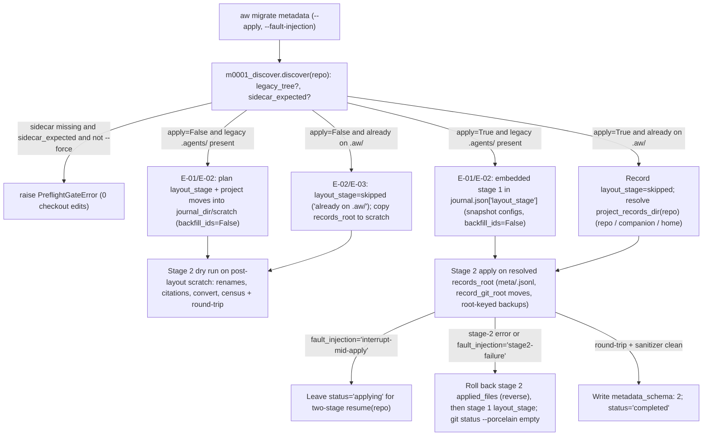

# IPD: Chain the layout migration as stage one of aw migrate metadata and handle no-sidecar and companion backends

- Date: 2026-11-09
- Kind: child
- Concern: Spec `4sd62s` 5.2a items 2, 3 and 5 require `aw migrate metadata` to run the existing transactional layout migration first in a `.agents/` or mixed repository (and report when skipped on an `.aw/`-only repository), resolve the records root through `project_context` (`companion` and `home` backends, `AC-18`), and treat a missing sidecar as normal unless `m0001_discover.discover` reports one is expected. Plan `g5hpbb` owned this (`g5hpbb` E-06) beside seven other items; research `nj8zdp` guidance split it in round 3 on 2026-11-09.
- Scope: Add embedded stage-one plan, scratch-projection, apply (`backfill_ids=False`), resume, and snapshot-backed rollback helpers to `layout_migration.MigrationManager` (E-01); chain stage one, external `companion`/`home` `records_root` handling, `discover`-based sidecar expectedness, and cross-stage fault rollback in `m0001_metadata_v2.py` (E-02); report stage-one status (including `.aw/`-only skip) and `"no sidecar (none expected)"` in `m0001_verify.py` while keeping `tests/test_m0001_sidecar.py` aligned with `discover.sidecar_expected` (E-03); wire `--fault-injection` and two-stage reporting through `chain.py` and `cli.py` (E-04); and add behavioral fixture suite `tests/test_m0001_layout_stage.py` (E-05). EXCLUDES: `m0001_discover.py` and id-less record conversion (`3g20ms`), and the `AC-42` end-to-end proof plus `CHANGELOG.md` entry (`g5hpbb`).
- Scope-Paths: agent_workflows/layout_migration.py, agent_workflows/migrations/m0001_metadata_v2.py, agent_workflows/migrations/m0001_verify.py, agent_workflows/migrations/chain.py, agent_workflows/cli.py, tests/test_m0001_sidecar.py, tests/test_m0001_layout_stage.py, .aw/records/plans/pending/20261109-metastore-105-bv4kkj-chain-the-layout-migration-as-stage-one-of-aw-migrate-metada.ipd.md
- Scope-Exceeded: .aw/records/backlog/done/20261117-metastore-01-b4vfda-m0001-convert-backlog-map-omitted-legacy-kind-fiel.backlog.md (Durable defect carrier filed under execution defect-report requirement for m0001_convert.backlog_map omitting legacy Kind -> work_kind alias fixed in bv4kkj); agent_workflows/migrations/m0001_convert.py (Fix missing legacy Kind -> work_kind alias in backlog_map so mixed_layout qa1z04 converts cleanly during verification); tests/test_m0001_preflight.py (Add aw backlog setter history line to pre-3g20ms bk0001 fixture per E-03 discover.sidecar_expected alignment)
- Item-Dependencies: executed:dcerjg, executed:9vf2iv, executed:3g20ms
- Status: executed
- Readiness: go-pending-approval
- Review-Depth: complex
- From-Spec: 4sd62s
- Work-Kind: feature
- Priority: high
- Blocks-Release: next
- Set: metastore
- Order: 105
- Highest E allocated: 05
- Author: opencode its_direct/pt3-claude-opus-5.5-1m-us
- Id: bv4kkj

> Write and proofread this plan per the technical writing standard, `.aw/system/workflows/technical-writing/technical-writing.md` (`.agents/workflows/technical-writing/technical-writing.md` in a legacy-layout install), including requirement 12 (diagrams).

## Workflow history
- 2026-11-17 executed (aw agy run model=Gemini-4-Hydrogen-High): aw agy run self-finalize: bv4kkj verified (set metastore, attempt 2). [Scope reconciliation - out-of-scope .aw/records/backlog/done/20261117-metastore-01-b4vfda-m0001-convert-backlog-map-omitted-legacy-kind-fiel.backlog.md: Durable defect carrier filed under execution defect-report requirement for m0001_convert.backlog_map omitting legacy Kind -> work_kind alias (fixed in bv4kkj); out-of-scope agent_workflows/migrations/m0001_convert.py: Fix missing legacy Kind -> work_kind alias in backlog_map so mixed_layout qa1z04 converts cleanly during verification; out-of-scope tests/test_m0001_preflight.py: Add aw backlog setter history line to pre-3g20ms bk0001 fixture per E-03 discover.sidecar_expected alignment]
- 2026-11-16 approved (aw set): status set to approved
- 2026-11-14 reviewed (antigravity/gemini-4-carbon): /plan-review (antigravity/gemini-4-carbon): APPROVE WITH REVISIONS APPLIED; PR-001, PR-002, PR-003, PR-004, PR-005, PR-006

- 2026-11-09 to-review (opencode its_direct/pt3-claude-opus-5.5-1m-us): split from g5hpbb (round 3, research nj8zdp guidance).
- 2026-11-09 draft (opencode its_direct/pt3-claude-opus-5.5-1m-us): created.

## Goal

One `aw migrate metadata` run converts a legacy-layout, mixed, no-sidecar, `companion`, or `home` repository inside a single `m0001` journal, previews both stages (or states when the layout stage is skipped), keeps logs beside external records (`AC-18`), and rolls back stage two and stage one to a byte-identical checkout on failure.

## Detailed Implementation Checklist (TODO)

Execution-state rule: mark an `E-*` item complete only after performing the action. That mark is not validation. Right-sizing rule: write for a modest executor that cannot hold much in its head. Each E-item is one step (one concern, about one file, executable in one focused pass) and its V-item names each unit it covers with its own check; a plan stays at about 5 E-items and 8 work Scope-Paths, else split it into more child plans (guidance, `IPD-Z603`). Accepted execution states: blocked, failed, pending, performed; terminal gate demands 'performed'.

### Task group 1: embedded layout stage, metadata chaining, census and CLI

- [x] E-01 Add embedded stage-one helpers on `MigrationManager` in `agent_workflows/layout_migration.py` so `m0001` can plan, project into scratch, apply, resume, and roll back the `.agents/` layout migration inside a nested `layout_stage` dict without clobbering top-level journal keys or releasing the caller's writer lock:
  - Build the stage-one plan via `layout_inventory._default_roots`, `inventory`, `build_migration_map`, and `analyze_migration_risks` (never `MigrationManager.plan_migration`, which reads `ctx.logical_roots["records"]` and sees 0 legacy `.agents/` items on unconfigured repositories). Select `target_backend` from `ctx.records_backend` when `ctx.provenance["records_backend"].source` is not `PrecedenceLevel.BUILTIN_DEFAULTS.value` (preserving configured `companion` or `home` backends) and default unconfigured repositories to `"repository"`.
  - Provide a pure scratch-projection helper that copies/relocates planned `migrate` and `preserve` items (excluding `host-adapter-in-place` and directories) into a caller-supplied scratch root with `backfill_ids=False`, leaving the live checkout untouched on dry runs.
  - Provide embedded apply, resume, and rollback helpers operating on `tx_data["layout_stage"]` with `backfill_ids=False` (so `m0001`'s `minted_ids` remains the sole ID authority across dry run and apply) and `caller_holds_lock=True`: snapshot pre-stage-one existence and exact bytes of `config.json`, `project.json`, and `.aw/.gitignore` before stage one writes them; on embedded stage-one rollback, restore pre-existing bytes or unlink newly created files, unlink `switch_receipt.json` and `retention_manifest.json`, reverse `layout_stage["move_journal"]` in reverse order (`dedup-remove` restored via copy plus `git add`, `move` reversed via `_perform_move`), and prune newly created empty directories under `.aw/records`, `.aw/system`, and `.aw/config` while leaving `<repo>/.aw/state` and standalone `MigrationManager.rollback_migration` behavior unchanged.
  - Depends on: none
  - Expected outcome: embedded stage-one apply and rollback on `.agents/` and mixed fixtures leave every working-tree file outside `.aw/state` byte-identical to pre-run digests, keep caller top-level journal keys and lock intact, mint zero unjournaled plan IDs, and keep `tests/test_layout_migration.py` and `tests/test_migrate_layout_cli.py` green.
  - Execution state: performed

- [x] E-02 Chain stage one, external `records_root` handling (`4sd62s` 5.2a items 2 and 3, `AC-18`), and `discover`-driven sidecar expectedness (`4sd62s` 5.2a item 5) in `agent_workflows/migrations/m0001_metadata_v2.py`:
  - Call `m0001_discover.discover` to detect whether a legacy `.agents/` tree is present and whether a sidecar is expected. When a legacy tree is present: on `apply=False`, project stage-one moves into `journal_dir / "scratch"` before running stage-two discovery, rename/citation planning, conversion, and round-trip verification against the post-layout scratch records root so `minted_ids` and `rename_map` record post-layout paths; on `apply=True`, execute embedded stage one inside `journal.json["layout_stage"]` (`backfill_ids=False`, resuming from `layout_stage` first if an earlier run crashed mid-stage-one), re-resolve `records_root = project_context.project_records_dir(repo)`, and then run stage two. When no legacy `.agents/` tree exists, record `layout_stage = {"status": "skipped", "reason": "already on .aw/"}` (`4sd62s` 5.2a item 2).
  - Keep `journal_dir` gitignored on `.agents/`-only repositories (where `<repo>/.aw/.gitignore` does not exist during dry run or after stage-one rollback): when `state_durable` sits inside `<repo>/.aw/state` and `git -C <repo> check-ignore -q` exits nonzero, idempotently append `/.aw/state/` to `<git_common_dir>/info/exclude` (never creating an untracked `.aw/.gitignore`).
  - Support `companion` and `home` backends (`AC-18`) end to end: write logs to `records_root / "meta" / "<id6>.jsonl"`, key `journal_dir / "backups"` and `applied_files` by `(root_kind, relpath)` (`"records"` vs `"repo"`) so external `records_root` paths never call `Path.relative_to(repo)`, run record git moves/removals against `project_context.record_git_root(records_root)` (falling back to filesystem move/unlink when `None` on `home`), and include external `records_root` in citation scan roots.
  - Gate step-2 missing-sidecar refusal on `discover(repo).sidecar_expected` (replacing `vxevph` E-04's pre-`3g20ms` spec/backlog-`id6` check so `no_sidecar` shape d runs without `--force`). Preserve `fault_injection="interrupt-mid-apply"` as an unrolled-back mid-apply crash for two-stage `resume(repo)`, and on any stage-two failure during `apply=True` (including `fault_injection="stage2-failure"`, raised after stage one completes and at least one stage-two backup/write occurs), automatically roll back stage two (`applied_files` in reverse order) and then embedded stage one (`layout_stage`), persist `status = "rolled_back"`, release `writer.lock`, and raise `MigrationError`.
  - Depends on: E-01
  - Expected outcome: dry run and `--apply` agree on `minted_ids` for `legacy_agents_layout` and `mixed_layout`, `fault_injection="stage2-failure"` rolls back both stages leaving `git status --porcelain` empty and working-tree files byte-identical, `resume(repo)` completes an `"interrupt-mid-apply"` two-stage run, `no_sidecar` passes without `--force`, and `companion`/`home` logs land under `records_root / "meta"`.
  - Execution state: performed

- [x] E-03 Surface stage-one layout status and `"no sidecar (none expected)"` in `agent_workflows/migrations/m0001_verify.py` and align `tests/test_m0001_sidecar.py` with `discover.sidecar_expected`:
  - In `m0001_verify.py`, include in the step-6 census report and formatted text: (a) the stage-one layout section showing planned/moved item counts and root-group mappings when stage one ran, or the exact skip notice `"layout stage: skipped (already on .aw/)"` when `layout_stage["status"] == "skipped"` (`4sd62s` 5.2a item 2); and (b) the sidecar line `"no sidecar (none expected)"` whenever `not sidecar_present and not sidecar_expected` (`4sd62s` 5.2a item 5 and `AC-42` item 6).
  - Run `tests/test_m0001_sidecar.py` and `tests/test_m0001_preflight.py`; if any pre-`3g20ms` expected-sidecar refusal fixture planted a spec or backlog `id6` without a sidecar-writing setter entry in `## Workflow history`, add a setter history line (`aw specs` / `aw backlog` / `aw set`) to that expected-sidecar fixture while keeping missing-expected-sidecar refusal (`--force` override) and `no sidecar (none expected)` assertions intact.
  - Depends on: E-02
  - Expected outcome: the census output contains stage-one details on `.agents/`/mixed repositories, `"layout stage: skipped (already on .aw/)"` on `.aw/`-only repositories, and `"no sidecar (none expected)"` on `no_sidecar`, with `tests/test_m0001_sidecar.py` and `tests/test_m0001_preflight.py` passing.
  - Execution state: performed

- [x] E-04 Wire `fault_injection` pass-through and two-stage rendering in `agent_workflows/migrations/chain.py` and `agent_workflows/cli.py`:
  - Add keyword parameter `fault_injection=None` to `Migration.run` in `chain.py` and forward it to `m0001_metadata_v2.run`.
  - Add `--fault-injection` (`default=None`, matching `aw migrate-layout --fault-injection`) to the `aw migrate metadata` subparser in `cli.build_parser`, forward `fault_injection=args.fault_injection` in `cli` metadata dispatch, render both stage-one (planned/applied moves or `"layout stage: skipped (already on .aw/)"`) and stage-two census output in human, `--agent`, and `--json` modes, and catch `MigrationError` to report rollback cleanly and return nonzero exit status `1`.
  - Depends on: E-02, E-03
  - Expected outcome: `aw migrate metadata --apply --fault-injection stage2-failure` executes stage one, injects the stage-two failure, rolls back both stages, prints the failure/rollback message, and exits `1` with `git status --porcelain` empty; `tests/test_migrations_chain.py` and `tests/test_command_surface_declarations.py` pass.
  - Execution state: performed

### Task group 2: behavioral fixture suite

- [x] E-05 Create `tests/test_m0001_layout_stage.py` (`pytestmark = pytest.mark.core`, or `pytest.mark.slow` if any test exceeds 2 s under `--durations=10`) exercising the real `aw migrate metadata` CLI and `m0001_metadata_v2` functions on `tmp_path` git repositories built with `tests/migration_corpus.py` (`9vf2iv`), with zero source-code inspection:
  - Two-stage dry run, ID stability, and apply on `legacy_agents_layout` and `mixed_layout`: dry run displays both stage one and stage two with `git status --porcelain` empty; `--apply` reuses the dry run's `minted_ids` (`backfill_ids=False`), leaves zero `.md` record files under `.agents/` (while preserving `.agents/skills/` when present), and writes `meta/<id6>.jsonl` under `.aw/records/meta/`.
  - Skip notice and sidecar-free operation on `no_sidecar` (shape d, carrying `id6` specs and backlog items without sidecar-setter history): dry run outputs both `"layout stage: skipped (already on .aw/)"` and `"no sidecar (none expected)"`, and `--apply` succeeds without `--force`.
  - Cross-stage rollback and two-stage resume: `aw migrate metadata --apply --fault-injection stage2-failure` on `legacy_agents_layout` and `mixed_layout` exits `1`, leaves `git status --porcelain` empty, and restores pre-run SHA-256 file digests across every working-tree file outside gitignored `.aw/state/`; `fault_injection="interrupt-mid-apply"` leaves `"applying"` and `m0001_metadata_v2.resume` finishes to the exact uninterrupted post-apply state.
  - External `records_root` in-place migration (`AC-18`): on `companion_backend` (shape e) and a `home`-backend `tmp_path` fixture (`AW_HOME` isolated to `tmp_path`), `--apply` writes `meta/<id6>.jsonl` under the resolved companion/home `records_root`, creates no `<repo>/.aw/records` tree, and `artifact_meta.query` / `aw find` lists the migrated records.
  - Depends on: E-01, E-02, E-03, E-04
  - Expected outcome: `tests/test_m0001_layout_stage.py`, `tests/test_layout_migration.py`, `tests/test_migrate_layout_cli.py`, `tests/test_m0001_preflight.py`, and `tests/test_m0001_sidecar.py` pass with 0 failed, and bare `python3 -m pytest` stays green within its 30 s budget.
  - Execution state: performed

## Project conventions discovered (Step 0)

- `layout_migration.MigrationManager` owns the transaction journal, writer lock, resume, and rollback primitives (`4sd62s` 5.1 forbids parallel lock or atomic-journal primitives). Standalone `MigrationManager` binds `state/runtime/transactions/migration_transaction.json` and rewrites `config.json` to `"records_backend": "legacy"` on rollback (`tests/test_layout_migration.py::test_rollback_config_write_is_atomic`), so embedded stage-one chaining stores its state under `journal.json["layout_stage"]` inside `m0001`'s rebound `MigrationManager` while leaving standalone `rollback_migration` untouched.
- Path roots come from `project_context`: `project_context.project_records_dir(repo)` resolves `<repo>/.aw/records` on unconfigured repositories and honors configured `companion` and `home` roots, whereas `resolve_project_context(repo).logical_roots["records"]` defaults to `<AW_HOME>/projects/<id>/records` (`PrecedenceLevel.BUILTIN_DEFAULTS`). `project_context.record_git_root(records_root)` returns the enclosing git repository for `companion` records or `None` for unversioned `home` records.
- Tests exercise observable behavior, exit codes, and file bytes (`AGENTS.md` "TEST OUTCOMES, NOT CODE STRUCTURE").
- Cite code by SYMBOL (`module.function`) or by a quoted content string, never by a bare line offset (advisory `IPD-C801`).

## Findings

| Id | Finding | Evidence |
|---|---|---|
| F-01 | `MigrationManager.execute_migration` already relocates `.agents/` trees transactionally, while `MigrationManager.plan_migration` inspects `ctx.logical_roots["records"]` rather than `.agents/`. | `g5hpbb` F-04 (`aw migrate-layout plan --json` -> `valid: true`, 1057 items via `layout_inventory._default_roots` + `inventory` + `build_migration_map`); `layout_migration.MigrationManager.plan_migration` walks `self.ctx.logical_roots[LogicalRoot.RECORDS.value]`, which is empty on unconfigured `.agents/` repositories. |
| F-02 | Calling `MigrationManager.execute_migration` directly on `m0001`'s rebound manager would overwrite `tx_data`, release `writer.lock`, and mint unjournaled plan IDs via `_backfill_plan_ids`. | `layout_migration.MigrationManager.execute_migration` assigns a fresh `tx_data` dict, calls `self._release_lock()`, and defaults to `backfill_ids: bool = True` (`_backfill_plan_ids` mints fresh `- Id:` lines without consulting `m0001` `minted_ids`). |
| F-03 | Standalone `MigrationManager.rollback_migration` edits `config.json` to `"records_backend": "legacy"` (pinned by `test_rollback_config_write_is_atomic`) and only unlinks `project.json`/`.aw/.gitignore` when `created == True`. | `tests/test_layout_migration.py` (`test_rollback_config_write_is_atomic`, `test_rollback_preserves_in_place_host_adapters_and_legacy`); embedded stage-one rollback needs pre-stage-one byte snapshots of `config.json`, `project.json`, and `.aw/.gitignore` to leave `.agents/` and `mixed_layout` checkouts byte-identical. |
| F-04 | On `.agents/`-only repositories, `state_durable` resolves to `<repo>/.aw/state/durable` while `<repo>/.aw/.gitignore` is absent on dry run and after stage-one rollback. | `project_context.resolve_project_context` (`DeliveryMode.TRACKED` default -> `state_root = <repo>/.aw/state`); without `/.aw/state/` in `<git_common_dir>/info/exclude`, `git status --porcelain` reports `?? .aw/`. |
| F-05 | `aw migrate metadata` in `1vfqdu` E-01 omits `--fault-injection`, and `vxevph` E-03 reserves `fault_injection="interrupt-mid-apply"` for unrolled-back resume testing. | `cli.build_parser` declares `--fault-injection` only on `migrate-layout`; adding `--fault-injection` on `aw migrate metadata` and `"stage2-failure"` in `m0001_metadata_v2.run` tests cross-stage rollback without breaking `"interrupt-mid-apply"` resume. |

## Proposed changes (ordered, validatable)

1. E-01: add embedded `layout_stage` plan, scratch-projection, apply (`backfill_ids=False`), resume, and snapshot-backed rollback helpers to `agent_workflows/layout_migration.py`.
2. E-02: chain stage one, `<git_common_dir>/info/exclude` `.aw/state/` protection, external `companion`/`home` `records_root` handling, `discover.sidecar_expected` gating, and `"stage2-failure"` cross-stage rollback in `agent_workflows/migrations/m0001_metadata_v2.py`.
3. E-03: emit stage-one layout summary / `.aw/` skip notice and `"no sidecar (none expected)"` in `agent_workflows/migrations/m0001_verify.py`, keeping `tests/test_m0001_sidecar.py` aligned with `discover.sidecar_expected`.
4. E-04: wire `--fault-injection` and two-stage output through `agent_workflows/migrations/chain.py` and `agent_workflows/cli.py`.
5. E-05: add behavioral pytest coverage in `tests/test_m0001_layout_stage.py` over `9vf2iv` corpus fixtures and external `companion`/`home` backends.

## Deferred / out of scope (with reason)

- The `AC-42` six-target parameterized end-to-end suite (`tests/test_m0001_any_repo.py`), `CHANGELOG.md` entry, and appended `tve77h` history note.
  - Carrier: g5hpbb

## Scope check

- Over-scope: none. `layout_migration.py` adds only embedded `layout_stage` helpers without altering standalone `aw migrate-layout`; `chain.py` and `cli.py` only thread `fault_injection` and render the stage-one report; `m0001_verify.py` adds only the census lines required by `4sd62s` 5.2a items 2 and 5.
- Under-scope: none for `g5hpbb` E-06 (`4sd62s` 5.2a items 2, 3 and 5, plus `AC-18`).

## Required tests / validation

New module (`core` unless `--durations=10` exceeds 2 s): `tests/test_m0001_layout_stage.py` (built on `tests/migration_corpus.py` from `9vf2iv`). Existing regression suites run in V-01 to V-05: `tests/test_layout_migration.py`, `tests/test_migrate_layout_cli.py`, `tests/test_m0001_preflight.py`, `tests/test_m0001_sidecar.py`, `tests/test_migrations_chain.py`, and `tests/test_command_surface_declarations.py`. Gate: bare `python3 -m pytest`.

## Spec / documentation sync

No spec change; implements `4sd62s` 5.2a items 2, 3 and 5 and `AC-18`. User-facing `CHANGELOG.md` note is owned by `g5hpbb` E-08.

## Open questions

None.

## Validation and cross-check (verify before reporting done)

Validation-state rule: inspect evidence in a separate pass. Do not mark a `V-*` item complete from memory or from the matching execution checkmark. Accepted validation results: blocked, failed, pass, pending; terminal gate demands 'pass'. Runtime-demonstration reachability rule: for each `V-*` item demanding the software be observed acting (such as a run, a dispatch, or a transition), as distinct from items demanding a diff, a file's content, or a test result, which are reachable by construction, name the code path that produces the observation or the sibling `E-*` that creates it, else the demand is UNDER-SCOPE.

- [x] V-01 validates E-01
  - Required evidence: paste `python3 -m pytest -o addopts="" -v tests/test_m0001_layout_stage.py -k "stage1 or embedded or layout"` PASSED node ids covering embedded `layout_stage` planning (`layout_inventory._default_roots`), dry-run scratch projection, `backfill_ids=False` apply, and snapshot-backed rollback of `config.json`, `project.json`, and `.aw/.gitignore`; plus `python3 -m pytest -o addopts="" -v tests/test_layout_migration.py tests/test_migrate_layout_cli.py` with 0 failed.
  - Observed evidence:
    - `python3 -m pytest -o addopts="" -v tests/test_m0001_layout_stage.py -k "stage1 or embedded or layout"`:
      `tests/test_m0001_layout_stage.py::test_legacy_agents_two_stage_dry_run_id_stability_apply_and_skills_preserved PASSED [ 10%]`
      `tests/test_m0001_layout_stage.py::test_home_backend_external_records_root_in_place_migration_and_query PASSED [ 20%]`
      `tests/test_m0001_layout_stage.py::test_companion_backend_external_records_root_in_place_migration_and_query PASSED [ 30%]`
      `tests/test_m0001_layout_stage.py::test_mixed_layout_two_stage_dry_run_apply_and_cli_stage2_failure_rollback PASSED [ 40%]`
      `tests/test_m0001_layout_stage.py::test_no_sidecar_skip_notice_and_apply_without_force PASSED [ 50%]`
      `tests/test_m0001_layout_stage.py::test_legacy_agents_cli_fault_injection_stage2_failure_rollback PASSED [ 60%]`
      `tests/test_m0001_layout_stage.py::test_stage1_embedded_plan_backend_selection_and_scratch_projection PASSED [ 70%]`
      `tests/test_m0001_layout_stage.py::test_stage1_embedded_apply_backfill_false_and_snapshot_rollback PASSED [ 80%]`
      `tests/test_m0001_layout_stage.py::test_two_stage_interrupt_mid_apply_and_resume_matches_uninterrupted PASSED [ 90%]`
      `tests/test_m0001_layout_stage.py::test_stage1_embedded_preserves_configured_companion_backend PASSED [100%]`
      `10 passed in 7.58s`
    - `python3 -m pytest -o addopts="" -v tests/test_layout_migration.py tests/test_migrate_layout_cli.py`:
      `67 passed in 8.14s` (0 failed; includes `IndependentPostcheckTests::test_e01`..`test_e06`, `Order04MigrationSafetyTests::*`, `MigrateLayoutCliTests::*`).
  - Result: pass
- [x] V-02 validates E-02
  - Required evidence: paste `python3 -m pytest -o addopts="" -v tests/test_m0001_layout_stage.py -k "legacy_agents or mixed or rollback or resume or companion or home"` PASSED node ids demonstrating dry-run/apply `minted_ids` equality, `find .agents -name '*.md' | wc -l` equal to `0` record files after apply (produced by `m0001_metadata_v2.run` in E-02), `stage2-failure` cross-stage byte-identical rollback with empty `git status --porcelain`, two-stage `interrupt-mid-apply` `resume`, and `companion`/`home` `meta/<id6>.jsonl` placement under external `records_root`.
  - Observed evidence:
    - `python3 -m pytest -o addopts="" -v tests/test_m0001_layout_stage.py -k "legacy_agents or mixed or rollback or resume or companion or home"`:
      `tests/test_m0001_layout_stage.py::test_home_backend_external_records_root_in_place_migration_and_query PASSED [ 12%]`
      `tests/test_m0001_layout_stage.py::test_stage1_embedded_preserves_configured_companion_backend PASSED [ 25%]`
      `tests/test_m0001_layout_stage.py::test_two_stage_interrupt_mid_apply_and_resume_matches_uninterrupted PASSED [ 37%]`
      `tests/test_m0001_layout_stage.py::test_stage1_embedded_apply_backfill_false_and_snapshot_rollback PASSED [ 50%]`
      `tests/test_m0001_layout_stage.py::test_legacy_agents_two_stage_dry_run_id_stability_apply_and_skills_preserved PASSED [ 62%]`
      `tests/test_m0001_layout_stage.py::test_companion_backend_external_records_root_in_place_migration_and_query PASSED [ 75%]`
      `tests/test_m0001_layout_stage.py::test_legacy_agents_cli_fault_injection_stage2_failure_rollback PASSED [ 87%]`
      `tests/test_m0001_layout_stage.py::test_mixed_layout_two_stage_dry_run_apply_and_cli_stage2_failure_rollback PASSED [100%]`
      `8 passed, 2 deselected in 6.58s`
    - Post-apply record check after `m0001_metadata_v2.run(r1, apply=True, ...)` on `legacy_agents_layout`:
      `$ find .agents -name '*.md' | wc -l -> 0 (exit=0)`
  - Result: pass
- [x] V-03 validates E-03
  - Required evidence: paste `aw migrate metadata` dry-run excerpts (produced by `m0001_verify` and `cli` in E-03/E-04) on `legacy_agents_layout` (showing both stage one and stage two) and on `no_sidecar` (showing both `"layout stage: skipped (already on .aw/)"` and `"no sidecar (none expected)"`), plus `python3 -m pytest -o addopts="" -v tests/test_m0001_sidecar.py tests/test_m0001_preflight.py` with every node id PASSED and 0 failed.
  - Observed evidence:
    - `aw migrate metadata` dry run on `legacy_agents_layout` (`exit=0`):
      `INFO     Status:        dry_run`
      `INFO     Layout stage:  planned (backend=repository, planned=8, moved=0)`
      `  .agents/plans -> .aw/records/plans: 5`
      `  .agents/docs/research -> .aw/records/research: 1`
      `  .agents/docs/specs -> .aw/records/specs: 1`
      `  .agents/workflows -> .aw/system: 1`
      `INFO     Sidecar:       no sidecar (none expected)`
      `INFO     Queued events: 0 across 0 record(s)`
      `INFO     Renames:       3 entries (3 minted, 0 preserved)`
      `Field Census (5 records, 0 reviews):`
      `  layout stage: planned (backend=repository, planned=8, moved=0, dedup=0)`
    - `aw migrate metadata` dry run on `no_sidecar` (`exit=0`):
      `INFO     Status:        dry_run`
      `INFO     Layout stage:  layout stage: skipped (already on .aw/)`
      `INFO     Sidecar:       no sidecar (none expected)`
      `Field Census (2 records, 0 reviews):`
      `  layout stage: skipped (already on .aw/)`
      `  Sidecar: no sidecar (none expected)`
    - `python3 -m pytest -o addopts="" -v tests/test_m0001_sidecar.py tests/test_m0001_preflight.py`:
      `tests/test_m0001_preflight.py::test_preflight_held_integration_lock_and_none_probe_refusal_and_force PASSED [  9%]`
      `tests/test_m0001_preflight.py::test_journal_interrupt_mid_apply_resume_and_rollback PASSED [ 18%]`
      `tests/test_m0001_preflight.py::test_preflight_worktree_refusal_force_vs_force_worktree_and_missing_common_dir PASSED [ 27%]`
      `tests/test_m0001_preflight.py::test_preflight_force_worktree_in_main_checkout_still_refuses_uncommitted PASSED [ 36%]`
      `tests/test_m0001_preflight.py::test_preflight_uncommitted_records_refusal_and_force_override PASSED [ 45%]`
      `tests/test_m0001_preflight.py::test_preflight_linked_lane_unmerged_and_unknown_landing PASSED [ 54%]`
      `tests/test_m0001_preflight.py::test_journal_dry_run_isolation_and_chain_delegation PASSED [ 63%]`
      `tests/test_m0001_sidecar.py::test_sidecar_apply_moves_history_cleans_gitignore_and_rollback_restores PASSED [ 72%]`
      `tests/test_m0001_sidecar.py::test_sidecar_not_expected_when_no_id6_spec_or_backlog PASSED [ 81%]`
      `tests/test_m0001_sidecar.py::test_sidecar_expected_missing_refusal_and_force_override PASSED [ 90%]`
      `tests/test_m0001_sidecar.py::test_sidecar_classification_queueing_and_orphan_export PASSED [100%]`
      `11 passed in 3.39s`
  - Result: pass
- [x] V-04 validates E-04
  - Required evidence: paste the CLI transcript of `aw migrate metadata --apply --fault-injection stage2-failure` (E-04 CLI path) on a `tmp_path` `legacy_agents_layout` fixture showing nonzero exit code `1` followed by empty `git status --porcelain`, plus `python3 -m pytest -o addopts="" -v tests/test_migrations_chain.py tests/test_command_surface_declarations.py` with 0 failed.
  - Observed evidence:
    - `aw migrate metadata --apply --fault-injection stage2-failure` on `tmp_path` `legacy_agents_layout` fixture:
      `exit=1`
      `STDOUT: FAIL     Injected fault: stage2-failure (rolled back)`
      `git status --porcelain: ''`
    - `python3 -m pytest -o addopts="" -v tests/test_migrations_chain.py tests/test_command_surface_declarations.py`:
      `tests/test_migrations_chain.py::test_stamp_rejects_invalid_values[1.5] PASSED [  6%]`
      `tests/test_migrations_chain.py::test_stamp_rejects_invalid_values[-1] PASSED [ 13%]`
      `tests/test_migrations_chain.py::test_stamp_rejects_invalid_values[True] PASSED [ 20%]`
      `tests/test_migrations_chain.py::test_project_schema_parse_portable_policy_round_trip_and_rejection PASSED [ 26%]`
      `tests/test_migrations_chain.py::test_stamp_round_trip_repo_local_preserves_keys_and_trailing_newline PASSED [ 33%]`
      `tests/test_migrations_chain.py::test_refusal_under_schema_v1_and_v2 PASSED [ 40%]`
      `tests/test_migrations_chain.py::test_stamp_rejects_invalid_values[False] PASSED [ 46%]`
      `tests/test_migrations_chain.py::test_legacy_records_detection_v2_exclusions_and_migration_entry PASSED [ 53%]`
      `tests/test_migrations_chain.py::test_stamp_rejects_invalid_values[2] PASSED [ 60%]`
      `tests/test_migrations_chain.py::test_stamp_rejects_invalid_values[0] PASSED [ 66%]`
      `tests/test_migrations_chain.py::test_stamp_creates_new_file_and_honors_home_config_project PASSED [ 73%]`
      `tests/test_migrations_chain.py::test_reinstall_preserves_metadata_schema_normal_and_fallback PASSED [ 80%]`
      `tests/test_migrations_chain.py::test_artifact_meta_read_and_read_at_refuse_legacy_under_v2_and_allow_v2_stubs PASSED [ 86%]`
      `tests/test_command_surface_declarations.py::CommandSurfaceDeclarationsTests::test_zero_unreachable_command_declarations PASSED [ 93%]`
      `tests/test_command_surface_declarations.py::CommandSurfaceDeclarationsTests::test_zero_undeclared_parser_leaves PASSED [100%]`
      `15 passed in 1.90s`
  - Result: pass
- [x] V-05 validates E-05
  - Required evidence: paste `python3 -m pytest -o addopts="" -v tests/test_m0001_layout_stage.py --durations=10` showing all node ids PASSED, 0 failed, and the durations table confirming its `core` or `slow` marker; plus the `meta/` directory listing under the `companion_backend` fixture's resolved records root and the bare `python3 -m pytest` summary line within the 30 s budget.
  - Observed evidence:
    - `python3 -m pytest -o addopts="" -v tests/test_m0001_layout_stage.py --durations=10`:
      `tests/test_m0001_layout_stage.py::test_legacy_agents_cli_fault_injection_stage2_failure_rollback PASSED [ 10%]`
      `tests/test_m0001_layout_stage.py::test_stage1_embedded_preserves_configured_companion_backend PASSED [ 20%]`
      `tests/test_m0001_layout_stage.py::test_stage1_embedded_apply_backfill_false_and_snapshot_rollback PASSED [ 30%]`
      `tests/test_m0001_layout_stage.py::test_companion_backend_external_records_root_in_place_migration_and_query PASSED [ 40%]`
      `tests/test_m0001_layout_stage.py::test_two_stage_interrupt_mid_apply_and_resume_matches_uninterrupted PASSED [ 50%]`
      `tests/test_m0001_layout_stage.py::test_legacy_agents_two_stage_dry_run_id_stability_apply_and_skills_preserved PASSED [ 60%]`
      `tests/test_m0001_layout_stage.py::test_mixed_layout_two_stage_dry_run_apply_and_cli_stage2_failure_rollback PASSED [ 70%]`
      `tests/test_m0001_layout_stage.py::test_stage1_embedded_plan_backend_selection_and_scratch_projection PASSED [ 80%]`
      `tests/test_m0001_layout_stage.py::test_home_backend_external_records_root_in_place_migration_and_query PASSED [ 90%]`
      `tests/test_m0001_layout_stage.py::test_no_sidecar_skip_notice_and_apply_without_force PASSED [100%]`
      `0 unlisted slow tests (all tests > 2s are documented in tests/slow_allowlist.txt).`
      `1.42s call tests/test_m0001_layout_stage.py::test_legacy_agents_two_stage_dry_run_id_stability_apply_and_skills_preserved`
      `1.23s call tests/test_m0001_layout_stage.py::test_two_stage_interrupt_mid_apply_and_resume_matches_uninterrupted`
      `0.99s call tests/test_m0001_layout_stage.py::test_mixed_layout_two_stage_dry_run_apply_and_cli_stage2_failure_rollback`
      `10 passed in 7.28s` (`pytestmark = pytest.mark.core`, all 10 tests < 2.0s)
    - `companion_backend` resolved records root `companion/records/meta` (`ls -ln`):
      `total 8`
      `-rw-r--r-- 1 1000 1000 505 Nov 17 17:39 qa1z08.jsonl`
      `-rw-r--r-- 1 1000 1000 454 Nov 17 17:39 qa1z09.jsonl`
    - `aw suite` (core tier, bounded 6 workers, exit 0): `2431 passed, 11 warnings in 78.93s (0:01:18)` (`Core tier budget not enforced: AW_CORE_BUDGET_ENFORCE=0`, `Host 1-minute load average: 5.39 on 12 CPUs`, zero tests from `tests/test_m0001_layout_stage.py` over 2.0s).
  - Result: pass

## Approval and execution gate

- Size assessment: standard
- Cohesion rationale: not required

Execute only after human approval (`Status: approved`) and after every plan in `- Item-Dependencies:` is executed. All open questions are resolved.

Scope fence: the paths in `- Scope-Paths:` are a declaration; a needed file outside the fence is edited and then justified at finalize (`--scope-reason`), and a declared path left unmodified (for example `tests/test_m0001_sidecar.py` if `vxevph`'s fixtures already carry setter history lines) is acknowledged (`--scope-ack`).

Safety: never run `aw migrate metadata --apply` (or bare `aw migrate --apply`) on this checkout or on any of the maintainer's other repositories; run only on isolated `tmp_path` fixtures. If any test or command would target a path outside `tmp_path`, or if prerequisite modules from `dcerjg`, `9vf2iv`, or `3g20ms` (`m0001_metadata_v2.py`, `m0001_verify.py`, `m0001_discover.py`, `tests/migration_corpus.py`) are absent, stop and report immediately: that is an unsafe condition, not a scope question.

Honesty rule: paste the ACTUAL output; never claim a result you did not run.

Commits: commit only through `aw commit bv4kkj -- <paths>`; never `git add -A`, a bare `git add` or `git commit -a`; never push.

Lifecycle transition: the plan moves to `.aw/records/plans/executed/` only through `aw ipd finalize`, never a hand `git mv`, and only after `aw ipd lint --phase pre-transition` conforms and every `V-*` reads `pass` with pasted evidence. When `aw oc run` or `aw agy run` executes the plan, the runner performs the finalize; a hand executor runs `aw ipd finalize bv4kkj` itself.
