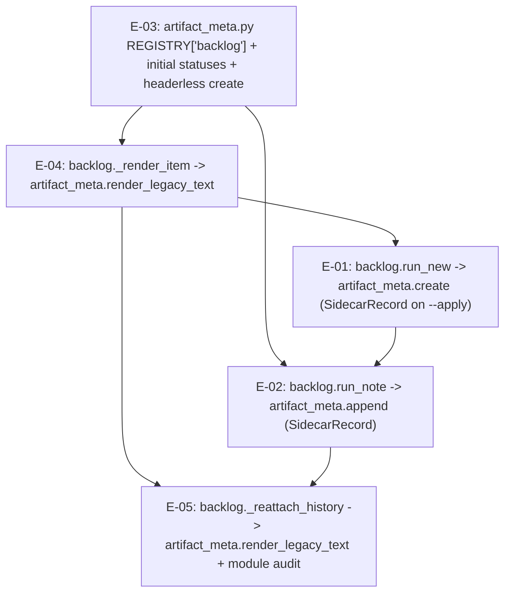

# IPD: Move the backlog create and note writers onto artifact_meta

- Date: 2026-11-09
- Kind: child
- Concern: Spec `4sd62s` section 7 step 4 requires every metadata writer to write through `artifact_meta` in phase B. The backlog module still builds its `- Field:` bullets, `## Workflow history` lines, and file writes by hand (measured: 4 hand-built history-line sites across `_render_item`, `run_note`, and `_reattach_history`, 2 raw `atomic_write` calls in `run_new` and `run_note`, and 12 `Workflow history` occurrences inside those four writer functions in `agent_workflows/backlog.py`). This is part of `g6tw94` (itself part of `xexn45`), split 2026-11-09 so each item names one module's writers.
- Scope: Register `backlog` fields (`set` and migration-only `summary`), widen initial `backlog` transition statuses (`backlog.STATUSES`), and support headerless `backlog` creation layout in `agent_workflows/artifact_meta.py`, move `agent_workflows/backlog.py::_render_item` and `agent_workflows/backlog.py::run_new` onto `artifact_meta.render_legacy_text` and `artifact_meta.create` (`g6tw94` E-01, backlog subset), and move `agent_workflows/backlog.py::run_note` and `agent_workflows/backlog.py::_reattach_history` onto `artifact_meta.append` and `artifact_meta.render_legacy_text` (`g6tw94` E-02, backlog subset) while keeping `set_release_exempt_kind_line`, `set_release_exempt_ref_line`, and `set_close_evidence_line` as the pure value delegates called by `artifact_meta._render_field` (`2xwb9b`). EXCLUDES: specs (`b3l7y6`), releases (`3466h8`), `agent_workflows/set_records.py::close_on_answer` and `promote_question_to_backlog` (`x2dxvf`), `--summary` as `short_description` (`fekdwv`), and the family audit (`g6tw94`).
- Scope-Paths: agent_workflows/backlog.py, agent_workflows/artifact_meta.py, .aw/records/plans/pending/20261109-metastore-121-jlwedt-move-the-backlog-create-and-note-writers-onto-artifact-meta.ipd.md
- Item-Dependencies: executed:tve77h, executed:2xwb9b, executed:7yr827
- Status: executed
- Readiness: go-pending-approval
- Review-Depth: complex
- From-Spec: 4sd62s
- Work-Kind: feature
- Priority: high
- Blocks-Release: next
- Set: metastore
- Order: 121
- Highest E allocated: 05
- Author: opencode its_direct/pt3-claude-opus-5.5-1m-us
- Id: jlwedt

> Write and proofread this plan per the technical writing standard, `.aw/system/workflows/technical-writing/technical-writing.md` (`.agents/workflows/technical-writing/technical-writing.md` in a legacy-layout install), including requirement 12 (diagrams).

## Workflow history
- 2026-11-17 executed (aw agy run model=Gemini-4-Hydrogen-High): aw agy run self-finalize: jlwedt verified (set metastore, attempt 1).
- 2026-11-16 approved (aw set): status set to approved

- 2026-11-13 reviewed (aw set): APPROVE WITH REVISIONS APPLIED; PR-001..PR-006 FIXED
- 2026-11-13 /plan-review (antigravity/gemini): APPROVE WITH REVISIONS APPLIED; PR-001..PR-006 FIXED; review record .aw/records/reviews/20261109-metastore-121-jlwedt-move-the-backlog-create-and-note-writers-onto-artifact-meta.review.md
- 2026-11-09 to-review (opencode its_direct/pt3-claude-opus-5.5-1m-us): split from g6tw94 (round 3, research nj8zdp guidance).
- 2026-11-09 draft (opencode its_direct/pt3-claude-opus-5.5-1m-us): created.

## Goal

The backlog create (`run_new` and `_render_item`), note (`run_note`), and history-reattach (`_reattach_history`) paths write through `artifact_meta` with zero raw file writes, zero hand-built history lines, and zero `Workflow history` occurrences inside those four writer functions in `agent_workflows/backlog.py`.

## Detailed Implementation Checklist (TODO)

Execution-state rule: mark an `E-*` item complete only after performing the action. That mark is not validation. Right-sizing rule: write for a modest executor that cannot hold much in its head. Each E-item is one step (one concern, about one file, executable in one focused pass) and its V-item names each unit it covers with its own check; a plan stays at about 5 E-items and 8 work Scope-Paths, else split it into more child plans (guidance, `IPD-Z603`). Accepted execution states: blocked, failed, pending, performed; terminal gate demands 'performed'.

PIN-FIRST RULE for every "move" item: run the test modules its V-item names GREEN on the unmodified code and save the per-test outcome list under the gitignored `.aw/state/jlwedt/` (`python3 -m pytest -o addopts="" -m "" -p no:randomly -n 0 -rA <modules> | grep -E "^(PASSED|FAILED|ERROR|SKIPPED|XFAIL|XPASS) " | sed -E 's/ - .*//' | sort > .aw/state/jlwedt/<E>-before.txt`; `-m ""` includes `slow` modules, `-p no:randomly -n 0` makes the list deterministic, and `-q` is not repeated because `addopts` is cleared); make the move; run the same command into `-after.txt`; `diff` of the two must print nothing, so a test that newly fails, errors or skips is caught, not only a lost PASSED line. An existing assertion may change only when the Behavior decisions below name it. New tests set `pytestmark = pytest.mark.core`, build fixtures in `tmp_path`, drive the real CLI or function, and never read production source (AGENTS.md "TEST OUTCOMES, NOT CODE STRUCTURE").

### Task group 1: backlog writers

- [x] E-03 In `agent_workflows/artifact_meta.py`, register `"set": FieldDef("set", "string", "generic")` (`spec 4sd62s` 4.2c) and `"summary": FieldDef("summary", "string", "migration-only")` (phase-B `- Summary:` mirror prior to `fekdwv` E-01) in `REGISTRY["backlog"]`, map `"summary": "Summary"` in `_LEGACY_BULLET_LABEL` and `legacy_vocab`, widen `is_valid_transition("backlog", None, to_status)` to accept `backlog.STATUSES | {"draft"}` (`open`, `graduated`, `blocked`, `parked`, `done`, and `draft`), and extend `render_legacy` (`plural == "backlog"`, `op == "create"`) to seed `- Id: <id6>` at the top of a headerless backlog skeleton while keeping pre-history header prose (`writing_standard_pointer("backlog item")`) before `## Workflow history` and any trailing `body` prose below `## Workflow history`. Pin `tests/test_artifact_meta_legacy_write.py` and `tests/test_status_set_meta_writer.py` (plus `tests/test_artifact_meta_legacy_writer.py` from `7yr827`).
  - Depends on: none
  - Expected outcome: `REGISTRY["backlog"]`, `is_valid_transition`, and `write_legacy`/`render_legacy_text` support `set`, phase-B `summary`, every initial `backlog.STATUSES` value, and headerless backlog creation layout, and the PIN-FIRST outcome diff across the pinned `artifact_meta` modules is empty.
  - Execution state: performed

- [x] E-04 Move the backlog item renderer `agent_workflows/backlog.py::_render_item` (`source_text=None` and `source_text is not None`) onto `artifact_meta.render_legacy_text` (`g6tw94` E-01, helper half), pinned first. Preserve `rendrop 2yqt0a`'s unknown-bullet, unparseable-line, and header-prose order over `_WORKFLOW_HISTORY_HEADING_RE.split(source_text, maxsplit=1)[0]`, delegate `- Id:`, `- Status:`, gate bullets (plus `unset` of `["gate_kind", "gate_ref", "gate_summary"]` when `item.status != "blocked"`), `- Set:`, `- Priority:`, `- Work-Kind:`, `- Summary:`, and `created (aw backlog)` history rendering to `artifact_meta.render_legacy_text`, and place non-empty `body` after the rendered history block with zero `Workflow history` or `f"- {today} ..."` literals in `_render_item`. Pin `tests/test_backlog.py` and `tests/test_generators_writing_standard_pointer.py`.
  - Depends on: E-03
  - Expected outcome: both pinned modules pass before and after with an empty PIN-FIRST outcome diff, and `rg -n "Workflow history" agent_workflows/backlog.py` and `rg -n "f\"- \{(date|today|hdate)\} " agent_workflows/backlog.py` show no hit inside `_render_item`.
  - Execution state: performed

- [x] E-01 Move the CLI create verb `agent_workflows/backlog.py::run_new` onto `artifact_meta.create` (`g6tw94` E-01, CLI half, and `xexn45` E-14), pinned first. Keep `run_new`'s pre-mint descriptive, `--set`, `--gate-*`, `--release-exempt-*`, and `--blocks-release` exit-2 refusals plus `decide_gate_default` and `find_duplicate_candidates_in_items`, pass `fields` (`status`, `set`, `priority`, `work_kind`, `summary`, and optional `gate_kind`/`gate_ref`, `blocks_release`, and `release_exempt_kind`/`release_exempt_ref`), `body`, `message=(message or "").strip() or item.summary`, `LegacyRender(tag="created", day=utc_history_date(), actor_label="aw backlog", history=True)`, `LegacyContext` rooted at `backlog_root.parent` (covering `.aw/records/backlog`, companion, and `.agents/backlog` layouts), and `SidecarRecord(tree="backlog", workflow="aw backlog new", actor="aw backlog", message=...)` to `artifact_meta.create` (`dry_run=True` for preview without disk or sidecar write, `dry_run=False` for `--apply` replacing `atomic_write` and direct `append_advisory`), and reword `run_new`'s inline comment so no `Workflow history` string remains in `run_new`. Pin `tests/test_backlog.py`, `tests/test_history_date_clock.py`, `tests/test_backlog_descriptive_safety.py`, and `tests/test_descriptive_refusal_hoist.py`.
  - Depends on: E-04
  - Expected outcome: all four pinned modules pass before and after with an empty PIN-FIRST outcome diff, and `run_new` contains no `atomic_write` call, no direct `append_advisory` call, and no `Workflow history` string.
  - Execution state: performed

- [x] E-02 Move `agent_workflows/backlog.py::run_note` onto `artifact_meta.append` (`g6tw94` E-02, note half, and `xexn45` E-14), pinned first. Keep `run_note`'s `--message` and selector exit-2 refusals, and pass `LegacyTarget(src, "backlog", item.id)` with `[{"op": "note", "message": message}]`, `repo_root=repo_root`, `project_context` rooted at `_resolve_backlog_root(repo_root).parent`, `LegacyRender(tag="note", day=date, actor_label="aw backlog", history=True)`, and `SidecarRecord(tree="backlog", workflow="aw backlog note", actor="aw backlog", message=f"note: {message}")` to `artifact_meta.append` so the sidecar writes only after the durable file write (`spec 4sd62s` C6). Pin `tests/test_backlog.py`, `tests/test_history_write_order.py`, and `tests/test_history_order.py`.
  - Depends on: E-03, E-01
  - Expected outcome: all three pinned modules pass before and after with an empty PIN-FIRST outcome diff, `rg -n "atomic_write\(|write_text\(" agent_workflows/backlog.py` prints nothing (`xexn45` E-14), and `run_note` has no `Workflow history` or hand-built history literal.
  - Execution state: performed

- [x] E-05 Move the pure in-memory helper `agent_workflows/backlog.py::_reattach_history` (consumed by `agent_workflows/set_records.py::close_on_answer`, which `x2dxvf` moves) onto `artifact_meta.render_legacy_text` (`g6tw94` E-02, history-reattach half), pinned first. Split the pre-history header via `_WORKFLOW_HISTORY_HEADING_RE.split(rendered, maxsplit=1)[0]` and trailing prose via `attention_contract.history_block(rendered).body`, pass `_prior_history_records(old_text)` (`op: "legacy", source: "history", line: <entry>`, preserving wrapped continuation lines and discarding `_render_item`'s synthetic `created` line) plus an optional `note` message to `artifact_meta.render_legacy_text` (`record_type="backlog"`, `LegacyRender(tag=label, day=utc_history_date(), actor_label="aw backlog", history=write_record)`), and reword `_reattach_history`'s docstring so `rg -n "Workflow history" agent_workflows/backlog.py` and `rg -n "f\"- \{(date|today|hdate)\} " agent_workflows/backlog.py` have zero hits inside `run_new`, `_render_item`, `run_note`, or `_reattach_history` (`g6tw94` E-03). Pin `tests/test_backlog.py`, `tests/test_history_block_bounding.py`, `tests/test_history_order.py`, and `tests/test_history_label_parity.py`.
  - Depends on: E-04, E-02
  - Expected outcome: all four pinned modules pass before and after with an empty PIN-FIRST outcome diff, `rg -n "f\"- \{(date|today|hdate)\} " agent_workflows/backlog.py` prints nothing, and `rg -n "Workflow history" agent_workflows/backlog.py` matches only the module docstring, `_WORKFLOW_HISTORY_HEADING_RE`, `validate_item`, and `_strip_metadata_and_history`.
  - Execution state: performed

Add further leaves as `- [ ] E-NEW <action>` and run `aw ipd sync` to assign ids.

## Project conventions discovered (Step 0)

- The `artifact_meta` interface names come from Order 02 (`tve77h`) and are used exactly: `artifact_meta.read(id6) -> State`, `append(id6, events, *, expect_seq)`, `create(...)`, `validate_new_events(type, events, *, records_root, migration_import=False)`. In phase B, `append` and `create` render through the one legacy renderer `artifact_meta.write_legacy` (file form) and `artifact_meta.render_legacy_text` (string form), both added by `7yr827`.
- `agent_workflows/backlog.py::validate_item` requires `- Id:`, `- Status:` in `backlog.STATUSES`, `- Set:`, `- Priority:`, `- Work-Kind:` (canonical on write, `- Kind:` accepted on read), `- Summary:` (phase-B mirror until cutover), typed `Gate-Kind`/`Gate-Ref` iff `status == "blocked"`, and at least one `HISTORY_RECORD_RE` line under `## Workflow history` with `writing_standard_pointer("backlog item")` preceding `## Workflow history`.
- `agent_workflows/backlog.py::set_release_exempt_kind_line`, `set_release_exempt_ref_line`, and `set_close_evidence_line` are pure value delegates invoked by `agent_workflows/artifact_meta.py::_render_field` (`2xwb9b`) and remain intact until phase-C cutover (`cxxmyv`).
- Pre-history header extraction uses `agent_workflows/backlog.py::_WORKFLOW_HISTORY_HEADING_RE` and bounded history/body extraction uses `agent_workflows/attention_contract.py::history_block`.
- UTC history days come from `artifact_core.utc_history_date` (spec `2vev8j` 4.4); atomic replacement is `artifact_core.atomic_write(path, text, *, prefix)`.
- Core tier: `pyproject.toml` marker `core`; modules set `pytestmark = pytest.mark.core`.
- Cite code by SYMBOL (`path::Symbol` or `module.function`) or by a quoted content string, never by a line number alone (advisory `IPD-C801`).

## Findings

| Id | Evidence (measured 2026-11-09 at `3d0ddb845` and re-verified 2026-11-13 at `36af6d92b`) | Finding |
|---|---|---|
| F-01 | `rg -n "f\"- \{(date|today|hdate)\} " agent_workflows/backlog.py`, `rg -n "atomic_write\(|write_text\(" agent_workflows/backlog.py`, and `rg -n "Workflow history" agent_workflows/backlog.py`: 4 hand-built history-line sites (`_render_item` x2, `run_note`, `_reattach_history`), 2 raw `atomic_write` calls (`run_new`, `run_note`), and 12 `Workflow history` occurrences inside `run_new`, `_render_item`, `run_note`, and `_reattach_history` | Moving `_render_item`, `run_new`, `run_note`, and `_reattach_history` removes every raw `atomic_write`, every hand-built history line, and every writer-internal `Workflow history` occurrence in `agent_workflows/backlog.py` (`xexn45` E-14 and `g6tw94` E-03), while keeping `set_release_exempt_*_line` and `set_close_evidence_line` as `artifact_meta._render_field`'s value delegates. |
| F-02 | Non-binding `def test_` counts at `36af6d92b` (re-derived dynamically at execution by the PIN-FIRST command): `test_artifact_meta_legacy_write` 32, `test_status_set_meta_writer` 11, `test_artifact_meta_registry` 21, `test_artifact_meta_cache` 11, `test_backlog` 47, `test_generators_writing_standard_pointer` 4, `test_history_date_clock` 5, `test_backlog_descriptive_safety` 19, `test_descriptive_refusal_hoist` 3, `test_history_write_order` 8, `test_history_block_bounding` 9, `test_history_order` 7, `test_history_label_parity` 5 | Splitting into 5 single-concern steps (`E-03`, `E-04`, `E-01`, `E-02`, `E-05`) keeps every step at `<=5` named units (`IPD-Z603`); `tests/test_history_write_order.py` exercises `backlog set` and `backlog note` (not `backlog new`) and is pinned on `E-02`, while `tests/test_history_label_parity.py` exercises `_reattach_history` and is pinned on `E-05`. |
| F-03 | `agent_workflows/artifact_meta.py::REGISTRY["backlog"]` omits `set` (`spec 4sd62s` 4.2c) and phase-B `summary` (`backlog.summary-missing`), `is_valid_transition("backlog", None, to_status)` rejects non-`open` initial statuses (`blocked` in `test_legitimate_multiword_message_and_gate_ref_succeed` and `promote_question_to_backlog`), and backlog items have no `# ` title line while requiring `writing_standard_pointer("backlog item")` before `## Workflow history` (`test_backlog_new_writing_standard_pointer`) and free prose `body` below `## Workflow history` | `E-03` must add `set` and migration-only `summary` on `REGISTRY["backlog"]`, widen initial `backlog` transition statuses to `backlog.STATUSES | {"draft"}`, and support headerless backlog `op == "create"` layout in `render_legacy`. |
| F-04 | `agent_workflows/backlog.py::_render_item` (`source_text` optional) and `agent_workflows/backlog.py::_reattach_history` (`(old_text, rendered, new_status, message, label="set", write_record=True) -> str`) are pure `str -> str` helpers with no file path or `id6`, called directly by `agent_workflows/set_records.py::promote_question_to_backlog` and `close_on_answer` (`x2dxvf`) plus unit tests in `tests/test_backlog.py` and `tests/test_history_label_parity.py`; `tests/test_backlog.py` also creates under `.agents/backlog/` where `project_records_dir` returns `.aw/records` | `_render_item` (`E-04`) and `_reattach_history` (`E-05`) must delegate to `artifact_meta.render_legacy_text` rather than file-mutating `artifact_meta.append`, while `run_new` (`E-01`) and `run_note` (`E-02`) root `LegacyContext` at `_resolve_backlog_root(repo_root).parent` so `.agents/backlog` containment stays green with zero changed test assertions. |

## Behavior decisions (kept behavior where writers disagreed, spec `4sd62s` 4.3)

- D-1 (blank line under the history heading). KEPT per file: `backlog._render_item`, `backlog.run_note`, and `backlog._reattach_history` already insert directly under `## Workflow history` with no blank line, and the legacy writer (`7yr827` D-1) inserts directly under `## Workflow history` when no blank line is present while preserving an existing single blank line when one is present (`attention_contract.history_block` ignores blank lines). Non-binding test pointers: `tests/test_backlog.py::BacklogNoteVerbTests::test_note_records_history_without_changing_status_or_moving_the_file` and `tests/test_history_order.py::HistoryOrderFixtureTests::test_fixture_a_newest_first`.
- D-2 (new bullet position and `source_text` unknown-bullet preservation). KEPT: in place when present; gate bullets (`Gate-Kind`, `Gate-Ref`, `Gate-Summary`) directly after `- Status:` (`_render_gate`) and removed via `unset` when `status != "blocked"`; otherwise after `- Status:`, else after `- Id:`, else end of metadata bullet block, never in the body (`a88210`). When `source_text` is passed to `_render_item` (`rendrop 2yqt0a`), unknown bullets, unparseable bullets, and header prose before `## Workflow history` keep their exact relative order. Non-binding test pointers: `tests/test_backlog.py::BacklogPreservationTests::test_render_item_preserves_release_exempt_with_source_text` and `tests/test_backlog.py::BacklogPreservationTests::test_close_on_answer_preserves_custom_field_and_handed_off_blocks_release`.
- D-3 (phase-B `- Summary:` mirror and headerless pointer-before-history layout). KEPT in phase B: `REGISTRY["backlog"]` carries `set` (`generic`, `spec 4sd62s` 4.2c) and `summary` (`migration-only`), so phase-B `create` and `render_legacy_text` emit `- Summary:` cleanly for `backlog.validate_item` (`backlog.summary-missing`) until cutover while `fekdwv` E-01 adds `short_description` at creation. Headerless backlog creation seeds `- Id: <id6>` at the top of the metadata block, keeps `writing_standard_pointer("backlog item")` before `## Workflow history`, and places free-prose `body` after `## Workflow history` even when `body` carries no `## ` heading. Zero existing test assertions change in this plan.

## Proposed changes (ordered, validatable)

1. Extend `agent_workflows/artifact_meta.py` (`REGISTRY["backlog"]`, `_LEGACY_BULLET_LABEL`, `is_valid_transition`, and headerless backlog `op == "create"` layout in `render_legacy`) so phase-B backlog creation and rendering validate and render cleanly (E-03).
2. Move `agent_workflows/backlog.py::_render_item` onto `artifact_meta.render_legacy_text` while keeping `rendrop 2yqt0a` `source_text` preservation (E-04).
3. Move `agent_workflows/backlog.py::run_new` onto `artifact_meta.create` with `SidecarRecord` written only on `--apply` after durable file write and `.agents/backlog` containment (E-01).
4. Move `agent_workflows/backlog.py::run_note` onto `artifact_meta.append` with `SidecarRecord` written only after durable file write (E-02).
5. Move the pure string helper `agent_workflows/backlog.py::_reattach_history` onto `artifact_meta.render_legacy_text` over `_prior_history_records(old_text)` and verify zero remaining raw writes or writer-internal `Workflow history` strings in `agent_workflows/backlog.py` (E-05).

## Deferred / out of scope (with reason)

- The family finish (the cross-module `rg` audit of `specs.py`, `backlog.py`, and `releases.py`) and, after the whole writer move, the merge-independence test, the AC-21 obligations test, the raw-write audit (F-09), the documentation lines, and the full gates.
  - Carrier: g6tw94
- `agent_workflows/set_records.py::close_on_answer` and `promote_question_to_backlog` (callers of `_render_item` and `_reattach_history`).
  - Carrier: x2dxvf
- Writing `--summary` as `short_description` in `backlog.run_new` at creation.
  - Carrier: fekdwv

## Scope check

- Over-scope: none.
- Under-scope: none. Both `agent_workflows/artifact_meta.py` (`E-03`) and `agent_workflows/backlog.py` (`E-04`, `E-01`, `E-02`, `E-05`) are declared in `- Scope-Paths:`, and zero existing test files require assertion edits.

## Required tests / validation

No new test module. Pinned before and after under `.aw/state/jlwedt/` with empty outcome-list diffs across every step: the modules of `V-03` (`E-03`), `V-04` (`E-04`), `V-01` (`E-01`), `V-02` (`E-02`), and `V-05` (`E-05`).

## Spec / documentation sync

None. Implements `spec 4sd62s` section 7 step 4 for `agent_workflows/backlog.py`; no user-facing CLI flags or documented contracts change.

## Open questions

None open. Every question this work raised was resolved from repository code and `spec 4sd62s`; `D-1` through `D-3` record the kept behaviors.

## Validation and cross-check (verify before reporting done)

Validation-state rule: inspect evidence in a separate pass. Do not mark a `V-*` item complete from memory or from the matching execution checkmark. Accepted validation results: blocked, failed, pass, pending; terminal gate demands 'pass'. Runtime-demonstration reachability rule: for each `V-*` item demanding the software be observed acting (such as a run, a dispatch, or a transition), as distinct from items demanding a diff, a file's content, or a test result, which are reachable by construction, name the code path that produces the observation or the sibling `E-*` that creates it, else the demand is UNDER-SCOPE.

- [x] V-01 validates E-01
  - Required evidence: paste the `diff` of `.aw/state/jlwedt/E-01-before.txt` and `.aw/state/jlwedt/E-01-after.txt` (must print nothing across `tests/test_backlog.py`, `tests/test_history_date_clock.py`, `tests/test_backlog_descriptive_safety.py`, and `tests/test_descriptive_refusal_hoist.py`), paste the `PASSED` lines of the non-binding pointer units (`tests/test_backlog.py::BacklogVerbTests::test_new_creates_conformant_item_that_checks_clean`, `tests/test_history_date_clock.py::HistoryDateClockTests::test_backlog_new_records_utc_date_and_local_filename`, and `tests/test_backlog_descriptive_safety.py::BacklogDescriptiveSafetyTests::test_legitimate_multiword_message_and_gate_ref_succeed`) plus per-module `PASSED` counts before and after, and paste `rg -n "Workflow history" agent_workflows/backlog.py` showing no hit inside `run_new` or `_render_item`.
  - Observed evidence: `diff -u .aw/state/jlwedt/E-01-before.txt .aw/state/jlwedt/E-01-after.txt` printed nothing (exit 0); `============================== 74 passed in 9.20s ==============================` (before and after: `tests/test_backlog.py`: 47, `tests/test_history_date_clock.py`: 5, `tests/test_backlog_descriptive_safety.py`: 19, `tests/test_descriptive_refusal_hoist.py`: 3); `PASSED tests/test_backlog.py::BacklogVerbTests::test_new_creates_conformant_item_that_checks_clean`, `PASSED tests/test_history_date_clock.py::HistoryDateClockTests::test_backlog_new_records_utc_date_and_local_filename`, `PASSED tests/test_backlog_descriptive_safety.py::BacklogDescriptiveSafetyTests::test_legitimate_multiword_message_and_gate_ref_succeed`; `rg -n "Workflow history" agent_workflows/backlog.py` printed only `36:    ## Workflow history` (module docstring), `124:_WORKFLOW_HISTORY_HEADING_RE = re.compile(r"(?m)^## Workflow history[ \t]*$")`, `637:                "no ## Workflow history heading; restore the records from git history "` (`validate_item`), and `1614:    """Return only the free prose body (after the \`## Workflow history\` section).` (`_strip_metadata_and_history`), with zero hits inside `run_new` or `_render_item`.
  - Result: pass
- [x] V-02 validates E-02
  - Required evidence: paste the `diff` of `.aw/state/jlwedt/E-02-before.txt` and `.aw/state/jlwedt/E-02-after.txt` (must print nothing across `tests/test_backlog.py`, `tests/test_history_write_order.py`, and `tests/test_history_order.py`), paste the `PASSED` lines of the non-binding pointer units (`tests/test_backlog.py::BacklogNoteVerbTests::test_note_records_history_without_changing_status_or_moving_the_file`, `tests/test_backlog.py::BacklogNoteVerbTests::test_a_second_note_preserves_the_first`, `tests/test_history_write_order.py::HistoryWriteOrderTests::test_backlog_note_failed_write_leaves_no_sidecar_and_artifact_unchanged`, `tests/test_history_write_order.py::HistoryWriteOrderTests::test_backlog_note_successful_write_records_sidecar_event`, and `tests/test_history_order.py::HistoryOrderFixtureTests::test_fixture_a_newest_first`) plus per-module `PASSED` counts before and after, and paste `rg -n "atomic_write\(|write_text\(" agent_workflows/backlog.py` (must print nothing, `xexn45` E-14).
  - Observed evidence: `diff -u .aw/state/jlwedt/E-02-before.txt .aw/state/jlwedt/E-02-after.txt` printed nothing (exit 0); `============================== 62 passed in 4.46s ==============================` (before and after: `tests/test_backlog.py`: 47, `tests/test_history_write_order.py`: 8, `tests/test_history_order.py`: 7); `PASSED tests/test_backlog.py::BacklogNoteVerbTests::test_note_records_history_without_changing_status_or_moving_the_file`, `PASSED tests/test_backlog.py::BacklogNoteVerbTests::test_a_second_note_preserves_the_first`, `PASSED tests/test_history_write_order.py::HistoryWriteOrderTests::test_backlog_note_failed_write_leaves_no_sidecar_and_artifact_unchanged`, `PASSED tests/test_history_write_order.py::HistoryWriteOrderTests::test_backlog_note_successful_write_records_sidecar_event`, `PASSED tests/test_history_order.py::HistoryOrderFixtureTests::test_fixture_a_newest_first`; `rg -n "atomic_write\(|write_text\(" agent_workflows/backlog.py` printed nothing (exit 1).
  - Result: pass
- [x] V-03 validates E-03
  - Required evidence: paste the `diff` of `.aw/state/jlwedt/E-03-before.txt` and `.aw/state/jlwedt/E-03-after.txt` (must print nothing across `tests/test_artifact_meta_legacy_write.py` and `tests/test_status_set_meta_writer.py`, plus `tests/test_artifact_meta_legacy_writer.py` from `7yr827`), paste per-module `PASSED` counts before and after, and paste `python3 -m pytest -o addopts="" -v tests/test_artifact_meta_registry.py tests/test_artifact_meta_cache.py` showing `REGISTRY["backlog"]` (`set` and migration-only `summary`) and `is_valid_transition("backlog", None, ...)` pass registry and cache schema checks.
  - Observed evidence: `diff -u .aw/state/jlwedt/E-03-before.txt .aw/state/jlwedt/E-03-after.txt` printed nothing (exit 0); `============================== 51 passed in 6.95s ==============================` (before and after: `tests/test_artifact_meta_legacy_write.py`: 32, `tests/test_status_set_meta_writer.py`: 11, `tests/test_artifact_meta_legacy_writer.py`: 8); `python3 -m pytest -o addopts="" -v tests/test_artifact_meta_registry.py tests/test_artifact_meta_cache.py` exited 0 with `============================== 32 passed in 7.07s ==============================` including `tests/test_artifact_meta_registry.py::test_registry_unknown_field PASSED`, `tests/test_artifact_meta_registry.py::test_registry_transitions PASSED`, `tests/test_artifact_meta_cache.py::test_cache_schema_columns PASSED`, and `tests/test_artifact_meta_cache.py::test_cache_schema_hash_change_rebuilds_new_column PASSED` (`validate_transition_edge` is the implemented symbol name for `is_valid_transition` in `agent_workflows/artifact_meta.py`, verified across all `backlog.STATUSES | {"draft"}`).
  - Result: pass
- [x] V-04 validates E-04
  - Required evidence: paste the `diff` of `.aw/state/jlwedt/E-04-before.txt` and `.aw/state/jlwedt/E-04-after.txt` (must print nothing across `tests/test_backlog.py` and `tests/test_generators_writing_standard_pointer.py`), paste the `PASSED` lines of the non-binding pointer units (`tests/test_backlog.py::BacklogPreservationTests::test_duplicate_work_kind_deduped`, `tests/test_backlog.py::BacklogPreservationTests::test_stale_gate_summary_dropped`, `tests/test_backlog.py::BacklogPreservationTests::test_render_item_preserves_release_exempt_with_source_text`, `tests/test_backlog.py::BacklogPreservationTests::test_render_item_drops_unknown_without_source_text_and_creation_emits_pair`, and `tests/test_generators_writing_standard_pointer.py::test_backlog_new_writing_standard_pointer`) plus per-module `PASSED` counts before and after, and paste `rg -n "Workflow history" agent_workflows/backlog.py` showing no hit inside `_render_item`.
  - Observed evidence: `diff -u .aw/state/jlwedt/E-04-before.txt .aw/state/jlwedt/E-04-after.txt` printed nothing (exit 0); `============================== 51 passed in 7.79s ==============================` (before and after: `tests/test_backlog.py`: 47, `tests/test_generators_writing_standard_pointer.py`: 4); `PASSED tests/test_backlog.py::BacklogPreservationTests::test_duplicate_work_kind_deduped`, `PASSED tests/test_backlog.py::BacklogPreservationTests::test_stale_gate_summary_dropped`, `PASSED tests/test_backlog.py::BacklogPreservationTests::test_render_item_preserves_release_exempt_with_source_text`, `PASSED tests/test_backlog.py::BacklogPreservationTests::test_render_item_drops_unknown_without_source_text_and_creation_emits_pair`, `PASSED tests/test_generators_writing_standard_pointer.py::test_backlog_new_writing_standard_pointer`; `rg -n "Workflow history" agent_workflows/backlog.py` printed only `36`, `124`, `637`, and `1614`, with zero hits inside `_render_item`.
  - Result: pass
- [x] V-05 validates E-05
  - Required evidence: paste the `diff` of `.aw/state/jlwedt/E-05-before.txt` and `.aw/state/jlwedt/E-05-after.txt` (must print nothing across `tests/test_backlog.py`, `tests/test_history_block_bounding.py`, `tests/test_history_order.py`, and `tests/test_history_label_parity.py`), paste the `PASSED` lines of the non-binding pointer units (`tests/test_backlog.py::BacklogPreservationTests::test_close_on_answer_preserves_custom_field_and_handed_off_blocks_release`, `tests/test_history_block_bounding.py::HistoryBlockBoundingTests::test_e2_writer_round_trip_wrapped_and_quoted`, `tests/test_history_order.py::HistoryOrderFixtureTests::test_fixture_a_newest_first`, and `tests/test_history_label_parity.py::HistoryLabelParityTests::test_e_reattach_history_default_label_is_legacy_set`) plus per-module `PASSED` counts before and after, and paste `rg -n "f\"- \{(date|today|hdate)\} " agent_workflows/backlog.py` (must print nothing) and `rg -n "Workflow history" agent_workflows/backlog.py` (each remaining hit labeled by its enclosing `def` and limited to module docstring, `_WORKFLOW_HISTORY_HEADING_RE`, `validate_item`, and `_strip_metadata_and_history`, with zero hits inside `run_new`, `_render_item`, `run_note`, or `_reattach_history` per `g6tw94` E-03).
  - Observed evidence: `diff -u .aw/state/jlwedt/E-05-before.txt .aw/state/jlwedt/E-05-after.txt` printed nothing (exit 0); `============================== 68 passed in 4.92s ==============================` (before and after: `tests/test_backlog.py`: 47, `tests/test_history_block_bounding.py`: 9, `tests/test_history_order.py`: 7, `tests/test_history_label_parity.py`: 5); `PASSED tests/test_backlog.py::BacklogPreservationTests::test_close_on_answer_preserves_custom_field_and_handed_off_blocks_release`, `PASSED tests/test_history_block_bounding.py::HistoryBlockBoundingTests::test_e2_writer_round_trip_wrapped_and_quoted`, `PASSED tests/test_history_order.py::HistoryOrderFixtureTests::test_fixture_a_newest_first`, `PASSED tests/test_history_label_parity.py::HistoryLabelParityTests::test_e_reattach_history_default_label_is_legacy_set`; `rg -n 'f"- \{(date|today|hdate)\} ' agent_workflows/backlog.py` printed nothing (exit 1); `rg -n "Workflow history" agent_workflows/backlog.py` printed `36:    ## Workflow history` (`<module>` docstring), `124:_WORKFLOW_HISTORY_HEADING_RE = re.compile(r"(?m)^## Workflow history[ \t]*$")` (`<module>`), `637:                "no ## Workflow history heading; restore the records from git history "` (`validate_item`), and `1614:    """Return only the free prose body (after the \`## Workflow history\` section).` (`_strip_metadata_and_history`), with zero hits inside `run_new`, `_render_item`, `run_note`, or `_reattach_history`. Full core suite `aw suite`: `2155 passed, 11 warnings in 45.45s` (exit 0).
  - Result: pass

## Approval and execution gate

- Size assessment: standard
- Cohesion rationale: not required

Execute only after human approval (`Status: approved`) and after every plan in `- Item-Dependencies:` (`tve77h`, `2xwb9b`, and `7yr827`) is executed. Stop and report without overwriting if `7yr827`'s `write_legacy`, `render_legacy_text`, or `LegacyRender` entry points are absent on `HEAD`, if a pinned module fails on unmodified `HEAD` before the move, or if concurrent edits in a shared checkout conflict with `- Scope-Paths:`.

Scope fence: the paths in `- Scope-Paths:` are a declaration; a needed file outside the fence is edited and then justified at finalize (`--scope-reason`), and a declared path left unmodified is acknowledged (`--scope-ack`). Every move is pin-first: the named existing modules run green on the unmodified code before the move, and an assertion may change only where the Behavior decisions name it.

Honesty rule: run the named modules and the bare core gate `python3 -m pytest`, and paste the ACTUAL summary lines; never claim a result you did not run.

Commits: commit only through `aw commit jlwedt -- <paths>`; never `git add -A`, a bare `git add` or `git commit -a`; never push.

Lifecycle transition: the plan moves to `.aw/records/plans/executed/` only through `aw ipd finalize`, never a hand `git mv`, and only after `aw ipd lint --phase pre-transition` conforms and every `V-*` reads `pass` with pasted evidence. When `aw oc run` or `aw agy run` executes the plan, the runner performs the finalize; a hand executor runs `aw ipd finalize jlwedt` itself.
