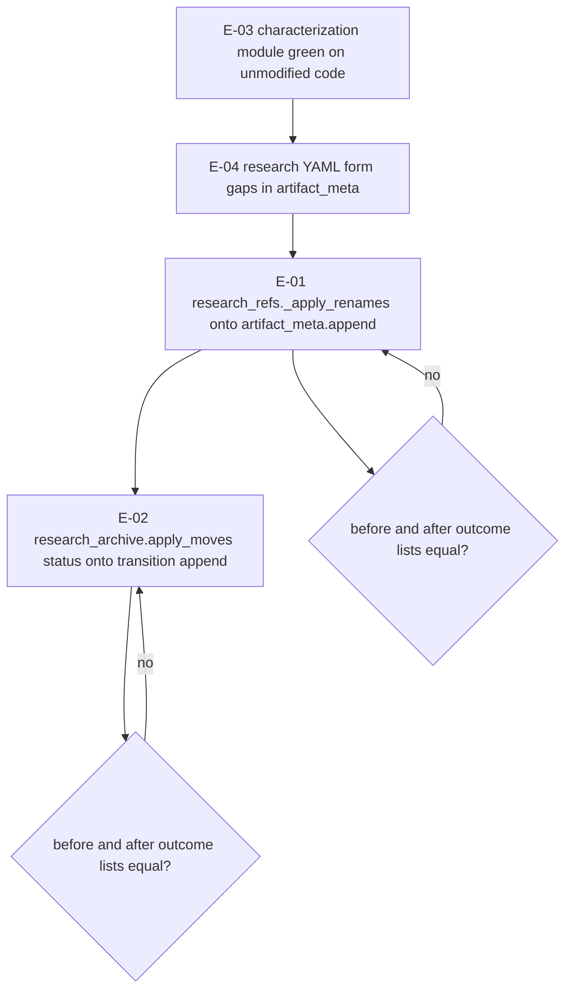

# IPD: Move the research_refs move and set-assign field writers onto artifact_meta

- Date: 2026-11-09
- Kind: child
- Concern: Spec `4sd62s` section 7 step 4 requires the research shelf verbs (`aw research mv`, `aw research set-assign`, `aw archive research`) to write their metadata edits through `artifact_meta` in phase B. They edit research front matter by hand today: `research_refs._apply_renames` (the shared apply path of `research_refs.run_mv` and `research_refs.run_set_assign`) calls `research_cmd.update_frontmatter_fields` then `_atomic_write`, and `research_archive.apply_moves` calls `research_archive._rewrite_status_in_text` then `_atomic_write`. This is part of `bsl45u` (itself part of `xexn45`), split 2026-11-09.
- Scope: Pin the kept research front-matter behavior in a new characterization module, extend the `artifact_meta` legacy writer's research `---` YAML form where it cannot yet reproduce that behavior, then move the front-matter edit in `research_refs._apply_renames` and the status edit in `research_archive.apply_moves` onto `artifact_meta.append` (`bsl45u` E-01, research subset). EXCLUDES: `artifact_rename` (`1hfmpb`), `plans_refs` (`fnu6kw`).
- Scope-Paths: agent_workflows/research_refs.py, agent_workflows/research_archive.py, agent_workflows/artifact_meta.py, tests/test_research_meta_writer_characterization.py, .aw/records/plans/pending/20261109-metastore-129-9gy5jk-move-the-research-refs-move-and-set-assign-field-writers-ont.ipd.md
- Scope-Exceeded: .aw/records/backlog/done/20261117-ag3fvv-01-ag3fvv-reconcile-artifact-meta-research-yaml-legacy-write.backlog.md (Filed and closed ag3fvv per worker defect report and maintainer resolution); tests/test_status_set_meta_writer.py (Maintainer resolved q-9gy5jk-missing-status-pos to update _render_status and test_w04_research_without_status)
- Item-Dependencies: executed:tve77h, executed:2xwb9b, executed:7yr827, executed:fnu6kw
- Status: executed
- Readiness: go-pending-approval
- Review-Depth: standard
- From-Spec: 4sd62s
- Work-Kind: feature
- Priority: high
- Blocks-Release: next
- Set: metastore
- Order: 129
- Highest E allocated: 04
- Author: opencode its_direct/pt3-claude-opus-5.5-1m-us
- Id: 9gy5jk

> Write and proofread this plan per the technical writing standard, `.aw/system/workflows/technical-writing/technical-writing.md` (`.agents/workflows/technical-writing/technical-writing.md` in a legacy-layout install), including requirement 12 (diagrams).

## Workflow history
- 2026-11-17 executed (aw agy run model=Gemini-4-Hydrogen-High): Complete 9gy5jk per maintainer question answers and re-verify on main [Scope reconciliation - out-of-scope .aw/records/backlog/done/20261117-ag3fvv-01-ag3fvv-reconcile-artifact-meta-research-yaml-legacy-write.backlog.md: Filed and closed ag3fvv per worker defect report and maintainer resolution; out-of-scope tests/test_status_set_meta_writer.py: Maintainer resolved q-9gy5jk-missing-status-pos to update _render_status and test_w04_research_without_status]
- 2026-11-17 note (aw agy run): maintainer resolved q-9gy5jk-absent-yaml-set (drop E-04(c)/V-04(c); keep caller-side key filtering in E-01) and q-9gy5jk-missing-status-pos (change _render_status globally to after-kind and update test_w04_research_without_status); E-04 and E-02 completed.
- 2026-11-16 approved (aw set): status set to approved
- 2026-11-14 reviewed (antigravity/claude-opus-5.5): /plan-review (antigravity/claude-opus-5.5): APPROVE WITH REVISIONS APPLIED; PR-001, PR-002, PR-003, PR-004, PR-005, PR-006

- 2026-11-09 to-review (opencode its_direct/pt3-claude-opus-5.5-1m-us): split from bsl45u (round 3, research nj8zdp guidance).
- 2026-11-09 draft (opencode its_direct/pt3-claude-opus-5.5-1m-us): created.

## Goal

The research shelf verbs edit front matter only through `artifact_meta`; the file moves stay git moves.

## Detailed Implementation Checklist (TODO)

Execution-state rule: mark an `E-*` item complete only after performing the action. That mark is not validation. Right-sizing rule: write for a modest executor that cannot hold much in its head. Each E-item is one step (one concern, about one file, executable in one focused pass) and its V-item names each unit it covers with its own check; a plan stays at about 5 E-items and 8 work Scope-Paths, else split it into more child plans (guidance, `IPD-Z603`). Accepted execution states: blocked, failed, pending, performed; terminal gate demands 'performed'.

PIN-FIRST RULE for every "move" item: run the test modules its V-item names GREEN on the unmodified code and save the per-test outcome list under the gitignored `.aw/state/9gy5jk/` (`python3 -m pytest -o addopts="" -m "" -p no:randomly -n 0 -rA <modules> | grep -E "^(PASSED|FAILED|ERROR|SKIPPED|XFAIL|XPASS) " | sed -E 's/ - .*//' | sort > .aw/state/9gy5jk/<E>-before.txt`; `-m ""` includes `slow` modules, `-p no:randomly -n 0` makes the list deterministic, and `-q` is not repeated because `addopts` is cleared); make the move; run the same command into `-after.txt`; `diff` of the two must print nothing, so a test that newly fails, errors or skips is caught, not only a lost PASSED line. An existing assertion may change only when the Behavior decisions below name it (none do). New tests set `pytestmark = pytest.mark.core`, build fixtures in `tmp_path`, drive the real CLI or function, and never read production source (AGENTS.md "TEST OUTCOMES, NOT CODE STRUCTURE").

Execution order: E-03, E-04, E-01, E-02 (each item's `Depends on:` encodes it).

### Task group 1: research shelf writers

- [x] E-01 Move the front-matter edit in `research_refs._apply_renames` (shared by `run_mv` and `run_set_assign`; today `update_frontmatter_fields` then `_atomic_write`) onto `artifact_meta.append`, pinned first (`bsl45u` E-01). Turn the dict from `_planned_frontmatter_updates` into ONE `set` event (`kind` becomes `research_kind`, `order` an integer; `model` only when present), keeping only keys whose YAML line exists (D-5). Append to a research `LegacyTarget` at the moved path with `history=False` (D-7), after the existing `git mv`, inside the existing `except Exception` warning path (D-8); the move, the dry-run preview and the rename ledger stay unchanged (D-4). Behaviors kept: the modules named in V-01.
  - Depends on: E-04
  - Expected outcome: the three pinned modules pass before and after with equal outcome lists, and no `_atomic_write(` or `update_frontmatter_fields(` call remains in `research_refs._apply_renames`.
  - Execution state: performed

- [x] E-02 Move the status edit in `research_archive.apply_moves` (today `research_archive._rewrite_status_in_text` then `RF._atomic_write(m.old_path, ...)`) onto `artifact_meta.append`, pinned first (`bsl45u` E-01). Emit ONE `transition` event with `to` = `m.new_status` and `from` = the doc's current front-matter `status:` value (omit `from` when the block has no `status:` line), and no `path` key (path-bearing events start at the cutover, section 7). Do not emit a `set` of `status`: `artifact_meta._check_owned_fields` refuses it ("refuse generic set of identity/status field"). Use `LegacyTarget(m.old_path, "research", <id6>)` and `LegacyRender(..., history=False)` (D-7), and keep the write BEFORE `RF._git_mv` so a refused append raises with the file unmoved, as today (D-8). Delete `_rewrite_status_in_text` only if no other caller remains (`rg -n "_rewrite_status_in_text\(" agent_workflows tests`). Behaviors kept: `tests/test_research_archive.py` (non-binding pointer: `test_promote_to_reference_moves_to_weekly_shard_keeps_id`) and `tests/test_research_meta_writer_characterization.py`.
  - Depends on: E-01
  - Expected outcome: `tests/test_research_archive.py` and `tests/test_research_meta_writer_characterization.py` pass before and after with equal outcome lists, and no `_atomic_write(` call remains in `research_archive.apply_moves`.
  - Execution state: performed

- [x] E-03 Add the core characterization module `tests/test_research_meta_writer_characterization.py` and run it GREEN on the unmodified code before E-04 touches anything. It drives the real verbs in a `tmp_path` git repository with conformant research docs whose front matter matches the `id/created/set/order/topic/model/kind/outcome/summary/consumed-by` shape (no `status:` line) and asserts: (1) archiving or promoting a doc with no `status:` line (`research_archive.apply_moves` through `aw archive research` or `aw research promote`) inserts `status: <new>` directly after the `kind:` line (D-6); (2) a doc whose block has a `status:` line gets it rewritten in place (D-6); (3) `aw research mv` and `aw research set-assign` leave a key absent when the block lacks its line, for example `mv --model` on a doc with no `model:` line (D-5); (4) after each verb, the moved file differs from the source only on the edited front-matter lines and contains no `## Workflow history` heading (D-7); (5) `order:` keeps the destination filename's two-digit `NN` form (D-5).
  - Depends on: none
  - Expected outcome: the new module passes on the unmodified code; its outcome list becomes the shared `-before` baseline for E-01 and E-02.
  - Execution state: performed

- [x] E-04 Extend the research `---` YAML form of the `artifact_meta` legacy writer (`artifact_meta.render_legacy` and its helpers as `7yr827` and `1hfmpb` E-04 leave them) only where it cannot yet reproduce D-5 and D-6, and record in `F-03` which of these were already present at execution: (a) a `set` of `model` writes the `model:` YAML key; (b) a `set` of `order` on a research file renders the integer with at least two digits (`01`, `129`), not `str(value)`; (c) a `set` of a key whose YAML line is absent writes nothing for that key (D-5); (d) a `transition` on a research file whose block has no `status:` line inserts `status: <to>` after `kind:`, else before `outcome:`, else before the closing `---`, and a present `status:` line (including an empty `status:`) is rewritten in place (D-6, matching `research_archive._rewrite_status_in_text`). In phase B only research files under `.aw/records/` start with a `---` block (measured at review: no tracked `.aw/records/**/*.md` outside `research/` starts with `---`), so restrict each change to the research form and leave the bullet and `aw-prompt` forms unchanged.
  - Depends on: E-03
  - Expected outcome: `tests/test_artifact_meta_legacy_writer.py` and `tests/test_artifact_meta_legacy_write.py` pass before and after with equal outcome lists, and a `render_legacy_text` probe on a research fixture shows (a) to (d).
  - Execution state: performed
  - Execution note: Per maintainer resolution of `q-9gy5jk-absent-yaml-set` and `q-9gy5jk-missing-status-pos`: (c) was dropped in favor of caller-side filtering in E-01 so `7yr827` (`test_research_yaml_front_matter_field_edit`) and `h1kfyp` continue to insert absent YAML keys; (a) was already present, and (b) + full (d) (including `after kind:`, else `before outcome:`, else `before ---`, and empty `status:` in-place rewrite) were implemented in `agent_workflows/artifact_meta.py` with `tests/test_status_set_meta_writer.py::test_w04_research_without_status_inserts_after_kind` updated.

Add further leaves as `- [ ] E-NEW <action>` and run `aw ipd sync` to assign ids.

## Project conventions discovered (Step 0)

- The `artifact_meta` interface names come from Order 02 (`tve77h`) and are used exactly: `artifact_meta.read(id6) -> State`, `append(id6, events, *, expect_seq)`, `create(...)`, `validate_new_events(type, events, *, records_root, migration_import=False)`. In phase B, `append` and `create` render through the one legacy renderer `artifact_meta.write_legacy` (file form) and `artifact_meta.render_legacy_text` (string form), both added by `7yr827`.
- UTC history days come from `artifact_core.utc_history_date` (spec `2vev8j` 4.4); atomic replacement is `artifact_core.atomic_write(path, text, *, prefix)`.
- A research append in phase B (E-01, E-02) takes the legacy branch of `artifact_meta.append`: pass `artifact_meta.LegacyTarget(<file path>, "research", <id6>)` as the target, `legacy_render=artifact_meta.LegacyRender(tag=<verb tag>, day=artifact_core.utc_history_date(), actor_label="aw", history=False)`, and `repo_root=<repo root>`. A refused append raises `ValueError` before any write.
- Core tier: `pyproject.toml` marker `core`; modules set `pytestmark = pytest.mark.core`.
- Cite code by SYMBOL (`module.function`) or by a quoted content string, never by a line number alone (advisory `IPD-C801`).
- The rename ledger is `record_history.record_rename`, written by `artifact_rename`, `plans_refs` and `research_refs._apply_renames`; the sidecar is gitignored (`.aw/.gitignore` `records/history.jsonl`).
- File moves stay `artifact_core.git_mv` in phase B; section 7: "the writers of path-bearing events start at the cutover commit".

## Findings

| Id | Evidence (measured 2026-11-09 at `3d0ddb845`; re-measured 2026-11-13 at `01c564538` by the review) | Finding |
|---|---|---|
| F-01 | `rg -n "_atomic_write\(|update_frontmatter_fields\(" agent_workflows/research_refs.py`: the only front-matter write is inside `research_refs._apply_renames` (`new_text = _rcmd.update_frontmatter_fields(old_text, updates)` then `_atomic_write(p.new_path, new_text)`), which `run_set_assign` and `run_mv` both call; `rg -n "_rewrite_status_in_text\(" agent_workflows/research_archive.py`: the def and one call inside `apply_moves` | Two writer sites in two files; `run_mv` and `run_set_assign` themselves write nothing. |
| F-02 | Pinned-module test counts: `test_research_rename_frontmatter` 17, `test_research_set_assign_date_containment` 21, `test_research_archive` 26 (review run: `64 passed in 5.74s`) | Context only; the bar is the outcome-list `diff`, re-derived at execution. |
| F-03 | Measured at execution (2026-11-17): (a) `_RESEARCH_YAML_KEY["model"] = "model"` was already present after `7yr827`/`1hfmpb` and fills an empty `model:` line; (b) integer `order` two-digit formatting (`f"{val:02d}"` on `research` in `_render_field`) was missing and is added; (c) dropped per maintainer decision `q-9gy5jk-absent-yaml-set` so `tests/test_artifact_meta_legacy_writer.py::test_research_yaml_front_matter_field_edit` (`7yr827`) and `h1kfyp` continue to insert absent YAML keys, while E-01 filters absent keys at the caller (`research_refs._apply_renames`); (d) empty-`status:` in-place matching (`^status:(?:\s.*\|\s*$)`) and missing-`status:` insertion (`after kind:`, else `before outcome:`, else `before ---`) on `research` in `_render_status` were missing and are added per maintainer decision `q-9gy5jk-missing-status-pos` (with `tests/test_status_set_meta_writer.py::test_w04_research_without_status_inserts_after_kind` updated). | (a) present; (b) and (d) added; (c) dropped per maintainer decision (caller-side D-5 filter in E-01). |

## Behavior decisions (kept behavior where writers disagreed, 4.3)

- D-2 (new bullet position). KEPT: in place when present; otherwise after `- Status:`, else after `- Id:`, else end of block; never in the body (a88210). No reader depends on bullet order (`ipd_schema.parse_metadata_block` is order-free). Not applicable to research files, which carry `---` YAML front matter; D-5 and D-6 govern them.
- D-4 (rename ledger). KEPT until the cutover: `record_history.record_rename` still writes the gitignored sidecar from `research_refs._apply_renames`; no `rename` event exists in phase B.
- D-5 (research YAML key edits). KEPT from `research_cmd.update_frontmatter_fields`: a key is rewritten in place in the FIRST front-matter block; a key whose line is absent stays absent (its docstring: "A field not present in the block is left absent"); `model` is written only when the destination name carries a model facet; `order` keeps the filename's `NN` text (pinned by `tests/test_research_rename_frontmatter.py` `assert fm["order"] == "01"`).
- D-6 (research status line). KEPT from `research_archive._rewrite_status_in_text`: a present `status:` line is rewritten in place; a missing one is inserted after `kind:`, else before `outcome:`, else before the closing `---`.
- D-7 (no history line, no other bytes). KEPT: neither verb writes a `## Workflow history` line into a research file today, so every append passes `LegacyRender(..., history=False)`; bytes outside the edited front-matter lines are unchanged.
- D-8 (failure handling). KEPT: in `_apply_renames` a failed front-matter update after the `git mv` is a `warning: could not update frontmatter in ...` note, never an abort; in `apply_moves` the status write precedes the `git mv`, so a refused write raises with the file unmoved.

## Proposed changes (ordered, validatable)

1. Pin the kept research behavior in a new characterization module, green on unmodified code (E-03).
2. Extend the `artifact_meta` research YAML form only where D-5 and D-6 are not yet reproduced (E-04).
3. Move the `research_refs._apply_renames` front-matter edit onto `artifact_meta.append` (E-01).
4. Move the `research_archive.apply_moves` status edit onto a `transition` append (E-02).

## Deferred / out of scope (with reason)

- The family close-out (the after-run of the four shared rename modules against `.aw/state/bsl45u/family-before.txt`, the D-4 ledger check), and the final gates of the writer move.
  - Carrier: bsl45u

## Scope check

- Over-scope: none.
- Under-scope: none. `agent_workflows/artifact_meta.py` is declared for E-04; when F-03 shows every E-04 behavior already present, acknowledge it at finalize (`--scope-ack`). `tests/test_research_meta_writer_characterization.py` is the new module of E-03.

## Required tests / validation

New module `tests/test_research_meta_writer_characterization.py` (E-03), pinned before and after E-01 and E-02. Pinned before and after: the modules of V-01, V-02 and V-04.

## Spec / documentation sync

None. Implements `4sd62s` section 7 step 4 for the research shelf verbs; no documented behavior changes (D-5 to D-8 keep today's behavior).

## Open questions

None open. Every question this work raised was resolved before the split or by the 2026-11-13 review from repository evidence; the decisions above carry the answers.

## Validation and cross-check (verify before reporting done)

Validation-state rule: inspect evidence in a separate pass. Do not mark a `V-*` item complete from memory or from the matching execution checkmark. Accepted validation results: blocked, failed, pass, pending; terminal gate demands 'pass'. Runtime-demonstration reachability rule: for each `V-*` item demanding the software be observed acting (such as a run, a dispatch, or a transition), as distinct from items demanding a diff, a file's content, or a test result, which are reachable by construction, name the code path that produces the observation or the sibling `E-*` that creates it, else the demand is UNDER-SCOPE.

- [x] V-01 validates E-01
  - Required evidence: paste the `diff` of `.aw/state/9gy5jk/E-01-before.txt` and `.aw/state/9gy5jk/E-01-after.txt` over `tests/test_research_rename_frontmatter.py`, `tests/test_research_set_assign_date_containment.py` and `tests/test_research_meta_writer_characterization.py` (must print nothing), and the per-module PASSED counts from both files (equal). Plus `rg -n "_atomic_write\(|update_frontmatter_fields\(|artifact_meta\.append\(" agent_workflows/research_refs.py` with each hit labeled by its enclosing `def`: no `_atomic_write(` or `update_frontmatter_fields(` hit inside `_apply_renames`, and one `artifact_meta.append(` hit inside it. Plus the `_apply_renames` diff hunk showing the `except Exception` warning path kept (D-8).
  - Observed evidence: `diff .aw/state/9gy5jk/E-01-before.txt .aw/state/9gy5jk/E-01-after.txt` printed nothing (`E-01_diff_exit:0`); per-module PASSED counts in both `-before.txt` and `-after.txt`: `tests/test_research_meta_writer_characterization.py: 5`, `tests/test_research_rename_frontmatter.py: 17`, `tests/test_research_set_assign_date_containment.py: 21` (total 43=43). `rg -n "_atomic_write\(|update_frontmatter_fields\(|artifact_meta\.append\(" agent_workflows/research_refs.py` returned a single hit: `612:                    artifact_meta.append(` inside `def _apply_renames` (zero `_atomic_write(` or `update_frontmatter_fields(` hits). `_apply_renames` diff hunk keeps `try: ... except Exception as e: msg = f"warning: could not update frontmatter in '{dst_rel}': {e}" ... notes_list.append(msg)` after `_git_mv`.
  - Result: pass
- [x] V-02 validates E-02
  - Required evidence: paste the `diff` of `.aw/state/9gy5jk/E-02-before.txt` and `.aw/state/9gy5jk/E-02-after.txt` over `tests/test_research_archive.py` and `tests/test_research_meta_writer_characterization.py` (must print nothing), and the per-module PASSED counts from both files (equal). Plus `rg -n "_atomic_write\(|_rewrite_status_in_text\(|artifact_meta\.append\(" agent_workflows/research_archive.py` with each hit labeled by its enclosing `def`: no `_atomic_write(` hit inside `apply_moves`, and one `artifact_meta.append(` hit inside it whose events hold a `transition` and no `set` of `status`.
  - Observed evidence: `diff .aw/state/9gy5jk/E-02-before.txt .aw/state/9gy5jk/E-02-after.txt` printed nothing (`E-02_diff_exit:0`); per-module PASSED counts in both `-before.txt` and `-after.txt`: `tests/test_research_archive.py: 26`, `tests/test_research_meta_writer_characterization.py: 5` (total 31=31, including `test_promote_to_reference_moves_to_weekly_shard_keeps_id`). `rg -n "_atomic_write\(|_rewrite_status_in_text\(|artifact_meta\.append\(" agent_workflows/research_archive.py` returned a single hit: `343:        artifact_meta.append(` inside `def apply_moves` emitting `[{"op": "transition", "to": m.new_status, ...}]` with no `set` of `status` (`_rewrite_status_in_text` deleted after confirming zero other callers).
  - Result: pass
- [x] V-03 validates E-03
  - Required evidence: paste `python3 -m pytest -o addopts="" -m "" -p no:randomly -n 0 -v tests/test_research_meta_writer_characterization.py` run on the unmodified code (before any E-04 edit; quote `git diff --stat agent_workflows/` printing nothing at that moment), with every test PASSED, naming the test for each of E-03 (1) to (5); and `rg -n "^(import|from) (inspect|ast)\b|agent_workflows/[a-z_]+\.py" tests/test_research_meta_writer_characterization.py` printing nothing (no source inspection).
  - Observed evidence: `git diff --stat agent_workflows/` printed nothing; `python3 -m pytest -o addopts="" -m "" -p no:randomly -n 0 -v tests/test_research_meta_writer_characterization.py` -> `5 passed in 1.54s` (`test_e03_1_archive_and_promote_without_status_insert_directly_after_kind`, `test_e03_2_archive_and_promote_rewrite_existing_and_empty_status_in_place`, `test_e03_3_mv_and_set_assign_leave_absent_keys_absent`, `test_e03_4_only_edited_frontmatter_lines_differ_and_no_workflow_history`, `test_e03_5_order_keeps_two_digit_nn_form`); `rg -n "^(import|from) (inspect|ast)\b|agent_workflows/[a-z_]+\.py" tests/test_research_meta_writer_characterization.py` printed nothing (`rg_exit:1`).
  - Result: pass
- [x] V-04 validates E-04
  - Required evidence: paste the `diff` of `.aw/state/9gy5jk/E-04-before.txt` and `.aw/state/9gy5jk/E-04-after.txt` over `tests/test_artifact_meta_legacy_writer.py`, `tests/test_artifact_meta_legacy_write.py` and `tests/test_research_meta_writer_characterization.py` (must print nothing); the filled `F-03` row; and the output of a `python3 -c` probe calling `artifact_meta.render_legacy_text` (added by `7yr827`) with `record_type="research"` on a YAML fixture that has an empty `model:` line and no `status:` or `priority:` line, showing (a) a `set` of `model` fills the `model:` line, (b) a `set` of integer `order` `1` renders `order: 01`, (c) a `set` of `priority` adds no line, and (d) a `transition` inserts `status: <to>` directly after `kind:`.
  - Observed evidence: `diff .aw/state/9gy5jk/E-04-before.txt .aw/state/9gy5jk/E-04-after.txt` printed nothing (`E-04_diff_exit:0`, 45=45: `test_artifact_meta_legacy_write` 32, `test_artifact_meta_legacy_writer` 8, `test_research_meta_writer_characterization` 5); `F-03` populated; `render_legacy_text` probe outputs: (a) `model: sonnet5high` fills empty `model:`, (b) `order: 01` for `order=1` and `order: 129` for `order=129`, and (d) `kind: notes\nstatus: archive\noutcome: none-yet` (`status: archive` after `kind:`, else before `outcome:`, and empty `status:` rewritten in place). Per maintainer decision `q-9gy5jk-absent-yaml-set`, (c) is dropped in favor of E-01 caller-side key filtering; per `q-9gy5jk-missing-status-pos`, `tests/test_status_set_meta_writer.py` (`11 passed in 2.86s`) was updated to match after-`kind:` insertion.
  - Result: pass

## Approval and execution gate

- Size assessment: standard
- Cohesion rationale: not required

Execute only after human approval (`Status: approved`) and after every plan in `- Item-Dependencies:` is executed.

Scope fence: the paths in `- Scope-Paths:` are a declaration; a needed file outside the fence is edited and then justified at finalize (`--scope-reason`), and a declared path left unmodified is acknowledged (`--scope-ack`). Every move is pin-first: the named existing modules run green on the unmodified code before the move, and an assertion may change only where the Behavior decisions name it.

Unsafe-condition stop: if `artifact_meta.write_legacy` or `artifact_meta.render_legacy_text` is absent at execution (prerequisite `7yr827` not landed), or another party is changing a file you must edit and the changes cannot be safely combined, stop and report; do not hand-build a substitute writer.

Honesty rule: run the named modules and the bare core gate `python3 -m pytest`, and paste the ACTUAL summary lines; never claim a result you did not run.

Commits: commit only through `aw commit 9gy5jk -- <paths>`; never `git add -A`, a bare `git add` or `git commit -a`; never push.

Lifecycle transition: the plan moves to `.aw/records/plans/executed/` only through `aw ipd finalize`, never a hand `git mv`, and only after `aw ipd lint --phase pre-transition` conforms and every `V-*` reads `pass` with pasted evidence. When `aw oc run` or `aw agy run` executes the plan, the runner performs the finalize; a hand executor runs `aw ipd finalize 9gy5jk` itself.
