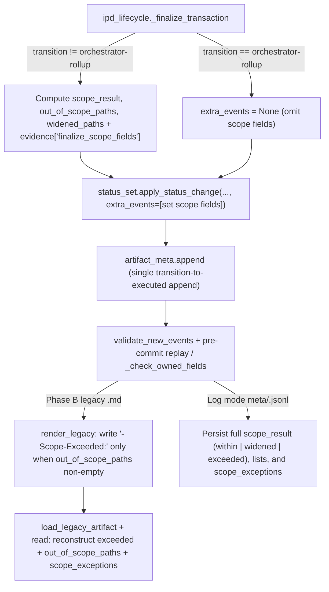

# IPD: Write the finalize scope fields in the executed append

- Date: 2026-11-09
- Kind: child
- Concern: Spec `4sd62s` Sections 4.2c and 4.4 (artifact metadata store) require finalize to write `scope_result`, `out_of_scope_paths`, and `widened_paths` in the `executed` transition append. Today `agent_workflows/ipd_lifecycle.py::_finalize_transaction` rewrites `- Scope-Exceeded:` on disk after moving the plan (41 tracked plans carry it, plan `xexn45` F-05, metadata writer migration). This plan is a round-3 split from plan `8q27jt` (attestation, finalize scope, and retirement writers), itself split from `xexn45`.
- Scope: Render and load `- Scope-Exceeded:` plus enforce finalize-owned field invariants in `agent_workflows/artifact_meta.py`, thread same-append `extra_events` through `agent_workflows/status_set.py` so `agent_workflows/ipd_lifecycle.py::_finalize_transaction` emits `scope_result`, `out_of_scope_paths`, and `widened_paths` in the `executed` append and deletes `_insert_scope_exceeded_metadata`, and add behavioral coverage in `tests/test_writers_scope_fields.py` (`8q27jt` E-03, finalize subset). Depends on plan `9qhtrc` (finalize scope path-root rule). EXCLUDES: orchestrator retirement checklist prose (`8q27jt`) and the `finalize` event payload (`nq1src`).
- Scope-Paths: agent_workflows/artifact_meta.py, agent_workflows/status_set.py, agent_workflows/ipd_lifecycle.py, tests/test_writers_scope_fields.py, .aw/records/plans/pending/20261109-metastore-132-1dvb08-write-the-finalize-scope-fields-in-the-executed-append.ipd.md
- Item-Dependencies: executed:tve77h, executed:2xwb9b, executed:7yr827, executed:9qhtrc
- Status: executed
- Readiness: go-pending-approval
- Review-Depth: complex
- From-Spec: 4sd62s
- Work-Kind: feature
- Priority: high
- Blocks-Release: next
- Set: metastore
- Order: 132
- Highest E allocated: 03
- Author: opencode its_direct/pt3-claude-opus-5.5-1m-us
- Id: 1dvb08

> Write and proofread this plan per the technical writing standard, `.aw/system/workflows/technical-writing/technical-writing.md` (`.agents/workflows/technical-writing/technical-writing.md` in a legacy-layout install), including requirement 12 (diagrams).

## Workflow history
- 2026-11-17 executed (aw agy run model=Gemini-4-Hydrogen-High): aw agy run self-finalize: 1dvb08 verified (set metastore, attempt 1).
- 2026-11-16 approved (aw set): status set to approved
- 2026-11-13 reviewed (aw set): APPROVE WITH REVISIONS APPLIED; PR-001..PR-005 FIXED

- 2026-11-13 /plan-review (antigravity/gemini): APPROVE WITH REVISIONS APPLIED; PR-001..PR-005 FIXED; review record .aw/records/reviews/20261109-metastore-132-1dvb08-write-the-finalize-scope-fields-in-the-executed-append.review.md
- 2026-11-09 to-review (opencode its_direct/pt3-claude-opus-5.5-1m-us): split from 8q27jt (round 3, research nj8zdp guidance).
- 2026-11-09 draft (opencode its_direct/pt3-claude-opus-5.5-1m-us): created.

## Goal

`agent_workflows/ipd_lifecycle.py::_finalize_transaction` emits `scope_result`, `out_of_scope_paths`, and `widened_paths` inside the `executed` transition append. Phase-B plan files preserve today's `- Scope-Exceeded:` bullet byte-for-byte. `agent_workflows/artifact_meta.py::read` reconstructs `- Scope-Exceeded:` on legacy plans and full scope fields on log-backed plans, and refuses out-of-append mutations before writing.

## Detailed Implementation Checklist (TODO)

Execution-state rule: mark an `E-*` item complete only after performing the action. That mark is not validation. Right-sizing rule: write for a modest executor that cannot hold much in its head. Each E-item is one step (one concern, about one file, executable in one focused pass) and its V-item names each unit it covers with its own check; a plan stays at about 5 E-items and 8 work Scope-Paths, else split it into more child plans (guidance, `IPD-Z603`). Accepted execution states: blocked, failed, pending, performed; terminal gate demands 'performed'.

PIN-FIRST RULE for every edit to an existing production module: before editing the target file(s), run the pinned test modules named in the matching `V-*` item GREEN on the unmodified code. Save the sorted per-test outcome list under the gitignored `.aw/state/1dvb08/` (`mkdir -p .aw/state/1dvb08 && python3 -m pytest -o addopts="" -m "" -p no:randomly -n 0 -rA <modules> | grep -E "^(PASSED|FAILED|ERROR|SKIPPED|XFAIL|XPASS) " | sed -E 's/ - .*//' | sort > .aw/state/1dvb08/<E>-before.txt`). Apply the edit, run the identical command into `<E>-after.txt`, and verify `diff` prints nothing so no test newly fails, errors, or skips. An existing assertion may change only when the Behavior decisions section names it. New tests set `pytestmark = pytest.mark.core`, build fixtures in `tmp_path`, call the real entry points, and never read production source (`AGENTS.md` "TEST OUTCOMES, NOT CODE STRUCTURE").

### Task group 1: phase-B scope rendering, legacy readback, and finalize writer

- [x] E-01 Update `agent_workflows/artifact_meta.py` to render and load phase-B `- Scope-Exceeded:` bullets and enforce finalize-owned field invariants, pinned first under `.aw/state/1dvb08/` across the six `artifact_meta` suites named in `V-01`. In `render_legacy` (called by `write_legacy` and `render_legacy_text`), consume `scope_result`, `out_of_scope_paths`, and `widened_paths` in `set` events without raising `legacy writer has no bullet form`. Write nothing for `within`, `widened`, `widened_paths`, or empty `out_of_scope_paths`, and format non-empty `out_of_scope_paths` as `- Scope-Exceeded: <path> (<reason>); ...` sorted by `path` (`\r\n` folded to spaces, `;()` removed, trimmed, >200 characters capped to `reason[:200] + "..."`) via `_set_bullet(..., "Scope-Exceeded", value, anchors=("Scope-Paths", "Status", "Id"))` (D-2, D-3). In `load_legacy_artifact` and `_load_sources`, parse `- Scope-Exceeded:` inside `selectors.metadata_region` into `fields["scope_result"] = "exceeded"` and `fields["out_of_scope_paths"] = [{"path": p, "reason": r}, ...]` (setting `fields["scope_exceeded_raw"]` if any `;`-separated segment is malformed per `4sd62s` Section 4.3), leave `scope_result` absent when the bullet is absent, and project `scope_exceptions` rows (`exception_kind="out-of-scope"`, `source="checkpoint"`) on unlogged plans. In `validate_event` and `validate_new_events`, require `fields["scope_result"]` to be in `{"within", "widened", "exceeded"}`, refuse `unset` of `scope_result`, `out_of_scope_paths`, or `widened_paths` in `replay` and `_check_owned_fields`, and run `replay` on the log branch of `append` before `dry_run` return and `_atomic_replace_fsync` so illegal mutations raise `ValueError` before touching `meta/<id6>.jsonl`.
  - Depends on: none
  - Expected outcome: `agent_workflows/artifact_meta.py` renders and loads `- Scope-Exceeded:` in phase B, refuses invalid `scope_result` values and out-of-append `set` or `unset` before writing, and produces an empty PIN-FIRST diff across all six `artifact_meta` test modules.
  - Execution state: performed

- [x] E-02 Thread same-append `extra_events` through `agent_workflows/status_set.py` and emit the finalize scope fields in `agent_workflows/ipd_lifecycle.py::_finalize_transaction`, pinned first under `.aw/state/1dvb08/` across the five setter and lifecycle suites named in `V-02`. Add keyword-only `extra_events: Optional[Sequence[Mapping[str, Any]]] = None` to `agent_workflows/status_set.py::_prepare_status_change` and `agent_workflows/status_set.py::apply_status_change`, appending `extra_events` to `events` before `_preview` without exposing owned-field flags on `argparse.Namespace`. In `agent_workflows/ipd_lifecycle.py::_finalize_transaction`, when `evidence.get("transition") != "orchestrator-rollup"`, derive `out_of_scope_paths` (`[{"path": p, "reason": str(recon_reasons[p])}]` sorted by `p` for `p not in widened_set`), `widened_paths` (`[{"path": p, "reason": str(recon_reasons.get(p, ""))}]` sorted by `p` for `p in widened_set`), and `scope_result` (`"exceeded"` if `out_of_scope_paths`, else `"widened"` if `widened_paths`, else `"within"`) from `evidence["scope_reconciliation"]`. Store that dict in `evidence["finalize_scope_fields"]` and pass `extra_events=[{"op": "set", "fields": scope_fields}]` to `_ss.apply_status_change`; on `orchestrator-rollup` (`retire_orchestrator`), set `evidence["finalize_scope_fields"] = None` and pass `extra_events=None`. Delete `_insert_scope_exceeded_metadata` and its post-move file rewrite in `_finalize_transaction`, keeping or moving `_format_scope_exceeded_value` cleanly with no stale symbol reference.
  - Depends on: E-01
  - Expected outcome: `_finalize_transaction` emits the three scope fields inside the `executed` transition append (and omits all three on `orchestrator-rollup`), `_insert_scope_exceeded_metadata` is absent from `agent_workflows/`, and the PIN-FIRST diff across all five existing suites in `V-02` is empty with `tests/test_scope_exceeded.py` unmodified.
  - Execution state: performed

- [x] E-03 Extend `tests/test_writers_scope_fields.py` (`pytestmark = pytest.mark.core`, `tmp_path` fixtures, zero source inspection) with behavioral coverage for finalize scope fields (`4sd62s` AC-39 (4), D-3). First, run real phase-B `ipd_lifecycle.finalize` (`exceeded`, `widened` in committed and uncommitted variants, and `within`) and `ipd_lifecycle.retire_orchestrator(..., apply=True)` (`rollup`) on `tmp_path` git repositories; assert `evidence["finalize_scope_fields"]`, assert `- Scope-Exceeded:` appears only on `exceeded`, and assert `artifact_meta.read` returns `scope_result == "exceeded"`, `out_of_scope_paths`, and `scope_exceptions` (`source == "checkpoint"`) on `exceeded` and `None` in phase B on `widened`, `within`, and `rollup`. Second, replay each emitted `evidence["finalize_scope_fields"]` payload through log-backed `artifact_meta.append` + `artifact_meta.read` (`meta/<id6>.jsonl`) in a `transition` to `executed` append (and without `set` on `rollup`), asserting `scope_result` (`"exceeded"`, `"widened"`, `"within"`, `None`), untrimmed reasons with `;()` intact, and `scope_exceptions` rows (`source == "finalize"`). Third, assert that a separate post-transition `set` or `unset` of `scope_result`, `out_of_scope_paths`, or `widened_paths` and an invalid `scope_result` enum value each raise `ValueError` on both legacy and log targets with zero bytes altered on disk.
  - Depends on: E-01, E-02
  - Expected outcome: every phase-B finalize/rollup test, log-backed replay test, and out-of-append or invalid-enum refusal test in `tests/test_writers_scope_fields.py` passes, and the repository core gate `python3 -m pytest` passes.
  - Execution state: performed

Add further leaves as `- [ ] E-NEW <action>` and run `aw ipd sync` to assign ids.

## Project conventions discovered (Step 0)

- The `agent_workflows/artifact_meta.py` interface names come from Order 02 (`tve77h`, metadata core): `artifact_meta.py::read`, `artifact_meta.py::append`, `artifact_meta.py::create`, and `artifact_meta.py::validate_new_events`. Phase-B legacy rendering runs through `artifact_meta.py::render_legacy`, `artifact_meta.py::write_legacy`, and `artifact_meta.py::render_legacy_text` (Order 21, `7yr827`).
- Status transitions route through `agent_workflows/status_set.py::_prepare_status_change` and `agent_workflows/status_set.py::apply_status_change` (Order 06, `2xwb9b`).
- UTC history days use `agent_workflows/artifact_core.py::utc_history_date` (spec `2vev8j` Section 4.4); atomic file replacement uses `agent_workflows/artifact_core.py::atomic_write`.
- Core test modules declare `pytestmark = pytest.mark.core` (`pyproject.toml`).
- Code citations use qualified symbols (`path::Symbol`) or quoted strings rather than bare line numbers (`IPD-C801`).
- Finalize scope reconciliation lives in `evidence["scope_reconciliation"]` with `reasons: dict[str, str]` and `widened_paths: list[str]` (`agent_workflows/ipd_lifecycle.py::finalize`). A committed widened path appears in both `scope_audit["out_of_scope_paths"]` and `scope_audit["widened_paths"]` and maps exclusively to `widened` via `p in widened_set` (`agent_workflows/ipd_lifecycle.py::_reconciliation_history_note`).
- Orchestrator rollup retirement runs `agent_workflows/ipd_lifecycle.py::retire_orchestrator` -> `_finalize_transaction` with `evidence["transition"] == "orchestrator-rollup"`.

## Findings

Authoring-time test counts in `F-02` are non-binding reference observations; executors re-derive exact per-test baselines dynamically via the PIN-FIRST rule before editing.

| Id | Evidence (verified 2026-11-13 at `12600ce2d`) | Finding |
|---|---|---|
| F-01 | `rg -c "_insert_scope_exceeded_metadata\(" agent_workflows` = 2 (`agent_workflows/ipd_lifecycle.py::_insert_scope_exceeded_metadata` definition and single call in `_finalize_transaction`) | One post-move writer to delete once `artifact_meta` renders `- Scope-Exceeded:`. |
| F-02 | Non-binding authoring-time test counts: `tests/test_scope_exceeded.py` (7 cases `a`..`g`), `tests/test_finalize_refusal_findings.py` (4), `tests/test_finalize_sendback.py` (62), `tests/test_ipd_lifecycle_cli.py` (73), `tests/test_status_set_meta_writer.py` (18) | Existing finalize, scope-exceeded, widening, and status-setter suites pin phase-B behavior via PIN-FIRST diffs. |
| F-03 | `_finalize_transaction` transitions inside `coordinator_worktree` via `status_set.apply_status_change`, while `append_legacy` writes no SQLite rows, `load_legacy_artifact` drops `- Scope-Exceeded:`, and log-branch `append` runs `_atomic_replace_fsync` before `replay` | `apply_status_change` needs `extra_events`, `load_legacy_artifact` must parse `- Scope-Exceeded:`, log-branch `append` must run `replay` before writing, and tests must cover both phase-B and log replay. |

## Behavior decisions (kept behavior where writers disagreed, 4.3)

- **D-2 (phase-B `- Scope-Exceeded:` anchor parity).** `_insert_scope_exceeded_metadata` replaced `- Scope-Exceeded:` in place or anchored after `- Scope-Paths:`, `- Status:`, or line 0. In `agent_workflows/artifact_meta.py::render_legacy`, `_set_bullet(..., "Scope-Exceeded", value, anchors=("Scope-Paths", "Status", "Id"))` restricts edits to `selectors.metadata_region`, replacing `- Scope-Exceeded:` in place or inserting after `- Scope-Paths:`, `- Status:`, or `- Id:` without ever writing into body prose (`7yr827` D-2).
- **D-3 (scope fields in phase B vs log-backed mode).** Spec `4sd62s` Section 4.3 preserves full untrimmed reasons in the event log (`out_of_scope_paths` and `widened_paths`). Phase-B legacy Markdown files carry only `- Scope-Exceeded:` for `exceeded` (with `;()` stripped, newlines folded, and reasons capped at `200` characters) and carry no bullet for `within` or `widened`. Because `append_legacy` writes only the `.md` file inside `_finalize_transaction`'s temporary `coordinator_worktree`, phase-B `artifact_meta.read` reloads the moved `.md` file via `load_legacy_artifact`. It therefore returns `scope_result == "exceeded"` and `out_of_scope_paths` (with `scope_exceptions` `source == "checkpoint"`) when `- Scope-Exceeded:` is present, and returns `None` on `within`, `widened`, and `rollup` (`4sd62s` Section 4.2c: absence on a legacy plan means unknown, never `within`). Meanwhile `_finalize_transaction` emits all three fields into `apply_status_change` (recorded in `FinalizeResult.evidence["finalize_scope_fields"]`), and `meta/<id6>.jsonl` log-backed `append` + `read` persists `exceeded`, `widened`, and `within` durably while keeping all three absent on `rollup`. Order 13 (`cxxmyv`, metadata cutover) switches live plan transitions onto logs.

## Proposed changes (ordered, validatable)

1. Teach `agent_workflows/artifact_meta.py` to render `- Scope-Exceeded:` in phase B, parse `- Scope-Exceeded:` in `load_legacy_artifact` and `_load_sources`, validate the closed `scope_result` enum, refuse `unset` of finalize-owned fields, and run `replay` before `_atomic_replace_fsync` on the log branch (`E-01`).
2. Thread `extra_events` through `agent_workflows/status_set.py`, emit `scope_result`, `out_of_scope_paths`, and `widened_paths` from `agent_workflows/ipd_lifecycle.py::_finalize_transaction` in the `executed` transition append (omitting them on `orchestrator-rollup`), and delete `_insert_scope_exceeded_metadata` (`E-02`).
3. Add end-to-end phase-B finalize/rollup tests, log-backed replay tests, and out-of-append / invalid-enum refusal tests to `tests/test_writers_scope_fields.py` (`E-03`).

## Deferred / out of scope (with reason)

- The `finalize` event payload that replaces the interim `set` of scope fields in a later migration slice.
  - Carrier: nq1src
- Orchestrator retirement checklist insertion (`_insert_rollup_checklist_statement`) and attestation writer moves.
  - Carrier: 8q27jt
- The final merge-independence test, the AC-21 obligations test (`tests/test_writers_obligations.py`), the raw-write audit (`F-09`), documentation updates, and the full writer-migration gates.
  - Carrier: xexn45

## Scope check

- Over-scope: none. Every listed file in `- Scope-Paths:` is required to emit, render, validate, and test the finalize scope fields in one `executed` append.
- Under-scope: none. `agent_workflows/status_set.py` is included in `- Scope-Paths:` so `_finalize_transaction` can pass `extra_events` into the single `executed` transition append.

## Required tests / validation

Extends `tests/test_writers_scope_fields.py` (created by `9qhtrc`) with phase-B finalize/rollup, legacy-loader readback, log-backed replay, and owned-field refusal cases for `4sd62s` AC-39 (4). Pins all existing `artifact_meta`, `status_set`, and `ipd_lifecycle` suites via PIN-FIRST outcome diffs.

## Spec / documentation sync

None here; the Section 4.2 repository-root path amendment is carried by dependency `9qhtrc`.

## Open questions

### OQ-03: Are finalize's `out_of_scope_paths` and `widened_paths` records-root-relative?

- Blocking: no
- Status: resolved
- Owner: plan-review (round 1, decision D-2, carried from `xexn45` / `8q27jt` / `9qhtrc`)
- Resolution or deferral rationale: No; they are repository-relative, matching `Scope-Paths` and `agent_workflows/runner_shared.py::compute_scope_reconciliation`. Plan `xexn45` F-05 measured 35 of 64 entries as code paths (`agent_workflows/...`, `tests/...`) outside `records_root`. Dependency `9qhtrc` enforces `records_root` containment on `path` only, enforces `repo_root` containment with relative, no-`..`, strict-subpath, string-safety, and leak-sanitizer checks on `out_of_scope_paths` and `widened_paths` (leaving newlines in `reason` legal for phase-B folding here), and amends spec `4sd62s` Section 4.2. Recommendation strength: strong.

## Validation and cross-check (verify before reporting done)

Validation-state rule: inspect evidence in a separate pass. Do not mark a `V-*` item complete from memory or from the matching execution checkmark. Accepted validation results: blocked, failed, pass, pending; terminal gate demands 'pass'. Runtime-demonstration reachability rule: for each `V-*` item demanding the software be observed acting (such as a run, a dispatch, or a transition), as distinct from items demanding a diff, a file's content, or a test result, which are reachable by construction, name the code path that produces the observation or the sibling `E-*` that creates it, else the demand is UNDER-SCOPE.

- [x] V-01 validates E-01
  - Required evidence: paste the empty `diff` output between `.aw/state/1dvb08/E-01-before.txt` and `.aw/state/1dvb08/E-01-after.txt` across `tests/test_artifact_meta_registry.py`, `tests/test_artifact_meta_replay.py`, `tests/test_artifact_meta_write.py`, `tests/test_artifact_meta_legacy_write.py`, `tests/test_artifact_meta_legacy_writer.py`, and `tests/test_writers_scope_fields.py`, plus the per-module PASSED counts from `E-01-after.txt` and `git diff --stat tests/test_artifact_meta_registry.py` empty.
  - Observed evidence: `diff -u .aw/state/1dvb08/E-01-before.txt .aw/state/1dvb08/E-01-after.txt` printed nothing (exit 0; `117 passed in 8.65s` after vs `117 passed in 9.12s` before); `git diff --stat tests/test_artifact_meta_registry.py` printed nothing. Per-module PASSED counts from `E-01-after.txt`: `tests/test_artifact_meta_legacy_write.py`: 32, `tests/test_artifact_meta_legacy_writer.py`: 8, `tests/test_artifact_meta_registry.py`: 21, `tests/test_artifact_meta_replay.py`: 18, `tests/test_artifact_meta_write.py`: 12, `tests/test_writers_scope_fields.py`: 26.
  - Result: pass
- [x] V-02 validates E-02
  - Required evidence: paste the empty `diff` output between `.aw/state/1dvb08/E-02-before.txt` and `.aw/state/1dvb08/E-02-after.txt` across `tests/test_status_set_meta_writer.py`, `tests/test_scope_exceeded.py`, `tests/test_finalize_refusal_findings.py`, `tests/test_finalize_sendback.py`, and `tests/test_ipd_lifecycle_cli.py`; paste from `E-02-after.txt` the PASSED lines of all seven `tests/test_scope_exceeded.py` cases (`test_case_a` through `test_case_g`), `tests/test_ipd_lifecycle_cli.py::TestWideningReconciliation::test_widening_finalizes_when_each_added_path_carries_a_reason`, and `tests/test_ipd_lifecycle_cli.py::TestWideningReconciliation::test_widening_audit_and_deduplication`, plus equal before/after PASSED counts for `tests/test_status_set_meta_writer.py`, `tests/test_finalize_refusal_findings.py`, and `tests/test_finalize_sendback.py`; and paste `git diff --stat tests/test_scope_exceeded.py` empty and `rg -n "_insert_scope_exceeded_metadata" agent_workflows` printing nothing (exit `1`).
  - Observed evidence: `diff -u .aw/state/1dvb08/E-02-before.txt .aw/state/1dvb08/E-02-after.txt` printed nothing (exit 0; `157 passed in 34.20s` after vs `157 passed in 36.25s` before); `git diff --stat tests/test_scope_exceeded.py` printed nothing; `rg -n "_insert_scope_exceeded_metadata" agent_workflows` printed nothing (exit 1). Equal before/after PASSED counts: `tests/test_status_set_meta_writer.py`: 11/11, `tests/test_finalize_refusal_findings.py`: 4/4, `tests/test_finalize_sendback.py`: 62/62, `tests/test_ipd_lifecycle_cli.py`: 73/73, `tests/test_scope_exceeded.py`: 7/7. PASSED lines from `E-02-after.txt`: `PASSED tests/test_scope_exceeded.py::TestScopeExceededMetadataAndSendBack::test_case_a_finalize_inserts_scope_exceeded_metadata`, `PASSED tests/test_scope_exceeded.py::TestScopeExceededMetadataAndSendBack::test_case_b_finalize_leaves_metadata_untouched_when_fully_in_scope`, `PASSED tests/test_scope_exceeded.py::TestScopeExceededMetadataAndSendBack::test_case_c_multiple_out_of_scope_paths_sorted_and_sanitized`, `PASSED tests/test_scope_exceeded.py::TestScopeExceededMetadataAndSendBack::test_case_d_runner_retry_loop_out_of_scope_notice`, `PASSED tests/test_scope_exceeded.py::TestScopeExceededMetadataAndSendBack::test_case_e_commit_scope_reason_recording_only_without_paths`, `PASSED tests/test_scope_exceeded.py::TestScopeExceededMetadataAndSendBack::test_case_f_commit_scope_reason_rejects_paths_not_out_of_scope`, `PASSED tests/test_scope_exceeded.py::TestScopeExceededMetadataAndSendBack::test_case_g_recorded_scope_justifications_survive_recovery_rebegin`, `PASSED tests/test_ipd_lifecycle_cli.py::AdditiveScopeWideningTests::test_widening_audit_and_deduplication`, `PASSED tests/test_ipd_lifecycle_cli.py::AdditiveScopeWideningTests::test_widening_finalizes_when_each_added_path_carries_a_reason`.
  - Result: pass
- [x] V-03 validates E-03
  - Required evidence: paste `python3 -m pytest -o addopts="" -v tests/test_writers_scope_fields.py` showing PASSED lines by test name for (1) phase-B `finalize` (`exceeded`, `widened` committed and uncommitted, `within`) and `retire_orchestrator` (`rollup`) verifying `evidence["finalize_scope_fields"]`, `- Scope-Exceeded:` presence only on `exceeded`, and `artifact_meta.read` returning `exceeded` + `out_of_scope_paths` + `scope_exceptions` on `exceeded` and `None` on `widened`/`within`/`rollup`, (2) log-backed `artifact_meta.append` + `artifact_meta.read` replaying the emitted payloads for `exceeded`, `widened`, `within`, and `rollup` with untrimmed reasons and `scope_exceptions`, and (3) `ValueError` refusals with unchanged on-disk files for out-of-append `set` and `unset` of `scope_result`, `out_of_scope_paths`, and `widened_paths` and invalid `scope_result` enum values; plus paste the bare `python3 -m pytest` summary line.
  - Observed evidence: `python3 -m pytest -o addopts="" -v tests/test_writers_scope_fields.py` exited 0 (`33 passed in 6.66s`), including: `tests/test_writers_scope_fields.py::test_phase_b_finalize_and_log_replay_exceeded PASSED`, `tests/test_writers_scope_fields.py::test_phase_b_finalize_and_log_replay_widened[committed] PASSED`, `tests/test_writers_scope_fields.py::test_phase_b_finalize_and_log_replay_widened[uncommitted] PASSED`, `tests/test_writers_scope_fields.py::test_phase_b_finalize_and_log_replay_within PASSED`, `tests/test_writers_scope_fields.py::test_phase_b_retire_orchestrator_rollup_and_log_replay PASSED`, `tests/test_writers_scope_fields.py::test_legacy_loader_scope_exceeded_raw_and_metadata_region_boundary PASSED`, `tests/test_writers_scope_fields.py::test_owned_scope_field_and_enum_refusals_on_legacy_and_log PASSED`. Full core suite (`aw suite`): `2173 passed, 11 warnings in 64.99s (0:01:04)`.
  - Result: pass

## Approval and execution gate

- Size assessment: standard
- Cohesion rationale: not required

Execute only after human approval (`Status: approved`) and after every plan in `- Item-Dependencies:` is executed.

Scope fence: the paths in `- Scope-Paths:` are a declaration; a needed file outside the fence is edited and then justified at finalize (`--scope-reason`), and a declared path left unmodified is acknowledged (`--scope-ack`). Stop immediately only on genuine unsafe conditions: a conflicting concurrent edit in the same file that cannot be safely combined, a required dependency absent on disk, or a contract contradiction with spec `4sd62s`. Every edit to an existing module is pin-first: the named existing modules run green on the unmodified code before the edit, and an assertion may change only where the Behavior decisions section names it.

Honesty rule: run the named modules and the bare core gate `python3 -m pytest`, and paste the ACTUAL summary lines; never claim a result you did not run.

Commits: commit only through `aw commit 1dvb08 -- <paths>`; never `git add -A`, a bare `git add`, or `git commit -a`; never push.

Lifecycle transition: the plan moves to `.aw/records/plans/executed/` only through `aw ipd finalize`, never a hand `git mv`, and only after `aw ipd lint --phase pre-transition` conforms and every `V-*` reads `pass` with pasted evidence. When `aw oc run` or `aw agy run` executes the plan, the runner performs the finalize; a hand executor runs `aw ipd finalize 1dvb08` itself.
