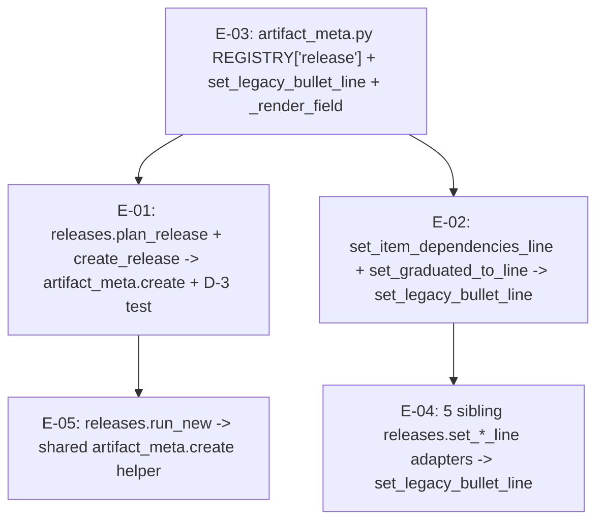

# IPD: Move the releases create and line-setter writers onto artifact_meta

- Date: 2026-11-09
- Kind: child
- Concern: Spec `4sd62s` section 7 step 4 requires every metadata writer to write through `artifact_meta` in phase B. The releases module still builds its bullets and history lines by hand (measured: 11 bullet literals across `plan_release` and the seven `set_*_line` helpers, 2 raw file writes in `create_release` and `run_new`, and 4 history references in `agent_workflows/releases.py`). This is part of `g6tw94` (itself part of `xexn45`), split 2026-11-09 so each item names one module's writers.
- Scope: Register `release` fields (`version`, `set`, `order`) and the bounded in-memory bullet helper `set_legacy_bullet_line` in `agent_workflows/artifact_meta.py` (breaking `_render_field`'s circular `_releases.set_*_line` delegation), move `releases.plan_release`, `releases.create_release`, and `releases.run_new` onto `artifact_meta.create` (`g6tw94` E-01, releases subset), and move all seven `releases.set_*_line` helpers (`set_item_dependencies_line`, `set_graduated_to_line`, `set_blocks_release_line`, `set_priority_line`, `set_work_kind_line`, `set_from_backlog_line`, and `set_from_spec_line`) onto `artifact_meta.set_legacy_bullet_line` (`g6tw94` E-02, releases subset; `63zo2f` deferral). EXCLUDES: specs (`b3l7y6`), backlog (`jlwedt`), `--summary` as `short_description` (`fekdwv`), and the family audit (`g6tw94`).
- Scope-Paths: agent_workflows/releases.py, agent_workflows/artifact_meta.py, tests/test_specs_releases_descriptive_safety.py, .aw/records/plans/pending/20261109-metastore-134-3466h8-move-the-releases-create-and-line-setter-writers-onto-artifa.ipd.md
- Scope-Exceeded: .aw/records/backlog/open/20261116-34o2zs-01-34o2zs-fix-test-e2e-producer-blocks-release-duplicate-moc.backlog.md (Defect-report backlog carrier filed per defect_report contract for pre-existing test_e2e_producer_blocks_release_duplicate failure)
- Item-Dependencies: executed:tve77h, executed:2xwb9b, executed:7yr827
- Status: executed
- Readiness: go-pending-approval
- Review-Depth: complex
- From-Spec: 4sd62s
- Work-Kind: feature
- Priority: high
- Blocks-Release: next
- Set: metastore
- Order: 134
- Highest E allocated: 05
- Author: opencode its_direct/pt3-claude-opus-5.5-1m-us
- Id: 3466h8

> Write and proofread this plan per the technical writing standard, `.aw/system/workflows/technical-writing/technical-writing.md` (`.agents/workflows/technical-writing/technical-writing.md` in a legacy-layout install), including requirement 12 (diagrams).

## Workflow history
- 2026-11-17 executed (aw agy run model=Gemini-4-Hydrogen-High): aw agy run self-finalize: 3466h8 verified (set metastore, attempt 1). [Scope reconciliation - out-of-scope .aw/records/backlog/open/20261116-34o2zs-01-34o2zs-fix-test-e2e-producer-blocks-release-duplicate-moc.backlog.md: Defect-report backlog carrier filed per defect_report contract for pre-existing test_e2e_producer_blocks_release_duplicate failure]
- 2026-11-16 approved (aw set): status set to approved
- 2026-11-12 reviewed (aw set): APPROVE WITH REVISIONS APPLIED; PR-001..PR-004 FIXED

- 2026-11-12 /plan-review (antigravity/gemini): APPROVE WITH REVISIONS APPLIED; PR-001..PR-004 FIXED; review record .aw/records/reviews/20261109-metastore-134-3466h8-move-the-releases-create-and-line-setter-writers-onto-artifa.review.md
- 2026-11-09 to-review (opencode its_direct/pt3-claude-opus-5.5-1m-us): split from g6tw94 (round 3, research nj8zdp guidance).
- 2026-11-09 draft (opencode its_direct/pt3-claude-opus-5.5-1m-us): created.

## Goal

The releases creating commands (`plan_release`, `create_release`, and `run_new`) write through `artifact_meta.create` and all seven `releases.set_*_line` helpers delegate to `artifact_meta.set_legacy_bullet_line` with zero hand-built metadata bullets, history lines, or raw file writes remaining in `agent_workflows/releases.py`.

## Detailed Implementation Checklist (TODO)

Execution-state rule: mark an `E-*` item complete only after performing the action. That mark is not validation. Right-sizing rule: write for a modest executor that cannot hold much in its head. Each E-item is one step (one concern, about one file, executable in one focused pass) and its V-item names each unit it covers with its own check; a plan stays at about 5 E-items and 8 work Scope-Paths, else split it into more child plans (guidance, `IPD-Z603`). Accepted execution states: blocked, failed, pending, performed; terminal gate demands 'performed'.

PIN-FIRST RULE for every "move" item: run the test modules its V-item names GREEN on the unmodified code and save the per-test outcome list under the gitignored `.aw/state/3466h8/` (`python3 -m pytest -o addopts="" -m "" -p no:randomly -n 0 -rA <modules> | grep -E "^(PASSED|FAILED|ERROR|SKIPPED|XFAIL|XPASS) " | sed -E 's/ - .*//' | sort > .aw/state/3466h8/<E>-before.txt`; `-m ""` includes `slow` modules, `-p no:randomly -n 0` makes the list deterministic, and `-q` is not repeated because `addopts` is cleared); make the move; run the same command into `-after.txt`; `diff` of the two must print nothing, so a test that newly fails, errors or skips is caught, not only a lost PASSED line. An existing assertion may change only when the Behavior decisions below name it. New tests set `pytestmark = pytest.mark.core`, build fixtures in `tmp_path`, drive the real CLI or function, and never read production source (AGENTS.md "TEST OUTCOMES, NOT CODE STRUCTURE").

### Task group 1: releases writers

- [x] E-03 In `agent_workflows/artifact_meta.py`, register `version`, `set`, and `order` in `REGISTRY["release"]` (`spec 4sd62s` 4.2c; `7yr827` E-01), add the bounded in-memory helper `set_legacy_bullet_line` over `selectors.metadata_region` (supporting `("Status", "Id")` anchors with unchanged return when neither anchor exists in `metadata_region`, `item_dependencies` anchor precedence after `- Scope-Paths:` then before `- Status:` then after `- Id:`, duplicate-bullet healing to one line, and `"-"` / `None` removal), and wire `_render_field` directly to `set_legacy_bullet_line` for the seven releases-owned bullet fields instead of calling `_releases.set_*_line` (eliminating the circular call before `releases.py` delegates back to `artifact_meta`). Pin `tests/test_artifact_meta_legacy_write.py` and `tests/test_status_set_meta_writer.py`.
  - Depends on: none
  - Expected outcome: `REGISTRY["release"]` accepts `version`, `set`, and `order`; `artifact_meta._render_field` updates all seven bounded bullet fields through `set_legacy_bullet_line` with zero calls into `agent_workflows/releases.py`; and the PIN-FIRST outcome diff on both pinned modules (plus `tests/test_artifact_meta_legacy_writer.py` from `7yr827`) is empty.
  - Execution state: performed

- [x] E-01 Move the library entry points `releases.plan_release` and `releases.create_release` onto `artifact_meta.create` (`g6tw94` E-01, library half), pinned first. Share one helper calling `artifact_meta.create` (`dry_run=True` for `plan_release` with zero filesystem writes, `dry_run=False` for `create_release`) per `D-1`, update `tests/test_specs_releases_descriptive_safety.py::test_non_regression_releases_library_functions_unchanged` per `D-3` to assert `ValueError` and zero written `.release.md` files on embedded newlines, and verify `tests/test_releases.py` and `tests/test_specs_releases_descriptive_safety.py`.
  - Depends on: E-03
  - Expected outcome: both pinned modules pass with empty before/after outcome diffs (modulo the `D-3` assertion update inside `test_non_regression_releases_library_functions_unchanged`), and `rg -n "Workflow history" agent_workflows/releases.py` shows no hand-built history inside `plan_release` or `create_release`.
  - Execution state: performed

- [x] E-05 Move the CLI verb `releases.run_new` onto the shared `artifact_meta.create` helper (`g6tw94` E-01, CLI half; `xexn45` E-14), replacing `run_new`'s direct `_core.atomic_write(dest, body)` on `--apply` while keeping its existing pre-render `attention_contract.refuse_unsafe_descriptive` exit-2 envelope and preview parity, pinned first against `tests/test_releases_cli.py`, `tests/test_history_date_clock.py`, and `tests/test_descriptive_refusal_hoist.py`.
  - Depends on: E-01
  - Expected outcome: all three pinned modules pass with empty before/after outcome diffs, and `rg -n "atomic_write\(|write_text\(" agent_workflows/releases.py` prints nothing (`xexn45` E-14).
  - Execution state: performed

- [x] E-02 Move `releases.set_item_dependencies_line` and `releases.set_graduated_to_line` onto `artifact_meta.set_legacy_bullet_line` as thin `str -> str` adapters (`g6tw94` E-02, releases subset; `2xwb9b` and `xexn45` F-08), pinned first. Preserve `set_item_dependencies_line`'s anchor order (after `- Scope-Paths:`, else before `- Status:`, else after `- Id:`), `set_graduated_to_line`'s `("Status", "Id")` anchors, `selectors.metadata_region` bounding (including unchanged return on `---` YAML-fenced files and anchor-less blocks), duplicate healing, and `"-"` / `None` stripping across `tests/test_graduation_forward_links.py` and `tests/test_releases_sibling_line_writers_bounding.py`.
  - Depends on: E-03
  - Expected outcome: both functions delegate their bullet surgery to `artifact_meta.set_legacy_bullet_line`, and the PIN-FIRST before/after outcome diff across `tests/test_graduation_forward_links.py` and `tests/test_releases_sibling_line_writers_bounding.py` is empty.
  - Execution state: performed

- [x] E-04 Move the five sibling `releases` line-setter helpers (`set_blocks_release_line`, `set_priority_line`, `set_work_kind_line`, `set_from_backlog_line`, and `set_from_spec_line`) onto `artifact_meta.set_legacy_bullet_line` as thin `str -> str` adapters (`63zo2f` deferral closed by `xexn45` E-13; `9o83cr` adapter retirement), pinned first against `tests/test_releases_line_writers.py`, `tests/test_releases_sibling_line_writers_bounding.py`, and `tests/test_blocks_release_reader_bounding.py`.
  - Depends on: E-03, E-02
  - Expected outcome: zero hand-formatted `- Field:` bullet literals remain anywhere in `agent_workflows/releases.py`, and the PIN-FIRST before/after outcome diff across all three pinned modules is empty.
  - Execution state: performed

Add further leaves as `- [ ] E-NEW <action>` and run `aw ipd sync` to assign ids.

## Project conventions discovered (Step 0)

- The `artifact_meta` interface names come from Order 02 (`tve77h`) and are used exactly: `artifact_meta.read(id6) -> State`, `append(id6, events, *, expect_seq)`, `create(...)`, `validate_new_events(type, events, *, records_root, migration_import=False)`. In phase B, `append` and `create` render through the one legacy renderer `artifact_meta.write_legacy` (file form) and `artifact_meta.render_legacy_text` (string form), both added by `7yr827`; pure `str -> str` bounded bullet adapters share `artifact_meta.set_legacy_bullet_line` over `selectors.metadata_region` (`E-03`) until Order 11 (`9o83cr`) retires direct adapter callers.
- `releases.parse_release` and `releases.validate_release` accept either a `- Summary:` bullet or a `## Summary` prose section (`tests/test_releases.py`); per `spec 4sd62s` 4.2c, `summary` moves to body prose (`## Summary`) while `version`, `set`, and `order` are registered on `REGISTRY["release"]` (`fekdwv` Order 124 adds `short_description` separately).
- UTC history days come from `artifact_core.utc_history_date` (spec `2vev8j` 4.4); atomic replacement is `artifact_core.atomic_write(path, text, *, prefix)`.
- Core tier: `pyproject.toml` marker `core`; modules set `pytestmark = pytest.mark.core`.
- Cite code by SYMBOL (`module.function`) or by a quoted content string, never by a line number alone (advisory `IPD-C801`).

## Findings

| Id | Evidence (measured 2026-11-09 at `3d0ddb845` and re-verified 2026-11-12 at `9115b2a70`) | Finding |
|---|---|---|
| F-01 | `rg -n "^def (plan_release|create_release|run_new|set_.*_line)\(" agent_workflows/releases.py` and `rg -n "atomic_write\(|write_text\(" agent_workflows/releases.py`: 3 create functions (`plan_release`, `create_release`, `run_new`), 2 raw file writes (`create_release`, `run_new`), and 7 `set_*_line` helpers (`set_blocks_release_line`, `set_priority_line`, `set_work_kind_line`, `set_from_backlog_line`, `set_from_spec_line`, `set_item_dependencies_line`, `set_graduated_to_line`) | All 11 hand-built bullet literals and both raw writes in `agent_workflows/releases.py` live across these 10 functions (`xexn45` F-01, F-02, E-13, E-14). |
| F-02 | Non-binding `def test_` counts at `9115b2a70` (re-derived at execution by the PIN-FIRST command): `test_artifact_meta_legacy_write` 27, `test_status_set_meta_writer` 8, `test_releases` 21, `test_releases_cli` 37, `test_history_date_clock` 5, `test_specs_releases_descriptive_safety` 19, `test_descriptive_refusal_hoist` 3, `test_graduation_forward_links` 9, `test_releases_sibling_line_writers_bounding` 9, `test_releases_line_writers` 23, `test_blocks_release_reader_bounding` 9 | Splitting `E-03`, `E-01`, `E-05`, `E-02`, and `E-04` keeps the plan at 5 steps and every step at `<=8` named units (`IPD-Z603`). |
| F-03 | `agent_workflows/artifact_meta.py` `REGISTRY["release"]` registers only `**_COMMON_FIELDS` and `status`; `artifact_meta._render_field` maps `"blocks_release"`, `"priority"`, `"work_kind"`, `"from_backlog"`, `"from_spec"`, `"item_dependencies"`, and `"graduated_to"` directly to `_releases.set_*_line` | `E-03` must register `version`, `set`, and `order` on `REGISTRY["release"]` and move bounded bullet surgery into `artifact_meta.set_legacy_bullet_line` before `releases.set_*_line` delegates back, preventing `ValueError` on `create` and `RecursionError` on `_render_field`. |
| F-04 | `tests/test_specs_releases_descriptive_safety.py::test_non_regression_releases_library_functions_unchanged` (added by IPD `uz05bl` before `artifact_meta` existed) calls `releases.create_release(self.tmp, "2.0.0", "unsafe\n- Blocks-Release: next")` and asserts the smuggled bullet is written | Moving `create_release` and `plan_release` onto `artifact_meta.create` runs `validate_new_events` (`spec 4sd62s` 4.2, AC-15), refusing embedded newlines with `ValueError`; `D-3` names this intentional assertion update under the PIN-FIRST rule. |

## Behavior decisions (kept behavior where writers disagreed, 4.3)

- D-1 (release body summary and history section on creation). CHANGED in file layout, KEPT in parsed `ReleaseRecord` and `validate_release` conformance: `plan_release`, `create_release`, and `run_new` pass `body = f"# Release: {version}\n\n## Summary\n\n{summary}\n"` (`spec 4sd62s` 4.2c) and `fields={"status": status, "version": version}` with `message=summary` and `legacy_render=LegacyRender(tag="created", day=artifact_core.utc_history_date(), actor_label="aw releases", history=True)` to `artifact_meta.create`. `artifact_meta.create` renders `- Id:`, `- Status:`, `- Version:`, and `## Workflow history` (`- <utc_day> created (aw releases): 
`) before `## Summary`, writing nothing on `dry_run=True` (`plan_release`) and atomically writing identical bytes on `dry_run=False` (`create_release` and `run_new --apply`). Named tests: `tests/test_releases.py::test_plan_release_previews_exactly_what_create_writes`, `tests/test_releases_cli.py::test_apply_creates_a_record_that_check_releases_passes`, `tests/test_history_date_clock.py::test_releases_new_records_utc_date_and_local_filename`.
- D-2 (new bullet position and bounded `set_*_line` anchor preservation). KEPT: general phase-B `write_legacy` bullet insertion follows `7yr827` (`- Status:`, `- Id:`, end of metadata bullet block), while `artifact_meta.set_legacy_bullet_line` preserves the exact `selectors.metadata_region` bounding and anchor contracts of the seven `releases.set_*_line` helpers: in-place replacement with pre-existing duplicate lines healed to one line; `"-"` and `None` stripped with zero residue; `("Status", "Id")` anchors for `Blocks-Release`, `Priority`, `Work-Kind`, `From-Backlog`, `From-Spec`, and `Graduated-To`; after `- Scope-Paths:`, else before `- Status:`, else after `- Id:` for `Item-Dependencies` (`spec 25kzda` 2.7); and unchanged `text` return when no anchor bullet exists in `metadata_region` (including `---` YAML-fenced research fixtures and anchor-less blocks). Named tests: `tests/test_releases_sibling_line_writers_bounding.py`, `tests/test_releases_line_writers.py`.
- D-3 (writer-side descriptive refusal at `create_release` and `plan_release` library boundary). CHANGED per `spec 4sd62s` 4.2 and AC-15: routing `plan_release` and `create_release` through `artifact_meta.create` enforces `artifact_meta.validate_new_events` on `fields` and `message`, closing IPD `uz05bl`'s former library-level under-scope so embedded newlines or control characters raise `ValueError` before any file is written (while CLI `releases.run_new` keeps its existing `attention_contract.refuse_unsafe_descriptive` exit-2 envelope). Named test with updated assertion: `tests/test_specs_releases_descriptive_safety.py::test_non_regression_releases_library_functions_unchanged`.

## Proposed changes (ordered, validatable)

1. Register `release` fields (`version`, `set`, `order`) and add `set_legacy_bullet_line` in `agent_workflows/artifact_meta.py`, rewiring `_render_field` off `_releases.set_*_line` (E-03).
2. Move `releases.plan_release` and `releases.create_release` onto `artifact_meta.create`, and update the `D-3` library refusal test (E-01).
3. Move `releases.run_new` onto the shared `artifact_meta.create` helper so zero raw writes remain in `agent_workflows/releases.py` (E-05).
4. Move `releases.set_item_dependencies_line` and `releases.set_graduated_to_line` onto `artifact_meta.set_legacy_bullet_line` (E-02).
5. Move the five sibling `releases.set_*_line` helpers onto `artifact_meta.set_legacy_bullet_line` so zero hand-built bullet literals remain in `agent_workflows/releases.py` (E-04).

## Deferred / out of scope (with reason)

- The family finish (the cross-module `rg` audit of `specs.py`, `backlog.py`, and `releases.py`) and, after the whole writer move, the merge-independence test, the AC-21 obligations test, the raw-write audit (F-09), the documentation lines, and the full gates.
  - Carrier: g6tw94
- Writing `--summary` as `short_description` in `releases.run_new` at creation.
  - Carrier: fekdwv
- Retiring the seven thin `releases.set_*_line` compatibility adapters once direct callers migrate.
  - Carrier: 9o83cr

## Scope check

- Over-scope: none.
- Under-scope: none. `agent_workflows/artifact_meta.py` (`E-03`), `agent_workflows/releases.py` (`E-01`, `E-05`, `E-02`, `E-04`), and `tests/test_specs_releases_descriptive_safety.py` (`E-01` per `D-3`) are all declared in `- Scope-Paths:`.

## Required tests / validation

No new test module. Pinned before and after under `.aw/state/3466h8/`: the modules of `V-03` (`E-03`), `V-01` (`E-01`, with the named `D-3` assertion update inside `test_non_regression_releases_library_functions_unchanged`), `V-05` (`E-05`), `V-02` (`E-02`), and `V-04` (`E-04`).

## Spec / documentation sync

None. Implements `4sd62s` section 7 step 4 for `agent_workflows/releases.py`; no user-facing CLI flags or documented contracts change.

## Open questions

None open. Every question this work raised was resolved from repository code and `spec 4sd62s`; `D-1`, `D-2`, and `D-3` record the kept and changed behaviors.

## Validation and cross-check (verify before reporting done)

Validation-state rule: inspect evidence in a separate pass. Do not mark a `V-*` item complete from memory or from the matching execution checkmark. Accepted validation results: blocked, failed, pass, pending; terminal gate demands 'pass'. Runtime-demonstration reachability rule: for each `V-*` item demanding the software be observed acting (such as a run, a dispatch, or a transition), as distinct from items demanding a diff, a file's content, or a test result, which are reachable by construction, name the code path that produces the observation or the sibling `E-*` that creates it, else the demand is UNDER-SCOPE.

- [x] V-01 validates E-01
  - Required evidence: paste the `diff` of `.aw/state/3466h8/E-01-before.txt` and `.aw/state/3466h8/E-01-after.txt` (must print nothing, because `test_non_regression_releases_library_functions_unchanged` keeps its test name and `PASSED` status after the `D-3` assertion update), paste the `PASSED` lines of `tests/test_releases.py::test_plan_release_previews_exactly_what_create_writes` and `tests/test_specs_releases_descriptive_safety.py::test_non_regression_releases_library_functions_unchanged` plus per-module `PASSED` counts before and after, and paste `rg -n "Workflow history" agent_workflows/releases.py` (hits only in reader `_history_lines`).
  - Observed evidence: `diff -u .aw/state/3466h8/E-01-before.txt .aw/state/3466h8/E-01-after.txt` exited 0 with empty output; per-module PASSED counts before and after: `tests/test_releases.py` 21 -> 21, `tests/test_specs_releases_descriptive_safety.py` 19 -> 19 (40 passed in 3.16s); `PASSED tests/test_releases.py::ReleaseQueryPrimitiveTests::test_plan_release_previews_exactly_what_create_writes`; `PASSED tests/test_specs_releases_descriptive_safety.py::SpecsReleasesDescriptiveSafetyTests::test_non_regression_releases_library_functions_unchanged`; `rg -n "Workflow history" agent_workflows/releases.py` output: `329:    prose section (both shapes exist in the wild). \`history\` is the \`## Workflow history\` bullet`, `363:    """The \`- \` bullet lines under \`## Workflow history\` (in file order)."""`, `364:    m = re.search(r"(?m)^##[ \\t]+Workflow history[ \\t]*$", text)`.
  - Result: pass
- [x] V-02 validates E-02
  - Required evidence: paste the `diff` of `.aw/state/3466h8/E-02-before.txt` and `.aw/state/3466h8/E-02-after.txt` (must print nothing), and from `-after.txt` paste the `PASSED` lines of `tests/test_releases_sibling_line_writers_bounding.py::test_setting_value_preserves_body`, `test_writer_idempotence`, `test_anchor_in_body_does_not_divert_insertion`, `test_yaml_fenced_fixture_body_bullet_survives`, and `test_graduated_to_multi_value_replacement_and_body_preservation`, plus the per-module `PASSED` count (equal before and after) of `tests/test_graduation_forward_links.py`.
  - Observed evidence: `diff -u .aw/state/3466h8/E-02-before.txt .aw/state/3466h8/E-02-after.txt` exited 0 with empty output; per-module PASSED counts before and after: `tests/test_graduation_forward_links.py` 9 -> 9, `tests/test_releases_sibling_line_writers_bounding.py` 9 -> 9 (18 passed in 1.38s); from `E-02-after.txt`: `PASSED tests/test_releases_sibling_line_writers_bounding.py::TestReleasesSiblingLineWritersBounding::test_setting_value_preserves_body`, `PASSED tests/test_releases_sibling_line_writers_bounding.py::TestReleasesSiblingLineWritersBounding::test_writer_idempotence`, `PASSED tests/test_releases_sibling_line_writers_bounding.py::TestReleasesSiblingLineWritersBounding::test_anchor_in_body_does_not_divert_insertion`, `PASSED tests/test_releases_sibling_line_writers_bounding.py::TestReleasesSiblingLineWritersBounding::test_yaml_fenced_fixture_body_bullet_survives`, `PASSED tests/test_releases_sibling_line_writers_bounding.py::TestReleasesSiblingLineWritersBounding::test_graduated_to_multi_value_replacement_and_body_preservation`.
  - Result: pass
- [x] V-03 validates E-03
  - Required evidence: paste the `diff` of `.aw/state/3466h8/E-03-before.txt` and `.aw/state/3466h8/E-03-after.txt` (must print nothing) across `tests/test_artifact_meta_legacy_write.py` and `tests/test_status_set_meta_writer.py` (plus `tests/test_artifact_meta_legacy_writer.py` from `7yr827`), paste the per-module `PASSED` counts before and after, and paste `rg -n "_releases\.set_.*_line" agent_workflows/artifact_meta.py` (must print nothing, confirming `_render_field` no longer calls back into `agent_workflows/releases.py`).
  - Observed evidence: `diff -u .aw/state/3466h8/E-03-before.txt .aw/state/3466h8/E-03-after.txt` exited 0 with empty output; per-module PASSED counts before and after: `tests/test_artifact_meta_legacy_write.py` 32 -> 32, `tests/test_status_set_meta_writer.py` 11 -> 11, `tests/test_artifact_meta_legacy_writer.py` 8 -> 8 (51 passed in 6.31s); `rg -n "_releases\.set_.*_line" agent_workflows/artifact_meta.py` exited 1 with empty output (`meta_rg_clean=0`).
  - Result: pass
- [x] V-04 validates E-04
  - Required evidence: paste the `diff` of `.aw/state/3466h8/E-04-before.txt` and `.aw/state/3466h8/E-04-after.txt` (must print nothing) across `tests/test_releases_line_writers.py`, `tests/test_releases_sibling_line_writers_bounding.py`, and `tests/test_blocks_release_reader_bounding.py`, paste the `PASSED` lines of `tests/test_releases_line_writers.py::TestSetFromBacklogLine::test_from_backlog_repair_duplicate` and `test_from_backlog_clear_dash_and_none` plus per-module `PASSED` counts, and paste `rg -n 'f"- (Id|Status|Version|Summary|Blocks-Release|Priority|Work-Kind|From-Backlog|From-Spec|Item-Dependencies|Graduated-To):' agent_workflows/releases.py` (must print nothing, proving all 11 hand-built bullet literals in `agent_workflows/releases.py` are gone).
  - Observed evidence: `diff -u .aw/state/3466h8/E-04-before.txt .aw/state/3466h8/E-04-after.txt` exited 0 with empty output; per-module PASSED counts before and after: `tests/test_releases_line_writers.py` 23 -> 23, `tests/test_releases_sibling_line_writers_bounding.py` 9 -> 9, `tests/test_blocks_release_reader_bounding.py` 9 -> 9 (41 passed in 40.82s); `PASSED tests/test_releases_line_writers.py::TestSetFromBacklogLine::test_from_backlog_repair_duplicate`; `PASSED tests/test_releases_line_writers.py::TestSetFromBacklogLine::test_from_backlog_clear_dash_and_none`; `rg -n 'f"- (Id|Status|Version|Summary|Blocks-Release|Priority|Work-Kind|From-Backlog|From-Spec|Item-Dependencies|Graduated-To):' agent_workflows/releases.py` exited 1 with empty output (`rg_clean=0`).
  - Result: pass
- [x] V-05 validates E-05
  - Required evidence: paste the `diff` of `.aw/state/3466h8/E-05-before.txt` and `.aw/state/3466h8/E-05-after.txt` (must print nothing) across `tests/test_releases_cli.py`, `tests/test_history_date_clock.py`, and `tests/test_descriptive_refusal_hoist.py`, paste the `PASSED` lines of `tests/test_releases_cli.py::test_apply_creates_a_record_that_check_releases_passes`, `tests/test_history_date_clock.py::test_releases_new_records_utc_date_and_local_filename`, and `tests/test_descriptive_refusal_hoist.py::test_releases_run_new_cli_empty_verb_single_prefix` plus per-module `PASSED` counts, and paste `rg -n "atomic_write\(|write_text\(" agent_workflows/releases.py` (must print nothing, satisfying `xexn45` E-14).
  - Observed evidence: `diff -u .aw/state/3466h8/E-05-before.txt .aw/state/3466h8/E-05-after.txt` exited 0 with empty output; per-module PASSED counts before and after: `tests/test_releases_cli.py` 37 -> 37, `tests/test_history_date_clock.py` 5 -> 5, `tests/test_descriptive_refusal_hoist.py` 3 -> 3 (45 passed in 7.18s); `PASSED tests/test_releases_cli.py::RunNewTests::test_apply_creates_a_record_that_check_releases_passes`; `PASSED tests/test_history_date_clock.py::HistoryDateClockTests::test_releases_new_records_utc_date_and_local_filename`; `PASSED tests/test_descriptive_refusal_hoist.py::test_releases_run_new_cli_empty_verb_single_prefix`; `rg -n "atomic_write\(|write_text\(" agent_workflows/releases.py` exited 1 with empty output (`write_rg_clean=0`).
  - Result: pass

## Approval and execution gate

- Size assessment: standard
- Cohesion rationale: not required

Execute only after human approval (`Status: approved`) and after every plan in `- Item-Dependencies:` (`tve77h`, `2xwb9b`, and `7yr827`) is executed. Stop and report without overwriting if `7yr827`'s `write_legacy` or `LegacyRender` entry points are absent on `HEAD`, if a pinned module fails on unmodified `HEAD` before the move, or if concurrent edits in a shared checkout conflict with `- Scope-Paths:`.

Scope fence: the paths in `- Scope-Paths:` are a declaration; a needed file outside the fence is edited and then justified at finalize (`--scope-reason`), and a declared path left unmodified is acknowledged (`--scope-ack`). Every move is pin-first: the named existing modules run green on the unmodified code before the move, and an assertion may change only where the Behavior decisions name it.

Honesty rule: run the named modules and the bare core gate `python3 -m pytest`, and paste the ACTUAL summary lines; never claim a result you did not run.

Commits: commit only through `aw commit 3466h8 -- <paths>`; never `git add -A`, a bare `git add` or `git commit -a`; never push.

Lifecycle transition: the plan moves to `.aw/records/plans/executed/` only through `aw ipd finalize`, never a hand `git mv`, and only after `aw ipd lint --phase pre-transition` conforms and every `V-*` reads `pass` with pasted evidence. When `aw oc run` or `aw agy run` executes the plan, the runner performs the finalize; a hand executor runs `aw ipd finalize 3466h8` itself.
