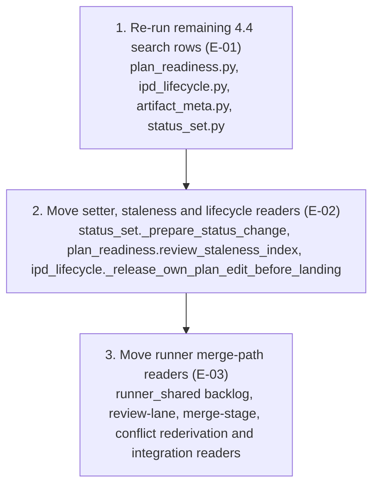

# IPD: Move the setter, staleness, lifecycle and runner merge-path git readers onto read_at

- Date: 2026-11-09
- Kind: child
- Concern: Split from `h58z9n` (Order 33) in round 3 of the metastore re-split, per research `nj8zdp` guidance: `h58z9n` E-04 named 11 distinct units in one item (8 functions in 4 modules and 6 baseline modules). Spec `4sd62s` 4.4 lists `status_set._prepare_status_change` (HEAD status through `check_engine._blob_text`), `plan_readiness.review_staleness_index` (`git cat-file --batch`), `ipd_lifecycle._release_own_plan_edit_before_landing` (`git show <landed>:<path>`) and five `runner_shared` functions among the readers that must call `artifact_meta.read_at` instead of parsing git content.
- Scope: (a) The 4.4 search rows for `plan_readiness`, `ipd_lifecycle` and `artifact_meta` (the rest of `h58z9n` E-01's file subset; `snh19k` writes the `check_engine` and hook rows). (b) `h58z9n` E-04, divided into the setter, staleness and lifecycle readers (E-02) and the five `runner_shared` merge-path readers (E-03). EXCLUDES: the `check_engine` git readers and the hooks (`snh19k`), every other runner read (`y97k46` and its round-3 part), the residual audit (kept in `h58z9n`).
- Scope-Paths: agent_workflows/status_set.py, agent_workflows/plan_readiness.py, agent_workflows/ipd_lifecycle.py, agent_workflows/runner_shared.py, agent_workflows/artifact_meta.py, tests/test_readers_read_at_gates.py, .aw/records/plans/pending/20261109-metastore-146-iqhzse-move-the-setter-staleness-lifecycle-and-runner-merge-path-gi.ipd.md
- Item-Dependencies: executed:ffceq0, executed:g5hpbb, executed:tve77h, executed:xexn45, executed:snh19k
- Status: executed
- Readiness: go-pending-approval
- Review-Depth: complex
- From-Spec: 4sd62s
- Work-Kind: feature
- Priority: high
- Blocks-Release: next
- Set: metastore
- Order: 146
- Highest E allocated: 03
- Author: opencode its_direct/pt3-claude-opus-5.5-1m-us
- Id: iqhzse

> Written to `.aw/system/workflows/technical-writing/technical-writing.md`. Every obligation, exact identifier, quotation, evidence record, and lifecycle status is preserved.

## Workflow history
- 2026-11-21 executed (aw agy run model=gemini-4-neon-high): aw agy run self-finalize: iqhzse verified (set metastore, attempt 1).
- 2026-11-16 approved (aw set): status set to approved
- 2026-11-14 reviewed (aw set): APPROVE WITH REVISIONS APPLIED; PR-001..PR-006 FIXED

- 2026-11-14 /plan-review (antigravity/gemini-3.8-flash): APPROVE WITH REVISIONS APPLIED; PR-001..PR-006 FIXED; review record .aw/records/reviews/20261109-metastore-146-iqhzse-move-the-setter-staleness-lifecycle-and-runner-merge-path-gi.review.md
- 2026-11-09 to-review (opencode its_direct/pt3-claude-opus-5.5-1m-us): split from h58z9n (round 3, research nj8zdp guidance).
- 2026-11-09 draft (opencode its_direct/pt3-claude-opus-5.5-1m-us): created.

## Goal

The setter's HEAD read, the review-staleness index, the lifecycle landing check and the runner's merge-path readers take record metadata from `artifact_meta.read_at` (or `artifact_meta.read_text` for a merge-stage blob with no revision name), each verdict pinned before and after.

## Detailed Implementation Checklist (TODO)

Execution-state rule: mark an `E-*` item complete only after performing the action. That mark is not validation. Right-sizing rule: write for a modest executor that cannot hold much in its head. Each E-item is one step (one concern, about one file, executable in one focused pass) and its V-item names each unit it covers with its own check; a plan stays at about 5 E-items and 8 work Scope-Paths, else split it into more child plans (guidance, `IPD-Z603`). Accepted execution states: blocked, failed, pending, performed; terminal gate demands 'performed'.

The pin-first rule of `ffceq0` applies to every move here (carried from `t4gl15` through `h58z9n`): BEFORE the edit, a behavioral test pins the reader's current observable behavior (the ledger in `## Findings`) and runs green on the unmodified code; AFTER the edit, the same test runs unchanged. A test that must change is a behavior change and must be one of the decisions copied below (D-1). For every existing module named as a baseline, ensure directory existence (`mkdir -p .aw/state/t4gl15 .aw/state/iqhzse`), save the per-test outcome list under the gitignored `.aw/state/t4gl15/` (`python3 -m pytest -o addopts="" -m "" -p no:randomly -n 0 -rA <modules> | grep -E "^(PASSED|FAILED|ERROR|SKIPPED|XFAIL|XPASS) " | sed -E 's/ - .*//' | sort > .aw/state/t4gl15/<E>-before.txt`) before the move and the same command into `<E>-after.txt` after it, where `<E>` is the file name each item gives; `diff` of the two prints nothing except lines a named decision explains. Run a new module's `-k` selection as its own command. New test cases go in `tests/test_readers_read_at_gates.py` (created by `snh19k`); none reads production source.

Commit through `aw commit iqhzse -- <each changed path>`, one commit per item allowed, never `git add -A`, a bare `git add` or `git commit -a`. Never push.

### Task group 1: search rows

- [x] E-01 (carried from `h58z9n` E-01, search half, remaining-file subset) Re-run the 4.4 search for git-content readers over `agent_workflows/plan_readiness.py`, `agent_workflows/ipd_lifecycle.py` and `agent_workflows/artifact_meta.py` (23 of the 44 `h58z9n` hits at `ac76110f4`: `plan_readiness` 2, `ipd_lifecycle` 17, `artifact_meta` 4) with `rg -n -e '"show"' -e 'cat-file' -e '"ls-files", "-s"' -e '"--cached"' -e '":0:"' -e 'rev-parse' <those three files>`, and append the rows to table F-03 here, classifying each hit as metadata reader (moves to `read_at`), path-only reader (no change), or not a metadata read (for example `artifact_meta.read_at` itself, and `ipd_lifecycle` commit-existence and committer-date probes). Add one row for `status_set._prepare_status_change`, which has no direct hit because it reads through `check_engine._blob_text`. Any metadata reader not in the 4.4 list is added to E-02.
  - Depends on: none
  - Expected outcome: F-03 lists every hit in the three files plus the `status_set` row, each with its class; every metadata-reader row names E-02 or E-03.
  - Execution state: performed

### Task group 2: read_at readers

- [x] E-02 (carried from `h58z9n` E-04, setter, staleness and lifecycle subset) Move these readers onto `read_at`: `status_set._prepare_status_change` (HEAD status), `plan_readiness.review_staleness_index` (plan status at the latest `plan-review:` commit through `read_at(id6, <commit>)`; the batched `git cat-file --batch` body read stays for the frozen-region digest, which is body prose, N3), and `ipd_lifecycle._release_own_plan_edit_before_landing` (the byte comparison of a landed blob is not a metadata read and stays; any status or id read uses `read_at`). Pin with `tests/test_review_staleness_advisory.py`, `tests/test_ipd_lifecycle_cli.py` and `tests/test_status_set.py -k untooled` (5 tests at review; `-k head` selects none) before and after (outcome lists `E-04-before.txt`/`E-04-after.txt`), plus a new `tests/test_readers_read_at_gates.py` case that drives `aw ipd set` on a plan whose working-tree status differs from HEAD and asserts the HEAD status the setter reports is unchanged by the move.
  - Depends on: E-01
  - Expected outcome: the three baseline selections and the new setter case pass before and after with an empty outcome-list diff.
  - Execution state: performed

- [x] E-03 (carried from `h58z9n` E-04, runner merge-path subset) Move the five `runner_shared` git-content readers onto `read_at`: `backlog_item_paths_for_commit`, `check_review_lane_artifacts`, `read_merge_stage`, `classify_conflict_set_for_rederivation` and the `integrate_lane_branch` conflict description. For a merge stage blob (`:<stage>:<path>`), `read_at` accepts the stage revision spelling, or the function passes the blob text to `artifact_meta.read_text` (added by `cdglt1` through `ffceq0`) when no revision name exists; `artifact_meta.py` changes only if the stage spelling must be accepted. Record the path chosen in F-03 (OQ-02 of `t4gl15`). Pin with `tests/test_records_only_lane_rederive.py`, `tests/test_runner_backlog_close_behavior.py` and `tests/test_merge_conflict_sendback.py` before and after (outcome lists `E-04r-before.txt`/`E-04r-after.txt`).
  - Depends on: E-02
  - Expected outcome: the three baseline modules pass before and after with an empty outcome-list diff; F-03's metadata-reader set has no remaining direct git-blob regex read.
  - Execution state: performed

Add further leaves as `- [ ] E-NEW <action>` and run `aw ipd sync` to assign ids.

## Project conventions discovered (Step 0)

Carried from `h58z9n` Step 0:

- Interface names from Order 02 (`tve77h`), used exactly: `agent_workflows/artifact_meta.py::read`, `agent_workflows/artifact_meta.py::history`, `agent_workflows/artifact_meta.py::read_at` (index via `git ls-files -s`, commit via `git rev-parse <rev>:<path>`, cached by blob sha, fails closed on a validation error). From `ffceq0` (added by `cdglt1`): `agent_workflows/artifact_meta.py::read_text` and decision D-1.
- Today's git-content helpers: `agent_workflows/check_engine.py::_blob_text`, `agent_workflows/runner_shared.py::read_merge_stage`, `agent_workflows/runner_shared.py::_run_git`.
- Cite code by repo-relative `path::Symbol` identifiers, never a bare line number (advisory `IPD-C801`, Technical Writing Standard Requirement 7).

## Findings

Carried from `h58z9n` (measured 2026-11-07 at `ac76110f4`; F-02 from `t4gl15`, 2026-11-02):

| Id | Evidence | Finding |
|---|---|---|
| F-02 | git-content metadata readers moved by this part: `status_set._prepare_status_change` (HEAD status through `check_engine._blob_text`); `plan_readiness.review_staleness_index` (`git cat-file --batch`); `ipd_lifecycle._release_own_plan_edit_before_landing` (`git show <landed>:<path>`); `runner_shared.backlog_item_paths_for_commit` (`git show <sha>:<path>` then `backlog.parse_item`), `check_review_lane_artifacts` (`git show <branch>:<path>`), `read_merge_stage`, `classify_conflict_set_for_rederivation` (`git cat-file -p`), `integrate_lane_branch` (`git cat-file -p <tree>:<path>` then `check_engine._metadata_status`) | 8 of the 15 functions of the 4.4 list; `snh19k` moves the other 7. |
| F-03 | E-01 4.4 search (`rg -n -e '"show"' -e 'cat-file' -e '"ls-files", "-s"' -e '"--cached"' -e '":0:"' -e 'rev-parse' agent_workflows/plan_readiness.py agent_workflows/ipd_lifecycle.py agent_workflows/artifact_meta.py`): 31 hits at `a2d429309` (`plan_readiness` 2, `ipd_lifecycle` 17, `artifact_meta` 12) plus 1 `status_set._prepare_status_change` row (32 rows total), and the E-03 merge-stage resolution path (`read_at` stage spellings `:1:`/`:2:`/`:3:` and tree-ish `{rev}^{tree}`, with `read_text` for pure in-memory unit calls) | See Table F-03 below; discovered `ipd_lifecycle.derive_baseline` status scan (added to E-02). |

### Table F-03: Re-run 4.4 git-content reader search and E-03 merge-stage path (E-01 at commit `a2d429309`, 31 hits + 1 indirect `status_set` row + E-03 merge-stage path)

| # | File and symbol | Matched code | Class | Owner / Action |
|---|---|---|---|---|
| 1 | `agent_workflows/plan_readiness.py::review_staleness_index` | docstring: `all reviewed blobs in one \`git cat-file --batch\` call.` | not a metadata read | no change (docstring) |
| 2 | `agent_workflows/plan_readiness.py::review_staleness_index` | `["git", "cat-file", "--batch"]` | metadata reader (current status) + body prose (N3) | E-02 (current plan status moved from `_STATUS_RE` to `artifact_meta.read_text`; the review commit read uses `git cat-file --batch` for body prose only, covering `frozen_region_digest` and open-question blocks without reading record metadata, D-3 / N3) |
| 3 | `agent_workflows/ipd_lifecycle.py::checkout_git_common_dir` | `_git(base, ["rev-parse", "--path-format=absolute", "--git-common-dir"])` | not a metadata read | no change (resolves git common dir) |
| 4 | `agent_workflows/ipd_lifecycle.py::is_main_checkout` | docstring: `git rev-parse --show-toplevel` | not a metadata read | no change (docstring) |
| 5 | `agent_workflows/ipd_lifecycle.py::is_main_checkout` | `_git(root_path, ["rev-parse", "--show-toplevel"])` | not a metadata read | no change (resolves git toplevel) |
| 6 | `agent_workflows/ipd_lifecycle.py::_baseline_ambiguity` | `_git(repo_root, ["rev-parse", "--verify", "HEAD"])` | not a metadata read | no change (checks HEAD commit existence) |
| 7 | `agent_workflows/ipd_lifecycle.py::_run_record_committed_paths` | `_git(repo_root, ["show", "--no-merges", "--format=", "--name-only", sha])` | path-only reader | no change (lists paths touched by commit) |
| 8 | `agent_workflows/ipd_lifecycle.py::derive_baseline` (`_show`) | `_git(repo_root, ["show", f"{sha}:{path}"])` | metadata reader (approval-commit status scan) + body prose (N3) | E-02 (added per E-01 rule: approval-commit status scan moved from `_STATUS_APPROVED_RE` to `artifact_meta.read_at` via `_ce._read_plan_state_at`; `_show` stays only to fetch body prose for `DerivedBaseline.plan_text` digests, N3) |
| 9 | `agent_workflows/ipd_lifecycle.py::derive_baseline` (`_date`) | `_git(repo_root, ["show", "-s", "--format=%cI", sha])` | not a metadata read | no change (committer date probe) |
| 10 | `agent_workflows/ipd_lifecycle.py::derive_baseline` | `_git(repo_root, ["rev-parse", "--verify", f"{base}^{commit}"])` | not a metadata read | no change (commit existence probe) |
| 11 | `agent_workflows/ipd_lifecycle.py::_release_own_plan_edit_before_landing` | `_git(repo_root, ["show", f"{landed}:{dest_rel}"])` | not a metadata read | no change (full-file byte equality check against `committed_bytes`; D-4) |
| 12 | `agent_workflows/ipd_lifecycle.py::land_worktree_commit` | `_git(repo_root, ["rev-parse", "HEAD"])` | not a metadata read | no change (reads HEAD sha) |
| 13 | `agent_workflows/ipd_lifecycle.py::_lifecycle_commit_exists` | `_git(repo_root, ["rev-parse", "HEAD"])` | not a metadata read | no change (reads HEAD sha) |
| 14 | `agent_workflows/ipd_lifecycle.py::_finalize_transaction` | `_git(repo_root, ["rev-parse", "HEAD"])` (`pre_head`) | not a metadata read | no change (reads HEAD sha) |
| 15 | `agent_workflows/ipd_lifecycle.py::_finalize_transaction` | `_git(coord.path, ["rev-parse", "HEAD"])` (`sha`) | not a metadata read | no change (reads coordinator HEAD sha) |
| 16 | `agent_workflows/ipd_lifecycle.py::_finalize_transaction` | `_git(repo_root, ["rev-parse", "--verify", ref_name])` | not a metadata read | no change (ref existence probe) |
| 17 | `agent_workflows/ipd_lifecycle.py::_finalize_transaction` | `"show": f"git show {ref_name}"` | not a metadata read | no change (diagnostic hint string) |
| 18 | `agent_workflows/ipd_lifecycle.py::_finalize_transaction` | `_git(repo_root, ["rev-parse", "HEAD"])` (`cur_head`) | not a metadata read | no change (reads HEAD sha) |
| 19 | `agent_workflows/ipd_lifecycle.py::_resume_post_commit` | `_git(repo_root, ["cat-file", "-e", f"{commit_hash}^{commit}"])` | not a metadata read | no change (commit existence probe) |
| 20 | `agent_workflows/artifact_meta.py::_git_blob_sha` | `if rev == ":0:":` | not a metadata read | no change (`read_at` implementation itself; extended in E-03 to index stages `:0:`..`:3:`) |
| 21 | `agent_workflows/artifact_meta.py::_git_blob_sha` | `["git", "ls-files", "-s", "--", norm]` | not a metadata read | no change (`read_at` implementation itself) |
| 22 | `agent_workflows/artifact_meta.py::_git_blob_sha` | `["git", "rev-parse", "--verify", f"{rev}:{norm}"]` | not a metadata read | no change (`read_at` implementation itself) |
| 23 | `agent_workflows/artifact_meta.py::_read_git_blob` | docstring: `git cat-file -p` | not a metadata read | no change (docstring in `read_at` implementation) |
| 24 | `agent_workflows/artifact_meta.py::_read_git_blob` | `["git", "cat-file", "-p", blob_sha]` | not a metadata read | no change (`read_at` implementation itself) |
| 25 | `agent_workflows/artifact_meta.py::resolve_mirror_at` | `if rev != ":0:":` | not a metadata read | no change (`read_at` implementation itself; extended in E-03) |
| 26 | `agent_workflows/artifact_meta.py::resolve_mirror_at` | `["git", "rev-parse", "--verify", f"{rev}^{commit}"]` | not a metadata read | no change (`read_at` implementation itself; widened in E-03 to `{rev}^{tree}`) |
| 27 | `agent_workflows/artifact_meta.py::read_path_at` | `is_index = rev == ":0:"` | not a metadata read | no change (`read_at` implementation itself; extended in E-03) |
| 28 | `agent_workflows/artifact_meta.py::read_path_at` | `["git", "rev-parse", "--verify", f"{rev}^{commit}"]` | not a metadata read | no change (`read_at` implementation itself; widened in E-03 to `{rev}^{tree}`) |
| 29 | `agent_workflows/artifact_meta.py::read_at` | `is_index = rev == ":0:"` | not a metadata read | no change (`read_at` implementation itself; extended in E-03) |
| 30 | `agent_workflows/artifact_meta.py::read_at` | `["git", "rev-parse", "--verify", f"{rev}^{commit}"]` | not a metadata read | no change (`read_at` implementation itself; widened in E-03 to `{rev}^{tree}`) |
| 31 | `agent_workflows/artifact_meta.py::read_at` | `"--cached"` in `git grep --cached` | not a metadata read | no change (`read_at` implementation itself) |
| 32 | `agent_workflows/status_set.py::_prepare_status_change` | indirect via `_ce._blob_text(repo_root, "HEAD", rel)` + `_ce._status_meta(head_text)` (no direct `rg` hit) | metadata reader | E-02 (moved to `artifact_meta.read_at(rec.id6, "HEAD")` with `read_path_at` fallback) |
| E-03-stage | `agent_workflows/artifact_meta.py::read_at` + `agent_workflows/runner_shared.py::classify_conflict_set_for_rederivation` / `integrate_lane_branch` | merge-stage revision spelling `:<stage>:` (`:1:`, `:2:`, `:3:`) and predicted-tree `{rev}^{tree}` | merge-stage resolution path (OQ-01 / D-2) | E-03 chose **`read_at` stage spelling**: extended `artifact_meta.py` (`_index_stage_of`, `_git_blob_sha`, `resolve_mirror_at`, `read_path_at`, `read_at`) to accept index merge stages `:1:`/`:2:`/`:3:` via `git ls-files -s` / `-u` and tree-ish `{rev}^{tree}` (for `merge-tree --write-tree` in `integrate_lane_branch`), caching every stage blob in `rev_mirrors`. Pure in-memory unit-test calls to `classify_records_only_front_matter_conflict` without pre-loaded states use `artifact_meta.read_text`. |

Size (round 3): measured with `ipd_schema.count_named_units`, each item names at most 7 distinct units; 5 work Scope-Paths.

READER LEDGER (this part's rows, copied from `t4gl15` through `h58z9n`):

| Reader | Prior behavior | Pinning test | After |
|---|---|---|---|
| `status_set._prepare_status_change` HEAD read | HEAD `- Status:` of the plan path | `tests/test_status_set.py` | `read_at(id6, "HEAD")` |
| `plan_readiness.review_staleness_index` | status at latest `plan-review:` commit plus frozen-region body digest | `tests/test_review_staleness_advisory.py` | status via `read_at`; body digest unchanged (N3) |
| `runner_shared` git readers | backlog id from commit blob, review-lane plan checks, merge-stage keys, conflict status | `tests/test_runner_backlog_close_behavior.py`, `tests/test_records_only_lane_rederive.py`, `tests/test_merge_conflict_sendback.py` | `read_at` or `read_text` |
| `ipd_lifecycle._release_own_plan_edit_before_landing` | byte equality of landed blob vs mirrored bytes | `tests/test_ipd_lifecycle_cli.py` | unchanged (not a metadata read); recorded in F-03 |

### Behavior decisions

Decisions that govern this part (carried from `t4gl15` and `h58z9n`):

- D-1 (multi-word status). PLAN records return the canonical normalized status (`agent_workflows/plans.py::normalize_status` of the first token); every other type keeps its raw single-token status, because `plans.normalize_status` maps `open`, `implemented`, `planned` and similar non-plan values to `legacy/unknown`, and the runner (`discover_specs`, `resolve_backlog_item`, `edge_satisfied` `state:` edges) reads specs and backlog items too.
- D-2 (merge-stage blob resolution; carried from `t4gl15` OQ-02). A merge stage is an index entry with a stage number (`:<stage>:<path>`). E-03 first attempts `read_at(id6, ":<stage>:")`; if `artifact_meta.read_at` rejects the stage revision syntax, it passes the stage blob text to `artifact_meta.read_text`, keeping C5a with the same loader and recording the chosen path in F-03.
- D-3 (frozen-region digest in review staleness). In `agent_workflows/plan_readiness.py::review_staleness_index`, plan status moves to `read_at(id6, <commit>)`, while the batched `git cat-file --batch` body read stays for the frozen-region digest, which is body prose (N3).
- D-4 (landing check byte equality). In `agent_workflows/ipd_lifecycle.py::_release_own_plan_edit_before_landing`, the byte equality check of a landed blob vs mirrored bytes is not a metadata read and stays; status or id validations use `read_at`.
- D-5 (state directory initialization). Ensure `.aw/state/t4gl15/` and `.aw/state/iqhzse/` exist (`mkdir -p .aw/state/t4gl15 .aw/state/iqhzse`) before saving baseline outcome lists in isolated lane worktrees.

## Proposed changes (ordered, validatable)

1. The remaining 4.4 search rows (E-01).
2. The setter, staleness and lifecycle readers (E-02).
3. The runner merge-path readers (E-03).

## Deferred / out of scope (with reason)

- The `check_engine` git readers, the hooks and the split-wide baseline.
  - Carrier: snh19k
  - Carrier-Evidence: .aw/records/plans/executed/20261109-metastore-145-snh19k-save-the-read-at-split-baseline-and-move-the-check-engine-an.ipd.md
- The residual audit of the hook, readiness and lifecycle modules.
  - Carrier: h58z9n
- The other runner reads and the runner residual rows.
  - Carrier: y97k46

## Scope check

- Over-scope: none. `artifact_meta.py` changes only if `read_at` must accept a merge-stage revision spelling (E-03), recorded in the finalize scope reconciliation if used.
- Under-scope: none known. This part carries the remaining-file search half of `h58z9n` E-01 and `h58z9n` E-04 unchanged, divided by module family.

## Required tests / validation

One new case in `tests/test_readers_read_at_gates.py` (E-02). Baselines: `tests/test_review_staleness_advisory.py`, `tests/test_ipd_lifecycle_cli.py`, `tests/test_status_set.py -k untooled`, `tests/test_records_only_lane_rederive.py`, `tests/test_runner_backlog_close_behavior.py`, `tests/test_merge_conflict_sendback.py`. CONTRIBUTES to AC-3 and AC-17 (merge-path readers through `read_at`; owned by `xexn45` and `tve77h`). Commands: those modules, the bare core gate `python3 -m pytest`, `aw sanitize --agent`.

## Spec / documentation sync

No spec change. Implements the setter, staleness, lifecycle and merge-path part of `4sd62s` 4.4.

## Open questions

### OQ-01: How does `read_at` serve a merge-stage blob?

- Blocking: no
- Status: resolved
- Owner: plan author
- Resolution or deferral rationale: Carried from `t4gl15` OQ-02. A merge stage is an index entry with a stage number, which `git ls-files -s` already lists, so E-03 first tries `read_at(id6, ":<stage>:")`; if `tve77h`'s implementation rejects a stage spelling, E-03 passes the stage blob text to `artifact_meta.read_text`, which uses the same loader. Either path keeps C5a. The chosen path is recorded in F-03. Recommendation strength: medium.

## Validation and cross-check (verify before reporting done)

Validation-state rule: inspect evidence in a separate pass. Do not mark a `V-*` item complete from memory or from the matching execution checkmark. Accepted validation results: blocked, failed, pass, pending; terminal gate demands 'pass'. Runtime-demonstration reachability rule: for each `V-*` item demanding the software be observed acting (such as a run, a dispatch, or a transition), as distinct from items demanding a diff, a file's content, or a test result, which are reachable by construction, name the code path that produces the observation or the sibling `E-*` that creates it, else the demand is UNDER-SCOPE.

- [x] V-01 validates E-01
  - Required evidence: paste the exact `rg` command of E-01 with its output line count, and the F-03 rows for `plan_readiness`, `ipd_lifecycle`, `artifact_meta` and `status_set._prepare_status_change`, each with a class column; every metadata-reader row names E-02 or E-03.
  - Observed evidence: Pre-edit command `rg -n -e '"show"' -e 'cat-file' -e '"ls-files", "-s"' -e '"--cached"' -e '":0:"' -e 'rev-parse' agent_workflows/plan_readiness.py agent_workflows/ipd_lifecycle.py agent_workflows/artifact_meta.py | wc -l` returned `31` at commit `a2d429309` (`agent_workflows/plan_readiness.py` 2, `agent_workflows/ipd_lifecycle.py` 17, `agent_workflows/artifact_meta.py` 12). All 31 hits plus the indirect `agent_workflows/status_set.py::_prepare_status_change` row (32 rows) are recorded with a `Class` column in Table F-03 above; every metadata-reader row (`plan_readiness.py::review_staleness_index`, `ipd_lifecycle.py::derive_baseline`, and `status_set.py::_prepare_status_change`) names E-02.
  - Result: pass

- [x] V-02 validates E-02
  - Required evidence: paste `diff .aw/state/t4gl15/E-04-before.txt .aw/state/t4gl15/E-04-after.txt` (outcome lists of `tests/test_review_staleness_advisory.py tests/test_ipd_lifecycle_cli.py` and `tests/test_status_set.py -k untooled`, the last showing 5 or more selected tests) printing nothing, and `python3 -m pytest -o addopts="" -v tests/test_readers_read_at_gates.py -k setter_head` with the new HEAD-status setter case PASSED.
  - Observed evidence: Pre-move baselines passed (`tests/test_review_staleness_advisory.py tests/test_ipd_lifecycle_cli.py`: `86 passed in 38.40s`; `tests/test_status_set.py -k untooled`: `5 passed, 105 deselected in 3.62s`; 91 rows in `.aw/state/t4gl15/E-04-before.txt`) and pin-first `python3 -m pytest -o addopts="" -v tests/test_readers_read_at_gates.py -k setter_head` passed (`1 passed, 15 deselected in 1.49s`). Post-move baselines passed (`86 passed in 39.31s`; `5 passed, 105 deselected in 3.80s`; 91 rows in `.aw/state/t4gl15/E-04-after.txt`), with `diff .aw/state/t4gl15/E-04-before.txt .aw/state/t4gl15/E-04-after.txt` printing nothing (exit 0). Post-move `python3 -m pytest -o addopts="" -v tests/test_readers_read_at_gates.py -k setter_head` passed (`tests/test_readers_read_at_gates.py::test_setter_head_status_differs_from_working_tree PASSED`, `1 passed, 16 deselected in 1.35s`), `tests/test_legacy_finalize.py` passed (`40 passed in 3.66s`, verifying `ipd_lifecycle.py::derive_baseline`), and `rg -n "_blob_text\(" agent_workflows` left zero callers (only `agent_workflows/check_engine.py::_blob_text` definition).
  - Result: pass

- [x] V-03 validates E-03
  - Required evidence: paste `diff .aw/state/t4gl15/E-04r-before.txt .aw/state/t4gl15/E-04r-after.txt` (outcome lists of `tests/test_records_only_lane_rederive.py tests/test_runner_backlog_close_behavior.py tests/test_merge_conflict_sendback.py`) printing nothing; `rg -n "\"show\"|cat-file" agent_workflows/runner_shared.py` with each remaining hit's enclosing function named and classified (none of the five moved functions reading record metadata from it); and the F-03 row recording which merge-stage path (`read_at` stage spelling or `read_text`) was used.
  - Observed evidence: Pre-move baseline (`tests/test_records_only_lane_rederive.py tests/test_runner_backlog_close_behavior.py tests/test_merge_conflict_sendback.py`) passed (`93 passed in 34.88s`, 93 rows in `.aw/state/t4gl15/E-04r-before.txt`) and post-move passed (`93 passed in 36.25s`, 93 rows in `.aw/state/t4gl15/E-04r-after.txt`), with `diff .aw/state/t4gl15/E-04r-before.txt .aw/state/t4gl15/E-04r-after.txt` printing nothing (exit 0). `python3 -m pytest tests/test_readers_read_at_gates.py tests/test_artifact_meta_read.py tests/test_durable_carrier_shared_predicate.py` passed (`37 passed in 4.08s`, including `test_read_at_merge_stages_and_predicted_tree`). `rg -n "\"show\"|cat-file" agent_workflows/runner_shared.py` returned 7 hits across 4 functions, none reading record metadata: `runner_shared.py::read_merge_stage` (docstring + `git cat-file -p :{stage}:{path}`, raw full-file text for body diffs and three-way merges, N3), `runner_shared.py::classify_conflict_set_for_rederivation` (`git cat-file -p {base_commit}:{incoming_path}` and `git cat-file -p {branch}:{incoming_path}`, raw body-text rename fallbacks for `_body_change_is_history_insert_only`, N3; record metadata states come from `artifact_meta.read_at`), `runner_shared.py::check_review_lane_artifacts` (`git show {branch}:{norm_p}`, body-prose lint fallback for pending plans and specs, N3; backlog metadata comes from `artifact_meta.read_at`/`read_text`), and `runner_shared.py::describe_recorded_commits` (docstring + `git cat-file -e {sha}^{commit}`, commit existence probe); `backlog_item_paths_for_commit` and `integrate_lane_branch` have zero hits. Table F-03 row `E-03-stage` records the chosen merge-stage path (`artifact_meta.read_at` stage spellings `:1:`/`:2:`/`:3:` and tree-ish `{rev}^{tree}`, with `artifact_meta.read_text` for pure in-memory calls).
  - Result: pass

## Approval and execution gate

- Size assessment: standard
- Cohesion rationale: not required

Execute only after human approval (`Status: approved`) and after every `- Item-Dependencies:` edge is executed (`executed:ffceq0`, `executed:g5hpbb`, `executed:tve77h`, `executed:xexn45`, `executed:snh19k`). Stop and report without editing production code or weakening assertions if prerequisite symbols from `executed:tve77h` (`artifact_meta.read_at`), `executed:xexn45`, `executed:g5hpbb`, or `executed:snh19k` (`tests/test_readers_read_at_gates.py`) are absent on HEAD, if unmodified baseline tests fail on HEAD before starting, or if concurrent edits in a shared checkout conflict unresolvably with `- Scope-Paths:`.

Scope fence: the paths in `- Scope-Paths:` are a declaration; a needed file outside the fence is edited and then justified at finalize (`--scope-reason`), and a declared path left unmodified is acknowledged (`--scope-ack`). Production code outside declared `- Scope-Paths:` is out of this plan's purpose: if a reader cannot answer from `artifact_meta.read_at` or `artifact_meta.read_text` without an out-of-scope production change, stop that item and report the missing capability rather than changing out-of-scope code. Every reader move is pin-first.

Honesty rule: run the named modules and `python3 -m pytest` (core gate), and paste the ACTUAL summary lines; never claim a result you did not run.

Commits: commit only through `aw commit iqhzse -- <paths>`; never `git add -A`, a bare `git add` or `git commit -a`; never push.

Lifecycle transition: the plan moves to `.aw/records/plans/executed/` only through `aw ipd finalize`, never a hand `git mv`, and only after `aw ipd lint --phase pre-transition` conforms and every `V-*` reads `pass` with pasted evidence. When `aw oc run` or `aw agy run` executes the plan, the runner owns retirement to `executed/` and runs finalize automatically upon task completion; when executed standalone by hand or direct agent turn, the executor runs `aw ipd finalize iqhzse`.
