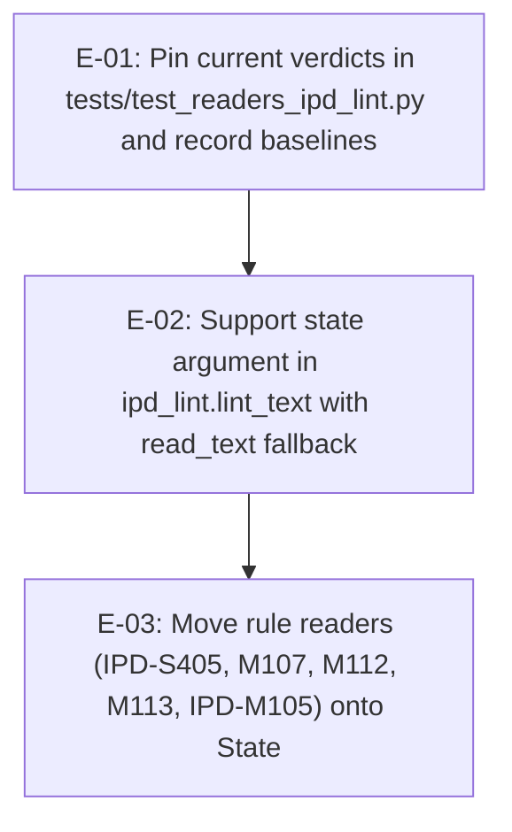

# IPD: Pin and move the ipd_lint metadata reads onto artifact_meta

- Date: 2026-11-09
- Kind: child
- Concern: Split from `dqutt8` (Order 28) in round 3 of the metastore re-split, per research `nj8zdp` guidance (at most 5 E-items, 8 work Scope-Paths, about 8 named units per item): `dqutt8` E-03 named 11 distinct units in one item. `ipd_lint` parses plan metadata and history itself (5 `^-` literals and `ipd_schema.parse_metadata_block`); spec `4sd62s` C5 requires it to answer from `artifact_meta`.
- Scope: Pin the `ipd_lint` metadata verdicts, then move the `parse` metadata slice and the `lint_text` `state` argument, then move the rule readers (`IPD-S405`, `IPD-M107`, `IPD-M112`, `IPD-M113`, `IPD-M105`, the `run_lint` rows and `_CITATION_PLAN_DATE_RE`) onto `artifact_meta` (`ffceq0` E-09, carried through `dqutt8` E-03 and split here into three steps). EXCLUDES: `attention` (kept in `dqutt8`), `selectors` and `aw find` (`cdglt1`), `check_engine` (Orders 29 to 32), and everything `ffceq0` keeps.
- Scope-Paths: agent_workflows/ipd_lint.py, agent_workflows/ipd_schema.py, tests/test_readers_ipd_lint.py, .aw/records/plans/pending/20261109-metastore-151-1suzlp-pin-and-move-the-ipd-lint-metadata-reads-onto-artifact-meta.ipd.md
- Item-Dependencies: executed:g5hpbb, executed:tve77h, executed:xexn45, executed:r81uvz, executed:w1cs3p, executed:na188y, executed:i3b5zu, executed:ebrc4t
- Status: executed
- Readiness: go-pending-approval
- Review-Depth: standard
- From-Spec: 4sd62s
- Work-Kind: feature
- Priority: high
- Blocks-Release: next
- Set: metastore
- Order: 151
- Highest E allocated: 03
- Author: opencode its_direct/pt3-claude-opus-5.5-1m-us
- Id: 1suzlp

> Write and proofread this plan per the technical writing standard, `.aw/system/workflows/technical-writing/technical-writing.md` (`.agents/workflows/technical-writing/technical-writing.md` in a legacy-layout install), including requirement 12 (diagrams).

## Workflow history
- 2026-11-21 executed (aw agy run model=gemini-4-neon-high): aw agy run self-finalize: 1suzlp verified (set metastore, attempt 1). [Scope reconciliation - in-scope-unmodified agent_workflows/ipd_schema.py: declared-but-unmodified (auto-acknowledged by aw agy run)]
- 2026-11-16 approved (aw set): status set to approved

- 2026-11-14 reviewed (antigravity/gemini-3.8-flash): /plan-review (antigravity/gemini-3.8-flash): APPROVE WITH REVISIONS APPLIED; PR-001, PR-002, PR-003, PR-004
- 2026-11-09 to-review (opencode its_direct/pt3-claude-opus-5.5-1m-us): split from dqutt8 (round 3, research nj8zdp guidance).
- 2026-11-09 draft (opencode its_direct/pt3-claude-opus-5.5-1m-us): created.

## Goal

`ipd_lint` gives the same verdict per plan (disposition and rule ids) as before the move, reading plan metadata and history from `artifact_meta` instead of its own parsers, while every existing `lint_text(text)` caller keeps working unchanged.

## Detailed Implementation Checklist (TODO)

Execution-state rule: mark an `E-*` item complete only after performing the action. That mark is not validation. Right-sizing rule: write for a modest executor that cannot hold much in its head. Each E-item is one step (one concern, about one file, executable in one focused pass) and its V-item names each unit it covers with its own check; a plan stays at about 5 E-items and 8 work Scope-Paths, else split it into more child plans (guidance, `IPD-Z603`). Accepted execution states: blocked, failed, pending, performed; terminal gate demands 'performed'.

Every E-item that moves a reader follows one rule, so a reviewer can check each the same way: (1) BEFORE the edit, add or extend a behavioral test in the named module that pins the reader's CURRENT observable behavior on a `tmp_path` fixture repository (the "prior behavior" column of the reader ledger in `## Findings`), and run it green against the unmodified code; (2) change the reader to call `artifact_meta`; (3) run the same test unchanged. A test that has to change in step 3 is a behavior change and must be one of the decisions copied below (D-1, D-4), never a silent one. For every existing module named as a baseline, save the per-test outcome list under the gitignored `.aw/state/ffceq0/` (`python3 -m pytest -o addopts="" -m "" -p no:randomly -n 0 -rA <modules> | grep -E "^(PASSED|FAILED|ERROR|SKIPPED|XFAIL|XPASS) " | sed -E 's/ - .*//' | sort > .aw/state/ffceq0/<E>-before.txt`) before the move and the same command into `<E>-after.txt` after it; `diff` of the two prints nothing except lines a named decision explains. The `<E>` file names keep the ORIGINAL `ffceq0` item number `E-09`, so the split parent `ffceq0` finds them. Every saved baseline goes under `.aw/state/ffceq0/`, never `/tmp`. New test modules set `pytestmark = pytest.mark.core`, call real functions or the real `aw` CLI, and never read production source.

Commit through `aw commit 1suzlp -- <each changed path>`, one commit per item allowed, never `git add -A`, a bare `git add` or `git commit -a`. Never push.

### Task group 1: ipd_lint

- [x] E-01 (carried from `dqutt8` E-03, pin step) Before any `ipd_lint` edit, pin the current verdicts in the new `tests/test_readers_ipd_lint.py`: one conforming and one refused fixture each for `IPD-S405`, `IPD-M107`, `IPD-M112`, `IPD-M113` and `IPD-M105`. Ensure directory `.aw/state/ffceq0/` exists (`mkdir -p .aw/state/ffceq0`), save the outcome list of `tests/test_ipd_lint.py`, `tests/test_readiness_absence_invariant.py`, `tests/test_orchestrator_readiness.py` and `tests/test_plan_priority_required.py` to `.aw/state/ffceq0/E-09-before.txt`, and save `aw ipd lint --all --agent` (every plan under `.aw/records/plans`, not only pending; per-plan disposition and rule ids, sorted) to `.aw/state/ffceq0/lint-before.jsonl`.
  - Depends on: none
  - Expected outcome: the new module passes on the unmodified code; both baselines are saved.
  - Execution state: performed

- [x] E-02 (carried from `dqutt8` E-03, input step) Change how `ipd_lint` gets plan metadata: `ipd_lint.parse` takes `meta_fields`/`meta_errors` from `artifact_meta` for a tracked plan (the `ipd_schema.parse_metadata_block` grammar now runs only inside the legacy loader), and `ipd_lint.lint_text(text, *, state=None)` gains a `state` argument that carries the plan's `State` from `artifact_meta.read`, `artifact_meta.read_at` or `artifact_meta.read_text`, using `artifact_meta.read_text(text)` when the caller passes none. The `state=None` default keeps the string callers in `review_sequence`, the runner and the 58 test call sites working, so none of them is edited and no second parser exists.
  - Depends on: E-01
  - Expected outcome: the E-01 module and the four baseline modules pass unchanged.
  - Execution state: performed

- [x] E-03 (carried from `dqutt8` E-03, rule step) Move the `ipd_lint` rule readers onto the `State` that E-02 supplies: `IPD-S405` reads `artifact_meta.history` (4.4 bullet "Gate IPD-S405"); `IPD-M107`, `IPD-M113` and `IPD-M112` read cached `readiness`, `approval` and `coverage` fields and their history (their meaning is unchanged; the event-ownership form is Order 06's AC-15); the `run_lint` row status, priority and `blocks_release` read cached fields; `_CITATION_PLAN_DATE_RE` reads cached `date`; `plans.read_status` is the shared status for `IPD-M105`. `_LEAF_RE` (the E-leaf grammar) stays, per N3. (The original's E-09 -> E-07 edge, on the check_engine move, is carried by this plan's `- Item-Dependencies:` edges on Orders 29 to 32.)
  - Depends on: E-02
  - Expected outcome: every test of E-01 passes with an empty outcome-list diff; `aw ipd lint --all --agent` reports the same per-plan disposition and rule ids as `.aw/state/ffceq0/lint-before.jsonl` (pasted sorted diff, empty).
  - Execution state: performed

Add further leaves as `- [ ] E-NEW <action>` and run `aw ipd sync` to assign ids.

## Project conventions discovered (Step 0)

Carried from `dqutt8` (and through it `ffceq0`) Step 0:

- The `artifact_meta` interface names come from Order 02 (`tve77h`) and are used exactly: `artifact_meta.read(id6) -> State`, `artifact_meta.history(id6)`, `artifact_meta.query(...)`, `artifact_meta.resolve(path_or_id6)`, `artifact_meta.read_at(id6, rev)`; `artifact_meta.read_text(text, *, record_type=None) -> State` is added by `cdglt1` (Order 142, through `r81uvz`).
- One status normalizer already exists: `plans.normalize_status` maps `EXECUTED`/`DONE` to `executed` and any other unrecognized token to `plans.LEGACY_GROUP` (`legacy/unknown`); `plans.read_status` applies it to the FIRST token of the whole-file `- Status:` line. `ipd_lint.lint_text` (`IPD-M105`) already uses it.
- Core tier: modules set `pytestmark = pytest.mark.core`; the bare gate is `python3 -m pytest` (30 s budget).
- Cite code by SYMBOL (`module.function`) or by a quoted content string, never a bare line number (advisory `IPD-C801`).

## Findings

Measured for `dqutt8` E-03 at the round-1 split (2026-11-07): `rg -n 're\.(compile|search|match)\(\s*r?"(\(\?m\))?\^-' agent_workflows/ipd_lint.py` = 5 (`_LEAF_RE`, the E-leaf grammar, stays per N3; `_HISTORY_LINE_RE`, `_CITATION_PLAN_DATE_RE` and the two `run_lint` status/priority searches move); 5 rule readers (S405, M107, M112, M113, M105) plus the `run_lint` `blocks_release` read; 4 baseline modules (`test_ipd_lint` 77 tests, `test_readiness_absence_invariant` 5, `test_orchestrator_readiness` 24, `test_plan_priority_required` 27). The 65 `lint_text(` call sites (`rg -c 'lint_text\(' tests agent_workflows`, 58 in tests) are NOT edited: the `state=None` default keeps them. Round 3: measured with `ipd_schema.count_named_units`, each item here names at most 6 units.

READER LEDGER row this part moves (copied from `ffceq0`):

| Reader | Prior behavior | Pinning test | After |
|---|---|---|---|
| `ipd_lint.parse` metadata, `IPD-S405`, `M107`, `M112`, `M113`, `run_lint` rows | `ipd_schema.parse_metadata_block` slice; history lines parsed in `ipd_lint` | E-01 module, `tests/test_ipd_lint.py`, `tests/test_readiness_absence_invariant.py`, `tests/test_orchestrator_readiness.py` | same verdict per plan |

DECISIONS that govern this part's reader moves (copied verbatim from `ffceq0`, which keeps the full D-1..D-6 table):

- D-1 (status of the 24 multi-word plans; F-03, F-04). KEPT: the canonical normalized status that `aw attention`, `aw ipd board` and `ipd_lint` already report (`executed` for `EXECUTED ...` and `DONE ...`, `legacy/unknown` for any other unrecognized token). For PLAN records only, both `aw find` paths match `plans.normalize_status` of the FIRST token of the cached raw value (the `plans.read_status` rule). Every other type keeps today's exact single-token match on the raw value, because `plans.normalize_status` knows only the plan vocabulary and maps `open`, `implemented`, `active` and `planned` to `legacy/unknown`. Reason: one reader, one answer (4.3), and it is the answer three surfaces already give. (Full consumer-by-consumer text in `ffceq0`.)
- D-4 (status bullet outside the metadata region; F-06). KEPT: region-bounded reading. The 4 records are 3 reviews and 1 walkthrough, which have no lifecycle status, so no plan-status consumer changes.

## Proposed changes (ordered, validatable)

1. Pin the verdicts in `tests/test_readers_ipd_lint.py` and save the baselines under `.aw/state/ffceq0/` (E-01).
2. Feed `ipd_lint` a `State` via `state: Optional[State] = None` in `ipd_lint.lint_text` (E-02).
3. Move the rule readers onto `State` fields and events (E-03).

## Deferred / out of scope (with reason)

- The event-owned readiness/approval/coverage rules (AC-15).
  - Carrier: 2xwb9b
- The residual audit over `ipd_lint` and the cache-parity test including `aw ipd lint`.
  - Carrier: ffceq0

## Scope check

- Over-scope: none. `ipd_schema.py` changes only so `parse_metadata_block` is reached through the legacy loader (E-02).
- Under-scope: none known. This part carries `dqutt8` E-03 (`ffceq0` E-09) unchanged, divided into three sequential steps.

## Required tests / validation

New core module `tests/test_readers_ipd_lint.py`. The four baseline modules named in E-01 run before and after with an empty outcome-list diff. Commands: the named modules, the bare core gate `python3 -m pytest`, `aw sanitize --agent`.

## Spec / documentation sync

N/A: no spec text changes; this part implements `4sd62s` 4.4 (the bullet "Gate IPD-S405" through `history`) and section 7 step 5 for `ipd_lint`.

## Open questions

### OQ-01: Why three items for one module?

- Blocking: no
- Status: resolved
- Owner: none
- Resolution or deferral rationale: The round-3 guidance asks for about 8 named units per item; the original item named 11. Pin, input change and rule change are three separately checkable steps in one file, each with its own evidence. Recommendation strength: strong.

## Validation and cross-check (verify before reporting done)

Validation-state rule: inspect evidence in a separate pass. Do not mark a `V-*` item complete from memory or from the matching execution checkmark. Accepted validation results: blocked, failed, pass, pending; terminal gate demands 'pass'. Runtime-demonstration reachability rule: for each `V-*` item demanding the software be observed acting (such as a run, a dispatch, or a transition), as distinct from items demanding a diff, a file's content, or a test result, which are reachable by construction, name the code path that produces the observation or the sibling `E-*` that creates it, else the demand is UNDER-SCOPE.

- [x] V-01 validates E-01
  - Required evidence: paste `git diff --stat agent_workflows/ipd_lint.py agent_workflows/ipd_schema.py` empty; `python3 -m pytest -o addopts="" -v tests/test_readers_ipd_lint.py` with ten named tests PASSED (one conforming and one refused each for IPD-S405, IPD-M107, IPD-M112, IPD-M113 and IPD-M105); `wc -l .aw/state/ffceq0/E-09-before.txt .aw/state/ffceq0/lint-before.jsonl`.
  - Observed evidence:
    - `git diff --stat agent_workflows/ipd_lint.py agent_workflows/ipd_schema.py`: empty (no output; commit `d7fcd69eeec1e5b47af4456cb45ccd72a0b68487` added only `tests/test_readers_ipd_lint.py`).
    - `python3 -m pytest -o addopts="" -v tests/test_readers_ipd_lint.py` on unmodified code: `10 passed in 0.26s` (`test_ipd_s405_conforming`, `test_ipd_s405_refused`, `test_ipd_m107_conforming`, `test_ipd_m107_refused`, `test_ipd_m112_conforming`, `test_ipd_m112_refused`, `test_ipd_m113_conforming`, `test_ipd_m113_refused`, `test_ipd_m105_conforming`, `test_ipd_m105_refused` all PASSED).
    - `wc -l .aw/state/ffceq0/E-09-before.txt .aw/state/ffceq0/lint-before.jsonl`: `138 .aw/state/ffceq0/E-09-before.txt`, `1 .aw/state/ffceq0/lint-before.jsonl`, `139 total` (all 138 baseline outcomes `PASSED`; `aw ipd lint --all --agent` exited 0 with `outcome: "clean"`, `findings: 29`, `error: 0`, `warning: 0`, `info: 29`).
  - Result: pass

- [x] V-02 validates E-02
  - Required evidence: paste the diff of `ipd_lint.lint_text`'s signature showing the new `state=None` keyword; `rg -n "parse_metadata_block\(" agent_workflows` listing where the grammar is now called (inside the legacy loader, plus any caller named with its reason); `python3 -m pytest -o addopts="" -v tests/test_readers_ipd_lint.py` all PASSED; and `git diff --stat tests/` showing no `lint_text(` caller edited.
  - Observed evidence:
    - `ipd_lint.lint_text` signature diff (commit `bb43dc78a7cf73a7b8755f11f984eb44425e1053`): added `state: Optional[Any] = None` keyword parameter with default `artifact_meta.read_text(text, record_type="ipd")`, while `ipd_lint._lint_file_impl` resolves the tracked plan's cached `State` from `artifact_meta.query` via `ipd_lint._lookup_tracked_state` and overlays it in `ipd_lint.parse`.
    - `rg -n "parse_metadata_block\(" agent_workflows`: `agent_workflows/ipd_schema.py` (`def parse_metadata_block(`) and one unified call site in `agent_workflows/ipd_lint.py::_parse_metadata_slice` (`return S.parse_metadata_block(meta_slice)`), retained in Phase B solely for line-level duplicate/unknown `meta_errors` (`IPD-M102`/`IPD-M103`) and non-registry schema fields (`Date`, `Concern`, `Scope`, `Quarantine*`, `Highest E allocated`) until Order 287 (`ad86ym`) moves `parse_metadata_block` into `agent_workflows/artifact_meta.py` (outside `1suzlp`'s Scope-Paths; `agent_workflows/ipd_schema.py` left unmodified).
    - `python3 -m pytest -o addopts="" -v tests/test_readers_ipd_lint.py`: `10 passed in 0.97s` (plus 4 baseline modules and `tests/test_startup_preflight_perf_behavior.py`: `134 passed in 11.26s`).
    - `git diff --stat tests/`: empty at E-02 (no existing `lint_text(` caller edited).
  - Result: pass

- [x] V-03 validates E-03
  - Required evidence: paste `diff .aw/state/ffceq0/E-09-before.txt .aw/state/ffceq0/E-09-after.txt` (outcome lists of `tests/test_ipd_lint.py tests/test_readiness_absence_invariant.py tests/test_orchestrator_readiness.py tests/test_plan_priority_required.py`) printing nothing; the sorted `diff` of `.aw/state/ffceq0/lint-before.jsonl` against a fresh `aw ipd lint --all --agent` printing nothing; `rg -n "re\.(compile|search|match)\(\s*r?[\"'](\(\?m\))?\^-" agent_workflows/ipd_lint.py` listing only `_LEAF_RE`; and `python3 -m pytest -o addopts="" -v tests/test_readers_ipd_lint.py` all PASSED.
  - Observed evidence:
    - `diff .aw/state/ffceq0/E-09-before.txt .aw/state/ffceq0/E-09-after.txt`: empty (`138` lines before, `138` lines after, `E09_DIFF_EMPTY`; commit `32a0a44e7709fd85a315ec90e1188397ad94119d`).
    - Sorted `diff` of `.aw/state/ffceq0/lint-before.jsonl` against fresh `python3 -m agent_workflows ipd lint --all --agent | sort`: empty (`lint_rc=0`, `1` line, `LINT_DIFF_EMPTY`).
    - `rg -n "re\.(compile|search|match)\(\s*r?[\"'](\(\?m\))?\^-" agent_workflows/ipd_lint.py`: single match `ipd_lint._LEAF_RE` (`_LEAF_RE = re.compile(r"^- \[([ x])\]\s+(.*)$")`).
    - `python3 -m pytest -o addopts="" -v tests/test_readers_ipd_lint.py`: `10 passed in 0.84s`.
    - `python3 -m pytest -o addopts="" tests/test_status_set.py -k untooled`: `5 passed, 105 deselected in 5.79s` (verifying Phase-B `_LegacyHistoryLineMatcher` shim for `check_engine._has_matching_history_line`).
    - Full core suite (`aw suite`): `2562 passed, 11 warnings in 87.48s (0:01:27)`.
    - `aw sanitize --agent`: `{"schema":"aw.agent/v1","kind":"result","cmd":"check-local-leaks","outcome":"clean","exit":0,"verified":true,"complete":true,"checked":6799,"findings":0,"evidence":["leak-scan"],"next":null}`.
  - Result: pass

## Approval and execution gate

- Size assessment: standard
- Cohesion rationale: not required

Execute only after human approval (`Status: approved`) and after every `- Item-Dependencies:` edge is executed. Every reader move is pin-first, and a test edited after a move must be one that the copied decisions name.

Scope fence: the paths in `- Scope-Paths:` are a declaration. A needed test-tree file outside the fence is edited and then justified at finalize (`--scope-reason`), and a declared path left unmodified is acknowledged (`--scope-ack`). Production code under other modules of `agent_workflows/` is out of this plan's purpose.

Safety: if prerequisite `artifact_meta` reader interfaces from `r81uvz` (`artifact_meta.read_text`, `artifact_meta.read`, `artifact_meta.history`) are absent or incomplete, stop and report immediately: that is an unsafe condition, not a scope question.

Honesty rule: run the named modules and `python3 -m pytest` (core gate) and paste the ACTUAL summary lines; never claim a result you did not run.

Commits: commit only through `aw commit 1suzlp -- <paths>`; never `git add -A`, a bare `git add` or `git commit -a`; never push.

Lifecycle transition: the plan moves to `.aw/records/plans/executed/` only through `aw ipd finalize`, never a hand `git mv`, and only after `aw ipd lint --phase pre-transition` conforms and every `V-*` reads `pass` with pasted evidence. When `aw oc run` or `aw agy run` executes the plan, the runner performs the finalize; a hand executor runs `aw ipd finalize 1suzlp` itself.
