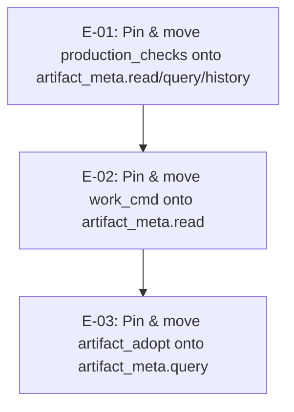

# IPD: Move the production_checks, work_cmd and artifact_adopt reads onto artifact_meta

- Date: 2026-11-09
- Kind: child
- Concern: Split from `2zpw22` (Order 36) in round 3 of the metastore re-split, per research `nj8zdp` guidance: `2zpw22` E-02 named 13 distinct units in one item. Spec `4sd62s` C5a requires every record module to read metadata through the cache. Measured 2026-11-07 at `ac76110f4`: `production_checks` reads through five module-level `^-` regexes and `backlog.parse_item` (28 sites in 11 functions), `work_cmd` through `_plan_id6`/`_plan_status` (16 in 11), and `artifact_adopt` through `_BULLET_ID_RE` (5 in 2).
- Scope: The production-check, work and adoption subset of `2zpw22` E-02, carried unchanged and divided into one item per module. EXCLUDES: the review findings, audit and reviews modules (`y4spqy`); the review sequence, tier, re-review and orchestrator readiness modules (`0i0zsg`); the residual audit (kept in `2zpw22`).
- Scope-Paths: agent_workflows/production_checks.py, agent_workflows/work_cmd.py, agent_workflows/artifact_adopt.py, tests/test_readers_review_modules.py, .aw/records/plans/pending/20261109-metastore-154-awmsyq-move-the-production-checks-work-cmd-and-artifact-adopt-reads.ipd.md
- Item-Dependencies: executed:ffceq0, executed:g5hpbb, executed:h58z9n, executed:tve77h, executed:xexn45, executed:0i0zsg
- Status: executed
- Readiness: go-pending-approval
- Review-Depth: complex
- From-Spec: 4sd62s
- Work-Kind: feature
- Priority: high
- Blocks-Release: next
- Set: metastore
- Order: 154
- Highest E allocated: 03
- Author: opencode its_direct/pt3-claude-opus-5.5-1m-us
- Id: awmsyq

> Written to .aw/system/workflows/technical-writing/technical-writing.md. Every obligation, exact identifier, quotation, evidence record, and lifecycle status is preserved.

## Workflow history
- 2026-11-23 executed (aw agy run model=Gemini-4-Neon-High): aw agy run self-finalize: awmsyq verified (set metastore, attempt 1).
- 2026-11-16 approved (aw set): status set to approved

- 2026-11-14 reviewed (aw set): APPROVE WITH REVISIONS APPLIED; PR-001..PR-008 FIXED
- 2026-11-14 /plan-review (antigravity/gemini): APPROVE WITH REVISIONS APPLIED; PR-001..PR-008 FIXED; review record .aw/records/reviews/20261109-metastore-154-awmsyq-move-the-production-checks-work-cmd-and-artifact-adopt-reads.review.md
- 2026-11-09 to-review (opencode its_direct/pt3-claude-opus-5.5-1m-us): split from 2zpw22 (round 3, research nj8zdp guidance).
- 2026-11-09 draft (opencode its_direct/pt3-claude-opus-5.5-1m-us): created.

## Goal

`production_checks`, `work_cmd` and `artifact_adopt` read record metadata only through `artifact_meta.read`/`query`/`history`, each move pinned before and after, with no `^-` metadata regex left in the three modules.

## Detailed Implementation Checklist (TODO)

Execution-state rule: mark an `E-*` item complete only after performing the action. That mark is not validation. Right-sizing rule: write for a modest executor that cannot hold much in its head. Each E-item is one step (one concern, about one file, executable in one focused pass) and its V-item names each unit it covers with its own check; a plan stays at about 5 E-items and 8 work Scope-Paths, else split it into more child plans (guidance, `IPD-Z603`). Accepted execution states: blocked, failed, pending, performed; terminal gate demands 'performed'.

The pin-first rule of `ffceq0` applies (carried from `t4gl15` through `2zpw22`): BEFORE the edit, a behavioral test pins the reader's current observable behavior and runs green on the unmodified code; AFTER the edit, the same test runs unchanged except where a decision copied below names it. Save each item's per-test outcome list under the gitignored `.aw/state/t4gl15/` (`mkdir -p .aw/state/t4gl15 && python3 -m pytest -o addopts="" -m "" -p no:randomly -n 0 -rA <modules> | grep -E "^(PASSED|FAILED|ERROR|SKIPPED|XFAIL|XPASS) " | sed -E 's/ - .*//' | sort > .aw/state/t4gl15/<file>`) before the move and into the matching after file after it. Run a new module's `-k` selection as its own command. Tests go in `tests/test_readers_review_modules.py` (created by `y4spqy`); none reads production source.

Commit through `aw commit awmsyq -- <each changed path>`, one commit per item allowed, never `git add -A`, a bare `git add` or `git commit -a`. Never push.

### Task group 1: production, work and adoption modules

- [x] E-01 (carried from `2zpw22` E-02, `production_checks` subset) Pin, then move, `production_checks` (`_PLAN_ID_RE`, `_ITEM_DEPS_RE`, `_SCOPE_PATHS_RE`, `_ITEM_FROM_BACKLOG_RE`, `_SET_RE`, `parse_item`, the history clause) onto `artifact_meta.read`/`query`/`history`. Most of its 11 reader functions read through the module-level regexes and the shared helpers `_extract_plan_id`/`_read_from_backlog`, so the edits concentrate there. Pin in `tests/test_readers_review_modules.py` and run `tests/test_production_checks_trace.py` and `tests/test_backlog_production.py` green before and after (outcome lists `E-12c-before.txt`/`E-12c-after.txt`).
  - Depends on: none
  - Expected outcome: both modules pass before and after; `production_checks` contains no `^-` metadata regex call.
  - Execution state: performed

- [x] E-02 (carried from `2zpw22` E-02, `work_cmd` subset) Pin, then move, `work_cmd` (`_plan_id6`, `_plan_status`, and the `- Date:` regex read in `_warn_if_begin_skipped`) onto `artifact_meta.read`; its 11 reader functions read through those helpers. Pin in `tests/test_readers_review_modules.py` and run `tests/test_scope_match.py` green before and after (outcome lists `E-12d-before.txt`/`E-12d-after.txt`).
  - Depends on: E-01
  - Expected outcome: the module passes before and after; `work_cmd` contains no `^-` metadata regex call.
  - Execution state: performed

- [x] E-03 (carried from `2zpw22` E-02, `artifact_adopt` subset) Pin, then move, `artifact_adopt` (`_BULLET_ID_RE` in the adoption id inventory) onto `artifact_meta.query` (D-3: the bullet `- Id:` inventory reads the cached `id` for plans, specs, backlog and releases). Pin in `tests/test_readers_review_modules.py` and run `tests/test_artifact_adopt.py` and `tests/test_id6_global_mint.py` green before and after (outcome lists `E-12e-before.txt`/`E-12e-after.txt`).
  - Depends on: E-02
  - Expected outcome: the module passes before and after; `artifact_adopt` contains no `^-` metadata regex call.
  - Execution state: performed

Add further leaves as `- [ ] E-NEW <action>` and run `aw ipd sync` to assign ids.

## Project conventions discovered (Step 0)

Carried from `2zpw22` Step 0:

- Interface names: `artifact_meta.read(id6) -> State`, `artifact_meta.history(id6)`, `artifact_meta.query(...)`, from `tve77h`; decision D-1 from `ffceq0`.
- Cite code by SYMBOL (`module.function`), never a bare line number (advisory `IPD-C801`).

## Findings

Carried from `2zpw22` (measured 2026-11-07 at `ac76110f4`):

| Id | Evidence | Finding |
|---|---|---|
| F-02 | AST pass over `rg` hits of each module's reader symbols (`_PLAN_ID_RE`, `_ITEM_DEPS_RE`, `_SCOPE_PATHS_RE`, `_ITEM_FROM_BACKLOG_RE`, `_SET_RE`, `parse_item(`, `_plan_id6(`, `_plan_status(`, `_warn_if_begin_skipped` date read, `_BULLET_ID_RE`, plus the `^-` regex pattern): `production_checks` 28 sites in 11 functions, `work_cmd` 17 in 11, `artifact_adopt` 5 in 2 | 22 of the 36 `2zpw22` E-02 sites go through helper functions (`2zpw22` OQ-01), which is why each module is one step. |

Size (round 3): measured with `ipd_schema.count_named_units`, each item names at most 4 distinct units; 4 work Scope-Paths.

READER LEDGER (this part's subset of the `2zpw22` row, copied from `t4gl15`):

| Reader | Prior behavior | Pinning test | After |
|---|---|---|---|
| `production_checks`, `work_cmd`, `artifact_adopt` | module-local regex reads | `tests/test_production_checks_trace.py`, `tests/test_backlog_production.py`, `tests/test_scope_match.py`, `tests/test_artifact_adopt.py` | cached fields |

DECISIONS (copied from `t4gl15` through `2zpw22`, whose text is authoritative): D-1 PLAN records return the canonical normalized status; every other type keeps its raw single-token status. D-3 the bullet `- Id:` inventory of `artifact_adopt` reads the cached `id` for plans, specs, backlog and releases, so each consumer gets the answer it gets today.

## Proposed changes (ordered, validatable)

1. Pin then move `production_checks` (E-01), `work_cmd` (E-02), `artifact_adopt` (E-03).

## Deferred / out of scope (with reason)

- The residual audit of these modules.
  - Carrier: 2zpw22
- Deleting the module-level regexes.
  - Carrier: 9o83cr

## Scope check

- Over-scope: none.
- Under-scope: none known. This part carries the production-check, work and adoption subset of `2zpw22` E-02 unchanged; with `0i0zsg` it equals the original list.

## Required tests / validation

Tests added to `tests/test_readers_review_modules.py` (core). Commands: every module named in E-01 to E-03, the bare core gate `python3 -m pytest`.

## Spec / documentation sync

No spec change. Implements the production-check, work and adoption part of `4sd62s` C5a.

## Open questions

### OQ-01: What if a module's helper-based count is wrong?

- Blocking: no
- Status: resolved
- Owner: plan author
- Resolution or deferral rationale: Carried from `2zpw22` OQ-01: if execution finds that `production_checks` or `work_cmd` reads metadata at many sites outside its helpers, the executor records the count and moves the excess to a new plan rather than growing the item. Recommendation strength: medium.

## Validation and cross-check (verify before reporting done)

Validation-state rule: inspect evidence in a separate pass. Do not mark a `V-*` item complete from memory or from the matching execution checkmark. Accepted validation results: blocked, failed, pass, pending; terminal gate demands 'pass'. Runtime-demonstration reachability rule: for each `V-*` item demanding the software be observed acting (such as a run, a dispatch, or a transition), as distinct from items demanding a diff, a file's content, or a test result, which are reachable by construction, name the code path that produces the observation or the sibling `E-*` that creates it, else the demand is UNDER-SCOPE.

- [x] V-01 validates E-01
  - Required evidence: paste `diff .aw/state/t4gl15/E-12c-before.txt .aw/state/t4gl15/E-12c-after.txt` (outcome lists of `tests/test_production_checks_trace.py tests/test_backlog_production.py`) printing nothing, `python3 -m pytest -o addopts="" -v tests/test_readers_review_modules.py -k production` all PASSED, and the empty output of `rg -n "re\.\w+\(\s*r?[\"'](\(\?m\))?\^-" agent_workflows/production_checks.py`.
  - Observed evidence: `diff .aw/state/t4gl15/E-12c-before.txt .aw/state/t4gl15/E-12c-after.txt` exited 0 with empty output (45/45 baseline outcomes PASSED before and after across `tests/test_production_checks_trace.py` and `tests/test_backlog_production.py`). `python3 -m pytest -o addopts="" -v tests/test_readers_review_modules.py -k production` ran green before (3 passed in 2.44s) and after: `TestProductionChecksReaders::test_production_checks_spec_count_conformance_gate_and_trace PASSED`, `TestProductionChecksReaders::test_production_checks_backlog_verifiers_and_history_legitimacy PASSED`, `TestProductionChecksReaders::test_production_checks_handoff_and_helper_readers PASSED` (`3 passed, 22 deselected in 2.24s`). `rg -n "re\.\w+\(\s*r?[\"'](\(\?m\))?\^-" agent_workflows/production_checks.py` printed nothing (exit 1, zero matches). Additional suites (`test_from_backlog_cardinality.py`, `test_production_set_check.py`, `test_production_resume_handoff.py`, `test_implementing_spec_replan.py`, `test_backlog_already_complete.py`, `test_spec_production.py`): `75 passed in 24.71s`.
  - Result: pass

- [x] V-02 validates E-02
  - Required evidence: paste `diff .aw/state/t4gl15/E-12d-before.txt .aw/state/t4gl15/E-12d-after.txt` (outcome list of `tests/test_scope_match.py`) printing nothing, `python3 -m pytest -o addopts="" -v tests/test_readers_review_modules.py -k work` all PASSED, and the empty output of `rg -n "re\.\w+\(\s*r?[\"'](\(\?m\))?\^-" agent_workflows/work_cmd.py`.
  - Observed evidence: `diff .aw/state/t4gl15/E-12d-before.txt .aw/state/t4gl15/E-12d-after.txt` exited 0 with empty output (6/6 baseline outcomes PASSED before and after in `tests/test_scope_match.py`). `python3 -m pytest -o addopts="" -v tests/test_readers_review_modules.py -k work` ran green before (2 passed in 1.65s) and after: `TestWorkCmdReaders::test_work_cmd_warn_if_begin_skipped_and_commit_flow PASSED`, `TestWorkCmdReaders::test_work_cmd_plan_helpers_and_default_commit_message PASSED` (`2 passed, 25 deselected in 1.59s`). `rg -n "re\.\w+\(\s*r?[\"'](\(\?m\))?\^-" agent_workflows/work_cmd.py` printed nothing (exit 1, zero matches). Additional suites (`test_commit_default_message.py`, `test_commit_scope_reason.py`, `test_commit_run_trailers_env.py`, `test_scope_exceeded.py`, `test_clean_target_control_state.py`, `test_companion_containment_and_storage.py`): `48 passed in 12.88s`.
  - Result: pass

- [x] V-03 validates E-03
  - Required evidence: paste `diff .aw/state/t4gl15/E-12e-before.txt .aw/state/t4gl15/E-12e-after.txt` (outcome list of `tests/test_artifact_adopt.py` and `tests/test_id6_global_mint.py`) printing nothing, `python3 -m pytest -o addopts="" -v tests/test_readers_review_modules.py -k adopt` all PASSED, and the empty output of `rg -n "re\.\w+\(\s*r?[\"'](\(\?m\))?\^-" agent_workflows/artifact_adopt.py`.
  - Observed evidence: `diff .aw/state/t4gl15/E-12e-before.txt .aw/state/t4gl15/E-12e-after.txt` exited 0 with empty output (41/41 baseline outcomes PASSED before and after across `tests/test_artifact_adopt.py` and `tests/test_id6_global_mint.py`). `python3 -m pytest -o addopts="" -v tests/test_readers_review_modules.py -k adopt` ran green before (2 passed in 1.83s) and after: `TestArtifactAdoptReaders::test_adopt_scan_identities_and_collision_guard PASSED`, `TestArtifactAdoptReaders::test_adopt_repository_id6s_reads_cached_types_and_preserves_quoted_superset PASSED` (`2 passed, 27 deselected in 1.79s`). `rg -n "re\.\w+\(\s*r?[\"'](\(\?m\))?\^-" agent_workflows/artifact_adopt.py` printed nothing (exit 1, zero matches). Combined `tests/test_readers_review_modules.py`, `tests/test_artifact_meta_shapes.py`, and `tests/test_m0001_renames.py`: `52 passed in 4.91s`. Core gate `aw suite`: `2760 passed, 1 skipped, 11 warnings in 170.28s (0:02:50)`. `aw sanitize --agent`: `{"schema":"aw.agent/v1","kind":"result","cmd":"check-local-leaks","outcome":"clean","exit":0,"verified":true,"complete":true,"checked":7089,"findings":0,"evidence":["leak-scan"],"next":null}`.
  - Result: pass

## Approval and execution gate

- Size assessment: standard
- Cohesion rationale: not required

Execute only after human approval (`Status: approved`) and after every `- Item-Dependencies:` edge is executed.

Safety rule: uncommitted changes and untracked files you did not create are not yours; never revert, stage, commit, discard, reformat, or "clean up" another party's work.

Scope fence: the paths in `- Scope-Paths:` are a declaration; a needed file outside the fence is edited and then justified at finalize (`--scope-reason`), and a declared path left unmodified is acknowledged (`--scope-ack`). Every reader move is pin-first.

Honesty rule: run the named modules and `python3 -m pytest` (core gate), and paste the ACTUAL summary lines; never claim a result you did not run.

Commits: commit only through `aw commit awmsyq -- <paths>`; never `git add -A`, a bare `git add` or `git commit -a`; never push.

Lifecycle transition: the plan moves to `.aw/records/plans/executed/` only through `aw ipd finalize awmsyq` (never a hand git mv), and only after `aw ipd lint --phase pre-transition` conforms and every `V-*` reads `pass` with pasted evidence. When aw oc run or aw agy run executes the plan, the runner performs the finalize; a hand executor runs aw ipd finalize awmsyq itself.
