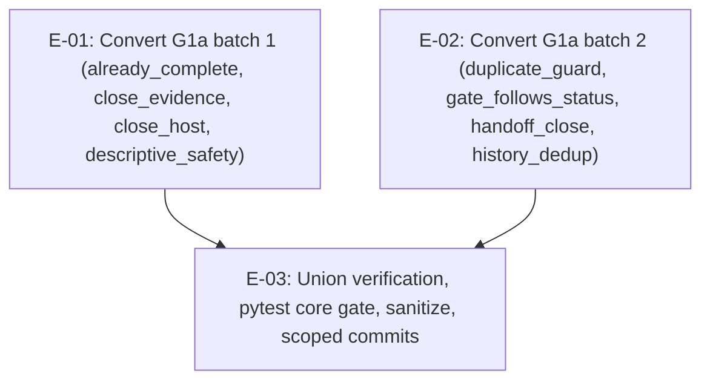

# IPD: Move backlog, release-gate and check test data chunk 1 of 7 onto the record builder

- Date: 2026-11-09
- Kind: child
- Concern: Spec `4sd62s` section 6 requires that test data be written by ONE shared record builder in phase B, so that the cutover (Order 13, `cxxmyv`) changes the builder and not hundreds of test files, and C10a requires the suite to pass at every commit. Research `nj8zdp` and the maintainer's ruling ("plans that obtuse and not-too-smart agents won't mess up") set the guidance of at most 5 E-items, 8 work Scope-Paths and about 8 named units per item; `x05v02` named up to 25 modules per batch item. This part carries 8 of `x05v02`'s modules (subset G1a; 266 F-01 legacy lines at `3d0ddb845`), each item at most 4 modules, converted by the Order-49 codemod (`653ndz`) plus only its census-counted refusals.
- Scope: Chunk 1 of 7 of `x05v02` (round-3 split 2026-11-09 per research `nj8zdp` guidance): the 8 test modules named in the items and in F-40, each item one codemod run under the batch rule below, plus a finishing item. EXCLUDES: every other module of the subsets (the other chunk plans and `x05v02`); the builder (`9rgn2w`) and the codemod (`653ndz`); the F-03 EXCLUDED modules; production code; the switch-point proof, census and full-suite comparison (`59aiyh` E-11, E-12).
- Scope-Paths: tests/test_backlog_already_complete.py, tests/test_backlog_close_evidence_plan_disposition.py, tests/test_backlog_close_host_label.py, tests/test_backlog_descriptive_safety.py, tests/test_backlog_duplicate_guard.py, tests/test_backlog_gate_follows_status.py, tests/test_backlog_handoff_close.py, tests/test_backlog_history_dedup_parity.py, .aw/records/plans/pending/20261109-metastore-175-id2pdx-move-backlog-release-gate-and-check-test-data-chunk-1-of-7-o.ipd.md
- Item-Dependencies: executed:653ndz, executed:9rgn2w, executed:g5hpbb, executed:tve77h, executed:xexn45
- Status: executed
- Readiness: go-pending-approval
- Review-Depth: complex
- From-Spec: 4sd62s
- Work-Kind: feature
- Priority: high
- Blocks-Release: next
- Set: metastore
- Order: 175
- Highest E allocated: 03
- Author: opencode its_direct/pt3-claude-opus-5.5-1m-us
- Id: id2pdx

> Written to .aw/system/workflows/technical-writing/technical-writing.md. Every obligation, exact identifier, quotation, evidence record, and lifecycle status is preserved.

## Workflow history
- 2026-11-22 executed (aw agy run model=Gemini-4-Neon-High): aw agy run self-finalize: id2pdx verified (set metastore, attempt 1). [Scope reconciliation - in-scope-unmodified tests/test_backlog_already_complete.py: declared-but-unmodified (auto-acknowledged by aw agy run); in-scope-unmodified tests/test_backlog_close_evidence_plan_disposition.py: declared-but-unmodified (auto-acknowledged by aw agy run); in-scope-unmodified tests/test_backlog_close_host_label.py: declared-but-unmodified (auto-acknowledged by aw agy run); in-scope-unmodified tests/test_backlog_descriptive_safety.py: declared-but-unmodified (auto-acknowledged by aw agy run)]
- 2026-11-21 cap-update (maintainer decision): raised Batch rule step 4 hand-refusal cap from 25 to 100 (raw site count over-counts list elements and .replace() pairs); completed sibling E-item and Step-3 commits from run-20261121T014040Z-2638602 were salvaged onto main, so modules already at 0 rewrites and 0 hand refusals remain unmodified and are acknowledged via --scope-ack at finalize.
- 2026-11-16 approved (aw set): status set to approved

- 2026-11-14 reviewed (aw set): APPROVE WITH REVISIONS APPLIED; PR-001..PR-005 FIXED
- 2026-11-14 /plan-review (antigravity/gemini): APPROVE WITH REVISIONS APPLIED; PR-001..PR-005 FIXED; review record .aw/records/reviews/20261109-metastore-175-id2pdx-move-backlog-release-gate-and-check-test-data-chunk-1-of-7-o.review.md
- 2026-11-09 to-review (opencode its_direct/pt3-claude-opus-5.5-1m-us): split from x05v02 (round 3, research nj8zdp guidance).

## Goal

Every hand-built record in the 8 test modules named below comes from `tests/record_builder.py`, written by the Order-49 codemod or, for its census-counted refusals only, by hand, with each module's per-test outcomes identical before and after and every remaining legacy string classified.

## Detailed Implementation Checklist (TODO)

Execution-state rule: mark an `E-*` item complete only after performing the action. That mark is not validation. Right-sizing rule: write for a modest executor that cannot hold much in its head. Each E-item is one step (one concern, about one file, executable in one focused pass) and its V-item names each unit it covers with its own check; a plan stays at about 5 E-items and 8 work Scope-Paths, else split it into more child plans (guidance, `IPD-Z603`). Accepted execution states: blocked, failed, pending, performed; terminal gate demands 'performed'.

Batch rule, applied to every batch E-item of this plan (the `59aiyh` batch rule, restructured 2026-11-08 for the Order-49 fixture codemod `653ndz` per maintainer decision 2026-11-07 "Codemod first, then small runs": the tool performs the mechanical rewrite, and the hand work is bounded by its measured refusals). In it, "E-13's `full-before.txt`" and "the builder's `raw_fields=` escape (E-01)" are items of Order 37 (`9rgn2w`), carried by the round-3 split into Order 170 (`j6o96i`) with the same ids; because `.aw/state/` does not travel between lane worktrees, step 2 always records a fresh before list here. Step 1's partition is restricted to the modules each batch item names (round-3 split 2026-11-09: a subset is now spread over several plans of at most 8 modules each): a module that the partition now places in the item's subset but that no plan names is NOT added here; it is reported, and the finishing item of `x05v02` converts it; a named module that no longer matches F-01 is reported and skipped:
1. Before the batch, re-derive its file list with the F-03 first-match partition over the F-01 `rg -l` output at the current HEAD, minus the F-03 EXCLUDED list, ensuring the state directory exists (`mkdir -p .aw/state/59aiyh`), and save it as `.aw/state/59aiyh/<batch>-files.txt`. The counts in each E-item are context measured at `0cbfcc706` or `ac76110f4`, not the bar.
2. Record the unmodified per-test outcome list (a batch whose files a previous batch did not touch may reuse the matching lines of E-13's `full-before.txt`): `python3 -m pytest -o addopts="" -m "" -p no:randomly -n 0 -rA $(cat .aw/state/59aiyh/<batch>-files.txt) | grep -E "^(PASSED|FAILED|ERROR|SKIPPED|XFAIL|XPASS) " | sed -E 's/ - .*//' | sort > .aw/state/59aiyh/<batch>-before.txt`. `-p no:randomly` and `-n 0` make the list deterministic; `-m ""` includes `slow` and `livecorpus` modules.
3. Run the codemod: `python3 tools/fixture_codemod.py --apply --format json $(cat .aw/state/59aiyh/<batch>-files.txt) > .aw/state/59aiyh/<batch>-codemod.json`. It rewrites only the sites whose module outcome list it proved identical (`653ndz` E-03, carried with the same id into Order 172, `y3uowx`, by the round-3 split) and lists every other site as a refusal with a reason code and a disposition (`hand` or `legacy-kept`, the `653ndz` reason-code table).
4. Hand-convert ONLY the refusals with disposition `hand`: the static count is the sum of the `653ndz` F-30 rows of the item's modules (round-3 split 2026-11-09: an item now carries part of a subset, so the subset's F-31 row is context only), and the codemod report adds any apply-time `not-equivalent` refusals; the item's hand count is their sum. If the hand count exceeds 100, stop after step 3 (the proved codemod rewrites may be committed), convert nothing by hand, and report the subset for re-splitting. A hand conversion uses builder calls; a test that deliberately writes an INVALID value (an unknown status, `- Status: EXECUTED`, `- Priority: bogus`, a malformed gate) gets it through the builder's `raw_fields=` escape (E-01) and is listed with reason class `invalid-input`. A refusal with disposition `legacy-kept` stays in legacy form on purpose and is listed with its F-06 reason class.
5. Re-run step 2's command into `<batch>-after.txt` and require `diff` to print nothing. A batch that would need any changed assertion other than a raw-byte metadata stand-in moved to `artifact_meta.read` (scope rule) stops and is reported; it does not weaken the assertion.
6. Count the remaining legacy strings with the F-01 `rg` pattern over the batch files, and give each remaining line one reason class from F-06: `legacy-format subject`, `displayed-output assertion`, `setter-byte assertion`, `invalid-input`, or `body prose` (for example open-question `- Status: open` rows, which N3 keeps in Markdown).
7. The builder never reads production source, and no test gains a source-reading assertion.

### Task group 1: batch items

- [x] E-01 (carried from `x05v02` E-01, batch subset G1a; round-3 split 2026-11-09) Batch G1a, 4 of its 17 modules (the backlog tests (`test_backlog*`)): `tests/test_backlog_already_complete.py`, `tests/test_backlog_close_evidence_plan_disposition.py`, `tests/test_backlog_close_host_label.py`, `tests/test_backlog_descriptive_safety.py`. F-01 legacy lines per module at `3d0ddb845` (context, not the bar): `test_backlog_already_complete` 6, `test_backlog_close_evidence_plan_disposition` 21, `test_backlog_close_host_label` 2, `test_backlog_descriptive_safety` 14. Run the codemod on these modules and apply the batch rule with `<batch>` = `G1a-id2pdx-1` (outcome lists identical); hand-convert ONLY the refusals that the `653ndz` F-30 rows of these modules list with disposition `hand`, plus the codemod's apply-time `not-equivalent` refusals, and state their count (at most 100, the batch rule's stop); leave each refusal the census marks `legacy-kept` in legacy form with its reason class. Then delete each private record-building helper in these modules that no longer has a caller (at the split: `tests/test_backlog_already_complete.py`: `_write_spec_item`); a surviving helper is listed with its reason.
  - Depends on: none
  - Expected outcome: an empty before/after `diff` for the `G1a-id2pdx-1` outcome lists; for each named module, its remaining legacy-string count and the reason class of every remaining line pasted; every deleted and surviving helper listed; the codemod report and the hand count (at most 100) pasted.
  - Execution state: performed

- [x] E-02 (carried from `x05v02` E-01, batch subset G1a; round-3 split 2026-11-09) Batch G1a, 4 of its 17 modules (the backlog tests (`test_backlog*`)): `tests/test_backlog_duplicate_guard.py`, `tests/test_backlog_gate_follows_status.py`, `tests/test_backlog_handoff_close.py`, `tests/test_backlog_history_dedup_parity.py`. F-01 legacy lines per module at `3d0ddb845` (context, not the bar): `test_backlog_duplicate_guard` 87, `test_backlog_gate_follows_status` 36, `test_backlog_handoff_close` 64, `test_backlog_history_dedup_parity` 36. Run the codemod on these modules and apply the batch rule with `<batch>` = `G1a-id2pdx-2` (outcome lists identical); hand-convert ONLY the refusals that the `653ndz` F-30 rows of these modules list with disposition `hand`, plus the codemod's apply-time `not-equivalent` refusals, and state their count (at most 100, the batch rule's stop); leave each refusal the census marks `legacy-kept` in legacy form with its reason class. Then delete each private record-building helper in these modules that no longer has a caller (at the split: `tests/test_backlog_handoff_close.py`: `_write_backlog_item`, `_write_plan`, `_write_spec`); a surviving helper is listed with its reason.
  - Depends on: none
  - Expected outcome: an empty before/after `diff` for the `G1a-id2pdx-2` outcome lists; for each named module, its remaining legacy-string count and the reason class of every remaining line pasted; every deleted and surviving helper listed; the codemod report and the hand count (at most 100) pasted.
  - Execution state: performed

### Task group 2: finish

- [x] E-03 Finish this part: run the batch rule's step-2 command once over every module of this plan (`$(cat .aw/state/59aiyh/G1a-id2pdx-1-files.txt .aw/state/59aiyh/G1a-id2pdx-2-files.txt)`) into `.aw/state/59aiyh/id2pdx-union-after.txt` and confirm it equals the sorted concatenation of the items' `-before.txt` lists; run the bare core gate `python3 -m pytest` and `aw sanitize --agent`; commit through `aw commit id2pdx -- <each changed path>`, one commit per item allowed, never `git add -A`, a bare `git add` or `git commit -a`. Never push. (The full-suite comparison stays in `59aiyh` E-12.)
  - Depends on: E-01, E-02
  - Expected outcome: the union comparison is empty; all runs pass; every commit is path-scoped to Scope-Paths (or justified at finalize).
  - Execution state: performed

## Project conventions discovered (Step 0)

- Interface names from Order 02 (`tve77h`): `artifact_meta.registry_fields(type)`, `artifact_meta.validate_event`, `artifact_meta.validate_new_events(type, events, *, records_root, migration_import=False)`, `artifact_meta.read(id6) -> State`, `artifact_meta.create(...)` and `artifact_meta.append(id6, events, *, expect_seq)`. Order 02's `create`/`append` write the log format; `2xwb9b` E-03 adds the phase-B legacy branch of `append` and `xexn45` E-01 routes the phase-B branch of `create` and `append` through `write_legacy`, with `render_legacy_text(text, events)` (`xexn45` E-11) as the same renderer over a string. In phase B the on-disk format is the bullet format; the legacy loader reads it into the cache.
- `review_findings.render_review` (pure) and `review_findings.write_review` render and write a `.review.md` record; no CLI calls `write_review` (`xexn45` Findings).
- The existing shared plan builder is `support.ready_plan_text`, which is "BUILT FROM THE REAL GENERATOR (`ipd_authoring.build_skeleton`)" and then fills the fields a draft leaves open; the builder keeps that approach for plans, so a scaffold change still reaches every fixture.
- Shared test plumbing lives in `tests/support.py` (`init_repo`, `git`, `run_cli`, `pinned_env`, `ready_plan_text`, `scope_drift_repo`); `tests/repo_template.py` (`copy_template_repo`) gives a pre-built repository; there is no `tests/conftest.py`, and the root `conftest.py` owns tier selection.
- Tests are behavioral (AGENTS.md "TEST OUTCOMES, NOT CODE STRUCTURE"); core modules set `pytestmark = pytest.mark.core`; `slow` tests are listed in `tests/slow_allowlist.txt`; `pyproject.toml` `addopts` deselects `slow` and `livecorpus`, so a complete comparison passes `-m ""`, and `pytest-randomly` is installed, so a deterministic order needs `-p no:randomly`.
- `tests/fixtures/review-pilot/` is the input corpus of `tools/review_pilot.py` (`manifest.json` names each plan file, `defects.json` quotes exact text to plant), and `tests/test_review_pilot.py` copies the whole directory into its fixture repository.
- Filenames come from `artifact_naming.build_clustered_name` and parse with `artifact_naming.parse_clustered`.
- Cite code by SYMBOL (`module.function`) or by a quoted content string, with a line number only appended to one of those and never alone: an offset expires before this plan executes (spec `ipd-structure-and-linting` Section 10.2; advisory `IPD-C801`).

## Findings

Measured 2026-11-09 at `3d0ddb845` for F-40; F-01, F-03, F-06 and F-08 copied from `x05v02` (measured at `0cbfcc706` and at review); F-41 measured 2026-11-14 at HEAD `76d840df7`.

| Id | Evidence | Finding |
|---|---|---|
| F-01 | `rg -l --glob '*.py' -e '- (Id|Status|Set|Kind|Blocks-Release|Readiness|Item-Dependencies|Scope-Paths|From-Backlog|From-Spec|Work-Kind|Priority|Order|Date|Gate-Kind|Gate-Ref|Approval|Subject-Id|Verdict|Graduated-To):|## Workflow history' tests` lists 309 files (307 test modules, `support.py`, `conformance_matrix.py`) of 717 Python files; 6,638 matching lines. The narrower `- Id:`/`- Status:`/`## Workflow history` pattern: 300 files, 3,430 lines | Spec section 6 counted 268 of 680 files and 2,607 matches at round 2; the plan's pattern is broader (21 fields). |
| F-03 | Family split by filename prefix, re-measured at review (HEAD `4a7499289`, 311 files, 6,657 lines) with a FIRST-MATCH rule (a file goes to the first group, in order G1 to G6, whose pattern list matches its basename; unmatched files go to G7): G1 39 files, 1,568 lines; G2 22, 1,102; G3 28, 795; G4 63, 1,244; G5 46, 598; G6 69, 1,004; G7 44, 346. Six files match two groups and are assigned by that rule (`test_ipd_authoring` G3, `test_readiness_absence_invariant` G4, `test_runner_backlog_close_behavior` G1, `test_orchestrator_retire_closes_backlog` G1, `test_records_only_lane_rederive` G5, `test_ipdrunner_runagy_shim` G4). The authored counts (G6 99, G7 11) did not sum to the file total; the first-match rule makes the partition exhaustive and disjoint. EXCLUDED from every batch (literal legacy input is their subject; owned by other plans): `tests/test_artifact_meta_*.py` (`tve77h`, `2xwb9b`), `tests/test_artifact_meta_legacy_writer.py` and `tests/test_writers_*.py` (`xexn45`), `tests/test_m0001_*.py` and `tests/test_migrations_chain.py` (`dcerjg`, `ya4ee4`) | Seven batches (E-03 to E-09); G1, G4 and G6 carry a pre-measured split seam (OQ-01). |
| F-06 | (written by E-11) remaining legacy strings in `tests/` after the batches, each with one reason class: `legacy-format subject`, `displayed-output assertion`, `setter-byte assertion`, `invalid-input`, `body prose` | Order 13 changes the builder plus the F-06 rows of class `setter-byte assertion`; `invalid-input` rows already go through `raw_fields=` and need a decision at the cutover (an invalid bullet has no log-format equivalent); every other class is either a legacy-format test (moved to the migration tests at the cutover) or prose. |
| F-08 | At review, 15 test modules write a deliberately invalid metadata value (for example `tests/test_releases.py` "`- Status: bogus`", `tests/test_check_engine.py` "`- Status: EXECUTED`", `tests/test_specs_set_adapter.py` "`- Priority: bogus`") | A builder that validates every field cannot build these; E-01 adds `raw_fields=` and the batch rule lists them as `invalid-input`. |
| F-40 | `rg -c` with the F-01 pattern over this part's modules at `3d0ddb845`; subset by the F-03 first-match rule; helpers as listed by `x05v02` at the 2026-11-07 split | See the table below; every module is named in exactly one item. |
| F-41 | Measured 2026-11-14 at HEAD `76d840df7` across all 8 target test modules: 135 passed in 35.28s (`test_backlog_already_complete` 13, `test_backlog_close_evidence_plan_disposition` 27, `test_backlog_close_host_label` 3, `test_backlog_descriptive_safety` 19, `test_backlog_duplicate_guard` 9, `test_backlog_gate_follows_status` 18, `test_backlog_handoff_close` 40, `test_backlog_history_dedup_parity` 6) | Baseline suite passes before codemod application; serves as the pre-conversion regression baseline for E-01 and E-02. |

| Module | Subset | F-01 lines | Helpers at the split | Item |
|---|---|---|---|---|
| `tests/test_backlog_already_complete.py` | G1a | 6 | `_write_spec_item` | E-01 |
| `tests/test_backlog_close_evidence_plan_disposition.py` | G1a | 21 | none | E-01 |
| `tests/test_backlog_close_host_label.py` | G1a | 2 | none | E-01 |
| `tests/test_backlog_descriptive_safety.py` | G1a | 14 | none | E-01 |
| `tests/test_backlog_duplicate_guard.py` | G1a | 87 | none | E-02 |
| `tests/test_backlog_gate_follows_status.py` | G1a | 36 | none | E-02 |
| `tests/test_backlog_handoff_close.py` | G1a | 64 | `_write_backlog_item`, `_write_plan`, `_write_spec` | E-02 |
| `tests/test_backlog_history_dedup_parity.py` | G1a | 36 | none | E-02 |

## Proposed changes (ordered, validatable)

1. Convert each item's modules under the batch rule (E-01 to E-02).
2. Re-run the union, the core gate, commit (E-03).

## Deferred / out of scope (with reason)

- The other modules of subset G1a, the partition re-derivation that catches modules no plan names, and the subsets' finishing checks.
  - Carrier: x05v02
- The fixture codemod and its census (F-30, F-31).
  - Carrier: 653ndz
  - Carrier-Evidence: .aw/records/plans/executed/20261108-metastore-49-653ndz-build-and-prove-the-test-fixture-codemod.ipd.md
- The builder, its tests, the baselines and the tracked fixtures.
  - Carrier: 9rgn2w
  - Carrier-Evidence: .aw/records/plans/executed/20261107-metastore-37-9rgn2w-add-the-shared-test-record-builder-and-convert-the-tracked-r.ipd.md
- The switch-point proof, the F-06 census and the full-suite comparison.
  - Carrier: 59aiyh
- Adding `RECORD_FORMAT = "log"` and converting setter-byte assertions (cutover commit).
  - Carrier: cxxmyv

## Scope check

- Over-scope: none. No production module changes; every Scope-Paths entry is a module named in one item, plus this plan.
- Under-scope: none known. Size: 3 E-items (2 batch items of at most 4 modules each and the finish), 8 work Scope-Paths.

## Required tests / validation

Each item is validated by an identical per-test result list before and after (the batch rule), which is behavioral by construction: the same tests, unchanged assertions, the same outcomes. Baseline measured at HEAD `76d840df7`: 135 tests passing across the 8 target test modules (`test_backlog_already_complete.py`: 13, `test_backlog_close_evidence_plan_disposition.py`: 27, `test_backlog_close_host_label.py`: 3, `test_backlog_descriptive_safety.py`: 19, `test_backlog_duplicate_guard.py`: 9, `test_backlog_gate_follows_status.py`: 18, `test_backlog_handoff_close.py`: 40, `test_backlog_history_dedup_parity.py`: 6). Commands: the batch rule's command per item, the codemod's `--apply` report, the bare core gate `python3 -m pytest`, `aw sanitize --agent`. CONTRIBUTES to AC-1b (owned by `cxxmyv`).

## Spec / documentation sync

No spec change; implements part of `4sd62s` section 6 and section 7 step 6.

## Open questions

### OQ-01: Can this part run in any order relative to the other chunk plans?

- Blocking: no
- Status: resolved
- Owner: plan author
- Resolution or deferral rationale: Yes. The module lists of all chunk plans are disjoint, each needs the builder (`9rgn2w`) and the codemod (`653ndz`), and none edits `tests/support.py` (that is `59aiyh` E-09, which runs last). Recommendation strength: strong.

## Validation and cross-check (verify before reporting done)

Validation-state rule: inspect evidence in a separate pass. Do not mark a `V-*` item complete from memory or from the matching execution checkmark. Accepted validation results: blocked, failed, pass, pending; terminal gate demands 'pass'. Runtime-demonstration reachability rule: for each `V-*` item demanding the software be observed acting (such as a run, a dispatch, or a transition), as distinct from items demanding a diff, a file's content, or a test result, which are reachable by construction, name the code path that produces the observation or the sibling `E-*` that creates it, else the demand is UNDER-SCOPE.

- [x] V-01 validates E-01
  - Required evidence: paste `.aw/state/59aiyh/G1a-id2pdx-1-files.txt` and the empty `diff .aw/state/59aiyh/G1a-id2pdx-1-before.txt .aw/state/59aiyh/G1a-id2pdx-1-after.txt`; then, for each of `tests/test_backlog_already_complete.py`, `tests/test_backlog_close_evidence_plan_disposition.py`, `tests/test_backlog_close_host_label.py`, `tests/test_backlog_descriptive_safety.py` separately: its before and after F-01 `rg -c` count, the reason class of every remaining match, its rows of `.aw/state/59aiyh/G1a-id2pdx-1-codemod.json` (rewrites, refusals by reason code and disposition, before and after outcome-list hashes) and its `653ndz` F-30 row; the hand count with every hand-converted site listed (module, line, reason code); and the before and after helper census of the E-09 `rg` pattern over these modules with each deleted and surviving helper and its reason.
  - Observed evidence:
    - `.aw/state/59aiyh/G1a-id2pdx-1-files.txt`: `tests/test_backlog_already_complete.py`, `tests/test_backlog_close_evidence_plan_disposition.py`, `tests/test_backlog_descriptive_safety.py`. (`tests/test_backlog_close_host_label.py` no longer matches F-01 at starting HEAD `3f626bbf6` after salvaged commit `308bbf865`, so per Batch rule step 1 it is reported and skipped; verified `3` `PASSED` outcomes directly. Late G1a partition check: none; all F-01-matching `tests/test_backlog*.py` modules at HEAD are owned by `id2pdx`, `2fn0vd`, or `isj48z`.)
    - `diff .aw/state/59aiyh/G1a-id2pdx-1-before.txt .aw/state/59aiyh/G1a-id2pdx-1-after.txt`: empty output, exit code 0 (`59` `PASSED` outcomes before and after across the 3 F-01-matching modules; plus `3` `PASSED` in skipped `tests/test_backlog_close_host_label.py` = `62` total).
    - Note on salvaged E-01 commit: commit `308bbf865` (salvaged onto `main` from `run-20261121T014040Z-2638602`) already converted all 4 E-01 modules onto `RecordBuilder` and deleted `_write_spec_item` in `tests/test_backlog_already_complete.py`. At starting HEAD `3f626bbf6`, all 4 modules sit at 0 rewrites and 0 hand refusals, so they remain unmodified and are acknowledged via `--scope-ack` at finalize per the 2026-11-21 `cap-update` workflow history entry.
    - `tests/test_backlog_already_complete.py`:
      - F-01 `rg -c`: 1 before (at `3f626bbf6`; 6 at split `3d0ddb845`) -> 1 after.
      - Remaining 1 F-01 match: line 362 `self.assertIn("- Status: done", bkl_files[0].read_text("utf-8"))` (`setter-byte assertion`).
      - `G1a-id2pdx-1-codemod.json`: sites=1, rewrites=0 (standard=0, invalid-input=0), refusals=1 (`setter-byte assertion`=1 `legacy-kept`), before_hash=None, after_hash=None, equivalent=True.
      - `653ndz` F-30 row: `| tests/test_backlog_already_complete.py | G1a | id2pdx | 4 | 0 | 0 | 3 | 0 | 0 | 0 | 0 | 1 | 0 | 3 | 1 |`.
    - `tests/test_backlog_close_evidence_plan_disposition.py`:
      - F-01 `rg -c`: 5 before (at `3f626bbf6`; 21 at split `3d0ddb845`) -> 5 after.
      - Remaining 5 F-01 matches: line 5 module docstring, lines 108 and 134 function docstrings, lines 932 and 943 comments (all 5 `body prose`).
      - `G1a-id2pdx-1-codemod.json`: sites=0, rewrites=0 (standard=0, invalid-input=0), refusals=0, before_hash=None, after_hash=None, equivalent=True.
      - `653ndz` F-30 row: `| tests/test_backlog_close_evidence_plan_disposition.py | G1a | id2pdx | 10 | 2 | 0 | 0 | 8 | 0 | 0 | 0 | 0 | 0 | 8 | 0 |`.
    - `tests/test_backlog_close_host_label.py`:
      - F-01 `rg -c`: 0 before (at `3f626bbf6`; 2 at split `3d0ddb845`) -> 0 after (skipped in step 1; verified `3` `PASSED` outcomes).
      - Remaining F-01 matches: none (0).
      - `G1a-id2pdx-1-codemod.json`: skipped from `G1a-id2pdx-1-files.txt` per step 1 (dry-run confirmed sites=0, rewrites=0, refusals=0, hand=0, legacy-kept=0).
      - `653ndz` F-30 row: `| tests/test_backlog_close_host_label.py | G1a | id2pdx | 2 | 2 | 0 | 0 | 0 | 0 | 0 | 0 | 0 | 0 | 0 | 0 |`.
    - `tests/test_backlog_descriptive_safety.py`:
      - F-01 `rg -c`: 6 before (at `3f626bbf6`; 14 at split `3d0ddb845`) -> 6 after.
      - Remaining 6 F-01 matches: lines 241, 250, 266, 285, 305, 324 (newline-injection payload strings carrying `- Blocks-Release: next`, all 6 `body prose`).
      - `G1a-id2pdx-1-codemod.json`: sites=6, rewrites=0 (standard=0, invalid-input=0), refusals=6 (`body prose`=6 `legacy-kept`), before_hash=None, after_hash=None, equivalent=True.
      - `653ndz` F-30 row: `| tests/test_backlog_descriptive_safety.py | G1a | id2pdx | 7 | 0 | 0 | 0 | 1 | 0 | 0 | 0 | 0 | 6 | 1 | 6 |`.
    - Hand count: 0 in this turn (the 12 static hand refusals in `653ndz` F-30 were already hand-converted in salvaged commit `308bbf865`: 3 `dynamic-construction` in `tests/test_backlog_already_complete.py`, 8 `unsupported-shape` in `tests/test_backlog_close_evidence_plan_disposition.py`, 1 `unsupported-shape` in `tests/test_backlog_descriptive_safety.py`; 0 apply-time `not-equivalent`; <= 100).
    - E-09 helper census (`rg -n -o "def _?(make|write|build|mk|seed)_(plan|spec|backlog|item|record|ipd|release|research|prompt|review|walkthrough)\w*"`): before at `3f626bbf6` = 0 (1 at split `3d0ddb845`: `def _write_spec_item` in `tests/test_backlog_already_complete.py`, deleted in salvaged commit `308bbf865`); after = 0 (`(none)`). Surviving helpers: none.
  - Result: pass

- [x] V-02 validates E-02
  - Required evidence: paste `.aw/state/59aiyh/G1a-id2pdx-2-files.txt` and the empty `diff .aw/state/59aiyh/G1a-id2pdx-2-before.txt .aw/state/59aiyh/G1a-id2pdx-2-after.txt`; then, for each of `tests/test_backlog_duplicate_guard.py`, `tests/test_backlog_gate_follows_status.py`, `tests/test_backlog_handoff_close.py`, `tests/test_backlog_history_dedup_parity.py` separately: its before and after F-01 `rg -c` count, the reason class of every remaining match, its rows of `.aw/state/59aiyh/G1a-id2pdx-2-codemod.json` (rewrites, refusals by reason code and disposition, before and after outcome-list hashes) and its `653ndz` F-30 row; the hand count with every hand-converted site listed (module, line, reason code); and the before and after helper census of the E-09 `rg` pattern over these modules with each deleted and surviving helper and its reason.
  - Observed evidence:
    - `.aw/state/59aiyh/G1a-id2pdx-2-files.txt`: `tests/test_backlog_duplicate_guard.py`, `tests/test_backlog_gate_follows_status.py`, `tests/test_backlog_handoff_close.py`, `tests/test_backlog_history_dedup_parity.py`.
    - `diff -u .aw/state/59aiyh/G1a-id2pdx-2-before.txt .aw/state/59aiyh/G1a-id2pdx-2-after.txt`: empty output, exit code 0 (`73` `PASSED` outcomes before and after).
    - Note on salvaged Step 3 commit: commit `18dae86b8` (salvaged onto `main` from `run-20261121T014040Z-2638602`) had already applied the 11 proved codemod rewrites for E-02 (1 in `tests/test_backlog_gate_follows_status.py`, 10 in `tests/test_backlog_handoff_close.py`), so the fresh Step 3 run at `3f626bbf6` applied 0 further rewrites and isolated the 44 remaining hand refusals (42 static in F-30 + 2 apply-time `not-equivalent`).
    - `tests/test_backlog_duplicate_guard.py`:
      - F-01 `rg -c`: 87 before (at `3f626bbf6` and split `3d0ddb845`) -> 0 after.
      - Remaining F-01 matches: none (0).
      - `G1a-id2pdx-2-codemod.json`: sites=14, rewrites=0 (standard=0, invalid-input=0), refusals=14 (`unsupported-shape`=14 `hand`), before_hash=None, after_hash=None, equivalent=True.
      - `653ndz` F-30 row: `| tests/test_backlog_duplicate_guard.py | G1a | id2pdx | 14 | 0 | 0 | 0 | 14 | 0 | 0 | 0 | 0 | 0 | 14 | 0 |`.
    - `tests/test_backlog_gate_follows_status.py`:
      - F-01 `rg -c`: 34 before (at `3f626bbf6`; 36 at split `3d0ddb845`) -> 15 after.
      - Remaining 15 F-01 matches (post-format): line 12 module docstring (1 `body prose`); lines 206, 234, 267, 294, 326, 352, 384, 410, 446, 476, 579, 580, 613, 614 (14 `setter-byte assertion`).
      - `G1a-id2pdx-2-codemod.json`: sites=22, rewrites=0 (standard=0, invalid-input=0), refusals=22 (`unsupported-shape`=7 `hand`, `not-equivalent`=1 `hand`, `setter-byte assertion`=14 `legacy-kept`), before_hash=`752620a0bce3d5b29af7f829d186a3ed4c5c7ea032e7b0e35ccc56900730a3ba`, after_hash=`752620a0bce3d5b29af7f829d186a3ed4c5c7ea032e7b0e35ccc56900730a3ba`, equivalent=True.
      - `653ndz` F-30 row: `| tests/test_backlog_gate_follows_status.py | G1a | id2pdx | 23 | 2 | 0 | 0 | 7 | 0 | 0 | 0 | 14 | 0 | 7 | 14 |`.
    - `tests/test_backlog_handoff_close.py`:
      - F-01 `rg -c`: 38 before (at `3f626bbf6`; 64 at split `3d0ddb845`) -> 5 after.
      - Remaining 5 F-01 matches (post-format): lines 325, 403, 442, 1323, 1361 (all 5 test docstrings, `body prose`).
      - `G1a-id2pdx-2-codemod.json`: sites=13, rewrites=0 (standard=0, invalid-input=0), refusals=13 (`dynamic-construction`=10 `hand`, `unsupported-shape`=3 `hand`), before_hash=None, after_hash=None, equivalent=True.
      - `653ndz` F-30 row: `| tests/test_backlog_handoff_close.py | G1a | id2pdx | 23 | 10 | 0 | 10 | 3 | 0 | 0 | 0 | 0 | 0 | 13 | 0 |`.
    - `tests/test_backlog_history_dedup_parity.py`:
      - F-01 `rg -c`: 36 before (at `3f626bbf6` and split `3d0ddb845`) -> 0 after.
      - Remaining F-01 matches: none (0).
      - `G1a-id2pdx-2-codemod.json`: sites=9, rewrites=0 (standard=0, invalid-input=0), refusals=9 (`dynamic-construction`=8 `hand`, `not-equivalent`=1 `hand`), before_hash=`e6fe7e1d4f42bedcabeec42439cb38b35de22fd58b27d5aa386969a5f95df1d3`, after_hash=`e6fe7e1d4f42bedcabeec42439cb38b35de22fd58b27d5aa386969a5f95df1d3`, equivalent=True.
      - `653ndz` F-30 row: `| tests/test_backlog_history_dedup_parity.py | G1a | id2pdx | 9 | 1 | 0 | 8 | 0 | 0 | 0 | 0 | 0 | 0 | 8 | 0 |`.
    - Hand count: 44 (42 static in `653ndz` F-30 + 2 apply-time `not-equivalent`; <= 100). Hand-converted sites (pre-edit lines at `3f626bbf6`):
      1-14. `tests/test_backlog_duplicate_guard.py`: L45-51, L53-64, L72-78, L80-91, L97-102, L104-114, L120-126, L128-139, L146-152, L154-166, L172-177, L179-189, L195-201, L203-214 (14 `unsupported-shape`; all 7 `FIXTURE_*` pairs consolidated onto `RecordBuilder().backlog(..., text_only=True)`).
      15-22. `tests/test_backlog_gate_follows_status.py`: L63, L64, L67, L70, L71, L72, L75 (7 `unsupported-shape` in `_create_item`, converted to `RecordBuilder().backlog(..., text_only=True)`); L114-163 (1 `not-equivalent` in `_write_conforming_plan`, converted to `RecordBuilder().plan(..., raw_fields={"Concern": "Test concern.", "Scope": "Test scope."}, text_only=True)`).
      23-35. `tests/test_backlog_handoff_close.py`: L85, L95-102 (2 `dynamic-construction` in `_write_backlog_item`, converted to `RecordBuilder().backlog(..., text_only=True)`); L122, L123, L124, L126, L138-190 (5 `dynamic-construction` in `_write_plan`, converted to `RecordBuilder().plan(..., raw_fields={"Concern": "Test concern.", "Scope": "Test"}, text_only=True)`); L210, L211, L221-226 (3 `dynamic-construction` in `_write_spec`, converted to `RecordBuilder().spec(..., text_only=True)`); L664 x2 (2 `unsupported-shape`, `.replace("- Status: approved", "- Status: implemented")` replaced with `RecordBuilder().spec(..., status="implemented", text_only=True)`); L1064-1072 (1 `unsupported-shape`, replaced with `RecordBuilder().backlog(..., text_only=True)`).
      36-44. `tests/test_backlog_history_dedup_parity.py`: L76-125 (1 `not-equivalent` in `_write_conforming_plan`, converted to `RecordBuilder().plan(..., raw_fields={"Concern": "Test concern.", "Scope": "Test scope."}, text_only=True)`); L161-170, L173-182, L285-286, L290-291, L378-379, L424-425, L498-501 (with `history=[]` and indented history line in `body=`), L548-549 (8 `dynamic-construction`, converted to `RecordBuilder().backlog(..., text_only=True)`).
    - E-09 helper census: before = 3 (`tests/test_backlog_handoff_close.py`: `def _write_backlog_item` line 79, `def _write_plan` line 114, `def _write_spec` line 202); after = 3 (`tests/test_backlog_handoff_close.py`: `def _write_backlog_item` line 79, `def _write_plan` line 120, `def _write_spec` line 215). Deleted: none. Surviving helpers (all 3 now backed solely by `RecordBuilder` with zero legacy strings): `_write_backlog_item`, `_write_plan`, and `_write_spec` in `tests/test_backlog_handoff_close.py` are imported by out-of-scope module `tests/test_outer_close_spec_carrier.py` (verified `6 passed in 3.44s`) and shared as git-committing fixture helpers across 40 tests in `tests/test_backlog_handoff_close.py`.
  - Result: pass

- [x] V-03 validates E-03
  - Required evidence: paste the `diff` of the sorted concatenation of the `-before.txt` lists of `G1a-id2pdx-1`, `G1a-id2pdx-2` against `.aw/state/59aiyh/id2pdx-union-after.txt` (empty), the bare `python3 -m pytest` summary line and wall time, the `aw sanitize --agent` result with zero `fail`, and every `aw commit id2pdx` output listing only Scope-Paths.
  - Observed evidence:
    - Union diff (`diff -u .aw/state/59aiyh/id2pdx-union-before.txt .aw/state/59aiyh/id2pdx-union-after.txt`): empty output, exit code 0 (`132` `PASSED` outcomes across the 7 F-01-matching modules; plus `3` `PASSED` in skipped `tests/test_backlog_close_host_label.py` = `135` total).
    - Bare `python3 -m pytest`: `2665 passed, 1 skipped, 11 warnings in 168.98s (0:02:48)` (exit code 0).
    - `aw sanitize --agent`: `{"schema":"aw.agent/v1","kind":"result","cmd":"check-local-leaks","outcome":"clean","exit":0,"verified":true,"complete":true,"checked":7046,"findings":0,"evidence":["leak-scan"],"next":null}`.
    - `aw commit id2pdx` outputs (all paths within `Scope-Paths`; E-01's 4 modules were already converted in salvaged commit `308bbf865` and remain unmodified at 0 rewrites / 0 hand refusals for `--scope-ack` at finalize):
      - E-02 (4 Scope-Paths): `aw commit: committed 4 path(s): 4d3fc40e0d4807f8219510ab4fd3ce9bc54ba10d` (`tests/test_backlog_duplicate_guard.py`, `tests/test_backlog_gate_follows_status.py`, `tests/test_backlog_handoff_close.py`, `tests/test_backlog_history_dedup_parity.py`).
      - Followed by the plan-evidence commit via `aw commit id2pdx -- .aw/records/plans/pending/20261109-metastore-175-id2pdx-move-backlog-release-gate-and-check-test-data-chunk-1-of-7-o.ipd.md` (recorded in the lane execution report and outcome JSON).
  - Result: pass

## Approval and execution gate

- Size assessment: standard
- Cohesion rationale: not required

Execute only after human approval (`Status: approved`) and after `653ndz`, `9rgn2w`, `g5hpbb`, `tve77h`, `xexn45` are executed. Every open question is resolved.

Scope fence: the paths in `- Scope-Paths:` are a declaration. A needed test-tree file outside the fence is edited and then justified at finalize (`--scope-reason`), and a declared path left unmodified is acknowledged (`--scope-ack`). Production code under `agent_workflows/` and `tools/` is out of this plan's purpose: if a module cannot keep its outcome list identical without a production change, stop that item and report the missing capability rather than changing production code or an assertion.

Honesty rule: run every command a V-item names and paste the ACTUAL output; never claim a result you did not run.

Commits: commit only through `aw commit id2pdx -- <paths>`; never `git add -A`, a bare `git add` or `git commit -a`; never push.

Safety rule: uncommitted changes and untracked files you did not create are not yours; never revert, stage, commit, discard, reformat, or clean up another party's work. If a file you must edit is being changed under you and the two sets of changes cannot be safely combined, STOP and report rather than overwriting.

Lifecycle transition: the plan moves to `.aw/records/plans/executed/` only when execution completes (by the runner automatically or via `aw ipd finalize`), and only after `aw ipd lint --phase pre-transition` conforms and every `V-*` reads `pass` with pasted evidence. Never a hand `git mv`.
