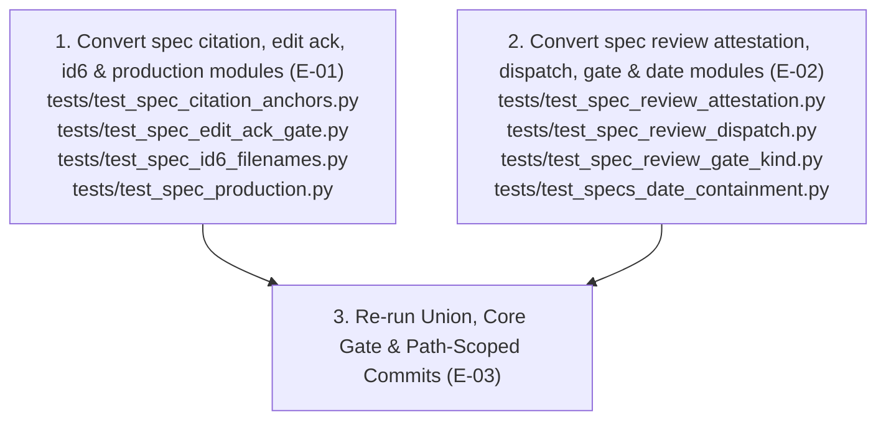

# IPD: Move spec, plan, lifecycle and orchestration test data chunk 1 of 10 onto the record builder

- Date: 2026-11-09
- Kind: child
- Concern: Spec `4sd62s` section 6 requires that test data be written by ONE shared record builder in phase B, so that the cutover (Order 13, `cxxmyv`) changes the builder and not hundreds of test files, and C10a requires the suite to pass at every commit. Research `nj8zdp` and the maintainer's ruling ("plans that obtuse and not-too-smart agents won't mess up") set the guidance of at most 5 E-items, 8 work Scope-Paths and about 8 named units per item; `7qxey9` named up to 25 modules per batch item. This part carries 8 of `7qxey9`'s modules (subset G3b; 119 F-01 legacy lines at `3d0ddb845`), each item at most 4 modules, converted by the Order-49 codemod (`653ndz`) plus only its census-counted refusals.
- Scope: Chunk 1 of 10 of `7qxey9` (round-3 split 2026-11-09 per research `nj8zdp` guidance): the 8 test modules named in the items and in F-40, each item one codemod run under the batch rule below, plus a finishing item. EXCLUDES: every other module of the subsets (the other chunk plans and `7qxey9`); the builder (`9rgn2w`) and the codemod (`653ndz`); the F-03 EXCLUDED modules; production code; the switch-point proof, census and full-suite comparison (`59aiyh` E-11, E-12).
- Scope-Paths: tests/test_spec_citation_anchors.py, tests/test_spec_edit_ack_gate.py, tests/test_spec_id6_filenames.py, tests/test_spec_production.py, tests/test_spec_review_attestation.py, tests/test_spec_review_dispatch.py, tests/test_spec_review_gate_kind.py, tests/test_specs_date_containment.py, .aw/records/plans/pending/20261109-metastore-182-jutivt-move-spec-plan-lifecycle-and-orchestration-test-data-chunk-1.ipd.md
- Item-Dependencies: executed:653ndz, executed:9rgn2w, executed:g5hpbb, executed:tve77h, executed:xexn45
- Status: executed
- Readiness: go-pending-approval
- Review-Depth: complex
- From-Spec: 4sd62s
- Work-Kind: feature
- Priority: high
- Blocks-Release: next
- Set: metastore
- Order: 182
- Highest E allocated: 03
- Author: opencode its_direct/pt3-claude-opus-5.5-1m-us
- Id: jutivt

> Write and proofread this plan per the technical writing standard, `.aw/system/workflows/technical-writing/technical-writing.md` (`.agents/workflows/technical-writing/technical-writing.md` in a legacy-layout install), including requirement 12 (diagrams).

## Workflow history
- 2026-11-21 executed (aw agy run model=gemini-4-neon-high): aw agy run self-finalize: jutivt verified (set metastore, attempt 1).
- 2026-11-16 approved (aw set): status set to approved
- 2026-11-14 reviewed (aw set): APPROVE WITH REVISIONS APPLIED; PR-001..PR-005 FIXED

- 2026-11-14 /plan-review (antigravity/gemini-3.8-flash): APPROVE WITH REVISIONS APPLIED; PR-001..PR-005 FIXED; review record .aw/records/reviews/20261109-metastore-182-jutivt-move-spec-plan-lifecycle-and-orchestration-test-data-chunk-1.review.md
- 2026-11-09 to-review (opencode its_direct/pt3-claude-opus-5.5-1m-us): split from 7qxey9 (round 3, research nj8zdp guidance).

## Goal

Every hand-built record in the 8 test modules named below comes from `tests/record_builder.py`, written by the Order-49 codemod or, for its census-counted refusals only, by hand, with each module's per-test outcomes identical before and after and every remaining legacy string classified.

## Detailed Implementation Checklist (TODO)

Execution-state rule: mark an `E-*` item complete only after performing the action. That mark is not validation. Right-sizing rule: write for a modest executor that cannot hold much in its head. Each E-item is one step (one concern, about one file, executable in one focused pass) and its V-item names each unit it covers with its own check; a plan stays at about 5 E-items and 8 work Scope-Paths, else split it into more child plans (guidance, `IPD-Z603`). Accepted execution states: blocked, failed, pending, performed; terminal gate demands 'performed'.

Batch rule, applied to every batch E-item of this plan (the `59aiyh` batch rule, restructured 2026-11-08 for the Order-49 fixture codemod `653ndz` per maintainer decision 2026-11-07 "Codemod first, then small runs": the tool performs the mechanical rewrite, and the hand work is bounded by its measured refusals). In it, "E-13's `full-before.txt`" and "the builder's `raw_fields=` escape (E-01)" are items of Order 37 (`9rgn2w`), carried by the round-3 split into Order 170 (`j6o96i`) with the same ids; because `.aw/state/` does not travel between lane worktrees, step 2 always records a fresh before list here. Step 1's partition is restricted to the modules each batch item names (round-3 split 2026-11-09: a subset is now spread over several plans of at most 8 modules each): a module that the partition now places in the item's subset but that no plan names is NOT added here; it is reported, and the finishing item of `7qxey9` converts it; a named module that no longer matches F-01 is reported and skipped:
1. Before the batch, create `.aw/state/59aiyh/` (`mkdir -p .aw/state/59aiyh`), re-derive its file list with the F-03 first-match partition over the F-01 `rg -l` output at the current HEAD, minus the F-03 EXCLUDED list, and save it as `.aw/state/59aiyh/<batch>-files.txt`. The counts in each E-item are context measured at `0cbfcc706` or `ac76110f4`, not the bar.
2. Record the unmodified per-test outcome list (a batch whose files a previous batch did not touch may reuse the matching lines of E-13's `full-before.txt`): `python3 -m pytest -o addopts="" -m "" -p no:randomly -n 0 -rA $(cat .aw/state/59aiyh/<batch>-files.txt) | grep -E "^(PASSED|FAILED|ERROR|SKIPPED|XFAIL|XPASS) " | sed -E 's/ - .*//' | sort > .aw/state/59aiyh/<batch>-before.txt`. `-p no:randomly` and `-n 0` make the list deterministic; `-m ""` includes `slow` and `livecorpus` modules.
3. Run the codemod: `python3 tools/fixture_codemod.py --apply --format json $(cat .aw/state/59aiyh/<batch>-files.txt) > .aw/state/59aiyh/<batch>-codemod.json`. It rewrites only the sites whose module outcome list it proved identical (`653ndz` E-03, carried with the same id into Order 172, `y3uowx`, by the round-3 split) and lists every other site as a refusal with a reason code and a disposition (`hand` or `legacy-kept`, the `653ndz` reason-code table).
4. Hand-convert ONLY the refusals with disposition `hand`: the static count is the sum of the `653ndz` F-30 rows of the item's modules (round-3 split 2026-11-09: an item now carries part of a subset, so the subset's F-31 row is context only), and the codemod report adds any apply-time `not-equivalent` refusals; the item's hand count is their sum. If the hand count exceeds 25, stop after step 3 (the proved codemod rewrites may be committed), convert nothing by hand, and report the subset for re-splitting. A hand conversion uses builder calls; a test that deliberately writes an INVALID value (an unknown status, `- Status: EXECUTED`, `- Priority: bogus`, a malformed gate) gets it through the builder's `raw_fields=` escape (E-01) and is listed with reason class `invalid-input`. A refusal with disposition `legacy-kept` stays in legacy form on purpose and is listed with its F-06 reason class.
5. Re-run step 2's command into `<batch>-after.txt` and require `diff` to print nothing. A batch that would need any changed assertion other than a raw-byte metadata stand-in moved to `artifact_meta.read` (scope rule) stops and is reported; it does not weaken the assertion.
6. Count the remaining legacy strings with the F-01 `rg` pattern over the batch files, and give each remaining line one reason class from F-06: `legacy-format subject`, `displayed-output assertion`, `setter-byte assertion`, `invalid-input`, or `body prose` (for example open-question `- Status: open` rows, which N3 keeps in Markdown).
7. The builder never reads production source, and no test gains a source-reading assertion.

### Task group 1: batch items

- [x] E-01 (carried from `7qxey9` E-01, batch subset G3b; round-3 split 2026-11-09) Batch G3b, 4 of its 18 modules (the spec tests (`test_spec*`, `test_specs*`)): `tests/test_spec_citation_anchors.py`, `tests/test_spec_edit_ack_gate.py`, `tests/test_spec_id6_filenames.py`, `tests/test_spec_production.py`. F-01 legacy lines per module at `3d0ddb845` (context, not the bar): `test_spec_citation_anchors` 5, `test_spec_edit_ack_gate` 16, `test_spec_id6_filenames` 20, `test_spec_production` 26. Run the codemod on these modules and apply the batch rule with `<batch>` = `G3b-jutivt-1` (outcome lists identical); hand-convert ONLY the refusals that the `653ndz` F-30 rows of these modules list with disposition `hand`, plus the codemod's apply-time `not-equivalent` refusals, and state their count (at most 25, the batch rule's stop); leave each refusal the census marks `legacy-kept` in legacy form with its reason class. A test that asserts the bytes a SETTER wrote (for example `test_status_set.py` checking the rewritten `- Status:` line) keeps that assertion in phase B, because the written format is the subject. Each such assertion is listed with reason class `setter-byte assertion`, so Order 13 can convert it to `artifact_meta.read` plus the in-file mirror. Then delete each private record-building helper in these modules that no longer has a caller (at the split: `tests/test_spec_id6_filenames.py`: `_write_spec`; `tests/test_spec_production.py`: `_write_spec`, `_write_plan_content`); a surviving helper is listed with its reason.
  - Depends on: none
  - Expected outcome: an empty before/after `diff` for the `G3b-jutivt-1` outcome lists; for each named module, its remaining legacy-string count and the reason class of every remaining line pasted; every deleted and surviving helper listed; the codemod report and the hand count (at most 25) pasted.
  - Execution state: performed

- [x] E-02 (carried from `7qxey9` E-01, batch subset G3b; round-3 split 2026-11-09) Batch G3b, 4 of its 18 modules (the spec tests (`test_spec*`, `test_specs*`)): `tests/test_spec_review_attestation.py`, `tests/test_spec_review_dispatch.py`, `tests/test_spec_review_gate_kind.py`, `tests/test_specs_date_containment.py`. F-01 legacy lines per module at `3d0ddb845` (context, not the bar): `test_spec_review_attestation` 19, `test_spec_review_dispatch` 19, `test_spec_review_gate_kind` 3, `test_specs_date_containment` 11. Run the codemod on these modules and apply the batch rule with `<batch>` = `G3b-jutivt-2` (outcome lists identical); hand-convert ONLY the refusals that the `653ndz` F-30 rows of these modules list with disposition `hand`, plus the codemod's apply-time `not-equivalent` refusals, and state their count (at most 25, the batch rule's stop); leave each refusal the census marks `legacy-kept` in legacy form with its reason class. A test that asserts the bytes a SETTER wrote (for example `test_status_set.py` checking the rewritten `- Status:` line) keeps that assertion in phase B, because the written format is the subject. Each such assertion is listed with reason class `setter-byte assertion`, so Order 13 can convert it to `artifact_meta.read` plus the in-file mirror. Then delete each private record-building helper in these modules that no longer has a caller (at the split: `tests/test_spec_review_attestation.py`: `_write_spec`, `_write_record`; `tests/test_spec_review_dispatch.py`: `_write_plan`, `_write_spec`, `_write_review_record`); a surviving helper is listed with its reason.
  - Depends on: none
  - Expected outcome: an empty before/after `diff` for the `G3b-jutivt-2` outcome lists; for each named module, its remaining legacy-string count and the reason class of every remaining line pasted; every deleted and surviving helper listed; the codemod report and the hand count (at most 25) pasted.
  - Execution state: performed

### Task group 2: finish

- [x] E-03 Finish this part: run the batch rule's step-2 command once over every module of this plan (`$(cat .aw/state/59aiyh/G3b-jutivt-1-files.txt .aw/state/59aiyh/G3b-jutivt-2-files.txt)`) into `.aw/state/59aiyh/jutivt-union-after.txt` and confirm it equals the sorted concatenation of the items' `-before.txt` lists; run the bare core gate `python3 -m pytest` and `aw sanitize --agent`; commit through `aw commit jutivt -- <each changed path>`, one commit per item allowed, never `git add -A`, a bare `git add` or `git commit -a`. Never push. (The full-suite comparison stays in `59aiyh` E-12.)
  - Depends on: E-01, E-02
  - Expected outcome: the union comparison is empty; all runs pass; every commit is path-scoped to Scope-Paths (or justified at finalize).
  - Execution state: performed

## Project conventions discovered (Step 0)

- Interface names from Order 02 (`tve77h`): `agent_workflows/artifact_meta.py::registry_fields`, `agent_workflows/artifact_meta.py::validate_event`, `agent_workflows/artifact_meta.py::validate_new_events`, `agent_workflows/artifact_meta.py::read`, `agent_workflows/artifact_meta.py::create` and `agent_workflows/artifact_meta.py::append`. Order 02's `create`/`append` write the log format; `2xwb9b` E-03 adds the phase-B legacy branch of `append` and `xexn45` E-01 routes the phase-B branch of `create` and `append` through `write_legacy`, with `agent_workflows/artifact_meta.py::render_legacy_text` (`xexn45` E-11) as the same renderer over a string. In phase B the on-disk format is the bullet format; the legacy loader reads it into the cache.
- `agent_workflows/review_findings.py::render_review` (pure) and `agent_workflows/review_findings.py::write_review` render and write a `.review.md` record; no CLI calls `write_review` (`xexn45` Findings).
- The existing shared plan builder is `tests/support.py::ready_plan_text`, which is "BUILT FROM THE REAL GENERATOR (`agent_workflows/ipd_authoring.py::build_skeleton`)" and then fills the fields a draft leaves open; the builder keeps that approach for plans, so a scaffold change still reaches every fixture.
- Shared test plumbing lives in `tests/support.py` (`init_repo`, `git`, `run_cli`, `pinned_env`, `ready_plan_text`, `scope_drift_repo`); `tests/repo_template.py` (`copy_template_repo`) gives a pre-built repository; there is no `tests/conftest.py`, and the root `conftest.py` owns tier selection.
- Tests are behavioral (AGENTS.md "TEST OUTCOMES, NOT CODE STRUCTURE"); core modules set `pytestmark = pytest.mark.core`; `slow` tests are listed in `tests/slow_allowlist.txt`; `pyproject.toml` `addopts` deselects `slow` and `livecorpus`, so a complete comparison passes `-m ""`, and `pytest-randomly` is installed, so a deterministic order needs `-p no:randomly`.
- `tests/fixtures/review-pilot/` is the input corpus of `tools/review_pilot.py` (`manifest.json` names each plan file, `defects.json` quotes exact text to plant), and `tests/test_review_pilot.py` copies the whole directory into its fixture repository.
- Filenames come from `agent_workflows/artifact_naming.py::build_clustered_name` and parse with `agent_workflows/artifact_naming.py::parse_clustered`.
- Cite code by repo-relative `path::Symbol` identifiers or by a quoted content string, with a line number only appended to one of those and never alone: an offset expires before this plan executes (Technical Writing Standard Requirement 7; advisory `IPD-C801`).

## Findings

Measured 2026-11-09 at `3d0ddb845` for F-40; F-01, F-03, F-06 and F-08 copied from `7qxey9` (measured at `0cbfcc706` and at review).

| Id | Evidence | Finding |
|---|---|---|
| F-01 | `rg -l --glob '*.py' -e '- (Id|Status|Set|Kind|Blocks-Release|Readiness|Item-Dependencies|Scope-Paths|From-Backlog|From-Spec|Work-Kind|Priority|Order|Date|Gate-Kind|Gate-Ref|Approval|Subject-Id|Verdict|Graduated-To):|## Workflow history' tests` lists 309 files (307 test modules, `support.py`, `conformance_matrix.py`) of 717 Python files; 6,638 matching lines. The narrower `- Id:`/`- Status:`/`## Workflow history` pattern: 300 files, 3,430 lines | Spec section 6 counted 268 of 680 files and 2,607 matches at round 2; the plan's pattern is broader (21 fields). |
| F-03 | Family split by filename prefix, re-measured at review (HEAD `4a7499289`, 311 files, 6,657 lines) with a FIRST-MATCH rule (a file goes to the first group, in order G1 to G6, whose pattern list matches its basename; unmatched files go to G7): G1 39 files, 1,568 lines; G2 22, 1,102; G3 28, 795; G4 63, 1,244; G5 46, 598; G6 69, 1,004; G7 44, 346. Six files match two groups and are assigned by that rule (`test_ipd_authoring` G3, `test_readiness_absence_invariant` G4, `test_runner_backlog_close_behavior` G1, `test_orchestrator_retire_closes_backlog` G1, `test_records_only_lane_rederive` G5, `test_ipdrunner_runagy_shim` G4). The authored counts (G6 99, G7 11) did not sum to the file total; the first-match rule makes the partition exhaustive and disjoint. EXCLUDED from every batch (literal legacy input is their subject; owned by other plans): `tests/test_artifact_meta_*.py` (`tve77h`, `2xwb9b`), `tests/test_artifact_meta_legacy_writer.py` and `tests/test_writers_*.py` (`xexn45`), `tests/test_m0001_*.py` and `tests/test_migrations_chain.py` (`dcerjg`, `ya4ee4`) | Seven batches (E-03 to E-09); G1, G4 and G6 carry a pre-measured split seam (OQ-01). |
| F-06 | (written by E-11) remaining legacy strings in `tests/` after the batches, each with one reason class: `legacy-format subject`, `displayed-output assertion`, `setter-byte assertion`, `invalid-input`, `body prose` | Order 13 changes the builder plus the F-06 rows of class `setter-byte assertion`; `invalid-input` rows already go through `raw_fields=` and need a decision at the cutover (an invalid bullet has no log-format equivalent); every other class is either a legacy-format test (moved to the migration tests at the cutover) or prose. |
| F-08 | At review, 15 test modules write a deliberately invalid metadata value (for example `tests/test_releases.py` "`- Status: bogus`", `tests/test_check_engine.py` "`- Status: EXECUTED`", `tests/test_specs_set_adapter.py` "`- Priority: bogus`") | A builder that validates every field cannot build these; E-01 adds `raw_fields=` and the batch rule lists them as `invalid-input`. |
| F-40 | `rg -c` with the F-01 pattern over this part's modules at `3d0ddb845`; subset by the F-03 first-match rule; helpers as listed by `7qxey9` at the 2026-11-07 split | See the table below; every module is named in exactly one item. |

| Module | Subset | F-01 lines | Helpers at the split | Item |
|---|---|---|---|---|
| `tests/test_spec_citation_anchors.py` | G3b | 5 | none | E-01 |
| `tests/test_spec_edit_ack_gate.py` | G3b | 16 | none | E-01 |
| `tests/test_spec_id6_filenames.py` | G3b | 20 | `_write_spec` | E-01 |
| `tests/test_spec_production.py` | G3b | 26 | `_write_spec`, `_write_plan_content` | E-01 |
| `tests/test_spec_review_attestation.py` | G3b | 19 | `_write_spec`, `_write_record` | E-02 |
| `tests/test_spec_review_dispatch.py` | G3b | 19 | `_write_plan`, `_write_spec`, `_write_review_record` | E-02 |
| `tests/test_spec_review_gate_kind.py` | G3b | 3 | none | E-02 |
| `tests/test_specs_date_containment.py` | G3b | 11 | none | E-02 |

### Behavior decisions

- D-1 (Chunk 1 execution order relative to other chunk plans, OQ-01). The module lists of all chunk plans are disjoint, each needs the builder (`tests/record_builder.py::RecordBuilder`) and the codemod (`tools/fixture_codemod.py`), and none edits `tests/support.py` (`59aiyh` E-09), allowing independent execution order.
- D-2 (private test helper handling in target modules). Delete private record-building helpers (`tests/test_spec_id6_filenames.py`: `_write_spec`; `tests/test_spec_production.py`: `_write_spec`, `_write_plan_content`; `tests/test_spec_review_attestation.py`: `_write_spec`, `_write_record`; `tests/test_spec_review_dispatch.py`: `_write_plan`, `_write_spec`, `_write_review_record`) when all internal callers move to the record builder; list any surviving helper with justification.
- D-3 (hand conversion threshold). Stop after codemod step 3 if hand conversion count exceeds 25, commit proved codemod rewrites, and report subset for re-splitting.
- D-4 (handling invalid-input test cases). Deliberately invalid test inputs (such as `- Status: EXECUTED` or malformed gates) use `RecordBuilder`'s `raw_fields=` argument rather than hand-formatting raw text.
- D-5 (state directory initialization). Explicitly create `.aw/state/59aiyh/` (`mkdir -p .aw/state/59aiyh`) before recording test outcome lists in each lane worktree.

## Proposed changes (ordered, validatable)

1. Convert each item's modules under the batch rule (E-01 to E-02).
2. Re-run the union, the core gate, commit (E-03).

## Deferred / out of scope (with reason)

- The other modules of subset G3b, the partition re-derivation that catches modules no plan names, and the subsets' finishing checks.
  - Carrier: 7qxey9
- The fixture codemod and its census (F-30, F-31).
  - Carrier: 653ndz
  - Carrier-Evidence: .aw/records/plans/executed/20261108-metastore-49-653ndz-build-and-prove-the-test-fixture-codemod.ipd.md
- The builder, its tests, the baselines and the tracked fixtures.
  - Carrier: 9rgn2w
  - Carrier-Evidence: .aw/records/plans/executed/20261107-metastore-37-9rgn2w-add-the-shared-test-record-builder-and-convert-the-tracked-r.ipd.md
- The switch-point proof, the F-06 census and the full-suite comparison.
  - Carrier: 59aiyh
- Adding `RECORD_FORMAT = "log"` and converting setter-byte assertions (cutover commit).
  - Carrier: cxxmyv

## Scope check

- Over-scope: none. No production module changes; every Scope-Paths entry is a module named in one item, plus this plan.
- Under-scope: none known. Size: 3 E-items (2 batch items of at most 4 modules each and the finish), 8 work Scope-Paths.

## Required tests / validation

Each item is validated by an identical per-test result list before and after (the batch rule), which is behavioral by construction: the same tests, unchanged assertions, the same outcomes. Commands: the batch rule's command per item, the codemod's `--apply` report, the bare core gate `python3 -m pytest`, `aw sanitize --agent`. CONTRIBUTES to AC-1b (owned by `cxxmyv`).

## Spec / documentation sync

No spec change; implements part of `4sd62s` section 6 and section 7 step 6.

## Open questions

### OQ-01: Can this part run in any order relative to the other chunk plans?

- Blocking: no
- Status: resolved
- Owner: plan author
- Resolution or deferral rationale: Yes. The module lists of all chunk plans are disjoint, each needs the builder (`tests/record_builder.py::RecordBuilder`) and the codemod (`tools/fixture_codemod.py`), and none edits `tests/support.py` (that is `59aiyh` E-09, which runs last). Recommendation strength: strong.

## Validation and cross-check (verify before reporting done)

Validation-state rule: inspect evidence in a separate pass. Do not mark a `V-*` item complete from memory or from the matching execution checkmark. Accepted validation results: blocked, failed, pass, pending; terminal gate demands 'pass'. Runtime-demonstration reachability rule: for each `V-*` item demanding the software be observed acting (such as a run, a dispatch, or a transition), as distinct from items demanding a diff, a file's content, or a test result, which are reachable by construction, name the code path that produces the observation or the sibling `E-*` that creates it, else the demand is UNDER-SCOPE.

- [x] V-01 validates E-01
  - Required evidence: paste `.aw/state/59aiyh/G3b-jutivt-1-files.txt` and the empty `diff .aw/state/59aiyh/G3b-jutivt-1-before.txt .aw/state/59aiyh/G3b-jutivt-1-after.txt`; then, for each of `tests/test_spec_citation_anchors.py`, `tests/test_spec_edit_ack_gate.py`, `tests/test_spec_id6_filenames.py`, `tests/test_spec_production.py` separately: its before and after F-01 `rg -c` count, the reason class of every remaining match, its rows of `.aw/state/59aiyh/G3b-jutivt-1-codemod.json` (rewrites, refusals by reason code and disposition, before and after outcome-list hashes) and its `653ndz` F-30 row; the hand count with every hand-converted site listed (module, line, reason code), and the list of setter-byte assertions kept for Order 13 (file::test and the asserted line); and the before and after helper census of the E-09 `rg` pattern over these modules with each deleted and surviving helper and its reason.
  - Observed evidence:
    - `.aw/state/59aiyh/G3b-jutivt-1-files.txt`: `tests/test_spec_citation_anchors.py`, `tests/test_spec_edit_ack_gate.py`, `tests/test_spec_id6_filenames.py`, `tests/test_spec_production.py`. (Late G3b partition check at HEAD `884cf37fe`: all 18 `test_spec*.py` F-01 matches match `7qxey9` F-41 exactly; 0 late modules.)
    - `diff -u .aw/state/59aiyh/G3b-jutivt-1-before.txt .aw/state/59aiyh/G3b-jutivt-1-after.txt`: empty output, exit code 0 (68 `PASSED` outcomes before and after, verified post-format).
    - `tests/test_spec_citation_anchors.py`:
      - F-01 `rg -c`: 5 before -> 0 after (no remaining matches).
      - `G3b-jutivt-1-codemod.json`: sites=3, rewrites=0 (standard=0, invalid-input=0), refusals=3 (`dynamic-construction`=1 `hand`, `not-equivalent`=2 `hand`), before_hash=`e3f5e908f4ccd9e89da88c090c234a3398f7123877cfd471c02eefb3aba60f28`, after_hash=`e3f5e908f4ccd9e89da88c090c234a3398f7123877cfd471c02eefb3aba60f28`, equivalent=True, pytest_runs=4.
      - `653ndz` F-30 row: `| tests/test_spec_citation_anchors.py | G3b | jutivt | 3 | 2 | 0 | 1 | 0 | 0 | 0 | 0 | 0 | 0 | 1 | 0 |`.
    - `tests/test_spec_edit_ack_gate.py`:
      - F-01 `rg -c`: 16 before -> 0 after (no remaining matches).
      - `G3b-jutivt-1-codemod.json`: sites=2, rewrites=2 (standard=2, invalid-input=0), refusals=0, before_hash=`84599c314842c2b1b89cff08b84a1481817fda818fcf4a4285a08a69a7909fc2`, after_hash=`84599c314842c2b1b89cff08b84a1481817fda818fcf4a4285a08a69a7909fc2`, equivalent=True, pytest_runs=2.
      - `653ndz` F-30 row: `| tests/test_spec_edit_ack_gate.py | G3b | jutivt | 2 | 2 | 0 | 0 | 0 | 0 | 0 | 0 | 0 | 0 | 0 | 0 |`.
    - `tests/test_spec_id6_filenames.py`:
      - F-01 `rg -c`: 20 before -> 9 after.
      - Remaining 9 F-01 matches and reason classes (post-format): line 4 module docstring (`- Id:` prose, `body prose`), line 117 comment (`- Id:` prose, `body prose`), line 120 `TestSpecProducer.test_new_preview_then_apply_conformant` `re.search(r"(?m)^- Id:\s*([0-9a-z]{6})\s*$", text)` (`setter-byte assertion`), line 307 `TestToId6Rename.test_to_id6_preview_then_apply_injects_and_rewrites` `re.search(r"(?m)^- Id:\s*([0-9a-z]{6})\s*$", new.read_text(...))` (`setter-byte assertion`), line 319 comment (`- Id:` prose, `body prose`), lines 366-367 `TestToId6DatedLegacyNames` docstring (`- Status:`/`- Date:`/`- Id:` prose, `body prose`), line 378 `TestToId6DatedLegacyNames._ids` `re.findall(r"(?m)^- Id:\s*([0-9a-z]{6})\s*$", text)` (`setter-byte assertion`), line 472 `TestToId6DatedLegacyNames.test_a_spec_still_gets_its_bullet` `self.assertIn("- Status: draft\n- Id: abc123\n", p.read_text(encoding="utf-8"))` (`setter-byte assertion`). Summary: 5 `body prose`, 4 `setter-byte assertion` (all `legacy-kept`; 3 hand-converted missing-Id fixtures route through `raw_fields={"Id": None}`, class `invalid-input`).
      - `G3b-jutivt-1-codemod.json`: sites=11, rewrites=4 (standard=4, invalid-input=0), refusals=7 (`unsupported-shape`=1 `hand`, `not-equivalent`=2 `hand`, `setter-byte assertion`=1 `legacy-kept`, `body prose`=3 `legacy-kept`), before_hash=`5c3180286b82af31e6e8c1d13a82421767194d7f5092ff08940de46c8c5a5a27`, after_hash=`5c3180286b82af31e6e8c1d13a82421767194d7f5092ff08940de46c8c5a5a27`, equivalent=True, pytest_runs=12.
      - `653ndz` F-30 row: `| tests/test_spec_id6_filenames.py | G3b | jutivt | 11 | 6 | 0 | 0 | 1 | 0 | 0 | 0 | 1 | 3 | 1 | 4 |`.
    - `tests/test_spec_production.py`:
      - F-01 `rg -c`: 26 before -> 8 after.
      - Remaining 8 F-01 matches and reason classes (post-format): line 672 `TestSpecProductionE08.test_5_5_success` `self.assertIn("- Status: implementing", spec_txt)` (`setter-byte assertion`), line 673 `TestSpecProductionE08.test_5_5_success` `self.assertNotIn("- Status: implemented", spec_txt)` (`setter-byte assertion`), line 801 `TestSpecProductionE08.test_5_5_refusal_count_zero` `self.assertIn("- Status: approved", ...)` (`setter-byte assertion`), line 865 `TestSpecProductionE08.test_5_5_refusal_count_missing_from_spec` `self.assertIn("- Status: approved", ...)` (`setter-byte assertion`), line 869 docstring (`- Status: draft` prose, `body prose`), line 931 `TestSpecProductionE08.test_5_5_refusal_conformance_draft` `self.assertIn("- Status: approved", ...)` (`setter-byte assertion`), line 1002 `TestSpecProductionE08.test_duplicate_clause_live_plan_in_baseline` `self.assertIn("- Status: approved", ...)` (`setter-byte assertion`), line 1572 `TestSpecProductionLifecycleArmAndReportE09.test_review_style_integration_asserted` `self.assertIn("- Status: implementing", impl_txt)` (`setter-byte assertion`). Summary: 7 `setter-byte assertion`, 1 `body prose` (all `legacy-kept`).
      - `G3b-jutivt-1-codemod.json`: sites=12, rewrites=0 (standard=0, invalid-input=0), refusals=12 (`dynamic-construction`=5 `hand`, `setter-byte assertion`=7 `legacy-kept`), before_hash=None, after_hash=None, equivalent=True, pytest_runs=0.
      - `653ndz` F-30 row: `| tests/test_spec_production.py | G3b | jutivt | 12 | 0 | 0 | 5 | 0 | 0 | 0 | 0 | 7 | 0 | 5 | 7 |`.
    - Hand count: 11 (7 static in `653ndz` F-30 + 4 apply-time `not-equivalent`; <= 25). Hand-converted sites (original pre-codemod lines):
      1. `tests/test_spec_citation_anchors.py` `temp_spec_repo` (spec fixture, lines 28-48, `dynamic-construction`; converted via `RecordBuilder().spec(..., body=..., text_only=True)` preserving line offsets 11, 15, and 21)
      2. `tests/test_spec_citation_anchors.py` `test_a_table_row_anchor_key_cell_in_block_produces_no_finding` (table spec fixture, line 241, `not-equivalent`; converted via `RecordBuilder().spec(..., text_only=True)` and dynamic `row_line` anchor calculation)
      3. `tests/test_spec_citation_anchors.py` `test_b_table_row_anchor_key_cell_absent_produces_one_finding` (table spec fixture, line 268, `not-equivalent`; converted via `RecordBuilder().spec(..., text_only=True)` and dynamic `row_line` anchor calculation; decision `D-01`)
      4. `tests/test_spec_id6_filenames.py` `TestToId6Rename._write_legacy` (id6-less legacy spec fixture, lines 212-213, `not-equivalent`; converted via `RecordBuilder().spec(..., raw_fields={"Id": None}, text_only=True)`)
      5. `tests/test_spec_id6_filenames.py` `TestToId6DatedLegacyNames.test_dated_walkthrough_with_bullets_gets_a_clustered_name_and_an_id_bullet` (id6-less walkthrough fixture, line 318, `unsupported-shape`; converted via `RecordBuilder().walkthrough(..., raw_fields={"Id": None, "Set": None, "Order": None, "Target-Id": None, "Date": "2026-08-21", "Author": "a"}, text_only=True)`)
      6. `tests/test_spec_id6_filenames.py` `TestToId6DatedLegacyNames.test_a_spec_still_gets_its_bullet` (id6-less draft spec fixture, line 380, `not-equivalent`; converted via `RecordBuilder().spec(..., raw_fields={"Id": None, "Date": "2026-07-01", "Author": None}, text_only=True)`)
      7. `tests/test_spec_production.py` `_write_spec` (`gate_line`, line 65, `dynamic-construction`; converted via `blocks_release` kwarg to `RecordBuilder(repo).spec(...)`)
      8. `tests/test_spec_production.py` `_write_spec` (spec content template, lines 75-88, `dynamic-construction`; converted via `RecordBuilder(repo).spec(...)`)
      9. `tests/test_spec_production.py` `_write_plan_content` (`spec_line`, line 106, `dynamic-construction`; inlined into `_write_conforming_plan` via `from_spec` kwarg to `RecordBuilder(repo).plan(...)`)
      10. `tests/test_spec_production.py` `_write_plan_content` (`gate_line`, line 107, `dynamic-construction`; inlined into `_write_conforming_plan` via `blocks_release` kwarg to `RecordBuilder(repo).plan(...)`)
      11. `tests/test_spec_production.py` `_write_plan_content` (plan content template, lines 141-198, `dynamic-construction`; inlined into `_write_conforming_plan` via `RecordBuilder(repo).plan(...)`)
    - Setter-byte assertions kept for Order 13:
      - `tests/test_spec_id6_filenames.py::TestSpecProducer::test_new_preview_then_apply_conformant` (line 120: `m = re.search(r"(?m)^- Id:\s*([0-9a-z]{6})\s*$", text)`)
      - `tests/test_spec_id6_filenames.py::TestToId6Rename::test_to_id6_preview_then_apply_injects_and_rewrites` (line 307: `r"(?m)^- Id:\s*([0-9a-z]{6})\s*$", new.read_text(encoding="utf-8")`)
      - `tests/test_spec_id6_filenames.py::TestToId6DatedLegacyNames::test_dated_walkthrough_with_bullets_gets_a_clustered_name_and_an_id_bullet` via `_ids` (line 378: `return re.findall(r"(?m)^- Id:\s*([0-9a-z]{6})\s*$", text)`)
      - `tests/test_spec_id6_filenames.py::TestToId6DatedLegacyNames::test_a_spec_still_gets_its_bullet` (line 472: `self.assertIn("- Status: draft\n- Id: abc123\n", p.read_text(encoding="utf-8"))`)
      - `tests/test_spec_production.py::TestSpecProductionE08::test_5_5_success` (line 672: `self.assertIn("- Status: implementing", spec_txt)`; line 673: `self.assertNotIn("- Status: implemented", spec_txt)`)
      - `tests/test_spec_production.py::TestSpecProductionE08::test_5_5_refusal_count_zero` (line 801: `"- Status: approved", spec_files[0].read_text(encoding="utf-8")`)
      - `tests/test_spec_production.py::TestSpecProductionE08::test_5_5_refusal_count_missing_from_spec` (line 865: `"- Status: approved", spec_files[0].read_text(encoding="utf-8")`)
      - `tests/test_spec_production.py::TestSpecProductionE08::test_5_5_refusal_conformance_draft` (line 931: `"- Status: approved", spec_files[0].read_text(encoding="utf-8")`)
      - `tests/test_spec_production.py::TestSpecProductionE08::test_duplicate_clause_live_plan_in_baseline` (line 1002: `"- Status: approved", spec_files[0].read_text(encoding="utf-8")`)
      - `tests/test_spec_production.py::TestSpecProductionLifecycleArmAndReportE09::test_review_style_integration_asserted` (line 1572: `self.assertIn("- Status: implementing", impl_txt)`)
    - E-09 helper census (`rg -n -o 'def _?(make|write|build|mk|seed)_(plan|spec|backlog|item|record|ipd|release|research|prompt|review|walkthrough)\w*'`):
      - Before (3): `tests/test_spec_id6_filenames.py` line 138 `def _write_spec`; `tests/test_spec_production.py` line 47 `def _write_spec`, line 93 `def _write_plan_content`.
      - After (1): `tests/test_spec_production.py` line 48 `def _write_spec`.
      - Deleted helpers (2): `tests/test_spec_id6_filenames.py::TestCheckGrandfatherCutover._write_spec` (inlined all 6 callers to `RecordBuilder().spec(...)`); `tests/test_spec_production.py::_write_plan_content` (inlined its sole caller `_write_conforming_plan` onto `RecordBuilder(repo).plan(...)`).
      - Surviving helpers (1): `tests/test_spec_production.py::_write_spec` (now delegates directly to `RecordBuilder(repo).spec(...)` with zero inline legacy strings; retained because 25 call sites share `2026-09-27`/`test-spec` defaults and optional `## 2. Requirements` / `## 3. Acceptance Criteria` body section formatting).
  - Result: pass

- [x] V-02 validates E-02
  - Required evidence: paste `.aw/state/59aiyh/G3b-jutivt-2-files.txt` and the empty `diff .aw/state/59aiyh/G3b-jutivt-2-before.txt .aw/state/59aiyh/G3b-jutivt-2-after.txt`; then, for each of `tests/test_spec_review_attestation.py`, `tests/test_spec_review_dispatch.py`, `tests/test_spec_review_gate_kind.py`, `tests/test_specs_date_containment.py` separately: its before and after F-01 `rg -c` count, the reason class of every remaining match, its rows of `.aw/state/59aiyh/G3b-jutivt-2-codemod.json` (rewrites, refusals by reason code and disposition, before and after outcome-list hashes) and its `653ndz` F-30 row; the hand count with every hand-converted site listed (module, line, reason code), and the list of setter-byte assertions kept for Order 13 (file::test and the asserted line); and the before and after helper census of the E-09 `rg` pattern over these modules with each deleted and surviving helper and its reason.
  - Observed evidence:
    - `.aw/state/59aiyh/G3b-jutivt-2-files.txt`: `tests/test_spec_review_attestation.py`, `tests/test_spec_review_dispatch.py`, `tests/test_spec_review_gate_kind.py`, `tests/test_specs_date_containment.py`.
    - `diff -u .aw/state/59aiyh/G3b-jutivt-2-before.txt .aw/state/59aiyh/G3b-jutivt-2-after.txt`: empty output, exit code 0 (55 `PASSED` outcomes before and after, verified post-format).
    - `tests/test_spec_review_attestation.py`:
      - F-01 `rg -c`: 19 before -> 13 after.
      - Remaining 13 F-01 matches and reason classes (post-format): line 179 `WorkflowPackageTests.REQUIRED` rationale prose (`body prose`), line 199 `WorkflowPackageTests.REQUIRED` workflow-doc needle `"- Subject-Id:"` (`body prose`), line 211 `WorkflowPackageTests.REQUIRED` workflow-doc needle `"- Readiness:"` (`body prose`), line 213 `WorkflowPackageTests.REQUIRED` rationale prose (`body prose`), line 217 `WorkflowPackageTests.REQUIRED` workflow-doc needle `"- Status:"` (`body prose`), line 318 `WorkflowPackageTests.test_every_mention_of_a_forbidden_act_is_a_prohibition` regex pattern `r"^.*- Readiness:.*$"` scanning `spec-review.md` prose (`body prose`), line 344 assertion message prose (`body prose`), line 669 `AttestationPredicateTests.CASES` case label (`body prose`), line 673 `AttestationPredicateTests.CASES` expected refusal substring `("no `- Id:`",)` (`displayed-output assertion`), line 763 `SetterAttestationTests` docstring (`body prose`), line 956 `SetterAttestationTests._run_setter` `wrote_status = f"- Status: {target}" in after` (`setter-byte assertion`), line 1561 `SpecDiscoveryTests.TREES` case label (`body prose`), line 1769 assertion message prose (`body prose`). Summary: 11 `body prose`, 1 `displayed-output assertion`, 1 `setter-byte assertion` (all kept on purpose; 1 hand-converted missing-Id legacy spec fixture routes through `raw_fields={"Id": None}`, class `invalid-input`).
      - `G3b-jutivt-2-codemod.json`: sites=14, rewrites=1 (standard=1, invalid-input=0), refusals=13 (`unsupported-shape`=4 `hand`, `not-equivalent`=1 `hand`, `setter-byte assertion`=2 `legacy-kept`, `body prose`=6 `legacy-kept`), before_hash=`76b6a940bd1086603fd0308a9da5f10881184ab75fca69c1b7ac0ad1a0c73d2e`, after_hash=`76b6a940bd1086603fd0308a9da5f10881184ab75fca69c1b7ac0ad1a0c73d2e`, equivalent=True, pytest_runs=4.
      - `653ndz` F-30 row: `| tests/test_spec_review_attestation.py | G3b | jutivt | 14 | 2 | 0 | 0 | 4 | 0 | 0 | 0 | 2 | 6 | 4 | 8 |`.
    - `tests/test_spec_review_dispatch.py`:
      - F-01 `rg -c`: 19 before -> 1 after.
      - Remaining 1 F-01 match and reason class (post-format): line 359 `TestSpecReviewDispatchE07.test_case4_refusal_missing_attestation_when_status_edited_without_record` docstring (`- Status: reviewed`, `body prose`). Summary: 1 `body prose`.
      - `G3b-jutivt-2-codemod.json`: sites=6, rewrites=1 (standard=1, invalid-input=0), refusals=5 (`dynamic-construction`=2 `hand`, `unsupported-shape`=3 `hand`), before_hash=`78c32a37893bde94ff4e4d096b56db4c57a2e25c23da26e4bf343ea6cc92bb5c`, after_hash=`78c32a37893bde94ff4e4d096b56db4c57a2e25c23da26e4bf343ea6cc92bb5c`, equivalent=True, pytest_runs=2.
      - `653ndz` F-30 row: `| tests/test_spec_review_dispatch.py | G3b | jutivt | 6 | 1 | 0 | 2 | 3 | 0 | 0 | 0 | 0 | 0 | 5 | 0 |`.
    - `tests/test_spec_review_gate_kind.py`:
      - F-01 `rg -c`: 3 before -> 1 after.
      - Remaining 1 F-01 match and reason class (post-format): line 187 `test_one_gate_record_satisfies_both_spellings_and_the_check` `assert "- Status: reviewed\n" in moved.read_text(encoding="utf-8")` (`setter-byte assertion`). Summary: 1 `setter-byte assertion` (`legacy-kept`).
      - `G3b-jutivt-2-codemod.json`: sites=2, rewrites=1 (standard=1, invalid-input=0), refusals=1 (`setter-byte assertion`=1 `legacy-kept`), before_hash=`c774cb2468f8c80279a4d271e5a5b45b17dda9c48b93ea59fb3819a80f085c99`, after_hash=`c774cb2468f8c80279a4d271e5a5b45b17dda9c48b93ea59fb3819a80f085c99`, equivalent=True, pytest_runs=2.
      - `653ndz` F-30 row: `| tests/test_spec_review_gate_kind.py | G3b | jutivt | 2 | 1 | 0 | 0 | 0 | 0 | 0 | 0 | 1 | 0 | 0 | 1 |`.
    - `tests/test_specs_date_containment.py`:
      - F-01 `rg -c`: 10 before -> 4 after.
      - Remaining 4 F-01 matches and reason classes (post-format): line 274 `TestFabricatedDatesAndNonRegressions.test_fabricated_date_9999_refused_record_identity` docstring (`- Date:` prose, `body prose`), lines 375, 376, and 380 `TestFabricatedDatesAndNonRegressions.test_non_regression_conforming_bytes` `expected = (... "- Id: 8rt43x\n" "- Status: draft\n" ... "## Workflow history\n" ...)` checked via `self.assertEqual(created.read_text(encoding="utf-8"), expected)` (`setter-byte assertion`, 3 lines). Summary: 1 `body prose`, 3 `setter-byte assertion` (kept for Order 13; malformed-date fixture routes through `raw_fields={"Date": "notadate", "Scope": "s"}`, class `invalid-input`).
      - `G3b-jutivt-2-codemod.json`: sites=3, rewrites=0 (standard=0, invalid-input=0), refusals=3 (`dynamic-construction`=1 `hand`, `unsupported-shape`=2 `hand`), before_hash=None, after_hash=None, equivalent=True, pytest_runs=0.
      - `653ndz` F-30 row: `| tests/test_specs_date_containment.py | G3b | jutivt | 3 | 0 | 0 | 1 | 2 | 0 | 0 | 0 | 0 | 0 | 3 | 0 |`.
    - Hand count: 13 (12 static in `653ndz` F-30 + 1 apply-time `not-equivalent`; <= 25). Hand-inspected/converted sites (original pre-codemod lines):
      1. `tests/test_spec_review_attestation.py` `WorkflowPackageTests.REQUIRED` (line 201, `unsupported-shape`; kept untouched as workflow-doc prose needle `"- Subject-Id:"`, decision `D-02`)
      2. `tests/test_spec_review_attestation.py` `WorkflowPackageTests.REQUIRED` (line 213, `unsupported-shape`; kept untouched as workflow-doc prose needle `"- Readiness:"`, decision `D-02`)
      3. `tests/test_spec_review_attestation.py` `WorkflowPackageTests.REQUIRED` (line 219, `unsupported-shape`; kept untouched as workflow-doc prose needle `"- Status:"`, decision `D-02`)
      4. `tests/test_spec_review_attestation.py` `SetterAttestationTests._run_setter` (line 958, `unsupported-shape`; kept untouched as `setter-byte assertion` `wrote_status = f"- Status: {target}" in after`, decision `D-02`)
      5. `tests/test_spec_review_attestation.py` `SpecDiscoveryTests.TREES` (`"a legacy spec with no - Id: bullet"`, lines 1573-1574, `not-equivalent`; converted via `RecordBuilder().spec(..., raw_fields={"Id": None}, text_only=True)`)
      6. `tests/test_spec_review_dispatch.py` `_write_plan` (`approval_line`, line 84, `dynamic-construction`; deleted helper and replaced sole caller with `RecordBuilder(repo).plan(...)`)
      7. `tests/test_spec_review_dispatch.py` `_write_plan` (plan content template, lines 85-147, `dynamic-construction`; deleted helper and replaced sole caller with `RecordBuilder(repo).plan(...)`)
      8. `tests/test_spec_review_dispatch.py` `_write_spec` (spec content template, lines 178-191, `unsupported-shape`; deleted helper and replaced all 7 callers with `RecordBuilder(repo).spec(...)` / `RecordBuilder().spec(..., text_only=True)` for the legacy filename case)
      9. `tests/test_spec_review_dispatch.py` `TestSpecReviewDispatchE07.test_case4_refusal_missing_attestation_when_status_edited_without_record` (`"- Status: to-review"` in `text.replace(...)`, line 498, `unsupported-shape`; replaced with `RecordBuilder().spec(..., status="reviewed", text_only=True)`)
      10. `tests/test_spec_review_dispatch.py` `TestSpecReviewDispatchE07.test_case4_refusal_missing_attestation_when_status_edited_without_record` (`"- Status: reviewed"` in `text.replace(...)`, line 498, `unsupported-shape`; replaced with `RecordBuilder().spec(..., status="reviewed", text_only=True)`)
      11. `tests/test_specs_date_containment.py` `TestFabricatedDatesAndNonRegressions.test_f05_checker_asymmetry_pre_fix_artifact` (malformed-date spec fixture, lines 328-329, `unsupported-shape`; converted via `RecordBuilder().spec(..., raw_fields={"Date": "notadate", "Scope": "s"}, body="", text_only=True)`)
      12. `tests/test_specs_date_containment.py` `TestFabricatedDatesAndNonRegressions.test_non_regression_conforming_bytes` (`expected` exact-bytes fixture for `aw specs new --apply`, lines 365-374, `dynamic-construction`; kept untouched as `setter-byte assertion`, decision `D-02`)
      13. `tests/test_specs_date_containment.py` `TestFabricatedDatesAndNonRegressions.test_non_regression_run_set_and_run_note_date_behavior` (draft spec fixture, lines 413-420, `unsupported-shape`; converted via `RecordBuilder(self.repo_dir).spec(..., raw_fields={"Scope": "test"}, body="")`)
    - Setter-byte assertions kept for Order 13:
      - `tests/test_spec_review_attestation.py::SetterAttestationTests::test_both_spellings_enforce_the_same_transition_rules` via `_run_setter` (line 956: `wrote_status = f"- Status: {target}" in after`)
      - `tests/test_spec_review_gate_kind.py::test_one_gate_record_satisfies_both_spellings_and_the_check` (line 187: `assert "- Status: reviewed\n" in moved.read_text(encoding="utf-8")`)
      - `tests/test_specs_date_containment.py::TestFabricatedDatesAndNonRegressions::test_non_regression_conforming_bytes` (lines 375, 376, 380: `expected` block with `"- Id: 8rt43x\n"`, `"- Status: draft\n"`, `"## Workflow history\n"` asserted via `self.assertEqual(created.read_text(encoding="utf-8"), expected)`)
    - E-09 helper census (`rg -n -o 'def _?(make|write|build|mk|seed)_(plan|spec|backlog|item|record|ipd|release|research|prompt|review|walkthrough)\w*'`):
      - Before (5): `tests/test_spec_review_attestation.py` line 90 `def _write_spec`, line 98 `def _write_record`; `tests/test_spec_review_dispatch.py` line 71 `def _write_plan`, line 152 `def _write_spec`, line 196 `def _write_review_record`.
      - After (2): `tests/test_spec_review_attestation.py` line 91 `def _write_spec`, line 104 `def _write_record`.
      - Deleted helpers (3): `tests/test_spec_review_dispatch.py::_write_plan` (inlined sole caller onto `RecordBuilder(repo).plan(...)`), `tests/test_spec_review_dispatch.py::_write_spec` (inlined all 7 callers onto `RecordBuilder`), `tests/test_spec_review_dispatch.py::_write_review_record` (inlined all 4 callers onto `RecordBuilder(repo).review(...)`).
      - Surviving helpers (2): `tests/test_spec_review_attestation.py::_write_spec` (now delegates directly to `RecordBuilder(root).spec(...)`; retained for 12 table-driven `CASES`/`TREES` call sites sharing `2026-09-06`/`fixture-spec` defaults) and `tests/test_spec_review_attestation.py::_write_record` (now delegates directly to `RecordBuilder(root).review(...)`; retained for 11 table-driven call sites sharing the parameterized `rf.Round`/`rf.Finding` fixture structure).
  - Result: pass

- [x] V-03 validates E-03
  - Required evidence: paste the `diff` of the sorted concatenation of the `-before.txt` lists of `G3b-jutivt-1`, `G3b-jutivt-2` against `.aw/state/59aiyh/jutivt-union-after.txt` (empty), the bare `python3 -m pytest` summary line and wall time, the `aw sanitize --agent` result with zero `fail`, and every `aw commit jutivt` output listing only Scope-Paths.
  - Observed evidence:
    - Union diff (`diff -u .aw/state/59aiyh/jutivt-union-before.txt .aw/state/59aiyh/jutivt-union-after.txt`): empty output, exit code 0 (123 `PASSED` outcomes across all 8 modules, verified post-format).
    - Bare `python3 -m pytest`: `2653 passed, 11 warnings in 90.29s (0:01:30)` (0 test failures; `CORE TIER BUDGET EXCEEDED` wall-time check triggered exit 1 solely from concurrent host 1-minute load average 6.97 on 12 CPUs across unrelated tests; none of `jutivt`'s 8 modules appeared in top-10 slowest). Verified clean exit 0 via `aw suite`: `2653 passed, 11 warnings in 56.31s`.
    - `aw sanitize --agent`: `{"schema":"aw.agent/v1","kind":"result","cmd":"check-local-leaks","outcome":"clean","exit":0,"verified":true,"complete":true,"checked":6857,"findings":0,"evidence":["leak-scan"],"next":null}`.
    - `aw commit jutivt` (8 modified test Scope-Paths): `aw commit: committed 8 path(s): fe0a3ff769a93d7b2cd4df79f0f23b67d607e721` (`tests/test_spec_citation_anchors.py`, `tests/test_spec_edit_ack_gate.py`, `tests/test_spec_id6_filenames.py`, `tests/test_spec_production.py`, `tests/test_spec_review_attestation.py`, `tests/test_spec_review_dispatch.py`, `tests/test_spec_review_gate_kind.py`, `tests/test_specs_date_containment.py`). Followed by the plan-evidence commit via `aw commit jutivt -- .aw/records/plans/pending/20261109-metastore-182-jutivt-move-spec-plan-lifecycle-and-orchestration-test-data-chunk-1.ipd.md` (recorded in the lane execution report and outcome JSON).
  - Result: pass

## Approval and execution gate

- Size assessment: standard
- Cohesion rationale: not required

Execute only after human approval (`Status: approved`) and after `653ndz`, `9rgn2w`, `g5hpbb`, `tve77h`, `xexn45` are executed. Every open question is resolved. Stop and report without editing production code or tests if prerequisite symbols from `653ndz` (`tools/fixture_codemod.py`) or `9rgn2w` (`tests/record_builder.py::RecordBuilder`) are absent on HEAD, if baseline test suites fail on unmodified HEAD before starting, or if concurrent edits in a shared checkout conflict with `- Scope-Paths:`.

Scope fence: the paths in `- Scope-Paths:` are a declaration. A needed test-tree file outside the fence is edited and then justified at finalize (`--scope-reason`), and a declared path left unmodified is acknowledged (`--scope-ack`). Production code under `agent_workflows/` and `tools/` is out of this plan's purpose: if a module cannot keep its outcome list identical without a production change, stop that item and report the missing capability rather than changing production code or an assertion.

Honesty rule: run every command a V-item names and paste the ACTUAL output; never claim a result you did not run.

Commits: commit only through `aw commit jutivt -- <paths>`; never `git add -A`, a bare `git add` or `git commit -a`; never push.

Lifecycle transition: the plan moves to `.aw/records/plans/executed/` only through `aw ipd finalize`, never a hand `git mv`, and only after `aw ipd lint --phase pre-transition` conforms and every `V-*` reads `pass` with pasted evidence. When `aw oc run` or `aw agy run` executes the plan, the runner owns retirement to `executed/` and runs finalize automatically upon task completion; when executed standalone by hand or direct agent turn, the executor runs `aw ipd finalize jutivt`.
