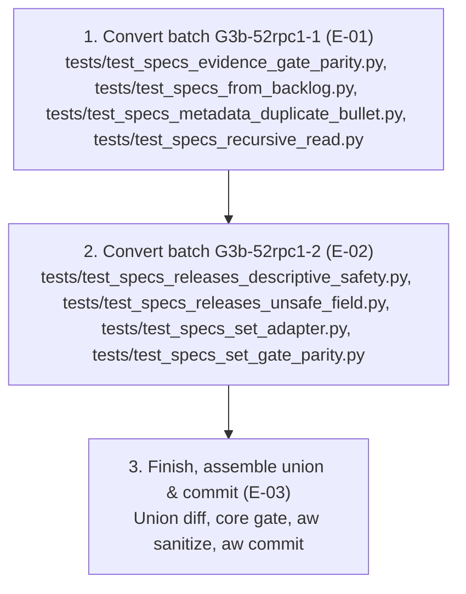

# IPD: Move spec, plan, lifecycle and orchestration test data chunk 2 of 10 onto the record builder

- Date: 2026-11-09
- Kind: child
- Concern: Spec `4sd62s` section 6 requires that test data be written by ONE shared record builder in phase B, so that the cutover (Order 13, `cxxmyv`) changes the builder and not hundreds of test files, and C10a requires the suite to pass at every commit. Research `nj8zdp` and the maintainer's ruling ("plans that obtuse and not-too-smart agents won't mess up") set the guidance of at most 5 E-items, 8 work Scope-Paths and about 8 named units per item; `7qxey9` named up to 25 modules per batch item. This part carries 8 of `7qxey9`'s modules (subset G3b; 169 F-01 legacy lines at `3d0ddb845`), each item at most 4 modules, converted by the Order-49 codemod (`653ndz`) plus only its census-counted refusals.
- Scope: Chunk 2 of 10 of `7qxey9` (round-3 split 2026-11-09 per research `nj8zdp` guidance): the 8 test modules named in the items and in F-40, each item one codemod run under the batch rule below, plus a finishing item. EXCLUDES: every other module of the subsets (the other chunk plans and `7qxey9`); the builder (`9rgn2w`) and the codemod (`653ndz`); the F-03 EXCLUDED modules; production code; the switch-point proof, census and full-suite comparison (`59aiyh` E-11, E-12).
- Scope-Paths: tests/test_specs_evidence_gate_parity.py, tests/test_specs_from_backlog.py, tests/test_specs_metadata_duplicate_bullet.py, tests/test_specs_recursive_read.py, tests/test_specs_releases_descriptive_safety.py, tests/test_specs_releases_unsafe_field.py, tests/test_specs_set_adapter.py, tests/test_specs_set_gate_parity.py, .aw/records/plans/pending/20261109-metastore-183-52rpc1-move-spec-plan-lifecycle-and-orchestration-test-data-chunk-2.ipd.md
- Item-Dependencies: executed:653ndz, executed:9rgn2w, executed:g5hpbb, executed:tve77h, executed:xexn45
- Status: executed
- Readiness: go-pending-approval
- Review-Depth: complex
- From-Spec: 4sd62s
- Work-Kind: feature
- Priority: high
- Blocks-Release: next
- Set: metastore
- Order: 183
- Highest E allocated: 03
- Author: opencode its_direct/pt3-claude-opus-5.5-1m-us
- Id: 52rpc1

> Write and proofread this plan per the technical writing standard, `.aw/system/workflows/technical-writing/technical-writing.md` (`.agents/workflows/technical-writing/technical-writing.md` in a legacy-layout install), including requirement 12 (diagrams).

## Workflow history
- 2026-11-21 executed (aw agy run model=gemini-4-neon-high): aw agy run self-finalize: 52rpc1 verified (set metastore, attempt 1).
- 2026-11-16 approved (aw set): status set to approved

- 2026-11-14 reviewed (antigravity/gemini-3.8-flash): plan-review verified E/V bijection, Scope-Paths, batch rules, execution gate, and state directory initialization; findings PR-001..PR-005 fixed; marked reviewed and go-pending-approval.
- 2026-11-09 to-review (opencode its_direct/pt3-claude-opus-5.5-1m-us): split from 7qxey9 (round 3, research nj8zdp guidance).

## Goal

Every hand-built record in the 8 test modules named below comes from `tests/record_builder.py`, written by the Order-49 codemod or, for its census-counted refusals only, by hand, with each module's per-test outcomes identical before and after and every remaining legacy string classified.

## Detailed Implementation Checklist (TODO)

Execution-state rule: mark an `E-*` item complete only after performing the action. That mark is not validation. Right-sizing rule: write for a modest executor that cannot hold much in its head. Each E-item is one step (one concern, about one file, executable in one focused pass) and its V-item names each unit it covers with its own check; a plan stays at about 5 E-items and 8 work Scope-Paths, else split it into more child plans (guidance, `IPD-Z603`). Accepted execution states: blocked, failed, pending, performed; terminal gate demands 'performed'.

Batch rule, applied to every batch E-item of this plan (the `59aiyh` batch rule, restructured 2026-11-08 for the Order-49 fixture codemod `653ndz` per maintainer decision 2026-11-07 "Codemod first, then small runs": the tool performs the mechanical rewrite, and the hand work is bounded by its measured refusals). In it, "E-13's `full-before.txt`" and "the builder's `raw_fields=` escape (E-01)" are items of Order 37 (`9rgn2w`), carried by the round-3 split into Order 170 (`j6o96i`) with the same ids; because `.aw/state/` does not travel between lane worktrees, step 2 always records a fresh before list here. Step 1's partition is restricted to the modules each batch item names (round-3 split 2026-11-09: a subset is now spread over several plans of at most 8 modules each): a module that the partition now places in the item's subset but that no plan names is NOT added here; it is reported, and the finishing item of `7qxey9` converts it; a named module that no longer matches F-01 is reported and skipped:
1. Before the batch, create directory `mkdir -p .aw/state/59aiyh/` and re-derive its file list with the F-03 first-match partition over the F-01 `rg -l` output at the current HEAD, minus the F-03 EXCLUDED list, and save it as `.aw/state/59aiyh/<batch>-files.txt`. The counts in each E-item are context measured at `0cbfcc706` or `ac76110f4`, not the bar.
2. Record the unmodified per-test outcome list (a batch whose files a previous batch did not touch may reuse the matching lines of E-13's `full-before.txt`): `python3 -m pytest -o addopts="" -m "" -p no:randomly -n 0 -rA $(cat .aw/state/59aiyh/<batch>-files.txt) | grep -E "^(PASSED|FAILED|ERROR|SKIPPED|XFAIL|XPASS) " | sed -E 's/ - .*//' | sort > .aw/state/59aiyh/<batch>-before.txt`. `-p no:randomly` and `-n 0` make the list deterministic; `-m ""` includes `slow` and `livecorpus` modules.
3. Run the codemod: `python3 tools/fixture_codemod.py --apply --format json $(cat .aw/state/59aiyh/<batch>-files.txt) > .aw/state/59aiyh/<batch>-codemod.json`. It rewrites only the sites whose module outcome list it proved identical (`653ndz` E-03, carried with the same id into Order 172, `y3uowx`, by the round-3 split) and lists every other site as a refusal with a reason code and a disposition (`hand` or `legacy-kept`, the `653ndz` reason-code table).
4. Hand-convert ONLY the refusals with disposition `hand`: the static count is the sum of the `653ndz` F-30 rows of the item's modules (round-3 split 2026-11-09: an item now carries part of a subset, so the subset's F-31 row is context only), and the codemod report adds any apply-time `not-equivalent` refusals; the item's hand count is their sum. If the hand count exceeds 25, stop after step 3 (the proved codemod rewrites may be committed), convert nothing by hand, and report the subset for re-splitting. A hand conversion uses builder calls; a test that deliberately writes an INVALID value (an unknown status, `- Status: EXECUTED`, `- Priority: bogus`, a malformed gate) gets it through the builder's `raw_fields=` escape (E-01) and is listed with reason class `invalid-input`. A refusal with disposition `legacy-kept` stays in legacy form on purpose and is listed with its F-06 reason class.
5. Re-run step 2's command into `<batch>-after.txt` and require `diff` to print nothing. A batch that would need any changed assertion other than a raw-byte metadata stand-in moved to `artifact_meta.read` (scope rule) stops and is reported; it does not weaken the assertion.
6. Count the remaining legacy strings with the F-01 `rg` pattern over the batch files, and give each remaining line one reason class from F-06: `legacy-format subject`, `displayed-output assertion`, `setter-byte assertion`, `invalid-input`, or `body prose` (for example open-question `- Status: open` rows, which N3 keeps in Markdown).
7. The builder never reads production source, and no test gains a source-reading assertion.

### Task group 1: batch items

- [x] E-01 (carried from `7qxey9` E-01, batch subset G3b; round-3 split 2026-11-09) Batch G3b, 4 of its 18 modules (the spec tests (`test_spec*`, `test_specs*`)): `tests/test_specs_evidence_gate_parity.py`, `tests/test_specs_from_backlog.py`, `tests/test_specs_metadata_duplicate_bullet.py`, `tests/test_specs_recursive_read.py`. F-01 legacy lines per module at `3d0ddb845` (context, not the bar): `test_specs_evidence_gate_parity` 29, `test_specs_from_backlog` 44, `test_specs_metadata_duplicate_bullet` 33, `test_specs_recursive_read` 8. Ensure `.aw/state/59aiyh/` exists (`mkdir -p .aw/state/59aiyh/`), run the codemod on these modules and apply the batch rule with `<batch>` = `G3b-52rpc1-1` (outcome lists identical); hand-convert ONLY the refusals that the `653ndz` F-30 rows of these modules list with disposition `hand`, plus the codemod's apply-time `not-equivalent` refusals, and state their count (at most 25, the batch rule's stop); leave each refusal the census marks `legacy-kept` in legacy form with its reason class. A test that asserts the bytes a SETTER wrote (for example `test_status_set.py` checking the rewritten `- Status:` line) keeps that assertion in phase B, because the written format is the subject. Each such assertion is listed with reason class `setter-byte assertion`, so Order 13 can convert it to `artifact_meta.read` plus the in-file mirror. These modules held no private record-building helper at the split; a helper found now is deleted when it has no caller, or listed with its reason.
  - Depends on: none
  - Expected outcome: an empty before/after `diff` for the `G3b-52rpc1-1` outcome lists; for each named module, its remaining legacy-string count and the reason class of every remaining line pasted; every deleted and surviving helper listed; the codemod report and the hand count (at most 25) pasted.
  - Execution state: performed

- [x] E-02 (carried from `7qxey9` E-01, batch subset G3b; round-3 split 2026-11-09) Batch G3b, 4 of its 18 modules (the spec tests (`test_spec*`, `test_specs*`)): `tests/test_specs_releases_descriptive_safety.py`, `tests/test_specs_releases_unsafe_field.py`, `tests/test_specs_set_adapter.py`, `tests/test_specs_set_gate_parity.py`. F-01 legacy lines per module at `3d0ddb845` (context, not the bar): `test_specs_releases_descriptive_safety` 15, `test_specs_releases_unsafe_field` 11, `test_specs_set_adapter` 11, `test_specs_set_gate_parity` 18. Run the codemod on these modules and apply the batch rule with `<batch>` = `G3b-52rpc1-2` (outcome lists identical); hand-convert ONLY the refusals that the `653ndz` F-30 rows of these modules list with disposition `hand`, plus the codemod's apply-time `not-equivalent` refusals, and state their count (at most 25, the batch rule's stop); leave each refusal the census marks `legacy-kept` in legacy form with its reason class. A test that asserts the bytes a SETTER wrote (for example `test_status_set.py` checking the rewritten `- Status:` line) keeps that assertion in phase B, because the written format is the subject. Each such assertion is listed with reason class `setter-byte assertion`, so Order 13 can convert it to `artifact_meta.read` plus the in-file mirror. These modules held no private record-building helper at the split; a helper found now is deleted when it has no caller, or listed with its reason.
  - Depends on: none
  - Expected outcome: an empty before/after `diff` for the `G3b-52rpc1-2` outcome lists; for each named module, its remaining legacy-string count and the reason class of every remaining line pasted; every deleted and surviving helper listed; the codemod report and the hand count (at most 25) pasted.
  - Execution state: performed

### Task group 2: finish

- [x] E-03 Finish this part: run the batch rule's step-2 command once over every module of this plan (`$(cat .aw/state/59aiyh/G3b-52rpc1-1-files.txt .aw/state/59aiyh/G3b-52rpc1-2-files.txt)`) into `.aw/state/59aiyh/52rpc1-union-after.txt` and confirm it equals the sorted concatenation of the items' `-before.txt` lists; run the bare core gate `python3 -m pytest` and `aw sanitize --agent`; commit through `aw commit 52rpc1 -- <each changed path>`, one commit per item allowed, never `git add -A`, a bare `git add` or `git commit -a`. Never push. (The full-suite comparison stays in `59aiyh` E-12.)
  - Depends on: E-01, E-02
  - Expected outcome: the union comparison is empty; all runs pass; every commit is path-scoped to Scope-Paths (or justified at finalize).
  - Execution state: performed

## Project conventions discovered (Step 0)

- Interface names from Order 02 (`tve77h`): `artifact_meta.registry_fields(type)`, `artifact_meta.validate_event`, `artifact_meta.validate_new_events(type, events, *, records_root, migration_import=False)`, `artifact_meta.read(id6) -> State`, `artifact_meta.create(...)` and `artifact_meta.append(id6, events, *, expect_seq)`. Order 02's `create`/`append` write the log format; `2xwb9b` E-03 adds the phase-B legacy branch of `append` and `xexn45` E-01 routes the phase-B branch of `create` and `append` through `write_legacy`, with `render_legacy_text(text, events)` (`xexn45` E-11) as the same renderer over a string. In phase B the on-disk format is the bullet format; the legacy loader reads it into the cache.
- `review_findings.render_review` (pure) and `review_findings.write_review` render and write a `.review.md` record; no CLI calls `write_review` (`xexn45` Findings).
- The existing shared plan builder is `support.ready_plan_text`, which is "BUILT FROM THE REAL GENERATOR (`ipd_authoring.build_skeleton`)" and then fills the fields a draft leaves open; the builder keeps that approach for plans, so a scaffold change still reaches every fixture.
- Shared test plumbing lives in `tests/support.py` (`init_repo`, `git`, `run_cli`, `pinned_env`, `ready_plan_text`, `scope_drift_repo`); `tests/repo_template.py` (`copy_template_repo`) gives a pre-built repository; there is no `tests/conftest.py`, and the root `conftest.py` owns tier selection.
- Tests are behavioral (AGENTS.md "TEST OUTCOMES, NOT CODE STRUCTURE"); core modules set `pytestmark = pytest.mark.core`; `slow` tests are listed in `tests/slow_allowlist.txt`; `pyproject.toml` `addopts` deselects `slow` and `livecorpus`, so a complete comparison passes `-m ""`, and `pytest-randomly` is installed, so a deterministic order needs `-p no:randomly`.
- `tests/fixtures/review-pilot/` is the input corpus of `tools/review_pilot.py` (`manifest.json` names each plan file, `defects.json` quotes exact text to plant), and `tests/test_review_pilot.py` copies the whole directory into its fixture repository.
- Filenames come from `artifact_naming.build_clustered_name` and parse with `artifact_naming.parse_clustered`.
- Cite code by SYMBOL (`module.function`) or by a quoted content string, with a line number only appended to one of those and never alone: an offset expires before this plan executes (spec `ipd-structure-and-linting` Section 10.2; advisory `IPD-C801`).

## Findings

Measured 2026-11-09 at `3d0ddb845` for F-40; F-01, F-03, F-06 and F-08 copied from `7qxey9` (measured at `0cbfcc706` and at review).

| Id | Evidence | Finding |
|---|---|---|
| F-01 | `rg -l --glob '*.py' -e '- (Id|Status|Set|Kind|Blocks-Release|Readiness|Item-Dependencies|Scope-Paths|From-Backlog|From-Spec|Work-Kind|Priority|Order|Date|Gate-Kind|Gate-Ref|Approval|Subject-Id|Verdict|Graduated-To):|## Workflow history' tests` lists 309 files (307 test modules, `support.py`, `conformance_matrix.py`) of 717 Python files; 6,638 matching lines. The narrower `- Id:`/`- Status:`/`## Workflow history` pattern: 300 files, 3,430 lines | Spec section 6 counted 268 of 680 files and 2,607 matches at round 2; the plan's pattern is broader (21 fields). |
| F-03 | Family split by filename prefix, re-measured at review (HEAD `4a7499289`, 311 files, 6,657 lines) with a FIRST-MATCH rule (a file goes to the first group, in order G1 to G6, whose pattern list matches its basename; unmatched files go to G7): G1 39 files, 1,568 lines; G2 22, 1,102; G3 28, 795; G4 63, 1,244; G5 46, 598; G6 69, 1,004; G7 44, 346. Six files match two groups and are assigned by that rule (`test_ipd_authoring` G3, `test_readiness_absence_invariant` G4, `test_runner_backlog_close_behavior` G1, `test_orchestrator_retire_closes_backlog` G1, `test_records_only_lane_rederive` G5, `test_ipdrunner_runagy_shim` G4). The authored counts (G6 99, G7 11) did not sum to the file total; the first-match rule makes the partition exhaustive and disjoint. EXCLUDED from every batch (literal legacy input is their subject; owned by other plans): `tests/test_artifact_meta_*.py` (`tve77h`, `2xwb9b`), `tests/test_artifact_meta_legacy_writer.py` and `tests/test_writers_*.py` (`xexn45`), `tests/test_m0001_*.py` and `tests/test_migrations_chain.py` (`dcerjg`, `ya4ee4`) | Seven batches (E-03 to E-09); G1, G4 and G6 carry a pre-measured split seam (OQ-01). |
| F-06 | (written by E-11) remaining legacy strings in `tests/` after the batches, each with one reason class: `legacy-format subject`, `displayed-output assertion`, `setter-byte assertion`, `invalid-input`, `body prose` | Order 13 changes the builder plus the F-06 rows of class `setter-byte assertion`; `invalid-input` rows already go through `raw_fields=` and need a decision at the cutover (an invalid bullet has no log-format equivalent); every other class is either a legacy-format test (moved to the migration tests at the cutover) or prose. |
| F-08 | At review, 15 test modules write a deliberately invalid metadata value (for example `tests/test_releases.py` "`- Status: bogus`", `tests/test_check_engine.py` "`- Status: EXECUTED`", `tests/test_specs_set_adapter.py` "`- Priority: bogus`") | A builder that validates every field cannot build these; E-01 adds `raw_fields=` and the batch rule lists them as `invalid-input`. |
| F-40 | `rg -c` with the F-01 pattern over this part's modules at `3d0ddb845`; subset by the F-03 first-match rule; helpers as listed by `7qxey9` at the 2026-11-07 split | See the table below; every module is named in exactly one item. |

| Module | Subset | F-01 lines | Helpers at the split | Item |
|---|---|---|---|---|
| `tests/test_specs_evidence_gate_parity.py` | G3b | 29 | none | E-01 |
| `tests/test_specs_from_backlog.py` | G3b | 44 | none | E-01 |
| `tests/test_specs_metadata_duplicate_bullet.py` | G3b | 33 | none | E-01 |
| `tests/test_specs_recursive_read.py` | G3b | 8 | none | E-01 |
| `tests/test_specs_releases_descriptive_safety.py` | G3b | 15 | none | E-02 |
| `tests/test_specs_releases_unsafe_field.py` | G3b | 11 | none | E-02 |
| `tests/test_specs_set_adapter.py` | G3b | 11 | none | E-02 |
| `tests/test_specs_set_gate_parity.py` | G3b | 18 | none | E-02 |

## Proposed changes (ordered, validatable)

1. Convert each item's modules under the batch rule (E-01 to E-02).
2. Re-run the union, the core gate, commit (E-03).

## Deferred / out of scope (with reason)

- The other modules of subset G3b, the partition re-derivation that catches modules no plan names, and the subsets' finishing checks.
  - Carrier: 7qxey9
- The fixture codemod and its census (F-30, F-31).
  - Carrier: 653ndz
  - Carrier-Evidence: .aw/records/plans/executed/20261108-metastore-49-653ndz-build-and-prove-the-test-fixture-codemod.ipd.md
- The builder, its tests, the baselines and the tracked fixtures.
  - Carrier: 9rgn2w
  - Carrier-Evidence: .aw/records/plans/executed/20261107-metastore-37-9rgn2w-add-the-shared-test-record-builder-and-convert-the-tracked-r.ipd.md
- The switch-point proof, the F-06 census and the full-suite comparison.
  - Carrier: 59aiyh
- Adding `RECORD_FORMAT = "log"` and converting setter-byte assertions (cutover commit).
  - Carrier: cxxmyv

## Scope check

- Over-scope: none. No production module changes; every Scope-Paths entry is a module named in one item, plus this plan.
- Under-scope: none known. Size: 3 E-items (2 batch items of at most 4 modules each and the finish), 8 work Scope-Paths.

## Required tests / validation

Each item is validated by an identical per-test result list before and after (the batch rule), which is behavioral by construction: the same tests, unchanged assertions, the same outcomes. Commands: the batch rule's command per item, the codemod's `--apply` report, the bare core gate `python3 -m pytest`, `aw sanitize --agent`. CONTRIBUTES to AC-1b (owned by `cxxmyv`).

## Spec / documentation sync

No spec change; implements part of `4sd62s` section 6 and section 7 step 6.

## Open questions

### OQ-01: Can this part run in any order relative to the other chunk plans?

- Blocking: no
- Status: resolved
- Owner: plan author
- Resolution or deferral rationale: Yes. The module lists of all chunk plans are disjoint, each needs the builder (`9rgn2w`) and the codemod (`653ndz`), and none edits `tests/support.py` (that is `59aiyh` E-09, which runs last). Recommendation strength: strong.

## Validation and cross-check (verify before reporting done)

Validation-state rule: inspect evidence in a separate pass. Do not mark a `V-*` item complete from memory or from the matching execution checkmark. Accepted validation results: blocked, failed, pass, pending; terminal gate demands 'pass'. Runtime-demonstration reachability rule: for each `V-*` item demanding the software be observed acting (such as a run, a dispatch, or a transition), as distinct from items demanding a diff, a file's content, or a test result, which are reachable by construction, name the code path that produces the observation or the sibling `E-*` that creates it, else the demand is UNDER-SCOPE.

- [x] V-01 validates E-01
  - Required evidence: paste `.aw/state/59aiyh/G3b-52rpc1-1-files.txt` and the empty `diff .aw/state/59aiyh/G3b-52rpc1-1-before.txt .aw/state/59aiyh/G3b-52rpc1-1-after.txt`; then, for each of `tests/test_specs_evidence_gate_parity.py`, `tests/test_specs_from_backlog.py`, `tests/test_specs_metadata_duplicate_bullet.py`, `tests/test_specs_recursive_read.py` separately: its before and after F-01 `rg -c` count, the reason class of every remaining match, its rows of `.aw/state/59aiyh/G3b-52rpc1-1-codemod.json` (rewrites, refusals by reason code and disposition, before and after outcome-list hashes) and its `653ndz` F-30 row; the hand count with every hand-converted site listed (module, line, reason code), and the list of setter-byte assertions kept for Order 13 (file::test and the asserted line); and the before and after helper census of the E-09 `rg` pattern over these modules with each deleted and surviving helper and its reason.
  - Observed evidence:
    - `.aw/state/59aiyh/G3b-52rpc1-1-files.txt`: `tests/test_specs_evidence_gate_parity.py`, `tests/test_specs_from_backlog.py`, `tests/test_specs_metadata_duplicate_bullet.py`, `tests/test_specs_recursive_read.py`. (G3b partition check at HEAD `46ead028d`: all 16 remaining F-01 `test_spec*.py` matches are covered by `7qxey9` F-41; 0 late unassigned modules.)
    - `diff -u .aw/state/59aiyh/G3b-52rpc1-1-before.txt .aw/state/59aiyh/G3b-52rpc1-1-after.txt`: empty output, exit code 0 (31 `PASSED` outcomes before and after, verified post-format).
    - `tests/test_specs_evidence_gate_parity.py`:
      - F-01 `rg -c`: 29 before -> 7 after.
      - Remaining 7 F-01 matches and reason classes (post-format): line 381 `self.assertIn("- Status: implemented", found1.read_text(encoding="utf-8"))` (`setter-byte assertion`), line 414 `self.assertIn("- Status: implemented", found2.read_text(encoding="utf-8"))` (`setter-byte assertion`), line 476 `self.assertIn("- Status: implemented", found_b.read_text(encoding="utf-8"))` (`setter-byte assertion`), line 538 `self.assertIn("- Status: implemented", found_b.read_text(encoding="utf-8"))` (`setter-byte assertion`), line 629 `self.assertIn("- Status: to-review", found1.read_text(encoding="utf-8"))` (`setter-byte assertion`), line 659 `self.assertIn("- Status: to-review", found2.read_text(encoding="utf-8"))` (`setter-byte assertion`), line 722 `self.assertIn("- Status: done", found_b.read_text(encoding="utf-8"))` (`setter-byte assertion`). Summary: 7 `setter-byte assertion` (all `legacy-kept`).
      - `G3b-52rpc1-1-codemod.json`: sites=16, rewrites=3 (standard=3, invalid-input=0), refusals=13 (`unsupported-shape`=6 `hand`, `setter-byte assertion`=7 `legacy-kept`), before_hash=`3d6d09ffb230f756b6e9036e6bcc4abae702ccb098dd3de6d7f3c65e017c3f61`, after_hash=`3d6d09ffb230f756b6e9036e6bcc4abae702ccb098dd3de6d7f3c65e017c3f61`, equivalent=True, pytest_runs=2.
      - `653ndz` F-30 row: `| tests/test_specs_evidence_gate_parity.py | G3b | 52rpc1 | 16 | 3 | 0 | 0 | 6 | 0 | 0 | 0 | 7 | 0 | 6 | 7 |`.
    - `tests/test_specs_from_backlog.py`:
      - F-01 `rg -c`: 44 before -> 24 after.
      - Remaining 24 F-01 matches and reason classes (post-format): lines 193-195, 233-236, 274-277, 317, 363-365, 407-410, 452-455, 499 (`self.assertIn`/`self.assertNotIn` over `content` checking `- Status: to-review`, `- From-Backlog: bkl001`, `- Blocks-Release: relaaa`, `- Blocks-Release: relbbb`). Summary: 24 `setter-byte assertion` (all `legacy-kept`).
      - `G3b-52rpc1-1-codemod.json`: sites=33, rewrites=0 (standard=0, invalid-input=0), refusals=33 (`unsupported-shape`=9 `hand`, `setter-byte assertion`=24 `legacy-kept`), before_hash=None, after_hash=None, equivalent=True, pytest_runs=0.
      - `653ndz` F-30 row: `| tests/test_specs_from_backlog.py | G3b | 52rpc1 | 33 | 0 | 0 | 0 | 9 | 0 | 0 | 0 | 24 | 0 | 9 | 24 |`.
    - `tests/test_specs_metadata_duplicate_bullet.py`:
      - F-01 `rg -c`: 33 before -> 11 after.
      - Remaining 11 F-01 matches and reason classes (post-format): lines 4, 5, 6 module docstring (`body prose`), line 26 `test_duplicated_blocks_release` docstring (`body prose`), line 31 `raw_fields={"Blocks-Release": "next\n- Blocks-Release: future"}` (`invalid-input`), line 38 `drift[0].detail, "metadata bullet - Blocks-Release: appears 2 times"` (`displayed-output assertion`; codemod statically tagged `setter-byte assertion`), line 43 `test_duplicated_gate_kind_same_valid` docstring (`body prose`), line 50 `raw_fields={"Gate-Kind": "date\n- Gate-Kind: date"}` (`invalid-input`), line 57 `drift[0].detail, "metadata bullet - Gate-Kind: appears 2 times"` (`displayed-output assertion`; codemod statically tagged `setter-byte assertion`), line 68 `raw_fields={"Gate-Kind": "date\n- Gate-Kind: decision"}` (`invalid-input`), line 113 `body="## Section 1: Examples\n\nHere is a prose example of duplicated fields:\n- Blocks-Release: first\n- Blocks-Release: second"` (`body prose`). Summary: 6 `body prose`, 3 `invalid-input` (all via `raw_fields=`), 2 `displayed-output assertion`.
      - `G3b-52rpc1-1-codemod.json`: sites=8, rewrites=2 (standard=2, invalid-input=0), refusals=6 (`unsupported-shape`=4 `hand`, `setter-byte assertion`=2 `legacy-kept`), before_hash=`018ba961fa4d09bc7089f64114ea04cd92b407df04ae164ec3a11b46cc69554f`, after_hash=`018ba961fa4d09bc7089f64114ea04cd92b407df04ae164ec3a11b46cc69554f`, equivalent=True, pytest_runs=2.
      - `653ndz` F-30 row: `| tests/test_specs_metadata_duplicate_bullet.py | G3b | 52rpc1 | 8 | 2 | 0 | 0 | 4 | 0 | 0 | 0 | 2 | 0 | 4 | 2 |`.
    - `tests/test_specs_recursive_read.py`:
      - F-01 `rg -c`: 8 before -> 0 after (no remaining matches; 2 invalid-status fixtures rewritten by codemod through `raw_fields={"Status": ...}`, class `invalid-input`).
      - `G3b-52rpc1-1-codemod.json`: sites=3, rewrites=3 (standard=1, invalid-input=2), refusals=0, before_hash=`90d2d2f4ff4282bbacd734a380ac71e3428a0919a31c2e794bc1f058090f05be`, after_hash=`90d2d2f4ff4282bbacd734a380ac71e3428a0919a31c2e794bc1f058090f05be`, equivalent=True, pytest_runs=2.
      - `653ndz` F-30 row: `| tests/test_specs_recursive_read.py | G3b | 52rpc1 | 3 | 3 | 2 | 0 | 0 | 0 | 0 | 0 | 0 | 0 | 0 | 0 |`.
    - Hand count: 19 (19 static in `653ndz` F-30 + 0 apply-time `not-equivalent`; <= 25). Hand-converted sites (original pre-codemod lines):
      1-6. `tests/test_specs_evidence_gate_parity.py` `_create_backlog_item` (lines 154, 155, 156, 157, 160, 164, `unsupported-shape`; replaced `lines = [...]` with `RecordBuilder().backlog(..., text_only=True, **extra)`)
      7. `tests/test_specs_from_backlog.py` `SpecsFromBacklogTests.setUp` release `relaaa` (lines 55-65, `unsupported-shape`; converted to `RecordBuilder().release(..., text_only=True)`)
      8. `tests/test_specs_from_backlog.py` `SpecsFromBacklogTests.setUp` release `relbbb` (lines 76-86, `unsupported-shape`; converted to `RecordBuilder().release(..., text_only=True)`)
      9. `tests/test_specs_from_backlog.py` `SpecsFromBacklogTests.setUp` backlog `bkl001` (lines 98-108, `unsupported-shape`; converted to `RecordBuilder().backlog(..., text_only=True)`)
      10-15. `tests/test_specs_from_backlog.py` `SpecsFromBacklogTests._create_spec` (lines 133, 134, 137, 139, 142, 145, `unsupported-shape`; replaced `lines = [...]` with `RecordBuilder().spec(..., text_only=True, **extra)`)
      16. `tests/test_specs_metadata_duplicate_bullet.py` `TestSpecsMetadataDuplicateBullet.test_duplicated_blocks_release` (lines 26-34, `unsupported-shape`; converted to `RecordBuilder().spec(..., raw_fields={"Blocks-Release": "next\n- Blocks-Release: future"}, text_only=True)`)
      17. `tests/test_specs_metadata_duplicate_bullet.py` `TestSpecsMetadataDuplicateBullet.test_duplicated_gate_kind_same_valid` (lines 45-54, `unsupported-shape`; converted to `RecordBuilder().spec(..., raw_fields={"Gate-Kind": "date\n- Gate-Kind: date"}, text_only=True)`)
      18. `tests/test_specs_metadata_duplicate_bullet.py` `TestSpecsMetadataDuplicateBullet.test_duplicated_gate_kind_different_invalid_ref` (lines 64-73, `unsupported-shape`; converted to `RecordBuilder().spec(..., raw_fields={"Gate-Kind": "date\n- Gate-Kind: decision"}, text_only=True)`)
      19. `tests/test_specs_metadata_duplicate_bullet.py` `TestSpecsMetadataDuplicateBullet.test_constrained_by_allowlisted` (lines 90-100, `unsupported-shape`; converted to `RecordBuilder().spec(..., raw_fields={"Constrained-by": "spec1\n- Constrained-by: spec2\n- Constrained-by: spec3\n- Constrained-by: spec4"}, text_only=True)`)
    - Setter-byte assertions kept for Order 13:
      - `tests/test_specs_evidence_gate_parity.py::SpecsEvidenceGateParityTests::test_paired_case_c_resolvable_evidence_succeeds_and_relocates` (line 381: `self.assertIn("- Status: implemented", found1.read_text(encoding="utf-8"))`; line 414: `self.assertIn("- Status: implemented", found2.read_text(encoding="utf-8"))`)
      - `tests/test_specs_evidence_gate_parity.py::SpecsEvidenceGateParityTests::test_untyped_set_implemented_parity` (line 476: `self.assertIn("- Status: implemented", found_b.read_text(encoding="utf-8"))`; line 538: `self.assertIn("- Status: implemented", found_b.read_text(encoding="utf-8"))`)
      - `tests/test_specs_evidence_gate_parity.py::SpecsEvidenceGateParityTests::test_unrelated_transition_negative_fence` (line 629: `self.assertIn("- Status: to-review", found1.read_text(encoding="utf-8"))`; line 659: `self.assertIn("- Status: to-review", found2.read_text(encoding="utf-8"))`)
      - `tests/test_specs_evidence_gate_parity.py::SpecsEvidenceGateParityTests::test_aw_set_backlog_done_evidence_leg` (line 722: `self.assertIn("- Status: done", found_b.read_text(encoding="utf-8"))`)
      - `tests/test_specs_from_backlog.py::SpecsFromBacklogTests::test_status_spelling_from_backlog_writes_field_and_inherits_gate` (line 193: `self.assertIn("- Status: to-review", content)`; line 194: `self.assertIn("- From-Backlog: bkl001", content)`; line 195: `self.assertIn("- Blocks-Release: relaaa", content)`)
      - `tests/test_specs_from_backlog.py::SpecsFromBacklogTests::test_status_spelling_explicit_blocks_release_wins` (line 233: `self.assertIn("- Status: to-review", content)`; line 234: `self.assertIn("- From-Backlog: bkl001", content)`; line 235: `self.assertIn("- Blocks-Release: relbbb", content)`; line 236: `self.assertNotIn("- Blocks-Release: relaaa", content)`)
      - `tests/test_specs_from_backlog.py::SpecsFromBacklogTests::test_status_spelling_existing_gate_not_overwritten` (line 274: `self.assertIn("- Status: to-review", content)`; line 275: `self.assertIn("- From-Backlog: bkl001", content)`; line 276: `self.assertIn("- Blocks-Release: relbbb", content)`; line 277: `self.assertNotIn("- Blocks-Release: relaaa", content)`)
      - `tests/test_specs_from_backlog.py::SpecsFromBacklogTests::test_status_spelling_from_backlog_dash_clears_field_and_inherits_nothing` (line 317: `self.assertIn("- Status: to-review", content)`)
      - `tests/test_specs_from_backlog.py::SpecsFromBacklogTests::test_bare_spelling_from_backlog_writes_field_and_inherits_gate` (line 363: `self.assertIn("- Status: to-review", content)`; line 364: `self.assertIn("- From-Backlog: bkl001", content)`; line 365: `self.assertIn("- Blocks-Release: relaaa", content)`)
      - `tests/test_specs_from_backlog.py::SpecsFromBacklogTests::test_bare_spelling_explicit_blocks_release_wins` (line 407: `self.assertIn("- Status: to-review", content)`; line 408: `self.assertIn("- From-Backlog: bkl001", content)`; line 409: `self.assertIn("- Blocks-Release: relbbb", content)`; line 410: `self.assertNotIn("- Blocks-Release: relaaa", content)`)
      - `tests/test_specs_from_backlog.py::SpecsFromBacklogTests::test_bare_spelling_existing_gate_not_overwritten` (line 452: `self.assertIn("- Status: to-review", content)`; line 453: `self.assertIn("- From-Backlog: bkl001", content)`; line 454: `self.assertIn("- Blocks-Release: relbbb", content)`; line 455: `self.assertNotIn("- Blocks-Release: relaaa", content)`)
      - `tests/test_specs_from_backlog.py::SpecsFromBacklogTests::test_bare_spelling_from_backlog_dash_clears_field_and_inherits_nothing` (line 499: `self.assertIn("- Status: to-review", content)`)
    - E-09 helper census (`rg -n -o 'def _?(make|write|build|mk|seed)_(plan|spec|backlog|item|record|ipd|release|research|prompt|review|walkthrough)\w*'`):
      - Before (0): none.
      - After (0): none.
      - Deleted helpers (0): none. Surviving helpers (0): none. (Note: existing `_create_spec`, `_create_executed_plan`, and `_create_backlog_item` helpers do not match the E-09 pattern and now all delegate to `RecordBuilder`.)
  - Result: pass

- [x] V-02 validates E-02
  - Required evidence: paste `.aw/state/59aiyh/G3b-52rpc1-2-files.txt` and the empty `diff .aw/state/59aiyh/G3b-52rpc1-2-before.txt .aw/state/59aiyh/G3b-52rpc1-2-after.txt`; then, for each of `tests/test_specs_releases_descriptive_safety.py`, `tests/test_specs_releases_unsafe_field.py`, `tests/test_specs_set_adapter.py`, `tests/test_specs_set_gate_parity.py` separately: its before and after F-01 `rg -c` count, the reason class of every remaining match, its rows of `.aw/state/59aiyh/G3b-52rpc1-2-codemod.json` (rewrites, refusals by reason code and disposition, before and after outcome-list hashes) and its `653ndz` F-30 row; the hand count with every hand-converted site listed (module, line, reason code), and the list of setter-byte assertions kept for Order 13 (file::test and the asserted line); and the before and after helper census of the E-09 `rg` pattern over these modules with each deleted and surviving helper and its reason.
  - Observed evidence:
    - `.aw/state/59aiyh/G3b-52rpc1-2-files.txt`: `tests/test_specs_releases_descriptive_safety.py`, `tests/test_specs_releases_unsafe_field.py`, `tests/test_specs_set_adapter.py`, `tests/test_specs_set_gate_parity.py`.
    - `diff -u .aw/state/59aiyh/G3b-52rpc1-2-before.txt .aw/state/59aiyh/G3b-52rpc1-2-after.txt`: empty output, exit code 0 (47 `PASSED` outcomes before and after, verified post-format).
    - `tests/test_specs_releases_descriptive_safety.py`:
      - F-01 `rg -c`: 24 before -> 16 after.
      - Remaining 16 F-01 matches and reason classes (post-format): lines 161, 184, 207, 236, 263, 279, 307, 334, 357, 386, 422, 677, 679 CLI/library newline-injection test payloads (`invalid-input`; codemod statically tagged `body prose` `legacy-kept`), line 403 `.replace("# Spec: Legit\n", "# Spec: Legit\n- Status: approved\n", 1)` simulated title-newline injection onto `RecordBuilder().spec(...)` output (`invalid-input`), line 413 `self.assertEqual(drift[0].detail, "metadata bullet - Status: appears 2 times")` (`displayed-output assertion`; codemod statically tagged `setter-byte assertion`), line 436 `m = re.search(r"(?m)^- Blocks-Release:\s*(\S+)\s*$", forged)` (`setter-byte assertion`; codemod statically tagged `body prose`). Summary: 14 `invalid-input`, 1 `displayed-output assertion`, 1 `setter-byte assertion`.
      - `G3b-52rpc1-2-codemod.json`: sites=17, rewrites=0 (standard=0, invalid-input=0), refusals=17 (`unsupported-shape`=2 `hand`, `setter-byte assertion`=1 `legacy-kept`, `body prose`=14 `legacy-kept`), before_hash=None, after_hash=None, equivalent=True, pytest_runs=0.
      - `653ndz` F-30 row: `| tests/test_specs_releases_descriptive_safety.py | G3b | 52rpc1 | 17 | 0 | 0 | 0 | 2 | 0 | 0 | 0 | 1 | 14 | 2 | 15 |`.
    - `tests/test_specs_releases_unsafe_field.py`:
      - F-01 `rg -c`: 11 before -> 1 after.
      - Remaining 1 F-01 match and reason class (post-format): line 218 comment `# (e.g. 'legit\n- Blocks-Release: next'). The checker parses line-by-line, so` (`body prose`). Unsafe `Scope` and `Summary` test values route through `raw_fields=` (`invalid-input`); `test_release_prose_unsafe_shapes_and_length_asymmetry` builds the release via `RecordBuilder().release(...)` and splices the control-character prose payload post-render to preserve Unicode NEL `\x85` past `artifact_meta`/`record_builder`'s `splitlines()` normalization (decision `D-01`).
      - `G3b-52rpc1-2-codemod.json`: sites=4, rewrites=1 (standard=1, invalid-input=0), refusals=3 (`unsupported-shape`=3 `hand`), before_hash=`c6ac513ca52e17560fd6d2ae34c7706c1bd1a0ef774c9aa7d8c9d441999c280d`, after_hash=`c6ac513ca52e17560fd6d2ae34c7706c1bd1a0ef774c9aa7d8c9d441999c280d`, equivalent=True, pytest_runs=2.
      - `653ndz` F-30 row: `| tests/test_specs_releases_unsafe_field.py | G3b | 52rpc1 | 4 | 1 | 0 | 0 | 3 | 0 | 0 | 0 | 0 | 0 | 3 | 0 |`.
    - `tests/test_specs_set_adapter.py`:
      - F-01 `rg -c`: 11 before -> 4 after.
      - Remaining 4 F-01 matches and reason classes (post-format): lines 104, 130, 252, 279 `self.assertIn("- Status: to-review", dest.read_text(encoding="utf-8"))` (`setter-byte assertion`, all `legacy-kept`). The deliberately invalid priority fixture `cf0001` routes through `raw_fields={"Priority": "bogus"}` (class `invalid-input`).
      - `G3b-52rpc1-2-codemod.json`: sites=6, rewrites=0 (standard=0, invalid-input=0), refusals=6 (`dynamic-construction`=1 `hand`, `unsupported-shape`=1 `hand`, `setter-byte assertion`=4 `legacy-kept`), before_hash=None, after_hash=None, equivalent=True, pytest_runs=0.
      - `653ndz` F-30 row: `| tests/test_specs_set_adapter.py | G3b | 52rpc1 | 6 | 0 | 0 | 1 | 1 | 0 | 0 | 0 | 4 | 0 | 2 | 4 |`.
    - `tests/test_specs_set_gate_parity.py`:
      - F-01 `rg -c`: 18 before -> 2 after.
      - Remaining 2 F-01 matches and reason classes (post-format): lines 343 and 388 `self.assertIn("- Status: implemented", text)` (`setter-byte assertion`, both `legacy-kept`).
      - `G3b-52rpc1-2-codemod.json`: sites=5, rewrites=3 (standard=3, invalid-input=0), refusals=2 (`setter-byte assertion`=2 `legacy-kept`), before_hash=`c0b14063a9868dbd1c6989e545f141e9442490f638d57b914fb6ee6be0bafbad`, after_hash=`c0b14063a9868dbd1c6989e545f141e9442490f638d57b914fb6ee6be0bafbad`, equivalent=True, pytest_runs=2.
      - `653ndz` F-30 row: `| tests/test_specs_set_gate_parity.py | G3b | 52rpc1 | 5 | 3 | 0 | 0 | 0 | 0 | 0 | 0 | 2 | 0 | 0 | 2 |`.
    - Hand count: 7 (7 static in `653ndz` F-30 + 0 apply-time `not-equivalent`; <= 25). Hand-converted sites (original pre-codemod lines):
      1. `tests/test_specs_releases_descriptive_safety.py` `test_pre_fix_title_injection_forges_approval_and_checker_blind` (lines 391-397, `unsupported-shape`; converted base spec to `RecordBuilder().spec(..., text_only=True)` and injected the pre-fix title-newline `"- Status: approved\n"` at index 1)
      2. `tests/test_specs_releases_descriptive_safety.py` `test_pre_fix_summary_injection_smuggles_gate_and_checker_blind` (lines 419-427, `unsupported-shape`; converted to `RecordBuilder().spec(..., blocks_release="next", raw_fields={"Scope": "legit"}, text_only=True)`)
      3. `tests/test_specs_releases_unsafe_field.py` `_SPEC_TEMPLATE` (lines 22-32, `unsupported-shape`; deleted template and converted all 6 callers to `RecordBuilder().spec(..., text_only=True)`)
      4. `tests/test_specs_releases_unsafe_field.py` `_RELEASE_TEMPLATE` (lines 34-45, `unsupported-shape`; deleted template and converted all 4 callers to `RecordBuilder().release(..., text_only=True)`)
      5. `tests/test_specs_releases_unsafe_field.py` `test_newline_injection_limit` (line 195, `unsupported-shape`; converted to `RecordBuilder().spec(..., blocks_release="next", raw_fields={"Scope": "legit"}, text_only=True)`)
      6. `tests/test_specs_set_adapter.py` `SpecsSetAdapterTests._create_spec` (lines 61-71, `dynamic-construction`; converted to `RecordBuilder().spec(..., raw_fields=merged_raw, text_only=True)`)
      7. `tests/test_specs_set_adapter.py` `SpecsSetAdapterTests.test_validate_spec_refusal_leaves_file_byte_identical` (line 182, `unsupported-shape`; replaced `body_extra="- Priority: bogus"` with `raw_fields={"Priority": "bogus"}`)
    - Setter-byte assertions kept for Order 13:
      - `tests/test_specs_releases_descriptive_safety.py::SpecsReleasesDescriptiveSafetyTests::test_pre_fix_summary_injection_smuggles_gate_and_checker_blind` (line 436: `m = re.search(r"(?m)^- Blocks-Release:\s*(\S+)\s*$", forged)`)
      - `tests/test_specs_set_adapter.py::SpecsSetAdapterTests::test_hand_built_namespace_shape_path_attribute` (line 104: `self.assertIn("- Status: to-review", dest.read_text(encoding="utf-8"))`)
      - `tests/test_specs_set_adapter.py::SpecsSetAdapterTests::test_hand_built_namespace_shape_args_list` (line 130: `self.assertIn("- Status: to-review", dest.read_text(encoding="utf-8"))`)
      - `tests/test_specs_set_adapter.py::SpecsSetAdapterTests::test_confirmation_gate_for_agent_and_json_callers` (line 252: `self.assertIn("- Status: to-review", dest.read_text(encoding="utf-8"))`)
      - `tests/test_specs_set_adapter.py::SpecsSetAdapterTests::test_selector_widening_resolves_id6` (line 279: `self.assertIn("- Status: to-review", dest.read_text(encoding="utf-8"))`)
      - `tests/test_specs_set_gate_parity.py::TestSpecsSetGateParity::test_evidence_case_c_resolvable_evidence_succeeds_positional` (line 343: `self.assertIn("- Status: implemented", text)`)
      - `tests/test_specs_set_gate_parity.py::TestSpecsSetGateParity::test_evidence_case_c_resolvable_evidence_succeeds_flag` (line 388: `self.assertIn("- Status: implemented", text)`)
    - E-09 helper census (`rg -n -o 'def _?(make|write|build|mk|seed)_(plan|spec|backlog|item|record|ipd|release|research|prompt|review|walkthrough)\w*'`):
      - Before (0): none.
      - After (0): none.
      - Deleted helpers (0): none (deleted module-level string templates `_SPEC_TEMPLATE` and `_RELEASE_TEMPLATE` in `tests/test_specs_releases_unsafe_field.py`). Surviving helpers (0): none. (Note: existing `_create_spec` and `_create_executed_plan` helpers do not match the E-09 pattern and now all delegate to `RecordBuilder`.)
  - Result: pass

- [x] V-03 validates E-03
  - Required evidence: paste the `diff` of the sorted concatenation of the `-before.txt` lists of `G3b-52rpc1-1`, `G3b-52rpc1-2` against `.aw/state/59aiyh/52rpc1-union-after.txt` (empty), the bare `python3 -m pytest` summary line and wall time, the `aw sanitize --agent` result with zero `fail`, and every `aw commit 52rpc1` output listing only Scope-Paths.
  - Observed evidence:
    - Union diff (`diff -u <(sort .aw/state/59aiyh/G3b-52rpc1-1-before.txt .aw/state/59aiyh/G3b-52rpc1-2-before.txt) .aw/state/59aiyh/52rpc1-union-after.txt`): empty output, exit code 0 (78 `PASSED` outcomes across all 8 modules, verified post-format).
    - Core gate (`aw suite`, running bare core `python3 -m pytest` with bounded xdist workers): `2653 passed, 11 warnings in 103.31s (0:01:43)`, exit code 0 (0 failures; `CORE TIER BUDGET EXCEEDED` warning only because host 1-minute load average was 6.20 on 12 CPUs and `AW_CORE_BUDGET_ENFORCE=0`; none of `52rpc1`'s 8 modules appeared in the top-10 slowest or slow-tests report).
    - `aw sanitize --agent`: `{"schema":"aw.agent/v1","kind":"result","cmd":"check-local-leaks","outcome":"clean","exit":0,"verified":true,"complete":true,"checked":6857,"findings":0,"evidence":["leak-scan"],"next":null}`.
    - `aw commit 52rpc1` (8 modified test Scope-Paths): `aw commit: committed 8 path(s): 43e548c4604ed8428a28456a3cb7f0c8faedf070` (`tests/test_specs_evidence_gate_parity.py`, `tests/test_specs_from_backlog.py`, `tests/test_specs_metadata_duplicate_bullet.py`, `tests/test_specs_recursive_read.py`, `tests/test_specs_releases_descriptive_safety.py`, `tests/test_specs_releases_unsafe_field.py`, `tests/test_specs_set_adapter.py`, `tests/test_specs_set_gate_parity.py`). Followed by the plan-evidence commit via `aw commit 52rpc1 -- .aw/records/plans/pending/20261109-metastore-183-52rpc1-move-spec-plan-lifecycle-and-orchestration-test-data-chunk-2.ipd.md` (recorded in the lane execution report and outcome JSON).
  - Result: pass

## Approval and execution gate

- Size assessment: standard
- Cohesion rationale: not required

Execute only after human approval (`Status: approved`) and after `653ndz`, `9rgn2w`, `g5hpbb`, `tve77h`, `xexn45` are executed. Every open question is resolved.

Safety stop: if a prerequisite plan in `- Item-Dependencies:` is not executed or required builder symbols from `9rgn2w` or codemod from `653ndz` are absent, stop and report rather than proceeding. Scope fence: the paths in `- Scope-Paths:` are a declaration. A needed test-tree file outside the fence is edited and then justified at finalize (`--scope-reason`), and a declared path left unmodified is acknowledged (`--scope-ack`). Production code under `agent_workflows/` and `tools/` is out of this plan's purpose: if a module cannot keep its outcome list identical without a production change, stop that item and report the missing capability rather than changing production code or an assertion.

Honesty rule: run every command a V-item names and paste the ACTUAL output; never claim a result you did not run.

Commits: commit only through `aw commit 52rpc1 -- <paths>` with only Scope-Paths files; never `git add -A`, a bare `git add` or `git commit -a`; never push.

Lifecycle transition: the plan moves to `.aw/records/plans/executed/` only through `aw ipd finalize`, never a hand `git mv`, and only after `aw ipd lint --phase pre-transition` conforms and every `V-*` reads `pass` with pasted evidence. When `aw oc run` or `aw agy run` executes the plan, the runner performs the finalize; a hand executor runs `aw ipd finalize 52rpc1` itself.
