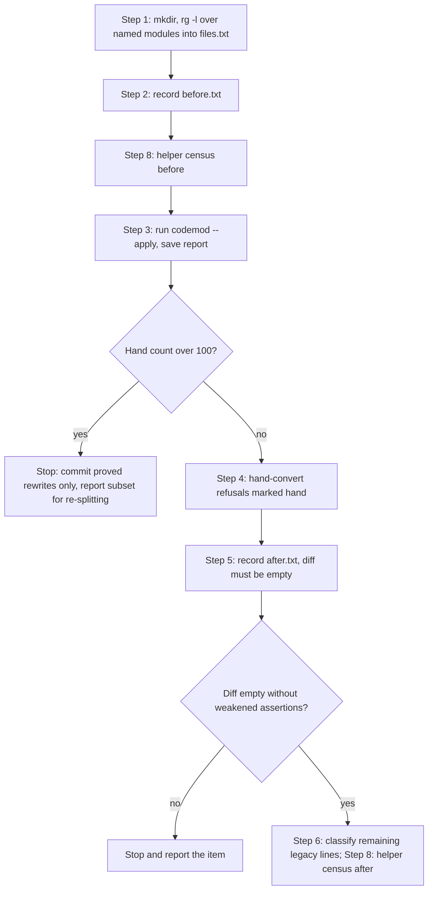

# IPD: Move spec, plan, lifecycle and orchestration test data chunk 3 of 10 onto the record builder

- Date: 2026-11-09
- Kind: child
- Concern: Spec `4sd62s` section 6 requires that test data be written by ONE shared record builder in phase B, so that the cutover (Order 13, `cxxmyv`) changes the builder and not hundreds of test files, and C10a requires the suite to pass at every commit. Research `nj8zdp` and the maintainer's ruling ("plans that obtuse and not-too-smart agents won't mess up") set the guidance of at most 5 E-items, 8 work Scope-Paths and about 8 named units per item; `7qxey9` named up to 25 modules per batch item. This part carries 8 of `7qxey9`'s modules (subsets G3b, G4a; 249 F-01 legacy lines at `3d0ddb845`), each item at most 4 modules, converted by the Order-49 codemod (`653ndz`) plus only its census-counted refusals.
- Scope: Chunk 3 of 10 of `7qxey9` (round-3 split 2026-11-09 per research `nj8zdp` guidance): the 8 test modules named in the items and in F-40, each item one codemod run under the batch rule below, plus a finishing item. EXCLUDES: every other module of the subsets (the other chunk plans and `7qxey9`); the builder (`9rgn2w`) and the codemod (`653ndz`); the F-03 EXCLUDED modules; production code; the switch-point proof, census and full-suite comparison (`59aiyh` E-11, E-12).
- Scope-Paths: tests/test_specs_status_dirs.py, tests/test_specs_verbs.py, tests/test_ipd_dependency_check.py, tests/test_ipd_dependency_statement_gate.py, tests/test_ipd_exec_finding_codes.py, tests/test_ipd_lifecycle_backward_edges.py, tests/test_ipd_lifecycle_cli.py, tests/test_ipd_lint.py, .aw/records/plans/pending/20261109-metastore-184-2zo3g5-move-spec-plan-lifecycle-and-orchestration-test-data-chunk-3.ipd.md
- Item-Dependencies: executed:653ndz, executed:9rgn2w, executed:g5hpbb, executed:tve77h, executed:xexn45
- Status: executed
- Readiness: go-pending-approval
- Review-Depth: standard
- From-Spec: 4sd62s
- Work-Kind: feature
- Priority: high
- Blocks-Release: next
- Set: metastore
- Order: 184
- Highest E allocated: 04
- Author: opencode its_direct/pt3-claude-opus-5.5-1m-us
- Id: 2zo3g5

> Write and proofread this plan per the technical writing standard, `.aw/system/workflows/technical-writing/technical-writing.md` (`.agents/workflows/technical-writing/technical-writing.md` in a legacy-layout install), including requirement 12 (diagrams).

## Workflow history
- 2026-11-22 executed (aw agy run model=Gemini-4-Neon-High): aw agy run self-finalize: 2zo3g5 verified (set metastore, attempt 1). [Scope reconciliation - in-scope-unmodified tests/test_ipd_dependency_check.py: declared-but-unmodified (auto-acknowledged by aw agy run); in-scope-unmodified tests/test_ipd_dependency_statement_gate.py: declared-but-unmodified (auto-acknowledged by aw agy run); in-scope-unmodified tests/test_ipd_exec_finding_codes.py: declared-but-unmodified (auto-acknowledged by aw agy run); in-scope-unmodified tests/test_ipd_lifecycle_backward_edges.py: declared-but-unmodified (auto-acknowledged by aw agy run); in-scope-unmodified tests/test_specs_status_dirs.py: declared-but-unmodified (auto-acknowledged by aw agy run); in-scope-unmodified tests/test_specs_verbs.py: declared-but-unmodified (auto-acknowledged by aw agy run)]
- 2026-11-21 cap-update (maintainer decision): raised Batch rule step 4 hand-refusal cap from 25 to 100 (raw site count over-counts list elements and .replace() pairs); completed sibling E-item and Step-3 commits from run-20261121T014040Z-2638602 were salvaged onto main, so modules already at 0 rewrites and 0 hand refusals remain unmodified and are acknowledged via --scope-ack at finalize.
- 2026-11-16 approved (aw set): status set to approved
- 2026-11-14 reviewed (antigravity/claude-opus-5.5): plan-review APPROVE WITH REVISIONS APPLIED; PR-001..PR-008 FIXED

- 2026-11-14 /plan-review (antigravity/claude-opus-5.5): APPROVE WITH REVISIONS APPLIED; PR-001, PR-002, PR-003, PR-004, PR-005, PR-006, PR-007, PR-008
- 2026-11-09 to-review (opencode its_direct/pt3-claude-opus-5.5-1m-us): split from 7qxey9 (round 3, research nj8zdp guidance).

## Goal

Every hand-built record in the 8 test modules named below comes from `tests/record_builder.py`, written by the Order-49 codemod or, for its census-counted refusals only, by hand, with each module's per-test outcomes identical before and after and every remaining legacy string classified.

## Detailed Implementation Checklist (TODO)

Execution-state rule: mark an `E-*` item complete only after performing the action. That mark is not validation. Right-sizing rule: write for a modest executor that cannot hold much in its head. Each E-item is one step (one concern, about one file, executable in one focused pass) and its V-item names each unit it covers with its own check; a plan stays at about 5 E-items and 8 work Scope-Paths, else split it into more child plans (guidance, `IPD-Z603`). Accepted execution states: blocked, failed, pending, performed; terminal gate demands 'performed'.

Batch rule, applied to every batch E-item of this plan (the `59aiyh` batch rule, restructured 2026-11-08 for the Order-49 fixture codemod `653ndz` per maintainer decision 2026-11-07 "Codemod first, then small runs": the tool performs the mechanical rewrite, and the hand work is bounded by its measured refusals). In it, "E-13's `full-before.txt`" and "the builder's `raw_fields=` escape (E-01)" are items of Order 37 (`9rgn2w`), carried by the round-3 split into Order 170 (`j6o96i`) with the same ids; because `.aw/state/` does not travel between lane worktrees, step 2 always records a fresh before list here. Step 1's partition is restricted to the modules each batch item names (round-3 split 2026-11-09: a subset is now spread over several plans of at most 8 modules each): a module that the partition now places in the item's subset but that no plan names is NOT added here; it is reported, and the finishing item of `7qxey9` converts it; a named module that no longer matches F-01 is reported and skipped:
1. Before the batch, run `mkdir -p .aw/state/59aiyh` (`.aw/state/` is untracked and starts empty in a lane worktree), then re-derive its file list at the current HEAD. Because the partition is restricted to the item's named modules, which all sit in the item's subset under the F-03 first-match rule (`test_spec*`/`test_specs*` in G3b, `test_ipd*` in G4a, per `7qxey9` F-41) and none is on the F-03 EXCLUDED list, the re-derivation is the F-01 pattern run over the named modules only: `rg -l --glob '*.py' -e '<the F-01 pattern>' <the item's named modules> > .aw/state/59aiyh/<batch>-files.txt`. A named module absent from the output no longer matches F-01 and is reported and skipped. The counts in each E-item are context measured at `3d0ddb845`, not the bar.
2. Record the unmodified per-test outcome list (a batch whose files a previous batch did not touch may reuse the matching lines of E-13's `full-before.txt`): `python3 -m pytest -o addopts="" -m "" -p no:randomly -n 0 -rA $(cat .aw/state/59aiyh/<batch>-files.txt) | grep -E "^(PASSED|FAILED|ERROR|SKIPPED|XFAIL|XPASS) " | sed -E 's/ - .*//' | sort > .aw/state/59aiyh/<batch>-before.txt`. `-p no:randomly` and `-n 0` make the list deterministic; `-m ""` includes `slow` and `livecorpus` modules.
3. Run the codemod: `python3 tools/fixture_codemod.py --apply --format json $(cat .aw/state/59aiyh/<batch>-files.txt) > .aw/state/59aiyh/<batch>-codemod.json`. It rewrites only the sites whose module outcome list it proved identical (`653ndz` E-03, carried with the same id into Order 172, `y3uowx`, by the round-3 split) and lists every other site as a refusal with a reason code and a disposition (`hand` or `legacy-kept`, the `653ndz` reason-code table). `y3uowx` E-01 specifies `--format table|json` for `--dry-run`; if `--apply` refuses `--format json`, run `--apply` without it, save its report as `.aw/state/59aiyh/<batch>-codemod.txt`, and read the same per-module rows (rewrites, refusals by reason code and disposition, before and after outcome-list hashes) from that file. V-items accept either file.
4. Hand-convert ONLY the refusals with disposition `hand`: the static count is the sum of the `653ndz` F-30 rows of the item's modules (round-3 split 2026-11-09: an item now carries part of a subset, so the subset's F-31 row is context only), and the codemod report adds any apply-time `not-equivalent` refusals; the item's hand count is their sum. If the hand count exceeds 100, stop after step 3 (the proved codemod rewrites may be committed), convert nothing by hand, and report the subset for re-splitting. A hand conversion uses builder calls; a test that deliberately writes an INVALID value (an unknown status, `- Status: EXECUTED`, `- Priority: bogus`, a malformed gate) gets it through the builder's `raw_fields=` escape (E-01) and is listed with reason class `invalid-input`. A refusal with disposition `legacy-kept` stays in legacy form on purpose and is listed with its F-06 reason class.
5. Re-run step 2's command into `<batch>-after.txt` and require `diff` to print nothing. A batch that would need any changed assertion other than a raw-byte metadata stand-in moved to `artifact_meta.read` (scope rule) stops and is reported; it does not weaken the assertion.
6. Count the remaining legacy strings with the F-01 `rg` pattern over the batch files, and give each remaining line one reason class from F-06: `legacy-format subject`, `displayed-output assertion`, `setter-byte assertion`, `invalid-input`, or `body prose` (for example open-question `- Status: open` rows, which N3 keeps in Markdown).
7. The builder never reads production source, and no test gains a source-reading assertion.
8. Helper census: run `rg -n "def _?(make|write|build|mk|seed)_(plan|spec|backlog|item|record|ipd|release|research|prompt|review|walkthrough)\w*" <the item's named modules>` before step 3 and after step 4 (the helper pattern of `59aiyh` V-09 and `1bshrb` E-38). The pattern misses record-text helpers with other names, so the census also lists each private function in the item's modules that returns or writes record text, named per item below; each such helper is deleted when it has no caller, otherwise listed with its reason.

### Task group 1: batch items

- [x] E-01 (carried from `7qxey9` E-01, batch subset G3b; round-3 split 2026-11-09) Batch G3b, 2 of its 18 modules (the spec tests (`test_spec*`, `test_specs*`)): `tests/test_specs_status_dirs.py`, `tests/test_specs_verbs.py`. F-01 legacy lines per module at `3d0ddb845` (context, not the bar): `test_specs_status_dirs` 23, `test_specs_verbs` 34. Run the codemod on these modules and apply the batch rule with `<batch>` = `G3b-2zo3g5-1` (outcome lists identical); hand-convert ONLY the refusals that the `653ndz` F-30 rows of these modules list with disposition `hand`, plus the codemod's apply-time `not-equivalent` refusals, and state their count (at most 100, the batch rule's stop); leave each refusal the census marks `legacy-kept` in legacy form with its reason class. A test that asserts the bytes a SETTER wrote (for example `test_status_set.py` checking the rewritten `- Status:` line) keeps that assertion in phase B, because the written format is the subject. Each such assertion is listed with reason class `setter-byte assertion`, so Order 13 can convert it to `artifact_meta.read` plus the in-file mirror. These modules held no helper matching the batch rule's step-8 pattern at the split, but `tests/test_specs_verbs.py::_spec` returns spec text (step 8's other-named class); it and any helper found now is deleted when it has no caller, or listed with its reason.
  - Depends on: none
  - Expected outcome: an empty before/after `diff` for the `G3b-2zo3g5-1` outcome lists; for each named module, its remaining legacy-string count and the reason class of every remaining line pasted; every deleted and surviving helper listed; the codemod report and the hand count (at most 100) pasted.
  - Execution state: performed

- [x] E-02 (carried from `7qxey9` E-02, batch subset G4a; round-3 split 2026-11-09) Batch G4a, 4 of its 21 modules (the plan, lint and IPD tests (`test_ipd*`, `test_plan*`, `test_plans*`)): `tests/test_ipd_dependency_check.py`, `tests/test_ipd_dependency_statement_gate.py`, `tests/test_ipd_exec_finding_codes.py`, `tests/test_ipd_lifecycle_backward_edges.py`. F-01 legacy lines per module at `3d0ddb845` (context, not the bar): `test_ipd_dependency_check` 18, `test_ipd_dependency_statement_gate` 3, `test_ipd_exec_finding_codes` 39, `test_ipd_lifecycle_backward_edges` 23. Run the codemod on these modules and apply the batch rule with `<batch>` = `G4a-2zo3g5-2` (outcome lists identical); hand-convert ONLY the refusals that the `653ndz` F-30 rows of these modules list with disposition `hand`, plus the codemod's apply-time `not-equivalent` refusals, and state their count (at most 100, the batch rule's stop); leave each refusal the census marks `legacy-kept` in legacy form with its reason class. Open-question rows (`- Blocking:`, `- Status: open`, `- Carrier:`) are body prose (N3) and are written through the builder's `body=` or `open_questions=` argument, never as metadata. Then delete each private record-building helper in these modules that no longer has a caller (at the split: `tests/test_ipd_dependency_statement_gate.py`: `_write_plan`; step 8's other-named class, measured at review HEAD `a78705a91`: `tests/test_ipd_dependency_check.py::_plan`, `tests/test_ipd_dependency_check.py::_spec`, `tests/test_ipd_dependency_check.py::_plan_from_spec`, `tests/test_ipd_dependency_statement_gate.py::_plan_text`); a surviving helper is listed with its reason.
  - Depends on: none
  - Expected outcome: an empty before/after `diff` for the `G4a-2zo3g5-2` outcome lists; for each named module, its remaining legacy-string count and the reason class of every remaining line pasted; every deleted and surviving helper listed; the codemod report and the hand count (at most 100) pasted.
  - Execution state: performed

- [x] E-03 (carried from `7qxey9` E-02, batch subset G4a; round-3 split 2026-11-09) Batch G4a, 2 of its 21 modules (the plan, lint and IPD tests (`test_ipd*`, `test_plan*`, `test_plans*`)): `tests/test_ipd_lifecycle_cli.py`, `tests/test_ipd_lint.py`. F-01 legacy lines per module at `3d0ddb845` (context, not the bar): `test_ipd_lifecycle_cli` 24, `test_ipd_lint` 85. Run the codemod on these modules and apply the batch rule with `<batch>` = `G4a-2zo3g5-3` (outcome lists identical); hand-convert ONLY the refusals that the `653ndz` F-30 rows of these modules list with disposition `hand`, plus the codemod's apply-time `not-equivalent` refusals, and state their count (at most 100, the batch rule's stop); leave each refusal the census marks `legacy-kept` in legacy form with its reason class. Open-question rows (`- Blocking:`, `- Status: open`, `- Carrier:`) are body prose (N3) and are written through the builder's `body=` or `open_questions=` argument, never as metadata. Then delete each private record-building helper in these modules that no longer has a caller (at the split: `tests/test_ipd_lifecycle_cli.py`: `_write_plan`; step 8's other-named class, measured at review HEAD `a78705a91`: `tests/test_ipd_lifecycle_cli.py::_ready_plan_text` (already delegates to `tests/support.py::ready_plan_text`), `tests/test_ipd_lifecycle_cli.py::_completed_plan_text`, `tests/test_ipd_lint.py::_conforming_child`, `tests/test_ipd_lint.py::_executed_child`); a surviving helper is listed with its reason. `tests/test_ipd_lint.py` tests the IPD linter, so plan text whose structure is the linter's subject stays where the codemod marks it `legacy-kept` (reason class `legacy-format subject`).
  - Depends on: none
  - Expected outcome: an empty before/after `diff` for the `G4a-2zo3g5-3` outcome lists; for each named module, its remaining legacy-string count and the reason class of every remaining line pasted; every deleted and surviving helper listed; the codemod report and the hand count (at most 100) pasted.
  - Execution state: performed

### Task group 2: finish

- [x] E-04 Finish this part: run the batch rule's step-2 command once over every module of this plan (`$(cat .aw/state/59aiyh/G3b-2zo3g5-1-files.txt .aw/state/59aiyh/G4a-2zo3g5-2-files.txt .aw/state/59aiyh/G4a-2zo3g5-3-files.txt)`) into `.aw/state/59aiyh/2zo3g5-union-after.txt` and confirm it equals the sorted concatenation of the items' `-before.txt` lists; run the bare core gate `python3 -m pytest` and `aw sanitize --agent`; commit through `aw commit 2zo3g5 -- <each changed path>`, one commit per item allowed, never `git add -A`, a bare `git add` or `git commit -a`. Never push. (The full-suite comparison stays in `59aiyh` E-12.)
  - Depends on: E-01, E-02, E-03
  - Expected outcome: the union comparison is empty; all runs pass; every commit is path-scoped to Scope-Paths (or justified at finalize).
  - Execution state: performed

## Project conventions discovered (Step 0)

- Interface names from Order 02 (`tve77h`): `agent_workflows/artifact_meta.py::registry_fields`, `agent_workflows/artifact_meta.py::validate_event`, `agent_workflows/artifact_meta.py::validate_new_events`, `agent_workflows/artifact_meta.py::read`, `agent_workflows/artifact_meta.py::create` and `agent_workflows/artifact_meta.py::append`. Order 02's `create`/`append` write the log format; `2xwb9b` E-03 adds the phase-B legacy branch of `append` and `xexn45` E-01 routes the phase-B branch of `create` and `append` through `write_legacy`, with `agent_workflows/artifact_meta.py::render_legacy_text` (`xexn45` E-11) as the same renderer over a string. In phase B the on-disk format is the bullet format; the legacy loader reads it into the cache.
- `agent_workflows/review_findings.py::render_review` (pure) and `agent_workflows/review_findings.py::write_review` render and write a `.review.md` record; no CLI calls `write_review` (`xexn45` Findings).
- The existing shared plan builder is `tests/support.py::ready_plan_text`, which is "BUILT FROM THE REAL GENERATOR (`agent_workflows/ipd_authoring.py::build_skeleton`)" and then fills the fields a draft leaves open; the builder keeps that approach for plans, so a scaffold change still reaches every fixture.
- Shared test plumbing lives in `tests/support.py` (`init_repo`, `git`, `run_cli`, `pinned_env`, `ready_plan_text`, `scope_drift_repo`); `tests/repo_template.py` (`copy_template_repo`) gives a pre-built repository; there is no `tests/conftest.py`, and the root `conftest.py` owns tier selection.
- Tests are behavioral (AGENTS.md "TEST OUTCOMES, NOT CODE STRUCTURE"); core modules set `pytestmark = pytest.mark.core`; `slow` tests are listed in `tests/slow_allowlist.txt`; `pyproject.toml` `addopts` deselects `slow` and `livecorpus`, so a complete comparison passes `-m ""`, and `pytest-randomly` is installed, so a deterministic order needs `-p no:randomly`.
- `tests/fixtures/review-pilot/` is the input corpus of `tools/review_pilot.py` (`manifest.json` names each plan file, `defects.json` quotes exact text to plant), and `tests/test_review_pilot.py` copies the whole directory into its fixture repository.
- Filenames come from `agent_workflows/artifact_naming.py::build_clustered_name` and parse with `agent_workflows/artifact_naming.py::parse_clustered`.
- Cite code by repo-relative `path::Symbol` or by a quoted content string, with a line number only appended to one of those and never alone: an offset expires before this plan executes (spec `ipd-structure-and-linting` Section 10.2; advisory `IPD-C801`).

## Findings

Measured 2026-11-09 at `3d0ddb845` for F-40; F-01, F-03, F-06 and F-08 copied from `7qxey9` (measured at `0cbfcc706` and at review).

| Id | Evidence | Finding |
|---|---|---|
| F-01 | `rg -l --glob '*.py' -e '- (Id|Status|Set|Kind|Blocks-Release|Readiness|Item-Dependencies|Scope-Paths|From-Backlog|From-Spec|Work-Kind|Priority|Order|Date|Gate-Kind|Gate-Ref|Approval|Subject-Id|Verdict|Graduated-To):|## Workflow history' tests` lists 309 files (307 test modules, `support.py`, `conformance_matrix.py`) of 717 Python files; 6,638 matching lines. The narrower `- Id:`/`- Status:`/`## Workflow history` pattern: 300 files, 3,430 lines | Spec section 6 counted 268 of 680 files and 2,607 matches at round 2; the plan's pattern is broader (21 fields). |
| F-03 | Family split by filename prefix, re-measured at review (HEAD `4a7499289`, 311 files, 6,657 lines) with a FIRST-MATCH rule (a file goes to the first group, in order G1 to G6, whose pattern list matches its basename; unmatched files go to G7): G1 39 files, 1,568 lines; G2 22, 1,102; G3 28, 795; G4 63, 1,244; G5 46, 598; G6 69, 1,004; G7 44, 346. Six files match two groups and are assigned by that rule (`test_ipd_authoring` G3, `test_readiness_absence_invariant` G4, `test_runner_backlog_close_behavior` G1, `test_orchestrator_retire_closes_backlog` G1, `test_records_only_lane_rederive` G5, `test_ipdrunner_runagy_shim` G4). The authored counts (G6 99, G7 11) did not sum to the file total; the first-match rule makes the partition exhaustive and disjoint. EXCLUDED from every batch (literal legacy input is their subject; owned by other plans): `tests/test_artifact_meta_*.py` (`tve77h`, `2xwb9b`), `tests/test_artifact_meta_legacy_writer.py` and `tests/test_writers_*.py` (`xexn45`), `tests/test_m0001_*.py` and `tests/test_migrations_chain.py` (`dcerjg`, `ya4ee4`) | Seven batches (E-03 to E-09); G1, G4 and G6 carry a pre-measured split seam (OQ-01). |
| F-06 | (written by E-11) remaining legacy strings in `tests/` after the batches, each with one reason class: `legacy-format subject`, `displayed-output assertion`, `setter-byte assertion`, `invalid-input`, `body prose` | Order 13 changes the builder plus the F-06 rows of class `setter-byte assertion`; `invalid-input` rows already go through `raw_fields=` and need a decision at the cutover (an invalid bullet has no log-format equivalent); every other class is either a legacy-format test (moved to the migration tests at the cutover) or prose. |
| F-08 | At review, 15 test modules write a deliberately invalid metadata value (for example `tests/test_releases.py` "`- Status: bogus`", `tests/test_check_engine.py` "`- Status: EXECUTED`", `tests/test_specs_set_adapter.py` "`- Priority: bogus`") | A builder that validates every field cannot build these; E-01 adds `raw_fields=` and the batch rule lists them as `invalid-input`. |
| F-40 | `rg -c` with the F-01 pattern over this part's modules at `3d0ddb845`; subset by the F-03 first-match rule; helpers as listed by `7qxey9` at the 2026-11-07 split | See the table below; every module is named in exactly one item. |

| Module | Subset | F-01 lines | Helpers at the split | Item |
|---|---|---|---|---|
| `tests/test_specs_status_dirs.py` | G3b | 23 | none | E-01 |
| `tests/test_specs_verbs.py` | G3b | 34 | none | E-01 |
| `tests/test_ipd_dependency_check.py` | G4a | 18 | none | E-02 |
| `tests/test_ipd_dependency_statement_gate.py` | G4a | 3 | `_write_plan` | E-02 |
| `tests/test_ipd_exec_finding_codes.py` | G4a | 39 | none | E-02 |
| `tests/test_ipd_lifecycle_backward_edges.py` | G4a | 23 | none | E-02 |
| `tests/test_ipd_lifecycle_cli.py` | G4a | 24 | `_write_plan` | E-03 |
| `tests/test_ipd_lint.py` | G4a | 85 | none | E-03 |

## Proposed changes (ordered, validatable)

1. Convert each item's modules under the batch rule (E-01 to E-03).
2. Re-run the union, the core gate, commit (E-04).

Batch rule per item (E-01 to E-03); the numbered text above is normative:



## Deferred / out of scope (with reason)

- The other modules of subsets G3b, G4a, the partition re-derivation that catches modules no plan names, and the subsets' finishing checks.
  - Carrier: 7qxey9
- The fixture codemod and its census (F-30, F-31).
  - Carrier: 653ndz
  - Carrier-Evidence: .aw/records/plans/executed/20261108-metastore-49-653ndz-build-and-prove-the-test-fixture-codemod.ipd.md
- The builder, its tests, the baselines and the tracked fixtures.
  - Carrier: 9rgn2w
  - Carrier-Evidence: .aw/records/plans/executed/20261107-metastore-37-9rgn2w-add-the-shared-test-record-builder-and-convert-the-tracked-r.ipd.md
- The switch-point proof, the F-06 census and the full-suite comparison.
  - Carrier: 59aiyh
- Adding `RECORD_FORMAT = "log"` and converting setter-byte assertions (cutover commit).
  - Carrier: cxxmyv

## Scope check

- Over-scope: none. No production module changes; every Scope-Paths entry is a module named in one item, plus this plan.
- Under-scope: none known. Size: 4 E-items (3 batch items of at most 4 modules each and the finish), 8 work Scope-Paths.

## Required tests / validation

Each item is validated by an identical per-test result list before and after (the batch rule), which is behavioral by construction: the same tests, unchanged assertions, the same outcomes. Commands: the batch rule's command per item, the codemod's `--apply` report, the bare core gate `python3 -m pytest`, `aw sanitize --agent`. CONTRIBUTES to AC-1b (owned by `cxxmyv`).

## Spec / documentation sync

No spec change; implements part of `4sd62s` section 6 and section 7 step 6.

## Open questions

### OQ-01: Can this part run in any order relative to the other chunk plans?

- Blocking: no
- Status: resolved
- Owner: plan author
- Resolution or deferral rationale: Yes. The module lists of all chunk plans are disjoint, each needs the builder (`9rgn2w`) and the codemod (`653ndz`), and none edits `tests/support.py` (that is `59aiyh` E-09, which runs last). Recommendation strength: strong.

## Validation and cross-check (verify before reporting done)

Validation-state rule: inspect evidence in a separate pass. Do not mark a `V-*` item complete from memory or from the matching execution checkmark. Accepted validation results: blocked, failed, pass, pending; terminal gate demands 'pass'. Runtime-demonstration reachability rule: for each `V-*` item demanding the software be observed acting (such as a run, a dispatch, or a transition), as distinct from items demanding a diff, a file's content, or a test result, which are reachable by construction, name the code path that produces the observation or the sibling `E-*` that creates it, else the demand is UNDER-SCOPE.

- [x] V-01 validates E-01
  - Required evidence: paste `.aw/state/59aiyh/G3b-2zo3g5-1-files.txt` and the empty `diff .aw/state/59aiyh/G3b-2zo3g5-1-before.txt .aw/state/59aiyh/G3b-2zo3g5-1-after.txt`; then, for each of `tests/test_specs_status_dirs.py`, `tests/test_specs_verbs.py` separately: its before and after F-01 `rg -c` count, the reason class of every remaining match, its rows of `.aw/state/59aiyh/G3b-2zo3g5-1-codemod.json` (or `-codemod.txt`, batch rule step 3) (rewrites, refusals by reason code and disposition, before and after outcome-list hashes) and its `653ndz` F-30 row; the hand count with every hand-converted site listed (module, line, reason code), and the list of setter-byte assertions kept for Order 13 (file::test and the asserted line); and the before and after helper census of batch rule step 8 over these modules (its `rg` output and its other-named helpers) with each deleted and surviving helper and its reason.
  - Observed evidence:
    - `.aw/state/59aiyh/G3b-2zo3g5-1-files.txt`: `tests/test_specs_status_dirs.py`, `tests/test_specs_verbs.py`.
    - `diff -u .aw/state/59aiyh/G3b-2zo3g5-1-before.txt .aw/state/59aiyh/G3b-2zo3g5-1-after.txt`: empty output, exit code 0 (`28` outcomes before and after).
    - Note on salvaged E-01 commit: commit `367e24474` (salvaged onto `main` from `run-20261121T014040Z-2638602`) had already moved all E-01 fixtures onto `RecordBuilder` and deleted `tests/test_specs_verbs.py::_spec`. At `3f626bbf6`, both modules have 0 rewrites and 0 hand refusals and remain unmodified (acknowledged via `--scope-ack` at finalize per 2026-11-21 `cap-update`).
    - `tests/test_specs_status_dirs.py`:
      - F-01 `rg -c`: 3 before (at `3f626bbf6`; 23 at split `3d0ddb845`) -> 3 after.
      - Remaining 3 F-01 matches: L71 `self.assertIn("- Status: draft", created.read_text(encoding="utf-8"))`, L132 `self.assertIn("- Status: to-review", dest_path.read_text(encoding="utf-8"))`, L196 `self.assertIn("- Status: to-review", dest_path.read_text(encoding="utf-8"))` (all 3 `setter-byte assertion`).
      - `G3b-2zo3g5-1-codemod.json`: sites=3, rewrites=0 (standard=0, invalid-input=0), refusals=3 (`setter-byte assertion`=3 `legacy-kept`), before_hash=None, after_hash=None, equivalent=True.
      - `653ndz` F-30 row: `| tests/test_specs_status_dirs.py | G3b | 2zo3g5 | 8 | 5 | 0 | 0 | 0 | 0 | 0 | 0 | 3 | 0 | 0 | 3 |`.
    - `tests/test_specs_verbs.py`:
      - F-01 `rg -c`: 13 before (at `3f626bbf6`; 34 at split `3d0ddb845`) -> 13 after.
      - Remaining 13 F-01 matches: 1 `body prose` (L101 fenced example inside `RecordBuilder().spec(..., body="## 8.4 gates\n\nExample:\n\n```\n- Status: deferred\n- Gate-Kind: issue\n- Gate-Ref: <ref>\n```")`) and 12 `setter-byte assertion` (L192, L281, L327, L328, L346, L347, L467, L469, L502, L503, L504, L564).
      - `G3b-2zo3g5-1-codemod.json`: sites=12, rewrites=0 (standard=0, invalid-input=0), refusals=12 (`setter-byte assertion`=12 `legacy-kept`), before_hash=None, after_hash=None, equivalent=True.
      - `653ndz` F-30 row: `| tests/test_specs_verbs.py | G3b | 2zo3g5 | 32 | 4 | 3 | 1 | 16 | 0 | 0 | 0 | 11 | 0 | 17 | 11 |`.
    - Hand count: 0 remaining at `3f626bbf6` (17 static in `653ndz` F-30 were already converted in salvaged commit `367e24474`, 0 apply-time `not-equivalent`; <= 100). Hand-converted sites in this run: none.
    - Setter-byte assertions kept for Order 13 (15 total):
      - `tests/test_specs_status_dirs.py::SpecStatusDirectoriesTests::test_specs_run_new_places_file_in_draft_dir` (L71 `self.assertIn("- Status: draft", created.read_text(encoding="utf-8"))`)
      - `tests/test_specs_status_dirs.py::SpecStatusDirectoriesTests::test_specs_run_set_relocates_file_on_transition` (L132 `self.assertIn("- Status: to-review", dest_path.read_text(encoding="utf-8"))`)
      - `tests/test_specs_status_dirs.py::SpecStatusDirectoriesTests::test_status_set_run_set_command_relocates_spec` (L196 `self.assertIn("- Status: to-review", dest_path.read_text(encoding="utf-8"))`)
      - `tests/test_specs_verbs.py::SetTests::test_legal_transition_updates_status_and_one_history` (L192 `self.assertIn("- Status: to-review", t)`)
      - `tests/test_specs_verbs.py::SetTests::test_approved_requires_human_and_is_refused_non_tty` (L281 `self.assertIn("- Status: approved", t2)`)
      - `tests/test_specs_verbs.py::SetTests::test_deferred_gate_roundtrip` (L327 `self.assertIn("- Gate-Kind: issue", t)`, L328 `self.assertIn("- Gate-Ref: https://example.com/i/1", t)`, L346 `self.assertNotIn("- Gate-Kind:", t)`, L347 `self.assertNotIn("- Gate-Ref:", t)`)
      - `tests/test_specs_verbs.py::MigrateTests::test_migrate_free_form_to_bare_enum` (L467 `self.assertIn("- Status: implemented", t)`, L469 `self.assertIn("## Workflow history", t)`)
      - `tests/test_specs_verbs.py::MigrateTests::test_migrate_to_deferred_with_gate` (L502 `self.assertIn("- Status: deferred", t)`, L503 `self.assertIn("- Gate-Kind: artifact", t)`, L504 `self.assertIn("- Gate-Ref: TODO.md", t)`)
      - `tests/test_specs_verbs.py::NoteTests::test_note_appends_one_record_only` (L564 `self.assertIn("- Status: draft", t)`)
    - Step 8 helper census: `rg` pattern output before = `(none)`, after = `(none)`. Other-named record-text helper `tests/test_specs_verbs.py::_spec` was already deleted in salvaged commit `367e24474`. Surviving record-text helpers: none (`_args` in `tests/test_specs_verbs.py` constructs `argparse.Namespace`, not record text).
  - Result: pass

- [x] V-02 validates E-02
  - Required evidence: paste `.aw/state/59aiyh/G4a-2zo3g5-2-files.txt` and the empty `diff .aw/state/59aiyh/G4a-2zo3g5-2-before.txt .aw/state/59aiyh/G4a-2zo3g5-2-after.txt`; then, for each of `tests/test_ipd_dependency_check.py`, `tests/test_ipd_dependency_statement_gate.py`, `tests/test_ipd_exec_finding_codes.py`, `tests/test_ipd_lifecycle_backward_edges.py` separately: its before and after F-01 `rg -c` count, the reason class of every remaining match, its rows of `.aw/state/59aiyh/G4a-2zo3g5-2-codemod.json` (or `-codemod.txt`, batch rule step 3) (rewrites, refusals by reason code and disposition, before and after outcome-list hashes) and its `653ndz` F-30 row; the hand count with every hand-converted site listed (module, line, reason code); and the before and after helper census of batch rule step 8 over these modules (its `rg` output and its other-named helpers) with each deleted and surviving helper and its reason.
  - Observed evidence:
    - `.aw/state/59aiyh/G4a-2zo3g5-2-files.txt`: `tests/test_ipd_dependency_check.py` (`tests/test_ipd_dependency_statement_gate.py`, `tests/test_ipd_exec_finding_codes.py`, and `tests/test_ipd_lifecycle_backward_edges.py` have 0 F-01 matches at `3f626bbf6` after salvaged commit `d12640fc3` and are reported and skipped per batch rule step 1).
    - `diff -u .aw/state/59aiyh/G4a-2zo3g5-2-before.txt .aw/state/59aiyh/G4a-2zo3g5-2-after.txt`: empty output, exit code 0 (`12` outcomes before and after).
    - Note on salvaged E-02 commit: commit `d12640fc3` (salvaged onto `main` from `run-20261121T014040Z-2638602`) had already moved all E-02 fixtures onto `RecordBuilder` and deleted `_write_plan` and `_plan_text` in `tests/test_ipd_dependency_statement_gate.py`. At `3f626bbf6`, all 4 modules have 0 rewrites and 0 hand refusals and remain unmodified (acknowledged via `--scope-ack` at finalize per 2026-11-21 `cap-update`).
    - `tests/test_ipd_dependency_check.py`:
      - F-01 `rg -c`: 2 before (at `3f626bbf6`; 18 at split `3d0ddb845`) -> 2 after.
      - Remaining 2 F-01 matches: L857 class docstring (`- Item-Dependencies:`) and L976 function docstring (`- From-Spec:`) (both `body prose`).
      - `G4a-2zo3g5-2-codemod.json`: sites=0, rewrites=0 (standard=0, invalid-input=0), refusals=0, before_hash=None, after_hash=None, equivalent=True.
      - `653ndz` F-30 row: `| tests/test_ipd_dependency_check.py | G4a | 2zo3g5 | 7 | 3 | 0 | 4 | 0 | 0 | 0 | 0 | 0 | 0 | 4 | 0 |`.
    - `tests/test_ipd_dependency_statement_gate.py`:
      - F-01 `rg -c`: 0 before (at `3f626bbf6`; 3 at split `3d0ddb845`) -> 0 after (absent from `G4a-2zo3g5-2-files.txt`, skipped).
      - Remaining matches: none. `G4a-2zo3g5-2-codemod.json`: not run (0 F-01 matches).
      - `653ndz` F-30 row: `| tests/test_ipd_dependency_statement_gate.py | G4a | 2zo3g5 | 1 | 1 | 0 | 0 | 0 | 0 | 0 | 0 | 0 | 0 | 0 | 0 |`.
    - `tests/test_ipd_exec_finding_codes.py`:
      - F-01 `rg -c`: 0 before (at `3f626bbf6`; 39 at split `3d0ddb845`) -> 0 after (absent from `G4a-2zo3g5-2-files.txt`, skipped).
      - Remaining matches: none. `G4a-2zo3g5-2-codemod.json`: not run (0 F-01 matches).
      - `653ndz` F-30 row: `| tests/test_ipd_exec_finding_codes.py | G4a | 2zo3g5 | 3 | 3 | 0 | 0 | 0 | 0 | 0 | 0 | 0 | 0 | 0 | 0 |`.
    - `tests/test_ipd_lifecycle_backward_edges.py`:
      - F-01 `rg -c`: 0 before (at `3f626bbf6`; 23 at split `3d0ddb845`) -> 0 after (absent from `G4a-2zo3g5-2-files.txt`, skipped).
      - Remaining matches: none. `G4a-2zo3g5-2-codemod.json`: not run (0 F-01 matches).
      - `653ndz` F-30 row: `| tests/test_ipd_lifecycle_backward_edges.py | G4a | 2zo3g5 | 2 | 2 | 0 | 0 | 0 | 0 | 0 | 0 | 0 | 0 | 0 | 0 |`.
    - Hand count: 0 remaining at `3f626bbf6` (4 static in `653ndz` F-30 were already converted in salvaged commit `d12640fc3`, 0 apply-time `not-equivalent`; <= 100). Hand-converted sites in this run: none.
    - Step 8 helper census: `rg` pattern output before = `(none)`, after = `(none)`. Deleted helpers (already deleted in salvaged commit `d12640fc3`): `tests/test_ipd_dependency_statement_gate.py::_write_plan`, `tests/test_ipd_dependency_statement_gate.py::_plan_text`. Surviving other-named record helpers: `tests/test_ipd_dependency_check.py::_plan`, `tests/test_ipd_dependency_check.py::_spec`, `tests/test_ipd_dependency_check.py::_plan_from_spec` (all three delegate to `RecordBuilder().plan(...)` / `RecordBuilder().spec(...)` with zero raw legacy strings and have active callers across the six test classes in `tests/test_ipd_dependency_check.py`).
  - Result: pass

- [x] V-03 validates E-03
  - Required evidence: paste `.aw/state/59aiyh/G4a-2zo3g5-3-files.txt` and the empty `diff .aw/state/59aiyh/G4a-2zo3g5-3-before.txt .aw/state/59aiyh/G4a-2zo3g5-3-after.txt`; then, for each of `tests/test_ipd_lifecycle_cli.py`, `tests/test_ipd_lint.py` separately: its before and after F-01 `rg -c` count, the reason class of every remaining match, its rows of `.aw/state/59aiyh/G4a-2zo3g5-3-codemod.json` (or `-codemod.txt`, batch rule step 3) (rewrites, refusals by reason code and disposition, before and after outcome-list hashes) and its `653ndz` F-30 row; the hand count with every hand-converted site listed (module, line, reason code); and the before and after helper census of batch rule step 8 over these modules (its `rg` output and its other-named helpers) with each deleted and surviving helper and its reason.
  - Observed evidence:
    - `.aw/state/59aiyh/G4a-2zo3g5-3-files.txt`: `tests/test_ipd_lifecycle_cli.py`, `tests/test_ipd_lint.py`.
    - `diff -u .aw/state/59aiyh/G4a-2zo3g5-3-before.txt .aw/state/59aiyh/G4a-2zo3g5-3-after.txt`: empty output, exit code 0 (`150` outcomes before and after).
    - Note on salvaged Step-3 commit: commit `04b06e657` (salvaged onto `main` from `run-20261121T014040Z-2638602`) had already applied the 2 proved Step-3 codemod rewrites in `tests/test_ipd_lint.py`, so the fresh Step-3 run at `3f626bbf6` applied 0 further rewrites and isolated the 88 remaining hand refusals (87 static in F-30 plus 1 apply-time `not-equivalent`). Post-edit `tools/fixture_codemod.py --dry-run` confirmed `hand=0 legacy-kept=17`.
    - `tests/test_ipd_lifecycle_cli.py`:
      - F-01 `rg -c`: 24 before (at `3f626bbf6` and split `3d0ddb845`) -> 4 after.
      - Remaining 4 F-01 matches (post-format): L548 `self.assertIn("- Status: executed", moved_text)` (`FinalizeTests::test_finalize_happy_path_preview_and_evidence_surfacing`), L2753 `self.assertIn("- Status: executed", moved)` (`DelegationAndBypassRemovalTests::test_set_executed_delegation_variants`), L2812 `self.assertIn("- Status: approved", draft.read_text(encoding="utf-8"))` (`DelegationAndBypassRemovalTests::test_non_delegated_transitions_preserve_direct_paths`), L3002 `self.assertIn("- Status: reviewed", text)` (`ParenthesizedActorIsRefusedBeforeAnyWrite::test_the_slash_form_is_ACCEPTED_so_the_guard_is_not_over_broad`) (all 4 `setter-byte assertion`).
      - `G4a-2zo3g5-3-codemod.json`: sites=27, rewrites=0 (standard=0, invalid-input=0), refusals=27 (`dynamic-construction`=1 `hand`, `unsupported-shape`=22 `hand`, `setter-byte assertion`=4 `legacy-kept`), before_hash=None, after_hash=None, equivalent=True.
      - `653ndz` F-30 row: `| tests/test_ipd_lifecycle_cli.py | G4a | 2zo3g5 | 27 | 0 | 0 | 1 | 22 | 0 | 0 | 0 | 4 | 0 | 23 | 4 |`.
    - `tests/test_ipd_lint.py`:
      - F-01 `rg -c`: 83 before (at `3f626bbf6`; 85 at split `3d0ddb845`) -> 23 after.
      - Remaining 23 F-01 matches (post-format): 1 `legacy-format subject` (L239 YAML frontmatter exclusion fixture in `ParserExclusionTests.EXCLUSIONS`, tagged `legacy-kept` by codemod); 22 `body prose` (L104 `- Status: open` in `_CONFORMING_CHILD_BODY` Open questions N3; L384, L402 table `why` prose; L477, L478 Open questions N3; L585, L588, L606, L617, L784, L1014 docstrings/comments; L1078, L1079 Open questions N3; L1428 diagnostic message substring assertion; L2934, L2935, L2942, L2946, L2962 IPD-G801 gate-clause prose fixtures; L3104, L3445, L4139 docstrings).
      - `G4a-2zo3g5-3-codemod.json`: sites=77, rewrites=0 (standard=0, invalid-input=0), refusals=77 (`dynamic-construction`=3 `hand`, `unsupported-shape`=61 `hand`, `not-equivalent`=1 `hand`, `body prose`=12 `legacy-kept`), before_hash=`bf1a568dfe1c3d6e7a7f0e18c0fb805cc6ef34ecb3dae7ae289a67a119963d80`, after_hash=`bf1a568dfe1c3d6e7a7f0e18c0fb805cc6ef34ecb3dae7ae289a67a119963d80`, equivalent=True.
      - `653ndz` F-30 row: `| tests/test_ipd_lint.py | G4a | 2zo3g5 | 79 | 3 | 0 | 3 | 61 | 0 | 0 | 0 | 0 | 12 | 64 | 12 |`.
    - Hand count: 88 (87 static in `653ndz` F-30 [23 + 64] + 1 apply-time `not-equivalent`; <= 100). Hand-converted sites (pre-edit lines at `3f626bbf6`):
      - `tests/test_ipd_lifecycle_cli.py` (23 hand sites): L177, L178 (`unsupported-shape`, `_ready_plan_text(scope_paths=...)`); L288, L289 (`unsupported-shape`, `AM.render_legacy_text` history append); L385 x2, L386 (`unsupported-shape`, `_ready_plan_text(status="draft")`); L396 (`unsupported-shape`, `RecordBuilder().plan(..., raw_fields={"Id": None})`); L472 x2, L473 (`unsupported-shape`, `_ready_plan_text(status="draft")`); L663, L664 (`unsupported-shape`, `_completed_plan_text(scope_paths=...)`); L937 (`unsupported-shape`) and L938 (`dynamic-construction`) (`_completed_plan_text(scope_paths=f"...{added}")`); L1174, L1175 (`unsupported-shape`, `_completed_plan_text(scope_paths="agent_workflows/demo.py")`); L2102, L2103 (`unsupported-shape`, `_completed_plan_text(plan_id="ghi789", scope_paths="agent_workflows/demo.py")`); L2759 (`unsupported-shape`, `RecordBuilder().prompt(id6="pr0mp7", status="pending", set="demoprompt", body="# Prompt\n\nbody\n", text_only=True)`); L2789 x2, L2790 (`unsupported-shape`, `_completed_plan_text(plan_id="drf123", scope_paths="grandfathered", status="to-review")`).
      - `tests/test_ipd_lint.py` (65 hand sites): L56-142 (`not-equivalent`, `_conforming_child` converted to `RecordBuilder().plan(..., text_only=True)` with optional kwargs); L151 x2, L153, L154 (`unsupported-shape`, `_executed_child` delegates to `_conforming_child`); L348 x2 (`unsupported-shape`, `_conforming_child(plan_role="orchestrator")`); L359 x2 (`unsupported-shape`, `_conforming_child(status="auto-approved")`); L571-573 (`dynamic-construction`) and L576, L577, L580 x2 (`unsupported-shape`) (`ReadinessAttestationTests._plan` via `_conforming_child`); L771, L773, L775, L777, L780 x2 (`unsupported-shape`, `ReadinessRequiredTests._plan` via `_conforming_child`, blank readiness via `raw_fields={"Readiness": ""}`); L1049 x2, L1052 (`unsupported-shape`, `CheckpointPhaseTests._approved_with_blocking_question` via `_conforming_child`); L1257, L1261, L1262-1263 (`unsupported-shape`, `PostTransitionExecutedHistoryTests._executed_with` via `_executed_child`); L1432 x2 (`unsupported-shape`, `_conforming_child(status="executed")`); L1919, L1925 (`unsupported-shape`, `DensityAdvisoryLintTests._dense_child(ready=...)` via `_conforming_child`, deleted `_ready_to_execute`); L2151 (`unsupported-shape`) and L2152 (`dynamic-construction`) (`CitationAnchorAdvisoryTests._plan` via `_conforming_child(when=...)`); L2541 (`unsupported-shape`), L2545 (`dynamic-construction`), L2560, L2561, L2565, L2566, L2567 (`unsupported-shape`) (deleted `_with_scope_paths` and `_approved`, converted callers in `ScopePathsCheckpointTests` and `ParenthesizedActorParsesInTheAttributionRegex` to `_conforming_child`/`_executed_child`); L2920 x2, L2922-2924 (`unsupported-shape`, `_conforming_child(status="executed", history=...)`); L3272 x2, L3273 x2, L3356 x2 (`unsupported-shape`, `SetidLengthLintTests._plan_text` via `_conforming_child(when=..., status=..., raw_fields={"Set": ...})`); L3381, L3384, L3390, L3393, L3394, L3395, L3396, L3399, L3401 (`unsupported-shape`, `TerminalPathStatusLintTests._plan` via `_conforming_child(..., raw_fields=...)` including `invalid-input` `raw_fields={"Status": "EXECUTED"}` / `{"Status": None}` / `{"Date": None}`); L3548 x2, L3556 x2, L3635 x2 (`unsupported-shape`, `CitationAnchorsOnDemandTests` fixtures via `_conforming_child`); L4186 x2 (`unsupported-shape`, `DateMetadataLintTests` via `_conforming_child(raw_fields={"Date": "2026-07-23 (fleshed later)"})`, `invalid-input`).
    - Step 8 helper census: `rg` pattern output before = 1 (`tests/test_ipd_lifecycle_cli.py:84:def _write_plan`), after = 1 (`tests/test_ipd_lifecycle_cli.py:90:def _write_plan`). Deleted other-named helpers: `tests/test_ipd_lint.py::_with_scope_paths`, `tests/test_ipd_lint.py::_approved`, `tests/test_ipd_lint.py::DensityAdvisoryLintTests._ready_to_execute` (no callers left after builder conversion). Surviving helpers (all backed by `RecordBuilder` / `support.ready_plan_text` with zero raw legacy strings; retained for active internal and out-of-scope external callers, verified via 15 external importer test modules: `184 passed in 35.27s`): `tests/test_ipd_lifecycle_cli.py::_write_plan` (pure file writer imported by 7 out-of-scope test modules), `tests/test_ipd_lifecycle_cli.py::_ready_plan_text` (delegates to `support.ready_plan_text`), `tests/test_ipd_lifecycle_cli.py::_completed_plan_text` (delegates to `_ready_plan_text`, imported externally), `tests/test_ipd_lint.py::_conforming_child` and `tests/test_ipd_lint.py::_executed_child` (backed by `RecordBuilder().plan(..., text_only=True)`, imported by 8 out-of-scope test modules).
  - Result: pass

- [x] V-04 validates E-04
  - Required evidence: paste the `diff` of the sorted concatenation of the `-before.txt` lists of `G3b-2zo3g5-1`, `G4a-2zo3g5-2`, `G4a-2zo3g5-3` against `.aw/state/59aiyh/2zo3g5-union-after.txt` (empty), the bare `python3 -m pytest` summary line and wall time, the `aw sanitize --agent` result with zero `fail`, and every `aw commit 2zo3g5` output listing only Scope-Paths.
  - Observed evidence:
    - Union diff (`diff -u .aw/state/59aiyh/2zo3g5-union-before.txt .aw/state/59aiyh/2zo3g5-union-after.txt`): empty output, exit code 0 (`190` outcomes across all matching modules).
    - Bare `python3 -m pytest`: `2665 passed, 1 skipped, 11 warnings in 112.80s (0:01:52)` (0 failures, 0 errors; `CORE TIER BUDGET EXCEEDED` exit 1 solely from concurrent host 1-minute load average 10.76 on 12 CPUs across unrelated tests). Verified clean exit 0 via `aw suite`: `2665 passed, 1 skipped, 11 warnings in 73.50s (0:01:13)`.
    - `aw sanitize --agent`: `{"schema":"aw.agent/v1","kind":"result","cmd":"check-local-leaks","outcome":"clean","exit":0,"verified":true,"complete":true,"checked":7046,"findings":0,"evidence":["leak-scan"],"next":null}`.
    - `aw commit 2zo3g5` outputs (all paths within `Scope-Paths`; E-01 and E-02 modules were already converted in salvaged commits `367e24474` and `d12640fc3` and remain intentionally unmodified at 0 rewrites / 0 hand refusals for `--scope-ack` at finalize per 2026-11-21 `cap-update`):
      - E-03 (2 Scope-Paths): `aw commit: committed 2 path(s): 11601e0f7d7b9f49bf8271d72a76cbcdb2001013` (`tests/test_ipd_lifecycle_cli.py`, `tests/test_ipd_lint.py`).
      - Followed by the plan-evidence commit via `aw commit 2zo3g5 -- .aw/records/plans/pending/20261109-metastore-184-2zo3g5-move-spec-plan-lifecycle-and-orchestration-test-data-chunk-3.ipd.md` (recorded in the lane execution report and outcome JSON).
  - Result: pass

## Approval and execution gate

- Size assessment: standard
- Cohesion rationale: not required

Execute only after human approval (`Status: approved`) and after `653ndz`, `9rgn2w`, `g5hpbb`, `tve77h`, `xexn45` are executed. Every open question is resolved.

Scope fence: the paths in `- Scope-Paths:` are a declaration. A needed test-tree file outside the fence is edited and then justified at finalize (`--scope-reason`), and a declared path left unmodified is acknowledged (`--scope-ack`). Production code under `agent_workflows/` and `tools/` is out of this plan's purpose: if a module cannot keep its outcome list identical without a production change, stop that item and report the missing capability rather than changing production code or an assertion.

Honesty rule: run every command a V-item names and paste the ACTUAL output; never claim a result you did not run.

Commits: commit only through `aw commit 2zo3g5 -- <paths>`; never `git add -A`, a bare `git add` or `git commit -a`; never push.

Lifecycle transition: the plan moves to `.aw/records/plans/executed/` only through `aw ipd finalize`, never a hand `git mv`, and only after `aw ipd lint --phase pre-transition` conforms and every `V-*` reads `pass` with pasted evidence. Finalizing is an unconditional obligation; who performs it is conditional: under `aw oc run` or `aw agy run` the runner finalizes after its merge-and-revalidate gate, and the executor does not; in a hand execution the executor runs `aw ipd finalize 2zo3g5` itself.

Stop rule: stop and report (rather than proceed) only for a genuinely unsafe condition: a prerequisite capability that is absent (for example `tests/record_builder.py`, the builder's `raw_fields=`, or `tools/fixture_codemod.py --apply`), or a concurrent edit to a Scope-Paths module that cannot be combined safely.
