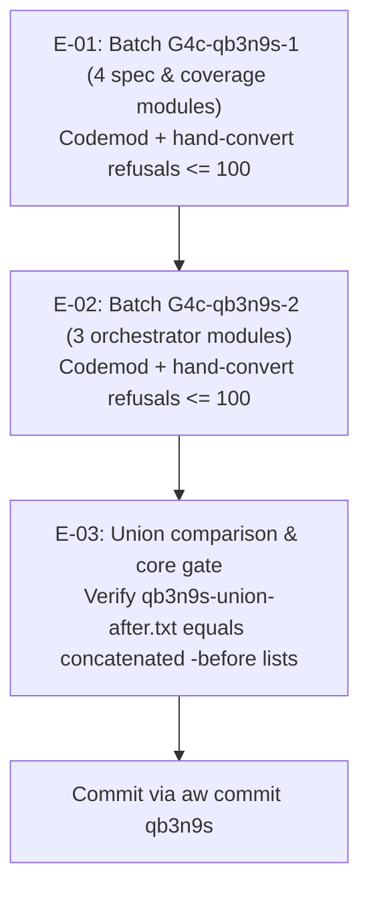

# IPD: Move spec, plan, lifecycle and orchestration test data chunk 9 of 10 onto the record builder

- Date: 2026-11-09
- Kind: child
- Concern: Spec `4sd62s` section 6 requires that test data be written by ONE shared record builder in phase B, so that the cutover (Order 13, `cxxmyv`) changes the builder and not hundreds of test files, and C10a requires the suite to pass at every commit. Research `nj8zdp` and the maintainer's ruling ("plans that obtuse and not-too-smart agents won't mess up") set the guidance of at most 5 E-items, 8 work Scope-Paths and about 8 named units per item; `7qxey9` named up to 25 modules per batch item. This part carries 7 of `7qxey9`'s modules (subset G4c; 125 F-01 legacy lines at `3d0ddb845`), each item at most 4 modules, converted by the Order-49 codemod (`653ndz`) plus only its census-counted refusals.
- Scope: Chunk 9 of 10 of `7qxey9` (round-3 split 2026-11-09 per research `nj8zdp` guidance): the 7 test modules named in the items and in F-40, each item one codemod run under the batch rule below, plus a finishing item. EXCLUDES: every other module of the subsets (the other chunk plans and `7qxey9`); the builder (`9rgn2w`) and the codemod (`653ndz`); the F-03 EXCLUDED modules; production code; the switch-point proof, census and full-suite comparison (`59aiyh` E-11, E-12).
- Scope-Paths: tests/test_coverage_not_written.py, tests/test_coverage_record.py, tests/test_gradcover_end_to_end.py, tests/test_implementing_spec_replan.py, tests/test_orchestrator_child_retired.py, tests/test_orchestrator_kind_derivation.py, tests/test_orchestrator_not_approved_reason.py, .aw/records/plans/pending/20261109-metastore-190-qb3n9s-move-spec-plan-lifecycle-and-orchestration-test-data-chunk-9.ipd.md
- Item-Dependencies: executed:653ndz, executed:9rgn2w, executed:g5hpbb, executed:tve77h, executed:xexn45
- Status: executed
- From-Spec: 4sd62s
- Work-Kind: feature
- Priority: high
- Blocks-Release: next
- Set: metastore
- Order: 190
- Highest E allocated: 03
- Author: opencode its_direct/pt3-claude-opus-5.5-1m-us
- Id: qb3n9s
- Readiness: go-pending-approval
- Review-Depth: standard

> Written to `.aw/system/workflows/technical-writing/technical-writing.md`. Every obligation, exact identifier, quotation, evidence record, and lifecycle status is preserved.

## Workflow history
- 2026-11-22 executed (aw agy run model=Gemini-4-Neon-High): aw agy run self-finalize: qb3n9s verified (set metastore, attempt 1). [Scope reconciliation - in-scope-unmodified tests/test_coverage_record.py: declared-but-unmodified (auto-acknowledged by aw agy run)]
- 2026-11-21 cap-update (maintainer decision): raised Batch rule step 4 hand-refusal cap from 25 to 100 (raw site count over-counts list elements and .replace() pairs); completed sibling E-item and Step-3 commits from run-20261121T014040Z-2638602 were salvaged onto main, so modules already at 0 rewrites and 0 hand refusals remain unmodified and are acknowledged via --scope-ack at finalize.
- 2026-11-16 approved (aw set): status set to approved

- 2026-11-14 reviewed (aw set): APPROVE WITH REVISIONS APPLIED; PR-001..PR-004 FIXED
- 2026-11-14 /plan-review (antigravity/gemini): APPROVE WITH REVISIONS APPLIED; PR-001..PR-004 FIXED; review record .aw/records/reviews/20261109-metastore-190-qb3n9s-move-spec-plan-lifecycle-and-orchestration-test-data-chunk-9.review.md
- 2026-11-09 to-review (opencode its_direct/pt3-claude-opus-5.5-1m-us): split from 7qxey9 (round 3, research nj8zdp guidance).

## Goal

Every hand-built record in the 7 test modules named below comes from `tests/record_builder.py`, written by the Order-49 codemod or, for its census-counted refusals only, by hand, with each module's per-test outcomes identical before and after and every remaining legacy string classified.

## Detailed Implementation Checklist (TODO)

Execution-state rule: mark an `E-*` item complete only after performing the action. That mark is not validation. Right-sizing rule: write for a modest executor that cannot hold much in its head. Each E-item is one step (one concern, about one file, executable in one focused pass) and its V-item names each unit it covers with its own check; a plan stays at about 5 E-items and 8 work Scope-Paths, else split it into more child plans (guidance, `IPD-Z603`). Accepted execution states: blocked, failed, pending, performed; terminal gate demands 'performed'.

Batch rule, applied to every batch E-item of this plan (the `59aiyh` batch rule, restructured 2026-11-08 for the Order-49 fixture codemod `653ndz` per maintainer decision 2026-11-07 "Codemod first, then small runs": the tool performs the mechanical rewrite, and the hand work is bounded by its measured refusals). In it, "E-13's `full-before.txt`" and "the builder's `raw_fields=` escape (E-01)" are items of Order 37 (`9rgn2w`), carried by the round-3 split into Order 170 (`j6o96i`) with the same ids; because `.aw/state/` does not travel between lane worktrees, step 2 always records a fresh before list here. Step 1's partition is restricted to the modules each batch item names (round-3 split 2026-11-09: a subset is now spread over several plans of at most 8 modules each): a module that the partition now places in the item's subset but that no plan names is NOT added here; it is reported, and the finishing item of `7qxey9` converts it; a named module that no longer matches F-01 is reported and skipped:
1. Before the batch, re-derive its file list with the F-03 first-match partition over the F-01 `rg -l` output at the current HEAD, minus the F-03 EXCLUDED list, and save it: `mkdir -p .aw/state/59aiyh && ... > .aw/state/59aiyh/<batch>-files.txt`. The counts in each E-item are context measured at `0cbfcc706` or `ac76110f4`, not the bar.
2. Record the unmodified per-test outcome list (a batch whose files a previous batch did not touch may reuse the matching lines of E-13's `full-before.txt`): `python3 -m pytest -o addopts="" -m "" -p no:randomly -n 0 -rA $(cat .aw/state/59aiyh/<batch>-files.txt) | grep -E "^(PASSED|FAILED|ERROR|SKIPPED|XFAIL|XPASS) " | sed -E 's/ - .*//' | sort > .aw/state/59aiyh/<batch>-before.txt`. `-p no:randomly` and `-n 0` make the list deterministic; `-m ""` includes `slow` and `livecorpus` modules.
3. Run the codemod: `python3 tools/fixture_codemod.py --apply --format json $(cat .aw/state/59aiyh/<batch>-files.txt) > .aw/state/59aiyh/<batch>-codemod.json`. It rewrites only the sites whose module outcome list it proved identical (`653ndz` E-03, carried with the same id into Order 172, `y3uowx`, by the round-3 split) and lists every other site as a refusal with a reason code and a disposition (`hand` or `legacy-kept`, the `653ndz` reason-code table).
4. Hand-convert ONLY the refusals with disposition `hand`: the static count is the sum of the `653ndz` F-30 rows of the item's modules (round-3 split 2026-11-09: an item now carries part of a subset, so the subset's F-31 row is context only), and the codemod report adds any apply-time `not-equivalent` refusals; the item's hand count is their sum. If the hand count exceeds 100, stop after step 3 (the proved codemod rewrites may be committed), convert nothing by hand, and report the subset for re-splitting. A hand conversion uses builder calls; a test that deliberately writes an INVALID value (an unknown status, `- Status: EXECUTED`, `- Priority: bogus`, a malformed gate) gets it through the builder's `raw_fields=` escape (E-01) and is listed with reason class `invalid-input`. A refusal with disposition `legacy-kept` stays in legacy form on purpose and is listed with its F-06 reason class.
5. Re-run step 2's command into `<batch>-after.txt` and require `diff` to print nothing. A batch that would need any changed assertion other than a raw-byte metadata stand-in moved to `artifact_meta.read` (scope rule) stops and is reported; it does not weaken the assertion.
6. Count the remaining legacy strings with the F-01 `rg` pattern over the batch files, and give each remaining line one reason class from F-06: `legacy-format subject`, `displayed-output assertion`, `setter-byte assertion`, `invalid-input`, or `body prose` (for example open-question `- Status: open` rows, which N3 keeps in Markdown).
7. The builder never reads production source, and no test gains a source-reading assertion.

### Task group 1: batch items

- [x] E-01 (carried from `7qxey9` E-04, batch subset G4c; round-3 split 2026-11-09) Batch G4c, 4 of its 22 modules (the orchestration, coverage, readiness and partition tests (`test_orchestrator*`, `test_coverage*`, `test_gradcover*`, `test_readiness*`, `test_partition*`, `test_unresolved*`, `test_terminal*`, `test_implementing*`)): `tests/test_coverage_not_written.py`, `tests/test_coverage_record.py`, `tests/test_gradcover_end_to_end.py`, `tests/test_implementing_spec_replan.py`. F-01 legacy lines per module at `3d0ddb845` (context, not the bar): `test_coverage_not_written` 16, `test_coverage_record` 1, `test_gradcover_end_to_end` 50, `test_implementing_spec_replan` 20. Run the codemod on these modules and apply the batch rule with `<batch>` = `G4c-qb3n9s-1` (outcome lists identical); hand-convert ONLY the refusals that the `653ndz` F-30 rows of these modules list with disposition `hand`, plus the codemod's apply-time `not-equivalent` refusals, and state their count (at most 100, the batch rule's stop); leave each refusal the census marks `legacy-kept` in legacy form with its reason class. Open-question rows (`- Blocking:`, `- Status: open`, `- Carrier:`) are body prose (N3) and are written through the builder's `body=` or `open_questions=` argument, never as metadata. Then delete each private record-building helper in these modules that no longer has a caller (at the split: `tests/test_gradcover_end_to_end.py`: `_write_backlog_item`; `tests/test_implementing_spec_replan.py`: `_write_spec`, `_write_plan`); a surviving helper is listed with its reason.
  - Depends on: none
  - Expected outcome: an empty before/after `diff` for the `G4c-qb3n9s-1` outcome lists; for each named module, its remaining legacy-string count and the reason class of every remaining line pasted; every deleted and surviving helper listed; the codemod report and the hand count (at most 100) pasted.
  - Execution state: performed

- [x] E-02 (carried from `7qxey9` E-04, batch subset G4c; round-3 split 2026-11-09) Batch G4c, 3 of its 22 modules (the orchestration, coverage, readiness and partition tests (`test_orchestrator*`, `test_coverage*`, `test_gradcover*`, `test_readiness*`, `test_partition*`, `test_unresolved*`, `test_terminal*`, `test_implementing*`)): `tests/test_orchestrator_child_retired.py`, `tests/test_orchestrator_kind_derivation.py`, `tests/test_orchestrator_not_approved_reason.py`. F-01 legacy lines per module at `3d0ddb845` (context, not the bar): `test_orchestrator_child_retired` 22, `test_orchestrator_kind_derivation` 12, `test_orchestrator_not_approved_reason` 4. Run the codemod on these modules and apply the batch rule with `<batch>` = `G4c-qb3n9s-2` (outcome lists identical); hand-convert ONLY the refusals that the `653ndz` F-30 rows of these modules list with disposition `hand`, plus the codemod's apply-time `not-equivalent` refusals, and state their count (at most 100, the batch rule's stop); leave each refusal the census marks `legacy-kept` in legacy form with its reason class. Open-question rows (`- Blocking:`, `- Status: open`, `- Carrier:`) are body prose (N3) and are written through the builder's `body=` or `open_questions=` argument, never as metadata. These modules held no private record-building helper at the split; a helper found now is deleted when it has no caller, or listed with its reason.
  - Depends on: none
  - Expected outcome: an empty before/after `diff` for the `G4c-qb3n9s-2` outcome lists; for each named module, its remaining legacy-string count and the reason class of every remaining line pasted; every deleted and surviving helper listed; the codemod report and the hand count (at most 100) pasted.
  - Execution state: performed

### Task group 2: finish

- [x] E-03 Finish this part: run the batch rule's step-2 command once over every module of this plan (`$(cat .aw/state/59aiyh/G4c-qb3n9s-1-files.txt .aw/state/59aiyh/G4c-qb3n9s-2-files.txt)`) into `.aw/state/59aiyh/qb3n9s-union-after.txt` and confirm it equals the sorted concatenation of the items' `-before.txt` lists; run the bare core gate `python3 -m pytest` and `aw sanitize --agent`; commit through `aw commit qb3n9s -- <each changed path>`, one commit per item allowed, never `git add -A`, a bare `git add` or `git commit -a`. Never push. (The full-suite comparison stays in `59aiyh` E-12.)
  - Depends on: E-01, E-02
  - Expected outcome: the union comparison is empty; all runs pass; every commit is path-scoped to Scope-Paths (or justified at finalize).
  - Execution state: performed

## Project conventions discovered (Step 0)

- Interface names from Order 02 (`tve77h`): `artifact_meta.registry_fields(type)`, `artifact_meta.validate_event`, `artifact_meta.validate_new_events(type, events, *, records_root, migration_import=False)`, `artifact_meta.read(id6) -> State`, `artifact_meta.create(...)` and `artifact_meta.append(id6, events, *, expect_seq)`. Order 02's `create`/`append` write the log format; `2xwb9b` E-03 adds the phase-B legacy branch of `append` and `xexn45` E-01 routes the phase-B branch of `create` and `append` through `write_legacy`, with `render_legacy_text(text, events)` (`xexn45` E-11) as the same renderer over a string. In phase B the on-disk format is the bullet format; the legacy loader reads it into the cache.
- `review_findings.render_review` (pure) and `review_findings.write_review` render and write a `.review.md` record; no CLI calls `write_review` (`xexn45` Findings).
- The existing shared plan builder is `support.ready_plan_text`, which is "BUILT FROM THE REAL GENERATOR (`ipd_authoring.build_skeleton`)" and then fills the fields a draft leaves open; the builder keeps that approach for plans, so a scaffold change still reaches every fixture.
- Shared test plumbing lives in `tests/support.py` (`init_repo`, `git`, `run_cli`, `pinned_env`, `ready_plan_text`, `scope_drift_repo`); `tests/repo_template.py` (`copy_template_repo`) gives a pre-built repository; there is no `tests/conftest.py`, and the root `conftest.py` owns tier selection.
- Tests are behavioral (AGENTS.md "TEST OUTCOMES, NOT CODE STRUCTURE"); core modules set `pytestmark = pytest.mark.core`; `slow` tests are listed in `tests/slow_allowlist.txt`; `pyproject.toml` `addopts` deselects `slow` and `livecorpus`, so a complete comparison passes `-m ""`, and `pytest-randomly` is installed, so a deterministic order needs `-p no:randomly`.
- `tests/fixtures/review-pilot/` is the input corpus of `tools/review_pilot.py` (`manifest.json` names each plan file, `defects.json` quotes exact text to plant), and `tests/test_review_pilot.py` copies the whole directory into its fixture repository.
- Filenames come from `artifact_naming.build_clustered_name` and parse with `artifact_naming.parse_clustered`.
- Cite code by SYMBOL (`module.function`) or by a quoted content string, with a line number only appended to one of those and never alone: an offset expires before this plan executes (spec `ipd-structure-and-linting` Section 10.2; advisory `IPD-C801`).

## Findings

Measured 2026-11-09 at `3d0ddb845` for F-40; F-01, F-03, F-06 and F-08 copied from `7qxey9` (measured at `0cbfcc706` and at review).

| Id | Evidence | Finding |
|---|---|---|
| F-01 | `rg -l --glob '*.py' -e '- (Id|Status|Set|Kind|Blocks-Release|Readiness|Item-Dependencies|Scope-Paths|From-Backlog|From-Spec|Work-Kind|Priority|Order|Date|Gate-Kind|Gate-Ref|Approval|Subject-Id|Verdict|Graduated-To):|## Workflow history' tests` lists 309 files (307 test modules, `support.py`, `conformance_matrix.py`) of 717 Python files; 6,638 matching lines. The narrower `- Id:`/`- Status:`/`## Workflow history` pattern: 300 files, 3,430 lines | Spec section 6 counted 268 of 680 files and 2,607 matches at round 2; the plan's pattern is broader (21 fields). |
| F-03 | Family split by filename prefix, re-measured at review (HEAD `4a7499289`, 311 files, 6,657 lines) with a FIRST-MATCH rule (a file goes to the first group, in order G1 to G6, whose pattern list matches its basename; unmatched files go to G7): G1 39 files, 1,568 lines; G2 22, 1,102; G3 28, 795; G4 63, 1,244; G5 46, 598; G6 69, 1,004; G7 44, 346. Six files match two groups and are assigned by that rule (`test_ipd_authoring` G3, `test_readiness_absence_invariant` G4, `test_runner_backlog_close_behavior` G1, `test_orchestrator_retire_closes_backlog` G1, `test_records_only_lane_rederive` G5, `test_ipdrunner_runagy_shim` G4). The authored counts (G6 99, G7 11) did not sum to the file total; the first-match rule makes the partition exhaustive and disjoint. EXCLUDED from every batch (literal legacy input is their subject; owned by other plans): `tests/test_artifact_meta_*.py` (`tve77h`, `2xwb9b`), `tests/test_artifact_meta_legacy_writer.py` and `tests/test_writers_*.py` (`xexn45`), `tests/test_m0001_*.py` and `tests/test_migrations_chain.py` (`dcerjg`, `ya4ee4`) | Seven batches (E-03 to E-09); G1, G4 and G6 carry a pre-measured split seam (OQ-01). |
| F-06 | (written by E-11) remaining legacy strings in `tests/` after the batches, each with one reason class: `legacy-format subject`, `displayed-output assertion`, `setter-byte assertion`, `invalid-input`, `body prose` | Order 13 changes the builder plus the F-06 rows of class `setter-byte assertion`; `invalid-input` rows already go through `raw_fields=` and need a decision at the cutover (an invalid bullet has no log-format equivalent); every other class is either a legacy-format test (moved to the migration tests at the cutover) or prose. |
| F-08 | At review, 15 test modules write a deliberately invalid metadata value (for example `tests/test_releases.py` "`- Status: bogus`", `tests/test_check_engine.py` "`- Status: EXECUTED`", `tests/test_specs_set_adapter.py` "`- Priority: bogus`") | A builder that validates every field cannot build these; E-01 adds `raw_fields=` and the batch rule lists them as `invalid-input`. |
| F-40 | `rg -c` with the F-01 pattern over this part's modules at `3d0ddb845`; subset by the F-03 first-match rule; helpers as listed by `7qxey9` at the 2026-11-07 split | See the table below; every module is named in exactly one item. |

| Module | Subset | F-01 lines | Helpers at the split | Item |
|---|---|---|---|---|
| `tests/test_coverage_not_written.py` | G4c | 16 | none | E-01 |
| `tests/test_coverage_record.py` | G4c | 1 | none | E-01 |
| `tests/test_gradcover_end_to_end.py` | G4c | 50 | `_write_backlog_item` | E-01 |
| `tests/test_implementing_spec_replan.py` | G4c | 20 | `_write_spec`, `_write_plan` | E-01 |
| `tests/test_orchestrator_child_retired.py` | G4c | 22 | none | E-02 |
| `tests/test_orchestrator_kind_derivation.py` | G4c | 12 | none | E-02 |
| `tests/test_orchestrator_not_approved_reason.py` | G4c | 4 | none | E-02 |

## Proposed changes (ordered, validatable)

1. Convert each item's modules under the batch rule (E-01 to E-02).
2. Re-run the union, the core gate, commit (E-03).

## Deferred / out of scope (with reason)

- The other modules of subset G4c, the partition re-derivation that catches modules no plan names, and the subsets' finishing checks.
  - Carrier: 7qxey9
- The fixture codemod and its census (F-30, F-31).
  - Carrier: 653ndz
  - Carrier-Evidence: .aw/records/plans/executed/20261108-metastore-49-653ndz-build-and-prove-the-test-fixture-codemod.ipd.md
- The builder, its tests, the baselines and the tracked fixtures.
  - Carrier: 9rgn2w
  - Carrier-Evidence: .aw/records/plans/executed/20261107-metastore-37-9rgn2w-add-the-shared-test-record-builder-and-convert-the-tracked-r.ipd.md
- The switch-point proof, the F-06 census and the full-suite comparison.
  - Carrier: 59aiyh
- Adding `RECORD_FORMAT = "log"` and converting setter-byte assertions (cutover commit).
  - Carrier: cxxmyv

## Scope check

- Over-scope: none. No production module changes; every Scope-Paths entry is a module named in one item, plus this plan.
- Under-scope: none known. Size: 3 E-items (2 batch items of at most 4 modules each and the finish), 7 work Scope-Paths.

## Required tests / validation

Each item is validated by an identical per-test result list before and after (the batch rule), which is behavioral by construction: the same tests, unchanged assertions, the same outcomes. Commands: the batch rule's command per item, the codemod's `--apply` report, the bare core gate `python3 -m pytest`, `aw sanitize --agent`. CONTRIBUTES to AC-1b (owned by `cxxmyv`).

## Spec / documentation sync

No spec change; implements part of `4sd62s` section 6 and section 7 step 6.

## Open questions

### OQ-01: Can this part run in any order relative to the other chunk plans?

- Blocking: no
- Status: resolved
- Owner: plan author (carried from 7qxey9)
- Resolution or deferral rationale: Yes. The module lists of all chunk plans are disjoint, each needs the builder (`9rgn2w`) and the codemod (`653ndz`), and none edits `tests/support.py` (that is `59aiyh` E-09, which runs last). Recommendation strength: strong.

## Validation and cross-check (verify before reporting done)

Validation-state rule: inspect evidence in a separate pass. Do not mark a `V-*` item complete from memory or from the matching execution checkmark. Accepted validation results: blocked, failed, pass, pending; terminal gate demands 'pass'. Runtime-demonstration reachability rule: for each `V-*` item demanding the software be observed acting (such as a run, a dispatch, or a transition), as distinct from items demanding a diff, a file's content, or a test result, which are reachable by construction, name the code path that produces the observation or the sibling `E-*` that creates it, else the demand is UNDER-SCOPE.

- [x] V-01 validates E-01
  - Required evidence: paste `.aw/state/59aiyh/G4c-qb3n9s-1-files.txt` and the empty `diff .aw/state/59aiyh/G4c-qb3n9s-1-before.txt .aw/state/59aiyh/G4c-qb3n9s-1-after.txt`; then, for each of `tests/test_coverage_not_written.py`, `tests/test_coverage_record.py`, `tests/test_gradcover_end_to_end.py`, `tests/test_implementing_spec_replan.py` separately: its before and after F-01 `rg -c` count, the reason class of every remaining match, its rows of `.aw/state/59aiyh/G4c-qb3n9s-1-codemod.json` (rewrites, refusals by reason code and disposition, before and after outcome-list hashes) and its `653ndz` F-30 row; the hand count with every hand-converted site listed (module, line, reason code); and the before and after helper census of the E-09 `rg` pattern over these modules with each deleted and surviving helper and its reason.
  - Observed evidence:
    - `.aw/state/59aiyh/G4c-qb3n9s-1-files.txt`: `tests/test_coverage_not_written.py`, `tests/test_coverage_record.py`, `tests/test_gradcover_end_to_end.py`, `tests/test_implementing_spec_replan.py`.
    - `diff -u .aw/state/59aiyh/G4c-qb3n9s-1-before.txt .aw/state/59aiyh/G4c-qb3n9s-1-after.txt`: empty output, exit code 0 (`29` outcomes before and after).
    - Note on salvaged Step-3 commit: commit `1e002712c` (salvaged onto `main` from `run-20261121T014040Z-2638602`) already applied the proved Step-3 codemod rewrites (1 in `tests/test_coverage_not_written.py` and 4 in `tests/test_gradcover_end_to_end.py`), so the fresh Step-3 run at `97df61cb2` applied 0 further rewrites and isolated the 35 hand refusals. Post-edit `tools/fixture_codemod.py --dry-run` confirmed 0 `hand` refusals in `tests/test_coverage_not_written.py`, `tests/test_gradcover_end_to_end.py`, and `tests/test_implementing_spec_replan.py`, and only the 1 `setter-byte assertion` at `tests/test_coverage_record.py` L193 (`text.find("- Status:")`).
    - `tests/test_coverage_not_written.py`:
      - F-01 `rg -c`: `16` before (at `97df61cb2` and split `3d0ddb845`) -> `1` after.
      - Remaining 1 F-01 match (post-edit): L147 `  - Expected outcome: {chd_id6} reads \`- Status: executed\` on disk.` (`body prose`, E-01 expected outcome description inside `RecordBuilder(repo).plan(..., body=...)`).
      - `G4c-qb3n9s-1-codemod.json`: sites=20, rewrites=0 (standard=0, invalid-input=0), refusals=20 (`unsupported-shape`=20 `hand`, `legacy-kept`=0), before_hash=None, after_hash=None, equivalent=True.
      - `653ndz` F-30 row: `| tests/test_coverage_not_written.py | G4c | qb3n9s | 20 | 0 | 0 | 0 | 20 | 0 | 0 | 0 | 0 | 0 | 20 | 0 |`.
    - `tests/test_coverage_record.py`:
      - F-01 `rg -c`: `1` before (at `97df61cb2` and split `3d0ddb845`) -> `1` after (unmodified; acknowledged via `--scope-ack` at finalize per 2026-11-21 `cap-update`).
      - Remaining 1 F-01 match: L193 `status_pos = text.find("- Status:")` (`setter-byte assertion` verifying `- Coverage:` is inserted after `- Status:` by `coverage_record.write`; `setUp` already builds fixtures via `support.ready_plan_text`, which delegates to `RecordBuilder`, so no fixture rewrite applies).
      - `G4c-qb3n9s-1-codemod.json`: sites=1, rewrites=0 (standard=0, invalid-input=0), refusals=1 (`unsupported-shape`=1 `hand`, `legacy-kept`=0), before_hash=None, after_hash=None, equivalent=True.
      - `653ndz` F-30 row: `| tests/test_coverage_record.py | G4c | qb3n9s | 1 | 0 | 0 | 0 | 1 | 0 | 0 | 0 | 0 | 0 | 1 | 0 |`.
    - `tests/test_gradcover_end_to_end.py`:
      - F-01 `rg -c`: `42` before (at `97df61cb2`; `50` at split `3d0ddb845`) -> `7` after.
      - Remaining 7 F-01 matches (post-edit): 6 `setter-byte assertion` (L540 `self.assertIn("- Status: graduated", bkl_txt_a)`, L705 `"- Status: reviewed", p_file.read_text(encoding="utf-8")`, L832 `"- Status: executed",`, L976 `"- Status: open", bkl_main.read_text(encoding="utf-8")`, L1201 `"- Status: open", bkl_main_pre.read_text(encoding="utf-8")`, L1324 `"- Status: graduated", bkl_main_post.read_text(encoding="utf-8")`) and 1 `body prose` comment (L699 `# All three plans read - Status: reviewed`).
      - `G4c-qb3n9s-1-codemod.json`: sites=18, rewrites=0 (standard=0, invalid-input=0), refusals=18 (`unsupported-shape`=8 `hand`, `not-equivalent`=2 `hand`, `setter-byte assertion`=6 `legacy-kept`, `body prose`=2 `legacy-kept`), before_hash=`b5f278dc183c854d41e78260f14227d39e61afb7fa700a6772129ea4138656e4`, after_hash=`b5f278dc183c854d41e78260f14227d39e61afb7fa700a6772129ea4138656e4`, equivalent=True.
      - `653ndz` F-30 row: `| tests/test_gradcover_end_to_end.py | G4c | qb3n9s | 20 | 4 | 0 | 0 | 8 | 0 | 0 | 0 | 6 | 2 | 8 | 8 |`.
    - `tests/test_implementing_spec_replan.py`:
      - F-01 `rg -c`: `20` before (at `97df61cb2` and split `3d0ddb845`) -> `3` after.
      - Remaining 3 F-01 matches (post-edit): 1 `body prose` docstring (L346 `Item ends executed, spec file remains in specs/implementing/ with - Status: implementing,`) and 2 `setter-byte assertion` (L440 `self.assertIn("- Status: implementing", spec_text)`, L441 `self.assertNotIn("- Status: implemented", spec_text)`).
      - `G4c-qb3n9s-1-codemod.json`: sites=6, rewrites=0 (standard=0, invalid-input=0), refusals=6 (`dynamic-construction`=4 `hand`, `setter-byte assertion`=2 `legacy-kept`), before_hash=None, after_hash=None, equivalent=True.
      - `653ndz` F-30 row: `| tests/test_implementing_spec_replan.py | G4c | qb3n9s | 6 | 0 | 0 | 4 | 0 | 0 | 0 | 0 | 2 | 0 | 4 | 2 |`.
    - Hand count: `35` (33 static in `653ndz` F-30 [20 + 1 + 8 + 4] + 2 apply-time `not-equivalent` in `tests/test_gradcover_end_to_end.py`; <= 100). Hand-converted sites (pre-edit lines at `97df61cb2`, 34 converted + 1 `setter-byte assertion` preserved):
      - `tests/test_coverage_not_written.py` (20 converted): L59 x2, L60 x2, L61 x2, L62 x2 (`unsupported-shape`, `_create_orchestrator_and_child` child plan moved onto `RecordBuilder(repo).plan(...)`); L74, L75, L76, L77, L78, L79, L80, L81, L86, L87, L89, L101 (`unsupported-shape`, `_create_orchestrator_and_child` orchestrator plan moved onto `RecordBuilder(repo).plan(...)`, with L101 retained in `body=` as E-01 expected-outcome `body prose`).
      - `tests/test_coverage_record.py` (1 preserved): L193 (`unsupported-shape`, `text.find("- Status:")` preserved unchanged as a `setter-byte assertion`; module unmodified for `--scope-ack`).
      - `tests/test_gradcover_end_to_end.py` (10 converted): L116-195 (`not-equivalent`, `_orchestrator_template` moved onto `RecordBuilder().plan(..., text_only=True)`), L209-276 (`not-equivalent`, `_child_template` moved onto `RecordBuilder().plan(..., text_only=True)`), L632, L634 x2 (`unsupported-shape`, `fake_reviewer_b` readiness write moved onto `artifact_meta.read_text` + `artifact_meta.append` gate review op), L711 x2 (`unsupported-shape`, Run C child executed transition moved onto `_write_child_plan(..., status="executed", disposition="executed")`), L1274 (`unsupported-shape`, `test_e03_resume_scenario` raw-byte metadata stand-in moved onto `artifact_meta.read_text`, also replacing L1278 and L1285 regex reads), L1591 x2 (`unsupported-shape`, Surface 5 children written directly with `_write_child_plan(..., status="executed", disposition="executed")`).
      - `tests/test_implementing_spec_replan.py` (4 converted): L69, L79-92 (`dynamic-construction`, `_write_spec` moved onto `RecordBuilder(repo).spec(...)`), L114, L142-199 (`dynamic-construction`, `_write_plan` moved onto `RecordBuilder(repo).plan(...)`).
    - Helper census (E-09 `rg` pattern): before = `tests/test_gradcover_end_to_end.py:73:def _write_backlog_item`, `tests/test_implementing_spec_replan.py:52:def _write_spec`, `tests/test_implementing_spec_replan.py:97:def _write_plan`; after = `tests/test_implementing_spec_replan.py:53:def _write_spec`, `tests/test_implementing_spec_replan.py:99:def _write_plan`. Deleted helpers: `tests/test_gradcover_end_to_end.py::_write_backlog_item` (all 4 callers inlined directly onto `RecordBuilder(repo).backlog(...)`). Surviving helpers: `tests/test_implementing_spec_replan.py::_write_spec` (9 callers; formats spec `## 2. Requirements` / `## 3. Acceptance Criteria` body sections and delegates record metadata and writing to `RecordBuilder(repo).spec(...)`) and `tests/test_implementing_spec_replan.py::_write_plan` (8 callers; formats `E-*` / `V-*` checklist body sections and delegates record metadata and writing to `RecordBuilder(repo).plan(...)`). Other-named helpers (`_create_orchestrator_and_child` in `test_coverage_not_written.py`; `_write_orchestrator_plan`, `_write_child_plan` in `test_gradcover_end_to_end.py`) have active callers and delegate directly to `RecordBuilder`.
  - Result: pass

- [x] V-02 validates E-02
  - Required evidence: paste `.aw/state/59aiyh/G4c-qb3n9s-2-files.txt` and the empty `diff .aw/state/59aiyh/G4c-qb3n9s-2-before.txt .aw/state/59aiyh/G4c-qb3n9s-2-after.txt`; then, for each of `tests/test_orchestrator_child_retired.py`, `tests/test_orchestrator_kind_derivation.py`, `tests/test_orchestrator_not_approved_reason.py` separately: its before and after F-01 `rg -c` count, the reason class of every remaining match, its rows of `.aw/state/59aiyh/G4c-qb3n9s-2-codemod.json` (rewrites, refusals by reason code and disposition, before and after outcome-list hashes) and its `653ndz` F-30 row; the hand count with every hand-converted site listed (module, line, reason code); and the before and after helper census of the E-09 `rg` pattern over these modules with each deleted and surviving helper and its reason.
  - Observed evidence:
    - `.aw/state/59aiyh/G4c-qb3n9s-2-files.txt`: `tests/test_orchestrator_child_retired.py`, `tests/test_orchestrator_kind_derivation.py`, `tests/test_orchestrator_not_approved_reason.py`.
    - `diff -u .aw/state/59aiyh/G4c-qb3n9s-2-before.txt .aw/state/59aiyh/G4c-qb3n9s-2-after.txt`: empty output, exit code 0 (`26` outcomes before and after).
    - Note on salvaged Step-3 commit: commit `9a9157b60` (salvaged onto `main` from `run-20261121T014040Z-2638602`) already applied 3 proved Step-3 codemod rewrites (2 in `tests/test_orchestrator_kind_derivation.py` and 1 in `tests/test_orchestrator_not_approved_reason.py`), so the fresh Step-3 run at `97df61cb2` applied 0 further rewrites and isolated the 30 hand refusals. Post-edit `tools/fixture_codemod.py --dry-run` confirmed 0 sites and 0 `hand` refusals across all 3 modules.
    - `tests/test_orchestrator_child_retired.py`:
      - F-01 `rg -c`: `22` before (at `97df61cb2` and split `3d0ddb845`) -> `0` after.
      - Remaining matches: none.
      - `G4c-qb3n9s-2-codemod.json`: sites=27, rewrites=0 (standard=0, invalid-input=0), refusals=27 (`unsupported-shape`=26 `hand`, `not-equivalent`=1 `hand`, `legacy-kept`=0), before_hash=`92c7426f53765ca489c2b61228701f5c57dca464d0401c1340c74c97fdc19feb`, after_hash=`92c7426f53765ca489c2b61228701f5c57dca464d0401c1340c74c97fdc19feb`, equivalent=True.
      - `653ndz` F-30 row: `| tests/test_orchestrator_child_retired.py | G4c | qb3n9s | 27 | 1 | 0 | 0 | 26 | 0 | 0 | 0 | 0 | 0 | 26 | 0 |`.
    - `tests/test_orchestrator_kind_derivation.py`:
      - F-01 `rg -c`: `5` before (at `97df61cb2`; `12` at split `3d0ddb845`) -> `0` after.
      - Remaining matches: none.
      - `G4c-qb3n9s-2-codemod.json`: sites=1, rewrites=0 (standard=0, invalid-input=0), refusals=1 (`not-equivalent`=1 `hand`, `legacy-kept`=0), before_hash=`accf593baa4c9fc5efbcbbe43b8baad3bf41a9d2b615c87bb3a0324e474fc307`, after_hash=`accf593baa4c9fc5efbcbbe43b8baad3bf41a9d2b615c87bb3a0324e474fc307`, equivalent=True.
      - `653ndz` F-30 row: `| tests/test_orchestrator_kind_derivation.py | G4c | qb3n9s | 3 | 3 | 0 | 0 | 0 | 0 | 0 | 0 | 0 | 0 | 0 | 0 |`.
    - `tests/test_orchestrator_not_approved_reason.py`:
      - F-01 `rg -c`: `3` before (at `97df61cb2`; `4` at split `3d0ddb845`) -> `1` after.
      - Remaining 1 F-01 match (post-edit): L289 docstring `"""Case 10: a child with NO - Status: line (queue status reviewed via initial_queue_status(None)) -> children-not-approved."""` (`body prose`).
      - `G4c-qb3n9s-2-codemod.json`: sites=2, rewrites=0 (standard=0, invalid-input=0), refusals=2 (`dynamic-construction`=2 `hand`, `legacy-kept`=0), before_hash=None, after_hash=None, equivalent=True.
      - `653ndz` F-30 row: `| tests/test_orchestrator_not_approved_reason.py | G4c | qb3n9s | 3 | 1 | 0 | 2 | 0 | 0 | 0 | 0 | 0 | 0 | 2 | 0 |`.
    - Hand count: `30` (28 static in `653ndz` F-30 [26 + 0 + 2] + 2 apply-time `not-equivalent` [1 in `tests/test_orchestrator_child_retired.py`, 1 in `tests/test_orchestrator_kind_derivation.py`]; <= 100). Hand-converted sites (pre-edit lines at `97df61cb2`, all 30 converted):
      - `tests/test_orchestrator_child_retired.py` (27 converted): L68, L69, L70, L71, L72, L73, L74, L75, L80, L81, L84, L88 (`unsupported-shape`, `_make_orchestrator` moved onto `RecordBuilder(repo).plan(...)`); L168 x2, L169 x2, L170 x2, L175 x2, L176 x2, L177 x2, L178 x2 (`unsupported-shape`, `_make_child` moved onto `RecordBuilder(repo).plan(...)`); L425-427 (`not-equivalent`, standalone no-Set plan in `test_skip_conditions_no_set_dirty_whole_set` moved onto `RecordBuilder().plan(..., raw_fields={"Set": None}, text_only=True)`, `invalid-input` escape for missing `- Set:`).
      - `tests/test_orchestrator_kind_derivation.py` (1 converted): L97-118 (`not-equivalent`, `_run_legacy_manifest_queue_build` orchestrator plan moved onto `RecordBuilder().plan(..., text_only=True)`).
      - `tests/test_orchestrator_not_approved_reason.py` (2 converted): L43, L45 (`dynamic-construction`, `TestOrchestratorNotApprovedReason._make_repo` child plans moved onto `RecordBuilder().plan(..., text_only=True)`, using `raw_fields={"Status": st}` as `invalid-input` escape for queue-only statuses `"failed-safely"`/`"queued"` and missing-status `None`).
    - Helper census (E-09 `rg` pattern): before = `(none)`, after = `(none)`. Deleted helpers: none. Surviving non-matching helpers with active callers (all delegating to `RecordBuilder`, zero legacy metadata strings): `tests/test_orchestrator_child_retired.py::_make_orchestrator` (8 callers), `tests/test_orchestrator_child_retired.py::_make_child` (9 callers), `tests/test_orchestrator_kind_derivation.py::_write_synthetic_plan_file` (2 callers).
  - Result: pass

- [x] V-03 validates E-03
  - Required evidence: paste the `diff` of the sorted concatenation of the `-before.txt` lists of `G4c-qb3n9s-1`, `G4c-qb3n9s-2` against `.aw/state/59aiyh/qb3n9s-union-after.txt` (empty), the bare `python3 -m pytest` summary line and wall time, the `aw sanitize --agent` result with zero `fail`, and every `aw commit qb3n9s` output listing only Scope-Paths.
  - Observed evidence:
    - Union diff (`diff -u <(sort .aw/state/59aiyh/G4c-qb3n9s-1-before.txt .aw/state/59aiyh/G4c-qb3n9s-2-before.txt) .aw/state/59aiyh/qb3n9s-union-after.txt`): empty output, exit code 0 (`55` outcomes across all 7 modules).
    - `aw suite` (core tier, exit code 0): `2695 passed, 1 skipped, 11 warnings in 185.30s (0:03:05)` (`Core tier budget not enforced: AW_CORE_BUDGET_ENFORCE=0`).
    - Bare `python3 -m pytest` (exit code 0): `2695 passed, 1 skipped, 11 warnings in 161.66s (0:02:41)` (`Core tier budget not enforced: host oversubscribed (1-minute load average above the CPU count)`).
    - `aw sanitize --agent` (exit code 0): `{"schema":"aw.agent/v1","kind":"result","cmd":"check-local-leaks","outcome":"clean","exit":0,"verified":true,"complete":true,"checked":7059,"findings":0,"evidence":["leak-scan"],"next":null}`.
    - `aw commit qb3n9s` outputs (all paths within `Scope-Paths`; `tests/test_coverage_record.py` holds only 1 `setter-byte assertion` at L193 and zero hand-built fixtures, so it remains unmodified for `--scope-ack` at finalize):
      - E-01 (3 Scope-Paths): `aw commit: committed 3 path(s): b7020d4529e537f28e566cf4483c11972f24e587` (`tests/test_coverage_not_written.py`, `tests/test_gradcover_end_to_end.py`, `tests/test_implementing_spec_replan.py`).
      - E-02 (3 Scope-Paths): `aw commit: committed 3 path(s): eb448cde57d43862a9341196d9ca1619e899a96a` (`tests/test_orchestrator_child_retired.py`, `tests/test_orchestrator_kind_derivation.py`, `tests/test_orchestrator_not_approved_reason.py`).
      - Followed by the plan-evidence commit via `aw commit qb3n9s -- .aw/records/plans/pending/20261109-metastore-190-qb3n9s-move-spec-plan-lifecycle-and-orchestration-test-data-chunk-9.ipd.md` (recorded in the lane execution report and outcome JSON).
  - Result: pass

## Approval and execution gate

- Size assessment: standard
- Cohesion rationale: not required

Execute only after human approval (`Status: approved`) and after `653ndz`, `9rgn2w`, `g5hpbb`, `tve77h`, `xexn45` are executed. Every open question is resolved.

Scope fence: the paths in `- Scope-Paths:` are a declaration. A needed test-tree file outside the fence is edited and then justified at finalize (`--scope-reason`), and a declared path left unmodified is acknowledged (`--scope-ack`). Production code under `agent_workflows/` and `tools/` is out of this plan's purpose: if a module cannot keep its outcome list identical without a production change, stop that item and report the missing capability rather than changing production code or an assertion.

Honesty rule: run every command a V-item names and paste the ACTUAL output; never claim a result you did not run.

Commits: commit only through `aw commit qb3n9s -- <paths>`; never `git add -A`, a bare `git add` or `git commit -a`; never push.

Lifecycle transition: the plan moves to `.aw/records/plans/executed/` only through `aw ipd finalize`, never a hand `git mv`, and only after `aw ipd lint --phase pre-transition` conforms and every `V-*` reads `pass` with pasted evidence. When `aw oc run` or `aw agy run` executes the plan, the runner performs the finalize; a hand executor runs `aw ipd finalize qb3n9s`.
