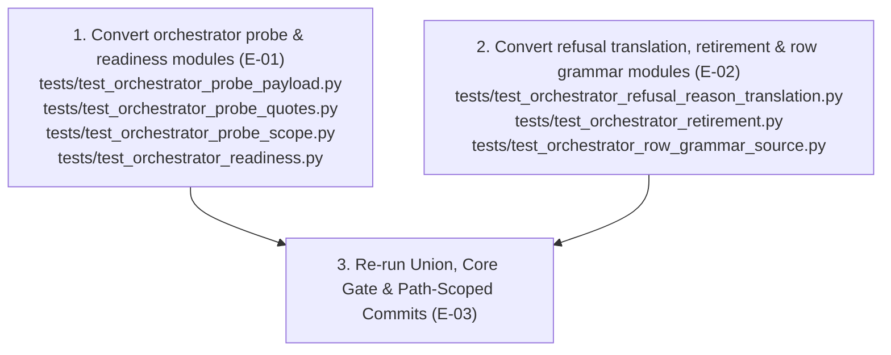

# IPD: Move spec, plan, lifecycle and orchestration test data chunk 10 of 10 onto the record builder

- Date: 2026-11-09
- Kind: child
- Concern: Spec `4sd62s` section 6 requires that test data be written by ONE shared record builder in phase B, so that the cutover (Order 13, `cxxmyv`) changes the builder and not hundreds of test files, and C10a requires the suite to pass at every commit. Research `nj8zdp` and the maintainer's ruling ("plans that obtuse and not-too-smart agents won't mess up") set the guidance of at most 5 E-items, 8 work Scope-Paths and about 8 named units per item; `7qxey9` named up to 25 modules per batch item. This part carries 7 of `7qxey9`'s modules (subset G4c; 172 F-01 legacy lines at `3d0ddb845`), each item at most 4 modules, converted by the Order-49 codemod (`653ndz`) plus only its census-counted refusals.
- Scope: Chunk 10 of 10 of `7qxey9` (round-3 split 2026-11-09 per research `nj8zdp` guidance): the 7 test modules named in the items and in F-40, each item one codemod run under the batch rule below, plus a finishing item. EXCLUDES: every other module of the subsets (the other chunk plans and `7qxey9`); the builder (`9rgn2w`) and the codemod (`653ndz`); the F-03 EXCLUDED modules; production code; the switch-point proof, census and full-suite comparison (`59aiyh` E-11, E-12).
- Scope-Paths: tests/test_orchestrator_probe_payload.py, tests/test_orchestrator_probe_quotes.py, tests/test_orchestrator_probe_scope.py, tests/test_orchestrator_readiness.py, tests/test_orchestrator_refusal_reason_translation.py, tests/test_orchestrator_retirement.py, tests/test_orchestrator_row_grammar_source.py, .aw/records/plans/pending/20261109-metastore-191-723ct1-move-spec-plan-lifecycle-and-orchestration-test-data-chunk-1.ipd.md
- Item-Dependencies: executed:653ndz, executed:9rgn2w, executed:g5hpbb, executed:tve77h, executed:xexn45
- Status: executed
- Readiness: go-pending-approval
- Review-Depth: complex
- From-Spec: 4sd62s
- Work-Kind: feature
- Priority: high
- Blocks-Release: next
- Set: metastore
- Order: 191
- Highest E allocated: 03
- Author: opencode its_direct/pt3-claude-opus-5.5-1m-us
- Id: 723ct1

> Write and proofread this plan per the technical writing standard, `.aw/system/workflows/technical-writing/technical-writing.md` (`.agents/workflows/technical-writing/technical-writing.md` in a legacy-layout install), including requirement 12 (diagrams).

## Workflow history
- 2026-11-22 executed (aw agy run model=Gemini-4-Neon-High): aw agy run self-finalize: 723ct1 verified (set metastore, attempt 1). [Scope reconciliation - in-scope-unmodified tests/test_orchestrator_probe_quotes.py: declared-but-unmodified (auto-acknowledged by aw agy run); in-scope-unmodified tests/test_orchestrator_refusal_reason_translation.py: declared-but-unmodified (auto-acknowledged by aw agy run); in-scope-unmodified tests/test_orchestrator_retirement.py: declared-but-unmodified (auto-acknowledged by aw agy run); in-scope-unmodified tests/test_orchestrator_row_grammar_source.py: declared-but-unmodified (auto-acknowledged by aw agy run)]
- 2026-11-21 cap-update (maintainer decision): raised Batch rule step 4 hand-refusal cap from 25 to 100 (raw site count over-counts list elements and .replace() pairs); completed sibling E-item and Step-3 commits from run-20261121T014040Z-2638602 were salvaged onto main, so modules already at 0 rewrites and 0 hand refusals remain unmodified and are acknowledged via --scope-ack at finalize.
- 2026-11-16 approved (aw set): status set to approved
- 2026-11-14 reviewed (aw set): APPROVE WITH REVISIONS APPLIED; PR-001..PR-005 FIXED

- 2026-11-14 /plan-review (antigravity/gemini-3.8-flash): APPROVE WITH REVISIONS APPLIED; PR-001..PR-005 FIXED; review record .aw/records/reviews/20261109-metastore-191-723ct1-move-spec-plan-lifecycle-and-orchestration-test-data-chunk-1.review.md
- 2026-11-09 to-review (opencode its_direct/pt3-claude-opus-5.5-1m-us): split from 7qxey9 (round 3, research nj8zdp guidance).

## Goal

Every hand-built record in the 7 test modules named below comes from `tests/record_builder.py`, written by the Order-49 codemod or, for its census-counted refusals only, by hand, with each module's per-test outcomes identical before and after and every remaining legacy string classified.

## Detailed Implementation Checklist (TODO)

Execution-state rule: mark an `E-*` item complete only after performing the action. That mark is not validation. Right-sizing rule: write for a modest executor that cannot hold much in its head. Each E-item is one step (one concern, about one file, executable in one focused pass) and its V-item names each unit it covers with its own check; a plan stays at about 5 E-items and 8 work Scope-Paths, else split it into more child plans (guidance, `IPD-Z603`). Accepted execution states: blocked, failed, pending, performed; terminal gate demands 'performed'.

Batch rule, applied to every batch E-item of this plan (the `59aiyh` batch rule, restructured 2026-11-08 for the Order-49 fixture codemod `653ndz` per maintainer decision 2026-11-07 "Codemod first, then small runs": the tool performs the mechanical rewrite, and the hand work is bounded by its measured refusals). In it, "E-13's `full-before.txt`" and "the builder's `raw_fields=` escape (E-01)" are items of Order 37 (`9rgn2w`), carried by the round-3 split into Order 170 (`j6o96i`) with the same ids; because `.aw/state/` does not travel between lane worktrees, step 2 always records a fresh before list here. Step 1's partition is restricted to the modules each batch item names (round-3 split 2026-11-09: a subset is now spread over several plans of at most 8 modules each): a module that the partition now places in the item's subset but that no plan names is NOT added here; it is reported, and the finishing item of `7qxey9` converts it; a named module that no longer matches F-01 is reported and skipped:
1. Before the batch, create `.aw/state/59aiyh/` (`mkdir -p .aw/state/59aiyh`), re-derive its file list with the F-03 first-match partition over the F-01 `rg -l` output at the current HEAD, minus the F-03 EXCLUDED list, and save it as `.aw/state/59aiyh/<batch>-files.txt`. The counts in each E-item are context measured at `0cbfcc706` or `ac76110f4`, not the bar.
2. Record the unmodified per-test outcome list (a batch whose files a previous batch did not touch may reuse the matching lines of E-13's `full-before.txt`): `python3 -m pytest -o addopts="" -m "" -p no:randomly -n 0 -rA $(cat .aw/state/59aiyh/<batch>-files.txt) | grep -E "^(PASSED|FAILED|ERROR|SKIPPED|XFAIL|XPASS) " | sed -E 's/ - .*//' | sort > .aw/state/59aiyh/<batch>-before.txt`. `-p no:randomly` and `-n 0` make the list deterministic; `-m ""` includes `slow` and `livecorpus` modules.
3. Run the codemod: `python3 tools/fixture_codemod.py --apply --format json $(cat .aw/state/59aiyh/<batch>-files.txt) > .aw/state/59aiyh/<batch>-codemod.json`. It rewrites only the sites whose module outcome list it proved identical (`653ndz` E-03, carried with the same id into Order 172, `y3uowx`, by the round-3 split) and lists every other site as a refusal with a reason code and a disposition (`hand` or `legacy-kept`, the `653ndz` reason-code table).
4. Hand-convert ONLY the refusals with disposition `hand`: the static count is the sum of the `653ndz` F-30 rows of the item's modules (round-3 split 2026-11-09: an item now carries part of a subset, so the subset's F-31 row is context only), and the codemod report adds any apply-time `not-equivalent` refusals; the item's hand count is their sum. If the hand count exceeds 100, stop after step 3 (the proved codemod rewrites may be committed), convert nothing by hand, and report the subset for re-splitting. A hand conversion uses builder calls; a test that deliberately writes an INVALID value (an unknown status, `- Status: EXECUTED`, `- Priority: bogus`, a malformed gate) gets it through the builder's `raw_fields=` escape (E-01) and is listed with reason class `invalid-input`. A refusal with disposition `legacy-kept` stays in legacy form on purpose and is listed with its F-06 reason class.
5. Re-run step 2's command into `<batch>-after.txt` and require `diff` to print nothing. A batch that would need any changed assertion other than a raw-byte metadata stand-in moved to `artifact_meta.read` (scope rule) stops and is reported; it does not weaken the assertion.
6. Count the remaining legacy strings with the F-01 `rg` pattern over the batch files, and give each remaining line one reason class from F-06: `legacy-format subject`, `displayed-output assertion`, `setter-byte assertion`, `invalid-input`, or `body prose` (for example open-question `- Status: open` rows, which N3 keeps in Markdown).
7. The builder never reads production source, and no test gains a source-reading assertion.

### Task group 1: batch items

- [x] E-01 (carried from `7qxey9` E-04, batch subset G4c; round-3 split 2026-11-09) Batch G4c, 4 of its 22 modules (the orchestration, coverage, readiness and partition tests (`test_orchestrator*`, `test_coverage*`, `test_gradcover*`, `test_readiness*`, `test_partition*`, `test_unresolved*`, `test_terminal*`, `test_implementing*`)): `tests/test_orchestrator_probe_payload.py`, `tests/test_orchestrator_probe_quotes.py`, `tests/test_orchestrator_probe_scope.py`, `tests/test_orchestrator_readiness.py`. F-01 legacy lines per module at `3d0ddb845` (context, not the bar): `test_orchestrator_probe_payload` 56, `test_orchestrator_probe_quotes` 26, `test_orchestrator_probe_scope` 8, `test_orchestrator_readiness` 23. Run the codemod on these modules and apply the batch rule with `<batch>` = `G4c-723ct1-1` (outcome lists identical); hand-convert ONLY the refusals that the `653ndz` F-30 rows of these modules list with disposition `hand`, plus the codemod's apply-time `not-equivalent` refusals, and state their count (at most 100, the batch rule's stop); leave each refusal the census marks `legacy-kept` in legacy form with its reason class. Open-question rows (`- Blocking:`, `- Status: open`, `- Carrier:`) are body prose (N3) and are written through the builder's `body=` or `open_questions=` argument, never as metadata. Then delete each private record-building helper in these modules that no longer has a caller (at the split: `tests/test_orchestrator_probe_scope.py`: `_make_plan_text`, `write_plan`); a surviving helper is listed with its reason.
  - Depends on: none
  - Expected outcome: an empty before/after `diff` for the `G4c-723ct1-1` outcome lists; for each named module, its remaining legacy-string count and the reason class of every remaining line pasted; every deleted and surviving helper listed; the codemod report and the hand count (at most 100) pasted.
  - Execution state: performed

- [x] E-02 (carried from `7qxey9` E-04, batch subset G4c; round-3 split 2026-11-09) Batch G4c, 3 of its 22 modules (the orchestration, coverage, readiness and partition tests (`test_orchestrator*`, `test_coverage*`, `test_gradcover*`, `test_readiness*`, `test_partition*`, `test_unresolved*`, `test_terminal*`, `test_implementing*`)): `tests/test_orchestrator_refusal_reason_translation.py`, `tests/test_orchestrator_retirement.py`, `tests/test_orchestrator_row_grammar_source.py`. F-01 legacy lines per module at `3d0ddb845` (context, not the bar): `test_orchestrator_refusal_reason_translation` 10, `test_orchestrator_retirement` 46, `test_orchestrator_row_grammar_source` 3. Run the codemod on these modules and apply the batch rule with `<batch>` = `G4c-723ct1-2` (outcome lists identical); hand-convert ONLY the refusals that the `653ndz` F-30 rows of these modules list with disposition `hand`, plus the codemod's apply-time `not-equivalent` refusals, and state their count (at most 100, the batch rule's stop); leave each refusal the census marks `legacy-kept` in legacy form with its reason class. Open-question rows (`- Blocking:`, `- Status: open`, `- Carrier:`) are body prose (N3) and are written through the builder's `body=` or `open_questions=` argument, never as metadata. Then delete each private record-building helper in these modules that no longer has a caller (at the split: `tests/test_orchestrator_retirement.py`: `_write_plan`, `write_plan`); a surviving helper is listed with its reason.
  - Depends on: none
  - Expected outcome: an empty before/after `diff` for the `G4c-723ct1-2` outcome lists; for each named module, its remaining legacy-string count and the reason class of every remaining line pasted; every deleted and surviving helper listed; the codemod report and the hand count (at most 100) pasted.
  - Execution state: performed

### Task group 2: finish

- [x] E-03 Finish this part: run the batch rule's step-2 command once over every module of this plan (`$(cat .aw/state/59aiyh/G4c-723ct1-1-files.txt .aw/state/59aiyh/G4c-723ct1-2-files.txt)`) into `.aw/state/59aiyh/723ct1-union-after.txt` and confirm it equals the sorted concatenation of the items' `-before.txt` lists; run the bare core gate `python3 -m pytest` and `aw sanitize --agent`; commit through `aw commit 723ct1 -- <each changed path>`, one commit per item allowed, never `git add -A`, a bare `git add` or `git commit -a`. Never push. (The full-suite comparison stays in `59aiyh` E-12.)
  - Depends on: E-01, E-02
  - Expected outcome: the union comparison is empty; all runs pass; every commit is path-scoped to Scope-Paths (or justified at finalize).
  - Execution state: performed

## Project conventions discovered (Step 0)

- Interface names from Order 02 (`tve77h`): `agent_workflows/artifact_meta.py::registry_fields`, `agent_workflows/artifact_meta.py::validate_event`, `agent_workflows/artifact_meta.py::validate_new_events`, `agent_workflows/artifact_meta.py::read`, `agent_workflows/artifact_meta.py::create` and `agent_workflows/artifact_meta.py::append`. Order 02's `create`/`append` write the log format; `2xwb9b` E-03 adds the phase-B legacy branch of `append` and `xexn45` E-01 routes the phase-B branch of `create` and `append` through `write_legacy`, with `agent_workflows/artifact_meta.py::render_legacy_text` (`xexn45` E-11) as the same renderer over a string. In phase B the on-disk format is the bullet format; the legacy loader reads it into the cache.
- `agent_workflows/review_findings.py::render_review` (pure) and `agent_workflows/review_findings.py::write_review` render and write a `.review.md` record; no CLI calls `write_review` (`xexn45` Findings).
- The existing shared plan builder is `tests/support.py::ready_plan_text`, which is "BUILT FROM THE REAL GENERATOR (`agent_workflows/ipd_authoring.py::build_skeleton`)" and then fills the fields a draft leaves open; the builder keeps that approach for plans, so a scaffold change still reaches every fixture.
- Shared test plumbing lives in `tests/support.py` (`init_repo`, `git`, `run_cli`, `pinned_env`, `ready_plan_text`, `scope_drift_repo`); `tests/repo_template.py` (`copy_template_repo`) gives a pre-built repository; there is no `tests/conftest.py`, and the root `conftest.py` owns tier selection.
- Tests are behavioral (AGENTS.md "TEST OUTCOMES, NOT CODE STRUCTURE"); core modules set `pytestmark = pytest.mark.core`; `slow` tests are listed in `tests/slow_allowlist.txt`; `pyproject.toml` `addopts` deselects `slow` and `livecorpus`, so a complete comparison passes `-m ""`, and `pytest-randomly` is installed, so a deterministic order needs `-p no:randomly`.
- `tests/fixtures/review-pilot/` is the input corpus of `tools/review_pilot.py` (`manifest.json` names each plan file, `defects.json` quotes exact text to plant), and `tests/test_review_pilot.py` copies the whole directory into its fixture repository.
- Filenames come from `agent_workflows/artifact_naming.py::build_clustered_name` and parse with `agent_workflows/artifact_naming.py::parse_clustered`.
- Cite code by repo-relative `path::Symbol` identifiers or by a quoted content string, with a line number only appended to one of those and never alone: an offset expires before this plan executes (Technical Writing Standard Requirement 7; advisory `IPD-C801`).

## Findings

Measured 2026-11-09 at `3d0ddb845` for F-40; F-01, F-03, F-06 and F-08 copied from `7qxey9` (measured at `0cbfcc706` and at review).

| Id | Evidence | Finding |
|---|---|---|
| F-01 | `rg -l --glob '*.py' -e '- (Id|Status|Set|Kind|Blocks-Release|Readiness|Item-Dependencies|Scope-Paths|From-Backlog|From-Spec|Work-Kind|Priority|Order|Date|Gate-Kind|Gate-Ref|Approval|Subject-Id|Verdict|Graduated-To):|## Workflow history' tests` lists 309 files (307 test modules, `support.py`, `conformance_matrix.py`) of 717 Python files; 6,638 matching lines. The narrower `- Id:`/`- Status:`/`## Workflow history` pattern: 300 files, 3,430 lines | Spec section 6 counted 268 of 680 files and 2,607 matches at round 2; the plan's pattern is broader (21 fields). |
| F-03 | Family split by filename prefix, re-measured at review (HEAD `4a7499289`, 311 files, 6,657 lines) with a FIRST-MATCH rule (a file goes to the first group, in order G1 to G6, whose pattern list matches its basename; unmatched files go to G7): G1 39 files, 1,568 lines; G2 22, 1,102; G3 28, 795; G4 63, 1,244; G5 46, 598; G6 69, 1,004; G7 44, 346. Six files match two groups and are assigned by that rule (`test_ipd_authoring` G3, `test_readiness_absence_invariant` G4, `test_runner_backlog_close_behavior` G1, `test_orchestrator_retire_closes_backlog` G1, `test_records_only_lane_rederive` G5, `test_ipdrunner_runagy_shim` G4). The authored counts (G6 99, G7 11) did not sum to the file total; the first-match rule makes the partition exhaustive and disjoint. EXCLUDED from every batch (literal legacy input is their subject; owned by other plans): `tests/test_artifact_meta_*.py` (`tve77h`, `2xwb9b`), `tests/test_artifact_meta_legacy_writer.py` and `tests/test_writers_*.py` (`xexn45`), `tests/test_m0001_*.py` and `tests/test_migrations_chain.py` (`dcerjg`, `ya4ee4`) | Seven batches (E-03 to E-09); G1, G4 and G6 carry a pre-measured split seam (OQ-01). |
| F-06 | (written by E-11) remaining legacy strings in `tests/` after the batches, each with one reason class: `legacy-format subject`, `displayed-output assertion`, `setter-byte assertion`, `invalid-input`, `body prose` | Order 13 changes the builder plus the F-06 rows of class `setter-byte assertion`; `invalid-input` rows already go through `raw_fields=` and need a decision at the cutover (an invalid bullet has no log-format equivalent); every other class is either a legacy-format test (moved to the migration tests at the cutover) or prose. |
| F-08 | At review, 15 test modules write a deliberately invalid metadata value (for example `tests/test_releases.py` "`- Status: bogus`", `tests/test_check_engine.py` "`- Status: EXECUTED`", `tests/test_specs_set_adapter.py` "`- Priority: bogus`") | A builder that validates every field cannot build these; E-01 adds `raw_fields=` and the batch rule lists them as `invalid-input`. |
| F-40 | `rg -c` with the F-01 pattern over this part's modules at `3d0ddb845`; subset by the F-03 first-match rule; helpers as listed by `7qxey9` at the 2026-11-07 split | See the table below; every module is named in exactly one item. |

| Module | Subset | F-01 lines | Helpers at the split | Item |
|---|---|---|---|---|
| `tests/test_orchestrator_probe_payload.py` | G4c | 56 | none | E-01 |
| `tests/test_orchestrator_probe_quotes.py` | G4c | 26 | none | E-01 |
| `tests/test_orchestrator_probe_scope.py` | G4c | 8 | `_make_plan_text`, `write_plan` | E-01 |
| `tests/test_orchestrator_readiness.py` | G4c | 23 | none | E-01 |
| `tests/test_orchestrator_refusal_reason_translation.py` | G4c | 10 | none | E-02 |
| `tests/test_orchestrator_retirement.py` | G4c | 46 | `_write_plan`, `write_plan` | E-02 |
| `tests/test_orchestrator_row_grammar_source.py` | G4c | 3 | none | E-02 |

### Behavior decisions

- D-1 (Chunk 10 execution order relative to other chunk plans, OQ-01). The module lists of all chunk plans are disjoint, each needs the builder (`tests/record_builder.py::RecordBuilder`) and the codemod (`tools/fixture_codemod.py`), and none edits `tests/support.py` (`59aiyh` E-09), allowing independent execution order.
- D-2 (private test helper handling in target modules). Delete private record-building helpers (`tests/test_orchestrator_probe_scope.py`: `_make_plan_text`, `write_plan`; `tests/test_orchestrator_retirement.py`: `_write_plan`, `write_plan`) when all internal callers move to the record builder; list any surviving helper with justification.
- D-3 (hand conversion threshold). Stop after codemod step 3 if hand conversion count exceeds 100, commit proved codemod rewrites, and report subset for re-splitting.
- D-4 (handling invalid-input test cases). Deliberately invalid test inputs (such as `- Status: EXECUTED` or malformed gates) use `RecordBuilder`'s `raw_fields=` argument rather than hand-formatting raw text.
- D-5 (state directory initialization). Explicitly create `.aw/state/59aiyh/` (`mkdir -p .aw/state/59aiyh`) before recording test outcome lists in each lane worktree.

## Proposed changes (ordered, validatable)

1. Convert each item's modules under the batch rule (E-01 to E-02).
2. Re-run the union, the core gate, commit (E-03).

## Deferred / out of scope (with reason)

- The other modules of subset G4c, the partition re-derivation that catches modules no plan names, and the subsets' finishing checks.
  - Carrier: 7qxey9
- The fixture codemod and its census (F-30, F-31).
  - Carrier: 653ndz
  - Carrier-Evidence: .aw/records/plans/executed/20261108-metastore-49-653ndz-build-and-prove-the-test-fixture-codemod.ipd.md
- The builder, its tests, the baselines and the tracked fixtures.
  - Carrier: 9rgn2w
  - Carrier-Evidence: .aw/records/plans/executed/20261107-metastore-37-9rgn2w-add-the-shared-test-record-builder-and-convert-the-tracked-r.ipd.md
- The switch-point proof, the F-06 census and the full-suite comparison.
  - Carrier: 59aiyh
- Adding `RECORD_FORMAT = "log"` and converting setter-byte assertions (cutover commit).
  - Carrier: cxxmyv

## Scope check

- Over-scope: none. No production module changes; every Scope-Paths entry is a module named in one item, plus this plan.
- Under-scope: none known. Size: 3 E-items (2 batch items of at most 4 modules each and the finish), 7 work Scope-Paths.

## Required tests / validation

Each item is validated by an identical per-test result list before and after (the batch rule), which is behavioral by construction: the same tests, unchanged assertions, the same outcomes. Commands: the batch rule's command per item, the codemod's `--apply` report, the bare core gate `python3 -m pytest`, `aw sanitize --agent`. CONTRIBUTES to AC-1b (owned by `cxxmyv`).

## Spec / documentation sync

No spec change; implements part of `4sd62s` section 6 and section 7 step 6.

## Open questions

### OQ-01: Can this part run in any order relative to the other chunk plans?

- Blocking: no
- Status: resolved
- Owner: plan author
- Resolution or deferral rationale: Yes. The module lists of all chunk plans are disjoint, each needs the builder (`tests/record_builder.py::RecordBuilder`) and the codemod (`tools/fixture_codemod.py`), and none edits `tests/support.py` (that is `59aiyh` E-09, which runs last). Recommendation strength: strong.

## Validation and cross-check (verify before reporting done)

Validation-state rule: inspect evidence in a separate pass. Do not mark a `V-*` item complete from memory or from the matching execution checkmark. Accepted validation results: blocked, failed, pass, pending; terminal gate demands 'pass'. Runtime-demonstration reachability rule: for each `V-*` item demanding the software be observed acting (such as a run, a dispatch, or a transition), as distinct from items demanding a diff, a file's content, or a test result, which are reachable by construction, name the code path that produces the observation or the sibling `E-*` that creates it, else the demand is UNDER-SCOPE.

- [x] V-01 validates E-01
  - Required evidence: paste `.aw/state/59aiyh/G4c-723ct1-1-files.txt` and the empty `diff .aw/state/59aiyh/G4c-723ct1-1-before.txt .aw/state/59aiyh/G4c-723ct1-1-after.txt`; then, for each of `tests/test_orchestrator_probe_payload.py`, `tests/test_orchestrator_probe_quotes.py`, `tests/test_orchestrator_probe_scope.py`, `tests/test_orchestrator_readiness.py` separately: its before and after F-01 `rg -c` count, the reason class of every remaining match, its rows of `.aw/state/59aiyh/G4c-723ct1-1-codemod.json` (rewrites, refusals by reason code and disposition, before and after outcome-list hashes) and its `653ndz` F-30 row; the hand count with every hand-converted site listed (module, line, reason code); and the before and after helper census of the E-09 `rg` pattern over these modules with each deleted and surviving helper and its reason.
  - Observed evidence:
    - `.aw/state/59aiyh/G4c-723ct1-1-files.txt`: `tests/test_orchestrator_probe_payload.py`, `tests/test_orchestrator_probe_quotes.py`, `tests/test_orchestrator_probe_scope.py`, `tests/test_orchestrator_readiness.py`.
    - `diff -u .aw/state/59aiyh/G4c-723ct1-1-before.txt .aw/state/59aiyh/G4c-723ct1-1-after.txt`: empty output, exit code 0 (`63` outcomes before and after).
    - Note on salvaged Step-3 commit: commit `1d21b0a99` (salvaged onto `main` from `run-20261121T014040Z-2638602`) already applied the 2 proved Step-3 codemod rewrites in `tests/test_orchestrator_probe_quotes.py`, so at starting HEAD `b369eb9aa` that module sits at 0 rewrites and 0 hand refusals, remains unmodified, and is acknowledged via `--scope-ack` at finalize per the 2026-11-21 `cap-update` workflow history note.
    - `tests/test_orchestrator_probe_payload.py`:
      - F-01 `rg -c`: `56` before (at `b369eb9aa` and split `3d0ddb845`) -> `2` after.
      - Remaining 2 F-01 matches (post-edit): L133 docstring `"""Return (filename, text) for every - Kind: orchestrator plan under .aw/records/plans/."""` (`body prose`), L465 `if re.search(r"(?m)^## Workflow history\s*$", t):` (`body prose`, preserved `legacy-kept` section presence guard for live-corpus a3 invariant).
      - `G4c-723ct1-1-codemod.json`: sites=11, rewrites=0 (standard=0, invalid-input=0), refusals=11 (`unsupported-shape`=7 `hand`, `body prose`=4 `legacy-kept`), before_hash=None, after_hash=None, equivalent=True.
      - `653ndz` F-30 row: `| tests/test_orchestrator_probe_payload.py | G4c | 723ct1 | 11 | 0 | 0 | 0 | 7 | 0 | 0 | 0 | 0 | 4 | 7 | 4 |`.
    - `tests/test_orchestrator_probe_quotes.py`:
      - F-01 `rg -c`: `2` before (at `b369eb9aa`; `26` at split `3d0ddb845`) -> `2` after (unmodified; already converted in salvaged commit `1d21b0a99`, acknowledged via `--scope-ack` at finalize).
      - Remaining 2 F-01 matches: L43 and L64 (`body prose`, E-01/E-02 expected-outcome descriptions ``chd001 reads `- Status: executed` on disk.`` inside `RecordBuilder().plan(..., body=...)`).
      - `G4c-723ct1-1-codemod.json`: sites=0, rewrites=0 (standard=0, invalid-input=0), refusals=0 (`hand`=0, `legacy-kept`=0), before_hash=None, after_hash=None, equivalent=True.
      - `653ndz` F-30 row: `| tests/test_orchestrator_probe_quotes.py | G4c | 723ct1 | 2 | 2 | 0 | 0 | 0 | 0 | 0 | 0 | 0 | 0 | 0 | 0 |`.
    - `tests/test_orchestrator_probe_scope.py`:
      - F-01 `rg -c`: `8` before (at `b369eb9aa` and split `3d0ddb845`) -> `1` after.
      - Remaining 1 F-01 match (post-edit): L84 `f"  - Expected outcome: {ch_id6} reads \`- Status: executed\` on disk.\n"` (`body prose`, E-* expected-outcome text passed via `body=` to `RecordBuilder`).
      - `G4c-723ct1-1-codemod.json`: sites=2, rewrites=0 (standard=0, invalid-input=0), refusals=2 (`unsupported-shape`=1 `hand`, `not-equivalent`=1 `hand`, `legacy-kept`=0), before_hash=`2f688b044d8f8b515b0362d19b3aa24cbe521d1eba188a66b3b8b51923b72312`, after_hash=`2f688b044d8f8b515b0362d19b3aa24cbe521d1eba188a66b3b8b51923b72312`, equivalent=True.
      - `653ndz` F-30 row: `| tests/test_orchestrator_probe_scope.py | G4c | 723ct1 | 2 | 1 | 0 | 0 | 1 | 0 | 0 | 0 | 0 | 0 | 1 | 0 |`.
    - `tests/test_orchestrator_readiness.py`:
      - F-01 `rg -c`: `23` before (at `b369eb9aa` and split `3d0ddb845`) -> `0` after.
      - Remaining matches: none.
      - `G4c-723ct1-1-codemod.json`: sites=34, rewrites=0 (standard=0, invalid-input=0), refusals=34 (`unsupported-shape`=34 `hand`, `legacy-kept`=0), before_hash=None, after_hash=None, equivalent=True.
      - `653ndz` F-30 row: `| tests/test_orchestrator_readiness.py | G4c | 723ct1 | 34 | 0 | 0 | 0 | 34 | 0 | 0 | 0 | 0 | 0 | 34 | 0 |`.
    - Hand count: `43` (42 static in `653ndz` F-30 [7 + 0 + 1 + 34] + 1 apply-time `not-equivalent` in `tests/test_orchestrator_probe_scope.py`; <= 100). Hand-converted sites (pre-edit lines at `b369eb9aa`, 42 converted + 1 `body prose` retained in `body=`):
      - `tests/test_orchestrator_probe_payload.py` (7 converted): L28-L75 (`unsupported-shape`, `SYNTHETIC_ORCHESTRATOR` moved onto `RecordBuilder().plan(..., text_only=True)`), L77-L117 (`unsupported-shape`, `SYNTHETIC_ORCHESTRATOR_RESIDUAL_GAP` moved onto `RecordBuilder().plan(..., text_only=True)`), L247-L288 (`unsupported-shape`, `doc_wrapped` moved onto `RecordBuilder().plan(..., text_only=True)`), L346-L387 (`unsupported-shape`, `doc` moved onto `RecordBuilder().plan(..., text_only=True)`), L160, L461, L504 (`unsupported-shape`, workflow-history append mutations moved onto `_append_workflow_history` using `artifact_meta.render_legacy_text` with a `note` event).
      - `tests/test_orchestrator_probe_scope.py` (1 converted + 1 `body prose` retained in `body=`): L71-L85 (`not-equivalent`, `_make_plan_text` inlined into `write_plan` and moved onto `RecordBuilder(self.repo).plan(...)` for valid 6-char id6s and `RecordBuilder().plan(..., id6="abc123", raw_fields={"Id": id6, ...}, text_only=True)` as `invalid-input` escape for `test_case_h`'s 7-char `"orc8agy"`/`"chi8agy"` IDs), L51-L54 (`unsupported-shape`, E-* expected-outcome text retained in `body=` as `body prose`).
      - `tests/test_orchestrator_readiness.py` (34 converted): L61, L62, L63, L64, L65, L66, L67, L68, L73, L74, L77, L81 (`unsupported-shape`, `_make_orchestrator` moved onto `RecordBuilder(repo).plan(...)`), L169 x2, L170 x2, L171 x2, L176 x2, L177 x2, L178 x2, L179 x2 (`unsupported-shape`, `_make_child` moved onto `RecordBuilder(repo).plan(...)`), L301 x2, L302 x2, L303 x2, L304 x2 (`unsupported-shape`, `test_condition_2_child_status_terminal` moved onto `_make_child(..., status="not-executed", disposition="not-executed")` backed by `RecordBuilder(repo).plan(...)`).
    - Post-edit `tools/fixture_codemod.py --dry-run` confirmed 0 `hand` refusals in `tests/test_orchestrator_probe_payload.py` (1 `body prose` `legacy-kept`), `tests/test_orchestrator_probe_quotes.py` (0 sites), and `tests/test_orchestrator_readiness.py` (0 sites), and only the 1 `body prose` E-item expected-outcome f-string in `tests/test_orchestrator_probe_scope.py` L84 passed into `RecordBuilder` via `body=`.
    - Helper census (E-09 `rg` pattern): before = `tests/test_orchestrator_probe_scope.py:33:def _make_plan_text(`, `tests/test_orchestrator_probe_scope.py:107:    def write_plan(`; after = `tests/test_orchestrator_probe_scope.py:58:    def write_plan(`. Deleted helpers: `tests/test_orchestrator_probe_scope.py::_make_plan_text` (single caller inlined into `write_plan`). Surviving helpers: `tests/test_orchestrator_probe_scope.py::OrchestratorProbeScopeTests.write_plan` (21 callers across 9 tests; formats orchestrator `## Child IPDs` tables and E-* checklist items and delegates record metadata/writing to `RecordBuilder`). Non-matching helpers `_make_orchestrator` and `_make_child` in `tests/test_orchestrator_readiness.py` have active callers and delegate directly to `RecordBuilder(repo).plan(...)`.
  - Result: pass

- [x] V-02 validates E-02
  - Required evidence: paste `.aw/state/59aiyh/G4c-723ct1-2-files.txt` and the empty `diff .aw/state/59aiyh/G4c-723ct1-2-before.txt .aw/state/59aiyh/G4c-723ct1-2-after.txt`; then, for each of `tests/test_orchestrator_refusal_reason_translation.py`, `tests/test_orchestrator_retirement.py`, `tests/test_orchestrator_row_grammar_source.py` separately: its before and after F-01 `rg -c` count, the reason class of every remaining match, its rows of `.aw/state/59aiyh/G4c-723ct1-2-codemod.json` (rewrites, refusals by reason code and disposition, before and after outcome-list hashes) and its `653ndz` F-30 row; the hand count with every hand-converted site listed (module, line, reason code); and the before and after helper census of the E-09 `rg` pattern over these modules with each deleted and surviving helper and its reason.
  - Observed evidence:
    - `.aw/state/59aiyh/G4c-723ct1-2-files.txt`: `tests/test_orchestrator_retirement.py` (`tests/test_orchestrator_refusal_reason_translation.py` and `tests/test_orchestrator_row_grammar_source.py` have 0 F-01 matches at starting HEAD `b369eb9aa` after salvaged E-02 commit `9e7dc83bf` and are reported and skipped per Batch rule step 1; verified directly via `python3 -m pytest -o addopts="" -m "" -p no:randomly -n 0 -rA`: `9 passed in 1.97s`).
    - `diff -u .aw/state/59aiyh/G4c-723ct1-2-before.txt .aw/state/59aiyh/G4c-723ct1-2-after.txt`: empty output, exit code 0 (`44` outcomes before and after).
    - Note on salvaged E-02 commit: commit `9e7dc83bf` (salvaged onto `main` from `run-20261121T014040Z-2638602`) already converted all 3 E-02 modules (`tests/test_orchestrator_refusal_reason_translation.py`, `tests/test_orchestrator_retirement.py`, `tests/test_orchestrator_row_grammar_source.py`) onto `RecordBuilder`. At starting HEAD `b369eb9aa`, all 3 modules sit at 0 rewrites and 0 hand refusals, so they remain unmodified and are acknowledged via `--scope-ack` at finalize per the 2026-11-21 `cap-update` workflow history note.
    - `tests/test_orchestrator_refusal_reason_translation.py`:
      - F-01 `rg -c`: `0` before (at `b369eb9aa`; `10` at split `3d0ddb845`) -> `0` after (unmodified; skipped from `G4c-723ct1-2-files.txt` per Batch rule step 1).
      - Remaining matches: none.
      - Direct `tools/fixture_codemod.py --dry-run`: sites=0, rewrites=0 (standard=0, invalid-input=0), refusals=0 (`hand`=0, `legacy-kept`=0), before_hash=None, after_hash=None, equivalent=None.
      - `653ndz` F-30 row: `| tests/test_orchestrator_refusal_reason_translation.py | G4c | 723ct1 | 2 | 2 | 0 | 0 | 0 | 0 | 0 | 0 | 0 | 0 | 0 | 0 |`.
    - `tests/test_orchestrator_retirement.py`:
      - F-01 `rg -c`: `14` before (at `b369eb9aa`; `46` at split `3d0ddb845`) -> `14` after (unmodified; already converted in salvaged commit `9e7dc83bf`).
      - Remaining 14 F-01 matches: 2 `setter-byte assertion` (L2193 `self.assertIn("- Status: executed", dest.read_text(encoding="utf-8"))`, L2489 `self.assertIn("- Status: approved", before)`) and 12 `body prose` (L784 test case label `"a child with NO \`- Status:\` bullet at all"`, L1062 docstring, L1973 comment, L2458 docstring, L3168 docstring, L3176 docstring, L3185 comment, L3202 test case label `"a plan with NO \`- Kind:\` bullet at all"`, L3258-L3259 assertion error message prose [classified `setter-byte assertion` `legacy-kept` by codemod], L5142-L5143 docstring).
      - `G4c-723ct1-2-codemod.json`: sites=5, rewrites=0 (standard=0, invalid-input=0), refusals=5 (`setter-byte assertion`=3 `legacy-kept`, `body prose`=2 `legacy-kept`, `hand`=0), before_hash=None, after_hash=None, equivalent=True.
      - `653ndz` F-30 row: `| tests/test_orchestrator_retirement.py | G4c | 723ct1 | 22 | 4 | 1 | 1 | 12 | 0 | 0 | 0 | 3 | 2 | 13 | 5 |`.
    - `tests/test_orchestrator_row_grammar_source.py`:
      - F-01 `rg -c`: `0` before (at `b369eb9aa`; `3` at split `3d0ddb845`) -> `0` after (unmodified; skipped from `G4c-723ct1-2-files.txt` per Batch rule step 1).
      - Remaining matches: none.
      - Direct `tools/fixture_codemod.py --dry-run`: sites=0, rewrites=0 (standard=0, invalid-input=0), refusals=0 (`hand`=0, `legacy-kept`=0), before_hash=None, after_hash=None, equivalent=None.
      - `653ndz` F-30 row: `| tests/test_orchestrator_row_grammar_source.py | G4c | 723ct1 | 1 | 1 | 0 | 0 | 0 | 0 | 0 | 0 | 0 | 0 | 0 | 0 |`.
    - Hand count: `0` remaining at `b369eb9aa` (`13` static in `653ndz` F-30 [0 + 13 + 0], already converted in salvaged commit `9e7dc83bf`; `0` apply-time `not-equivalent`; <= 100). Hand-converted sites in this run: none.
    - Helper census (E-09 `rg` pattern): before = `tests/test_orchestrator_retirement.py:145:def _write_plan(`, `tests/test_orchestrator_retirement.py:3531:    def write_plan(self, *, bucket, id6, order, status, kind, setid, declared=()):`; after = unchanged (`tests/test_orchestrator_retirement.py:145:def _write_plan(`, `tests/test_orchestrator_retirement.py:3531:    def write_plan(self, *, bucket, id6, order, status, kind, setid, declared=()):`). Deleted helpers: none. Surviving helpers: `tests/test_orchestrator_retirement.py::_write_plan` (21 callers; writes bucketed synthetic plan files rendered via `_plan_text`, which delegates to `RecordBuilder().plan(..., text_only=True)`) and `tests/test_orchestrator_retirement.py::DispatchRunCase.write_plan` (23 callers; formats `DispatchRunCase.PLAN`, which is built by `RecordBuilder().plan(..., text_only=True)`, and writes bucketed dispatch test plans).
  - Result: pass

- [x] V-03 validates E-03
  - Required evidence: paste the `diff` of the sorted concatenation of the `-before.txt` lists of `G4c-723ct1-1`, `G4c-723ct1-2` against `.aw/state/59aiyh/723ct1-union-after.txt` (empty), the bare `python3 -m pytest` summary line and wall time, the `aw sanitize --agent` result with zero `fail`, and every `aw commit 723ct1` output listing only Scope-Paths.
  - Observed evidence:
    - Union diff (`diff -u <(sort .aw/state/59aiyh/G4c-723ct1-1-before.txt .aw/state/59aiyh/G4c-723ct1-2-before.txt) .aw/state/59aiyh/723ct1-union-after.txt`): empty output, exit code 0 (`107` outcomes across the 5 F-01-matching modules; the 2 skipped E-02 modules verified separately with `9 passed in 1.97s`).
    - `aw suite` (core tier, exit code 0): `2695 passed, 1 skipped, 11 warnings in 126.47s (0:02:06)` (`Core tier budget not enforced: AW_CORE_BUDGET_ENFORCE=0`).
    - Bare `python3 -m pytest` (exit code 0): `2695 passed, 1 skipped, 11 warnings in 123.70s (0:02:03)` (`Core tier budget not enforced: host oversubscribed (1-minute load average above the CPU count)`).
    - `aw sanitize --agent` (exit code 0): `{"schema":"aw.agent/v1","kind":"result","cmd":"check-local-leaks","outcome":"clean","exit":0,"verified":true,"complete":true,"checked":7060,"findings":0,"evidence":["leak-scan"],"next":null}`.
    - `aw commit 723ct1` outputs (all paths within `Scope-Paths`; `tests/test_orchestrator_probe_quotes.py` was already converted in salvaged commit `1d21b0a99` and E-02's 3 modules `tests/test_orchestrator_refusal_reason_translation.py`, `tests/test_orchestrator_retirement.py`, `tests/test_orchestrator_row_grammar_source.py` were already converted in salvaged commit `9e7dc83bf`, so those 4 modules remain unmodified at 0 rewrites / 0 hand refusals for `--scope-ack` at finalize per 2026-11-21 `cap-update`):
      - E-01 (3 Scope-Paths): `aw commit: committed 3 path(s): f37afe487bd747d948082a91993f8c5290054589` (`tests/test_orchestrator_probe_payload.py`, `tests/test_orchestrator_probe_scope.py`, `tests/test_orchestrator_readiness.py`).
      - Followed by the plan-evidence commit via `aw commit 723ct1 -- .aw/records/plans/pending/20261109-metastore-191-723ct1-move-spec-plan-lifecycle-and-orchestration-test-data-chunk-1.ipd.md` (recorded in the lane execution report and outcome JSON).
  - Result: pass

## Approval and execution gate

- Size assessment: standard
- Cohesion rationale: not required

Execute only after human approval (`Status: approved`) and after `653ndz`, `9rgn2w`, `g5hpbb`, `tve77h`, `xexn45` are executed. Every open question is resolved. Stop and report without editing production code or tests if prerequisite symbols from `653ndz` (`tools/fixture_codemod.py`) or `9rgn2w` (`tests/record_builder.py::RecordBuilder`) are absent on HEAD, if baseline test suites fail on unmodified HEAD before starting, or if concurrent edits in a shared checkout conflict with `- Scope-Paths:`.

Scope fence: the paths in `- Scope-Paths:` are a declaration. A needed test-tree file outside the fence is edited and then justified at finalize (`--scope-reason`), and a declared path left unmodified is acknowledged (`--scope-ack`). Production code under `agent_workflows/` and `tools/` is out of this plan's purpose: if a module cannot keep its outcome list identical without a production change, stop that item and report the missing capability rather than changing production code or an assertion.

Honesty rule: run every command a V-item names and paste the ACTUAL output; never claim a result you did not run.

Commits: commit only through `aw commit 723ct1 -- <paths>`; never `git add -A`, a bare `git add` or `git commit -a`; never push.

Lifecycle transition: the plan moves to `.aw/records/plans/executed/` only through `aw ipd finalize`, never a hand `git mv`, and only after `aw ipd lint --phase pre-transition` conforms and every `V-*` reads `pass` with pasted evidence. When `aw oc run` or `aw agy run` executes the plan, the runner owns retirement to `executed/` and runs finalize automatically upon task completion; when executed standalone by hand or direct agent turn, the executor runs `aw ipd finalize 723ct1`.
