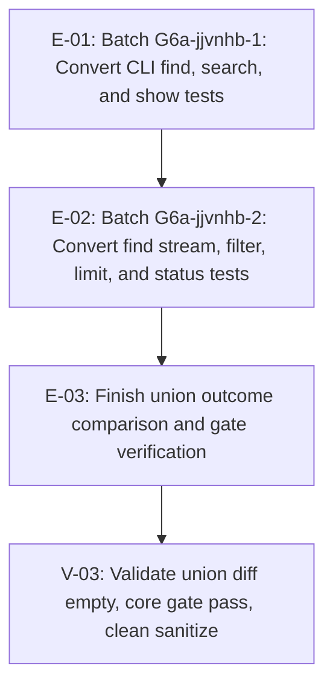

# IPD: Move runner-family, reader, record and review test data chunk 5 of 11 onto the record builder

- Date: 2026-11-09
- Kind: child
- Concern: Spec `4sd62s` section 6 requires that test data be written by ONE shared record builder in phase B, so that the cutover (Order 13, `cxxmyv`) changes the builder and not hundreds of test files, and C10a requires the suite to pass at every commit. Research `nj8zdp` and the maintainer's ruling ("plans that obtuse and not-too-smart agents won't mess up") set the guidance of at most 5 E-items, 8 work Scope-Paths and about 8 named units per item; `nbfg7w` named up to 25 modules per batch item. This part carries 8 of `nbfg7w`'s modules (subset G6a; 64 F-01 legacy lines at `3d0ddb845`), each item at most 4 modules, converted by the Order-49 codemod (`653ndz`) plus only its census-counted refusals.
- Scope: Chunk 5 of 11 of `nbfg7w` (round-3 split 2026-11-09 per research `nj8zdp` guidance): the 8 test modules named in the items and in F-40, each item one codemod run under the batch rule below, plus a finishing item. EXCLUDES: every other module of the subsets (the other chunk plans and `nbfg7w`); the builder (`9rgn2w`) and the codemod (`653ndz`); the F-03 EXCLUDED modules; production code; the switch-point proof, census and full-suite comparison (`59aiyh` E-11, E-12).
- Scope-Paths: tests/test_cli_find.py, tests/test_cli.py, tests/test_cli_search.py, tests/test_cli_show.py, tests/test_find_agent_stream.py, tests/test_find_filters.py, tests/test_find_human_limit.py, tests/test_find_prompts_lane_status.py, .aw/records/plans/pending/20261109-metastore-196-jjvnhb-move-runner-family-reader-record-and-review-test-data-chunk.ipd.md
- Scope-Exceeded: .aw/records/backlog/open/20261121-e0wwtc-01-e0wwtc-fixture-codemod-drops-h1-heading-title-on-backlog.backlog.md (Required defect-report backlog carrier filed via aw backlog new for tools/fixture_codemod.py dropping H1 heading titles on backlog and prompt records)
- Item-Dependencies: executed:653ndz, executed:9rgn2w, executed:g5hpbb, executed:tve77h, executed:xexn45
- Status: executed
- Readiness: go-pending-approval
- Review-Depth: complex
- From-Spec: 4sd62s
- Work-Kind: feature
- Priority: high
- Blocks-Release: next
- Set: metastore
- Order: 196
- Highest E allocated: 03
- Author: opencode its_direct/pt3-claude-opus-5.5-1m-us
- Id: jjvnhb

> Written to .aw/system/workflows/technical-writing/technical-writing.md. Every obligation, exact identifier, quotation, evidence record, and lifecycle status is preserved.

## Workflow history
- 2026-11-21 executed (aw agy run model=Gemini-4-Neon-High): aw agy run self-finalize: jjvnhb verified (set metastore, attempt 1). [Scope reconciliation - out-of-scope .aw/records/backlog/open/20261121-e0wwtc-01-e0wwtc-fixture-codemod-drops-h1-heading-title-on-backlog.backlog.md: Required defect-report backlog carrier filed via aw backlog new for tools/fixture_codemod.py dropping H1 heading titles on backlog and prompt records]
- 2026-11-16 approved (aw set): status set to approved

- 2026-11-14 reviewed (antigravity/gemini-3.8-flash): APPROVE WITH REVISIONS APPLIED; PR-001..PR-006 FIXED.
- 2026-11-09 to-review (opencode its_direct/pt3-claude-opus-5.5-1m-us): split from nbfg7w (round 3, research nj8zdp guidance).

## Goal

Every hand-built record in the 8 test modules named below comes from `tests/record_builder.py`, written by the Order-49 codemod or, for its census-counted refusals only, by hand, with each module's per-test outcomes identical before and after and every remaining legacy string classified.

## Detailed Implementation Checklist (TODO)

Execution-state rule: mark an `E-*` item complete only after performing the action. That mark is not validation. Right-sizing rule: write for a modest executor that cannot hold much in its head. Each E-item is one step (one concern, about one file, executable in one focused pass) and its V-item names each unit it covers with its own check; a plan stays at about 5 E-items and 8 work Scope-Paths, else split it into more child plans (guidance, `IPD-Z603`). Accepted execution states: blocked, failed, pending, performed; terminal gate demands 'performed'.

Batch rule, applied to every batch E-item of this plan (the `59aiyh` batch rule, restructured 2026-11-08 for the Order-49 fixture codemod `653ndz` per maintainer decision 2026-11-07 "Codemod first, then small runs": the tool performs the mechanical rewrite, and the hand work is bounded by its measured refusals). In it, "E-13's `full-before.txt`" and "the builder's `raw_fields=` escape (E-01)" are items of Order 37 (`9rgn2w`), carried by the round-3 split into Order 170 (`j6o96i`) with the same ids; because `.aw/state/` does not travel between lane worktrees, step 2 always records a fresh before list here. Step 1's partition is restricted to the modules each batch item names (round-3 split 2026-11-09: a subset is now spread over several plans of at most 8 modules each): a module that the partition now places in the item's subset but that no plan names is NOT added here; it is reported, and the finishing item of `nbfg7w` converts it; a named module that no longer matches F-01 is reported and skipped:
1. Before the batch, ensure directory existence (`mkdir -p .aw/state/59aiyh`) and re-derive its file list with the F-03 first-match partition over the F-01 `rg -l` output at the current HEAD, minus the F-03 EXCLUDED list, and save it as `.aw/state/59aiyh/<batch>-files.txt`. The counts in each E-item are context measured at `0cbfcc706` or `ac76110f4`, not the bar.
2. Record the unmodified per-test outcome list (a batch whose files a previous batch did not touch may reuse the matching lines of E-13's `full-before.txt`): `python3 -m pytest -o addopts="" -m "" -p no:randomly -n 0 -rA $(cat .aw/state/59aiyh/<batch>-files.txt) | grep -E "^(PASSED|FAILED|ERROR|SKIPPED|XFAIL|XPASS) " | sed -E 's/ - .*//' | sort > .aw/state/59aiyh/<batch>-before.txt`. `-p no:randomly` and `-n 0` make the list deterministic; `-m ""` includes `slow` and `livecorpus` modules.
3. Run the codemod: `python3 tools/fixture_codemod.py --apply --format json $(cat .aw/state/59aiyh/<batch>-files.txt) > .aw/state/59aiyh/<batch>-codemod.json`. It rewrites only the sites whose module outcome list it proved identical (`653ndz` E-03, carried with the same id into Order 172, `y3uowx`, by the round-3 split) and lists every other site as a refusal with a reason code and a disposition (`hand` or `legacy-kept`, the `653ndz` reason-code table).
4. Hand-convert ONLY the refusals with disposition `hand`: the static count is the sum of the `653ndz` F-30 rows of the item's modules (round-3 split 2026-11-09: an item now carries part of a subset, so the subset's F-31 row is context only), and the codemod report adds any apply-time `not-equivalent` refusals; the item's hand count is their sum. If the hand count exceeds 25, stop after step 3 (the proved codemod rewrites may be committed), convert nothing by hand, and report the subset for re-splitting. A hand conversion uses builder calls; a test that deliberately writes an INVALID value (an unknown status, `- Status: EXECUTED`, `- Priority: bogus`, a malformed gate) gets it through the builder's `raw_fields=` escape (E-01) and is listed with reason class `invalid-input`. A refusal with disposition `legacy-kept` stays in legacy form on purpose and is listed with its F-06 reason class.
5. Re-run step 2's command into `<batch>-after.txt` and require `diff` to print nothing. A batch that would need any changed assertion other than a raw-byte metadata stand-in moved to `artifact_meta.read` (scope rule) stops and is reported; it does not weaken the assertion.
6. Count the remaining legacy strings with the F-01 `rg` pattern over the batch files, and give each remaining line one reason class from F-06: `legacy-format subject`, `displayed-output assertion`, `setter-byte assertion`, `invalid-input`, or `body prose` (for example open-question `- Status: open` rows, which N3 keeps in Markdown).
7. The builder never reads production source, and no test gains a source-reading assertion.

### Task group 1: batch items

- [x] E-01 (carried from `nbfg7w` E-02, batch subset G6a; round-3 split 2026-11-09) Batch G6a, 4 of its 25 modules (the find, attention, CLI, selector, front-matter, read and resolver tests (`test_find*`, `test_attention*`, `test_cli*`, `test_selector*`, `test_front_matter*`, `test_read*`, `test_resolver*`)): `tests/test_cli_find.py`, `tests/test_cli.py`, `tests/test_cli_search.py`, `tests/test_cli_show.py`. F-01 legacy lines per module at `3d0ddb845` (context, not the bar): `test_cli_find` 4, `test_cli` 1, `test_cli_search` 16, `test_cli_show` 8. Run the codemod on these modules and apply the batch rule with `<batch>` = `G6a-jjvnhb-1` (outcome lists identical); hand-convert ONLY the refusals that the `653ndz` F-30 rows of these modules list with disposition `hand`, plus the codemod's apply-time `not-equivalent` refusals, and state their count (at most 25, the batch rule's stop); leave each refusal the census marks `legacy-kept` in legacy form with its reason class. The `aw-prompt` comment tests use `prompt(...)`. Tests whose subject is the legacy grammar itself (`test_front_matter_loose_whitespace.py`, `test_history_block_bounding.py`, the quoted-example cases of `test_selector_two_dialect_readers.py`) keep their literal input and are listed as `legacy-format subject`. These modules held no private record-building helper at the split; a helper found now is deleted when it has no caller, or listed with its reason.
  - Depends on: none
  - Expected outcome: an empty before/after `diff` for the `G6a-jjvnhb-1` outcome lists; for each named module, its remaining legacy-string count and the reason class of every remaining line pasted; every deleted and surviving helper listed; the codemod report and the hand count (at most 25) pasted.
  - Execution state: performed

- [x] E-02 (carried from `nbfg7w` E-02, batch subset G6a; round-3 split 2026-11-09) Batch G6a, 4 of its 25 modules (the find, attention, CLI, selector, front-matter, read and resolver tests (`test_find*`, `test_attention*`, `test_cli*`, `test_selector*`, `test_front_matter*`, `test_read*`, `test_resolver*`)): `tests/test_find_agent_stream.py`, `tests/test_find_filters.py`, `tests/test_find_human_limit.py`, `tests/test_find_prompts_lane_status.py`. F-01 legacy lines per module at `3d0ddb845` (context, not the bar): `test_find_agent_stream` 9, `test_find_filters` 10, `test_find_human_limit` 9, `test_find_prompts_lane_status` 7. Run the codemod on these modules and apply the batch rule with `<batch>` = `G6a-jjvnhb-2` (outcome lists identical); hand-convert ONLY the refusals that the `653ndz` F-30 rows of these modules list with disposition `hand`, plus the codemod's apply-time `not-equivalent` refusals, and state their count (at most 25, the batch rule's stop); leave each refusal the census marks `legacy-kept` in legacy form with its reason class. The `aw-prompt` comment tests use `prompt(...)`. Tests whose subject is the legacy grammar itself (`test_front_matter_loose_whitespace.py`, `test_history_block_bounding.py`, the quoted-example cases of `test_selector_two_dialect_readers.py`) keep their literal input and are listed as `legacy-format subject`. These modules held no private record-building helper at the split; a helper found now is deleted when it has no caller, or listed with its reason.
  - Depends on: none
  - Expected outcome: an empty before/after `diff` for the `G6a-jjvnhb-2` outcome lists; for each named module, its remaining legacy-string count and the reason class of every remaining line pasted; every deleted and surviving helper listed; the codemod report and the hand count (at most 25) pasted.
  - Execution state: performed

### Task group 2: finish

- [x] E-03 Finish this part: run the batch rule's step-2 command once over every module of this plan (`$(cat .aw/state/59aiyh/G6a-jjvnhb-1-files.txt .aw/state/59aiyh/G6a-jjvnhb-2-files.txt)`) into `.aw/state/59aiyh/jjvnhb-union-after.txt` and confirm it equals the sorted concatenation of the items' `-before.txt` lists; run the bare core gate `python3 -m pytest` and `aw sanitize --agent`; commit through `aw commit jjvnhb -- <each changed path>`, one commit per item allowed, never `git add -A`, a bare `git add` or `git commit -a`. Never push. (The full-suite comparison stays in `59aiyh` E-12.)
  - Depends on: E-01, E-02
  - Expected outcome: the union comparison is empty; all runs pass; every commit is path-scoped to Scope-Paths (or justified at finalize).
  - Execution state: performed

## Project conventions discovered (Step 0)

- Interface names from Order 02 (`tve77h`): `agent_workflows/artifact_meta.py::registry_fields`, `agent_workflows/artifact_meta.py::validate_event`, `agent_workflows/artifact_meta.py::validate_new_events`, `agent_workflows/artifact_meta.py::read`, `agent_workflows/artifact_meta.py::create` and `agent_workflows/artifact_meta.py::append`. Order 02's `create`/`append` write the log format; `2xwb9b` E-03 adds the phase-B legacy branch of `append` and `7yr827` (split from `xexn45`) routes the phase-B branch of `create` and `append` through `write_legacy`, with `render_legacy_text(text, events)` as the same renderer over a string. In phase B the on-disk format is the bullet format; the legacy loader reads it into the cache.
- `review_findings.render_review` (pure) and `review_findings.write_review` render and write a `.review.md` record; no CLI calls `write_review` (`xexn45` Findings).
- The existing shared plan builder is `support.ready_plan_text`, which is "BUILT FROM THE REAL GENERATOR (`ipd_authoring.build_skeleton`)" and then fills the fields a draft leaves open; the builder keeps that approach for plans, so a scaffold change still reaches every fixture.
- Shared test plumbing lives in `tests/support.py` (`init_repo`, `git`, `run_cli`, `pinned_env`, `ready_plan_text`, `scope_drift_repo`); `tests/repo_template.py` (`copy_template_repo`) gives a pre-built repository; there is no `tests/conftest.py`, and the root `conftest.py` owns tier selection.
- Tests are behavioral (AGENTS.md "TEST OUTCOMES, NOT CODE STRUCTURE"); core modules set `pytestmark = pytest.mark.core`; `slow` tests are listed in `tests/slow_allowlist.txt`; `pyproject.toml` `addopts` deselects `slow` and `livecorpus`, so a complete comparison passes `-m ""`, and `pytest-randomly` is installed, so a deterministic order needs `-p no:randomly`.
- `tests/fixtures/review-pilot/` is the input corpus of `tools/review_pilot.py` (`manifest.json` names each plan file, `defects.json` quotes exact text to plant), and `tests/test_review_pilot.py` copies the whole directory into its fixture repository.
- Filenames come from `artifact_naming.build_clustered_name` and parse with `artifact_naming.parse_clustered`.
- Cite code by SYMBOL (`module.function`) or by a quoted content string, with a line number only appended to one of those and never alone: an offset expires before this plan executes (spec `ipd-structure-and-linting` Section 10.2; advisory `IPD-C801`).

## Findings

Measured 2026-11-09 at `3d0ddb845` for F-40; F-01, F-03, F-06 and F-08 copied from `nbfg7w` (measured at `0cbfcc706` and at review).

| Id | Evidence | Finding |
|---|---|---|
| F-01 | `rg -l --glob '*.py' -e '- (Id|Status|Set|Kind|Blocks-Release|Readiness|Item-Dependencies|Scope-Paths|From-Backlog|From-Spec|Work-Kind|Priority|Order|Date|Gate-Kind|Gate-Ref|Approval|Subject-Id|Verdict|Graduated-To):|## Workflow history' tests` lists 309 files (307 test modules, `support.py`, `conformance_matrix.py`) of 717 Python files; 6,638 matching lines. The narrower `- Id:`/`- Status:`/`## Workflow history` pattern: 300 files, 3,430 lines | Spec section 6 counted 268 of 680 files and 2,607 matches at round 2; the plan's pattern is broader (21 fields). |
| F-03 | Family split by filename prefix, re-measured at review (HEAD `4a7499289`, 311 files, 6,657 lines) with a FIRST-MATCH rule (a file goes to the first group, in order G1 to G6, whose pattern list matches its basename; unmatched files go to G7): G1 39 files, 1,568 lines; G2 22, 1,102; G3 28, 795; G4 63, 1,244; G5 46, 598; G6 69, 1,004; G7 44, 346. Six files match two groups and are assigned by that rule (`test_ipd_authoring` G3, `test_readiness_absence_invariant` G4, `test_runner_backlog_close_behavior` G1, `test_orchestrator_retire_closes_backlog` G1, `test_records_only_lane_rederive` G5, `test_ipdrunner_runagy_shim` G4). The authored counts (G6 99, G7 11) did not sum to the file total; the first-match rule makes the partition exhaustive and disjoint. EXCLUDED from every batch (literal legacy input is their subject; owned by other plans): `tests/test_artifact_meta_*.py` (`tve77h`, `2xwb9b`), `tests/test_artifact_meta_legacy_writer.py` and `tests/test_writers_*.py` (`xexn45`), `tests/test_m0001_*.py` and `tests/test_migrations_chain.py` (`dcerjg`, `ya4ee4`) | Seven batches (E-03 to E-09); G1, G4 and G6 carry a pre-measured split seam (OQ-01). |
| F-06 | (written by E-11) remaining legacy strings in `tests/` after the batches, each with one reason class: `legacy-format subject`, `displayed-output assertion`, `setter-byte assertion`, `invalid-input`, `body prose` | Order 13 changes the builder plus the F-06 rows of class `setter-byte assertion`; `invalid-input` rows already go through `raw_fields=` and need a decision at the cutover (an invalid bullet has no log-format equivalent); every other class is either a legacy-format test (moved to the migration tests at the cutover) or prose. |
| F-08 | At review, 15 test modules write a deliberately invalid metadata value (for example `tests/test_releases.py` "`- Status: bogus`", `tests/test_check_engine.py` "`- Status: EXECUTED`", `tests/test_specs_set_adapter.py` "`- Priority: bogus`") | A builder that validates every field cannot build these; E-01 adds `raw_fields=` and the batch rule lists them as `invalid-input`. |
| F-40 | `rg -c` with the F-01 pattern over this part's modules at `3d0ddb845`; subset by the F-03 first-match rule; helpers as listed by `nbfg7w` at the 2026-11-07 split | See the table below; every module is named in exactly one item. |
| F-41 | Pre-conversion test suite baseline for the 8 target modules: `tests/test_cli_find.py` (12 passed), `tests/test_cli.py` (65 passed), `tests/test_cli_search.py` (16 passed), `tests/test_cli_show.py` (8 passed), `tests/test_find_agent_stream.py` (14 passed), `tests/test_find_filters.py` (18 passed), `tests/test_find_human_limit.py` (10 passed), `tests/test_find_prompts_lane_status.py` (8 passed); 151 total collected, 86 passed in core gate in 8.37s at HEAD `28e2fd6d0`. | Baseline context for step 2 outcome preservation and E-03 finishing gate. |

| Module | Subset | F-01 lines | Helpers at the split | Item |
|---|---|---|---|---|
| `tests/test_cli_find.py` | G6a | 4 | none | E-01 |
| `tests/test_cli.py` | G6a | 1 | none | E-01 |
| `tests/test_cli_search.py` | G6a | 16 | none | E-01 |
| `tests/test_cli_show.py` | G6a | 8 | none | E-01 |
| `tests/test_find_agent_stream.py` | G6a | 9 | none | E-02 |
| `tests/test_find_filters.py` | G6a | 10 | none | E-02 |
| `tests/test_find_human_limit.py` | G6a | 9 | none | E-02 |
| `tests/test_find_prompts_lane_status.py` | G6a | 7 | none | E-02 |

## Proposed changes (ordered, validatable)

1. Convert each item's modules under the batch rule (E-01 to E-02).
2. Re-run the union, the core gate, commit (E-03).

## Deferred / out of scope (with reason)

- The other modules of subset G6a, the partition re-derivation that catches modules no plan names, and the subsets' finishing checks.
  - Carrier: nbfg7w
- The fixture codemod and its census (F-30, F-31).
  - Carrier: 653ndz
  - Carrier-Evidence: .aw/records/plans/executed/20261108-metastore-49-653ndz-build-and-prove-the-test-fixture-codemod.ipd.md
- The builder, its tests, the baselines and the tracked fixtures.
  - Carrier: 9rgn2w
  - Carrier-Evidence: .aw/records/plans/executed/20261107-metastore-37-9rgn2w-add-the-shared-test-record-builder-and-convert-the-tracked-r.ipd.md
- The switch-point proof, the F-06 census and the full-suite comparison.
  - Carrier: 59aiyh
- Adding `RECORD_FORMAT = "log"` and converting setter-byte assertions (cutover commit).
  - Carrier: cxxmyv

## Scope check

- Over-scope: none. No production module changes; every Scope-Paths entry is a module named in one item, plus this plan.
- Under-scope: none known. Size: 3 E-items (2 batch items of at most 4 modules each and the finish), 8 work Scope-Paths.

## Required tests / validation

Each item is validated by an identical per-test result list before and after (the batch rule), which is behavioral by construction: the same tests, unchanged assertions, the same outcomes. Commands: the batch rule's command per item, the codemod's `--apply` report, the bare core gate `python3 -m pytest`, `aw sanitize --agent`. CONTRIBUTES to spec `4sd62s` AC-1b (owned by `cxxmyv`). Baseline context: 151 total collected tests across the 8 modules (86 passed in core gate at HEAD `28e2fd6d0`).

## Spec / documentation sync

No spec change; implements part of `4sd62s` section 6 and section 7 step 6.

## Open questions

### OQ-01: Can this part run in any order relative to the other chunk plans?

- Blocking: no
- Status: resolved
- Owner: plan author
- Resolution or deferral rationale: Yes. The module lists of all chunk plans are disjoint, each needs the builder (`9rgn2w`) and the codemod (`653ndz`), and none edits `tests/support.py` (that is `59aiyh` E-09, which runs last). Recommendation strength: strong.

## Validation and cross-check (verify before reporting done)

Validation-state rule: inspect evidence in a separate pass. Do not mark a `V-*` item complete from memory or from the matching execution checkmark. Accepted validation results: blocked, failed, pass, pending; terminal gate demands 'pass'. Runtime-demonstration reachability rule: for each `V-*` item demanding the software be observed acting (such as a run, a dispatch, or a transition), as distinct from items demanding a diff, a file's content, or a test result, which are reachable by construction, name the code path that produces the observation or the sibling `E-*` that creates it, else the demand is UNDER-SCOPE.

- [x] V-01 validates E-01
  - Required evidence: paste `.aw/state/59aiyh/G6a-jjvnhb-1-files.txt` and the empty `diff .aw/state/59aiyh/G6a-jjvnhb-1-before.txt .aw/state/59aiyh/G6a-jjvnhb-1-after.txt`; then, for each of `tests/test_cli_find.py`, `tests/test_cli.py`, `tests/test_cli_search.py`, `tests/test_cli_show.py` separately: its before and after F-01 `rg -c` count, the reason class of every remaining match, its rows of `.aw/state/59aiyh/G6a-jjvnhb-1-codemod.json` (rewrites, refusals by reason code and disposition, before and after outcome-list hashes) and its `653ndz` F-30 row; the hand count with every hand-converted site listed (module, line, reason code); and the before and after helper census of the `59aiyh` V-09 `rg` pattern (`rg -n "(def _(plan|review|backlog|spec|research)[a-z_]*\()|(def (write|ready)_(plan|review)[a-z_]*\()"`) over these modules with each deleted and surviving helper and its reason (F-40 records none at the split).
  - Observed evidence:
    - `.aw/state/59aiyh/G6a-jjvnhb-1-files.txt`:
      - `tests/test_cli_find.py`
      - `tests/test_cli.py`
      - `tests/test_cli_search.py`
      - `tests/test_cli_show.py`
    - Step-1 partition report (G6a modules matching F-01 at HEAD `054235071` that no plan names, NOT added here and deferred to `nbfg7w` E-06): `tests/test_readers_attention.py`, `tests/test_readers_cache_parity.py`, `tests/test_readers_check_engine.py`, `tests/test_readers_ipd_lint.py`, `tests/test_readers_offline.py`, `tests/test_readers_read_at_gates.py`, `tests/test_readers_selectors_find.py`, `tests/test_selector_scan_once.py`.
    - Outcome diff (`diff -u .aw/state/59aiyh/G6a-jjvnhb-1-before.txt .aw/state/59aiyh/G6a-jjvnhb-1-after.txt`): empty output, exit code 0 (101 `PASSED` outcomes).
    - Per-module F-01 counts, remaining classifications, codemod rows, and `653ndz` F-30 rows:
      - `tests/test_cli_find.py`:
        - F-01 `rg -c`: before 4, after 0. Remaining matches: none.
        - Codemod JSON row: `sites=4`, `rewrites=4` (`standard=4`, `invalid-input=0`), `refusals=0` (`hand=0`, `legacy-kept=0`), `before_hash=5c97d49aaf174ecb98a468534d40499eb64e2d6754fa9980e7add14399665c95`, `after_hash=5c97d49aaf174ecb98a468534d40499eb64e2d6754fa9980e7add14399665c95`, `equivalent=true`, `pytest_runs=2`.
        - `653ndz` F-30 row: `G6a | jjvnhb | 4 | 4 | 0 | 0 | 0 | 0 | 0 | 0 | 0 | 0 | 0 | 0`.
      - `tests/test_cli.py`:
        - F-01 `rg -c`: before 1, after 0. Remaining matches: none.
        - Codemod JSON row: `sites=1`, `rewrites=1` (`standard=1`, `invalid-input=0`), `refusals=0` (`hand=0`, `legacy-kept=0`), `before_hash=d24d3be413eef5be029d50194ced6565d970d0991e9eb3d1049da765fab614e4`, `after_hash=d24d3be413eef5be029d50194ced6565d970d0991e9eb3d1049da765fab614e4`, `equivalent=true`, `pytest_runs=2`.
        - `653ndz` F-30 row: `G6a | jjvnhb | 1 | 1 | 0 | 0 | 0 | 0 | 0 | 0 | 0 | 0 | 0 | 0`.
      - `tests/test_cli_search.py`:
        - F-01 `rg -c`: before 16, after 0. Remaining matches: none (prompt fixture uses `raw_fields={"Status": "reviewed"}`, `invalid-input`).
        - Codemod JSON row: `sites=8`, `rewrites=5` (`standard=5`, `invalid-input=0`), `refusals=3` (`not-equivalent=3`, `hand=3`, `legacy-kept=0`), `before_hash=dad0d8c147dde451ffe40ea0e71603614f8017887d7c494279274e7fe5c306a8`, `after_hash=dad0d8c147dde451ffe40ea0e71603614f8017887d7c494279274e7fe5c306a8`, `equivalent=true`, `pytest_runs=10`.
        - `653ndz` F-30 row: `G6a | jjvnhb | 8 | 8 | 1 | 0 | 0 | 0 | 0 | 0 | 0 | 0 | 0 | 0`.
      - `tests/test_cli_show.py`:
        - F-01 `rg -c`: before 8, after 0. Remaining matches: none.
        - Codemod JSON row: `sites=4`, `rewrites=0` (`standard=0`, `invalid-input=0`), `refusals=4` (`dynamic-construction=1`, `unsupported-shape=3`, `hand=4`, `legacy-kept=0`), `before_hash=null`, `after_hash=null`, `equivalent=true`, `pytest_runs=0`.
        - `653ndz` F-30 row: `G6a | jjvnhb | 4 | 0 | 0 | 1 | 3 | 0 | 0 | 0 | 0 | 0 | 4 | 0`.
    - Hand count: 7 (4 static + 3 apply-time `not-equivalent`; <= 25). Every hand-converted site:
      1. `tests/test_cli_search.py` pre-edit lines 91-95 (`not-equivalent`; codemod dropped H1 title `Sample Backlog Title ALPHA_SECRET`, filed as backlog `e0wwtc`; converted to `RecordBuilder().backlog(id6="bkl001", status="open", summary="Sample Backlog Title ALPHA_SECRET", body="## Details\n\nBacklog body text containing BETA_BODY.", text_only=True)`).
      2. `tests/test_cli_search.py` pre-edit lines 101-105 (`not-equivalent`; codemod dropped H1 title `Done Backlog Title ALPHA_SECRET`, filed as backlog `e0wwtc`; converted to `RecordBuilder().backlog(id6="bkl002", status="done", summary="Done Backlog Title ALPHA_SECRET", body="## Details\n\nDone body text containing BETA_BODY.", text_only=True)`).
      3. `tests/test_cli_search.py` pre-edit lines 126-130 (`not-equivalent`; codemod dropped H1 title `Sample Prompt ALPHA_SECRET`, filed as backlog `e0wwtc`; converted to `RecordBuilder().prompt(id6="prm001", short_description="Sample Prompt ALPHA_SECRET", body="# Prompt: Sample Prompt ALPHA_SECRET\n\n## Prompt\n\nPrompt body containing BETA_BODY.\n", raw_fields={"Status": "reviewed"}, text_only=True)`, `invalid-input` for non-prompt status `reviewed`).
      4. `tests/test_cli_show.py` pre-edit lines 33-38 (`unsupported-shape`; converted `self.p1_content` to `RecordBuilder().plan(title="Sample Plan", id6="p99001", status="to-review", set="showtest", order=1, body="Plan details.\n", text_only=True)`).
      5. `tests/test_cli_show.py` pre-edit lines 49-52 (`unsupported-shape`; converted `self.b1_content` to `RecordBuilder().backlog(id6="b99001", status="open", set="showtest", summary="Sample Item", body="Item details.\n", text_only=True)`).
      6. `tests/test_cli_show.py` pre-edit line 64 (`unsupported-shape`; converted `self.rel_content` to `RecordBuilder().release(id6=self.rel_id6, version="1.0.0", status="shipped", body="# Release: 1.0.0\n\nRelease body.\n", text_only=True)`).
      7. `tests/test_cli_show.py` pre-edit lines 280-282 (`dynamic-construction`; converted history write in `test_history_flag_prints_one_row_per_history_line` to `RecordBuilder().plan(title="Sample Plan", id6="p99001", status="to-review", set="showtest", order=1, body="Plan details.\n", history=["- 2026-11-02 to-review (aw set): ready", "- 2026-11-01 draft (author): created"], text_only=True)`).
    - `59aiyh` V-09 helper census (`rg -n "(def _(plan|review|backlog|spec|research)[a-z_]*\()|(def (write|ready)_(plan|review)[a-z_]*\()"`):
      - Before (1): `tests/test_cli.py` line 454 (`def _plans_repo(self, plan_name):`).
      - After (1): `tests/test_cli.py` line 455 (`def _plans_repo(self, plan_name):`).
      - Deleted helpers (0): none.
      - Surviving helpers (1): `tests/test_cli.py`: `PlanNamesVerbTests._plans_repo` — repo-setup wrapper with 2 active callers (`test_check_reports_nonconforming`, `test_conformant_repo_exit_0`) creating arbitrary filenames under `.agents/plans/pending/`; now writes plan text via `RecordBuilder().plan(status="draft", text_only=True)` with zero legacy strings of its own.
  - Result: pass

- [x] V-02 validates E-02
  - Required evidence: paste `.aw/state/59aiyh/G6a-jjvnhb-2-files.txt` and the empty `diff .aw/state/59aiyh/G6a-jjvnhb-2-before.txt .aw/state/59aiyh/G6a-jjvnhb-2-after.txt`; then, for each of `tests/test_find_agent_stream.py`, `tests/test_find_filters.py`, `tests/test_find_human_limit.py`, `tests/test_find_prompts_lane_status.py` separately: its before and after F-01 `rg -c` count, the reason class of every remaining match, its rows of `.aw/state/59aiyh/G6a-jjvnhb-2-codemod.json` (rewrites, refusals by reason code and disposition, before and after outcome-list hashes) and its `653ndz` F-30 row; the hand count with every hand-converted site listed (module, line, reason code); and the before and after helper census of the `59aiyh` V-09 `rg` pattern (`rg -n "(def _(plan|review|backlog|spec|research)[a-z_]*\()|(def (write|ready)_(plan|review)[a-z_]*\()"`) over these modules with each deleted and surviving helper and its reason (F-40 records none at the split).
  - Observed evidence:
    - `.aw/state/59aiyh/G6a-jjvnhb-2-files.txt`:
      - `tests/test_find_agent_stream.py`
      - `tests/test_find_filters.py`
      - `tests/test_find_human_limit.py`
      - `tests/test_find_prompts_lane_status.py`
    - Outcome diff (`diff -u .aw/state/59aiyh/G6a-jjvnhb-2-before.txt .aw/state/59aiyh/G6a-jjvnhb-2-after.txt`): empty output, exit code 0 (54 `PASSED` outcomes).
    - Per-module F-01 counts, remaining classifications, codemod rows, and `653ndz` F-30 rows:
      - `tests/test_find_agent_stream.py`:
        - F-01 `rg -c`: before 9, after 0. Remaining matches: none.
        - Codemod JSON row: `sites=9`, `rewrites=9` (`standard=9`, `invalid-input=0`), `refusals=0` (`hand=0`, `legacy-kept=0`), `before_hash=7e2ed72259cf5b08b33f13554be34f1b0f72fb38b1187754eaa7b88ce26c95aa`, `after_hash=7e2ed72259cf5b08b33f13554be34f1b0f72fb38b1187754eaa7b88ce26c95aa`, `equivalent=true`, `pytest_runs=2`.
        - `653ndz` F-30 row: `G6a | jjvnhb | 9 | 9 | 0 | 0 | 0 | 0 | 0 | 0 | 0 | 0 | 0 | 0`.
      - `tests/test_find_filters.py`:
        - F-01 `rg -c`: before 10, after 2. Remaining matches (2): line 186 (`# 6. Walkthrough in .aw/records/walkthroughs/ (no readable - Status:)`, `body prose`, comment); line 294 (`# All walkthrough records lack a readable \`- Status:\`, so filtering on status returns zero rows.`, `body prose`, comment).
        - Codemod JSON row: `sites=8`, `rewrites=8` (`standard=8`, `invalid-input=0`), `refusals=0` (`hand=0`, `legacy-kept=0`), `before_hash=081c514cf373bf7df6749bfab372665832862c243e381133a3b3af669867a00e`, `after_hash=081c514cf373bf7df6749bfab372665832862c243e381133a3b3af669867a00e`, `equivalent=true`, `pytest_runs=2`.
        - `653ndz` F-30 row: `G6a | jjvnhb | 8 | 8 | 0 | 0 | 0 | 0 | 0 | 0 | 0 | 0 | 0 | 0`.
      - `tests/test_find_human_limit.py`:
        - F-01 `rg -c`: before 9, after 0. Remaining matches: none.
        - Codemod JSON row: `sites=9`, `rewrites=9` (`standard=9`, `invalid-input=0`), `refusals=0` (`hand=0`, `legacy-kept=0`), `before_hash=6b4026e8e904211985d430fbd4b436faf1fcac194d04818e20d8021a6f68c1cc`, `after_hash=6b4026e8e904211985d430fbd4b436faf1fcac194d04818e20d8021a6f68c1cc`, `equivalent=true`, `pytest_runs=2`.
        - `653ndz` F-30 row: `G6a | jjvnhb | 9 | 9 | 0 | 0 | 0 | 0 | 0 | 0 | 0 | 0 | 0 | 0`.
      - `tests/test_find_prompts_lane_status.py`:
        - F-01 `rg -c`: before 7, after 6. Remaining matches (6): line 62 (`# Divergent prompt in pending lane that carries an explicit - Status: superseded bullet`, `body prose`, comment); line 72 (`body="# Divergent Prompt\n\n- Status: superseded\n\nPrompt body text with explicit diverging bullet."` inside `RecordBuilder().prompt(...)`, `body prose`, intentional body bullet tested for bullet-over-lane precedence); line 126 (`"""(b) A prompt carrying an explicit - Status: bullet that disagrees with its lane renders the bullet value."""`, `body prose`, docstring); line 304 (`(d) comment Id (pr0004) and Set (set004) whose body quotes - Id: bogus1 and - Set: bogus2`, `body prose`, docstring); line 345 (`# (d) comment Id and Set, body quotes - Id: and - Set: bullets above first ## heading`, `body prose`, comment); line 354 (`body="# Quoted Bullets Prompt\n\n- Id: bogus1\n- Set: bogus2\n\n## Real Section\n\nBody content after heading."` inside `RecordBuilder().prompt(...)`, `body prose`, intentional quoted bullets in prompt body). The `lane == "not-executed"` case (`id6 == "prnot-"`) uses `raw_fields={"Id": id6, "Set": None}` (`invalid-input`).
        - Codemod JSON row: `sites=6`, `rewrites=5` (`standard=5`, `invalid-input=0`), `refusals=1` (`not-equivalent=1`, `hand=1`, `legacy-kept=0`), `before_hash=e3f54002e02dea9672df8ea7313c8aedf54a8ef13eaad12ab13bc10e778e249b`, `after_hash=e3f54002e02dea9672df8ea7313c8aedf54a8ef13eaad12ab13bc10e778e249b`, `equivalent=true`, `pytest_runs=6`.
        - `653ndz` F-30 row: `G6a | jjvnhb | 6 | 6 | 0 | 0 | 0 | 0 | 0 | 0 | 0 | 0 | 0 | 0`.
    - Hand count: 1 (0 static + 1 apply-time `not-equivalent`; <= 25). Every hand-converted site:
      1. `tests/test_find_prompts_lane_status.py` pre-edit lines 46-47 (`not-equivalent`; loop builds `id6 = f"pr{lane[:4]}"` which evaluates to invalid hyphenated `"prnot-"` for `lane == "not-executed"`, intentionally rejected by `validate_id6`; converted to `RecordBuilder().prompt(...)` with `id6=id6` for valid lanes and `raw_fields={"Id": id6, "Set": None}` for `"prnot-"`, `invalid-input`).
    - `59aiyh` V-09 helper census (`rg -n "(def _(plan|review|backlog|spec|research)[a-z_]*\()|(def (write|ready)_(plan|review)[a-z_]*\()"`):
      - Before (0): none.
      - After (0): none.
      - Deleted helpers (0): none.
      - Surviving helpers (0): none.
  - Result: pass

- [x] V-03 validates E-03
  - Required evidence: paste the `diff` of the sorted concatenation of the `-before.txt` lists of `G6a-jjvnhb-1`, `G6a-jjvnhb-2` against `.aw/state/59aiyh/jjvnhb-union-after.txt` (empty), the bare `python3 -m pytest` summary line and wall time, the `aw sanitize --agent` result with zero `fail`, and every `aw commit jjvnhb` output listing only Scope-Paths.
  - Observed evidence:
    - Union diff (`diff -u <(sort .aw/state/59aiyh/G6a-jjvnhb-1-before.txt .aw/state/59aiyh/G6a-jjvnhb-2-before.txt) .aw/state/59aiyh/jjvnhb-union-after.txt`): empty output, exit code 0 (155 `PASSED` outcomes across all 8 modules).
    - Post-edit codemod dry-run over all 8 modules (`python3 tools/fixture_codemod.py --dry-run --format json`): `modules=8`, `sites=0`, `rewrites=0`, `refusals=0`, `hand=0`, `legacy-kept=0`.
    - Core gate (`aw suite`, running bare `python3 -m pytest` with bounded xdist workers): `2661 passed, 11 warnings in 107.36s (0:01:47)`, exit code 0 (0 failures; none of `jjvnhb`'s 8 modules appeared in the top-10 slowest or unlisted slow-tests report).
    - `aw sanitize --agent`: `{"schema":"aw.agent/v1","kind":"result","cmd":"check-local-leaks","outcome":"clean","exit":0,"verified":true,"complete":true,"checked":6875,"findings":0,"evidence":["leak-scan"],"next":null}`.
    - `aw commit jjvnhb` (all 8 modified test Scope-Paths): `aw commit: committed 8 path(s): 28be046cf2698f13ced1764beb0822bf03cc9772` (`tests/test_cli_find.py`, `tests/test_cli.py`, `tests/test_cli_search.py`, `tests/test_cli_show.py`, `tests/test_find_agent_stream.py`, `tests/test_find_filters.py`, `tests/test_find_human_limit.py`, `tests/test_find_prompts_lane_status.py`). Followed by the plan-evidence commit via `aw commit jjvnhb -- .aw/records/plans/pending/20261109-metastore-196-jjvnhb-move-runner-family-reader-record-and-review-test-data-chunk.ipd.md` (and defect-report backlog carrier `.aw/records/backlog/open/20261121-e0wwtc-01-e0wwtc-fixture-codemod-drops-h1-heading-title-on-backlog.backlog.md` committed via `aw commit --no-plan` with `--scope-reason` recorded).
  - Result: pass

## Approval and execution gate

- Size assessment: standard
- Cohesion rationale: not required

Execute only after human approval (`Status: approved`) and after `653ndz`, `9rgn2w`, `g5hpbb`, `tve77h`, `xexn45` are executed. Every open question is resolved.

Scope fence: the paths in `- Scope-Paths:` are a declaration. A needed test-tree file outside the fence is edited and then justified at finalize (`--scope-reason`), and a declared path left unmodified is acknowledged (`--scope-ack`). Production code under `agent_workflows/` and `tools/` is out of this plan's purpose: if a module cannot keep its outcome list identical without a production change, stop that item and report the missing capability rather than changing production code or an assertion.

Safety: if prerequisite builder or codemod interfaces (`tests/record_builder.py`, `tools/fixture_codemod.py`) are absent or incomplete, or if an unresolvable concurrent-edit conflict occurs, stop and report immediately: that is an unsafe condition, not a scope question.

Honesty rule: run every command a V-item names and paste the ACTUAL output; never claim a result you did not run.

Commits: commit only through `aw commit jjvnhb -- <paths>`; never `git add -A`, a bare `git add` or `git commit -a`; never push.

Lifecycle transition: the plan moves to `.aw/records/plans/executed/` only through `aw ipd finalize`, never a hand `git mv`, and only after `aw ipd lint --phase pre-transition` conforms and every `V-*` reads `pass` with pasted evidence. When `aw oc run` or `aw agy run` executes the plan, the runner performs the finalize; a hand executor runs `aw ipd finalize jjvnhb` itself.
