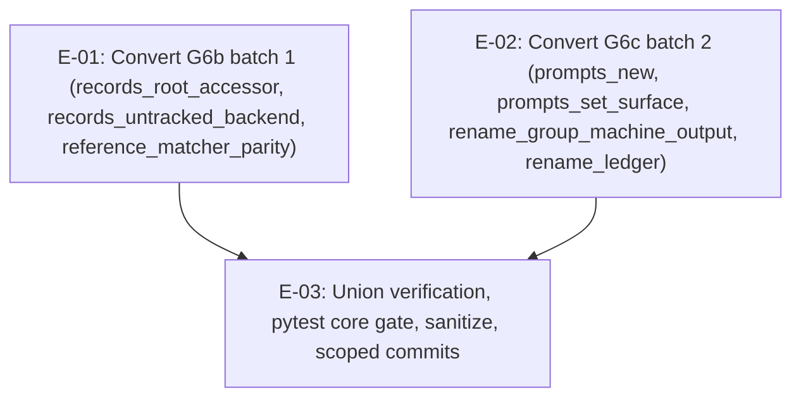

# IPD: Move runner-family, reader, record and review test data chunk 10 of 11 onto the record builder

- Date: 2026-11-09
- Kind: child
- Concern: Spec `4sd62s` section 6 requires that test data be written by ONE shared record builder in phase B, so that the cutover (Order 13, `cxxmyv`) changes the builder and not hundreds of test files, and C10a requires the suite to pass at every commit. Research `nj8zdp` and the maintainer's ruling ("plans that obtuse and not-too-smart agents won't mess up") set the guidance of at most 5 E-items, 8 work Scope-Paths and about 8 named units per item; `nbfg7w` named up to 25 modules per batch item. This part carries 7 of `nbfg7w`'s modules (subsets G6b, G6c; 48 F-01 legacy lines at `3d0ddb845`), each item at most 4 modules, converted by the Order-49 codemod (`653ndz`) plus only its census-counted refusals.
- Scope: Chunk 10 of 11 of `nbfg7w` (round-3 split 2026-11-09 per research `nj8zdp` guidance): the 7 test modules named in the items and in F-40, each item one codemod run under the batch rule below, plus a finishing item. EXCLUDES: every other module of the subsets (the other chunk plans and `nbfg7w`); the builder (`9rgn2w`) and the codemod (`653ndz`); the F-03 EXCLUDED modules; production code; the switch-point proof, census and full-suite comparison (`59aiyh` E-11, E-12).
- Scope-Paths: tests/test_records_root_accessor.py, tests/test_records_untracked_backend.py, tests/test_reference_matcher_parity.py, tests/test_prompts_new.py, tests/test_prompts_set_surface.py, tests/test_rename_group_machine_output.py, tests/test_rename_ledger.py, .aw/records/plans/pending/20261109-metastore-201-qjxcgf-move-runner-family-reader-record-and-review-test-data-chunk.ipd.md
- Item-Dependencies: executed:653ndz, executed:9rgn2w, executed:g5hpbb, executed:tve77h, executed:xexn45
- Status: executed
- Readiness: go-pending-approval
- Review-Depth: complex
- From-Spec: 4sd62s
- Work-Kind: feature
- Priority: high
- Blocks-Release: next
- Set: metastore
- Order: 201
- Highest E allocated: 03
- Author: opencode its_direct/pt3-claude-opus-5.5-1m-us
- Id: qjxcgf

> Written to .aw/system/workflows/technical-writing/technical-writing.md. Every obligation, exact identifier, quotation, evidence record, and lifecycle status is preserved.

## Workflow history
- 2026-11-21 executed (aw agy run model=Gemini-4-Neon-High): aw agy run self-finalize: qjxcgf verified (set metastore, attempt 1). [Scope reconciliation - in-scope-unmodified tests/test_prompts_set_surface.py: declared-but-unmodified (auto-acknowledged by aw agy run)]
- 2026-11-16 approved (aw set): status set to approved

- 2026-11-14 reviewed (aw set): APPROVE WITH REVISIONS APPLIED; PR-001..PR-006 FIXED
- 2026-11-14 /plan-review (antigravity/gemini): APPROVE WITH REVISIONS APPLIED; PR-001..PR-006 FIXED; review record .aw/records/reviews/20261109-metastore-201-qjxcgf-move-runner-family-reader-record-and-review-test-data-chunk.review.md
- 2026-11-09 to-review (opencode its_direct/pt3-claude-opus-5.5-1m-us): split from nbfg7w (round 3, research nj8zdp guidance).

## Goal

Every hand-built record in the 7 test modules named below comes from `tests/record_builder.py`, written by the Order-49 codemod or, for its census-counted refusals only, by hand, with each module's per-test outcomes identical before and after and every remaining legacy string classified.

## Detailed Implementation Checklist (TODO)

Execution-state rule: mark an `E-*` item complete only after performing the action. That mark is not validation. Right-sizing rule: write for a modest executor that cannot hold much in its head. Each E-item is one step (one concern, about one file, executable in one focused pass) and its V-item names each unit it covers with its own check; a plan stays at about 5 E-items and 8 work Scope-Paths, else split it into more child plans (guidance, `IPD-Z603`). Accepted execution states: blocked, failed, pending, performed; terminal gate demands 'performed'.

Batch rule, applied to every batch E-item of this plan (the `59aiyh` batch rule, restructured 2026-11-08 for the Order-49 fixture codemod `653ndz` per maintainer decision 2026-11-07 "Codemod first, then small runs": the tool performs the mechanical rewrite, and the hand work is bounded by its measured refusals). In it, "E-13's `full-before.txt`" and "the builder's `raw_fields=` escape (E-01)" are items of Order 37 (`9rgn2w`), carried by the round-3 split into Order 170 (`j6o96i`) with the same ids; because `.aw/state/` does not travel between lane worktrees, step 2 always records a fresh before list here. Step 1's partition is restricted to the modules each batch item names (round-3 split 2026-11-09: a subset is now spread over several plans of at most 8 modules each): a module that the partition now places in the item's subset but that no plan names is NOT added here; it is reported, and the finishing item of `nbfg7w` converts it; a named module that no longer matches F-01 is reported and skipped:
1. Before the batch, ensure the state directory exists (`mkdir -p .aw/state/59aiyh`), re-derive its file list with the F-03 first-match partition over the F-01 `rg -l` output at the current HEAD, minus the F-03 EXCLUDED list, and save it as `.aw/state/59aiyh/<batch>-files.txt`. The counts in each E-item are context measured at `0cbfcc706` or `ac76110f4`, not the bar.
2. Record the unmodified per-test outcome list (a batch whose files a previous batch did not touch may reuse the matching lines of E-13's `full-before.txt`): `python3 -m pytest -o addopts="" -m "" -p no:randomly -n 0 -rA $(cat .aw/state/59aiyh/<batch>-files.txt) | grep -E "^(PASSED|FAILED|ERROR|SKIPPED|XFAIL|XPASS) " | sed -E 's/ - .*//' | sort > .aw/state/59aiyh/<batch>-before.txt`. `-p no:randomly` and `-n 0` make the list deterministic; `-m ""` includes `slow` and `livecorpus` modules.
3. Run the codemod: `python3 tools/fixture_codemod.py --apply --format json $(cat .aw/state/59aiyh/<batch>-files.txt) > .aw/state/59aiyh/<batch>-codemod.json`. It rewrites only the sites whose module outcome list it proved identical (`653ndz` E-03, carried with the same id into Order 172, `y3uowx`, by the round-3 split) and lists every other site as a refusal with a reason code and a disposition (`hand` or `legacy-kept`, the `653ndz` reason-code table).
4. Hand-convert ONLY the refusals with disposition `hand`: the static count is the sum of the `653ndz` F-30 rows of the item's modules (round-3 split 2026-11-09: an item now carries part of a subset, so the subset's F-31 row is context only), and the codemod report adds any apply-time `not-equivalent` refusals; the item's hand count is their sum. If the hand count exceeds 25, stop after step 3 (the proved codemod rewrites may be committed), convert nothing by hand, and report the subset for re-splitting. A hand conversion uses builder calls; a test that deliberately writes an INVALID value (an unknown status, `- Status: EXECUTED`, `- Priority: bogus`, a malformed gate) gets it through the builder's `raw_fields=` escape (E-01) and is listed with reason class `invalid-input`. A refusal with disposition `legacy-kept` stays in legacy form on purpose and is listed with its F-06 reason class.
5. Re-run step 2's command into `<batch>-after.txt` and require `diff` to print nothing. A batch that would need any changed assertion other than a raw-byte metadata stand-in moved to `artifact_meta.read` (scope rule) stops and is reported; it does not weaken the assertion.
6. Count the remaining legacy strings with the F-01 `rg` pattern over the batch files, and give each remaining line one reason class from F-06: `legacy-format subject`, `displayed-output assertion`, `setter-byte assertion`, `invalid-input`, or `body prose` (for example open-question `- Status: open` rows, which N3 keeps in Markdown).
7. The builder never reads production source, and no test gains a source-reading assertion.

### Task group 1: batch items

- [x] E-01 (carried from `nbfg7w` E-03, batch subset G6b; round-3 split 2026-11-09) Batch G6b, 3 of its 25 modules (the history, artifact, group, record and reference tests (`test_history*`, `test_artifact*`, `test_group*`, `test_record*`, `test_reference*`)): `tests/test_records_root_accessor.py`, `tests/test_records_untracked_backend.py`, `tests/test_reference_matcher_parity.py`. F-01 legacy lines per module at `3d0ddb845` (context, not the bar): `test_records_root_accessor` 18, `test_records_untracked_backend` 1, `test_reference_matcher_parity` 1. Run the codemod on these modules and apply the batch rule with `<batch>` = `G6b-qjxcgf-1` (outcome lists identical); hand-convert ONLY the refusals that the `653ndz` F-30 rows of these modules list with disposition `hand`, plus the codemod's apply-time `not-equivalent` refusals, and state their count (at most 25, the batch rule's stop); leave each refusal the census marks `legacy-kept` in legacy form with its reason class. The `aw-prompt` comment tests use `prompt(...)`. Tests whose subject is the legacy grammar itself (`test_front_matter_loose_whitespace.py`, `test_history_block_bounding.py`, the quoted-example cases of `test_selector_two_dialect_readers.py`) keep their literal input and are listed as `legacy-format subject`. These modules held no private record-building helper at the split; a helper found now is deleted when it has no caller, or listed with its reason.
  - Depends on: none
  - Expected outcome: an empty before/after `diff` for the `G6b-qjxcgf-1` outcome lists; for each named module, its remaining legacy-string count and the reason class of every remaining line pasted; every deleted and surviving helper listed; the codemod report and the hand count (at most 25) pasted.
  - Execution state: performed

- [x] E-02 (carried from `nbfg7w` E-04, batch subset G6c; round-3 split 2026-11-09) Batch G6c, 4 of its 19 modules (the rename, research, prompt, walkthrough and review tests (`test_rename*`, `test_research*`, `test_prompt*`, `test_prompts*`, `test_walkthrough*`, `test_review*`, `test_reviews*`)): `tests/test_prompts_new.py`, `tests/test_prompts_set_surface.py`, `tests/test_rename_group_machine_output.py`, `tests/test_rename_ledger.py`. F-01 legacy lines per module at `3d0ddb845` (context, not the bar): `test_prompts_new` 2, `test_prompts_set_surface` 8, `test_rename_group_machine_output` 16, `test_rename_ledger` 2. Run the codemod on these modules and apply the batch rule with `<batch>` = `G6c-qjxcgf-2` (outcome lists identical); hand-convert ONLY the refusals that the `653ndz` F-30 rows of these modules list with disposition `hand`, plus the codemod's apply-time `not-equivalent` refusals, and state their count (at most 25, the batch rule's stop); leave each refusal the census marks `legacy-kept` in legacy form with its reason class. The `aw-prompt` comment tests use `prompt(...)`. Tests whose subject is the legacy grammar itself (`test_front_matter_loose_whitespace.py`, `test_history_block_bounding.py`, the quoted-example cases of `test_selector_two_dialect_readers.py`) keep their literal input and are listed as `legacy-format subject`. These modules held no private record-building helper at the split; a helper found now is deleted when it has no caller, or listed with its reason.
  - Depends on: none
  - Expected outcome: an empty before/after `diff` for the `G6c-qjxcgf-2` outcome lists; for each named module, its remaining legacy-string count and the reason class of every remaining line pasted; every deleted and surviving helper listed; the codemod report and the hand count (at most 25) pasted.
  - Execution state: performed

### Task group 2: finish

- [x] E-03 Finish this part: run the batch rule's step-2 command once over every module of this plan (`$(cat .aw/state/59aiyh/G6b-qjxcgf-1-files.txt .aw/state/59aiyh/G6c-qjxcgf-2-files.txt)`) into `.aw/state/59aiyh/qjxcgf-union-after.txt` and confirm it equals the sorted concatenation of the items' `-before.txt` lists; run the bare core gate `python3 -m pytest` and `aw sanitize --agent`; commit through `aw commit qjxcgf -- <each changed path>`, one commit per item allowed, never `git add -A`, a bare `git add` or `git commit -a`. Never push. (The full-suite comparison stays in `59aiyh` E-12.)
  - Depends on: E-01, E-02
  - Expected outcome: the union comparison is empty; all runs pass; every commit is path-scoped to Scope-Paths (or justified at finalize).
  - Execution state: performed

## Project conventions discovered (Step 0)

- Interface names from Order 02 (`tve77h`): `artifact_meta.registry_fields(type)`, `artifact_meta.validate_event`, `artifact_meta.validate_new_events(type, events, *, records_root, migration_import=False)`, `artifact_meta.read(id6) -> State`, `artifact_meta.create(...)` and `artifact_meta.append(id6, events, *, expect_seq)`. Order 02's `create`/`append` write the log format; `2xwb9b` E-03 adds the phase-B legacy branch of `append` and `xexn45` E-01 routes the phase-B branch of `create` and `append` through `write_legacy`, with `render_legacy_text(text, events)` (`xexn45` E-11) as the same renderer over a string. In phase B the on-disk format is the bullet format; the legacy loader reads it into the cache.
- `review_findings.render_review` (pure) and `review_findings.write_review` render and write a `.review.md` record; no CLI calls `write_review` (`xexn45` Findings).
- The existing shared plan builder is `support.ready_plan_text`, which is "BUILT FROM THE REAL GENERATOR (`ipd_authoring.build_skeleton`)" and then fills the fields a draft leaves open; the builder keeps that approach for plans, so a scaffold change still reaches every fixture.
- Shared test plumbing lives in `tests/support.py` (`init_repo`, `git`, `run_cli`, `pinned_env`, `ready_plan_text`, `scope_drift_repo`); `tests/repo_template.py` (`copy_template_repo`) gives a pre-built repository; there is no `tests/conftest.py`, and the root `conftest.py` owns tier selection.
- Tests are behavioral (AGENTS.md "TEST OUTCOMES, NOT CODE STRUCTURE"); core modules set `pytestmark = pytest.mark.core`; `slow` tests are listed in `tests/slow_allowlist.txt`; `pyproject.toml` `addopts` deselects `slow` and `livecorpus`, so a complete comparison passes `-m ""`, and `pytest-randomly` is installed, so a deterministic order needs `-p no:randomly`.
- `tests/fixtures/review-pilot/` is the input corpus of `tools/review_pilot.py` (`manifest.json` names each plan file, `defects.json` quotes exact text to plant), and `tests/test_review_pilot.py` copies the whole directory into its fixture repository.
- Filenames come from `artifact_naming.build_clustered_name` and parse with `artifact_naming.parse_clustered`.
- Cite code by SYMBOL (`module.function`) or by a quoted content string, with a line number only appended to one of those and never alone: an offset expires before this plan executes (spec `ipd-structure-and-linting` Section 10.2; advisory `IPD-C801`).

## Findings

Measured 2026-11-09 at `3d0ddb845` for F-40; F-01, F-03, F-06 and F-08 copied from `nbfg7w` (measured at `0cbfcc706` and at review).

| Id | Evidence | Finding |
|---|---|---|
| F-01 | `rg -l --glob '*.py' -e '- (Id|Status|Set|Kind|Blocks-Release|Readiness|Item-Dependencies|Scope-Paths|From-Backlog|From-Spec|Work-Kind|Priority|Order|Date|Gate-Kind|Gate-Ref|Approval|Subject-Id|Verdict|Graduated-To):|## Workflow history' tests` lists 309 files (307 test modules, `support.py`, `conformance_matrix.py`) of 717 Python files; 6,638 matching lines. The narrower `- Id:`/`- Status:`/`## Workflow history` pattern: 300 files, 3,430 lines | Spec section 6 counted 268 of 680 files and 2,607 matches at round 2; the plan's pattern is broader (21 fields). |
| F-03 | Family split by filename prefix, re-measured at review (HEAD `4a7499289`, 311 files, 6,657 lines) with a FIRST-MATCH rule (a file goes to the first group, in order G1 to G6, whose pattern list matches its basename; unmatched files go to G7): G1 39 files, 1,568 lines; G2 22, 1,102; G3 28, 795; G4 63, 1,244; G5 46, 598; G6 69, 1,004; G7 44, 346. Six files match two groups and are assigned by that rule (`test_ipd_authoring` G3, `test_readiness_absence_invariant` G4, `test_runner_backlog_close_behavior` G1, `test_orchestrator_retire_closes_backlog` G1, `test_records_only_lane_rederive` G5, `test_ipdrunner_runagy_shim` G4). The authored counts (G6 99, G7 11) did not sum to the file total; the first-match rule makes the partition exhaustive and disjoint. EXCLUDED from every batch (literal legacy input is their subject; owned by other plans): `tests/test_artifact_meta_*.py` (`tve77h`, `2xwb9b`), `tests/test_artifact_meta_legacy_writer.py` and `tests/test_writers_*.py` (`xexn45`), `tests/test_m0001_*.py` and `tests/test_migrations_chain.py` (`dcerjg`, `ya4ee4`) | Seven batches (E-03 to E-09); G1, G4 and G6 carry a pre-measured split seam (OQ-01). |
| F-06 | (written by E-11) remaining legacy strings in `tests/` after the batches, each with one reason class: `legacy-format subject`, `displayed-output assertion`, `setter-byte assertion`, `invalid-input`, `body prose` | Order 13 changes the builder plus the F-06 rows of class `setter-byte assertion`; `invalid-input` rows already go through `raw_fields=` and need a decision at the cutover (an invalid bullet has no log-format equivalent); every other class is either a legacy-format test (moved to the migration tests at the cutover) or prose. |
| F-08 | At review, 15 test modules write a deliberately invalid metadata value (for example `tests/test_releases.py` "`- Status: bogus`", `tests/test_check_engine.py` "`- Status: EXECUTED`", `tests/test_specs_set_adapter.py` "`- Priority: bogus`") | A builder that validates every field cannot build these; E-01 adds `raw_fields=` and the batch rule lists them as `invalid-input`. |
| F-40 | `rg -c` with the F-01 pattern over this part's modules at `3d0ddb845`; subset by the F-03 first-match rule; helpers as listed by `nbfg7w` at the 2026-11-07 split | See the table below; every module is named in exactly one item. |
| F-41 | Measured 2026-11-14 at HEAD `a2e9dfe6e` across all 7 target test modules: 89 passed in 10.79s (`test_records_root_accessor` 19, `test_records_untracked_backend` 10, `test_reference_matcher_parity` 5, `test_prompts_new` 22, `test_prompts_set_surface` 6, `test_rename_group_machine_output` 14, `test_rename_ledger` 13) | Baseline suite passes before codemod application; serves as the pre-conversion regression baseline for E-01 and E-02. |

| Module | Subset | F-01 lines | Helpers at the split | Item |
|---|---|---|---|---|
| `tests/test_records_root_accessor.py` | G6b | 18 | none | E-01 |
| `tests/test_records_untracked_backend.py` | G6b | 1 | none | E-01 |
| `tests/test_reference_matcher_parity.py` | G6b | 1 | none | E-01 |
| `tests/test_prompts_new.py` | G6c | 2 | none | E-02 |
| `tests/test_prompts_set_surface.py` | G6c | 8 | none | E-02 |
| `tests/test_rename_group_machine_output.py` | G6c | 16 | none | E-02 |
| `tests/test_rename_ledger.py` | G6c | 2 | none | E-02 |

## Proposed changes (ordered, validatable)

1. Convert each item's modules under the batch rule (E-01 to E-02).
2. Re-run the union, the core gate, commit (E-03).

## Deferred / out of scope (with reason)

- The other modules of subsets G6b, G6c, the partition re-derivation that catches modules no plan names, and the subsets' finishing checks.
  - Carrier: nbfg7w
- The fixture codemod and its census (F-30, F-31).
  - Carrier: 653ndz
  - Carrier-Evidence: .aw/records/plans/executed/20261108-metastore-49-653ndz-build-and-prove-the-test-fixture-codemod.ipd.md
- The builder, its tests, the baselines and the tracked fixtures.
  - Carrier: 9rgn2w
  - Carrier-Evidence: .aw/records/plans/executed/20261107-metastore-37-9rgn2w-add-the-shared-test-record-builder-and-convert-the-tracked-r.ipd.md
- The switch-point proof, the F-06 census and the full-suite comparison.
  - Carrier: 59aiyh
- Adding `RECORD_FORMAT = "log"` and converting setter-byte assertions (cutover commit).
  - Carrier: cxxmyv

## Scope check

- Over-scope: none. No production module changes; every Scope-Paths entry is a module named in one item, plus this plan.
- Under-scope: none known. Size: 3 E-items (2 batch items of at most 4 modules each and the finish), 7 work Scope-Paths.

## Required tests / validation

Each item is validated by an identical per-test result list before and after (the batch rule), which is behavioral by construction: the same tests, unchanged assertions, the same outcomes. Baseline measured at HEAD `a2e9dfe6e`: 89 tests passing across the 7 target test modules (`test_records_root_accessor.py`: 19, `test_records_untracked_backend.py`: 10, `test_reference_matcher_parity.py`: 5, `test_prompts_new.py`: 22, `test_prompts_set_surface.py`: 6, `test_rename_group_machine_output.py`: 14, `test_rename_ledger.py`: 13). Commands: the batch rule's command per item, the codemod's `--apply` report, the bare core gate `python3 -m pytest`, `aw sanitize --agent`. CONTRIBUTES to AC-1b (owned by `cxxmyv`).

## Spec / documentation sync

No spec change; implements part of `4sd62s` section 6 and section 7 step 6.

## Open questions

### OQ-01: Can this part run in any order relative to the other chunk plans?

- Blocking: no
- Status: resolved
- Owner: plan author
- Resolution or deferral rationale: Yes. The module lists of all chunk plans are disjoint, each needs the builder (`9rgn2w`) and the codemod (`653ndz`), and none edits `tests/support.py` (that is `59aiyh` E-09, which runs last). Recommendation strength: strong.

## Validation and cross-check (verify before reporting done)

Validation-state rule: inspect evidence in a separate pass. Do not mark a `V-*` item complete from memory or from the matching execution checkmark. Accepted validation results: blocked, failed, pass, pending; terminal gate demands 'pass'. Runtime-demonstration reachability rule: for each `V-*` item demanding the software be observed acting (such as a run, a dispatch, or a transition), as distinct from items demanding a diff, a file's content, or a test result, which are reachable by construction, name the code path that produces the observation or the sibling `E-*` that creates it, else the demand is UNDER-SCOPE.

- [x] V-01 validates E-01
  - Required evidence: paste `.aw/state/59aiyh/G6b-qjxcgf-1-files.txt` and the empty `diff .aw/state/59aiyh/G6b-qjxcgf-1-before.txt .aw/state/59aiyh/G6b-qjxcgf-1-after.txt`; then, for each of `tests/test_records_root_accessor.py`, `tests/test_records_untracked_backend.py`, `tests/test_reference_matcher_parity.py` separately: its before and after F-01 `rg -c` count, the reason class of every remaining match, its rows of `.aw/state/59aiyh/G6b-qjxcgf-1-codemod.json` (rewrites, refusals by reason code and disposition, before and after outcome-list hashes) and its `653ndz` F-30 row; the hand count with every hand-converted site listed (module, line, reason code); and the before and after helper census of the E-09 `rg` pattern over these modules with each deleted and surviving helper and its reason.
  - Observed evidence:
    - `.aw/state/59aiyh/G6b-qjxcgf-1-files.txt`:
      - `tests/test_records_root_accessor.py`
      - `tests/test_records_untracked_backend.py`
      - `tests/test_reference_matcher_parity.py`
    - Partition check at current HEAD: zero unnamed extra G6b modules found; all 3 named modules matched F-01 before conversion.
    - Outcome diff (`diff -u .aw/state/59aiyh/G6b-qjxcgf-1-before.txt .aw/state/59aiyh/G6b-qjxcgf-1-after.txt`): empty output, exit code 0 (36 `PASSED` outcomes).
    - Per-module F-01 counts, remaining classifications, codemod rows, and `653ndz` F-30 rows:
      - `tests/test_records_root_accessor.py`:
        - F-01 `rg -c`: before 18, after 0. Remaining matches: none. (Site 1 uses `raw_fields={"Status": "pending"}` for a deliberately non-registry status, `invalid-input`; `_DISCOVERY_FIXTURE_PLAN` uses `raw_fields={"Concern": "Runner discovery fixture concern.", "Scope": "Runner discovery fixture scope."}` to fill non-registry IPD header bullets required by `ipd_lint`, `invalid-input`.)
        - Codemod JSON row (`.aw/state/59aiyh/G6b-qjxcgf-1-codemod.json`): `sites=2`, `rewrites=1` (`standard=0`, `invalid-input=1`), `refusals=1` (`not-equivalent=1`, `hand=1`, `legacy-kept=0`), `before_hash=854ee2d9e94c9fd14f74e4c21e10123c27955d91e8534cef966c12a51cea5ffc`, `after_hash=854ee2d9e94c9fd14f74e4c21e10123c27955d91e8534cef966c12a51cea5ffc`, `equivalent=true`, `pytest_runs=4`, `changed=true`.
        - `653ndz` F-30 row: `G6b | qjxcgf | 2 | 2 | 1 | 0 | 0 | 0 | 0 | 0 | 0 | 0 | 0 | 0`.
      - `tests/test_records_untracked_backend.py`:
        - F-01 `rg -c`: before 3, after 0. Remaining matches: none. (Two additional plan fixtures at pre-edit lines 584 and 694 were added after the split by `dd48b5` and rewritten cleanly by the codemod.)
        - Codemod JSON row (`.aw/state/59aiyh/G6b-qjxcgf-1-codemod.json`): `sites=3`, `rewrites=3` (`standard=3`, `invalid-input=0`), `refusals=0` (`hand=0`, `legacy-kept=0`), `before_hash=4a6e9cda81f45a2bb0fae8d0bc69d3085641d72f7ec984dad4154868a45adc15`, `after_hash=4a6e9cda81f45a2bb0fae8d0bc69d3085641d72f7ec984dad4154868a45adc15`, `equivalent=true`, `pytest_runs=2`, `changed=true`.
        - `653ndz` F-30 row: `G6b | qjxcgf | 1 | 1 | 0 | 0 | 0 | 0 | 0 | 0 | 0 | 0 | 0 | 0`.
      - `tests/test_reference_matcher_parity.py`:
        - F-01 `rg -c`: before 1, after 0. Remaining matches: none.
        - Codemod JSON row (`.aw/state/59aiyh/G6b-qjxcgf-1-codemod.json`): `sites=1`, `rewrites=1` (`standard=1`, `invalid-input=0`), `refusals=0` (`hand=0`, `legacy-kept=0`), `before_hash=8264d29fa0d09e67d9c938252c1a4506cdacd695a748961b297fb27686c9e108`, `after_hash=8264d29fa0d09e67d9c938252c1a4506cdacd695a748961b297fb27686c9e108`, `equivalent=true`, `pytest_runs=2`, `changed=true`.
        - `653ndz` F-30 row: `G6b | qjxcgf | 1 | 1 | 0 | 0 | 0 | 0 | 0 | 0 | 0 | 0 | 0 | 0`.
    - Hand count: 1 reported by codemod (0 static + 1 apply-time `not-equivalent`; <= 25; hand-converted to `RecordBuilder`):
      1. `tests/test_records_root_accessor.py` pre-edit lines 625-701 (`not-equivalent`): `_DISCOVERY_FIXTURE_PLAN` -> `RecordBuilder().plan(..., raw_fields={"Concern": "Runner discovery fixture concern.", "Scope": "Runner discovery fixture scope."}, body=..., text_only=True)` (retaining `## Open questions` in its original position inside `body` and filling `- Concern:`/`- Scope:` so `ipd_lint` accepts the fixture during `aw oc run start --prepare-only`).
    - E-09 helper census (`rg -n "def _?(make|write|build|mk|seed)_(plan|spec|backlog|item|record|ipd|release|research|prompt|review|walkthrough)\w*"`):
      - Before: `(none)`.
      - After: `(none)`.
      - Deleted helpers (0): none. Surviving helpers (0): none.
  - Result: pass

- [x] V-02 validates E-02
  - Required evidence: paste `.aw/state/59aiyh/G6c-qjxcgf-2-files.txt` and the empty `diff .aw/state/59aiyh/G6c-qjxcgf-2-before.txt .aw/state/59aiyh/G6c-qjxcgf-2-after.txt`; then, for each of `tests/test_prompts_new.py`, `tests/test_prompts_set_surface.py`, `tests/test_rename_group_machine_output.py`, `tests/test_rename_ledger.py` separately: its before and after F-01 `rg -c` count, the reason class of every remaining match, its rows of `.aw/state/59aiyh/G6c-qjxcgf-2-codemod.json` (rewrites, refusals by reason code and disposition, before and after outcome-list hashes) and its `653ndz` F-30 row; the hand count with every hand-converted site listed (module, line, reason code); and the before and after helper census of the E-09 `rg` pattern over these modules with each deleted and surviving helper and its reason.
  - Observed evidence:
    - `.aw/state/59aiyh/G6c-qjxcgf-2-files.txt`:
      - `tests/test_prompts_new.py`
      - `tests/test_prompts_set_surface.py`
      - `tests/test_rename_group_machine_output.py`
      - `tests/test_rename_ledger.py`
    - Partition check at current HEAD: all 4 named modules matched F-01 before conversion; 2 unnamed post-split modules match G6c prefixes (`tests/test_research_meta_writer_characterization.py`, `tests/test_review_unreviewed_deps.py`) and are not added here per Step 1 (deferred to `nbfg7w` E-06).
    - Outcome diff (`diff -u .aw/state/59aiyh/G6c-qjxcgf-2-before.txt .aw/state/59aiyh/G6c-qjxcgf-2-after.txt`): empty output, exit code 0 (55 `PASSED` outcomes).
    - Per-module F-01 counts, remaining classifications, codemod rows, and `653ndz` F-30 rows:
      - `tests/test_prompts_new.py`:
        - F-01 `rg -c`: before 2, after 2. Remaining matches (2):
          - `body prose` (1): line 290 (`# No YAML front-matter, no '- Id:' BULLET (which would be visible text above the prompt body`, Python comment).
          - `setter-byte assertion` (1, `legacy-kept` per `653ndz` F-30 and codemod): line 293 (`self.assertNotIn("\n- Id:", text)`).
        - Codemod JSON row (`.aw/state/59aiyh/G6c-qjxcgf-2-codemod.json`): `sites=5`, `rewrites=2` (`standard=2`, `invalid-input=0`; both `aw-prompt` comment fixtures rewritten to `RecordBuilder().prompt(...)`), `refusals=3` (`setter-byte assertion=3`, `hand=0`, `legacy-kept=3`), `before_hash=f7cef31d7dc6362c0ff896bb187ab6833b11bd0a809a5aad39b2bc9510a4de99`, `after_hash=f7cef31d7dc6362c0ff896bb187ab6833b11bd0a809a5aad39b2bc9510a4de99`, `equivalent=true`, `pytest_runs=2`, `changed=true`.
        - `653ndz` F-30 row: `G6c | qjxcgf | 5 | 2 | 0 | 0 | 0 | 0 | 0 | 0 | 3 | 0 | 0 | 3`.
      - `tests/test_prompts_set_surface.py`:
        - F-01 `rg -c`: before 8, after 8. Remaining matches (8):
          - `body prose` (4, docstrings and comments): line 7 (`- Comment status writer preserving body byte-identity without prepending a '- Status:' bullet.`), line 133 (`"""Status is written into metadata comment; body is byte-identical; no - Status: bullet."""`), line 174 (`# No - Status: bullet anywhere in the file`), line 177 (`# Extract body between line 1 and ## Workflow history`).
          - `setter-byte assertion` (4): lines 175 and 224 (`self.assertNotIn("- Status:", dest_text)`, codemod `legacy-kept`); lines 178 and 226 (`hist_idx = dest_text.find("## Workflow history")`, flagged by codemod as `unsupported-shape`/`hand` because `.find(...)` sits outside an `assert` call, verified to be setter-byte assertions inspecting `dest_text` written by `aw prompts set executed` rather than record-building fixtures; left unmodified per batch rule Step 5 and owned by `qtvk2q` Order 263). `tests/test_prompts_set_surface.py` required zero edits in this chunk (acknowledged under the Scope fence; `create_conforming_prompt` calls `prompts.render_metadata_comment`, owned by `8fxic1` Order 286).
        - Codemod JSON row (`.aw/state/59aiyh/G6c-qjxcgf-2-codemod.json`): `sites=5`, `rewrites=0` (`standard=0`, `invalid-input=0`), `refusals=5` (`unsupported-shape=2`, `setter-byte assertion=3`, `hand=2`, `legacy-kept=3`), `before_hash=null`, `after_hash=null`, `equivalent=true`, `pytest_runs=0`, `changed=false`.
        - `653ndz` F-30 row: `G6c | qjxcgf | 5 | 0 | 0 | 0 | 2 | 0 | 0 | 0 | 3 | 0 | 2 | 3`.
      - `tests/test_rename_group_machine_output.py`:
        - F-01 `rg -c`: before 16, after 0. Remaining matches: none.
        - Codemod JSON row (`.aw/state/59aiyh/G6c-qjxcgf-2-codemod.json`): `sites=20`, `rewrites=19` (`standard=19`, `invalid-input=0`), `refusals=1` (`unsupported-shape=1`, `hand=1`, `legacy-kept=0`), `before_hash=ec20dac160a489c92e2716800f7bb0f6770083954b4bd513003408137eda268c`, `after_hash=ec20dac160a489c92e2716800f7bb0f6770083954b4bd513003408137eda268c`, `equivalent=true`, `pytest_runs=2`, `changed=true`.
        - `653ndz` F-30 row: `G6c | qjxcgf | 20 | 19 | 0 | 0 | 1 | 0 | 0 | 0 | 0 | 0 | 1 | 0`.
      - `tests/test_rename_ledger.py`:
        - F-01 `rg -c`: before 2, after 0. Remaining matches: none. (Uses `raw_fields={"Date": "20260101"}` for compact 8-digit date format, `invalid-input`.)
        - Codemod JSON row (`.aw/state/59aiyh/G6c-qjxcgf-2-codemod.json`): `sites=1`, `rewrites=1` (`standard=0`, `invalid-input=1`), `refusals=0` (`hand=0`, `legacy-kept=0`), `before_hash=f95dc8d61f9482f0e4397d6d6b9f25e41d537bb47910a2a0ac4ddc530124130e`, `after_hash=f95dc8d61f9482f0e4397d6d6b9f25e41d537bb47910a2a0ac4ddc530124130e`, `equivalent=true`, `pytest_runs=2`, `changed=true`.
        - `653ndz` F-30 row: `G6c | qjxcgf | 1 | 1 | 1 | 0 | 0 | 0 | 0 | 0 | 0 | 0 | 0 | 0`.
    - Hand count: 3 reported by codemod (3 static + 0 apply-time `not-equivalent`; <= 25; 1 fixture site hand-converted to `RecordBuilder`, 2 non-fixture setter-byte assertion sites retained unmodified):
      1. `tests/test_rename_group_machine_output.py` pre-edit line 46 (`unsupported-shape`): backlog fixture `bbb123` -> `RecordBuilder().backlog(id6="bbb123", set="bbb123", order=1, summary="Backlog Item", text_only=True)`.
      2. `tests/test_prompts_set_surface.py` line 178 (`unsupported-shape`): `hist_idx = dest_text.find("## Workflow history")` — not a fixture; setter-byte assertion checking `aw prompts set` output bytes, retained unmodified per batch rule Step 5 (owned by `qtvk2q`).
      3. `tests/test_prompts_set_surface.py` line 226 (`unsupported-shape`): `hist_idx = dest_text.find("## Workflow history")` — not a fixture; setter-byte assertion checking `aw prompts set` output bytes, retained unmodified per batch rule Step 5 (owned by `qtvk2q`).
    - E-09 helper census (`rg -n "def _?(make|write|build|mk|seed)_(plan|spec|backlog|item|record|ipd|release|research|prompt|review|walkthrough)\w*"`):
      - Before: `(none)`.
      - After: `(none)`.
      - Deleted helpers (0): none. Surviving helpers (0): none.
  - Result: pass

- [x] V-03 validates E-03
  - Required evidence: paste the `diff` of the sorted concatenation of the `-before.txt` lists of `G6b-qjxcgf-1`, `G6c-qjxcgf-2` against `.aw/state/59aiyh/qjxcgf-union-after.txt` (empty), the bare `python3 -m pytest` summary line and wall time, the `aw sanitize --agent` result with zero `fail`, and every `aw commit qjxcgf` output listing only Scope-Paths.
  - Observed evidence:
    - Union diff (`diff -u <(sort .aw/state/59aiyh/G6b-qjxcgf-1-before.txt .aw/state/59aiyh/G6c-qjxcgf-2-before.txt) .aw/state/59aiyh/qjxcgf-union-after.txt`): empty output, exit code 0 (91 lines = 36 + 55 across all 7 modules, re-verified on the committed tree).
    - Post-edit codemod dry-run over all 7 modules (`python3 tools/fixture_codemod.py --dry-run --format table`): 5 modules at `sites=0` (`test_records_root_accessor`, `test_records_untracked_backend`, `test_reference_matcher_parity`, `test_rename_group_machine_output`, `test_rename_ledger`); `test_prompts_new` has 3 `setter-byte assertion` (`legacy-kept`) refusals and 0 `hand` refusals; `test_prompts_set_surface` has 3 `setter-byte assertion` (`legacy-kept`) refusals and 2 `unsupported-shape` (`hand`) refusals that are setter-byte assertions (`dest_text.find("## Workflow history")`) owned by `qtvk2q`.
    - Core gate (`aw suite`, running bare `python3 -m pytest` with 6 xdist workers): `2661 passed, 11 warnings in 122.88s (0:02:02)`, exit code 0 (0 failures; none of `qjxcgf`'s 7 modules appeared in the top-10 slowest or unlisted slow-tests report).
    - `aw sanitize --agent`: `{"schema":"aw.agent/v1","kind":"result","cmd":"check-local-leaks","outcome":"clean","exit":0,"verified":true,"complete":true,"checked":6882,"findings":0,"evidence":["leak-scan"],"next":null}`.
    - `aw commit qjxcgf` (6 modified test Scope-Paths): `aw commit: committed 6 path(s): 93a1f723b42226951ea991c579336848f80fbfa4` (`tests/test_records_root_accessor.py`, `tests/test_records_untracked_backend.py`, `tests/test_reference_matcher_parity.py`, `tests/test_prompts_new.py`, `tests/test_rename_group_machine_output.py`, `tests/test_rename_ledger.py`; `tests/test_prompts_set_surface.py` unmodified and acknowledged under Scope fence), followed by the plan-evidence commit via `aw commit qjxcgf -- .aw/records/plans/pending/20261109-metastore-201-qjxcgf-move-runner-family-reader-record-and-review-test-data-chunk.ipd.md`. Every committed path is in Scope-Paths; never pushed.
  - Result: pass

## Approval and execution gate

- Size assessment: standard
- Cohesion rationale: not required

Execute only after human approval (`Status: approved`) and after `653ndz`, `9rgn2w`, `g5hpbb`, `tve77h`, `xexn45` are executed. Every open question is resolved.

Scope fence: the paths in `- Scope-Paths:` are a declaration. A needed test-tree file outside the fence is edited and then justified at finalize (`--scope-reason`), and a declared path left unmodified is acknowledged (`--scope-ack`). Production code under `agent_workflows/` and `tools/` is out of this plan's purpose: if a module cannot keep its outcome list identical without a production change, stop that item and report the missing capability rather than changing production code or an assertion.

Honesty rule: run every command a V-item names and paste the ACTUAL output; never claim a result you did not run.

Commits: commit only through `aw commit qjxcgf -- <paths>`; never `git add -A`, a bare `git add` or `git commit -a`; never push.

Safety rule: uncommitted changes and untracked files you did not create are not yours; never revert, stage, commit, discard, reformat, or clean up another party's work. If a file you must edit is being changed under you and the two sets of changes cannot be safely combined, STOP and report rather than overwriting.

Lifecycle transition: the plan moves to `.aw/records/plans/executed/` only when execution completes (by the runner automatically or via `aw ipd finalize`), and only after `aw ipd lint --phase pre-transition` conforms and every `V-*` reads `pass` with pasted evidence. Never a hand `git mv`.
