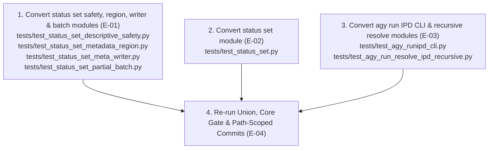

# IPD: Move setter, runner-lane and first-half unmatched test data chunk 2 of 7 onto the record builder

- Date: 2026-11-09
- Kind: child
- Concern: Spec `4sd62s` section 6 requires that test data be written by ONE shared record builder in phase B, so that the cutover (Order 13, `cxxmyv`) changes the builder and not hundreds of test files, and C10a requires the suite to pass at every commit. Research `nj8zdp` and the maintainer's ruling ("plans that obtuse and not-too-smart agents won't mess up") set the guidance of at most 5 E-items, 8 work Scope-Paths and about 8 named units per item; `1upea0` named up to 25 modules per batch item. This part carries 7 of `1upea0`'s modules (subsets G3a, G5a; 386 F-01 legacy lines at `3d0ddb845`), each item at most 4 modules, converted by the Order-49 codemod (`653ndz`) plus only its census-counted refusals.
- Scope: Chunk 2 of 7 of `1upea0` (round-3 split 2026-11-09 per research `nj8zdp` guidance): the 7 test modules named in the items and in F-40, each item one codemod run under the batch rule below, plus a finishing item. EXCLUDES: every other module of the subsets (the other chunk plans and `1upea0`); the builder (`9rgn2w`) and the codemod (`653ndz`); the F-03 EXCLUDED modules; production code; the switch-point proof, census and full-suite comparison (`59aiyh` E-11, E-12).
- Scope-Paths: tests/test_status_set_descriptive_safety.py, tests/test_status_set_metadata_region.py, tests/test_status_set_meta_writer.py, tests/test_status_set_partial_batch.py, tests/test_status_set.py, tests/test_agy_runipd_cli.py, tests/test_agy_run_resolve_ipd_recursive.py, .aw/records/plans/pending/20261109-metastore-204-9hk3rh-move-setter-runner-lane-and-first-half-unmatched-test-data-c.ipd.md
- Item-Dependencies: executed:653ndz, executed:9rgn2w, executed:g5hpbb, executed:tve77h, executed:xexn45
- Status: executed
- Readiness: go-pending-approval
- Review-Depth: complex
- From-Spec: 4sd62s
- Work-Kind: feature
- Priority: high
- Blocks-Release: next
- Set: metastore
- Order: 204
- Highest E allocated: 04
- Author: opencode its_direct/pt3-claude-opus-5.5-1m-us
- Id: 9hk3rh

> Written to `.aw/system/workflows/technical-writing/technical-writing.md`. Every obligation, exact identifier, quotation, evidence record, and lifecycle status is preserved.

## Workflow history
- 2026-11-22 executed (aw agy run model=Gemini-4-Neon-High): aw agy run self-finalize: 9hk3rh verified (set metastore, attempt 1).
- 2026-11-21 cap-update (maintainer decision): raised Batch rule step 4 hand-refusal cap from 25 to 100 (raw site count over-counts list elements and .replace() pairs).
- 2026-11-16 approved (aw set): status set to approved

- 2026-11-14 reviewed (aw set): APPROVE WITH REVISIONS APPLIED; PR-001..PR-005 FIXED
- 2026-11-14 /plan-review (antigravity/gemini): APPROVE WITH REVISIONS APPLIED; PR-001..PR-005 FIXED; review record .aw/records/reviews/20261109-metastore-204-9hk3rh-move-setter-runner-lane-and-first-half-unmatched-test-data-c.review.md
- 2026-11-09 to-review (opencode its_direct/pt3-claude-opus-5.5-1m-us): split from 1upea0 (round 3, research nj8zdp guidance).

## Goal

Every hand-built record in the 7 test modules named below comes from `tests/record_builder.py`, written by the Order-49 codemod or, for its census-counted refusals only, by hand, with each module's per-test outcomes identical before and after and every remaining legacy string classified.

## Detailed Implementation Checklist (TODO)

Execution-state rule: mark an `E-*` item complete only after performing the action. That mark is not validation. Right-sizing rule: write for a modest executor that cannot hold much in its head. Each E-item is one step (one concern, about one file, executable in one focused pass) and its V-item names each unit it covers with its own check; a plan stays at about 5 E-items and 8 work Scope-Paths, else split it into more child plans (guidance, `IPD-Z603`). Accepted execution states: blocked, failed, pending, performed; terminal gate demands 'performed'.

Batch rule, applied to every batch E-item of this plan (the `59aiyh` batch rule, restructured 2026-11-08 for the Order-49 fixture codemod `653ndz` per maintainer decision 2026-11-07 "Codemod first, then small runs": the tool performs the mechanical rewrite, and the hand work is bounded by its measured refusals). In it, "E-13's `full-before.txt`" and "the builder's `raw_fields=` escape (E-01)" are items of Order 37 (`9rgn2w`), carried by the round-3 split into Order 170 (`j6o96i`) with the same ids; because `.aw/state/` does not travel between lane worktrees, step 2 always records a fresh before list here. Step 1's partition is restricted to the modules each batch item names (round-3 split 2026-11-09: a subset is now spread over several plans of at most 8 modules each): a module that the partition now places in the item's subset but that no plan names is NOT added here; it is reported, and the finishing item of `1upea0` converts it; a named module that no longer matches F-01 is reported and skipped:
1. Before the batch, ensure the state directory exists (`mkdir -p .aw/state/59aiyh`), re-derive its file list with the F-03 first-match partition over the F-01 `rg -l` output at the current HEAD, minus the F-03 EXCLUDED list, and save it as `.aw/state/59aiyh/<batch>-files.txt`. The counts in each E-item are context measured at `0cbfcc706` or `ac76110f4`, not the bar.
2. Record the unmodified per-test outcome list (a batch whose files a previous batch did not touch may reuse the matching lines of E-13's `full-before.txt`): `python3 -m pytest -o addopts="" -m "" -p no:randomly -n 0 -rA $(cat .aw/state/59aiyh/<batch>-files.txt) | grep -E "^(PASSED|FAILED|ERROR|SKIPPED|XFAIL|XPASS) " | sed -E 's/ - .*//' | sort > .aw/state/59aiyh/<batch>-before.txt`. `-p no:randomly` and `-n 0` make the list deterministic; `-m ""` includes `slow` and `livecorpus` modules.
3. Run the codemod: `python3 tools/fixture_codemod.py --apply --format json $(cat .aw/state/59aiyh/<batch>-files.txt) > .aw/state/59aiyh/<batch>-codemod.json`. It rewrites only the sites whose module outcome list it proved identical (`653ndz` E-03, carried with the same id into Order 172, `y3uowx`, by the round-3 split) and lists every other site as a refusal with a reason code and a disposition (`hand` or `legacy-kept`, the `653ndz` reason-code table).
4. Hand-convert ONLY the refusals with disposition `hand`: the static count is the sum of the `653ndz` F-30 rows of the item's modules (round-3 split 2026-11-09: an item now carries part of a subset, so the subset's F-31 row is context only), and the codemod report adds any apply-time `not-equivalent` refusals; the item's hand count is their sum. If the hand count exceeds 100, stop after step 3 (the proved codemod rewrites may be committed), convert nothing by hand, and report the subset for re-splitting. A hand conversion uses builder calls; a test that deliberately writes an INVALID value (an unknown status, `- Status: EXECUTED`, `- Priority: bogus`, a malformed gate) gets it through the builder's `raw_fields=` escape (E-01) and is listed with reason class `invalid-input`. A refusal with disposition `legacy-kept` stays in legacy form on purpose and is listed with its F-06 reason class.
5. Re-run step 2's command into `<batch>-after.txt` and require `diff` to print nothing. A batch that would need any changed assertion other than a raw-byte metadata stand-in moved to `artifact_meta.read` (scope rule) stops and is reported; it does not weaken the assertion.
6. Count the remaining legacy strings with the F-01 `rg` pattern over the batch files, and give each remaining line one reason class from F-06: `legacy-format subject`, `displayed-output assertion`, `setter-byte assertion`, `invalid-input`, or `body prose` (for example open-question `- Status: open` rows, which N3 keeps in Markdown).
7. The builder never reads production source, and no test gains a source-reading assertion.

### Task group 1: batch items

- [x] E-01 (carried from `1upea0` E-01, batch subset G3a; round-3 split 2026-11-09) Batch G3a, 4 of its 12 modules (the setter, scaffold and authoring tests (`test_status*`, `test_set_*`, `test_scaffold*`, `test_ipd_authoring*`, `test_descriptive*`, `test_bidi*`)): `tests/test_status_set_descriptive_safety.py`, `tests/test_status_set_metadata_region.py`, `tests/test_status_set_meta_writer.py`, `tests/test_status_set_partial_batch.py`. F-01 legacy lines per module at `3d0ddb845` (context, not the bar): `test_status_set_descriptive_safety` 52, `test_status_set_metadata_region` 12, `test_status_set_meta_writer` 37, `test_status_set_partial_batch` 41. Run the codemod on these modules and apply the batch rule with `<batch>` = `G3a-9hk3rh-1` (outcome lists identical); hand-convert ONLY the refusals that the `653ndz` F-30 rows of these modules list with disposition `hand`, plus the codemod's apply-time `not-equivalent` refusals, and state their count (at most 100, the batch rule's stop); leave each refusal the census marks `legacy-kept` in legacy form with its reason class. A test that asserts the bytes a SETTER wrote (for example `test_status_set.py` checking the rewritten `- Status:` line) keeps that assertion in phase B, because the written format is the subject. Each such assertion is listed with reason class `setter-byte assertion`, so Order 13 can convert it to `artifact_meta.read` plus the in-file mirror. These modules held no private record-building helper at the split; a helper found now is deleted when it has no caller, or listed with its reason.
  - Depends on: none
  - Expected outcome: an empty before/after `diff` for the `G3a-9hk3rh-1` outcome lists; for each named module, its remaining legacy-string count and the reason class of every remaining line pasted; every deleted and surviving helper listed; the codemod report and the hand count (at most 100) pasted.
  - Execution state: performed

- [x] E-02 (carried from `1upea0` E-01, batch subset G3a; round-3 split 2026-11-09) Batch G3a, 1 of its 12 modules (the setter, scaffold and authoring tests (`test_status*`, `test_set_*`, `test_scaffold*`, `test_ipd_authoring*`, `test_descriptive*`, `test_bidi*`)): `tests/test_status_set.py`. F-01 legacy lines per module at `3d0ddb845` (context, not the bar): `test_status_set` 216. Run the codemod on these modules and apply the batch rule with `<batch>` = `G3a-9hk3rh-2` (outcome lists identical); hand-convert ONLY the refusals that the `653ndz` F-30 rows of these modules list with disposition `hand`, plus the codemod's apply-time `not-equivalent` refusals, and state their count (at most 100, the batch rule's stop); leave each refusal the census marks `legacy-kept` in legacy form with its reason class. A test that asserts the bytes a SETTER wrote (for example `test_status_set.py` checking the rewritten `- Status:` line) keeps that assertion in phase B, because the written format is the subject. Each such assertion is listed with reason class `setter-byte assertion`, so Order 13 can convert it to `artifact_meta.read` plus the in-file mirror. Then delete each private record-building helper in these modules that no longer has a caller (at the split: `tests/test_status_set.py`: `_write_spec_review_record`); a surviving helper is listed with its reason.
  - Depends on: none
  - Expected outcome: an empty before/after `diff` for the `G3a-9hk3rh-2` outcome lists; for each named module, its remaining legacy-string count and the reason class of every remaining line pasted; every deleted and surviving helper listed; the codemod report and the hand count (at most 100) pasted.
  - Execution state: performed

- [x] E-03 (carried from `1upea0` E-02, batch subset G5a; round-3 split 2026-11-09) Batch G5a, 2 of its 21 modules (the runner, lane and merge tests (`test_oc_*`, `test_agy*`, `test_runner*`, `test_run_*`, `test_runs_*`, `test_lane*`, `test_records_only*`, `test_merge*`)): `tests/test_agy_runipd_cli.py`, `tests/test_agy_run_resolve_ipd_recursive.py`. F-01 legacy lines per module at `3d0ddb845` (context, not the bar): `test_agy_runipd_cli` 22, `test_agy_run_resolve_ipd_recursive` 6. Run the codemod on these modules and apply the batch rule with `<batch>` = `G5a-9hk3rh-3` (outcome lists identical); hand-convert ONLY the refusals that the `653ndz` F-30 rows of these modules list with disposition `hand`, plus the codemod's apply-time `not-equivalent` refusals, and state their count (at most 100, the batch rule's stop); leave each refusal the census marks `legacy-kept` in legacy form with its reason class. A test that builds a two-branch merge or a lane worktree commits builder-made records on each branch with real `git`. These modules held no private record-building helper at the split; a helper found now is deleted when it has no caller, or listed with its reason.
  - Depends on: none
  - Expected outcome: an empty before/after `diff` for the `G5a-9hk3rh-3` outcome lists; for each named module, its remaining legacy-string count and the reason class of every remaining line pasted; every deleted and surviving helper listed; the codemod report and the hand count (at most 100) pasted.
  - Execution state: performed

### Task group 2: finish

- [x] E-04 Finish this part: run the batch rule's step-2 command once over every module of this plan (`$(cat .aw/state/59aiyh/G3a-9hk3rh-1-files.txt .aw/state/59aiyh/G3a-9hk3rh-2-files.txt .aw/state/59aiyh/G5a-9hk3rh-3-files.txt)`) into `.aw/state/59aiyh/9hk3rh-union-after.txt` and confirm it equals the sorted concatenation of the items' `-before.txt` lists; run the bare core gate `python3 -m pytest` and `aw sanitize --agent`; commit through `aw commit 9hk3rh -- <each changed path>`, one commit per item allowed, never `git add -A`, a bare `git add` or `git commit -a`. Never push. (The full-suite comparison stays in `59aiyh` E-12.)
  - Depends on: E-01, E-02, E-03
  - Expected outcome: the union comparison is empty; all runs pass; every commit is path-scoped to Scope-Paths (or justified at finalize).
  - Execution state: performed

## Project conventions discovered (Step 0)

- Interface names from Order 02 (`tve77h`): `artifact_meta.registry_fields(type)`, `artifact_meta.validate_event`, `artifact_meta.validate_new_events(type, events, *, records_root, migration_import=False)`, `artifact_meta.read(id6) -> State`, `artifact_meta.create(...)` and `artifact_meta.append(id6, events, *, expect_seq)`. Order 02's `create`/`append` write the log format; `2xwb9b` E-03 adds the phase-B legacy branch of `append` and `xexn45` E-01 routes the phase-B branch of `create` and `append` through `write_legacy`, with `render_legacy_text(text, events)` (`xexn45` E-11) as the same renderer over a string. In phase B the on-disk format is the bullet format; the legacy loader reads it into the cache.
- `review_findings.render_review` (pure) and `review_findings.write_review` render and write a `.review.md` record; no CLI calls `write_review` (`xexn45` Findings).
- The existing shared plan builder is `support.ready_plan_text`, which is "BUILT FROM THE REAL GENERATOR (`ipd_authoring.build_skeleton`)" and then fills the fields a draft leaves open; the builder keeps that approach for plans, so a scaffold change still reaches every fixture.
- Shared test plumbing lives in `tests/support.py` (`init_repo`, `git`, `run_cli`, `pinned_env`, `ready_plan_text`, `scope_drift_repo`); `tests/repo_template.py` (`copy_template_repo`) gives a pre-built repository; there is no `tests/conftest.py`, and the root `conftest.py` owns tier selection.
- Tests are behavioral (AGENTS.md "TEST OUTCOMES, NOT CODE STRUCTURE"); core modules set `pytestmark = pytest.mark.core`; `slow` tests are listed in `tests/slow_allowlist.txt`; `pyproject.toml` `addopts` deselects `slow` and `livecorpus`, so a complete comparison passes `-m ""`, and `pytest-randomly` is installed, so a deterministic order needs `-p no:randomly`.
- `tests/fixtures/review-pilot/` is the input corpus of `tools/review_pilot.py` (`manifest.json` names each plan file, `defects.json` quotes exact text to plant), and `tests/test_review_pilot.py` copies the whole directory into its fixture repository.
- Filenames come from `artifact_naming.build_clustered_name` and parse with `artifact_naming.parse_clustered`.
- Cite code by SYMBOL (`module.function`) or by a quoted content string, with a line number only appended to one of those and never alone: an offset expires before this plan executes (spec `ipd-structure-and-linting` Section 10.2; advisory `IPD-C801`).

## Findings

Measured 2026-11-09 at `3d0ddb845` for F-40; F-01, F-03, F-06 and F-08 copied from `1upea0` (measured at `0cbfcc706` and at review).

| Id | Evidence | Finding |
|---|---|---|
| F-01 | `rg -l --glob '*.py' -e '- (Id|Status|Set|Kind|Blocks-Release|Readiness|Item-Dependencies|Scope-Paths|From-Backlog|From-Spec|Work-Kind|Priority|Order|Date|Gate-Kind|Gate-Ref|Approval|Subject-Id|Verdict|Graduated-To):|## Workflow history' tests` lists 309 files (307 test modules, `support.py`, `conformance_matrix.py`) of 717 Python files; 6,638 matching lines. The narrower `- Id:`/`- Status:`/`## Workflow history` pattern: 300 files, 3,430 lines | Spec section 6 counted 268 of 680 files and 2,607 matches at round 2; the plan's pattern is broader (21 fields). |
| F-03 | Family split by filename prefix, re-measured at review (HEAD `4a7499289`, 311 files, 6,657 lines) with a FIRST-MATCH rule (a file goes to the first group, in order G1 to G6, whose pattern list matches its basename; unmatched files go to G7): G1 39 files, 1,568 lines; G2 22, 1,102; G3 28, 795; G4 63, 1,244; G5 46, 598; G6 69, 1,004; G7 44, 346. Six files match two groups and are assigned by that rule (`test_ipd_authoring` G3, `test_readiness_absence_invariant` G4, `test_runner_backlog_close_behavior` G1, `test_orchestrator_retire_closes_backlog` G1, `test_records_only_lane_rederive` G5, `test_ipdrunner_runagy_shim` G4). The authored counts (G6 99, G7 11) did not sum to the file total; the first-match rule makes the partition exhaustive and disjoint. EXCLUDED from every batch (literal legacy input is their subject; owned by other plans): `tests/test_artifact_meta_*.py` (`tve77h`, `2xwb9b`), `tests/test_artifact_meta_legacy_writer.py` and `tests/test_writers_*.py` (`xexn45`), `tests/test_m0001_*.py` and `tests/test_migrations_chain.py` (`dcerjg`, `ya4ee4`) | Seven batches (E-03 to E-09); G1, G4 and G6 carry a pre-measured split seam (OQ-01). |
| F-06 | (written by E-11) remaining legacy strings in `tests/` after the batches, each with one reason class: `legacy-format subject`, `displayed-output assertion`, `setter-byte assertion`, `invalid-input`, `body prose` | Order 13 changes the builder plus the F-06 rows of class `setter-byte assertion`; `invalid-input` rows already go through `raw_fields=` and need a decision at the cutover (an invalid bullet has no log-format equivalent); every other class is either a legacy-format test (moved to the migration tests at the cutover) or prose. |
| F-08 | At review, 15 test modules write a deliberately invalid metadata value (for example `tests/test_releases.py` "`- Status: bogus`", `tests/test_check_engine.py` "`- Status: EXECUTED`", `tests/test_specs_set_adapter.py` "`- Priority: bogus`") | A builder that validates every field cannot build these; E-01 adds `raw_fields=` and the batch rule lists them as `invalid-input`. |
| F-40 | `rg -c` with the F-01 pattern over this part's modules at `3d0ddb845`; subset by the F-03 first-match rule; helpers as listed by `1upea0` at the 2026-11-07 split | See the table below; every module is named in exactly one item. |
| F-41 | pytest measured at c8f3aee45 (220 passed across the 7 modules: test_status_set_descriptive_safety.py 15, test_status_set_metadata_region.py 3, test_status_set_meta_writer.py 11, test_status_set_partial_batch.py 16, test_status_set.py 110, test_agy_runipd_cli.py 55, test_agy_run_resolve_ipd_recursive.py 10) | Baseline test count for this chunk's target modules before conversion. |

| Module | Subset | F-01 lines | Helpers at the split | Item |
|---|---|---|---|---|
| `tests/test_status_set_descriptive_safety.py` | G3a | 52 | none | E-01 |
| `tests/test_status_set_metadata_region.py` | G3a | 12 | none | E-01 |
| `tests/test_status_set_meta_writer.py` | G3a | 37 | none | E-01 |
| `tests/test_status_set_partial_batch.py` | G3a | 41 | none | E-01 |
| `tests/test_status_set.py` | G3a | 216 | `_write_spec_review_record` | E-02 |
| `tests/test_agy_runipd_cli.py` | G5a | 22 | none | E-03 |
| `tests/test_agy_run_resolve_ipd_recursive.py` | G5a | 6 | none | E-03 |

## Proposed changes (ordered, validatable)

1. Convert each item's modules under the batch rule (E-01 to E-03).
2. Re-run the union, the core gate, commit (E-04).

## Deferred / out of scope (with reason)

- The other modules of subsets G3a, G5a, the partition re-derivation that catches modules no plan names, and the subsets' finishing checks.
  - Carrier: 1upea0
- The fixture codemod and its census (F-30, F-31).
  - Carrier: 653ndz
  - Carrier-Evidence: .aw/records/plans/executed/20261108-metastore-49-653ndz-build-and-prove-the-test-fixture-codemod.ipd.md
- The builder, its tests, the baselines and the tracked fixtures.
  - Carrier: 9rgn2w
  - Carrier-Evidence: .aw/records/plans/executed/20261107-metastore-37-9rgn2w-add-the-shared-test-record-builder-and-convert-the-tracked-r.ipd.md
- The switch-point proof, the F-06 census and the full-suite comparison.
  - Carrier: 59aiyh
- Adding `RECORD_FORMAT = "log"` and converting setter-byte assertions (cutover commit).
  - Carrier: cxxmyv

## Scope check

- Over-scope: none. No production module changes; every Scope-Paths entry is a module named in one item, plus this plan.
- Under-scope: none known. Size: 4 E-items (3 batch items of at most 4 modules each and the finish), 7 work Scope-Paths.

## Required tests / validation

Each item is validated by an identical per-test result list before and after (the batch rule), which is behavioral by construction: the same tests, unchanged assertions, the same outcomes (220 passed total across the 7 modules: 15, 3, 11, 16, 110, 55, 10). Commands: the batch rule's command per item, the codemod's `--apply` report, the bare core gate `python3 -m pytest`, `aw sanitize --agent`. CONTRIBUTES to AC-1b (owned by `cxxmyv`).

## Spec / documentation sync

No spec change; implements part of `4sd62s` section 6 and section 7 step 6.

## Open questions

### OQ-01: Can this part run in any order relative to the other chunk plans?

- Blocking: no
- Status: resolved
- Owner: plan author
- Resolution or deferral rationale: Yes. The module lists of all chunk plans are disjoint, each needs the builder (`9rgn2w`) and the codemod (`653ndz`), and none edits `tests/support.py` (that is `59aiyh` E-09, which runs last). Recommendation strength: strong.

## Validation and cross-check (verify before reporting done)

Validation-state rule: inspect evidence in a separate pass. Do not mark a `V-*` item complete from memory or from the matching execution checkmark. Accepted validation results: blocked, failed, pass, pending; terminal gate demands 'pass'. Runtime-demonstration reachability rule: for each `V-*` item demanding the software be observed acting (such as a run, a dispatch, or a transition), as distinct from items demanding a diff, a file's content, or a test result, which are reachable by construction, name the code path that produces the observation or the sibling `E-*` that creates it, else the demand is UNDER-SCOPE.

- [x] V-01 validates E-01
  - Required evidence: paste `.aw/state/59aiyh/G3a-9hk3rh-1-files.txt` and the empty `diff .aw/state/59aiyh/G3a-9hk3rh-1-before.txt .aw/state/59aiyh/G3a-9hk3rh-1-after.txt`; then, for each of `tests/test_status_set_descriptive_safety.py`, `tests/test_status_set_metadata_region.py`, `tests/test_status_set_meta_writer.py`, `tests/test_status_set_partial_batch.py` separately: its before and after F-01 `rg -c` count, the reason class of every remaining match, its rows of `.aw/state/59aiyh/G3a-9hk3rh-1-codemod.json` (rewrites, refusals by reason code and disposition, before and after outcome-list hashes) and its `653ndz` F-30 row; the hand count with every hand-converted site listed (module, line, reason code), and the list of setter-byte assertions kept for Order 13 (file::test and the asserted line); and the before and after helper census of the E-09 `rg` pattern over these modules with each deleted and surviving helper and its reason.
  - Observed evidence:
    - `.aw/state/59aiyh/G3a-9hk3rh-1-files.txt`:
      - `tests/test_status_set_descriptive_safety.py`
      - `tests/test_status_set_metadata_region.py`
      - `tests/test_status_set_meta_writer.py`
      - `tests/test_status_set_partial_batch.py`
    - Partition check at starting HEAD `7c6e4a63433ff73df205c901c39b3e2dd45a5457`: all 4 named modules matched F-01 before conversion; 0 unnamed G3a modules matched F-01 at HEAD.
    - Outcome diff (`diff -u .aw/state/59aiyh/G3a-9hk3rh-1-before.txt .aw/state/59aiyh/G3a-9hk3rh-1-after.txt`): empty output, exit code 0 (45 `PASSED` outcomes).
    - Per-module F-01 counts, remaining classifications (line numbers verified against committed `96a280911`), codemod rows, and `653ndz` F-30 rows:
      - `tests/test_status_set_descriptive_safety.py`:
        - F-01 `rg -c`: before 52, after 11. Remaining matches (11, all `body prose`):
          - `body prose` (7 injection payload strings, `legacy-kept` in codemod): lines 329, 354, 375, 435, 651, 668, 731 (`- Readiness: go` embedded in newline-injection inputs).
          - `body prose` (1 docstring): line 478 (`history bullet - Blocks-Release: rel001 is inert...`).
          - `body prose` (3 history-entry strings inside `RecordBuilder().plan`/`backlog` calls testing forged/smuggled bullets in history): lines 465 (`"- Readiness: go"`), 504 (`"- Blocks-Release: rl0002"`), 528 (`history=["- 2026-10-01 open (aw set): ok", "- Blocks-Release: rl0002"]`).
        - Codemod JSON row (`.aw/state/59aiyh/G3a-9hk3rh-1-codemod.json`): `sites=15`, `rewrites=7` (`standard=7`, `invalid-input=0`), `refusals=8` (`not-equivalent=1`, `body prose=7`, `hand=1`, `legacy-kept=7`), `before_hash=0fa163fd2f5f7257fd77a8723693a2c7ef5a30f9ce277e81479a7ae22f267f15`, `after_hash=0fa163fd2f5f7257fd77a8723693a2c7ef5a30f9ce277e81479a7ae22f267f15`, `equivalent=true`, `pytest_runs=8`, `changed=true`.
        - `653ndz` F-30 row: `G3a | 9hk3rh | 15 | 8 | 0 | 0 | 0 | 0 | 0 | 0 | 0 | 7 | 0 | 7`.
      - `tests/test_status_set_metadata_region.py`:
        - F-01 `rg -c`: before 12, after 4. Remaining matches (4, all `body prose`):
          - `body prose` (4 body-quoted metadata lines inside `RecordBuilder().research` and `RecordBuilder().plan` `body=` arguments, which are the test's subject): line 36 (`fixture_records_tree`), lines 90-92 (`test_read_artifact_record_bullet_frontmatter_all_fields`).
        - Codemod JSON row (`.aw/state/59aiyh/G3a-9hk3rh-1-codemod.json`): `sites=3`, `rewrites=1` (`standard=1`, `invalid-input=0`), `refusals=2` (`unsupported-shape=2`, `hand=2`, `legacy-kept=0`), `before_hash=954a9cb10065c5c0b60628e2e2f5179d8b9d80b7aaca8b8dfed81ee7f944ec3d`, `after_hash=954a9cb10065c5c0b60628e2e2f5179d8b9d80b7aaca8b8dfed81ee7f944ec3d`, `equivalent=true`, `pytest_runs=2`, `changed=true`.
        - `653ndz` F-30 row: `G3a | 9hk3rh | 3 | 1 | 0 | 0 | 2 | 0 | 0 | 0 | 0 | 0 | 2 | 0`.
      - `tests/test_status_set_meta_writer.py`:
        - F-01 `rg -c`: before 38, after 32. Remaining matches (32):
          - `body prose` (3 docstrings): lines 63, 85, 101.
          - `legacy-format subject` (11 lines across 6 `2xwb9b` legacy-writer whole-file byte-pin inputs): lines 69-70 (`test_w04_plan_without_status_gets_one_after_the_title`), 105-106 (`test_w14_backlog_single_kind_line_becomes_work_kind`), 138-139 (`test_w05_gate_bullets_land_after_status_in_kind_ref_summary_order`), 172-174 (`test_w16_approval_lands_directly_after_id`), 196 and 210 (`test_w18_history_heading_created_before_first_h2_for_a_plan_and_at_end_for_a_prompt`).
          - `setter-byte assertion` (18 lines across expected whole-file byte literals and byte assertions): lines 75-76, 95, 123-124, 129, 160-162, 181-184, 202-203, 228-229, 344.
        - Codemod JSON row (`.aw/state/59aiyh/G3a-9hk3rh-1-codemod.json`): `sites=18`, `rewrites=3` (`standard=3`, `invalid-input=0`), `refusals=15` (`unsupported-shape=4`, `not-equivalent=4`, `setter-byte assertion=7`, `hand=8`, `legacy-kept=7`), `before_hash=209c8b88b7bbe4d7366d93453a86092ff11fe72487e5596bffff2d4c92427fbc`, `after_hash=209c8b88b7bbe4d7366d93453a86092ff11fe72487e5596bffff2d4c92427fbc`, `equivalent=true`, `pytest_runs=12`, `changed=true`.
        - `653ndz` F-30 row: `G3a | 9hk3rh | 18 | 7 | 0 | 0 | 4 | 0 | 0 | 0 | 7 | 0 | 4 | 7`.
      - `tests/test_status_set_partial_batch.py`:
        - F-01 `rg -c`: before 41, after 15. Remaining matches (15, all `setter-byte assertion`, `legacy-kept` in codemod): lines 267, 268, 322, 323, 446, 447, 557, 625, 628, 694, 697, 739, 740, 777, 778.
        - Codemod JSON row (`.aw/state/59aiyh/G3a-9hk3rh-1-codemod.json`): `sites=50`, `rewrites=0` (`standard=0`, `invalid-input=0`), `refusals=50` (`unsupported-shape=33`, `not-equivalent=1`, `setter-byte assertion=16`, `hand=34`, `legacy-kept=16`), `before_hash=e1b27a2a0afa1b625b08d437465941d0b8cf44153a69bf2d4a2f108aaf3591ef`, `after_hash=e1b27a2a0afa1b625b08d437465941d0b8cf44153a69bf2d4a2f108aaf3591ef`, `equivalent=true`, `pytest_runs=2`, `changed=false`.
        - `653ndz` F-30 row: `G3a | 9hk3rh | 50 | 1 | 1 | 0 | 33 | 0 | 0 | 0 | 16 | 0 | 33 | 16`.
    - Hand count: 45 reported by codemod (39 static + 6 apply-time `not-equivalent`; <= 100; 37 fixture sites hand-converted to `RecordBuilder`, 8 sites in `test_status_set_meta_writer.py` classified and retained as `2xwb9b` `legacy-format subject` / `setter-byte assertion` whole-file byte pins):
      1. `tests/test_status_set_descriptive_safety.py` pre-edit lines 213-222 (`create_prompt`, `not-equivalent`): hand-converted to `RecordBuilder().prompt(..., raw_fields={"status": status} if status == "draft" else None, text_only=True)` (`invalid-input` for `status="draft"`).
      2. `tests/test_status_set_metadata_region.py` pre-edit lines 47-51 (`fixture_records_tree`, `unsupported-shape`): hand-converted to `RecordBuilder().plan(title="Plan Title", id6="bbb222", status="approved", set="otherset", body="Plan body.", text_only=True)`.
      3. `tests/test_status_set_metadata_region.py` pre-edit lines 82-89 (`test_read_artifact_record_bullet_frontmatter_all_fields`, `unsupported-shape`): hand-converted to `RecordBuilder().plan(..., raw_fields={"status": "open"}, body=..., text_only=True)` (`invalid-input` status `"open"` on `.ipd.md`).
      4. `tests/test_status_set_meta_writer.py` pre-edit lines 68-69, 88, 104-105, 137-138, 171-173, 195-196, 209 (7 `not-equivalent`/`unsupported-shape` inputs) and lines 122-125 (`expected = (...)`, `unsupported-shape`): `2xwb9b` whole-file exact byte pins testing legacy bullet/YAML placement rules W-04, W-05, W-14, W-16, W-18; retained as `legacy-format subject` (7 input sites) and `setter-byte assertion` (lines 122-125 `expected` literal) without weakening whole-file byte equality assertions.
      5. `tests/test_status_set_partial_batch.py` pre-edit lines 95-110 (11 sites in `_make_orchestrator`, `unsupported-shape`): hand-converted to `RecordBuilder().plan(plan_role="orchestrator", ...)`.
      6. `tests/test_status_set_partial_batch.py` pre-edit lines 184-187 (8 `.replace(...)` sites in `_make_child`, `unsupported-shape`): hand-converted to delegate to `_conforming_child(set_name=..., order=..., status=..., raw_fields=...)` (backed by `RecordBuilder().plan`).
      7. `tests/test_status_set_partial_batch.py` pre-edit lines 491, 493 (4 `.replace(...)` sites in `test_case_10_terminal_reopen_only_batch_exits_2`, `unsupported-shape`): hand-converted to `_make_child(..., status="executed", disposition="executed", raw_fields={"Disposition": "executed"})`.
      8. `tests/test_status_set_partial_batch.py` pre-edit line 520 (`test_case_11_gate_a_invalid_transition_mixed_batch`, `not-equivalent`): hand-converted to `RecordBuilder().prompt(id6="prm001", status="pending", raw_fields={"status": "draft"}, ...)` (`invalid-input`), moving the raw-byte metadata stand-in check on `prm001` to `artifact_meta.read("prm001", ...).status == "draft"` per Batch rule step 5.
      9. `tests/test_status_set_partial_batch.py` pre-edit lines 557, 563, 601, 607 (4 backlog fixtures in `test_case_12` and `test_case_13`, `unsupported-shape`): hand-converted to `RecordBuilder().backlog(..., author="test", text_only=True)`.
      10. `tests/test_status_set_partial_batch.py` pre-edit line 614 (2 `.replace(...)` sites in `test_case_13_gate_c_handoff_ready_mixed_batch`, `unsupported-shape`): hand-converted to `_make_child(..., from_backlog="bkl002")`.
      11. `tests/test_status_set_partial_batch.py` pre-edit lines 654, 656 (4 `.replace(...)` sites in `test_case_14_gate_d_terminal_reopen_mixed_batch`, `unsupported-shape`): hand-converted to `_make_child(..., status="executed", disposition="executed", raw_fields={"Disposition": "executed"})`.
    - Setter-byte assertions kept for Order 13 (33 lines across `test_status_set_meta_writer.py` and `test_status_set_partial_batch.py`):
      - `tests/test_status_set_meta_writer.py::test_w04_plan_without_status_gets_one_after_the_title`: expected whole-file literal lines 75-76
      - `tests/test_status_set_meta_writer.py::test_w04_research_without_status_inserts_after_kind`: expected whole-file literal line 95
      - `tests/test_status_set_meta_writer.py::test_w14_backlog_single_kind_line_becomes_work_kind`: expected whole-file literal lines 123-124 and `assert "- Kind:" not in p.read_text(encoding="utf-8")` (line 129)
      - `tests/test_status_set_meta_writer.py::test_w05_gate_bullets_land_after_status_in_kind_ref_summary_order`: expected whole-file literal lines 160-162
      - `tests/test_status_set_meta_writer.py::test_w16_approval_lands_directly_after_id`: expected whole-file literal lines 181-184
      - `tests/test_status_set_meta_writer.py::test_w18_history_heading_created_before_first_h2_for_a_plan_and_at_end_for_a_prompt`: expected whole-file literals lines 202-203, 228-229
      - `tests/test_status_set_meta_writer.py::test_cache_state_does_not_change_setter_bytes_or_stdout`: `assert b"- Status: approved\n" in got` (line 344)
      - `tests/test_status_set_partial_batch.py::TestStatusSetPartialBatch::test_case_02_skip_refused_applies_passing_and_agent_record_validates`: `self.assertIn("- Status: to-review", p1.read_text(encoding="utf-8"))` (line 267), `p2` (line 268)
      - `tests/test_status_set_partial_batch.py::TestStatusSetPartialBatch::test_case_03_interactive_answered_yes_applies_two`: `self.assertIn("- Status: to-review", p1/p2.read_text(encoding="utf-8"))` (lines 322, 323)
      - `tests/test_status_set_partial_batch.py::TestStatusSetPartialBatch::test_case_07_no_refusals_is_unchanged_exit_0`: `self.assertIn("- Status: to-review", p1/p2.read_text(encoding="utf-8"))` (lines 446, 447)
      - `tests/test_status_set_partial_batch.py::TestStatusSetPartialBatch::test_case_11_gate_a_invalid_transition_mixed_batch`: `self.assertIn("- Status: reviewed", p1.read_text(encoding="utf-8"))` (line 557)
      - `tests/test_status_set_partial_batch.py::TestStatusSetPartialBatch::test_case_12_gate_b_blocking_close_mixed_batch`: `self.assertIn("- Status: open", b1.read_text(encoding="utf-8"))` (line 625), `self.assertIn("- Status: done", target_b2.read_text(encoding="utf-8"))` (line 628)
      - `tests/test_status_set_partial_batch.py::TestStatusSetPartialBatch::test_case_13_gate_c_handoff_ready_mixed_batch`: `self.assertIn("- Status: open", b1.read_text(encoding="utf-8"))` (line 694), `self.assertIn("- Status: graduated", target_b2.read_text(encoding="utf-8"))` (line 697)
      - `tests/test_status_set_partial_batch.py::TestStatusSetPartialBatch::test_case_14_gate_d_terminal_reopen_mixed_batch`: `self.assertIn("- Status: executed", p1.read_text(encoding="utf-8"))` (line 739), `self.assertIn("- Status: to-review", p2.read_text(encoding="utf-8"))` (line 740)
      - `tests/test_status_set_partial_batch.py::TestStatusSetPartialBatch::test_case_15_gate_e_backward_plan_message_required_mixed_batch`: `self.assertIn("- Status: reviewed", p1.read_text(encoding="utf-8"))` (line 777), `self.assertIn("- Status: to-review", p2.read_text(encoding="utf-8"))` (line 778)
    - Helper census (`rg -n "def _?(make|write|build|mk|seed)_(plan|spec|backlog|item|record|ipd|release|research|prompt|review|walkthrough)\w*"`):
      - Before: `(none)` (0 matches).
      - After: `(none)` (0 matches).
      - Deleted helpers (0): none.
      - Surviving module-local wrappers outside the E-09 regex (all delegating to `RecordBuilder` with zero F-01 legacy strings): `StatusSetDescriptiveSafetyTestBase.create_plan|create_spec|create_backlog|create_release|create_prompt` (active callers across 15 tests) and `test_status_set_partial_batch._make_orchestrator|_make_child` (active callers across 16 tests).
  - Result: pass

- [x] V-02 validates E-02
  - Required evidence: paste `.aw/state/59aiyh/G3a-9hk3rh-2-files.txt` and the empty `diff .aw/state/59aiyh/G3a-9hk3rh-2-before.txt .aw/state/59aiyh/G3a-9hk3rh-2-after.txt`; then, for each of `tests/test_status_set.py` separately: its before and after F-01 `rg -c` count, the reason class of every remaining match, its rows of `.aw/state/59aiyh/G3a-9hk3rh-2-codemod.json` (rewrites, refusals by reason code and disposition, before and after outcome-list hashes) and its `653ndz` F-30 row; the hand count with every hand-converted site listed (module, line, reason code), and the list of setter-byte assertions kept for Order 13 (file::test and the asserted line); and the before and after helper census of the E-09 `rg` pattern over these modules with each deleted and surviving helper and its reason.
  - Observed evidence:
    - `.aw/state/59aiyh/G3a-9hk3rh-2-files.txt`:
      - `tests/test_status_set.py`
    - Partition check at starting HEAD `7c6e4a63433ff73df205c901c39b3e2dd45a5457`: `tests/test_status_set.py` matched F-01 before conversion; 0 unnamed G3a modules matched F-01 at HEAD.
    - Outcome diff (`diff -u .aw/state/59aiyh/G3a-9hk3rh-2-before.txt .aw/state/59aiyh/G3a-9hk3rh-2-after.txt`): empty output, exit code 0 (110 `PASSED` outcomes).
    - Per-module F-01 counts, remaining classifications (line numbers verified against committed `96a280911`), codemod row, and `653ndz` F-30 row:
      - `tests/test_status_set.py`:
        - F-01 `rg -c`: before 217, after 89. Remaining matches (89):
          - `body prose` (7): docstrings/comments at lines 274, 1064, 1537, 1820, 1903; open-question `- Status: open` rows at lines 1510 (`ApprovalGateTests.BLOCKING_OQ`) and 4733 (`RefusalMessagePolishAndGateTests::test_single_plan_approval_refusal_blocking_question_formatting`).
          - `legacy-format subject` (1): line 854 (`TestStatusSetCommands::test_other_artifact_status_transition`: untyped `records/notes/` `"other"` artifact outside the 8 governed record types).
          - `setter-byte assertion` (81): 79 `legacy-kept` assertions in codemod plus 2 readback checks (`TestApprovedWritesApprovalField::test_set_approved_inserts_approval_field` line 966 `ln.startswith("- Approval:")`, and `TestGateFieldClearingOnStatusChange::test_plan_transition_is_unaffected_by_gate_clearing` line 1485 `not ln.startswith("- Status:")`), itemized below.
        - Codemod JSON row (`.aw/state/59aiyh/G3a-9hk3rh-2-codemod.json`): `sites=131`, `rewrites=16` (`standard=16`, `invalid-input=0`), `refusals=115` (`dynamic-construction=5`, `unsupported-shape=22`, `not-equivalent=3`, `setter-byte assertion=80`, `body prose=5`, `hand=30`, `legacy-kept=85`), `before_hash=b6763473f239926740d2a660c61abcc1089b60805643c5bfc3c029ba09e129c9`, `after_hash=b6763473f239926740d2a660c61abcc1089b60805643c5bfc3c029ba09e129c9`, `equivalent=true`, `pytest_runs=18`, `changed=true`.
        - `653ndz` F-30 row: `G3a | 9hk3rh | 131 | 19 | 0 | 5 | 22 | 0 | 0 | 0 | 80 | 5 | 27 | 85`.
    - Hand count: 30 reported by codemod (27 static + 3 apply-time `not-equivalent`; <= 100; 27 fixture/mutation sites hand-converted to `RecordBuilder` or `artifact_meta.append`, 1 untyped `notes` artifact retained as `legacy-format subject`, 2 readback checks retained as `setter-byte assertion`):
      1. `tests/test_status_set.py` pre-edit lines 63-80 (`StatusSetTestBase.create_plan`, `not-equivalent`): hand-converted to `RecordBuilder().plan(...)` with `raw_fields={"status": status}` when `status not in plans.RECOGNIZED` (`invalid-input` for `"open"`, `"EXECUTED"`, `"DONE"`), plus optional `approval`, `history`, `body`.
      2. `tests/test_status_set.py` pre-edit lines 98, 99, 100-164 (3 sites in `StatusSetTestBase.create_conforming_plan`, `dynamic-construction`): hand-converted to `RecordBuilder().plan(...)` with optional `from_backlog`, `from_spec`, `priority`, `work_kind` (`raw_fields=` for `"unresolved"` sentinel `invalid-input`), and `raw_fields={"Concern": ..., "Scope": ..., "Highest E allocated": "01"}`.
      3. `tests/test_status_set.py` pre-edit lines 199-209 (`StatusSetTestBase.create_prompt`, `not-equivalent`): hand-converted to `RecordBuilder().prompt(...)` with `raw_fields={"status": status}` for non-prompt statuses (`"draft"`, `"to-review"` `invalid-input`); raw-byte stand-in assertion on `pr0002` in `test_set_multiple_mixed_types` moved to `artifact_meta.read("pr0002", ...).status == "to-review"` per Batch rule step 5.
      4. `tests/test_status_set.py` pre-edit lines 252-262 (`StatusSetTestBase.create_research`, `dynamic-construction`): hand-converted to `RecordBuilder().research(...)`.
      5. `tests/test_status_set.py` pre-edit line 841 (`TestStatusSetCommands.test_other_artifact_status_transition`, `unsupported-shape`): untyped `.aw/records/notes/` `"other"` record outside the 8 governed record types; retained as `legacy-format subject`.
      6. `tests/test_status_set.py` pre-edit line 953 (`TestApprovedWritesApprovalField.test_set_approved_inserts_approval_field`, `unsupported-shape`): `ln.startswith("- Approval:")` readback; retained as `setter-byte assertion`.
      7. `tests/test_status_set.py` pre-edit lines 1053, 1064, 1065 (3 sites in `TestApprovedWritesApprovalField.test_scaffolded_ipd_set_approved_lints_conforming`, `unsupported-shape`): hand-converted to `artifact_meta.append` (`op: set` for `scope_paths`, `op: review` for `verdict`/`readiness`).
      8. `tests/test_status_set.py` pre-edit lines 1260, 1262, 1263 (3 sites in `BlocksReleaseSetterTests.test_status_set_unchanged_idempotent_no_rewrite`, `unsupported-shape`): hand-converted to `self.create_plan(..., approval="2026-08-27, recorded: ok")`.
      9. `tests/test_status_set.py` pre-edit lines 1429, 1430 (2 sites in `TestGateFieldClearingOnStatusChange.test_spec_leaving_deferred_still_clears_gate`, `unsupported-shape`): hand-converted to `self.create_spec(..., gate_kind="decision", gate_ref="D7")`.
      10. `tests/test_status_set.py` pre-edit line 1466 (`TestGateFieldClearingOnStatusChange.test_plan_transition_is_unaffected_by_gate_clearing`, `unsupported-shape`): `not ln.startswith("- Status:")` readback; retained as `setter-byte assertion`.
      11. `tests/test_status_set.py` pre-edit lines 1504, 1505 (2 sites in `ApprovalGateTests.create_reviewed_plan`, `unsupported-shape` and `dynamic-construction`): hand-converted to `self.create_plan(..., history=[record, ...], body="## Goal\nTest goal." + extra)`.
      12. `tests/test_status_set.py` pre-edit lines 3133 (2 sites), 3213 (2 sites), 3238 (2 sites) (`UntooledStatusRemediationTests`, `unsupported-shape`): hand-converted to `_render_untooled_plan(...)` backed by `RecordBuilder().plan(...)` preserving original history while changing `status`.
      13. `tests/test_status_set.py` pre-edit lines 4268-4315 (`TestScopePathCitationRewriteSetter.test_h_rewritten_plan_lints_conforming`, `not-equivalent`): hand-converted to `RecordBuilder().plan(...)` with `raw_fields={"Concern": "test", "Scope": "test", "Highest E allocated": "01"}`.
      14. `tests/test_status_set.py` pre-edit lines 4767 (2 sites), 4768 (2 sites) (`RefusalMessagePolishAndGateTests.test_terminal_reopen_and_priority_backstop_multiline_output`, `unsupported-shape`): hand-converted to `self.create_conforming_plan(..., priority="unresolved", work_kind="unresolved")`.
    - Setter-byte assertions kept for Order 13 (81 lines in `tests/test_status_set.py`):
      - `TestStatusSetCommands`: `test_set_plan_status_by_id6` L311 (`- Status: approved`); `test_set_plan_status_from_executed_to_pending_moves_file_back` L398 (`- Status: to-review`); `test_ipd_set_command` L409 (`- Status: approved`); `test_set_with_explicit_type_noun_syntax` L427 (`- Status: approved`), L447 (`- Status: to-review`); `test_spec_set_by_filename_and_id6` L469 (`- Status: to-review`); `test_specs_set_dual_compatibility` L493 (`- Status: to-review`); `test_backlog_set_and_directory_move` L543 (`- Status: done`); `test_set_multiple_mixed_types` L613, L614 (`- Status: to-review`), L636, L640 (`- Status: reviewed`); `test_mixed_batch_refuses_ALL_when_the_spec_member_is_unattested` L672, L673 (`- Status: to-review`); `test_set_by_setid_all_members_updated` L688, L689 (`- Status: to-review`); `test_type_mismatch_refuses_execution_before_changes` L709, L710 (`- Status: draft`); `test_set_with_mixed_types_scoped_command_limits_to_scoped_type` L734 (`- Status: approved`), L735 (`- Status: draft`); `test_target_not_found_refuses_execution_before_changes` L757 (`- Status: draft`); `test_invalid_status_for_artifact_type_refuses` L770 (`- Status: open`); `test_custom_message_and_by_human_attestation` L791 (`- Status: approved`); `test_spec_approved_interactive_confirmation` L823 (`- Status: approved`); `test_spec_approved_non_interactive_refused` L847 (`- Status: reviewed`); `test_other_artifact_status_transition` L861 (`- Status: done`), L868 (`- Status: active`); `test_dry_run_mode` L879 (`- Status: draft`).
      - `TestApprovedWritesApprovalField`: `test_set_approved_inserts_approval_field` L964 (`- Status: approved`), L966 (`ln.startswith("- Approval:")`), L968 (`len("- Approval:")`), L972 (`- Approval:`); `test_approval_field_stripped_when_leaving_approved` L989, L1003 (`- Approval:`); `test_auto_approved_does_not_get_approval_field` L1014 (`- Status: auto-approved`), L1015 (`- Approval:`); `test_scaffolded_ipd_set_approved_lints_conforming` L1111 (`- Approval:`), L1121 (`- Priority: medium`), L1122 (`- Work-Kind: chore`).
      - `BlocksReleaseSetterTests`: `test_backlog_positional_status_persists_blocks_release_61qk4a` L1150 (`- Blocks-Release: next`); `test_plans_set_writes_and_clears_blocks_release` L1170 (`- Blocks-Release: next`), L1172 (`## Workflow history`); `test_specs_blocks_release_unchanged_after_hoist` L1210 (`- Blocks-Release: next`); `test_ipd_set_with_shared_setid_across_types` L1243, L1244 (`- Status: approved`), L1247 (`- Status: draft`), L1248 (`- Status: open`); `test_status_set_att_style_output_format` L1278 (`- Status: approved`).
      - `TestGateFieldClearingOnStatusChange`: `test_backlog_leaving_blocked_clears_gate_fields` L1386 (`- Status: open`); `test_backlog_staying_blocked_retains_gate_fields` L1440 (`- Gate-Kind: decision`), L1441 (`- Gate-Ref: D42`); `test_spec_leaving_deferred_still_clears_gate` L1459 (`- Status: draft`); `test_plan_transition_is_unaffected_by_gate_clearing` L1477 (`- Status: to-review`), L1485 (`not ln.startswith("- Status:")`).
      - `ApprovalGateTests`: `test_rejected_plan_refuses_and_leaves_the_file_unchanged` L1539 (`- Approval:`); `test_blocking_open_question_refuses_then_the_override_permits_and_is_recorded` L1657 (`- Status: approved`); `test_reviewed_plan_with_an_approving_verdict_still_approves` L1698 (`- Status: approved`), L1699 (`- Approval:`); `test_plan_with_no_review_at_all_still_approves` L1710 (`- Status: approved`); `test_successor_narrating_a_predecessors_reject_still_approves` L1724 (`- Status: approved`); `test_spec_blocking_open_question_refuses_on_the_positional_spelling` L1772 (`- Status: approved`).
      - `SharedSetidCrossTypeResolutionTests`: `test_the_printed_disambiguating_command_resolves_within_one_type` L2154, L2155 (`- Status: approved`), L2156 (`- Status: open`); `test_a_status_valid_for_two_matched_types_refuses_instead_of_writing_both` L2196, L2197 (`- Status: draft`); `test_within_type_setid_fanout_still_acts_on_the_whole_set` L2215, L2216 (`- Status: to-review`).
      - `FlaglessConfirmationRefusalTests`: `test_flagless_call_applies_status_directly` L2468, L2469 (`- Status: approved`); `test_flagless_with_yes_applies_status_and_auto_commits` L2506, L2507 (`- Status: approved`).
      - `TerminalReopenRefusalTests`: `test_the_override_performs_it_and_records_itself_in_the_history` L2667 (`- Status: approved`); `test_a_nonterminal_plan_still_advances` L2694 (`- Status: reviewed`), L2709 (`- Status: approved`); `test_retirement_into_a_terminal_state_still_works` L2737 (`- Status: superseded`); `test_a_spec_transition_the_spec_table_permits_is_untouched` L2754 (`- Status: draft`).
      - `SetterRefusalRetryCommandTests`: `test_case_b_confirmation_refusal_emitted_command_reexecutes_and_preserves_attribution` L3390 (`- Status: reviewed`); `test_case_d_terminal_reopen_hint_names_typed_verb_and_reexecutes_with_attribution` L3479 (`- Status: approved`); `test_case_h_specs_and_backlog_set_emit_long_message_and_reexecute` L3773 (`- Status: to-review`), L3834 (`- Status: done`).
    - Helper census (`rg -n "def _?(make|write|build|mk|seed)_(plan|spec|backlog|item|record|ipd|release|research|prompt|review|walkthrough)\w*"`):
      - Before: `tests/test_status_set.py:511:    def _write_spec_review_record(` (1 match).
      - After: `(none)` (0 matches).
      - Deleted helpers (1): `TestStatusSetCommands._write_spec_review_record` (single caller in `test_set_multiple_mixed_types` replaced directly with `RecordBuilder(self.repo_root).review(...)`).
      - Surviving module-local wrappers outside the E-09 regex (all delegating to `RecordBuilder` with zero F-01 legacy strings): `StatusSetTestBase.create_plan|create_conforming_plan|create_spec|create_prompt|create_backlog|create_research`, `TestGateFieldClearingOnStatusChange.create_blocked_backlog`, `ApprovalGateTests.create_reviewed_plan`, `UntooledStatusRemediationTests._create_committed_plan|_render_untooled_plan` (active test-class fixture wrappers).
  - Result: pass

- [x] V-03 validates E-03
  - Required evidence: paste `.aw/state/59aiyh/G5a-9hk3rh-3-files.txt` and the empty `diff .aw/state/59aiyh/G5a-9hk3rh-3-before.txt .aw/state/59aiyh/G5a-9hk3rh-3-after.txt`; then, for each of `tests/test_agy_runipd_cli.py`, `tests/test_agy_run_resolve_ipd_recursive.py` separately: its before and after F-01 `rg -c` count, the reason class of every remaining match, its rows of `.aw/state/59aiyh/G5a-9hk3rh-3-codemod.json` (rewrites, refusals by reason code and disposition, before and after outcome-list hashes) and its `653ndz` F-30 row; the hand count with every hand-converted site listed (module, line, reason code); the outcome lists are run with the batch rule's `-m ""`, so `slow` tests are included; paste the count of `slow` node ids in the list; and the before and after helper census of the E-09 `rg` pattern over these modules with each deleted and surviving helper and its reason.
  - Observed evidence:
    - `.aw/state/59aiyh/G5a-9hk3rh-3-files.txt`:
      - `tests/test_agy_runipd_cli.py`
      - `tests/test_agy_run_resolve_ipd_recursive.py`
    - Partition check at starting HEAD `7c6e4a63433ff73df205c901c39b3e2dd45a5457`: both named modules matched F-01 before conversion. Two unnamed G5 modules matched F-01 at HEAD (`tests/test_runner_fullauto_and_sweep_fixes.py`, `tests/test_runner_startup_timings.py`); per Batch rule step 1 they are reported here, not added to this plan, and remain for the finishing item of `1upea0`.
    - Outcome diff (`diff -u .aw/state/59aiyh/G5a-9hk3rh-3-before.txt .aw/state/59aiyh/G5a-9hk3rh-3-after.txt`): empty output, exit code 0 (66 `PASSED` outcomes: 56 in `test_agy_runipd_cli.py` and 10 in `test_agy_run_resolve_ipd_recursive.py`).
    - Slow node ids in the `-m ""` list: 0 node ids carry `@pytest.mark.slow` (`pytest -o addopts="" -m "slow" --collect-only` collected 0, 66 deselected); 8 node ids in `tests/test_agy_runipd_cli.py` are listed in `tests/slow_allowlist.txt` (all 8 ran and passed in both `-before.txt` and `-after.txt`).
    - Per-module F-01 counts, remaining classifications (line numbers verified against committed `96a280911`), codemod rows, and `653ndz` F-30 rows:
      - `tests/test_agy_runipd_cli.py`:
        - F-01 `rg -c`: before 22, after 2. Remaining matches (2):
          - `body prose` (1, `legacy-kept` in post-edit codemod): `_conforming_plan_text` line 107 (`"- Status: resolved\n"` inside `## Open questions` `OQ-01`).
          - `setter-byte assertion` (1, `legacy-kept` in codemod): `AgySelfFinalizeTests::test_begin_writes_receipt_then_finalize_moves_to_executed` line 251 (`self.assertIn("- Status: executed", executed.read_text(encoding="utf-8"))`).
        - Codemod JSON row (`.aw/state/59aiyh/G5a-9hk3rh-3-codemod.json`): `sites=14`, `rewrites=5` (`standard=5`, `invalid-input=0`), `refusals=9` (`unsupported-shape=7`, `not-equivalent=1`, `setter-byte assertion=1`, `hand=8`, `legacy-kept=1`), `before_hash=795b734b7b9d91a613d4649c0f58e71944c67b31076e35e26a4c20a2522fc1ff`, `after_hash=795b734b7b9d91a613d4649c0f58e71944c67b31076e35e26a4c20a2522fc1ff`, `equivalent=true`, `pytest_runs=6`, `changed=true`.
        - `653ndz` F-30 row: `G5a | 9hk3rh | 14 | 6 | 0 | 0 | 7 | 0 | 0 | 0 | 1 | 0 | 7 | 1`.
      - `tests/test_agy_run_resolve_ipd_recursive.py`:
        - F-01 `rg -c`: before 6, after 0. Remaining matches: none.
        - Codemod JSON row (`.aw/state/59aiyh/G5a-9hk3rh-3-codemod.json`): `sites=6`, `rewrites=6` (`standard=3`, `invalid-input=3`), `refusals=0` (`hand=0`, `legacy-kept=0`), `before_hash=f80ba7e59a6cf4dc41bae0d2bbe998aa22f2e134d13a5b3ed062b8ea5bed77e7`, `after_hash=f80ba7e59a6cf4dc41bae0d2bbe998aa22f2e134d13a5b3ed062b8ea5bed77e7`, `equivalent=true`, `pytest_runs=2`, `changed=true`.
        - `653ndz` F-30 row: `G5a | 9hk3rh | 6 | 6 | 3 | 0 | 0 | 0 | 0 | 0 | 0 | 0 | 0 | 0`.
    - Hand count: 8 reported by codemod (7 static + 1 apply-time `not-equivalent`; <= 100; all 8 hand-converted to `RecordBuilder`):
      1. `tests/test_agy_runipd_cli.py` pre-edit line 443 (2 `.replace(...)` sites in `AgySelfFinalizeTests.test_execute_item_spec_edits_report_parity_with_oc`, `unsupported-shape`): hand-converted to `_conforming_plan_text(id6="agy001", scope_paths="docs/A.spec.md")` backed by `RecordBuilder().plan(...)`.
      2. `tests/test_agy_runipd_cli.py` pre-edit lines 1298-1299 and 1305-1306 (4 `.replace(...)` sites in `AgyFailClosedIntegrationGuardTests._setup_backlog_and_two_carriers`, `unsupported-shape`): hand-converted to `_conforming_plan_text(id6=..., order=..., from_backlog="bg0001")` backed by `RecordBuilder().plan(...)` and committed via real `git`.
      3. `tests/test_agy_runipd_cli.py` pre-edit lines 2428-2431 (`AgyDependencyPathsAreSharedTests._repo`, `not-equivalent`): hand-converted to `RecordBuilder().plan(...)` with `raw_fields={"status": status}` for legacy status `"EXECUTED (approved by maintainer)"` (`invalid-input`).
      4. `tests/test_agy_runipd_cli.py` pre-edit line 2856 (`AgyVerificationAbsenceTests.test_plan_path_resolution`, `unsupported-shape`): hand-converted to `RecordBuilder().plan(title="Test Plan", id6="agy999", set="testset", status="approved", text_only=True)`.
    - Setter-byte assertions kept for Order 13 (1):
      - `tests/test_agy_runipd_cli.py::AgySelfFinalizeTests::test_begin_writes_receipt_then_finalize_moves_to_executed`: `self.assertIn("- Status: executed", executed.read_text(encoding="utf-8"))` (line 251).
    - Helper census (`rg -n "def _?(make|write|build|mk|seed)_(plan|spec|backlog|item|record|ipd|release|research|prompt|review|walkthrough)\w*"`):
      - Before: `(none)` (0 matches).
      - After: `(none)` (0 matches).
      - Deleted helpers (0): none.
      - Surviving module-local wrapper outside the E-09 regex (1): `tests/test_agy_runipd_cli.py::_conforming_plan_text` (3 active callers; delegates to `RecordBuilder().plan(...)`).
  - Result: pass

- [x] V-04 validates E-04
  - Required evidence: paste the `diff` of the sorted concatenation of the `-before.txt` lists of `G3a-9hk3rh-1`, `G3a-9hk3rh-2`, `G5a-9hk3rh-3` against `.aw/state/59aiyh/9hk3rh-union-after.txt` (empty), the bare `python3 -m pytest` summary line and wall time, the `aw sanitize --agent` result with zero `fail`, and every `aw commit 9hk3rh` output listing only Scope-Paths.
  - Observed evidence:
    - Union diff (`diff -u .aw/state/59aiyh/9hk3rh-union-before.txt .aw/state/59aiyh/9hk3rh-union-after.txt`, where `9hk3rh-union-before.txt` is `sort .aw/state/59aiyh/G3a-9hk3rh-1-before.txt .aw/state/59aiyh/G3a-9hk3rh-2-before.txt .aw/state/59aiyh/G5a-9hk3rh-3-before.txt`): empty output, exit code 0 (221 `PASSED` outcomes = 45 + 110 + 66 across all 7 modules).
    - Core gate (`aw suite`, running bare `python3 -m pytest` with 6 xdist workers): `2695 passed, 1 skipped, 11 warnings in 126.26s (0:02:06)`, exit code 0.
    - `aw sanitize --agent`: `{"schema":"aw.agent/v1","kind":"result","cmd":"check-local-leaks","outcome":"clean","exit":0,"verified":true,"complete":true,"checked":7059,"findings":0,"evidence":["leak-scan"],"next":null}`.
    - `aw commit 9hk3rh` (all 7 work Scope-Paths): `aw commit: committed 7 path(s): 96a2809112b7f8d75249dcb816a852c4d97cb7bc` (`tests/test_status_set_descriptive_safety.py`, `tests/test_status_set_metadata_region.py`, `tests/test_status_set_meta_writer.py`, `tests/test_status_set_partial_batch.py`, `tests/test_status_set.py`, `tests/test_agy_runipd_cli.py`, `tests/test_agy_run_resolve_ipd_recursive.py`), followed by the plan-evidence commit via `aw commit 9hk3rh -- .aw/records/plans/pending/20261109-metastore-204-9hk3rh-move-setter-runner-lane-and-first-half-unmatched-test-data-c.ipd.md`. Every committed path is in Scope-Paths; never pushed.
  - Result: pass

## Approval and execution gate

- Size assessment: standard
- Cohesion rationale: not required

Execute only after human approval (`Status: approved`) and after `653ndz`, `9rgn2w`, `g5hpbb`, `tve77h`, `xexn45` are executed. Every open question is resolved.

Scope fence: the paths in `- Scope-Paths:` are a declaration. A needed test-tree file outside the fence is edited and then justified at finalize (`--scope-reason`), and a declared path left unmodified is acknowledged (`--scope-ack`). Production code under `agent_workflows/` and `tools/` is out of this plan's purpose: if a module cannot keep its outcome list identical without a production change, stop that item and report the missing capability rather than changing production code or an assertion.

Safety rule: Stop and report rather than editing production code outside Scope-Paths or weakening test assertions if an unexpected failure occurs on unmodified code, or if an unresolvable concurrent-edit conflict occurs.

Honesty rule: run every command a V-item names and paste the ACTUAL output; never claim a result you did not run.

Commits: commit only through `aw commit 9hk3rh -- <paths>`; never `git add -A`, a bare `git add` or `git commit -a`; never push.

Lifecycle transition: the plan moves to `.aw/records/plans/executed/` only through `aw ipd finalize`, never a hand `git mv`, and only after `aw ipd lint --phase pre-transition` conforms and every `V-*` reads `pass` with pasted evidence. When `aw oc run` or `aw agy run` executes the plan, the runner performs the finalize; a hand executor runs `aw ipd finalize 9hk3rh` itself.
