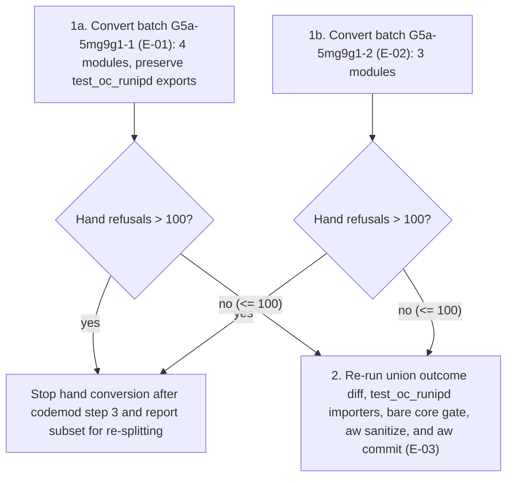

# IPD: Move setter, runner-lane and first-half unmatched test data chunk 3 of 7 onto the record builder

- Date: 2026-11-09
- Kind: child
- Concern: Spec `4sd62s` section 6 requires that test data be written by ONE shared record builder in phase B, so that the cutover (Order 13, `cxxmyv`) changes the builder and not hundreds of test files, and C10a requires the suite to pass at every commit. Research `nj8zdp` and the maintainer's ruling ("plans that obtuse and not-too-smart agents won't mess up") set the guidance of at most 5 E-items, 8 work Scope-Paths and about 8 named units per item; `1upea0` named up to 25 modules per batch item. This part carries 7 of `1upea0`'s modules (subset G5a; 208 F-01 legacy lines at `3d0ddb845`), each item at most 4 modules, converted by the Order-49 codemod (`653ndz`) plus only its census-counted refusals.
- Scope: Chunk 3 of 7 of `1upea0` (round-3 split 2026-11-09 per research `nj8zdp` guidance): the 7 test modules named in the items and in F-40, each item one codemod run under the batch rule below, plus a finishing item. EXCLUDES: every other module of the subsets (the other chunk plans and `1upea0`); the builder (`9rgn2w`) and the codemod (`653ndz`); the F-03 EXCLUDED modules; production code; the switch-point proof, census and full-suite comparison (`59aiyh` E-11, E-12).
- Scope-Paths: tests/test_agy_skip_permissions_default.py, tests/test_lane_rule_break_detection.py, tests/test_merge_gate_spec_anchors.py, tests/test_oc_runipd.py, tests/test_records_only_lane_rederive.py, tests/test_run_analytics_review_cost.py, tests/test_run_dir_parents_are_guaranteed.py, .aw/records/plans/pending/20261109-metastore-205-5mg9g1-move-setter-runner-lane-and-first-half-unmatched-test-data-c.ipd.md
- Item-Dependencies: executed:653ndz, executed:9rgn2w, executed:g5hpbb, executed:tve77h, executed:xexn45
- Status: executed
- Readiness: go-pending-approval
- Review-Depth: complex
- From-Spec: 4sd62s
- Work-Kind: feature
- Priority: high
- Blocks-Release: next
- Set: metastore
- Order: 205
- Highest E allocated: 03
- Author: opencode its_direct/pt3-claude-opus-5.5-1m-us
- Id: 5mg9g1

> Written to `.aw/system/workflows/technical-writing/technical-writing.md`. Every obligation, exact identifier, quotation, evidence record, and lifecycle status is preserved.

## Workflow history
- 2026-11-22 executed (aw agy run model=Gemini-4-Neon-High): aw agy run self-finalize: 5mg9g1 verified (set metastore, attempt 1).
- 2026-11-21 cap-update (maintainer decision): raised Batch rule step 4 hand-refusal cap from 25 to 100 (raw site count over-counts list elements and .replace() pairs).
- 2026-11-16 approved (aw set): status set to approved
- 2026-11-14 reviewed (aw set): APPROVE WITH REVISIONS APPLIED; PR-001..PR-006 FIXED

- 2026-11-14 /plan-review (antigravity/gemini-4-carbon-medium): APPROVE WITH REVISIONS APPLIED; PR-001..PR-006 FIXED; review record .aw/records/reviews/20261109-metastore-205-5mg9g1-move-setter-runner-lane-and-first-half-unmatched-test-data-c.review.md
- 2026-11-09 to-review (opencode its_direct/pt3-claude-opus-5.5-1m-us): split from 1upea0 (round 3, research nj8zdp guidance).

## Goal

Every hand-built record in the 7 test modules named below comes from `tests/record_builder.py`, written by the Order-49 codemod or, for its census-counted refusals only, by hand, with each module's per-test outcomes identical before and after and every remaining legacy string classified.

## Detailed Implementation Checklist (TODO)

Execution-state rule: mark an `E-*` item complete only after performing the action. That mark is not validation. Right-sizing rule: write for a modest executor that cannot hold much in its head. Each E-item is one step (one concern, about one file, executable in one focused pass) and its V-item names each unit it covers with its own check; a plan stays at about 5 E-items and 8 work Scope-Paths, else split it into more child plans (guidance, `IPD-Z603`). Accepted execution states: blocked, failed, pending, performed; terminal gate demands 'performed'.

Batch rule, applied to every batch E-item of this plan (the `59aiyh` batch rule, restructured 2026-11-08 for the Order-49 fixture codemod `653ndz` per maintainer decision 2026-11-07 "Codemod first, then small runs": the tool performs the mechanical rewrite, and the hand work is bounded by its measured refusals). In it, "E-13's `full-before.txt`" and "the builder's `raw_fields=` escape (E-01)" are items of Order 37 (`9rgn2w`), carried by the round-3 split into Order 170 (`j6o96i`) with the same ids; because `.aw/state/` does not travel between lane worktrees, step 2 always records a fresh before list here. Step 1's partition is restricted to the modules each batch item names (round-3 split 2026-11-09: a subset is now spread over several plans of at most 8 modules each): a module that the partition now places in the item's subset but that no plan names is NOT added here; it is reported, and the finishing item of `1upea0` converts it; a named module that no longer matches F-01 is reported and skipped:
1. Before the batch, create `.aw/state/59aiyh/` (`mkdir -p .aw/state/59aiyh`), re-derive its file list with the F-03 first-match partition over the F-01 `rg -l` output at the current HEAD, minus the F-03 EXCLUDED list, and save it as `.aw/state/59aiyh/<batch>-files.txt`. The counts in each E-item are context measured at `0cbfcc706` or `ac76110f4`, not the bar.
2. Record the unmodified per-test outcome list (a batch whose files a previous batch did not touch may reuse the matching lines of E-13's `full-before.txt`): `python3 -m pytest -o addopts="" -m "" -p no:randomly -n 0 -rA $(cat .aw/state/59aiyh/<batch>-files.txt) | grep -E "^(PASSED|FAILED|ERROR|SKIPPED|XFAIL|XPASS) " | sed -E 's/ - .*//' | sort > .aw/state/59aiyh/<batch>-before.txt`. `-p no:randomly` and `-n 0` make the list deterministic; `-m ""` includes `slow` and `livecorpus` modules.
3. Run the codemod: `python3 tools/fixture_codemod.py --apply --format json $(cat .aw/state/59aiyh/<batch>-files.txt) > .aw/state/59aiyh/<batch>-codemod.json`. It rewrites only the sites whose module outcome list it proved identical (`653ndz` E-03, carried with the same id into Order 172, `y3uowx`, by the round-3 split) and lists every other site as a refusal with a reason code and a disposition (`hand` or `legacy-kept`, the `653ndz` reason-code table).
4. Hand-convert ONLY the refusals with disposition `hand`: the static count is the sum of the `653ndz` F-30 rows of the item's modules (round-3 split 2026-11-09: an item now carries part of a subset, so the subset's F-31 row is context only), and the codemod report adds any apply-time `not-equivalent` refusals; the item's hand count is their sum. If the hand count exceeds 100, stop after step 3 (the proved codemod rewrites may be committed), convert nothing by hand, and report the subset for re-splitting. A hand conversion uses builder calls; a test that deliberately writes an INVALID value (an unknown status, `- Status: EXECUTED`, `- Priority: bogus`, a malformed gate) gets it through the builder's `raw_fields=` escape (E-01) and is listed with reason class `invalid-input`. A refusal with disposition `legacy-kept` stays in legacy form on purpose and is listed with its F-06 reason class.
5. Re-run step 2's command into `<batch>-after.txt` and require `diff` to print nothing. A batch that would need any changed assertion other than a raw-byte metadata stand-in moved to `artifact_meta.read` (scope rule) stops and is reported; it does not weaken the assertion.
6. Count the remaining legacy strings with the F-01 `rg` pattern over the batch files, and give each remaining line one reason class from F-06: `legacy-format subject`, `displayed-output assertion`, `setter-byte assertion`, `invalid-input`, or `body prose` (for example open-question `- Status: open` rows, which N3 keeps in Markdown).
7. The builder never reads production source, and no test gains a source-reading assertion.

### Task group 1: batch items

- [x] E-01 (carried from `1upea0` E-02, batch subset G5a; round-3 split 2026-11-09) Batch G5a, 4 of its 21 modules (the runner, lane and merge tests (`test_oc_*`, `test_agy*`, `test_runner*`, `test_run_*`, `test_runs_*`, `test_lane*`, `test_records_only*`, `test_merge*`)): `tests/test_agy_skip_permissions_default.py`, `tests/test_lane_rule_break_detection.py`, `tests/test_merge_gate_spec_anchors.py`, `tests/test_oc_runipd.py`. F-01 legacy lines per module at `3d0ddb845` (context, not the bar): `test_agy_skip_permissions_default` 12, `test_lane_rule_break_detection` 9, `test_merge_gate_spec_anchors` 2, `test_oc_runipd` 92. Run the codemod on these modules and apply the batch rule with `<batch>` = `G5a-5mg9g1-1` (outcome lists identical); hand-convert ONLY the refusals that the `653ndz` F-30 rows of these modules list with disposition `hand`, plus the codemod's apply-time `not-equivalent` refusals, and state their count (at most 100, the batch rule's stop); leave each refusal the census marks `legacy-kept` in legacy form with its reason class. A test that builds a two-branch merge or a lane worktree commits builder-made records on each branch with real `git`. Keep `tests/test_oc_runipd.py::_CONFORMING_PLAN` and `tests/test_oc_runipd.py::_init_repo_with_conforming_plan` exported with their existing `id6` format-placeholder (`_CONFORMING_PLAN.format(id6=...)`) and `(repo: Path, id6: str = "slf001") -> Path` call contract intact, because 25 other `tests/test_*.py` modules import them directly (`D-2`); any other private record-building helper found now is deleted when it has no internal or external caller, or listed with its reason.
  - Depends on: none
  - Expected outcome: an empty before/after `diff` for the `G5a-5mg9g1-1` outcome lists; for each named module, its remaining legacy-string count and the reason class of every remaining line pasted; every deleted and surviving helper (including `tests/test_oc_runipd.py::_CONFORMING_PLAN` and `tests/test_oc_runipd.py::_init_repo_with_conforming_plan`) listed with its reason; the codemod report and the hand count (at most 100) pasted.
  - Execution state: performed

- [x] E-02 (carried from `1upea0` E-02, batch subset G5a; round-3 split 2026-11-09) Batch G5a, 3 of its 21 modules (the runner, lane and merge tests (`test_oc_*`, `test_agy*`, `test_runner*`, `test_run_*`, `test_runs_*`, `test_lane*`, `test_records_only*`, `test_merge*`)): `tests/test_records_only_lane_rederive.py`, `tests/test_run_analytics_review_cost.py`, `tests/test_run_dir_parents_are_guaranteed.py`. F-01 legacy lines per module at `3d0ddb845` (context, not the bar): `test_records_only_lane_rederive` 61, `test_run_analytics_review_cost` 31, `test_run_dir_parents_are_guaranteed` 1. Run the codemod on these modules and apply the batch rule with `<batch>` = `G5a-5mg9g1-2` (outcome lists identical); hand-convert ONLY the refusals that the `653ndz` F-30 rows of these modules list with disposition `hand`, plus the codemod's apply-time `not-equivalent` refusals, and state their count (at most 100, the batch rule's stop); leave each refusal the census marks `legacy-kept` in legacy form with its reason class. A test that builds a two-branch merge or a lane worktree commits builder-made records on each branch with real `git`. These modules held no private record-building helper at the split; a helper found now is deleted when it has no caller, or listed with its reason.
  - Depends on: none
  - Expected outcome: an empty before/after `diff` for the `G5a-5mg9g1-2` outcome lists; for each named module, its remaining legacy-string count and the reason class of every remaining line pasted; every deleted and surviving helper listed; the codemod report and the hand count (at most 100) pasted.
  - Execution state: performed

### Task group 2: finish

- [x] E-03 Finish this part: run the batch rule's step-2 command once over every module of this plan (`$(cat .aw/state/59aiyh/G5a-5mg9g1-1-files.txt .aw/state/59aiyh/G5a-5mg9g1-2-files.txt)`) into `.aw/state/59aiyh/5mg9g1-union-after.txt` and confirm it equals the sorted concatenation of the items' `-before.txt` lists; run `python3 -m pytest -m "" $(rg -l "tests\.test_oc_runipd" tests/)` to verify zero cross-module regressions across external callers of `tests/test_oc_runipd.py` (`D-2`); run the bare core gate `python3 -m pytest` and `aw sanitize --agent`; commit through `aw commit 5mg9g1 -- <each changed path>`, one commit per item allowed, never `git add -A`, a bare `git add` or `git commit -a`. Never push. (The full-suite comparison stays in `59aiyh` E-12.)
  - Depends on: E-01, E-02
  - Expected outcome: the union comparison is empty; all cross-module `test_oc_runipd` importers, the bare core gate, and `aw sanitize --agent` pass; every commit is path-scoped to Scope-Paths (or justified at finalize).
  - Execution state: performed

## Project conventions discovered (Step 0)

- Interface names from Order 02 (`tve77h`): `agent_workflows/artifact_meta.py::registry_fields`, `agent_workflows/artifact_meta.py::validate_event`, `agent_workflows/artifact_meta.py::validate_new_events`, `agent_workflows/artifact_meta.py::read`, `agent_workflows/artifact_meta.py::create` and `agent_workflows/artifact_meta.py::append`. Order 02's `create`/`append` write the log format; `2xwb9b` E-03 adds the phase-B legacy branch of `append` and `xexn45` E-01 (via Order 21, `7yr827`) routes the phase-B branch of `create` and `append` through `agent_workflows/artifact_meta.py::write_legacy`, with `agent_workflows/artifact_meta.py::render_legacy_text` (`xexn45` E-11) as the same renderer over a string. In phase B the on-disk format is the bullet format; the legacy loader reads it into the cache.
- `agent_workflows/review_findings.py::render_review` (pure) and `agent_workflows/review_findings.py::write_review` render and write a `.review.md` record; no CLI calls `write_review` (`xexn45` Findings).
- The existing shared plan builder is `tests/support.py::ready_plan_text`, which is "BUILT FROM THE REAL GENERATOR (`agent_workflows/ipd_authoring.py::build_skeleton`)" and then fills the fields a draft leaves open; the builder keeps that approach for plans, so a scaffold change still reaches every fixture.
- Shared test plumbing lives in `tests/support.py` (`init_repo`, `git`, `run_cli`, `pinned_env`, `ready_plan_text`, `scope_drift_repo`); `tests/repo_template.py` (`copy_template_repo`) gives a pre-built repository; there is no `tests/conftest.py`, and the root `conftest.py` owns tier selection.
- Tests are behavioral (AGENTS.md "TEST OUTCOMES, NOT CODE STRUCTURE"); core modules set `pytestmark = pytest.mark.core`; `slow` tests are listed in `tests/slow_allowlist.txt`; `pyproject.toml` `addopts` deselects `slow` and `livecorpus`, so a complete comparison passes `-m ""`, and `pytest-randomly` is installed, so a deterministic order needs `-p no:randomly`.
- `tests/fixtures/review-pilot/` is the input corpus of `tools/review_pilot.py` (`manifest.json` names each plan file, `defects.json` quotes exact text to plant), and `tests/test_review_pilot.py` copies the whole directory into its fixture repository.
- Filenames come from `agent_workflows/artifact_naming.py::build_clustered_name` and parse with `agent_workflows/artifact_naming.py::parse_clustered`.
- Cite code by repo-relative `path::Symbol` identifiers or by a quoted content string, with a line number only appended to one of those and never alone: an offset expires before this plan executes (Technical Writing Standard Requirement 7; advisory `IPD-C801`).

## Findings

Measured 2026-11-09 at `3d0ddb845` for F-40; F-01, F-03, F-06 and F-08 copied from `1upea0` (measured at `0cbfcc706` and at review).

| Id | Evidence | Finding |
|---|---|---|
| F-01 | `rg -l --glob '*.py' -e '- (Id|Status|Set|Kind|Blocks-Release|Readiness|Item-Dependencies|Scope-Paths|From-Backlog|From-Spec|Work-Kind|Priority|Order|Date|Gate-Kind|Gate-Ref|Approval|Subject-Id|Verdict|Graduated-To):|## Workflow history' tests` lists 309 files (307 test modules, `support.py`, `conformance_matrix.py`) of 717 Python files; 6,638 matching lines. The narrower `- Id:`/`- Status:`/`## Workflow history` pattern: 300 files, 3,430 lines | Spec section 6 counted 268 of 680 files and 2,607 matches at round 2; the plan's pattern is broader (21 fields). |
| F-03 | Family split by filename prefix, re-measured at review (HEAD `4a7499289`, 311 files, 6,657 lines) with a FIRST-MATCH rule (a file goes to the first group, in order G1 to G6, whose pattern list matches its basename; unmatched files go to G7): G1 39 files, 1,568 lines; G2 22, 1,102; G3 28, 795; G4 63, 1,244; G5 46, 598; G6 69, 1,004; G7 44, 346. Six files match two groups and are assigned by that rule (`test_ipd_authoring` G3, `test_readiness_absence_invariant` G4, `test_runner_backlog_close_behavior` G1, `test_orchestrator_retire_closes_backlog` G1, `test_records_only_lane_rederive` G5, `test_ipdrunner_runagy_shim` G4). The authored counts (G6 99, G7 11) did not sum to the file total; the first-match rule makes the partition exhaustive and disjoint. EXCLUDED from every batch (literal legacy input is their subject; owned by other plans): `tests/test_artifact_meta_*.py` (`tve77h`, `2xwb9b`), `tests/test_artifact_meta_legacy_writer.py` and `tests/test_writers_*.py` (`xexn45`), `tests/test_m0001_*.py` and `tests/test_migrations_chain.py` (`dcerjg`, `ya4ee4`) | Seven batches (E-03 to E-09); G1, G4 and G6 carry a pre-measured split seam (OQ-01). |
| F-06 | (written by E-11) remaining legacy strings in `tests/` after the batches, each with one reason class: `legacy-format subject`, `displayed-output assertion`, `setter-byte assertion`, `invalid-input`, `body prose` | Order 13 changes the builder plus the F-06 rows of class `setter-byte assertion`; `invalid-input` rows already go through `raw_fields=` and need a decision at the cutover (an invalid bullet has no log-format equivalent); every other class is either a legacy-format test (moved to the migration tests at the cutover) or prose. |
| F-08 | At review, 15 test modules write a deliberately invalid metadata value (for example `tests/test_releases.py` "`- Status: bogus`", `tests/test_check_engine.py` "`- Status: EXECUTED`", `tests/test_specs_set_adapter.py` "`- Priority: bogus`") | A builder that validates every field cannot build these; E-01 adds `raw_fields=` and the batch rule lists them as `invalid-input`. |
| F-40 | `rg -c` with the F-01 pattern over this part's modules at `3d0ddb845`; subset by the F-03 first-match rule; helpers as listed by `1upea0` at the 2026-11-07 split | See the table below; every module is named in exactly one item. |

| Module | Subset | F-01 lines | Helpers at the split | Item |
|---|---|---|---|---|
| `tests/test_agy_skip_permissions_default.py` | G5a | 12 | none | E-01 |
| `tests/test_lane_rule_break_detection.py` | G5a | 9 | none | E-01 |
| `tests/test_merge_gate_spec_anchors.py` | G5a | 2 | none | E-01 |
| `tests/test_oc_runipd.py` | G5a | 92 | none (E-09 regex); exports `_CONFORMING_PLAN`, `_init_repo_with_conforming_plan` to 25 `tests/test_*.py` modules | E-01 |
| `tests/test_records_only_lane_rederive.py` | G5a | 61 | none | E-02 |
| `tests/test_run_analytics_review_cost.py` | G5a | 31 | none | E-02 |
| `tests/test_run_dir_parents_are_guaranteed.py` | G5a | 1 | none | E-02 |

### Behavior decisions

- D-1 (Chunk 3 execution order relative to sibling chunk plans, OQ-01). The module lists of all chunk plans are disjoint, each depends on the builder (`tests/record_builder.py::RecordBuilder`, `9rgn2w`) and the codemod (`tools/fixture_codemod.py`, `653ndz`), and none edits `tests/support.py` (`59aiyh` E-09), allowing independent execution order.
- D-2 (shared `tests/test_oc_runipd.py` exports). Keep `tests/test_oc_runipd.py::_CONFORMING_PLAN` (preserving `.format(id6=...)` and field lines replaced by callers) and `tests/test_oc_runipd.py::_init_repo_with_conforming_plan` (preserving `(repo: Path, id6: str = "slf001") -> Path`) exported because 25 other `tests/test_*.py` modules import them directly (`rg -l "tests\.test_oc_runipd" tests/`), and verify all importers pass in `E-03`.
- D-3 (private test helper handling and inline census regex). Inline the `59aiyh` E-09 helper-census `rg` pattern directly in `V-01` and `V-02`; delete any unreferenced private record-building helper found at execution time and list surviving helpers with their reason.
- D-4 (hand conversion stop threshold). Stop after codemod step 3 if an item's hand-conversion refusal count exceeds 100, commit proved codemod rewrites if desired, and report the subset for re-splitting.
- D-5 (deliberately invalid test inputs). Construct deliberately invalid metadata fixtures through `tests/record_builder.py::RecordBuilder`'s `raw_fields=` escape rather than raw legacy bullet strings, classifying remaining matches as `invalid-input`.
- D-6 (state directory initialization). Create `.aw/state/59aiyh/` via `mkdir -p .aw/state/59aiyh` in batch rule step 1 before writing `<batch>-files.txt` and `<batch>-before.txt` in an isolated lane worktree.

## Proposed changes (ordered, validatable)

1. Convert each item's modules under the batch rule (E-01 to E-02).
2. Re-run the union, the `test_oc_runipd` importer check, the core gate, and commit (E-03).

## Deferred / out of scope (with reason)

- The other modules of subset G5a, the partition re-derivation that catches modules no plan names, and the subsets' finishing checks.
  - Carrier: 1upea0
- The fixture codemod and its census (F-30, F-31).
  - Carrier: 653ndz
  - Carrier-Evidence: .aw/records/plans/executed/20261108-metastore-49-653ndz-build-and-prove-the-test-fixture-codemod.ipd.md
- The builder, its tests, the baselines and the tracked fixtures.
  - Carrier: 9rgn2w
  - Carrier-Evidence: .aw/records/plans/executed/20261107-metastore-37-9rgn2w-add-the-shared-test-record-builder-and-convert-the-tracked-r.ipd.md
- The switch-point proof, the F-06 census and the full-suite comparison.
  - Carrier: 59aiyh
- Adding `RECORD_FORMAT = "log"` and converting setter-byte assertions (cutover commit).
  - Carrier: cxxmyv

## Scope check

- Over-scope: none. No production module changes; every Scope-Paths entry is a module named in one item, plus this plan.
- Under-scope: none known. Size: 3 E-items (2 batch items of at most 4 modules each and the finish), 7 work Scope-Paths.

## Required tests / validation

Each item is validated by an identical per-test result list before and after (the batch rule), which is behavioral by construction: the same tests, unchanged assertions, the same outcomes. Commands: the batch rule's command per item, the codemod's `--apply` report, the bare core gate `python3 -m pytest`, `aw sanitize --agent`. CONTRIBUTES to AC-1b (owned by `cxxmyv`).

## Spec / documentation sync

No spec change; implements part of `4sd62s` section 6 and section 7 step 6.

## Open questions

### OQ-01: Can this part run in any order relative to the other chunk plans?

- Blocking: no
- Status: resolved
- Owner: plan author
- Resolution or deferral rationale: Yes. The module lists of all chunk plans are disjoint, each needs the builder (`tests/record_builder.py::RecordBuilder`, `9rgn2w`) and the codemod (`tools/fixture_codemod.py`, `653ndz`), `tests/test_oc_runipd.py` preserves its exported `_CONFORMING_PLAN` and `_init_repo_with_conforming_plan` contracts for sibling callers (`D-2`), and none edits `tests/support.py` (that is `59aiyh` E-09, which runs last). Recommendation strength: strong.

## Validation and cross-check (verify before reporting done)

Validation-state rule: inspect evidence in a separate pass. Do not mark a `V-*` item complete from memory or from the matching execution checkmark. Accepted validation results: blocked, failed, pass, pending; terminal gate demands 'pass'. Runtime-demonstration reachability rule: for each `V-*` item demanding the software be observed acting (such as a run, a dispatch, or a transition), as distinct from items demanding a diff, a file's content, or a test result, which are reachable by construction, name the code path that produces the observation or the sibling `E-*` that creates it, else the demand is UNDER-SCOPE.

- [x] V-01 validates E-01
  - Required evidence: paste `.aw/state/59aiyh/G5a-5mg9g1-1-files.txt` and the empty `diff .aw/state/59aiyh/G5a-5mg9g1-1-before.txt .aw/state/59aiyh/G5a-5mg9g1-1-after.txt`; then, for each of `tests/test_agy_skip_permissions_default.py`, `tests/test_lane_rule_break_detection.py`, `tests/test_merge_gate_spec_anchors.py`, `tests/test_oc_runipd.py` separately: its before and after F-01 `rg -c` count, the reason class of every remaining match, its rows of `.aw/state/59aiyh/G5a-5mg9g1-1-codemod.json` (rewrites, refusals by reason code and disposition, before and after outcome-list hashes) and its `653ndz` F-30 row; the hand count with every hand-converted site listed (module, line, reason code); the outcome lists are run with the batch rule's `-m ""`, so `slow` tests are included; paste the count of `slow` node ids in the list; confirm `tests/test_oc_runipd.py::_CONFORMING_PLAN` and `tests/test_oc_runipd.py::_init_repo_with_conforming_plan` remain exported with `.format(id6=...)` and `(repo, id6)` compatibility (`D-2`); and paste the before and after helper census of `rg -n "def _?(make|write|build|mk|seed)_(plan|spec|backlog|item|record|ipd|release|research|prompt|review|walkthrough)\w*"` (`59aiyh` E-09 pattern) over these modules with each deleted and surviving helper and its reason.
  - Observed evidence:
    - `.aw/state/59aiyh/G5a-5mg9g1-1-files.txt`:
      - `tests/test_agy_skip_permissions_default.py`
      - `tests/test_lane_rule_break_detection.py`
      - `tests/test_merge_gate_spec_anchors.py`
      - `tests/test_oc_runipd.py`
    - Partition check at starting HEAD `2854f236e9e2904feb97859e0c49b2449605d13d`: all 4 named modules matched F-01 before conversion. Two unnamed G5a modules matched F-01 at HEAD (`tests/test_runner_fullauto_and_sweep_fixes.py`, `tests/test_runner_startup_timings.py`); per Batch rule step 1 they are reported here, not added to this plan, and remain for the finishing item of `1upea0`.
    - Outcome diff (`diff -u .aw/state/59aiyh/G5a-5mg9g1-1-before.txt .aw/state/59aiyh/G5a-5mg9g1-1-after.txt`): empty output, exit code 0 (205 `PASSED` outcomes).
    - Slow node ids in the `-m ""` list: 0 node ids carry `@pytest.mark.slow` (`pytest -o addopts="" -m "slow" --collect-only` collected 0, 205 deselected); 42 node ids (6 in `test_lane_rule_break_detection.py`, 6 in `test_merge_gate_spec_anchors.py`, 30 in `test_oc_runipd.py`) are listed in `tests/slow_allowlist.txt` and all 42 ran and passed in both `-before.txt` and `-after.txt`.
    - Per-module F-01 counts, remaining classifications (line numbers verified against committed `c91a674d6`), codemod rows, and `653ndz` F-30 rows:
      - `tests/test_agy_skip_permissions_default.py`:
        - F-01 `rg -c`: before 12, after 0. Remaining matches: none.
        - Codemod JSON row (`.aw/state/59aiyh/G5a-5mg9g1-1-codemod.json`): `sites=1`, `rewrites=0` (`standard=0`, `invalid-input=0`), `refusals=1` (`not-equivalent=1`, `hand=1`, `legacy-kept=0`), `before_hash=dca9be0b687cdb65bc4b933401329e255770c823135424fbe753e212b19b7087`, `after_hash=dca9be0b687cdb65bc4b933401329e255770c823135424fbe753e212b19b7087`, `equivalent=true`, `pytest_runs=2`, `changed=false`.
        - `653ndz` F-30 row: `G5a | 5mg9g1 | 1 | 1 | 1 | 0 | 0 | 0 | 0 | 0 | 0 | 0 | 0 | 0`.
      - `tests/test_lane_rule_break_detection.py`:
        - F-01 `rg -c`: before 9, after 0. Remaining matches: none.
        - Codemod JSON row (`.aw/state/59aiyh/G5a-5mg9g1-1-codemod.json`): `sites=16`, `rewrites=0` (`standard=0`, `invalid-input=0`), `refusals=16` (`unsupported-shape=16`, `hand=16`, `legacy-kept=0`), `before_hash=null`, `after_hash=null`, `equivalent=true`, `pytest_runs=0`, `changed=false`.
        - `653ndz` F-30 row: `G5a | 5mg9g1 | 16 | 0 | 0 | 0 | 16 | 0 | 0 | 0 | 0 | 0 | 16 | 0`.
      - `tests/test_merge_gate_spec_anchors.py`:
        - F-01 `rg -c`: before 2, after 0. Remaining matches: none.
        - Codemod JSON row (`.aw/state/59aiyh/G5a-5mg9g1-1-codemod.json`): `sites=1`, `rewrites=0` (`standard=0`, `invalid-input=0`), `refusals=1` (`not-equivalent=1`, `hand=1`, `legacy-kept=0`), `before_hash=c95c56f7caba6b56f40ab5e66f8ae90d4def69c74edaa9da977beaaeb92396e5`, `after_hash=c95c56f7caba6b56f40ab5e66f8ae90d4def69c74edaa9da977beaaeb92396e5`, `equivalent=true`, `pytest_runs=2`, `changed=false`.
        - `653ndz` F-30 row: `G5a | 5mg9g1 | 1 | 1 | 0 | 0 | 0 | 0 | 0 | 0 | 0 | 0 | 0 | 0`.
      - `tests/test_oc_runipd.py`:
        - F-01 `rg -c`: before 92, after 13. Remaining matches (13):
          - `body prose` (9): fake `opencode` subprocess script strings (`legacy-kept` in codemod) at lines 303, 2108, 2110, 2111, 2227; docstrings/comments at lines 2001, 2090, 2352; open-question `- Status: resolved` row inside `_conforming_plan_text` `body=` at line 2969 (N3 keeps open-question rows in Markdown).
          - `setter-byte assertion` (4): line 3087 (`SelfFinalizeHelperTests::test_begin_writes_receipt_then_finalize_moves_to_executed`: `self.assertIn("- Status: executed", executed.read_text(encoding="utf-8"))`, `legacy-kept` in codemod); line 5652 (`ActionLegalityTests::_refusal_run`: `if line.startswith("- Status:")`, readback paired with L5666/L5672); lines 5666 and 5672 (`ActionLegalityTests::test_alias_refusal_and_acceptance`: `self.assertEqual(status, "- Status: approved")` and `self.assertEqual(status, "- Status: reviewed")`, `legacy-kept` in codemod).
        - Codemod JSON row (`.aw/state/59aiyh/G5a-5mg9g1-1-codemod.json`): `sites=56`, `rewrites=10` (`standard=10`, `invalid-input=0`), `refusals=46` (`unsupported-shape=36`, `not-equivalent=2`, `setter-byte assertion=3`, `body prose=5`, `hand=38`, `legacy-kept=8`), `before_hash=45ade0513ad28967819fd68af701f5e3ec1ff578e3fae4406a94964a26f4c52a`, `after_hash=45ade0513ad28967819fd68af701f5e3ec1ff578e3fae4406a94964a26f4c52a`, `equivalent=true`, `pytest_runs=14`, `changed=true`.
        - `653ndz` F-30 row: `G5a | 5mg9g1 | 56 | 12 | 1 | 0 | 36 | 0 | 0 | 0 | 3 | 5 | 36 | 8`.
    - Hand count: 56 reported by codemod (52 static + 4 apply-time `not-equivalent`; <= 100; 55 fixture/mutation sites hand-converted to `RecordBuilder` / `artifact_meta.render_legacy_text`, 1 readback site at `tests/test_oc_runipd.py` pre-edit line 5555 retained as `setter-byte assertion` paired with `legacy-kept` L5569/L5575):
      1. `tests/test_agy_skip_permissions_default.py` pre-edit lines 137-201 (`PLAN_FIXTURE`, `not-equivalent`): hand-converted to `RecordBuilder().plan(..., raw_fields={"Id": "{id6}", "Concern": "fixture", "Scope": "fixture"}, body=..., text_only=True)` (`invalid-input` `{id6}` format placeholder).
      2. `tests/test_lane_rule_break_detection.py` pre-edit lines 253 (2 sites), 264 (2 sites), 366 (2 sites), 384 (2 sites), 592 (2 sites), 595, 596, 651 (2 sites), 794 (2 sites) (16 `unsupported-shape` sites across `test_case_a`, `test_case_b`, `test_case_d`, `test_case_e`, `test_hook_bypass_rename_inside_executed_passes_under_real_gate`): hand-converted to `_set_plan_status(...)` backed by `artifact_meta.render_legacy_text(..., [{"op": "transition", "to": status}], ...)`.
      3. `tests/test_merge_gate_spec_anchors.py` pre-edit lines 35-47 (`_SPEC_CONTENT`, `not-equivalent`): hand-converted to `RecordBuilder().spec(id6="demo01", title="Test Spec", status="approved", body=..., text_only=True)` with `_INTRO_LINE` derived from `_SPEC_CONTENT` so the fixture's Python spec-anchor comments cite the real Section 1 line number without changing any assertion.
      4. `tests/test_oc_runipd.py` pre-edit lines 150-151 (2 `unsupported-shape` sites in `DriverTests.test_atomic_state_and_set_session_continuity`): hand-converted to `_conforming_plan_text(id6=id6, item_dependencies=...)`.
      5. `tests/test_oc_runipd.py` pre-edit lines 265 (2 sites), 269 (3 `unsupported-shape` sites in `ReviewPlanRoutingTests.test_to_review_plans_invoke_plan_review_and_share_session`): hand-converted to `_conforming_plan_text(id6=ident, status="to-review", approval=None, history=[...])`.
      6. `tests/test_oc_runipd.py` pre-edit lines 372, 377 (2 `unsupported-shape` sites in `SelectorResolutionTests.test_dynamic_plan_discovery_without_manifest`): hand-converted to `RecordBuilder().plan(...)`.
      7. `tests/test_oc_runipd.py` pre-edit lines 1989-2000, 2008-2019, 2028-2037, 2044-2053 (4 `unsupported-shape` sites in `AllSelectorAndFullAutoTests`): hand-converted to `RecordBuilder().plan(...)`.
      8. `tests/test_oc_runipd.py` pre-edit lines 2070 (2 sites), 2072, 2183 (2 sites), 2185 (6 `unsupported-shape` sites in `test_full_auto_reviews_approves_and_executes_plan` and `test_without_full_auto_stops_at_reviewed`): hand-converted to `_conforming_plan_text(id6=..., status="to-review", approval=None, history=[...])`.
      9. `tests/test_oc_runipd.py` pre-edit lines 2343, 2347 (2 `unsupported-shape` sites in `RunipdBugsFixesTests.test_read_deps_and_set_parsing`): hand-converted to `RecordBuilder().plan(..., raw_fields={"Dependencies": ..., "Set": ..., "Item-Dependencies": None}, text_only=True)` and `"Depends-on"` (`invalid-input` legacy fields).
      10. `tests/test_oc_runipd.py` pre-edit line 2684 (`VerifierPromptTests.test_resolve_plan_path_handles_transition_to_executed`, `unsupported-shape`): hand-converted to `RecordBuilder().plan(...)`.
      11. `tests/test_oc_runipd.py` pre-edit lines 2712, 2716, 2720 (3 `unsupported-shape` sites in `OrchestratorNotAgentExecutedTests._make_set`): hand-converted to `RecordBuilder().plan(...)`.
      12. `tests/test_oc_runipd.py` pre-edit lines 2809-2903 (`_CONFORMING_PLAN`, `not-equivalent`): hand-converted to `_conforming_plan_text(id6=None)` backed by `RecordBuilder().plan(..., raw_fields={"Id": "{id6}", "Concern": ..., "Scope": ...}, text_only=True)` (`invalid-input` `{id6}` format placeholder).
      13. `tests/test_oc_runipd.py` pre-edit line 3517 (2 `unsupported-shape` sites in `SpecEditReportBehavioralTests.test_execute_item_spec_edits_report_declared_and_undeclared`): hand-converted to `_conforming_plan_text(id6="spe001", scope_paths="docs/A.spec.md")`.
      14. `tests/test_oc_runipd.py` pre-edit lines 4827 (2 sites), 4832, 4836, 4849, 4850-4851 (6 `unsupported-shape` sites in `_repo_with_statuses`): hand-converted to `_conforming_plan_text(id6=id6, status=status, approval=..., readiness=..., history=...)`.
      15. `tests/test_oc_runipd.py` pre-edit line 5555 (`ActionLegalityTests._refusal_run`, `unsupported-shape`): `if line.startswith("- Status:")` readback paired with `legacy-kept` assertions at lines 5569 and 5575; retained as `setter-byte assertion`.
      16. `tests/test_oc_runipd.py` pre-edit lines 7933-7974 (`conforming_plan`, `not-equivalent`): hand-converted to `RecordBuilder().plan(..., raw_fields={"Concern": "test", "Scope": "test"}, body=..., text_only=True)`.
      17. `tests/test_oc_runipd.py` pre-edit lines 8045, 8046, 8052, 8053 (4 `unsupported-shape` sites in `TestDeferredReattemptBacklogCloseCoordinatorWorktree._setup_backlog_and_two_carriers`): hand-converted to `_conforming_plan_text(id6="wir001"|"wir002", from_backlog="bg0001")`.
    - `D-2` export compatibility: verified `tests/test_oc_runipd.py::_CONFORMING_PLAN` remains exported with `.format(id6=...)` (`- Id: abc123`, `- Scope-Paths: src/`, `- Item-Dependencies: none`, and `## Deferred / out of scope (with reason)\n\nnone.` all preserved) and `tests/test_oc_runipd.py::_init_repo_with_conforming_plan` keeps its `(repo: Path, id6: str = "slf001") -> Path` signature; all 23 importing test modules pass (300 passed in `V-03`).
    - Helper census (`rg -n "def _?(make|write|build|mk|seed)_(plan|spec|backlog|item|record|ipd|release|research|prompt|review|walkthrough)\w*"`):
      - Before: `(none)` (0 matches).
      - After: `(none)` (0 matches).
      - Deleted helpers (0): none.
      - Surviving exports and module-local wrappers outside the E-09 regex: `tests/test_oc_runipd.py::_CONFORMING_PLAN` and `tests/test_oc_runipd.py::_init_repo_with_conforming_plan` (preserved per `D-2` for external callers across `tests/test_*.py`); `tests/test_oc_runipd.py::_conforming_plan_text` (delegates to `RecordBuilder().plan(...)`, shared by `_CONFORMING_PLAN` and 8 internal call sites); `tests/test_lane_rule_break_detection.py::_set_plan_status` (delegates to `artifact_meta.render_legacy_text`, 6 call sites).
  - Result: pass

- [x] V-02 validates E-02
  - Required evidence: paste `.aw/state/59aiyh/G5a-5mg9g1-2-files.txt` and the empty `diff .aw/state/59aiyh/G5a-5mg9g1-2-before.txt .aw/state/59aiyh/G5a-5mg9g1-2-after.txt`; then, for each of `tests/test_records_only_lane_rederive.py`, `tests/test_run_analytics_review_cost.py`, `tests/test_run_dir_parents_are_guaranteed.py` separately: its before and after F-01 `rg -c` count, the reason class of every remaining match, its rows of `.aw/state/59aiyh/G5a-5mg9g1-2-codemod.json` (rewrites, refusals by reason code and disposition, before and after outcome-list hashes) and its `653ndz` F-30 row; the hand count with every hand-converted site listed (module, line, reason code); the outcome lists are run with the batch rule's `-m ""`, so `slow` tests are included; paste the count of `slow` node ids in the list; and paste the before and after helper census of `rg -n "def _?(make|write|build|mk|seed)_(plan|spec|backlog|item|record|ipd|release|research|prompt|review|walkthrough)\w*"` (`59aiyh` E-09 pattern) over these modules with each deleted and surviving helper and its reason.
  - Observed evidence:
    - `.aw/state/59aiyh/G5a-5mg9g1-2-files.txt`:
      - `tests/test_records_only_lane_rederive.py`
      - `tests/test_run_analytics_review_cost.py`
      - `tests/test_run_dir_parents_are_guaranteed.py`
    - Partition check at starting HEAD `2854f236e9e2904feb97859e0c49b2449605d13d`: all 3 named modules matched F-01 before conversion; the 2 unnamed G5a modules matching F-01 at HEAD are reported in `V-01` and left for `1upea0`.
    - Outcome diff (`diff -u .aw/state/59aiyh/G5a-5mg9g1-2-before.txt .aw/state/59aiyh/G5a-5mg9g1-2-after.txt`): empty output, exit code 0 (76 `PASSED` outcomes).
    - Slow node ids in the `-m ""` list: 0 node ids carry `@pytest.mark.slow` (`pytest -o addopts="" -m "slow" --collect-only` collected 0, 76 deselected); 0 node ids are listed in `tests/slow_allowlist.txt`.
    - Per-module F-01 counts, remaining classifications (line numbers verified against committed `c91a674d6`), codemod rows, and `653ndz` F-30 rows:
      - `tests/test_records_only_lane_rederive.py`:
        - F-01 `rg -c`: before 61, after 25. Remaining matches (25):
          - `body prose` (15 docstrings/comments): lines 15, 18, 19, 20, 31, 32, 35, 183, 326, 382, 600, 610, 626, 633, 639.
          - `displayed-output assertion` (6, `legacy-kept` in codemod): lines 458, 459, 460, 461 (`test_rederivation_keeps_the_target_status_and_adds_both_keys`), lines 621, 622 (`test_the_anti_revert_control_holds_on_the_shipped_allow_list`).
          - `setter-byte assertion` (4, `legacy-kept` in codemod): line 404 (`test_the_refusal_names_the_stale_snapshot_and_the_safe_resolution`), lines 491, 492, 493 (`test_the_integration_reports_a_DISTINCT_recomputed_outcome`).
        - Codemod JSON row (`.aw/state/59aiyh/G5a-5mg9g1-2-codemod.json`): `sites=51`, `rewrites=0` (`standard=0`, `invalid-input=0`), `refusals=51` (`unsupported-shape=40`, `not-equivalent=1`, `displayed-output assertion=6`, `setter-byte assertion=4`, `hand=41`, `legacy-kept=10`), `before_hash=1cec68ea9bfd7d3094a0566fc85021726274b8a6635cc7343e55ed0b7fb57435`, `after_hash=1cec68ea9bfd7d3094a0566fc85021726274b8a6635cc7343e55ed0b7fb57435`, `equivalent=true`, `pytest_runs=2`, `changed=false`.
        - `653ndz` F-30 row: `G5a | 5mg9g1 | 51 | 1 | 0 | 0 | 40 | 0 | 0 | 6 | 4 | 0 | 40 | 10`.
      - `tests/test_run_analytics_review_cost.py`:
        - F-01 `rg -c`: before 31, after 1. Remaining matches (1):
          - `body prose` (1 docstring): line 946 (`ReviewReadinessRecordingTests::test_review_turn_with_readiness_records_readiness_value`).
        - Codemod JSON row (`.aw/state/59aiyh/G5a-5mg9g1-2-codemod.json`): `sites=10`, `rewrites=1` (`standard=1`, `invalid-input=0`), `refusals=9` (`unsupported-shape=8`, `not-equivalent=1`, `hand=9`, `legacy-kept=0`), `before_hash=beaabd623ea2c2ce4385044909a1b17638679fc4b7052c498adc0b5996b10250`, `after_hash=beaabd623ea2c2ce4385044909a1b17638679fc4b7052c498adc0b5996b10250`, `equivalent=true`, `pytest_runs=4`, `changed=true`.
        - `653ndz` F-30 row: `G5a | 5mg9g1 | 10 | 2 | 0 | 0 | 8 | 0 | 0 | 0 | 0 | 0 | 8 | 0`.
      - `tests/test_run_dir_parents_are_guaranteed.py`:
        - F-01 `rg -c`: before 1, after 0. Remaining matches: none.
        - Codemod JSON row (`.aw/state/59aiyh/G5a-5mg9g1-2-codemod.json`): `sites=1`, `rewrites=1` (`standard=1`, `invalid-input=0`), `refusals=0` (`hand=0`, `legacy-kept=0`), `before_hash=db94ddad97d5e06f274a0922ca4924907f6a4bd0dc070e5b7708e36562c82659`, `after_hash=db94ddad97d5e06f274a0922ca4924907f6a4bd0dc070e5b7708e36562c82659`, `equivalent=true`, `pytest_runs=2`, `changed=true`.
        - `653ndz` F-30 row: `G5a | 5mg9g1 | 1 | 1 | 0 | 0 | 0 | 0 | 0 | 0 | 0 | 0 | 0 | 0`.
    - Hand count: 50 reported by codemod (48 static + 2 apply-time `not-equivalent`; <= 100; all 50 hand-converted to `RecordBuilder` / `artifact_meta.render_legacy_text`):
      1. `tests/test_records_only_lane_rederive.py` pre-edit lines 59-78 (`BASE_PLAN`, `not-equivalent`): hand-converted to `RecordBuilder().plan(..., raw_fields={"Work-Kind": None, "Priority": None}, text_only=True)` so `Work-Kind` and `Priority` remain omitted on the base plan for the backfill tests.
      2. `tests/test_records_only_lane_rederive.py` pre-edit lines 138, 139, 141, 142-143, 152 (2 sites), 154, 155 (8 `unsupported-shape` sites in `race_repo`): hand-converted to `_mutate_plan(...)` backed by `artifact_meta.render_legacy_text` (`op: "set"` / `op: "transition"`) and committed on both branches with real `git`.
      3. `tests/test_records_only_lane_rederive.py` pre-edit lines 246 (2 sites), 247 (2 sites), 273 (2 sites), 275 (2 sites), 293 (2 sites), 295 (2 sites), 310 (2 sites), 312 (2 sites), 321 (2 sites), 323 (2 sites), 332 (2 sites), 335 (2 sites) (24 `unsupported-shape` sites across the classifier unit tests): hand-converted to `_mutate_plan(...)` and `_raw_plan_variant(...)` (using `raw_fields={"Status": "done"}` `invalid-input` for the unmeasured-type target and `raw_fields={key: None|value}` for the allow-list test).
      4. `tests/test_records_only_lane_rederive.py` pre-edit lines 481, 482, 494 (2 sites) (4 `unsupported-shape` sites in `test_a_mixed_conflict_set_refuses_ENTIRELY_and_writes_nothing`): hand-converted to `_mutate_plan(...)` and committed on both branches with real `git`.
      5. `tests/test_records_only_lane_rederive.py` pre-edit lines 602, 603 (2 sites), 611 (4 `unsupported-shape` sites in `test_the_anti_revert_control_FAILS_when_rederivation_is_widened_to_status`): hand-converted to `_raw_plan_variant(Status=None)` (`invalid-input` statusless plan) and `_mutate_plan(BASE_PLAN, {"status": "executed"})`.
      6. `tests/test_run_analytics_review_cost.py` pre-edit lines 608-672 (`PLAN`, `not-equivalent`): hand-converted to `RecordBuilder().plan(..., raw_fields={"Concern": "fixture", "Scope": "fixture"}, body=..., text_only=True)`.
      7. `tests/test_run_analytics_review_cost.py` pre-edit lines 989, 990, 993, 994, 1015 (2 sites), 1017, 1018 (8 `unsupported-shape` sites in `ReviewReadinessRecordingTests`): hand-converted to `artifact_meta.render_legacy_text` (`op: "transition"` + `op: "review"` for readiness).
    - Helper census (`rg -n "def _?(make|write|build|mk|seed)_(plan|spec|backlog|item|record|ipd|release|research|prompt|review|walkthrough)\w*"`):
      - Before: `(none)` (0 matches).
      - After: `(none)` (0 matches).
      - Deleted helpers (0): none.
      - Surviving module-local wrappers outside the E-09 regex (2 in `tests/test_records_only_lane_rederive.py`): `_mutate_plan` (delegates to `artifact_meta.render_legacy_text`, 13 call sites) and `_raw_plan_variant` (delegates to `RecordBuilder().plan(...)`, 4 call sites).
  - Result: pass

- [x] V-03 validates E-03
  - Required evidence: paste the `diff` of the sorted concatenation of the `-before.txt` lists of `G5a-5mg9g1-1`, `G5a-5mg9g1-2` against `.aw/state/59aiyh/5mg9g1-union-after.txt` (empty), the `python3 -m pytest -m "" $(rg -l "tests\.test_oc_runipd" tests/)` summary line confirming zero cross-module regressions, the bare `python3 -m pytest` summary line and wall time, the `aw sanitize --agent` result with zero `fail`, and every `aw commit 5mg9g1` output listing only Scope-Paths.
  - Observed evidence:
    - Union diff (`diff -u .aw/state/59aiyh/5mg9g1-union-before.txt .aw/state/59aiyh/5mg9g1-union-after.txt`, where `5mg9g1-union-before.txt` is `sort .aw/state/59aiyh/G5a-5mg9g1-1-before.txt .aw/state/59aiyh/G5a-5mg9g1-2-before.txt`): empty output, exit code 0 (281 `PASSED` outcomes = 205 + 76 across all 7 modules).
    - External `tests.test_oc_runipd` importers (`python3 -m pytest -m "" $(rg -l "tests\.test_oc_runipd" tests/)`, 23 importing test modules): `300 passed in 85.42s (0:01:25)`, exit code 0.
    - Bare core gate (`python3 -m pytest`): `2703 passed, 1 skipped, 11 warnings in 257.88s (0:04:17)`, exit code 0.
    - `aw sanitize --agent`: `{"schema":"aw.agent/v1","kind":"result","cmd":"check-local-leaks","outcome":"clean","exit":0,"verified":true,"complete":true,"checked":7063,"findings":0,"evidence":["leak-scan"],"next":null}`.
    - `aw commit 5mg9g1` (all 7 work Scope-Paths): `aw commit: committed 7 path(s): c91a674d6792d8059258219b24ee299abfe2076f` (`tests/test_agy_skip_permissions_default.py`, `tests/test_lane_rule_break_detection.py`, `tests/test_merge_gate_spec_anchors.py`, `tests/test_oc_runipd.py`, `tests/test_records_only_lane_rederive.py`, `tests/test_run_analytics_review_cost.py`, `tests/test_run_dir_parents_are_guaranteed.py`), followed by the plan-evidence commit via `aw commit 5mg9g1 -- .aw/records/plans/pending/20261109-metastore-205-5mg9g1-move-setter-runner-lane-and-first-half-unmatched-test-data-c.ipd.md`. Every committed path is in Scope-Paths; never pushed.
  - Result: pass

## Approval and execution gate

- Size assessment: standard
- Cohesion rationale: not required

Execute only after human approval (`Status: approved`) and after `653ndz`, `9rgn2w`, `g5hpbb`, `tve77h`, `xexn45` are executed. Every open question is resolved. Stop and report without editing production code or weakening assertions if prerequisite symbols from `653ndz` (`tools/fixture_codemod.py`) or `9rgn2w` (`tests/record_builder.py::RecordBuilder`) are absent on HEAD, if unmodified baseline tests fail on HEAD before edits, or if concurrent edits in a shared checkout conflict unresolvably with `- Scope-Paths:`.

Scope fence: the paths in `- Scope-Paths:` are a declaration. A needed test-tree file outside the fence is edited and then justified at finalize (`--scope-reason`), and a declared path left unmodified is acknowledged (`--scope-ack`). Production code under `agent_workflows/` and `tools/` is out of this plan's purpose: if a module cannot keep its outcome list identical without a production change, stop that item and report the missing capability rather than changing production code or an assertion.

Honesty rule: run every command a V-item names and paste the ACTUAL output; never claim a result you did not run.

Commits: commit only through `aw commit 5mg9g1 -- <paths>`; never `git add -A`, a bare `git add` or `git commit -a`; never push.

Lifecycle transition: the plan moves to `.aw/records/plans/executed/` only through `aw ipd finalize`, never a hand `git mv`, and only after `aw ipd lint --phase pre-transition` conforms and every `V-*` reads `pass` with pasted evidence. When `aw oc run` or `aw agy run` executes the plan, the runner owns retirement to `executed/` and runs finalize automatically upon task completion; when executed standalone by hand or direct agent turn, the executor runs `aw ipd finalize 5mg9g1`.
