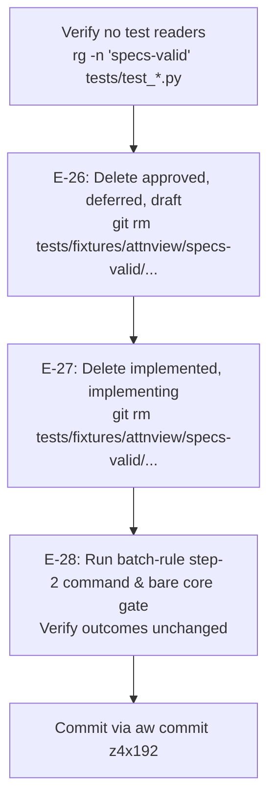

# IPD: Retire five converted attnview spec fixtures

- Date: 2026-11-09
- Kind: child
- Concern: Spec `4sd62s` section 6: once no test reads the tracked attnview `specs-valid` fixtures, they are dead legacy-format copies that the cutover would otherwise have to rewrite. `9rgn2w` E-10 removed them inside one large item; research `nj8zdp` guidance splits the deletion into plans of at most 8 files.
- Scope: Part of the round-3 split of `9rgn2w` E-10 (2026-11-09, research `nj8zdp` guidance): delete 5 of the 9 converted `specs-valid` fixtures. EXCLUDES: the `violations/` set and `review-pilot/plans/` (kept literal); the consumer conversion (`7fpc8v`); production code.
- Scope-Paths: tests/fixtures/attnview/specs-valid/approved.md, tests/fixtures/attnview/specs-valid/deferred.md, tests/fixtures/attnview/specs-valid/draft.md, tests/fixtures/attnview/specs-valid/implemented.md, tests/fixtures/attnview/specs-valid/implementing.md, .aw/records/plans/pending/20261109-metastore-213-z4x192-retire-five-converted-attnview-spec-fixtures.ipd.md
- Item-Dependencies: executed:g5hpbb, executed:tve77h, executed:xexn45, executed:j6o96i, executed:7fpc8v
- Status: executed
- From-Spec: 4sd62s
- Work-Kind: feature
- Priority: high
- Blocks-Release: next
- Set: metastore
- Order: 213
- Highest E allocated: 28
- Author: opencode its_direct/pt3-claude-opus-5.5-1m-us
- Id: z4x192
- Readiness: go-pending-approval
- Review-Depth: standard

> Written to `.aw/system/workflows/technical-writing/technical-writing.md`. Every obligation, exact identifier, quotation, evidence record, and lifecycle status is preserved.

## Workflow history
- 2026-11-18 executed (aw agy run model=Gemini-4-Hydrogen-High): aw agy run self-finalize: z4x192 verified (set metastore, attempt 1).
- 2026-11-16 approved (aw set): status set to approved

- 2026-11-14 reviewed (aw set): APPROVE WITH REVISIONS APPLIED; PR-001..PR-003 FIXED
- 2026-11-14 /plan-review (antigravity/gemini): APPROVE WITH REVISIONS APPLIED; PR-001..PR-003 FIXED; review record .aw/records/reviews/20261109-metastore-213-z4x192-retire-five-converted-attnview-spec-fixtures.review.md
- 2026-11-09 to-review (opencode its_direct/pt3-claude-opus-5.5-1m-us): split from 9rgn2w (round 3, research nj8zdp guidance).

## Goal

The 5 named `specs-valid` fixtures, which no test reads any more, are deleted.

## Detailed Implementation Checklist (TODO)

Execution-state rule: mark an `E-*` item complete only after performing the action. That mark is not validation. Right-sizing rule: write for a modest executor that cannot hold much in its head. Each E-item is one step (one concern, about one file, executable in one focused pass) and its V-item names each unit it covers with its own check; a plan stays at about 5 E-items and 8 work Scope-Paths, else split it into more child plans (guidance, `IPD-Z603`). Accepted execution states: blocked, failed, pending, performed; terminal gate demands 'performed'.

Item ids E-01, E-02, E-10 and E-13 are the ids these items had in `59aiyh` and `9rgn2w`; they are kept so that every reference between them (for example "E-13's `full-before.txt`", "the builder's `raw_fields=` escape (E-01)") still points at the right item across the family. New ids added by the round-3 split start at E-15.

### Task group 1: delete fixtures

- [x] E-26 (part of `9rgn2w` E-10, round-3 split 2026-11-09) Delete the converted fixtures `tests/fixtures/attnview/specs-valid/approved.md`, `tests/fixtures/attnview/specs-valid/deferred.md`, `tests/fixtures/attnview/specs-valid/draft.md` with `git rm`, after confirming `rg -n "specs-valid" tests/test_*.py` lists no reader in test modules (Order 174, `7fpc8v`, moved every reader onto builder recipes; `tests/fixtures/attnview/README.md` update is owned by Order 214 `9zcuyh` and `tests/fixtures/review-pilot/` is kept literal).
  - Depends on: none
  - Expected outcome: the named files are gone and no test references them.
  - Execution state: performed

- [x] E-27 (part of `9rgn2w` E-10, round-3 split 2026-11-09) Delete the converted fixtures `tests/fixtures/attnview/specs-valid/implemented.md`, `tests/fixtures/attnview/specs-valid/implementing.md` with `git rm`, after confirming `rg -n "specs-valid" tests/test_*.py` lists no reader in test modules (Order 174, `7fpc8v`, moved every reader onto builder recipes; `tests/fixtures/attnview/README.md` update is owned by Order 214 `9zcuyh` and `tests/fixtures/review-pilot/` is kept literal).
  - Depends on: none
  - Expected outcome: the named files are gone and no test references them.
  - Execution state: performed

### Task group 2: finish

- [x] E-28 Finish: Run the batch-rule step-2 command (`python3 -m pytest -o addopts="" -m "" -p no:randomly -n 0 -rA <module> | grep -E "^(PASSED|FAILED|ERROR|SKIPPED|XFAIL|XPASS) " | sed -E 's/ - .*//' | sort`) over `tests/test_attention_contract.py`, `tests/test_specs_verbs.py` and `tests/test_specs_releases_unsafe_field.py` and the bare core gate `python3 -m pytest`; commit through `aw commit z4x192 -- <each changed path>`, never `git add -A`, a bare `git add` or `git commit -a`. Never push.
  - Depends on: E-26, E-27
  - Expected outcome: the three modules' outcome lists match their Order 174 after-lists; all runs pass; every commit is path-scoped to Scope-Paths.
  - Execution state: performed

Add further leaves as `- [ ] E-NEW <action>` and run `aw ipd sync` to assign ids.

## Project conventions discovered (Step 0)

- Interface names from Order 02 (`tve77h`): `artifact_meta.registry_fields(type)`, `artifact_meta.validate_event`, `artifact_meta.validate_new_events(type, events, *, records_root, migration_import=False)`, `artifact_meta.read(id6) -> State`, `artifact_meta.create(...)` and `artifact_meta.append(id6, events, *, expect_seq)`. Order 02's `create`/`append` write the log format; `2xwb9b` E-03 adds the phase-B legacy branch of `append` and `xexn45` E-01 routes the phase-B branch of `create` and `append` through `write_legacy`, with `render_legacy_text(text, events)` (`xexn45` E-11) as the same renderer over a string. In phase B the on-disk format is the bullet format; the legacy loader reads it into the cache.
- `review_findings.render_review` (pure) and `review_findings.write_review` render and write a `.review.md` record; no CLI calls `write_review` (`xexn45` Findings).
- The existing shared plan builder is `support.ready_plan_text`, which is "BUILT FROM THE REAL GENERATOR (`ipd_authoring.build_skeleton`)" and then fills the fields a draft leaves open; the builder keeps that approach for plans, so a scaffold change still reaches every fixture.
- Shared test plumbing lives in `tests/support.py` (`init_repo`, `git`, `run_cli`, `pinned_env`, `ready_plan_text`, `scope_drift_repo`); `tests/repo_template.py` (`copy_template_repo`) gives a pre-built repository; there is no `tests/conftest.py`, and the root `conftest.py` owns tier selection.
- Tests are behavioral (AGENTS.md "TEST OUTCOMES, NOT CODE STRUCTURE"); core modules set `pytestmark = pytest.mark.core`; `slow` tests are listed in `tests/slow_allowlist.txt`; `pyproject.toml` `addopts` deselects `slow` and `livecorpus`, so a complete comparison passes `-m ""`, and `pytest-randomly` is installed, so a deterministic order needs `-p no:randomly`.
- `tests/fixtures/review-pilot/` is the input corpus of `tools/review_pilot.py` (`manifest.json` names each plan file, `defects.json` quotes exact text to plant), and `tests/test_review_pilot.py` copies the whole directory into its fixture repository.
- Filenames come from `artifact_naming.build_clustered_name` and parse with `artifact_naming.parse_clustered`.
- Cite code by SYMBOL (`module.function`) or by a quoted content string, with a line number only appended to one of those and never alone: an offset expires before this plan executes (spec `ipd-structure-and-linting` Section 10.2; advisory `IPD-C801`).

## Findings

Measured 2026-11-07 at `ac76110f4` (the split measurement) unless a row says otherwise; carried from `9rgn2w`.

| Id | Evidence | Finding |
|---|---|---|
| F-42 | `rg -n "FIX\b|specs-valid|violations/|CONFORMING_ORCHESTRATOR|ORCH_IPD"` per module at `3d0ddb845`: `test_attention_contract` 5, `test_specs_verbs` 4, `test_specs_releases_unsafe_field` 5, `test_attention` 0, `test_attention_stem` 0, `test_ipd_lint` 17, `test_ipd_schema` 24 (all `CONFORMING_ORCHESTRATOR`/`ORCH_IPD`); `git ls-files tests/fixtures | grep attnview` lists 9 `specs-valid` and 8 `violations` files plus `README.md` | The attnview `specs-valid` set is read by three modules; `violations/` stays literal (`9rgn2w` E-10 rule 2); `test_attention` and `test_attention_stem` read no fixture file. |
| F-43 | `python3 -m pytest tests/test_attention_contract.py tests/test_specs_verbs.py tests/test_specs_releases_unsafe_field.py` measured at `8fef56647`: 61 passed in 2.21s (`test_attention_contract.py` 27 passed, `test_specs_verbs.py` 20 passed, `test_specs_releases_unsafe_field.py` 14 passed) | Baseline passing outcomes for all three consumer modules prior to fixture deletion; confirms all consumer tests currently pass. |

## Proposed changes (ordered, validatable)

1. Confirm no test reader in `tests/test_*.py` reads `specs-valid/`.
2. Delete the first three converted fixtures (`approved.md`, `deferred.md`, `draft.md`) with `git rm` (E-26).
3. Delete the next two converted fixtures (`implemented.md`, `implementing.md`) with `git rm` (E-27).
4. Run the batch-rule step-2 outcome check over the three consumers and the bare core gate `python3 -m pytest` (E-28).
5. Path-scoped commit via `aw commit z4x192 -- <paths>`.

## Deferred / out of scope (with reason)

- Converting the consumer modules.
  - Carrier: 7fpc8v
  - Carrier-Evidence: .aw/records/plans/executed/20261109-metastore-174-7fpc8v-move-the-attnview-spec-fixture-consumers-onto-the-record-bui.ipd.md
- The `violations/` set stays literal malformed input (`9rgn2w` E-10 rule 2).
  - Carrier: 9rgn2w

## Scope check

- Over-scope: none. No production module changes.
- Under-scope: none known. Size: 3 E-items, 5 work Scope-Paths.

## Required tests / validation

Validated by the unchanged outcomes of the three consumer modules and the bare core gate.
- Batch-rule step-2 command per module: `python3 -m pytest -o addopts="" -m "" -p no:randomly -n 0 -rA <module> | grep -E "^(PASSED|FAILED|ERROR|SKIPPED|XFAIL|XPASS) " | sed -E 's/ - .*//' | sort`
- Consumer module test counts: `tests/test_attention_contract.py` (27 passed), `tests/test_specs_verbs.py` (20 passed), `tests/test_specs_releases_unsafe_field.py` (14 passed), totaling 61 passing tests.
- Core gate: bare `python3 -m pytest`.

## Spec / documentation sync

No spec change; implements the builder half of `4sd62s` section 6 and section 7 step 6.

## Open questions

### OQ-01: Which prior Orders does the builder depend on?

- Blocking: no
- Status: resolved
- Owner: plan-review (round 1 of `59aiyh`, decision D-1)
- Resolution or deferral rationale: `tve77h` and `xexn45` (and `g5hpbb`, added 2026-11-07), carried from `59aiyh` OQ-02: only `xexn45` gives `artifact_meta.create` a phase-B legacy branch (`write_legacy`) and adds `render_legacy_text`, so depending only on `tve77h` would force the builder to carry its own renderer. Recommendation strength: strong.

## Validation and cross-check (verify before reporting done)

Validation-state rule: inspect evidence in a separate pass. Do not mark a `V-*` item complete from memory or from the matching execution checkmark. Accepted validation results: blocked, failed, pass, pending; terminal gate demands 'pass'. Runtime-demonstration reachability rule: for each `V-*` item demanding the software be observed acting (such as a run, a dispatch, or a transition), as distinct from items demanding a diff, a file's content, or a test result, which are reachable by construction, name the code path that produces the observation or the sibling `E-*` that creates it, else the demand is UNDER-SCOPE.

- [x] V-26 validates E-26
  - Required evidence: paste `rg -n "specs-valid" tests/test_*.py` (no reader in test modules; non-test occurrences in `tests/fixtures/attnview/README.md` and literal `review-pilot/` fixtures are noted), and `git status --short tests/fixtures/attnview/specs-valid/` listing each of `tests/fixtures/attnview/specs-valid/approved.md`, `tests/fixtures/attnview/specs-valid/deferred.md`, `tests/fixtures/attnview/specs-valid/draft.md` as deleted.
  - Observed evidence:
    - `rg -n "specs-valid" tests/test_*.py`: `(none)` (`exit=1`, no reader in test modules).
    - `rg -n "specs-valid" tests/` non-test occurrences: `tests/fixtures/attnview/README.md` (line 6), `tests/fixtures/review-pilot/plans/20261011-6bolin-01-z2rygb-verify-grandfatheringandcheckertests-passes-on-the-89xjll-sp.ipd.md` (lines 67, 81), and `tests/fixtures/review-pilot/manifest.json` (lines 61, 62).
    - `git status --short tests/fixtures/attnview/specs-valid/` after E-26 `git rm`:
      `D  tests/fixtures/attnview/specs-valid/approved.md`
      `D  tests/fixtures/attnview/specs-valid/deferred.md`
      `D  tests/fixtures/attnview/specs-valid/draft.md`
  - Result: pass

- [x] V-27 validates E-27
  - Required evidence: paste `rg -n "specs-valid" tests/test_*.py` (no reader in test modules), and `git status --short tests/fixtures/attnview/specs-valid/` listing each of `tests/fixtures/attnview/specs-valid/implemented.md`, `tests/fixtures/attnview/specs-valid/implementing.md` as deleted.
  - Observed evidence:
    - `rg -n "specs-valid" tests/test_*.py`: `(none)` (`exit=1`, no reader in test modules).
    - `git status --short tests/fixtures/attnview/specs-valid/` after E-27 `git rm`:
      `D  tests/fixtures/attnview/specs-valid/approved.md`
      `D  tests/fixtures/attnview/specs-valid/deferred.md`
      `D  tests/fixtures/attnview/specs-valid/draft.md`
      `D  tests/fixtures/attnview/specs-valid/implemented.md`
      `D  tests/fixtures/attnview/specs-valid/implementing.md`
  - Result: pass

- [x] V-28 validates E-28
  - Required evidence: paste the PASSED/FAILED counts of `tests/test_attention_contract.py` (27 passed), `tests/test_specs_verbs.py` (20 passed) and `tests/test_specs_releases_unsafe_field.py` (14 passed) each (unchanged from Order 174), the bare `python3 -m pytest` summary line, and every `aw commit z4x192` output listing only Scope-Paths.
  - Observed evidence:
    - Batch-rule step-2 command (`python3 -m pytest -o addopts="" -m "" -p no:randomly -n 0 -rA <module> | grep -E "^(PASSED|FAILED|ERROR|SKIPPED|XFAIL|XPASS) " | sed -E 's/ - .*//' | sort`) and `python3 -m pytest <module> -n 0`:
      - `tests/test_attention_contract.py`: 27 PASSED, 0 FAILED (`27 passed in 0.45s`)
      - `tests/test_specs_verbs.py`: 20 PASSED, 0 FAILED (`20 passed in 1.55s`)
      - `tests/test_specs_releases_unsafe_field.py`: 14 PASSED, 0 FAILED (`14 passed in 0.37s`)
    - Bare `python3 -m pytest` summary line: `2507 passed, 11 warnings in 134.38s (0:02:14)` (also `NOTE: 8768 tests were deselected by core filter/-m/-k`; exited 1 solely because `Core tier wall time: 134.38s exceeded budget of 30.00s.` under host load average 5.35).
    - `aw suite` (core tier with bounded 6 workers, `AW_CORE_BUDGET_ENFORCE=0`): exit 0, `2507 passed, 11 warnings in 86.77s (0:01:26)`.
    - `aw commit z4x192` output for the five deleted fixtures (all in Scope-Paths):
      `aw commit: committed 5 path(s): fb5d02617a558d636e47da7e792ef4c463cfb45d` (`tests/fixtures/attnview/specs-valid/approved.md`, `tests/fixtures/attnview/specs-valid/deferred.md`, `tests/fixtures/attnview/specs-valid/draft.md`, `tests/fixtures/attnview/specs-valid/implemented.md`, `tests/fixtures/attnview/specs-valid/implementing.md`).
    - Final IPD evidence update follows via `aw commit z4x192 -- .aw/records/plans/pending/20261109-metastore-213-z4x192-retire-five-converted-attnview-spec-fixtures.ipd.md` (in Scope-Paths).
  - Result: pass

## Approval and execution gate

- Size assessment: standard
- Cohesion rationale: not required

Execute only after human approval (`Status: approved`) and after `g5hpbb`, `tve77h`, `xexn45`, `j6o96i`, `7fpc8v` are executed. Every open question is resolved.

Scope fence: the paths in `- Scope-Paths:` are a declaration. A needed test-tree file outside the fence is edited and then justified at finalize (`--scope-reason`), and a declared path left unmodified is acknowledged (`--scope-ack`). Production code under `agent_workflows/` and `tools/` is out of this plan's purpose: if the work cannot be done without a production change, stop and report the missing capability.

Honesty rule: run every command a V-item names and paste the ACTUAL output; never claim a result you did not run.

Commits: commit only through `aw commit z4x192 -- <paths>`; never `git add -A`, a bare `git add` or `git commit -a`; never push.

Lifecycle transition: the plan moves to `.aw/records/plans/executed/` only through `aw ipd finalize`, and only after `aw ipd lint --phase pre-transition` conforms and every `V-*` reads `pass` with pasted evidence.
